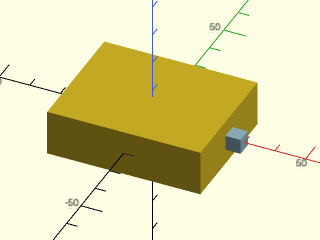
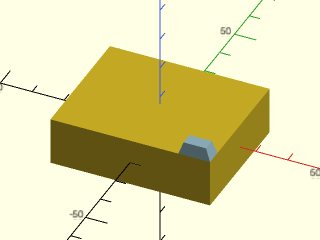
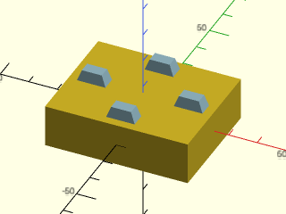
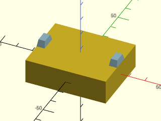
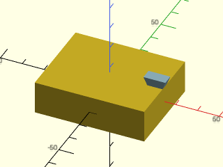
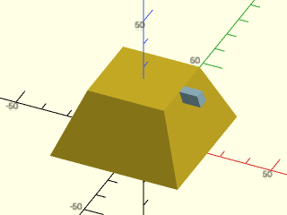
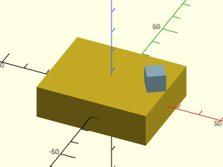
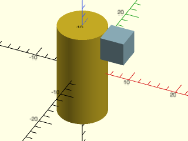

[Previous: Using position()](Tutorial-Attachment-Position)

# Aligning children with align()

You may have noticed that with position() and orient(), specifying the
child anchors to position objects flush with their parent can be
annoying, or sometimes even tricky.  You can simplify this task by
using the align() module.  This module positions children on faces
of a parent and aligns to edges or corners, while picking the correct anchor points on
the children so that the children line up correctly with the
parent. Like `position()`, align does not change the orientation of
the child object.  

In the simplest case, if you want to place a child on the RIGHT side
of its parent, you need to anchor the child to its LEFT anchor:

```openscad
include<BOSL2/std.scad>
cuboid([50,40,15])
    position(RIGHT)
        color("lightblue")cuboid(5,anchor=LEFT);
```


When you use align() it automatically determines the correct anchor to
use for the child and this anchor overrides any anchor specified to
the child:  any anchor you specify for the child is ignored.

```openscad
include<BOSL2/std.scad>
cuboid([50,40,15])
    align(RIGHT)
        color("lightblue")cuboid(5);
```


To place the child on top of the parent in the corner you can do use
align as shown below instead of specifying the RIGHT+FRONT+BOT anchor
with position(): 

```openscad
include<BOSL2/std.scad>
cuboid([50,40,15])
    align(TOP,RIGHT+FRONT)
        color("lightblue")prismoid([10,5],[7,4],height=4);
```


Both position() and align() can accept a list of anchor locations and
makes several copies of the children, but
if you want the children positioned flush, each copy 
requires a different anchor, so it is impossible to do this with a
single call to position(), but easily done using align():

```openscad
include<BOSL2/std.scad>
cuboid([50,40,15])
    align(TOP,[RIGHT,LEFT])
        color("lightblue")prismoid([10,5],[7,4],height=4);
```


If you want the children close to the edge but not actually flush you
can use the `inset=` parameter of align to achieve this:

```openscad
include<BOSL2/std.scad>
cuboid([50,40,15])
    align(TOP,[FWD,RIGHT,LEFT,BACK],inset=3)
        color("lightblue")prismoid([10,5],[7,4],height=4);
```


If you spin the children then align will still do the right thing

```openscad
include<BOSL2/std.scad>
cuboid([50,40,15])
    align(TOP,[RIGHT,LEFT])
        color("lightblue")prismoid([10,5],[7,4],height=4,spin=90);
```


If you orient the object DOWN it will be attached from its top anchor,
correctly aligned.  

```openscad
include<BOSL2/std.scad>
cuboid([50,40,15])
    align(TOP,RIGHT)
        color("lightblue")prismoid([10,5],[7,4],height=4,orient=DOWN);
```


Note that align() never changes the orientation of the children.  If
you put the blue prismoid on the right side the anchors line up but
the edges of the child and parent don't.

```openscad
include<BOSL2/std.scad>
prismoid(50,30,25){
  align(RIGHT,TOP)
    color("lightblue")prismoid([10,5],[7,4],height=4);
}
```


If you apply spin that is not a multiple of 90 degrees then alignment
will line up the corner

```openscad
include<BOSL2/std.scad>
cuboid([50,40,15])
    align(TOP,RIGHT)
        color("lightblue")cuboid(8,spin=33);
```


You can also attach objects to a cylinder.  If you use the usual cubic
anchors then a cube will attach on a face as shown here:

```openscad
include<BOSL2/std.scad>
cyl(h=20,d=10,$fn=128)
  align(RIGHT,TOP)
    color("lightblue")cuboid(5);
```


But with a cylinder you can choose an arbitrary horizontal angle for
the anchor.  If you do this, similar to the case of arbitrary spin,
the cube will attach on the nearest corner.

```openscad
include<BOSL2/std.scad>
cyl(h=20,d=10,$fn=128)
  align([1,.3],TOP)
    color("lightblue")cuboid(5);
```


[Next: Using attach()](Tutorial-Attachment-Attach)
