[Previous: Attachments Overview](Tutorial-Attachment-Overview)

# Basic Object Positioning: Anchor, Spin and Orient

When you create attachable objects using BOSL2 you have some 
options for controling how that object is positioned relative to the
origin and the coordinate axes.  The basic object positioning
parameters are optional named parameters supported by attachable
objects:

* anchor: controls which point on the object is positioned at the origin
* spin: rotates the object around the Z axis
* orient: points the top of the object in a chosen direction

## Anchoring
Anchoring allows you to align a specified part of an object or point
on an object with the origin.  The alignment point can be the center
of a side, the center of an edge, a corner, or some other
distinguished point on the object.  This is done by passing a vector
or text string into the `anchor=` argument.  For roughly cubical
or prismoidal shapes, that vector points in the general direction of the side, edge, or
corner that will be aligned to.  For example, a vector of [1,0,-1] refers to the lower-right
edge of the shape.  For this sort of shape, each vector component should be -1, 0, or 1:

```openscad
include <BOSL2/std.scad>
// Anchor at upper-front-left corner
cube([40,30,50], anchor=[-1,-1,1]);
```
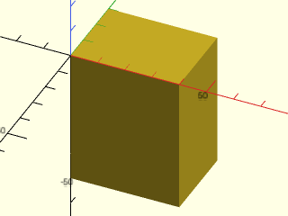

```openscad
include <BOSL2/std.scad>
// Anchor at upper-right edge
cube([40,30,50], anchor=[1,0,1]);
```
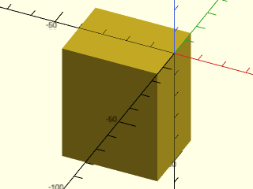

```openscad
include <BOSL2/std.scad>
// Anchor at bottom face
cube([40,30,50], anchor=[0,0,-1]);
```
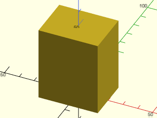

Since manually written vectors are not very intuitive, BOSL2 defines some standard directional
vector constants that can be added together:

Constant | Direction | Value
-------- | --------- | -----------
`LEFT`   | X-        | `[-1, 0, 0]`
`RIGHT`  | X+        | `[ 1, 0, 0]`
`FRONT`/`FORWARD`/`FWD` | Y− | `[ 0, −1, 0]`
`BACK`   | Y+        | `[ 0, 1, 0]`
`BOTTOM`/`BOT`/`DOWN` | Z− (Y− in 2D) | `[ 0, 0, −1]` (`[0, −1]` in 2D.)
`TOP`/`UP` | Z+ (Y+ in 2D)      | `[ 0, 0, 1]` (`[0, 1]` in 2D.)
`CENTER`/`CTR` | Centered | `[ 0, 0, 0]`

If you want a vector pointing towards the bottom−left edge, just add the `BOTTOM` and `LEFT` vector
constants together like `BOTTOM + LEFT`.  This will result in a vector of `[−1,0,−1]`.  You can pass
that to the `anchor=` argument for a clearly understandable anchoring:  

```openscad
include <BOSL2/std.scad>
cube([40,30,50], anchor=BACK+TOP);
```
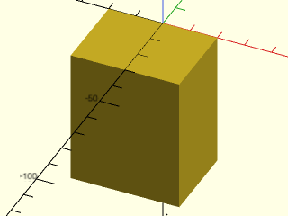

```openscad
include <BOSL2/std.scad>
cube([40,30,50], anchor=FRONT);
```
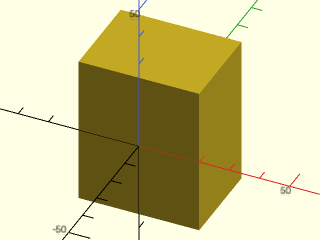

---

For cylindrical type attachables, the Z component of the anchor vector must be −1, 0, or 1, referring
to the bottom rim, the middle side, or the top rim of the cylindrical or conical shape.
The X and Y components can be any value, pointing towards the circular perimeter of the cone.
These combined let you point at any place on the bottom or top rims, or at an arbitrary
side wall.  When the Z component is zero you can omit it and pass just
an [X,Y] vector.  

```openscad
include <BOSL2/std.scad>
cylinder(r1=25, r2=15, h=60, anchor=TOP+LEFT);
```
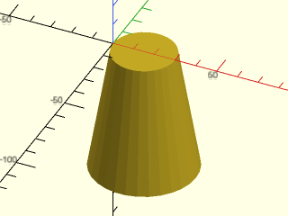

```openscad
include <BOSL2/std.scad>
cylinder(r1=25, r2=15, h=60, anchor=BOTTOM+FRONT);
```
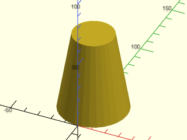

Here we convert a 30 deg angle into an anchor using [cylindrical_to_xyz()](https://github.com/BelfrySCAD/BOSL2/wiki/coords.scad#function-cylindrical_to_xyz)

```openscad
include <BOSL2/std.scad>
cylinder(r1=25, r2=15, h=60, anchor=cylindrical_to_xyz(1,30,1));
```
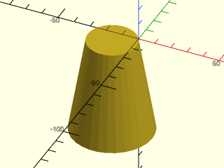

Here we anchor using a 2D XY vector where the Z value is assumed to be
zero:

```openscad
include <BOSL2/std.scad>
cylinder(r=25, h=6, anchor=[-1,-2]);
```
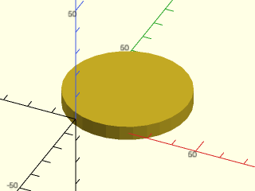

---

For Spherical type attachables, you can pass a vector that points at any arbitrary place on
the surface of the sphere:

```openscad
include <BOSL2/std.scad>
sphere(r=50, anchor=TOP);
```
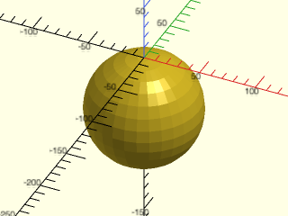

```openscad
include <BOSL2/std.scad>
sphere(r=50, anchor=TOP+FRONT);
```
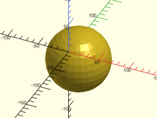

Here the [spherical_to_xyz()](https://github.com/BelfrySCAD/BOSL2/wiki/coords.scad#function-spherical_to_xyz) function converts spherical coordinates into
a vector you can use as an anchor:

```openscad
include <BOSL2/std.scad>
sphere(r=50, anchor=spherical_to_xyz(1,-30,60));
```
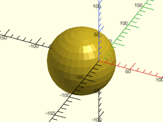

---

Some attachable shapes may provide specific named anchors for shape-specific anchoring.  These
will be given as strings and will be specific to that type of
attachable.  When named anchors are supported, they are listed in a
"Named Anchors" section of the documentation for the module.  The
`teardrop()` attachable, for example, has a named anchor called "cap" and in 2D the
`star()` attachable has anchors labeled by tip number: 

```openscad
include <BOSL2/std.scad>
teardrop(d=100, l=20, anchor="cap");
```
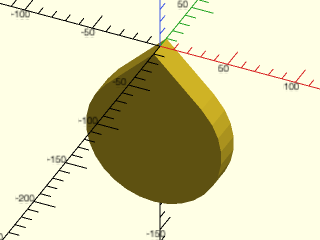

```openscad
include <BOSL2/std.scad>
star(n=7, od=30, id=20, anchor="tip2");
```
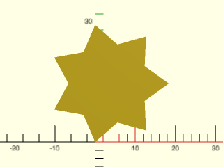

---

Some shapes, for backwards compatibility reasons, can take a `center=` argument.  This just
overrides the `anchor=` argument.  A `center=true` argument is the same as `anchor=CENTER`.
A `center=false` argument chooses the anchor to match the behavior of
the builtin version:  for a cube it is the same as `anchor=[-1,-1,-1]` but for a
cylinder, it is the same as `anchor=BOTTOM`.

```openscad
include <BOSL2/std.scad>
cube([50,40,30],center=true);
```
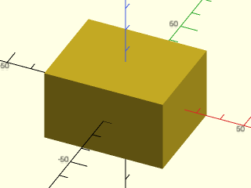

```openscad
include <BOSL2/std.scad>
cube([50,40,30],center=false);
```
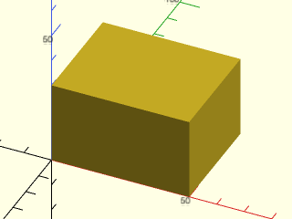

---

Most 2D shapes provided by BOSL2 are also anchorable.  The built-in `square()` and `circle()`
modules have been overridden to make them attachable..  The `anchor=` options for 2D
shapes treat 2D vectors as expected.  Special handling occurs with 3D
vectors:  if the Y coordinate is zero and the Z coordinate is nonzero,
then the Z coordinate is used to replace the Y coordinate.  This is
done so that you can use the TOP and BOTTOM names as anchor for 2D
shapes.  


```openscad
include <BOSL2/std.scad>
square([40,30], anchor=BACK+LEFT);
```
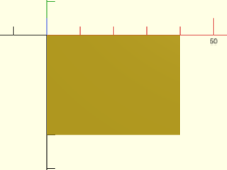

```openscad
include <BOSL2/std.scad>
circle(d=50, anchor=BACK);
```
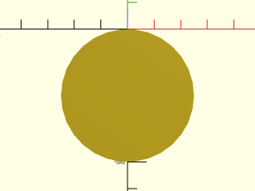

```openscad
include <BOSL2/std.scad>
hexagon(d=50, anchor=LEFT);
```
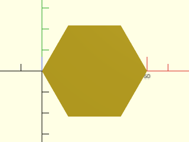

```openscad
include <BOSL2/std.scad>
pentagon(d=50, anchor=TOP);
```
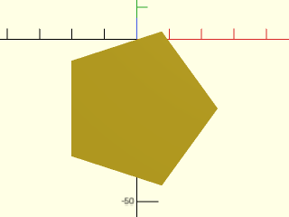


## Spin
You can spin attachable objects around the origin using the `spin=`
argument.  The spin applies **after** anchoring, so depending on how
you anchor an object, its spin may not be about its center.  This
means that spin can have an effect even on rotationally symmetric
objects like spheres and cylinders.  You specify the spin in degrees.
A positive number will result in a counter-clockwise spin around the Z
axis (as seen from above), and a negative number will make a clockwise
spin:

```openscad
include <BOSL2/std.scad>
cube([20,20,40], center=true, spin=45);
```
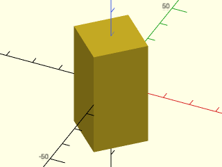

This example shows a cylinder which has been anchored at its FRONT,
with a rotated copy in gray.  The rotation is performed around the
origin, but the cylinder is off the origin, so the rotation **does**
have an effect on the cylinder, even though the cylinder has
rotational symmetry.

```openscad
include <BOSL2/std.scad>
cylinder(h=40,d=20,anchor=FRONT+BOT);
%cylinder(h=40.2,d=20,anchor=FRONT+BOT,spin=40);
```
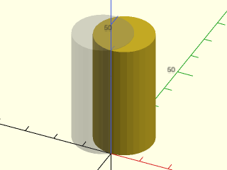


You can also apply spin to 2D shapes from BOSL2, though only by scalar angle:

```openscad
include <BOSL2/std.scad>
square([40,30], spin=30);
```
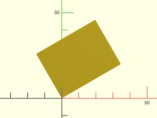

```openscad
include <BOSL2/std.scad>
ellipse(d=[40,30], spin=30);
```
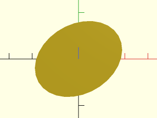


## Orientation
Another way to specify a rotation for an attachable shape, is to pass a 3D vector via the
`orient=` argument.  This lets you specify what direction to tilt the top of the shape towards.
For example, you can make a cone that is tilted up and to the right like this:

```openscad
include <BOSL2/std.scad>
cylinder(h=100, r1=50, r2=20, orient=UP+RIGHT);
```
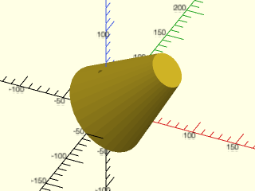

More precisely, the Z direction of the shape is rotated to align with
the vector you specify.  Two dimensional attachables, which have no Z vector,
do not accept the `orient=` argument.  


## Mixing Anchoring, Spin, and Orientation
When giving `anchor=`, `spin=`, and `orient=`, they are applied anchoring first, spin second,
then orient last.  For example, here's a cube:

```openscad
include <BOSL2/std.scad>
cube([20,20,50]);
```
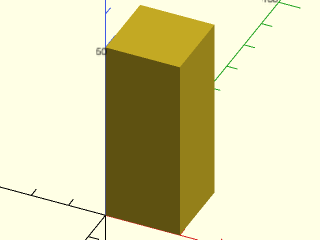

You can center it with an `anchor=CENTER` argument:

```openscad
include <BOSL2/std.scad>
cube([20,20,50], anchor=CENTER);
```
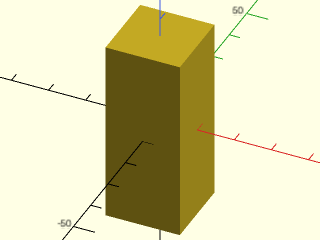

Add a 45 degree spin:

```openscad
include <BOSL2/std.scad>
cube([20,20,50], anchor=CENTER, spin=45);
```
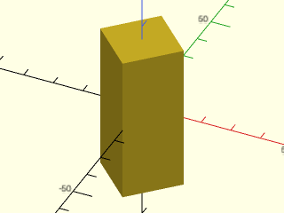

Now tilt the top up and forward:

```openscad
include <BOSL2/std.scad>
cube([20,20,50], anchor=CENTER, spin=45, orient=UP+FWD);
```
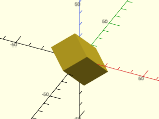

For 2D shapes, you can mix `anchor=` with `spin=`, but not with `orient=`.

```openscad
include <BOSL2/std.scad>
square([40,30], anchor=BACK+LEFT, spin=30);
```
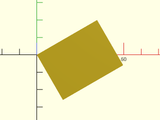

[Next: Relative Positioning of Children](Tutorial-Attachment-Relative-Positioning)
