# LibFile: attachments.scad

The modules in this file allows you to attach one object to another by making one object the child of another object.
You can place the child object in relation to its parent object and control the position and orientation
relative to the parent.  The modifiers allow you to treat children in ways different from simple union, such
as differencing them from the parent, or changing their color.  Attachment works only when the parent and child
are both written to support attachment.  Also included in this file  are the tools to make your own "attachable" objects.

To use, add the following lines to the beginning of your file:

    include <BOSL2/std.scad>

## File Contents

1. [Section: Terminology and Shortcuts](#section-terminology-and-shortcuts)
    1. [Subsection: Anchor](#subsection-anchor)
    2. [Subsection: Spin](#subsection-spin)
    3. [Subsection: Orient](#subsection-orient)
    4. [Subsection: Specifying Directions](#subsection-specifying-directions)
    5. [Subsection: Specifying Faces](#subsection-specifying-faces)
    6. [Subsection: Specifying Edges](#subsection-specifying-edges)
    7. [Subsection: Specifying Corners](#subsection-specifying-corners)
    8. [Subsection: Anchoring of Non-Rectangular Objects and Anchor Type (atype)](#subsection-anchoring-of-non-rectangular-objects-and-anchor-type-atype)
    

2. [Section: Attachment Positioning](#section-attachment-positioning)
    - [`position()`](#module-position) – Attaches children to a parent object at an anchor point. <sup title="Can transform children.">[<abbr>Trans</abbr>]</sup>
    - [`orient()`](#module-orient) – Orients children's tops in the directon of the specified anchor. <sup title="Can transform children.">[<abbr>Trans</abbr>]</sup>
    - [`align()`](#module-align) – Position children with alignment to parent edges. <sup title="Can transform children.">[<abbr>Trans</abbr>]</sup>
    - [`attach()`](#module-attach) – Attaches children to a parent object at an anchor point and with anchor orientation. <sup title="Can transform children.">[<abbr>Trans</abbr>]</sup>
    - [`attach_part()`](#module-attach_part) – Select a named attachable part for subsequent attachment operations

3. [Section: Tagging](#section-tagging)
    - [`tag()`](#module-tag) – Assigns a tag to an object
    - [`tag_this()`](#module-tag_this) – Assigns a tag to an object at the current level only.
    - [`force_tag()`](#module-force_tag) – Assigns a tag to a non-attachable object.
    - [`default_tag()`](#module-default_tag) – Conditionally set a default tag for all children.
    - [`tag_scope()`](#module-tag_scope) – Creates a new tag scope.

4. [Section: Tagged Operations with Attachable Objects](#section-tagged-operations-with-attachable-objects)
    - [`diff()`](#module-diff) – Performs a differencing operation using tags rather than hierarchy to control what happens.
    - [`tag_diff()`](#module-tag_diff) – Performs a [`diff()`](#module-diff) and then sets a tag on the result.
    - [`intersect()`](#module-intersect) – Perform an intersection operation on children using tags rather than hierarchy to control what happens.
    - [`tag_intersect()`](#module-tag_intersect) – Performs an [`intersect()`](#module-intersect) and then tags the result.
    - [`conv_hull()`](#module-conv_hull) – Performs a hull operation on the children using tags to determine what happens.
    - [`tag_conv_hull()`](#module-tag_conv_hull) – Performs a [`conv_hull()`](#module-conv\_hull) and then sets a tag on the result.
    - [`hide()`](#module-hide) – Hides attachable children with the given tags.
    - [`hide_this()`](#module-hide_this) – Hides attachable children at the current level
    - [`show_only()`](#module-show_only) – Show only the children with the listed tags.
    - [`show_all()`](#module-show_all) – Shows all children and clears tags.
    - [`show_int()`](#module-show_int) – Shows children with the listed tags that were already shown in the parent context.

5. [Section: Making your objects attachable](#section-making-your-objects-attachable)
    - [`attachable()`](#module-attachable) – Manages the anchoring, spin, orientation, and attachments for an object.
    - [`reorient()`](#function-reorient) – Calculates the transformation matrix needed to reorient an object. <sup title="Can transform children.">[<abbr>Trans</abbr>]</sup> <sup title="Can return a Path.">[<abbr>Path</abbr>]</sup> <sup title="Can return a VNF.">[<abbr>VNF</abbr>]</sup>
    - [`named_anchor()`](#function-named_anchor) – Creates an anchor data structure.
    - [`change_anchors()`](#module-change_anchors) – Changes the named anchors inherited from the parent
    - [`attach_geom()`](#function-attach_geom) – Returns the internal geometry description of an attachable object.
    - [`define_part()`](#function-define_part) – Creates an attachable part data structure.

6. [Section: Visualizing Anchors](#section-visualizing-anchors)
    - [`show_anchors()`](#module-show_anchors) – Shows anchors for the parent object. <sup title="Can return geometry.">[<abbr>Geom</abbr>]</sup>
    - [`anchor_arrow()`](#module-anchor_arrow) – Shows a 3d anchor orientation arrow. <sup title="Can return geometry.">[<abbr>Geom</abbr>]</sup>
    - [`anchor_arrow2d()`](#module-anchor_arrow2d) – Shows a 2d anchor orientation arrow. <sup title="Can return geometry.">[<abbr>Geom</abbr>]</sup>
    - [`expose_anchors()`](#module-expose_anchors) – Used to show a transparent object with solid color anchor arrows.
    - [`show_transform_list()`](#module-show_transform_list) – Shows a list of transforms and how they connect. <sup title="Can return geometry.">[<abbr>Geom</abbr>]</sup>
    - [`generic_airplane()`](#module-generic_airplane) – Shows a generic airplane shape, useful for viewing orientations. <sup title="Can return geometry.">[<abbr>Geom</abbr>]</sup>
    - [`frame_ref()`](#module-frame_ref) – Shows axis orientation arrows. <sup title="Can return geometry.">[<abbr>Geom</abbr>]</sup>

7. [Section: Attachable Descriptions for Operating on Attachables or Restoring a Previous State](#section-attachable-descriptions-for-operating-on-attachables-or-restoring-a-previous-state)
    - [`parent()`](#function-parent) – Returns a description (transformation state and attachment geometry) of the parent
    - [`parent_part()`](#function-parent_part) – Returns a description (transformation state and attachment geometry) of a part defined by the parent
    - [`restore()`](#module-restore) – Restores transformation state and attachment geometry from a description
    - [`desc_point()`](#function-desc_point) – Computes the location in the current context of an anchor point from an attachable description
    - [`desc_dir()`](#function-desc_dir) – Computes the direction in the current context of a direction or anchor in a description's context
    - [`desc_dist()`](#function-desc_dist) – Computes the distance between two points specified by attachable descriptions
    - [`transform_desc()`](#function-transform_desc) – Applies a transformation matrix to a description
    - [`desc_copies()`](#module-desc_copies) – Places copies according to a list of transformation matrices and supplies descriptions for the copies. <sup title="Can return a list of transformation matrices.">[<abbr>MatList</abbr>]</sup> <sup title="Can transform children.">[<abbr>Trans</abbr>]</sup>
    - [`is_description()`](#function-is_description) – Check if its argument is a description


## Section: Terminology and Shortcuts

This library adds the concept of anchoring, spin and orientation to the `cube()`, `cylinder()`
and `sphere()` builtins, as well as to most of the shapes provided by this library itself.
- An anchor is a place on an object that you can align the object to, or attach other objects
  to using `attach()` or `position()`. An anchor has a position, a direction, and a spin.
  The direction and spin are used to orient other objects to match when using `attach()`.
- Spin is a simple rotation around the Z axis.
- Orientation is rotating an object so that its top is pointed toward a given vector.

An object is first be translated to its anchor position, then spun, then oriented.
For a detailed step-by-step explanation of attachments, see the [Attachments Tutorial](Tutorial-Attachment-Relative-Positioning).

For describing directions, faces, edges, and corners the library provides a set of shortcuts
all based on combinations of unit direction vectors.  You can use these for anchoring and orienting
attachable objects.  You can also them to specify edge sets for rounding or chamfering cuboids,
or for placing edge, face and corner masks.

## Subsection: Anchor

Anchoring is specified with the `anchor` argument in most shape modules.  Specifying `anchor`
when creating an object translates the object so that the anchor point is at the origin
(0,0,0).  Anchoring always occurs before spin and orientation are applied.

An anchor can be referred to in one of two ways; as a directional vector, or as a named anchor string.

When given as a vector, it points, in a general way, toward the face, edge, or corner of the
object that you want the anchor for, relative to the center of the object.  You can simply
specify a vector like `[0,0,1]` to anchor an object at the Z+ end, but you can also use
directional constants with names like `TOP`, `BOTTOM`, `LEFT`, `RIGHT` and `BACK` that you can add together
to specify anchor points.  See [specifying directions](attachments.scad#subsection-specifying-directions)
below for the full list of pre-defined directional constants.

For example:
- `[0,0,1]` is the same as `TOP` and refers to the center of the top face.
- `[-1,0,1]` is the same as `TOP+LEFT`, and refers to the center of the top-left edge.
- `[1,1,-1]` is the same as `BOTTOM+BACK+RIGHT`, and refers to the bottom-back-right corner.

When the object is cubical or rectangular in shape the anchor components must be 0, -1, or 1 and
these values specify the face centers, edge centers, or corners of the object.
The direction of a face anchor is perpendicular to the face, pointing outward.  The direction of an edge
anchor is the average of the anchor directions of the two faces on either side of the edge.  The direction
of a corner anchor is the average of the anchor directions of the three faces meeting at the corner.

When the object is cylindrical or conical and aligned with the z axis the z component of an anchor must be
0, 1 or -1.  For selecting the flat faces the x and y components must be zero, but otherwise, the x and y components
can be arbitrary and will select any angle on either the circular edges (if anchor.z is nonzero) or on the center
of the curved face (if anchor.z is zero).  When the object is spherical the anchors are arbitrary and can select any location on the sphere.
Anchors on curved surfaces are oriented normal to the surface.  Anchors on edges are oriented to divide the
edge angle.

For objects in two dimensions, the natural expectation is for TOP and BOTTOM to refer to the Y direction
of the shape.  To support this, if you give an anchor in 2D that has anchor.y=0 then the Z component
is mapped to the Y direction.  This  means you can use TOP and BOTTOM for anchors of 2D objects.
But remember that TOP and BOTTOM are three dimensional vectors and this is a special interpretation
for 2d anchoring.

Some more complex objects, like screws and stepper motors, have named anchors to refer to places
on the object that are not at one of the standard faces, edges or corners.  For example, stepper
motors have anchors for `"screw1"`, `"screw2"`, etc. to refer to the various screwholes on the
stepper motor shape.  The names, positions, directions, and spins of these anchors are
specific to the object, and are documented when they exist.

The anchor argument is ignored if you use [`align()`](#module-align) or the two-argument form of [`attach()`](#module-attach) because
these modules provide their own anchoring for their children.

## Subsection: Spin

Spin is specified with the `spin` argument in most shape modules.  Specifying a spin
angle when creating an object rotates the object counter-clockwise around the Z axis by the given
number of degrees.  Spin is always applied after anchoring, and before orientation.
Since spin is applied **after** anchoring it does not, in general, rotate around the object's center,
so it is not always what you might think of intuitively as spinning the shape.

## Subsection: Orient

Orientation is specified with the `orient` argument in most shape modules.  Specifying `orient`
when creating an object rotates the object such that the top of the object points
at the vector direction given in the `orient` argument.  Orientation is always applied after
anchoring and spin.  The constants `UP`, `DOWN`, `FRONT`, `BACK`, `LEFT`, and `RIGHT` can be
added together to form the directional vector for this (e.g. `LEFT+BACK`).  The orient parameter
is ignored when you use [`attach()`](#module-attach) with two arguments, because [`attach()`](#module-attach) provides its own orientation.

## Subsection: Specifying Directions

You can use direction vectors to specify anchors for objects or to specify edges, faces, and
corners of cubes.  You can simply specify these direction vectors numerically, but another
option is to use named constants for direction vectors.  These constants define unit vectors
for the six axis directions as shown below.

**Figure 1.4.1:** Named constants for direction vectors.  Some directions have more than one name.

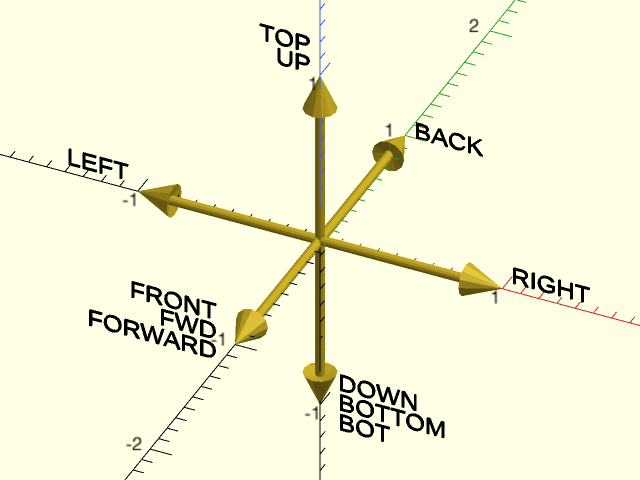

<br clear="all" />

**Figure 1.4.2:** Named constants for direction vectors in 2D.  For anchors the TOP and BOTTOM directions are collapsed into 2D as shown here, but do not try to use TOP or BOTTOM as 2D directions in other situations.

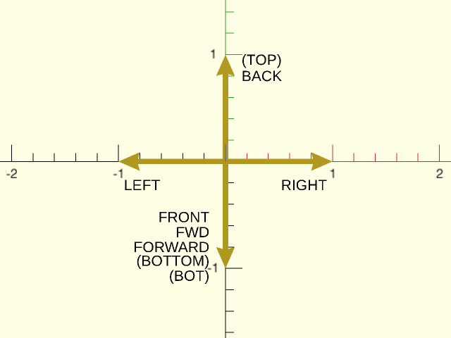

<br clear="all" />

## Subsection: Specifying Faces

Modules operating on faces accept a list of faces to describe the faces to operate on.  Each
face is given by a vector that points to that face.  Attachments of cuboid objects onto their faces also
work by choosing an attachment face with a single vector in the same manner.

**Figure 1.5.1:** The six faces of the cube.  Some have faces have more than one name.

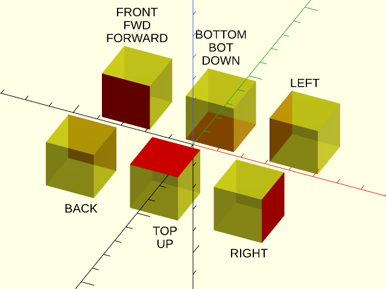

<br clear="all" />

## Subsection: Specifying Edges

Modules operating on edges use two arguments to describe the edge set they will use: The `edges` argument
is a list of edge set descriptors to include in the edge set, and the `except` argument is a list of
edge set descriptors to remove from the edge set.
The default value for `edges` is `"ALL"`, the set of all edges.
The default value for `except` is the empty set, meaning no edges are removed.
If either argument is just a single edge set
descriptor it can be passed directly rather than in a singleton list.
Each edge set descriptor must be one of:
- A 3-vector with entries in {-1,0,1} pointing toward an edge of a centered cube, indicating that single edge.
- A 3-vector with entries in {-1,0,1} pointing toward a face of a centered cube, indicating all edges surrounding that face.
- A 3-vector with entries in {-1,0,1} pointing toward a corner of a centered cube, indicating all edges touching that corner.
- The string `"X"`, indicating all X axis aligned edges.
- The string `"Y"`, indicating all Y axis aligned edges.
- The string `"Z"`, indicating all Z axis aligned edges.
- The string `"ALL"`, indicating all edges.
- The string `"NONE"`, indicating no edges at all.
- A 3x4 array, where each entry corresponds to one of the 12 edges and is set to 1 if that edge is included and 0 if the edge is not.  The edge ordering is:
    ```
    [
        [Y-Z-, Y+Z-, Y-Z+, Y+Z+],
        [X-Z-, X+Z-, X-Z+, X+Z+],
        [X-Y-, X+Y-, X-Y+, X+Y+]
    ]
    ```

You can specify edge descriptors directly by giving a vector, or you can use sums of the
named direction vectors described above.
Below we show all of the edge sets you can
describe with sums of the direction vectors, and then we show some examples of combining
edge set descriptors.

**Figure 1.6.1:** Vectors pointing toward an edge select that single edge

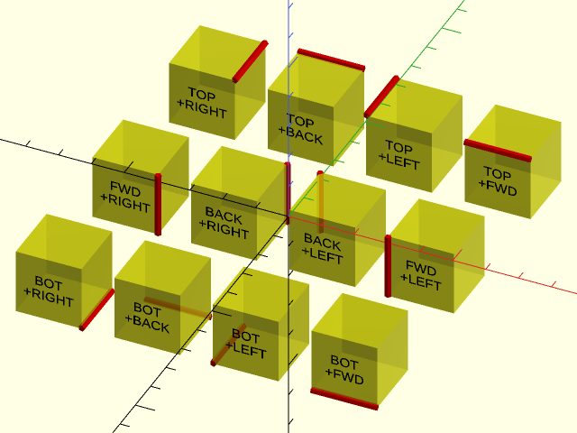

<br clear="all" />

**Figure 1.6.2:** Vectors pointing toward a face select all edges surrounding that face.

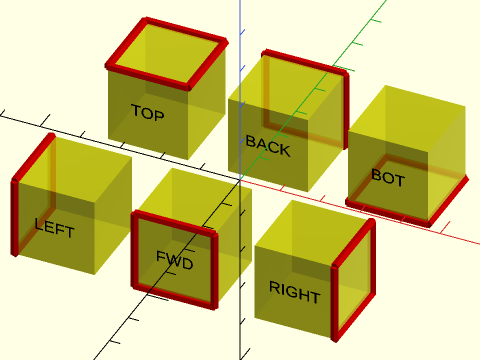

<br clear="all" /><br/>

**Figure 1.6.3:** Vectors pointing toward a corner select all edges surrounding that corner.

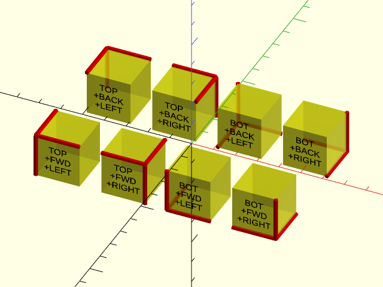

<br clear="all" />

**Figure 1.6.4:** Named Edge Sets

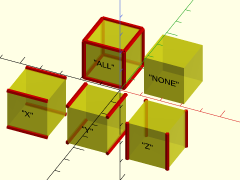

<br clear="all" /><br/>

**Figure 1.6.5:** Next are some examples showing how you can combine edge descriptors to obtain different edge sets.    You can specify the top front edge with a numerical vector or by combining the named direction vectors.  If you combine them as a list you get all the edges around the front and top faces.  Adding `except` removes an edge.

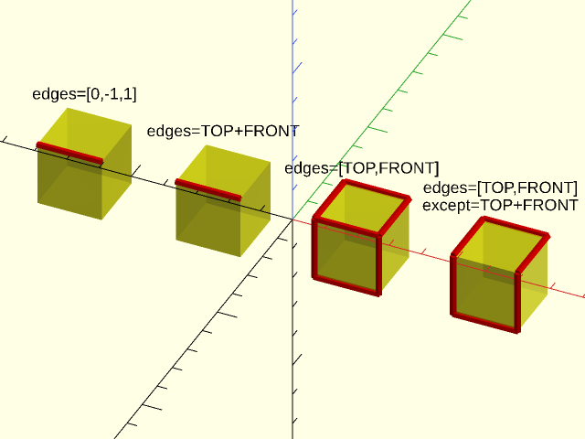

<br clear="all" />

**Figure 1.6.6:** Using `except=BACK` removes the four edges surrounding the back face if they are present in the edge set.  In the first example, only one edge needs to be removed.  In the second example we remove two of the Z-aligned edges.  The third example removes all four back edges from the default edge set of all edges.  You can explicitly give `edges="ALL"` but it is not necessary, since this is the default.  In the fourth example, the edge set of Y-aligned edges contains no back edges, so the `except` parameter has no effect.

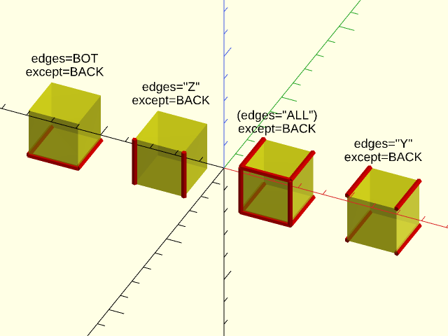

<br clear="all" />

**Figure 1.6.7:** On the left `except` is a list to remove two edges.  In the center we show a corner edge set defined by a numerical vector, and at the right we remove that same corner edge set with named direction vectors.

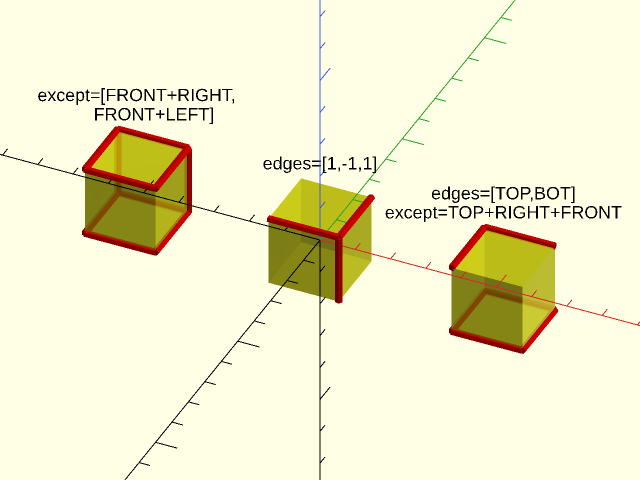

<br clear="all" />

## Subsection: Specifying Corners

Modules operating on corners use two arguments to describe the corner set they will use: The `corners` argument
is a list of corner set descriptors to include in the corner set, and the `except` argument is a list of
corner set descriptors to remove from the corner set.
The default value for `corners` is `"ALL"`, the set of all corners.
The default value for `except` is the   empty set, meaning no corners are removed.
If either argument is just a single corner set
descriptor it can be passed directly rather than in a singleton list.
Each corner set descriptor must be one of:
- A 3-vector with entries in {-1,0,1} pointing toward a corner of a centered cube, indicating that corner.
- A 3-vector with entries in {-1,0,1} pointing toward an edge of a centered cube indicating both corners at the ends of that edge.
- A 3-vector with entries in {-1,0,1} pointing toward a face of a centered cube, indicating all the corners of that face.
- The string `"ALL"`, indicating all corners.
- The string `"NONE"`, indicating no corners at all.
- A length 8 vector where each entry corresponds to a corner and is 1 if the corner is included and 0 if it is excluded.  The corner ordering is
    ```
    [X-Y-Z-, X+Y-Z-, X-Y+Z-, X+Y+Z-, X-Y-Z+, X+Y-Z+, X-Y+Z+, X+Y+Z+]
    ```

You can specify corner descriptors directly by giving a vector, or you can use sums of the
named direction vectors described above.  Below we show all of the corner sets you can
describe with sums of the direction vectors and then we show some examples of combining
corner set descriptors.

**Figure 1.7.1:** Vectors pointing toward a corner select that corner.

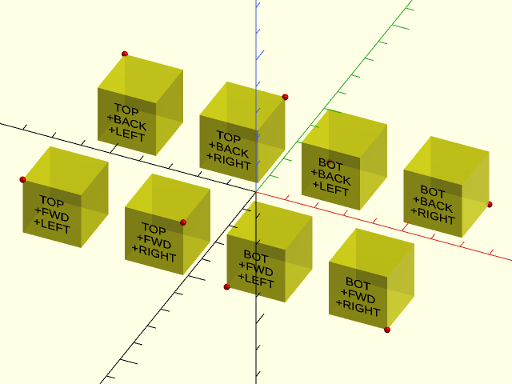

<br clear="all" />

**Figure 1.7.2:** Vectors pointing toward an edge select the corners and the ends of the edge.

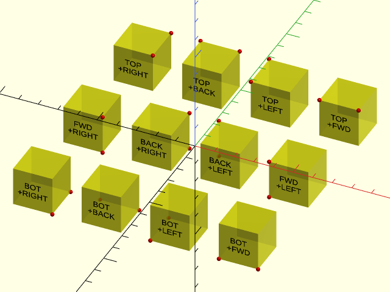

<br clear="all" />

**Figure 1.7.3:** Vectors pointing toward a face select the corners of the face.

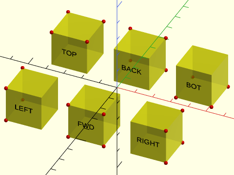

<br clear="all" /><br/>

**Figure 1.7.4:** Corners by name

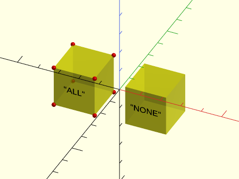

<br clear="all" /><br/>

**Figure 1.7.5:** Next are some examples showing how you can combine corner descriptors to obtain different corner sets.   You can specify corner sets numerically or by adding together named directions.  The third example shows a list of two corner specifications, giving all the corners on the front face or the right face.

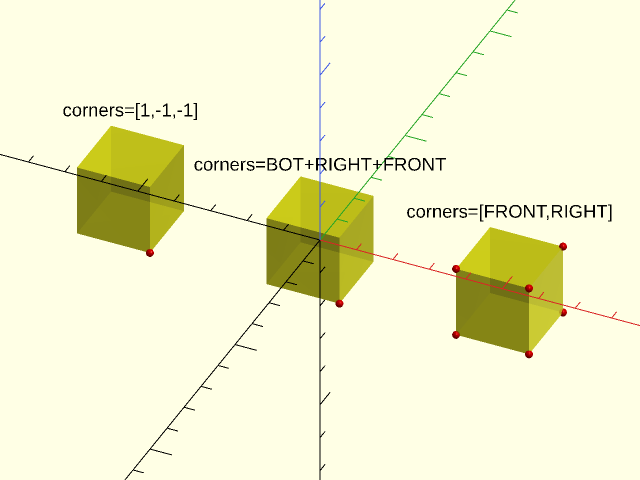

<br clear="all" />

**Figure 1.7.6:** Corners for one edge, two edges, and all the edges except the two on one edge.  Note that since the default is all edges, you need to give only the `except` argument in this case:

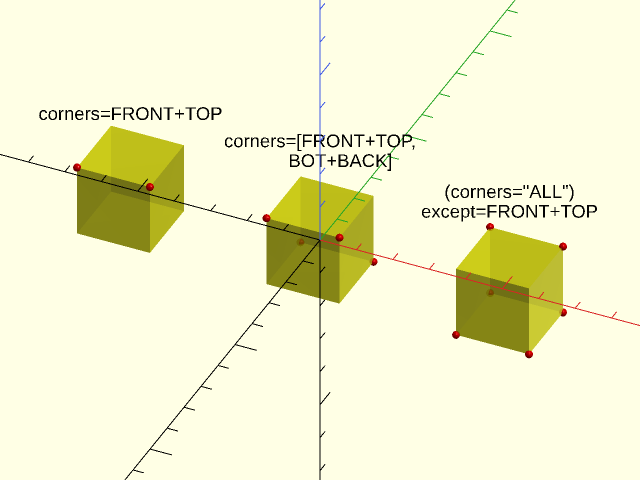

<br clear="all" />

**Figure 1.7.7:** The first example shows a single corner removed from the top corners using a numerical vector.  The second one shows removing a set of two corner descriptors from the implied set of all corners.

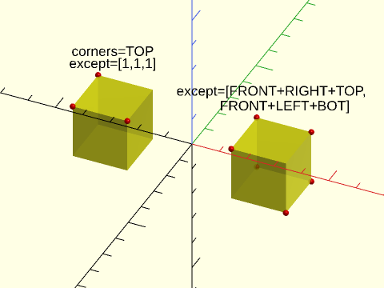

<br clear="all" />

## Subsection: Anchoring of Non-Rectangular Objects and Anchor Type (atype)

We focused above on rectangular objects that have well-defined faces and edges aligned with the coordinate axes.
Things get difficult when the objects are curved, or even when their edges are not neatly aligned with the coordinate axes.
In these cases, the library may provide multiple different anchoring schemes, called the anchor types.  When a module supports
multiple anchor types, use the `atype=` parameter to select the anchor type you need.

First consider the case of a simple rectangle whose corners have been rounded.  Where should the anchors lie?
The default anchor type puts them in the same location as the anchors of an unrounded rectangle, which means that for
positive rounding radii, they are not even located on the perimeter of the object.

**Figure 1.8.1:** Default "box" atype anchors for a rounded [`rect()`](shapes2d.scad#functionmodule-rect)

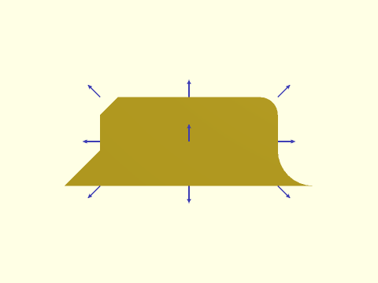

<br clear="all" />


This choice enables you to position the box, or attach things to it, without regard to its rounding or chamfers.  If you need to
anchor onto the roundovers or chamfers then you can use the "perim" anchor type:

**Figure 1.8.2:** The "perim" atype for a rounded and chamfered [`rect()`](shapes2d.scad#functionmodule-rect)

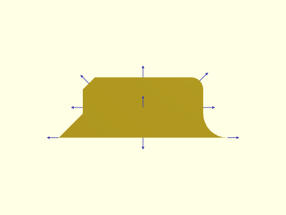

<br clear="all" />


With this anchor type, the anchors are located on the perimeter.  For positive roundings they point in the standard anchor direction;
for negative roundings they are parallel to the base.  As noted above, for circles, cylinders, and spheres, the anchor point is
determined by choosing the point where the anchor vector intersects the shape.  On a circle, this results in an anchor whose direction
matches the user provided anchor vector.  But on an ellipse, something else happens:

**Figure 1.8.3:** Anchors on an ellipse.  The red arrow shows a TOP+RIGHT anchor direction.

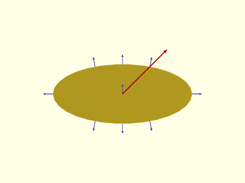

<br clear="all" />


For a TOP+RIGHT anchor direction, the surface normal at the intersection point does not match the anchor direction,
so the direction of the anchor shown in blue does not match the direction specified, in red.
Anchors computed this way have anchor type "intersect".  When a shape is concave, intersection anchors can produce
a result buried inside the shape's concavity.  Consider the RIGHT anchor of this supershape example:

**Figure 1.8.4:** A supershape with "intersect" anchor type:

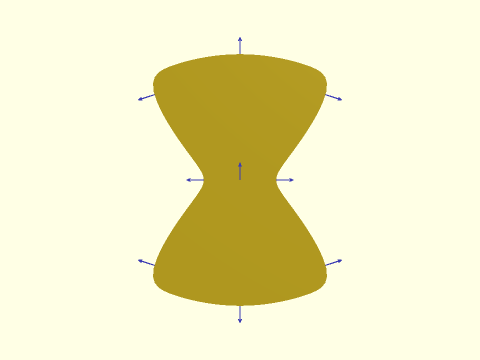

<br clear="all" />


A different anchor type called "hull" finds anchors that are on the convex hull of the shape.

**Figure 1.8.5:** A supershape with "hull" anchor type:

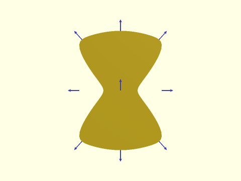

<br clear="all" />


Hull anchoring works by creating the line (or plane in 3D) that is normal to the specified anchor direction, and
finding the point farthest from the center that intersects that line (or plane).

**Figure 1.8.6:** Finding the RIGHT and BACK+LEFT "hull" anchors

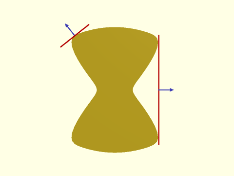

<br clear="all" />


In the example the RIGHT anchor is found when the normal line (shown in red) is tangent to the shape at two points.
The anchor is then taken to be the midpoint.  The BACK+LEFT anchor occurs with a single tangent point, and the
anchor point is located at the tangent point.  For circles intersection is done to the exact circle, but for other
shapes these calculations are done on the point lists that defines the shape, so if you change the number of points
in the list, the precise location of the anchors can change.  You can also get surprising results if your point list is badly chosen.

**Figure 1.8.7:** Circle anchor in blue.  The red anchor is computed to a point list of a circle with 17 segments.

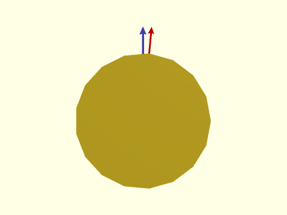

<br clear="all" />


The figure shows a large horizontal offset due to a poor choice of sampling for the circular shape when using the "hull" anchor type.
The determination of "hull" or "intersect" anchors may depend on the location of the centerpoint used in the computation.
Some of the modules allow you to change the centerpoint using a `cp=` argument.  If you need to change the centerpoint for
a module that does not provide this option, you can use the generic [`region()`](regions.scad#module-region) module, which lets you specify a centerpoint.
The default center point is the centroid, specified by "centroid".  You can also choose "mean", which gives the mean of all
the data points, or "box", which gives the centerpoint of the bounding box for the data.  Your last option for centerpoint is to
choose an arbitrary point that meets your needs.

**Figure 1.8.8:** The centerpoint for "intersect" anchors is located at the red dot

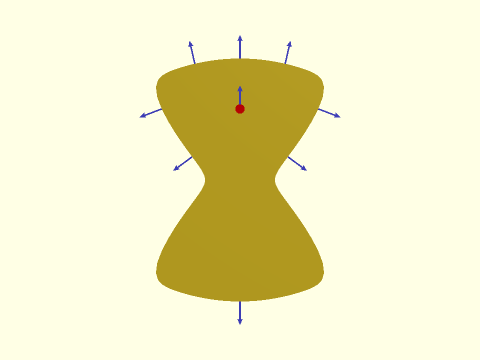

<br clear="all" />


Note that all the anchors for an object have to be determined based on one anchor type and relative to the same centerpoint.
The supported anchor types for each module appear in the "Anchor Types" section of its entry.

## Section: Attachment Positioning


### Module: position()

**Synopsis:** Attaches children to a parent object at an anchor point. <sup title="Can transform children.">[<abbr>Trans</abbr>]</sup>

**Topics:** [Attachments](Topics#attachments)

**See Also:** [attachable()](#module-attachable), [attach()](#module-attach), [orient()](#module-orient)

**Usage:** 

- PARENT() position(at) CHILDREN;

**Description:** 

Attaches children to a parent object at an anchor point.  For a step-by-step explanation
of attachments, see the [Attachments Tutorial](Tutorial-Attachment-Relative-Positioning).

**Arguments:** 

<abbr title="These args can be used by position or by name.">By&nbsp;Position</abbr> | What it does
-------------------- | ------------
`at`                 | The vector, or name of the parent anchor point to attach to.

**Side Effects:** 

- `$attach_anchor` for each `from=` anchor given, this is set to the `[ANCHOR, POSITION, ORIENT, SPIN]` information for that anchor.
- `$attach_to` is set to `undef`.
- `$edge_angle` is set to the angle of the edge if the anchor is on an edge and the parent is a prismoid, or vnf with "hull" anchoring
- `$edge_length` is set to the length of the edge if the anchor is on an edge and the parent is a prismoid, or vnf with "hull" anchoring

**Example 1:** 

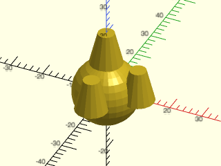

    include <BOSL2/std.scad>
    spheroid(d=20) {
        position(TOP) cyl(l=10, d1=10, d2=5, anchor=BOTTOM);
        position(RIGHT) cyl(l=10, d1=10, d2=5, anchor=BOTTOM);
        position(FRONT) cyl(l=10, d1=10, d2=5, anchor=BOTTOM);
    }

<br clear="all" /><br/>

---

### Module: orient()

**Synopsis:** Orients children's tops in the directon of the specified anchor. <sup title="Can transform children.">[<abbr>Trans</abbr>]</sup>

**Topics:** [Attachments](Topics#attachments)

**See Also:** [attachable()](#module-attachable), [attach()](#module-attach), [position()](#module-position)

**Usage:** 

- PARENT() orient(anchor, [spin]) CHILDREN;

**Description:** 

Orients children such that their top is tilted in the direction of the specified parent anchor point.
For a step-by-step explanation of attachments, see the [Attachments Tutorial](Tutorial-Attachment-Relative-Positioning).

**Arguments:** 

<abbr title="These args can be used by position or by name.">By&nbsp;Position</abbr> | What it does
-------------------- | ------------
`anchor`             | The anchor on the parent that you want to match the orientation of.
`spin`               | The spin to add to the children.  (Overrides anchor spin.)

**Side Effects:** 

- `$attach_to` is set to `undef`.

**Example 1:** When orienting to an anchor, the spin of the anchor may cause confusion:

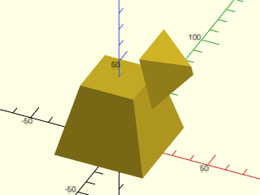

    include <BOSL2/std.scad>
    prismoid([50,50],[30,30],h=40) {
        position(TOP+RIGHT)
            orient(RIGHT)
                prismoid([30,30],[0,5],h=20,anchor=BOT+LEFT);
    }

<br clear="all" /><br/>

**Example 2:** You can override anchor spin with `spin=`.

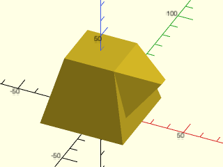

    include <BOSL2/std.scad>
    prismoid([50,50],[30,30],h=40) {
        position(TOP+RIGHT)
            orient(RIGHT,spin=0)
                prismoid([30,30],[0,5],h=20,anchor=BOT+LEFT);
    }

<br clear="all" /><br/>

**Example 3:** Or you can anchor the child from the back

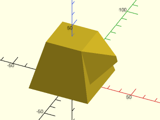

    include <BOSL2/std.scad>
    prismoid([50,50],[30,30],h=40) {
        position(TOP+RIGHT)
            orient(RIGHT)
                prismoid([30,30],[0,5],h=20,anchor=BOT+BACK);
    }

<br clear="all" /><br/>

---

### Module: align()

**Synopsis:** Position children with alignment to parent edges. <sup title="Can transform children.">[<abbr>Trans</abbr>]</sup>

**Topics:** [Attachments](Topics#attachments)

**See Also:** [attachable()](#module-attachable), [attach()](#module-attach), [position()](#module-position), [orient()](#module-orient)

**Usage:** 

- PARENT() align(anchor, [align], [inside=], [inset=], [shiftout=], [overlap=]) CHILDREN;

**Description:** 

Place a child on the face identified by `anchor`.  If align is not given or is CENTER
then the child is centered on top of the specified face, outside the parent object.  The align parameter is a
direction defining an edge or corner to align to.  The child is aligned to that edge or corner by
choosing an appropriate anchor on the child.
Like [`position()`](#module-position) this module never rotates the child.  If you give `anchor=RIGHT` then the child
is given the LEFT anchor and placed adjacent to the parent.  You can use `orient=` or `spin=`
with the child and the alignment adjusts to select the correct child anchor.  Note that if
you spin the child by an amount not a multiple of 90 degrees then an edge of the child will be
placed against the parent.  This module makes it easy to place children aligned flush with the edges
of the parent, even after orienting them or spinning them.  In contrast [`position()`](#module-position) can
do the same thing but you would have to figure out the correct child anchor, which is not always obvious.

Because `align()` works by setting the child anchor, it overrides any anchor you specify to the child:
**any `anchor=` value given to the child is ignored.**

Several options can adjust how the child is positioned.  You can specify `inset=` to inset the
aligned object from its alignment location. If you set `inside=true` then the
child appears inside the parent instead of on its surface so that you can use [`diff()`](#module-diff) to subtract it.
In this case the child receives a default "remove" tag.

The overlap option and shiftout option both move the object away from its aligned position.  They
can be used to prevent coincident faces from creating issues in OpenSCAD by ensuring that the child
fully overlaps the parent's face(s).  The `overlap` parameter defaults to the value of `$overlap`, or
0 if `$overlap` is not set.  It moves the child object in the direction of the `anchor` face when
`inside=false` (sinking the child into the parent) and it moves the child in the opposite direction
if `inside=true`, shifting the child outward away from the `anchor` face.  The child will remain exactly flush
with edges it was aligned to using `align`. The `overlap` parameter is best suited to externally aligned objects (`inside=false`)
where the aligned edges should remain perfectly aligned. The `shiftout` parameter shifts the child outward relative to
the `anchor` face and also any aligned edges.  The direction of movement does not depend on the `inside` parameter.
For an inside child this is equivalent to giving a positive overlap and negative inset value.
For a child with `inside=false` it is equivalent to a negative overlap and negative inset.  The `shiftout` parameter
is well suited to internal objects where `inside=true` because it shifts to overlap all coincident faces, including
faces at aligned edges.

In the description above, the anchor was said to define a "face".  You can also use this module
with an edge anchor, in which case a corner of the child is placed in contact with the specified
edge and the align direction shifts the child to either end of the edge.  You can even give a
corner as the anchor point, but in that case the only allowed alignment is CENTER.

If you give a list of anchors and/or a list of align directions then all combinations are generated.
In this way align() acts like a distributor, creating multiple copies of the child.
Named anchors are not supported by `align()`.

**Arguments:** 

<abbr title="These args can be used by position or by name.">By&nbsp;Position</abbr> | What it does
-------------------- | ------------
`anchor`             | parent anchor or list of parent anchors for positioning children.
`align`              | optional alignment direction or directions for aligning the children.  Default: CENTER

<abbr title="These args must be used by name, ie: name=value">By&nbsp;Name</abbr> | What it does
-------------------- | ------------
`inside`             | if true, place object inside the parent instead of outside.  Default: false
`inset`              | shift the child away from the alignment edge/corner by this amount.  Default: 0
`shiftout`           | Shift an inside object outward so that it overlaps all the aligned faces.  Default: 0
`overlap`            | Amount to sink the child into the parent (or raise child out of parent if `inside=true`).  Defaults to `$overlap`, which is zero by default.

**Side Effects:** 

- `$anchor` set to the anchor value used for the child.
- `$align` set to the align value used for the child.
- `$idx` set to a unique index for each child, increasing by alignment first.
- `$attach_anchor` for each anchor given, this is set to the `[ANCHOR, POSITION, ORIENT, SPIN]` information for that anchor.
- if `inside` is true then set default tag to "remove"

**Example 1:** Cuboid positioned on the right of its parent.  Note that it is in its native orientation.

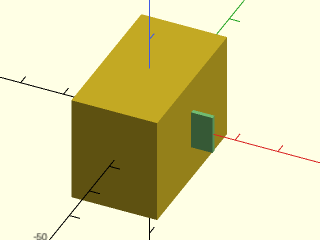

    include <BOSL2/std.scad>
    cuboid([20,35,25])
      align(RIGHT)
        color("lightgreen")cuboid([5,1,9]);

<br clear="all" /><br/>

**Example 2:** Child would require anchor of RIGHT+FRONT+BOT if placed with [`position()`](#module-position).


    include <BOSL2/std.scad>
    cuboid([50,40,15])
      align(TOP,RIGHT+FRONT)
        color("lightblue")prismoid([10,5],[7,4],height=4);

<br clear="all" /><br/>

**Example 3:** Child requires a different anchor for each position, so a simple explicit specification of the anchor for children is impossible in this case, without using two separate commands.

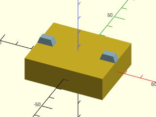

    include <BOSL2/std.scad>
    cuboid([50,40,15])
      align(TOP,[RIGHT,LEFT])
        color("lightblue")prismoid([10,5],[7,4],height=4);

<br clear="all" /><br/>

**Example 4:** If you spin the child 90 deg it is still flush with the edge of the parent.  In this case the required anchor for the child is BOT+FWD:

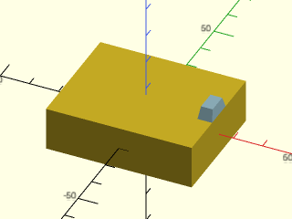

    include <BOSL2/std.scad>
    cuboid([50,40,15])
      align(TOP,RIGHT)
        color("lightblue")
           prismoid([10,5],[7,4],height=4,spin=90);

<br clear="all" /><br/>

**Example 5:** Here the child is placed on the RIGHT face.  Notice how the TOP+LEFT anchor of the prismoid is aligned with the edge of the parent.  The prismoid remains in the same orientation.

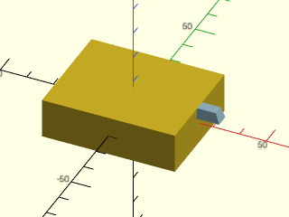

    include <BOSL2/std.scad>
    cuboid([50,40,15])
      align(RIGHT,TOP)
        color("lightblue")prismoid([10,5],[7,4],height=4);

<br clear="all" /><br/>

**Example 6:** If you change the orientation of the child it still appears aligned flush in its changed orientation:


<br clear="all" />

    include <BOSL2/std.scad>
    cuboid([50,40,15])
      align(TOP, RIGHT)
        color("lightblue")prismoid([10,5],[7,4],height=4,orient=DOWN);

**Example 7:** The center of the cubes edge is lined up with the center of the prismoid edge, so this result is the expected result:

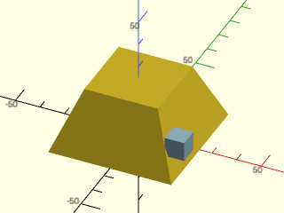

    include <BOSL2/std.scad>
    prismoid(50,30,25)
      align(RIGHT,FRONT)
        color("lightblue")cuboid(8);

<br clear="all" /><br/>

**Example 8:** Spinning the cube means that the corner of the cube is the most extreme point, so that's what aligns with the front edge of the parent:

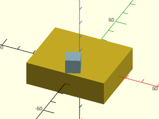

    include <BOSL2/std.scad>
    cuboid([50,40,15])
      align(TOP,FWD)
        color("lightblue")cuboid(9,spin=22);

<br clear="all" /><br/>

**Example 9:** A similar thing happens if you attach a cube to a cylinder with an arbitrary anchor angle:

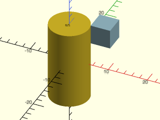

    include <BOSL2/std.scad>
    cyl(h=20,d=10,$fn=128)
      align([1,.3],TOP)
        color("lightblue")cuboid(5);

<br clear="all" /><br/>

**Example 10:** Orienting the child is done in the global coordinate system (as usual) not in the parent coordinate system.  Note that the blue prismoid is not lined up with the parent face.  (To place the child on the face use [`attach()`](#module-attach).

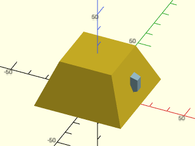

<br clear="all" />

    include <BOSL2/std.scad>
    prismoid(50,30,25)
      align(RIGHT)
       color("lightblue")prismoid([10,5],[7,4],height=4,orient=RIGHT);

**Example 11:** Setting `inside=true` enables us to subtract the child from the parent with [`diff()`](#module-diff).  The "remove" tag is automatically applied when you set `inside=true`, and we used `shiftout=0.01` to prevent z-fighting on the faces.

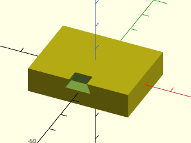

    include <BOSL2/std.scad>
    diff()
      cuboid([40,30,10])
        align(FRONT,TOP,inside=true,shiftout=0.01)
          prismoid([10,5],[7,5],height=4);

<br clear="all" /><br/>

**Example 12:** Setting `inset` shifts all of the children away from their aligned edge, which is a different direction for each child.

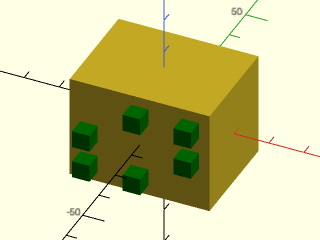

<br clear="all" />

    include <BOSL2/std.scad>
    cuboid([40,30,30])
      align(FRONT,[TOP,BOT,LEFT,RIGHT,TOP+RIGHT,BOT+LEFT], inset=3)
        color("green") cuboid(5);

**Example 13:** Changing the child characteristics based on the alignment

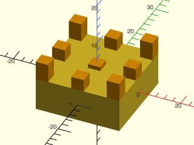

    include <BOSL2/std.scad>
    cuboid([20,20,8])
      align(TOP,[for(i=[-1:1], j=[-1:1]) [i,j]])
        color("orange")
          if (norm($align)==0) cuboid([3,3,1]);
          else if (norm($align)==norm([1,1])) cuboid([3,3,4.5]);
          else cuboid(3);

<br clear="all" /><br/>

**Example 14:** In this example the pink cubes are positioned onto an edge.  They meet edge-to-edge.  Aligning left shifts the cube to the left end of the edge.

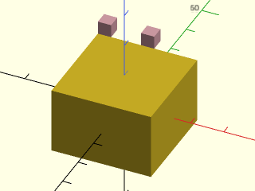

    include <BOSL2/std.scad>
    cuboid([30,30,20])
       align(TOP+BACK,[CTR,LEFT])
         color("pink")cuboid(4);

<br clear="all" /><br/>

**Example 15:** Normally `overlap` is used to create a tiny overlap to keep CGAL happy, but you can also give it a large value as shown here:

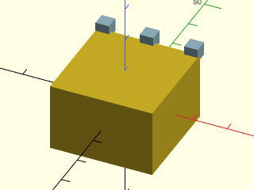

    include <BOSL2/std.scad>
    cuboid([30,30,20])
      align(TOP+BACK,[RIGHT,CTR,LEFT],overlap=2)
        color("lightblue")cuboid(4);

<br clear="all" /><br/>

---

### Module: attach()

**Synopsis:** Attaches children to a parent object at an anchor point and with anchor orientation. <sup title="Can transform children.">[<abbr>Trans</abbr>]</sup>

**Topics:** [Attachments](Topics#attachments)

**See Also:** [attachable()](#module-attachable), [position()](#module-position), [align()](#module-align), [face\_profile()](masks.scad#module-face_profile), [edge\_profile()](masks.scad#module-edge_profile), [corner\_profile()](masks.scad#module-corner_profile)

**Usage:** 

- PARENT() attach(parent, child, [align=], [spin=], [overlap=], [inside=], [inset=], [shiftout=]) CHILDREN;
- PARENT() attach(parent, [overlap=], [spin=]) CHILDREN;

**Description:** 

Attaches children to a parent object at an anchor point or points, oriented in the anchor direction.
This module differs from [`position()`](#module-position) and [`align()`](#module-align) in that it rotates the children to
the anchor direction, which generally means it places the children on the surface of a parent.
There are two modes of operation, parent anchor (single argument) and parent-child anchor (double argument).
In most cases you should use the parent-child (double argument) version of `attach()`.

The parent-child anchor (double argument) version is usually easier to use, and it is more powerful because it supports
alignment.  You provide an anchor on the parent (`parent`) and an anchor on the child (`child`).
This module connects the `child` anchor on the child to the `parent` anchor on the parent.
Imagine pointing the parent and child anchor arrows at each other and pushing the objects
together until they meet at the anchor point.  The most basic case
is `attach(TOP,BOT)`, which puts the bottom of the child onto the top of the parent.  If you
do `attach(RIGHT,BOT)` this puts the bottom of the child onto the right anchor of the parent.
When an object is attached to the top or bottom, its BACK direction remains pointing BACK.
When an object is attached to one of the other anchors its FRONT is pointed DOWN and its
BACK pointed UP.  You can change this using the `spin=` argument to attach().  This spin
rotates around the attachment vector and is not the same as the spin argument to the child, which
will usually rotate around some other axis that may be hard to predict.
For 2D objects you cannot give the `spin=` argument to attach() because this breaks the anchor
alignment that attach() creates.  (You can,  however, still give `spin=` to the child, which will
misalign the anchors produe by the attachment.)

As with [`align()`](#module-align) you can use the `align=` parameter to align the child to an edge or corner of the
face where that child is attached.  For example, `attach(TOP,BOT,align=RIGHT)` stands the child
up on the top while aligning it with the right edge of the top face, and `attach(RIGHT,BOT,align=TOP)`
stands the object on the right face while aligning with the top edge.  If you apply spin using the
argument to `attach()`, then it is taken into account for the alignment. However, if you apply spin as
a parameter to the child, it is **not** taken into account.  The special spin value "align"
spins the child so that the child's BACK direction is pointed toward the aligned edge on the parent.
When you use `align=` you can also adjust the position using `inset=`, which shifts the child
inward away from the edge or corner it is aligned to.  The `inset=` parameter is not permitted without `align=`.

The concept of alignment doesn't always make sense for objects without corners, such as spheres or cylinders.
In same cases, the alignments using such children may look odd because the alignment computation tries to
place a non-existent corner somewhere.  Because attach() doesn't have in formation about the child when
it runs, it cannot handle curved shapes differently from cubes, so this behavior cannot be changed.

Because the attachment process forces an orientation and anchor point for the child, it overrides
any such specifications you give to the child:  **both `anchor=` and `orient=` given to the child are
ignored** with the **double argument** version of `attach()`.  As noted above, you can give `spin=` to the
child but using the `spin=` parameter to `attach()` is more likely to be useful.

If you give `inside=true` then the anchor arrows are lined up so they point the same direction and
the child object is located inside the parent.  In this case a default "remove" tag is applied to
the children.

The overlap option and shiftout option both move the object away from its aligned position.  They
can be used to prevent coincident faces from creating issues in OpenSCAD by ensuring that the child
fully overlaps the parent's face(s).  The `overlap` parameter defaults to the value of `$overlap`, or
0 if `$overlap` is not set.  It moves the child object in the direction of the `parent` face when
`inside=false` (sinking the child into the parent) and it moves the child in the opposite direction
if `inside=true`, shifting the child outward away from the `parent` face.  The child will remain exactly flush
with edges it was aligned to using `align=`.  The `overlap` parameter is best suited to externally attached objects (`inside=false`)
where the aligned edges should remain perfectly aligned.  The `shiftout` parameter shifts the child outward relative to
the `parent` face and also any aligned edges.  The direction of movement does not depend on the `inside` parameter.
For an inside child this is equivalent to giving a positive overlap and negative inset value.
For a child with `inside=false` it is equivalent to a negative overlap and negative inset.  The `shiftout` parameter
is well suited to internal objects where `inside=true` because it shifts to overlap all coincident faces, including
faces at aligned edges.

The single parameter version of `attach()` is rarely needed; to use it, you give only the `parent` anchor.  The `align` direction
is not permitted.  In this case the child is placed at the specified parent anchor point
and rotated to the anchor direction.  For example, `attach(TOP) cuboid(2);` places a small
cube **with its center** located at the TOP anchor of the parent, so just half the cube projects
from the parent.  If you want the cube sitting on the parent you need to anchor the cube to its bottom:
`attach(TOP) cuboid(2,anchor=BOT);`.

The **single argument** version of `attach()` **respects `anchor=` and `orient=` given to the child.**
These options will probably be necessary, in fact, to get the child correctly positioned.  Note that
giving `spin=` to `attach()` in this case is the same as applying `zrot()` to the child.

For a step-by-step explanation of attachments, see the [Attachments Tutorial](Tutorial-Attachment-Relative-Positioning).

**Arguments:** 

<abbr title="These args can be used by position or by name.">By&nbsp;Position</abbr> | What it does
-------------------- | ------------
`parent`             | The parent anchor point to attach to or a list of parent anchor points.
`child`              | Optional child anchor point.  If given, orients the child to connect this anchor point to the parent anchor.

<abbr title="These args must be used by name, ie: name=value">By&nbsp;Name</abbr> | What it does
-------------------- | ------------
`align`              | If `child` is given you can specify alignment or list of alistnments to shift the child to an edge or corner of the parent.
`inset`              | Shift aligned children away from their alignment edge/corner by this amount.  Default: 0
`overlap`            | Amount to sink child into the parent (or raise child out of parent if `inside=true`).  Equivalent to `down(X)` after the attach (or `up(X)` if `inside=true`).  This defaults to the value in `$overlap`, which is `0` by default.
`inside`             | If `child` is given you can set `inside=true` to attach the child to the inside of the parent for diff() operations.  Default: false
`shiftout`           | Shift an inside object outward so that it overlaps all the aligned faces.  Default: 0
`spin`               | Angle to rotate the child around the axis of the parent anchor.  Can set to "align" to align the child's BACK with the parent aligned edge.  (Permitted only in 3D.)

**Side Effects:** 

- `$anchor` set to the parent anchor value used for the child.
- `$align` set to the align value used for the child.
- `$idx` set to a unique index for each child, increasing by alignment first.
- `$attach_anchor` for each anchor given, this is set to the `[ANCHOR, POSITION, ORIENT, SPIN]` information for that anchor.
- if inside is true then set default tag to "remove"
- `$attach_to` is set to the value of the `child` argument, if given.  Otherwise, `undef`
- `$edge_angle` is set to the angle of the edge if the anchor is on an edge and the parent is a prismoid or vnf with "hull" anchoring
- `$edge_length` is set to the length of the edge if the anchor is on an edge and the parent is a prismoid or vnf with "hull" anchoring

**Example 1:** Cylinder placed on top of cube:

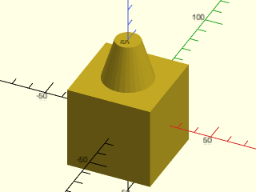

    include <BOSL2/std.scad>
    cuboid(50)
      attach(TOP,BOT) cylinder(d1=30,d2=15,h=25);

<br clear="all" /><br/>

**Example 2:** Cylinder on right and front side of cube:

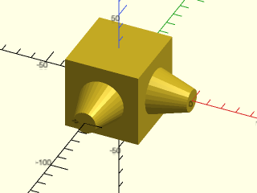

    include <BOSL2/std.scad>
    cuboid(50)
      attach([RIGHT,FRONT],BOT) cylinder(d1=30,d2=15,h=25);

<br clear="all" /><br/>

**Example 3:** Using `align` can align child object(s) with edges

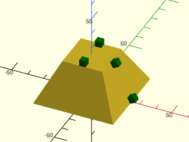

    include <BOSL2/std.scad>
    prismoid(50,25,25) color("green"){
      attach(TOP,BOT,align=[BACK,FWD]) cuboid(4);
      attach(RIGHT,BOT,align=[TOP,BOT]) cuboid(4);
    }

<br clear="all" /><br/>

**Example 4:** One aligned to the corner upside down (light blue) and one inset fromt the corner (pink), one aligned on a side (orange) and one rotated and aligned (green).

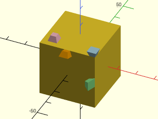

<br clear="all" />

    include <BOSL2/std.scad>
    cuboid(30) {
      attach(TOP,TOP,align=FRONT+RIGHT) color("lightblue") prismoid(5,3,3);
      attach(TOP,BOT,inset=3,align=FRONT+LEFT) color("pink") prismoid(5,3,3);
      attach(FRONT,RIGHT,align=TOP) color("orange") prismoid(5,3,3);
      attach(FRONT,RIGHT,align=RIGHT,spin=90) color("lightgreen") prismoid(5,3,3);
    }

**Example 5:** Rotation not a multiple of 90 degrees with alignment.  The children are aligned on a corner.

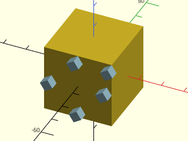

<br clear="all" />

    include <BOSL2/std.scad>
    cuboid(30)
      attach(FRONT,BOT,spin=33,align=[RIGHT,LEFT,TOP,BOT,RIGHT+TOP])
        color("lightblue")cuboid(4);

**Example 6:** Anchoring the cone onto the sphere gives a single point of contact.

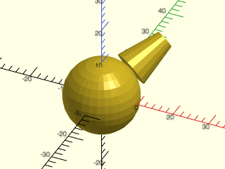

    include <BOSL2/std.scad>
    spheroid(d=20)
        attach([1,1.5,1], BOTTOM) cyl(l=11.5, d1=10, d2=5);

<br clear="all" /><br/>

**Example 7:** Using the `overlap` option can help:

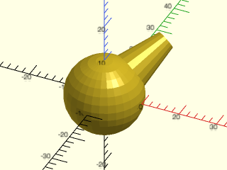

<br clear="all" />

    include <BOSL2/std.scad>
    spheroid(d=20)
        attach([1,1.5,1], BOTTOM, overlap=1.5) cyl(l=11.5, d1=10, d2=5);

**Example 8:** Alignment works on the sides of cylinders but you can align only with either the top or bototm face:

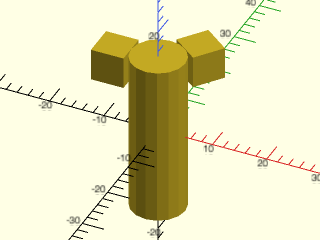

    include <BOSL2/std.scad>
    cyl(h=30,d=10)
      attach([LEFT,[1,1.3]], BOT,align=TOP) cuboid(6);

<br clear="all" /><br/>

**Example 9:** Attaching to edges.  The light blue and orange objects are attached to edges.  The purple object is attached to an edge and aligned.


    include <BOSL2/std.scad>
    prismoid([20,10],[10,10],7){
      attach(RIGHT+TOP,BOT,align=FRONT) color("pink")cuboid(2);
      attach(BACK+TOP, BOT) color("lightblue")cuboid(2);
      attach(RIGHT+BOT, RIGHT) color("orange")cyl(h=8,d=1);
    }

<br clear="all" /><br/>

**Example 10:** Attaching inside the parent.  For inside attachment the anchors are lined up pointing the same direction, so the most natural way to anchor the child is using its TOP anchor.  This is equivalent to anchoring outside with the BOTTOM anchor and then lowering the child into the parent by its full depth.


<br clear="all" />

    include <BOSL2/std.scad>
    back_half()
      diff()
      cuboid(20)
        attach(TOP,TOP,inside=true,shiftout=0.01) cyl(d1=10,d2=5,h=10);

**Example 11:** Attaching inside the parent with alignment


<br clear="all" />

    include <BOSL2/std.scad>
    diff()
    cuboid(20){
      attach(TOP,TOP,inside=true,align=RIGHT,shiftout=.01) cuboid([8,7,3]);
      attach(TOP,TOP,inside=true,align=LEFT+FRONT,shiftout=0.01) cuboid([3,4,5]);
      attach(RIGHT+FRONT, TOP, inside=true) cuboid([10,3,5]);
      attach(RIGHT+FRONT, TOP, inside=true, align=TOP,shiftout=.01) cuboid([5,1,2]);
    }

**Example 12:** Attaching a 3d edge mask.  Simple 2d masks can be done using [`edge_profile()`](masks.scad#module-edge\_profile) but this mask varies along its length. In order to correctly position the anchors on the mask we can use `offset=` when creating it with attachable().


<br clear="all" />

    include <BOSL2/std.scad>
    module wavy_edge(length,cycles, r, steps, n)
    {
      rmin = is_vector(r) ? r[0] : 0.01;
      rmax = is_vector(r) ? r[1] : r;
      layers = [for(z=[0:steps])
                    let(
                         r=rmin+(rmax-rmin)/2*(cos(z*360*cycles/steps)+1)
                    )
                    path3d( concat([[0,0]],
                                   arc(corner=path2d([BACK,CTR,RIGHT]), n=n, r=r)),
                            z/steps*length-length/2)
                ];
      attachable(size=[rmax,rmax,length], offset=[rmax/2,rmax/2,0]){
          skin(layers,slices=0);
          children();
      }
    }
    diff()
    cuboid(25)
      attach([TOP+RIGHT,TOP+LEFT,TOP+FWD, FWD+RIGHT], FWD+LEFT, inside=true, shiftout=.01)
        wavy_edge(length=25.1,cycles=1.4,r=4,steps=24,n=15);

---

### Module: attach\_part()

**Synopsis:** Select a named attachable part for subsequent attachment operations

**Topics:** [Attachment](Topics#attachment)

**See Also:** [attach()](#module-attach), [align()](#module-align), [attachable()](#module-attachable), [define\_part()](#function-define_part), [parent\_part()](#function-parent_part)

**Usage:** 

- PARENT() attach_part(name, [ind]) CHILDREN;

**Description:** 

Most attachable objects have a single geometry defined that is used by the attachment commands,
but some objects also define attachable parts.  This module selects
an attachable part using a name defined by the parent object.  Any operations
that use the parent geometry such as [`attach()`](#module-attach), [`align()`](#module-align), [`position()`](#module-position) or [`parent()`](#function-parent)
references the geometry for the specified part.  This allows you to access the inner wall
of tubes, for example.  Note that you cannot call `attach_part()` as a child of another `attach_part()`.

If you select a compound part then you can also provide an index to select the desired component
of that part.  The index wraps around in both directions so for example, -1 gives the last component, and
the selection cannot fail due to being out of bounds.  The default index is zero.   The `ind`
parameter has no effect on simple parts.

**Arguments:** 

<abbr title="These args can be used by position or by name.">By&nbsp;Position</abbr> | What it does
-------------------- | ------------
`name`               | name of part to use for subsequent attachments.
`ind`                | index for use with compount parts.  Default: 0

**Example 1:** This example shows attaching the light blue cube normally, on the outside of the tube, and the pink cube using the "inside" attachment part.


    include <BOSL2/std.scad>
    tube(ir1=10,ir2=20,h=20, wall=3){
      color("lightblue")attach(RIGHT,BOT) cuboid(4);
      color("pink")
         attach_part("inside")
         attach(BACK,BOT) cuboid(4);
    }

<br clear="all" /><br/>

---

## Section: Tagging


### Module: tag()

**Synopsis:** Assigns a tag to an object

**Topics:** [Attachments](Topics#attachments)

**See Also:** [tag\_this()](#module-tag_this), [force\_tag()](#module-force_tag), [recolor()](color.scad#module-recolor), [hide()](#module-hide), [show\_only()](#module-show_only), [diff()](#module-diff), [intersect()](#module-intersect)

**Usage:** 

- PARENT() tag(tag) CHILDREN;

**Description:** 

Assigns the specified tag to all of the children. Note that if you want
to apply a tag to non-tag-aware objects you need to use [`force_tag()`](#module-force_tag) instead.
This works by setting the `$tag` variable, but it provides extra error checking and
handling of scopes.  You may set `$tag` directly yourself, but this is not recommended.

For a step-by-step explanation of tagged attachments, see the [Attachments Tutorial](Tutorial-Attachment-Tags).

**Arguments:** 

<abbr title="These args can be used by position or by name.">By&nbsp;Position</abbr> | What it does
-------------------- | ------------
`tag`                | tag string, which must not contain any spaces.

**Side Effects:** 

- Sets `$tag` to the tag you specify, possibly with a scope prefix.

**Example 1:** Applies the tag to both cuboids instead of having to repeat `$tag="remove"` for each one.


    include <BOSL2/std.scad>
    diff("remove")
      cuboid(10){
        position(TOP) cuboid(3);
        tag("remove")
        {
          position(FRONT) cuboid(3);
          position(RIGHT) cuboid(3);
        }
      }

<br clear="all" /><br/>

---

### Module: tag\_this()

**Synopsis:** Assigns a tag to an object at the current level only.

**Topics:** [Attachments](Topics#attachments)

**See Also:** [tag()](#module-tag), [force\_tag()](#module-force_tag), [recolor()](color.scad#module-recolor), [hide()](#module-hide), [show\_only()](#module-show_only), [diff()](#module-diff), [intersect()](#module-intersect)

**Usage:** 

- PARENT() tag_this(tag) CHILDREN;

**Description:** 

Assigns the specified tag to the children at the current level only, with tags reverting to
the previous tag in force for deeper descendents.  This works using `$tag` and `$save_tag`.

For a step-by-step explanation of tagged attachments, see the [Attachments Tutorial](Tutorial-Attachment-Tags).

**Arguments:** 

<abbr title="These args can be used by position or by name.">By&nbsp;Position</abbr> | What it does
-------------------- | ------------
`tag`                | tag string, which must not contain any spaces.

**Side Effects:** 

- Sets `$tag` to the tag you specify, possibly with a scope prefix, and saves current tag in `$save_tag`.

**Example 1:** Here we subtract a cube while keeping its child.  With [`tag()`](#module-tag) the child would inherit the "remove" tag and we would need to explicitly retag the child to prevent it from also being subtracted.


<br clear="all" />

    include <BOSL2/std.scad>
    diff()
    cuboid([10,10,4])
      tag_this("remove")position(TOP) cuboid(3)  // This cube is subtracted
        attach(TOP,BOT) cuboid(1);  // Tag is reset so this cube displays

---

### Module: force\_tag()

**Synopsis:** Assigns a tag to a non-attachable object.

**Topics:** [Attachments](Topics#attachments)

**See Also:** [tag()](#module-tag), [recolor()](color.scad#module-recolor), [hide()](#module-hide), [show\_only()](#module-show_only), [diff()](#module-diff), [intersect()](#module-intersect)

**Usage:** 

- PARENT() force_tag([tag]) CHILDREN;

**Description:** 

You use this module when you want to make a non-attachable or non-BOSL2 module respect tags.
It applies to its children the tag specified (or the tag currently in force if you don't specify a tag),
making a final determination about whether to show or hide the children.
This means that tagging is ignored in children's children.
This module is specifically provided for operating on children that are not tag aware such as modules
that don't use [`attachable()`](#module-attachable) or built in modules such as
- `polygon()`
- `projection()`
- `polyhedron()`  (or use [`vnf_polyhedron()`](vnf.scad#module-vnf_polyhedron))
- `linear_extrude()`  (or use [`linear_sweep()`](skin.scad#functionmodule-linear_sweep))
- `rotate_extrude()`
- `surface()`
- `import()`
- `difference()`
- `intersection()`
- `hull()`

When you use tag-based modules like [`diff()`](#module-diff) with a non-attachable module, the result may be puzzling.
Any time a test occurs for display of child(), that test will succeed.  This means that when diff() checks
to see if it should show a module, it shows the module, and when diff() checks to see if it should subtract the module,
it subtracts the module.  The result appears as a hole, possibly with zero-thickness edges or faces. To
get the correct behavior, every non-attachable module needs an invocation of `force_tag()`, even ones
that are not tagged.

For a step-by-step explanation of tagged attachments, see the [Attachments Tutorial](Tutorial-Attachment-Tags).

**Arguments:** 

<abbr title="These args can be used by position or by name.">By&nbsp;Position</abbr> | What it does
-------------------- | ------------
`tag`                | tag string, which must not contain any spaces

**Side Effects:** 

- Sets `$tag` to the tag you specify, possibly with a scope prefix.

**Example 1:** This example produces the full square without subtracting the "remove" item.  When you use non-attachable modules with tags, results are unpredictable.


    include <BOSL2/std.scad>
    diff()
    {
      polygon(square(10));
      move(-[.01,.01])polygon(square(5),$tag="remove");
    }

<br clear="all" /><br/>

**Example 2:** Adding force\_tag() fixes the model.  Note you need to add it to *every* non-attachable module, even the untagged ones, as shown here.


    include <BOSL2/std.scad>
    diff()
    {
      force_tag()
        polygon(square(10));
      force_tag("remove")
        move(-[.01,.01])polygon(square(5));
    }

<br clear="all" /><br/>

---

### Module: default\_tag()

**Synopsis:** Conditionally set a default tag for all children.

**Topics:** [Attachments](Topics#attachments)

**See Also:** [force\_tag()](#module-force_tag), [recolor()](color.scad#module-recolor), [hide()](#module-hide), [show\_only()](#module-show_only), [diff()](#module-diff), [intersect()](#module-intersect)

**Usage:** 

- PARENT() default_tag(tag, [do_tag]) CHILDREN;

**Description:** 

Sets a default tag for all of the children.  This is intended to be used to set a tag for a whole module
that is then used outside the module, such as setting the tag to "remove" for easy operation with [`diff()`](#module-diff).
The default_tag() module sets the `$tag` variable only if it is not already
set so you can have a module set a default tag of "remove" but that tag can be overridden by a [`tag()`](#module-tag)
in force from a parent.  If you use [`tag()`](#module-tag), it overrides any previously
specified tag from a parent, which can be confusing to a user trying to change the tag on a module.
The `do_tag` parameter allows you to apply a default tag conditionally without having to repeat the children.

For a step-by-step explanation of tagged attachments, see the [Attachments Tutorial](Tutorial-Attachment-Tags).

**Arguments:** 

<abbr title="These args can be used by position or by name.">By&nbsp;Position</abbr> | What it does
-------------------- | ------------
`tag`                | tag string, which must not contain any spaces.
`do_tag`             | if false do not set the tag.  Default: true

**Side Effects:** 

- Sets `$tag` to the tag you specify, possibly with a scope prefix.

**Example 1:** The module thing() is defined with [`tag()`](#module-tag) and the user applied tag of "keep\_it" is ignored, leaving the user puzzled.


    include <BOSL2/std.scad>
    module thing() { tag("remove") cuboid(10);}
    diff()
      cuboid(20){
        position(TOP) thing();
        position(RIGHT) tag("keep_it") thing();
    }

<br clear="all" /><br/>

**Example 2:** Using default\_tag() fixes this problem: the user applied tag does not get overridden by the tag hidden in the module definition.


    include <BOSL2/std.scad>
    module thing() { default_tag("remove") cuboid(10);}
    diff()
      cuboid(20){
        position(TOP) thing();
        position(RIGHT) tag("keep_it") thing();
    }

<br clear="all" /><br/>

---

### Module: tag\_scope()

**Synopsis:** Creates a new tag scope.

**Topics:** [Attachments](Topics#attachments)

**See Also:** [tag()](#module-tag), [force\_tag()](#module-force_tag), [default\_tag()](#module-default_tag)

**Usage:** 

- tag_scope([scope]) CHILDREN;

**Description:** 

Creates a tag scope with locally altered tag names to avoid tag name conflict with other code.
This is necessary when writing modules because the module's caller might happen to use the same tags.
Note that if you directly set the `$tag` variable, then tag scoping will not work correctly.
Usually you would to use tag_scope in the first child of [`attachable()`](#module-attachable) to isolate the geometry
of your attachable object.  If you put it **outside** the [`attachable()`](#module-attachable) call, then it
sets a scope that also applies to the children passed to your attachable object, which is probably not what you want.

**Side Effects:** 

- `$tag_prefix` is set to the value of `scope=` if given, otherwise is set to a random string.

**Example 1:** In this example, tag\_scope() is required for things to work correctly.


    include <BOSL2/std.scad>
    module myring(){
       attachable(anchor=CENTER, spin=0, d=60, l=60) {
          tag_scope()
          diff()
            cyl(d=60, l=60){
               tag("remove")
                 color_this("lightblue")
                 cyl(d=30, l=61);
            }
          children();
       }
    }
    diff()
      myring()
        color_this("green") cyl(d=20, l=61)
          tag("remove") color_this("yellow") cyl(d=10, l=65);

<br clear="all" /><br/>

**Example 2:** Without tag\_scope() we get this result


    include <BOSL2/std.scad>
    module myring(){
       attachable(anchor=CENTER, spin=0, d=60, l=60) {
          diff()
            cyl(d=60, l=60){
               tag("remove")
                 color_this("lightblue")
                 cyl(d=30, l=61);
            }
          children();
       }
    }
    diff()
      myring()
        color_this("green") cyl(d=20, l=61)
          tag("remove") color_this("yellow") cyl(d=10, l=65);

<br clear="all" /><br/>

**Example 3:** If the tag\_scope() is outside the attachable() call then the scope applies to the children and something different goes wrong:


    include <BOSL2/std.scad>
    module myring(){
       tag_scope()
       attachable(anchor=CENTER, spin=0, d=60, l=60) {
          diff()
            cyl(d=60, l=60){
               tag("remove")
                 color_this("lightblue")
                 cyl(d=30, l=61);
            }
          children();
       }
    }
    diff()
      myring()
        color_this("green") cyl(d=20, l=61)
          tag("remove") color_this("yellow") cyl(d=10, l=65);

<br clear="all" /><br/>

**Example 4:** In this example the myring module uses "remove" tags, which conflict with use of the same tags elsewhere in a diff() operation, even without a parent-child relationship.  Without the `tag_scope()` the result is a solid cylinder.


    include <BOSL2/std.scad>
    module myring(r,h,w=1,anchor,spin,orient)
    {
        attachable(anchor,spin,orient,r=r,h=h){
          tag_scope("myringscope")
          diff()
            cyl(r=r,h=h)
              tag("remove") cyl(r=r-w,h=h+1);
          children();
        }
    }
    // Calling the module using "remove" tags
    // conflicst with internal tag use in
    // the myring module.
    $fn=32;
    diff(){
        myring(10,7,w=4);
        tag("remove")myring(8,8);
        tag("remove")diff("rem"){
           myring(9.5,8,w=1);
           tag("rem")myring(9.5,8,w=.3);
        }
      }

<br clear="all" /><br/>

---

## Section: Tagged Operations with Attachable Objects


### Module: diff()

**Synopsis:** Performs a differencing operation using tags rather than hierarchy to control what happens.

**Topics:** [Attachments](Topics#attachments)

**See Also:** [tag()](#module-tag), [force\_tag()](#module-force_tag), [recolor()](color.scad#module-recolor), [show\_only()](#module-show_only), [hide()](#module-hide), [tag\_diff()](#module-tag_diff), [intersect()](#module-intersect), [tag\_intersect()](#module-tag_intersect)

**Usage:** 

- diff([remove], [keep]) PARENT() CHILDREN;

**Description:** 

Performs a differencing operation using tags to control what happens.  This is specifically intended to
address the situation where you want differences between a parent and child object, something
that is impossible with the native difference() module.
The children to diff are grouped into three categories, regardless of nesting level.
The `remove` argument is a space delimited list of tags specifying objects to
subtract.  The `keep` argument is a similar list of tags giving objects to be kept.
Objects not matching either the `remove` or `keep` lists form the third category of base objects.
To produce its output, diff() forms the union of all the base objects and then
subtracts all the objects with tags in `remove`.  Finally it adds in objects listed in `keep`.
Attachable objects should be tagged using [`tag()`](#module-tag)
and non-attachable objects with [`force_tag()`](#module-force_tag).

Remember when using tagged operations with that the operations don't happen in hierarchical order, since
the point of tags is to break the hierarchy.  If you tag an object with a keep tag, nothing will be
subtracted from it, no matter where it appears because kept objects are unioned in at the end.
If you want a child of an object tagged with a remove tag to stay in the model it may be
better to give it a tag that is not a remove tag or a keep tag.  Such an object *will* be subject to
subtractions from other remove-tagged objects.

Note that `diff()` invokes its children three times.

For a step-by-step explanation of tagged attachments, see the [Attachments Tutorial](Tutorial-Attachment-Tags).

**Arguments:** 

<abbr title="These args can be used by position or by name.">By&nbsp;Position</abbr> | What it does
-------------------- | ------------
`remove`             | String containing space delimited set of tag names of children to difference away.  Default: `"remove"`
`keep`               | String containing space delimited set of tag names of children to keep; that is, to union into the model after differencing is completed.  Default: `"keep"`

**Example 1:** Diffing using default tags


    include <BOSL2/std.scad>
    diff()
    cuboid(50) {
        tag("remove") attach(TOP) sphere(d=40);
        tag("keep") attach(CTR) cylinder(h=40, d=10);
    }

<br clear="all" /><br/>

**Example 2:** The "hole" items are subtracted from everything else.  The other tags can be anything you find convenient.


<br clear="all" />

    include <BOSL2/std.scad>
    diff("hole")
      tag("body")sphere(d=100) {
        tag("pole") zcyl(d=55, h=100);  // attach() not needed for center-to-center.
        tag("hole") {
           xcyl(d=55, h=101);
           ycyl(d=55, h=101);
        }
        tag("axle")zcyl(d=15, h=140);
      }

**Example 3:** 


    include <BOSL2/std.scad>
    diff(keep="axle")
    sphere(d=100) {
        tag("axle")xcyl(d=40, l=120);
        tag("remove")cuboid([40,120,100]);
    }

<br clear="all" /><br/>

**Example 4:** Masking


    include <BOSL2/std.scad>
    diff()
    cube([80,90,100], center=true) {
        edge_mask(FWD)
            rounding_edge_mask(l=max($parent_size)*1.01, r=25);
    }

<br clear="all" /><br/>

**Example 5:** Here we subtract the parent object from the child.  Because tags propagate to children we need to clear the "remove" tag from the child.


    include <BOSL2/std.scad>
    diff()
       tag("remove")cuboid(10)
         tag("")position(RIGHT+BACK)cyl(r=8,h=9);

<br clear="all" /><br/>

**Example 6:** A pipe module that subtracts its interior when you call it using diff().  Normally if you union two pipes together, you'll get interfering walls at the intersection, but not here:


    include <BOSL2/std.scad>
    $fn=16;
    // This module must be called by subtracting with "diff"
    module pipe(length, od, id) {
        // Strip the tag the user is using to subtract
        tag("")cylinder(h=length, d=od, center=true);
        // Leave the tag alone here, so this one is removed
        cylinder(h=length+.02, d=id, center=true);
    }
    // Draw some intersecting pipes
    diff(){
      tag("remove"){
        pipe(length=5, od=2, id=1.9);
        zrot(10)xrot(75)
          pipe(length=5, od=2, id=1.9);
      }
      // The orange bar has its center removed
      color("orange") down(1) xcyl(h=8, d=1);
      // "keep" preserves the interior of the blue bar intact
      tag("keep") recolor("blue") up(1) xcyl(h=8, d=1);
    }
    // Objects outside the diff don't have pipe interiors removed
    color("purple") down(2.2) ycyl(h=8, d=0.3);

<br clear="all" /><br/>

**Example 7:** Nested diff() calls work as expected, but be careful of reusing tag names, even hidden in submodules.


    include <BOSL2/std.scad>
    $fn=32;
    diff("rem1")
    cyl(r=10,h=10){
      diff("rem2",$tag="rem1"){
        cyl(r=8,h=11);
        tag("rem2")diff("rem3"){
            cyl(r=6,h=12);
            tag("rem3")cyl(r=4,h=13);
            }
        }
    }

<br clear="all" /><br/>

**Example 8:** This example shows deep nesting, where all the differences cross levels.  Unlike the preceding example, each cylinder is positioned relative to its parent.  Note that it suffices to use two remove tags, alternating between them at each level.


<br clear="all" />

    include <BOSL2/std.scad>
    $fn=32;
    diff("remA")
      cyl(r=9, h=6)
        tag("remA")diff("remB")
          left(.2)position(RIGHT)cyl(r=8,h=7,anchor=RIGHT)
            tag("remB")diff("remA")
             left(.2)position(LEFT)cyl(r=7,h=7,anchor=LEFT)
               tag("remA")diff("remB")
                 left(.2)position(LEFT)cyl(r=6,h=8,anchor=LEFT)
                   tag("remB")diff("remA")
                     right(.2)position(RIGHT)cyl(r=5,h=9,anchor=RIGHT)
                       tag("remA")diff("remB")
                         right(.2)position(RIGHT)cyl(r=4,h=10,anchor=RIGHT)
                           tag("remB")left(.2)position(LEFT)cyl(r=3,h=11,anchor=LEFT);

**Example 9:** When working with Non-Attachables like rotate\_extrude() you must apply [`force_tag()`](#module-force\_tag) to every non-attachable object.


    include <BOSL2/std.scad>
    back_half()
      diff("remove")
        cuboid(40) {
          attach(TOP)
            recolor("lightgreen")
              cyl(l=10,d=30);
          position(TOP+RIGHT)
            force_tag("remove")
              xrot(90)
                rotate_extrude()
                  right(20)
                    circle(5);
        }

<br clear="all" /><br/>

**Example 10:** Here is another example where two children are intersected using the native intersection operator, and then tagged with [`force_tag()`](#module-force\_tag).  Note that because the children are at the same level, you don't need to use a tagged operator for their intersection.


    include <BOSL2/std.scad>
    $fn=32;
    diff()
      cuboid(10){
        force_tag("remove")intersection()
          {
            position(RIGHT) cyl(r=7,h=15);
            position(LEFT) cyl(r=7,h=15);
          }
        tag("keep")cyl(r=1,h=9);
      }

<br clear="all" /><br/>

**Example 11:** In this example the children that are subtracted are each at different nesting levels, with a kept object in between.


    include <BOSL2/std.scad>
    $fn=32;
    diff()
      cuboid(10){
        tag("remove")cyl(r=4,h=11)
          tag("keep")cyl(r=3,h=17)
            tag("remove")position(RIGHT)cyl(r=2,h=18);
      }

<br clear="all" /><br/>

**Example 12:** Combining tag operators can be tricky.  Here the `diff()` operation keeps two tags, "fullkeep" and "keep".  Then [`intersect()`](#module-intersect) intersects the "keep" tagged item with everything else, but keeps the "fullkeep" object.


    include <BOSL2/std.scad>
    $fn=32;
    intersect("keep","fullkeep")
      diff(keep="fullkeep keep")
        cuboid(10){
          tag("remove")cyl(r=4,h=11);
          tag("keep") position(RIGHT)cyl(r=8,h=12);
          tag("fullkeep")cyl(r=1,h=12);
      }

<br clear="all" /><br/>

**Example 13:** In this complex example we form an intersection, subtract an object, and keep some objects.  Note that for the small cylinders on either side, marking them as "keep" or removing their tag gives the same effect.  This is because without a tag they become part of the intersection and the result ends up the same.  For the two cylinders at the back, however, the result is different.  With "keep" the cylinder on the left appears whole, but without it, the cylinder at the back right is subject to intersection.


    include <BOSL2/std.scad>
    $fn=64;
    diff()
      intersect(keep="remove keep")
        cuboid(10,$thing="cube"){
          tag("intersect"){
            position(RIGHT) cyl(r=5.5,h=15)
               tag("")cyl(r=2,h=10);
            position(LEFT) cyl(r=5.54,h=15)
               tag("keep")cyl(r=2,h=10);
          }
          // Untagged it is in the intersection
          tag("") position(BACK+RIGHT)
            cyl(r=2,h=10,anchor=CTR);
          // With keep the full cylinder appears
          tag("keep") position(BACK+LEFT)
            cyl(r=2,h=10,anchor=CTR);
          tag("remove") cyl(r=3,h=15);
        }

<br clear="all" /><br/>

---

### Module: tag\_diff()

**Synopsis:** Performs a [`diff()`](#module-diff) and then sets a tag on the result.

**Topics:** [Attachments](Topics#attachments)

**See Also:** [tag()](#module-tag), [force\_tag()](#module-force_tag), [recolor()](color.scad#module-recolor), [show\_only()](#module-show_only), [hide()](#module-hide), [diff()](#module-diff), [intersect()](#module-intersect), [tag\_intersect()](#module-tag_intersect)

**Usage:** 

- tag_diff([tag], [remove], [keep]) PARENT() CHILDREN;

**Description:** 

Perform a differencing operation in the manner of [`diff()`](#module-diff) using tags to control what happens,
and then tag the resulting difference object with the specified tag.  This forces the specified
tag to be resolved at the level of the difference operation.  In most cases, this is not necessary,
but if you have kept objects and want to operate on this difference object as a whole object using
more tag operations, you will probably not get the results you want if you simply use [`tag()`](#module-tag).

For a step-by-step explanation of tagged attachments, see the [Attachments Tutorial](Tutorial-Attachment-Tags).

**Arguments:** 

<abbr title="These args can be used by position or by name.">By&nbsp;Position</abbr> | What it does
-------------------- | ------------
`tag`                | Tag string to apply to this difference object.  Default: `""` (no tag)
`remove`             | String containing space delimited set of tag names of children to difference away.  Default: `"remove"`
`keep`               | String containing space delimited set of tag names of children to keep; that is, to union into the model after differencing is completed.  Default: `"keep"`

**Side Effects:** 

- Sets `$tag` to the tag you specify, possibly with a scope prefix.

**Example 1:** In this example we have a difference with a kept object that is then subtracted from a cube, but we don't want the kept object to appear in the final output, so this result is wrong:


    include <BOSL2/std.scad>
    diff("rem"){
      cuboid([20,10,30],anchor=FRONT);
      tag("rem")diff("remove","keep"){
        cuboid([10,10,20]);
        tag("remove")cuboid([11,11,5]);
        tag("keep")cuboid([2,2,20]);
      }
    }

<br clear="all" /><br/>

**Example 2:** Using tag\_diff corrects the problem:


    include <BOSL2/std.scad>
    diff("rem"){
      cuboid([20,10,30],anchor=FRONT);
        tag_diff("rem","remove","keep"){
          cuboid([10,10,20]);
          tag("remove")cuboid([11,11,5]);
          tag("keep")cuboid([2,2,20]);
        }
    }

<br clear="all" /><br/>

**Example 3:** This concentric cylinder example uses "keep" and produces the wrong result.  The kept cylinder gets kept in the final output instead of subtracted.  This happens even when we make sure to change the `keep` argument at the top level [`diff()`](#module-diff) call.


    include <BOSL2/std.scad>
    diff("rem","nothing")
      cyl(r=8,h=6)
        tag("rem")diff()
          cyl(r=7,h=7)
            tag("remove")cyl(r=6,h=8)
            tag("keep")cyl(r=5,h=9);

<br clear="all" /><br/>

**Example 4:** Changing to tag\_diff() causes the kept cylinder to be subtracted, producing the desired result:


    include <BOSL2/std.scad>
    diff("rem")
      cyl(r=8,h=6)
        tag_diff("rem")
          cyl(r=7,h=7)
            tag("remove")cyl(r=6,h=8)
            tag("keep")cyl(r=5,h=9);

<br clear="all" /><br/>

---

### Module: intersect()

**Synopsis:** Perform an intersection operation on children using tags rather than hierarchy to control what happens.

**Topics:** [Attachments](Topics#attachments)

**See Also:** [tag()](#module-tag), [force\_tag()](#module-force_tag), [recolor()](color.scad#module-recolor), [show\_only()](#module-show_only), [hide()](#module-hide), [diff()](#module-diff), [tag\_diff()](#module-tag_diff), [tag\_intersect()](#module-tag_intersect)

**Usage:** 

- intersect([intersect], [keep]) PARENT() CHILDREN;

**Description:** 

Performs an intersection operation on its children, using tags to
determine what happens.  This is specifically intended to address
the situation where you want intersections involving a parent and
child object, something that is impossible with the native
intersection() module.  This module treats the children in three
groups: objects matching the tags listed in `intersect`, objects
matching tags listed in `keep`, and the remaining objects that
don't match any of the listed tags.  The intersection is computed
between the union of the `intersect` tagged objects and union of the objects that don't
match any of the listed tags.  Finally the objects listed in `keep` are
unioned with the result.  Attachable objects should be tagged using [`tag()`](#module-tag)
and non-attachable objects with [`force_tag()`](#module-force_tag).

Note that `intersect()` invokes its children three times.

For a step-by-step explanation of tagged attachments, see the [Attachments Tutorial](Tutorial-Attachment-Tags).

**Arguments:** 

<abbr title="These args can be used by position or by name.">By&nbsp;Position</abbr> | What it does
-------------------- | ------------
`intersect`          | String containing space delimited set of tag names of children to intersect.  Default: "intersect"
`keep`               | String containing space delimited set of tag names of children to keep whole.  Default: "keep"

**Example 1:** 


    include <BOSL2/std.scad>
    intersect("mask", keep="axle")
      sphere(d=100) {
          tag("mask")cuboid([40,100,100]);
          tag("axle")xcyl(d=40, l=100);
      }

<br clear="all" /><br/>

**Example 2:** Combining tag operators can be tricky.  Here the [`diff()`](#module-diff) operation keeps two tags, "fullkeep" and "keep".  Then `intersect()` intersects the "keep" tagged item with everything else, but keeps the "fullkeep" object.


    include <BOSL2/std.scad>
    $fn=32;
    intersect("keep","fullkeep")
      diff(keep="fullkeep keep")
        cuboid(10){
          tag("remove")cyl(r=4,h=11);
          tag("keep") position(RIGHT)cyl(r=8,h=12);
          tag("fullkeep")cyl(r=1,h=12);
      }

<br clear="all" /><br/>

**Example 3:** In this complex example we form an intersection, subtract an object, and keep some objects.  Note that for the small cylinders on either side, marking them as "keep" or removing their tag gives the same effect.  This is because without a tag they become part of the intersection and the result ends up the same.  For the two cylinders at the back, however, the result is different.  With "keep" the cylinder on the left appears whole, but without it, the cylinder at the back right is subject to intersection.


    include <BOSL2/std.scad>
    $fn=64;
    diff()
      intersect(keep="remove keep")
        cuboid(10,$thing="cube"){
          tag("intersect"){
            position(RIGHT) cyl(r=5.5,h=15)
               tag("")cyl(r=2,h=10);
            position(LEFT) cyl(r=5.54,h=15)
               tag("keep")cyl(r=2,h=10);
          }
          // Untagged it is in the intersection
          tag("") position(BACK+RIGHT)
            cyl(r=2,h=10,anchor=CTR);
          // With keep the full cylinder appears
          tag("keep") position(BACK+LEFT)
            cyl(r=2,h=10,anchor=CTR);
          tag("remove") cyl(r=3,h=15);
        }

<br clear="all" /><br/>

---

### Module: tag\_intersect()

**Synopsis:** Performs an [`intersect()`](#module-intersect) and then tags the result.

**Topics:** [Attachments](Topics#attachments)

**See Also:** [tag()](#module-tag), [force\_tag()](#module-force_tag), [recolor()](color.scad#module-recolor), [show\_only()](#module-show_only), [hide()](#module-hide), [diff()](#module-diff), [tag\_diff()](#module-tag_diff), [intersect()](#module-intersect)

**Usage:** 

- tag_intersect([tag], [intersect], [keep]) PARENT() CHILDREN;

**Description:** 

Perform an intersection operation in the manner of [`intersect()`](#module-intersect) using tags to control what happens,
and then tag the resulting difference object with the specified tag.  This forces the specified
tag to be resolved at the level of the intersect operation.  In most cases, this is not necessary,
but if you have kept objects and want to operate on this difference object as a whole object using
more tag operations, you will probably not get the results you want if you simply use [`tag()`](#module-tag).

For a step-by-step explanation of tagged attachments, see the [Attachments Tutorial](Tutorial-Attachment-Tags).

**Arguments:** 

<abbr title="These args can be used by position or by name.">By&nbsp;Position</abbr> | What it does
-------------------- | ------------
`tag`                | Tag to set for the intersection.  Default: `""` (no tag)
`intersect`          | String containing space delimited set of tag names of children to intersect.  Default: "intersect"
`keep`               | String containing space delimited set of tag names of children to keep whole.  Default: "keep"

**Side Effects:** 

- Sets `$tag` to the tag you specify, possibly with a scope prefix.

**Example 1:** Without `tag_intersect()` the kept object is not included in the difference.


    include <BOSL2/std.scad>
    $fn=32;
    diff()
      cuboid([20,15,9])
      tag("remove")intersect()
        cuboid(10){
          tag("intersect")position(RIGHT) cyl(r=7,h=10);
          tag("keep")position(LEFT)cyl(r=4,h=10);
        }

<br clear="all" /><br/>

**Example 2:** Using tag\_intersect corrects the problem.


    include <BOSL2/std.scad>
    $fn=32;
    diff()
      cuboid([20,15,9])
      tag_intersect("remove")
        cuboid(10){
          tag("intersect")position(RIGHT) cyl(r=7,h=10);
          tag("keep")position(LEFT)cyl(r=4,h=10);
        }

<br clear="all" /><br/>

---

### Module: conv\_hull()

**Synopsis:** Performs a hull operation on the children using tags to determine what happens.

**Topics:** [Attachments](Topics#attachments), [Hulling](Topics#hulling)

**See Also:** [tag()](#module-tag), [recolor()](color.scad#module-recolor), [show\_only()](#module-show_only), [hide()](#module-hide), [diff()](#module-diff), [intersect()](#module-intersect), [hull()](geometry.scad#function-hull)

**Usage:** 

- conv_hull([keep]) CHILDREN;

**Description:** 

Performs a hull operation on the children using tags to determine what happens.  The items
not tagged with the `keep` tags are combined into a convex hull, and the children tagged with the keep tags
are unioned with the result.

Note that `conv_hull()` invokes its children twice.

For a step-by-step explanation of tagged attachments, see the [Attachments Tutorial](Tutorial-Attachment-Tags).

**Arguments:** 

<abbr title="These args can be used by position or by name.">By&nbsp;Position</abbr> | What it does
-------------------- | ------------
`keep`               | String containing space delimited set of tag names of children to keep out of the hull.  Default: "keep"

**Example 1:** 


    include <BOSL2/std.scad>
    conv_hull("keep")
       sphere(d=100, $fn=64) {
         cuboid([40,90,90]);
         tag("keep")xcyl(d=40, l=120);
       }

<br clear="all" /><br/>

**Example 2:** difference combined with hull where all objects are relative to each other.


    include <BOSL2/std.scad>
    $fn=32;
    diff()
      conv_hull("remove")
        cuboid(10)
          position(RIGHT+BACK)cyl(r=4,h=10)
            tag("remove")cyl(r=2,h=12);

<br clear="all" /><br/>

---

### Module: tag\_conv\_hull()

**Synopsis:** Performs a [`conv_hull()`](#module-conv\_hull) and then sets a tag on the result.

**Topics:** [Attachments](Topics#attachments)

**See Also:** [tag()](#module-tag), [recolor()](color.scad#module-recolor), [show\_only()](#module-show_only), [hide()](#module-hide), [diff()](#module-diff), [intersect()](#module-intersect)

**Usage:** 

- tag_conv_hull([tag], [keep]) CHILDREN;

**Description:** 

Perform a convex hull operation in the manner of [`conv_hull()`](#module-conv_hull) using tags to control what happens,
and then tag the resulting hull object with the specified tag.  This forces the specified
tag to be resolved at the level of the hull operation.  In most cases, this is not necessary,
but if you have kept objects and want to operate on the hull object as a whole object using
more tag operations, you will probably not get the results you want if you simply use [`tag()`](#module-tag).

For a step-by-step explanation of tagged attachments, see the [Attachments Tutorial](Tutorial-Attachment-Tags).

**Arguments:** 

<abbr title="These args can be used by position or by name.">By&nbsp;Position</abbr> | What it does
-------------------- | ------------
`tag`                | Tag string to apply to this convex hull object.  Default: `""` (no tag)
`keep`               | String containing space delimited set of tag names of children to keep out of the hull.  Default: "keep"

**Side Effects:** 

- Sets `$tag` to the tag you specify, possibly with a scope prefix.

**Example 1:** With a regular tag, the kept object is not handled as desired:


    include <BOSL2/std.scad>
    diff(){
       cuboid([30,30,9])
         tag("remove")conv_hull("remove")
           cuboid(10,anchor=LEFT+FRONT){
             position(RIGHT+BACK)cyl(r=4,h=10);
             tag("keep")position(FRONT+LEFT)cyl(r=4,h=10);
           }
    }

<br clear="all" /><br/>

**Example 2:** Using `tag_conv_hull()` fixes the problem:


    include <BOSL2/std.scad>
    diff(){
       cuboid([30,30,9])
         tag_conv_hull("remove")
           cuboid(10,anchor=LEFT+FRONT){
             position(RIGHT+BACK)cyl(r=4,h=10);
             tag("keep")position(FRONT+LEFT)cyl(r=4,h=10);
           }
    }

<br clear="all" /><br/>

---

### Module: hide()

**Synopsis:** Hides attachable children with the given tags.

**Topics:** [Attachments](Topics#attachments)

**See Also:** [tag()](#module-tag), [recolor()](color.scad#module-recolor), [show\_only()](#module-show_only), [show\_all()](#module-show_all), [show\_int()](#module-show_int), [diff()](#module-diff), [intersect()](#module-intersect)

**Usage:** 

- hide(tags) CHILDREN;

**Description:** 

Hides all attachable children with the given tags, which you supply as a space separated string. Previously hidden objects remain hidden, so hiding is cumulative, unlike `show_only()`.
For a step-by-step explanation of tagged attachments, see the [Attachments Tutorial](Tutorial-Attachment-Tags).

**Side Effects:** 

- Sets `$tags_hidden` to include the tags you specify.

**Example 1:** Hides part of the model.


    include <BOSL2/std.scad>
    hide("A")
      tag("main") cube(50, anchor=CENTER, $tag="Main") {
        tag("A")attach(LEFT, BOTTOM) cylinder(d=30, h=30);
        tag("B")attach(RIGHT, BOTTOM) cylinder(d=30, h=30);
      }

<br clear="all" /><br/>

**Example 2:** Use an invisible parent to position children.  Note that children must be retagged because they inherit the parent tag.


    include <BOSL2/std.scad>
    $fn=16;
    hide("hidden")
      tag("hidden")cuboid(10)
        tag("visible") {
          position(RIGHT) cyl(r=1,h=12);
          position(LEFT) cyl(r=1,h=12);
        }

<br clear="all" /><br/>

---

### Module: hide\_this()

**Synopsis:** Hides attachable children at the current level

**Topics:** [Attachments](Topics#attachments)

**See Also:** [hide()](#module-hide), [tag\_this()](#module-tag_this), [tag()](#module-tag), [recolor()](color.scad#module-recolor), [show\_only()](#module-show_only), [show\_all()](#module-show_all), [show\_int()](#module-show_int), [diff()](#module-diff), [intersect()](#module-intersect)

**Usage:** 

- hide_this() CHILDREN;

**Description:** 

Hides all attachable children at the current level, while still displaying descendants.
For a step-by-step explanation of tagged attachments, see the [Attachments Tutorial](Tutorial-Attachment-Tags).

**Side Effects:** 

- Sets `$hide_this`, which is cleared for descendants by attachable().

**Example 1:** Use an invisible parent to position children.  Unlike with [`hide()`](#module-hide) we do not need to explicitly use any tags.


    include <BOSL2/std.scad>
    $fn=16;
    hide_this() cuboid(10)
        {
          attach(RIGHT,BOT) cyl(r=1,h=5);
          attach(LEFT,BOT) cyl(r=1,h=5);
        }

<br clear="all" /><br/>

**Example 2:** Nesting applications of hide\_this()


    include <BOSL2/std.scad>
    $fn=32;
    hide_this() cuboid(10)
      attach(TOP,BOT) cyl(r=2,h=5)
        hide_this() attach(TOP,BOT) cuboid(4)
          attach(RIGHT,BOT) cyl(r=1,h=2);

<br clear="all" /><br/>

---

### Module: show\_only()

**Synopsis:** Show only the children with the listed tags.

**Topics:** [Attachments](Topics#attachments)

**See Also:** [tag()](#module-tag), [recolor()](color.scad#module-recolor), [show\_all()](#module-show_all), [show\_int()](#module-show_int), [diff()](#module-diff), [intersect()](#module-intersect)

**Usage:** 

- show_only(tags) CHILDREN;

**Description:** 

Show only the children with the listed tags, which you supply as a space separated string.  Only unhidden objects are shown, so if an object is hidden either before or after the `show_only()` call then it remains hidden.  This overrides any previous `show_only()` calls.  Unlike `hide()`, calls to `show_only()` are not cumulative.
For a step-by-step explanation of tagged attachments, see the [Attachments Tutorial](Tutorial-Attachment-Tags).

**Side Effects:** 

- Sets `$tags_shown` to the tag you specify.

**Example 1:** Display the attachments but not the parent


    include <BOSL2/std.scad>
    show_only("visible")
      cube(50, anchor=CENTER)
        tag("visible"){
          attach(LEFT, BOTTOM) cylinder(d=30, h=30);
          attach(RIGHT, BOTTOM) cylinder(d=30, h=30);
        }

<br clear="all" /><br/>

---

### Module: show\_all()

**Synopsis:** Shows all children and clears tags.

**Topics:** [Attachments](Topics#attachments)

**See Also:** [tag()](#module-tag), [recolor()](color.scad#module-recolor), [show\_only()](#module-show_only), [show\_int()](#module-show_int), [diff()](#module-diff), [intersect()](#module-intersect)

**Description:** 

Shows all children.  Clears the list of hidden tags and shown tags so that all child objects are
fully displayed.

**Side Effects:** 

- Sets `$tags_shown="ALL"`
- Sets `$tags_hidden=[]`

---

### Module: show\_int()

**Synopsis:** Shows children with the listed tags that were already shown in the parent context.

**Topics:** [Attachments](Topics#attachments)

**See Also:** [tag()](#module-tag), [recolor()](color.scad#module-recolor), [show\_only()](#module-show_only), [show\_all()](#module-show_all), [diff()](#module-diff), [intersect()](#module-intersect)

**Usage:** 

- show_int(tags) CHILDREN;

**Description:** 

Show only the children with the listed tags that were already shown in the parent context.
This intersects the current show list with the list of tags you provide.

**Arguments:** 

<abbr title="These args can be used by position or by name.">By&nbsp;Position</abbr> | What it does
-------------------- | ------------
`tags`               | list of tags to show

**Side Effects:** 

- Sets `$tags_shown`

---

## Section: Making your objects attachable


### Module: attachable()

**Synopsis:** Manages the anchoring, spin, orientation, and attachments for an object.

**Topics:** [Attachments](Topics#attachments)

**See Also:** [reorient()](#function-reorient)

**Usage:** Square/Trapezoid Geometry

- attachable(anchor, spin, two_d=true, size=, [size2=], [shift=], [override=], ...) {OBJECT; children();}

**Usage:** Circle/Oval Geometry

- attachable(anchor, spin, two_d=true, r=|d=, ...) {OBJECT; children();}

**Usage:** 2D Path/Polygon Geometry

- attachable(anchor, spin, two_d=true, path=, [extent=], ...) {OBJECT; children();}

**Usage:** 2D Region Geometry

- attachable(anchor, spin, two_d=true, region=, [extent=], ...) {OBJECT; children();}

**Usage:** Cubical/Prismoidal Geometry

- attachable(anchor, spin, [orient], size=, [size2=], [shift=], [override=],  ...) {OBJECT; children();}

**Usage:** Cylindrical Geometry

- attachable(anchor, spin, [orient], r=|d=, l=, [axis=], ...) {OBJECT; children();}

**Usage:** Conical Geometry

- attachable(anchor, spin, [orient], r1=|d1=, r2=|d2=, l=, [axis=], ...) {OBJECT; children();}

**Usage:** Spheroid/Ovoid Geometry

- attachable(anchor, spin, [orient], r=|d=, ...) {OBJECT; children();}

**Usage:** Extruded Path/Polygon Geometry

- attachable(anchor, spin, path=, l=|h=, [extent=], ...) {OBJECT; children();}

**Usage:** Extruded Region Geometry

- attachable(anchor, spin, region=, l=|h=, [extent=], ...) {OBJECT; children();}

**Usage:** VNF Geometry

- attachable(anchor, spin, [orient], vnf=, [extent=], ...) {OBJECT; children();}

**Usage:** Pre-Specified Geometry

- attachable(anchor, spin, [orient], geom=) {OBJECT; children();}

**Description:** 

Manages the anchoring, spin, orientation, and attachments for OBJECT, located in a 3D volume or 2D area.
A managed 3D volume is assumed to be vertically (Z-axis) oriented, and centered.
A managed 2D area is just assumed to be centered.  The shape to be managed is given
as the first child to this module, and the second child should be given as `children()`.
For example, to manage a conical shape:
```openscad
attachable(anchor, spin, orient, r1=r1, r2=r2, l=h) {
    cyl(r1=r1, r2=r2, l=h);
    children();
}
```

If this is *not* run as a child of `attach()` with the `child` argument
given, then the following transformations are performed in order:
* Translates so the `anchor` point is at the origin (0,0,0).
* Rotates around the Z axis by `spin` degrees counter-clockwise.
* Rotates so the top of the part points toward the vector `orient`.

If this is called as a child of `attach(parent,child)`, then the info
for the anchor points referred to by `parent` and `child` are fetched,
which includes position, direction, and spin.  With that info,
the following transformations are performed:
* Translates this part so its anchor position matches the parent's anchor position.
* Rotates this part so its anchor direction vector exactly opposes the parent's anchor direction vector.
* Rotates this part so its anchor spin matches the parent's anchor spin.

In addition to handling positioning of the attachable object,
this module is also responsible for handing coloring of objects with [`recolor()`](color.scad#module-recolor) and [`color_this()`](color.scad#module-color_this), and
it is responsible for processing tags and determining whether the object should
display or not in the current context.  The determination based on the tags of whether to display the attachable object
often occurs in this module, meaning that an object that does not display (e.g. a "remove" tagged object
inside [`diff()`](#module-diff)) cannot have internal [`tag()`](#module-tag) calls that change its tags and cause submodel
portions to display: the entire object simply does not run.  If you want the use the attachable object's internal tags outside
of the attachable object you can set `expose_tags=true` to delay the determination to display objects to the children.
For this to work correctly, all of the children must be attachables.  An example situation where you should set
`expose_tags=true` is when you want to have negative space in an attachable object that gets removed from the parent via
a "remove" tagged component of your attachable.

Application of [`recolor()`](color.scad#module-recolor) and [`color_this()`](color.scad#module-color_this) also happens in this module and normally it applies to the
entire attachable object, so coloring commands that you give internally in the first child to `attachable()` have no effect.
Generally it makes sense that if a user specifies a color for an attachable object, the entire object is displayed
in that color, but if you want to retain control of color for sub-parts of an attachable object, you can use
the `keep_color=true` option, which delays the assignment of colors to the child level.  For this to work
correctly, all of the sub-parts of your attachable object must be attachables.  Also note that this option could
be confusing to users who don't understand why color commands are not working on the object.

Note that anchors created by attachable() are generally intended for use by the user-supplied children of the attachable object, but they
are available internally and can be used in the object's definition.

For a step-by-step explanation of making objects attachable, see the [Attachments Tutorial](Tutorial-Attachment-Making).

**Arguments:** 

<abbr title="These args can be used by position or by name.">By&nbsp;Position</abbr> | What it does
-------------------- | ------------
`anchor`             | Translate so anchor point is at origin (0,0,0).  See [anchor](attachments.scad#subsection-anchor).  Default: `CENTER`
`spin`               | Rotate this many degrees around the Z axis after anchor.  See [spin](attachments.scad#subsection-spin).  Default: `0`
`orient`             | Vector to rotate top toward, after spin.  See [orient](attachments.scad#subsection-orient).  Default: `UP`

<abbr title="These args must be used by name, ie: name=value">By&nbsp;Name</abbr> | What it does
-------------------- | ------------
`size`               | If given as a 3D vector, contains the XY size of the bottom of the cuboidal/prismoidal volume, and the Z height.  If given as a 2D vector, contains the front X width of the rectangular/trapezoidal shape, and the Y length.
`size2`              | If given as a 2D vector, contains the XY size of the top of the prismoidal volume.  If given as a number, contains the back width of the trapezoidal shape.
`shift`              | If given as a 2D vector, shifts the top of the prismoidal or conical shape by the given amount.  If given as a number, shifts the back of the trapezoidal shape right by that amount.  Default: No shift.
`scale`              | Scalar or 2-vector scaling the top of an extruded path or region relative to the bottom. Default: `[1,1]`
`r`                  | Radius of the cylindrical/conical volume.  Can be a scalar, or a list of sizes per axis.
`d`                  | Diameter of the cylindrical/conical volume.  Can be a scalar, or a list of sizes per axis.
`r1`                 | Radius of the bottom of the conical volume.  Can be a scalar, or a list of sizes per axis.
`r2`                 | Radius of the top of the conical volume.  Can be a scalar, or a list of sizes per axis.
`d1`                 | Diameter of the bottom of the conical volume.  Can be a scalar, a list of sizes per axis.
`d2`                 | Diameter of the top of the conical volume.  Can be a scalar, a list of sizes per axis.
`l`                  / `h`                  | Length of the cylindrical, conical, or extruded path volume along axis.
`vnf`                | The [VNF](vnf.scad) of the volume.
`path`               | The path to generate a polygon from.
`region`             | The region to generate a shape from.
`extent`             | If true, calculate anchors by extents, rather than intersection, for VNFs and paths.  Default: true.
`cp`                 | If given, specifies the centerpoint of the volume for an object whose anchor center is not at its true center.  All of the directional anchors shift by this vector.  Default: `[0,0,0]`
`offset`             | If given, offsets the non-centered anchor components, while leaving centered components (including CENTER itself) unchanged. Ignored for region, extrusion, and VNF geometries.
`anchors`            | If given as a list of anchor points, allows named anchor points.
`two_d`              | If true, the attachable shape is 2D.  If false, 3D.  Default: false (3D)
`axis`               | The vector pointing along the axis of a geometry.  Default: UP
`override`           | Function that takes an anchor and for 3d returns a triple `[position, direction, spin]` or for 2d returns a pair `[position,direction]` to use for that anchor to override the normal one.  You can also supply a lookup table that is a list of `[anchor, [position, direction, spin]]` entries.  If the direction/position/spin that is returned is undef then the default is used.  This option applies only to the "trapezoid", "prismoid", "conoid", "ellipse", and "vnf_*"  geometry types.
`geom`               | If given, uses the pre-defined geometry produced by [`attach_geom()`](#function-attach_geom).
`parts`              | List of named attachable parts created with [`define_part()`](#function-define_part). Select a part with [`attach_part()`](#module-attach_part). Default: `[]`
`expose_tags`        | If true then delay the decision to display or not display this object to the children, which it possible for tags to respond to operations like [`diff()`](#module-diff) used outside the attachble object. This works correctly only if everything in the attachable is also attachable.  Default: false
`keep_color`         | If true then delay application of color to the children, which means that externally applied color is overridden by color specified within the attachable. This works properly only if everything in the attachable is also attacahble.  Default: false

**Side Effects:** 

- `$parent_anchor` is set to the parent object's `anchor` value.
- `$parent_spin` is set to the parent object's `spin` value.
- `$parent_orient` is set to the parent object's `orient` value.
- `$parent_geom` is set to the parent object's `geom` value.
- `$parent_size` is set to the parent object's cubical `[X,Y,Z]` volume size.
- `$color` is used to set the color of the object
- `$save_color` is used to revert color to the parent's color

**Example 1:** Cubical Shape

    include <BOSL2/std.scad>
    attachable(anchor, spin, orient, size=size) {
        cube(size, center=true);
        children();
    }

<br clear="all" /><br/>

**Example 2:** Prismoidal Shape

    include <BOSL2/std.scad>
    attachable(
        anchor, spin, orient,
        size=point3d(botsize,h),
        size2=topsize,
        shift=shift
    ) {
        prismoid(botsize, topsize, h=h, shift=shift);
        children();
    }

<br clear="all" /><br/>

**Example 3:** Cylindrical Shape, Z-Axis Aligned

    include <BOSL2/std.scad>
    attachable(anchor, spin, orient, r=r, l=h) {
        cyl(r=r, l=h);
        children();
    }

<br clear="all" /><br/>

**Example 4:** Cylindrical Shape, Y-Axis Aligned

    include <BOSL2/std.scad>
    attachable(anchor, spin, orient, r=r, l=h, axis=BACK) {
        cyl(r=r, l=h, orient=BACK);
        children();
    }

<br clear="all" /><br/>

**Example 5:** Cylindrical Shape, X-Axis Aligned

    include <BOSL2/std.scad>
    attachable(anchor, spin, orient, r=r, l=h, axis=RIGHT) {
        cyl(r=r, l=h, orient=RIGHT);
        children();
    }

<br clear="all" /><br/>

**Example 6:** Conical Shape, Z-Axis Aligned

    include <BOSL2/std.scad>
    attachable(anchor, spin, orient, r1=r1, r2=r2, l=h) {
        cyl(r1=r1, r2=r2, l=h);
        children();
    }

<br clear="all" /><br/>

**Example 7:** Conical Shape, Y-Axis Aligned

    include <BOSL2/std.scad>
    attachable(anchor, spin, orient, r1=r1, r2=r2, l=h, axis=BACK) {
        cyl(r1=r1, r2=r2, l=h, orient=BACK);
        children();
    }

<br clear="all" /><br/>

**Example 8:** Conical Shape, X-Axis Aligned

    include <BOSL2/std.scad>
    attachable(anchor, spin, orient, r1=r1, r2=r2, l=h, axis=RIGHT) {
        cyl(r1=r1, r2=r2, l=h, orient=RIGHT);
        children();
    }

<br clear="all" /><br/>

**Example 9:** Spherical Shape

    include <BOSL2/std.scad>
    attachable(anchor, spin, orient, r=r) {
        sphere(r=r);
        children();
    }

<br clear="all" /><br/>

**Example 10:** Extruded Polygon Shape, by Extents

    include <BOSL2/std.scad>
    attachable(anchor, spin, orient, path=path, l=length, scale=scale) {
        linear_extrude(height=length, center=true, scale=scale)
            polygon(path);
        children();
    }

<br clear="all" /><br/>

**Example 11:** Extruded Polygon Shape, by Intersection

    include <BOSL2/std.scad>
    attachable(anchor, spin, orient, path=path, l=length, extent=false, scale=scale) {
        linear_extrude(height=length, center=true, scale=scale)
            polygon(path);
        children();
    }

<br clear="all" /><br/>

**Example 12:** Arbitrary VNF Shape, by Extents

    include <BOSL2/std.scad>
    attachable(anchor, spin, orient, vnf=vnf) {
        vnf_polyhedron(vnf);
        children();
    }

<br clear="all" /><br/>

**Example 13:** Arbitrary VNF Shape, by Intersection

    include <BOSL2/std.scad>
    attachable(anchor, spin, orient, vnf=vnf, extent=false) {
        vnf_polyhedron(vnf);
        children();
    }

<br clear="all" /><br/>

**Example 14:** 2D Rectangular Shape

    include <BOSL2/std.scad>
    attachable(anchor, spin, orient, two_d=true, size=size) {
        square(size, center=true);
        children();
    }

<br clear="all" /><br/>

**Example 15:** 2D Trapezoidal Shape

    include <BOSL2/std.scad>
    attachable(
        anchor, spin, orient,
        two_d=true,
        size=[x1,y],
        size2=x2,
        shift=shift
    ) {
        trapezoid(w1=x1, w2=x2, h=y, shift=shift);
        children();
    }

<br clear="all" /><br/>

**Example 16:** 2D Circular Shape

    include <BOSL2/std.scad>
    attachable(anchor, spin, orient, two_d=true, r=r) {
        circle(r=r);
        children();
    }

<br clear="all" /><br/>

**Example 17:** Arbitrary 2D Polygon Shape, by Extents

    include <BOSL2/std.scad>
    attachable(anchor, spin, orient, two_d=true, path=path) {
        polygon(path);
        children();
    }

<br clear="all" /><br/>

**Example 18:** Arbitrary 2D Polygon Shape, by Intersection

    include <BOSL2/std.scad>
    attachable(anchor, spin, orient, two_d=true, path=path, extent=false) {
        polygon(path);
        children();
    }

<br clear="all" /><br/>

**Example 19:** Using Pre-defined Geometry

    include <BOSL2/std.scad>
    r = max([for(pt=path) norm(pt)]);
    geom = atype=="perim"? attach_geom(two_d=true, region=[path], extent=false) :
        atype=="extents"? attach_geom(two_d=true, region=[path], extent=true) :
        atype=="circle"? attach_geom(two_d=true, r=r) :
        assert(false, "Bad atype");
    attachable(anchor, spin, orient, geom=geom) {
        polygon(path);
        children();
    }

<br clear="all" /><br/>

**Example 20:** An object can be designed to attach as negative space using [`diff()`](#module-diff), but if you want an object to include both positive and negative space then you run into trouble because tags inside the `attachable()` are ignored.  One solution is to call attachable() twice.  This example shows how two calls to  attachable can create an object with positive and negative space.  Note, however, that children in the negative space are differenced away: the highlighted little cube does not survive into the final model.


<br clear="all" />

    include <BOSL2/std.scad>
    module thing(anchor,spin,orient) {
       tag("remove") attachable(size=[15,15,15],anchor=anchor,spin=spin,orient=orient){
         cuboid([10,10,16]);
         union(){}   // dummy children
       }
       attachable(size=[15,15,15], anchor=anchor, spin=spin, orient=orient){
         cuboid([15,15,15]);
         children();
       }
    }
    diff()
      cube([19,10,19])
        attach([FRONT],overlap=-4)
          thing(anchor=TOP)
            # attach(TOP) cuboid(2,anchor=TOP);

**Example 21:** Here is an example where the "keep" tag allows children to appear in the negative space.  That tag is also needed for this module to produce the desired output.  As above, the tag must be applied outside the attachable() call.


<br clear="all" />

    include <BOSL2/std.scad>
    module thing(anchor = CENTER, spin = 0, orient = UP) {
       tag("remove") attachable(anchor, spin, orient, d1=0,d2=95,h=33) {
           cylinder(h = 33.1, d1 = 0, d2 = 95, anchor=CENTER);
           union(){}  // dummy children
       }
       tag("keep") attachable(anchor, spin, orient,d1=0,d2=95,h=33) {
             cylinder(h = 33, d = 10,anchor=CENTER);
             children();
         }
     }
     diff()
       cube(100)
         attach([FRONT,TOP],overlap=-4)
           thing(anchor=TOP)
             tube(ir=12,h=10);

**Example 22:** A different way to achieve similar effects to the above to examples is to use the `expose_tags` parameter.  This parameter allows you to use just one call to attachable.  The second example above can also be rewritten like this.


<br clear="all" />

    include <BOSL2/std.scad>
    module thing(anchor,spin,orient) {
       attachable(size=[15,15,15],anchor=anchor,spin=spin,orient=orient,expose_tags=true){
         union(){
           cuboid([15,15,15]);
           tag("remove")cuboid([10,10,16]);
         }
         children();
       }
    }
    diff()
      cube([19,10,19])
        attach([FRONT],overlap=-4)
          thing(anchor=TOP);

**Example 23:** An advantage of using `expose_tags` is that it can work on nested constructions.  Here the child cylinder is aligned relative to its parent and removed from the calling parent object.


    include <BOSL2/std.scad>
    $fn=64;
    module thing(anchor=BOT){
      attachable(anchor = anchor,d=9,h=6,expose_tags=true){
        cyl(d = 9, h = 6)
          tag("remove")
             align(RIGHT+TOP,inside=true)
                  left(1)up(1)cyl(l=11, d=3);
        children();
      }
    }
    back_half()
      diff()
        cuboid(10)
          position(TOP)thing(anchor=BOT);

<br clear="all" /><br/>

**Example 24:** Here an attachable module uses [`recolor()`](color.scad#module-recolor) to change the color of a sub-part, producing the result shown on the left.  But if the caller applies color to the attachable, then both the green and yellow are changed, as shown on the right.


    include <BOSL2/std.scad>
    module thing(anchor=CENTER) {
        attachable(anchor,size=[10,10,10]) {
            cuboid(10)
              position(TOP) recolor("green")
                cuboid(5,anchor=BOT);
            children();
        }
    }
    move([-15,-15])
    thing()
      attach(RIGHT,BOT)
        recolor("blue") cyl(d=5,h=5);
    recolor("pink") thing()
      attach(RIGHT,BOT)
        recolor("blue") cyl(d=5,h=5);

<br clear="all" /><br/>

**Example 25:** Using the `keep_color=true` option enables the green color to persist, even when the user specifies a color.


    include <BOSL2/std.scad>
    module thing(anchor=CENTER) {
        attachable(anchor,size=[10,10,10],keep_color=true) {
            cuboid(10)
              position(TOP) recolor("green")
                cuboid(5,anchor=BOT);
            children();
        }
    }
    recolor("pink") thing()
      attach(RIGHT,BOT)
        recolor("blue") cyl(d=5,h=5);

<br clear="all" /><br/>

**Example 26:** This example defines named anchors and then uses them internally in the object definition to make a cutout in the socket() object and to attach the plug on the plug() object.  These objects can be connected using the "socket" and "plug" named anchors, which fit the plug into the socket.


<br clear="all" />

    include <BOSL2/std.scad>
    module socket(anchor, spin, orient) {
        sz = 50;
        prong_size = 10;
        anchors = [
            named_anchor("socket", [sz/2,.15*sz,.2*sz], RIGHT, 0)
        ];
        attachable(anchor, spin, orient, size=[sz,sz,sz], anchors=anchors) {
            diff() {
                cuboid(sz);
                tag("remove") attach("socket") zcyl(d=prong_size, h=prong_size*2, $fn=6);
            }
            children();
        }
    }
    module plug(anchor, spin, orient) {
        sz = 30;
        prong_size = 9.5;
        anchors=[
            named_anchor("plug", [0,sz/3,sz/2], UP, 0)
        ];
        attachable(anchor, spin, orient, size=[sz,sz,sz], anchors=anchors) {
           union(){
             cuboid(sz);
             attach("plug") cyl(d=prong_size, h=prong_size*2,$fn=6);
           }
           children();
        }
    }
    socket();
    right(75) plug();

---

### Function: reorient()

**Synopsis:** Calculates the transformation matrix needed to reorient an object. <sup title="Can transform children.">[<abbr>Trans</abbr>]</sup> <sup title="Can return a Path.">[<abbr>Path</abbr>]</sup> <sup title="Can return a VNF.">[<abbr>VNF</abbr>]</sup>

**Topics:** [Attachments](Topics#attachments)

**See Also:** [attachable()](#module-attachable)

**Usage:** Square/Trapezoid Geometry

- mat = reorient(anchor, spin, [orient], two_d=true, size=, [size2=], [shift=], ...);
- pts = reorient(anchor, spin, [orient], two_d=true, size=, [size2=], [shift=], p=, ...);

**Usage:** Circle/Oval Geometry

- mat = reorient(anchor, spin, [orient], two_d=true, r=|d=, ...);
- pts = reorient(anchor, spin, [orient], two_d=true, r=|d=, p=, ...);

**Usage:** 2D Path/Polygon Geometry

- mat = reorient(anchor, spin, [orient], two_d=true, path=, [extent=], ...);
- pts = reorient(anchor, spin, [orient], two_d=true, path=, [extent=], p=, ...);

**Usage:** 2D Region/Polygon Geometry

- mat = reorient(anchor, spin, [orient], two_d=true, region=, [extent=], ...);
- pts = reorient(anchor, spin, [orient], two_d=true, region=, [extent=], p=, ...);

**Usage:** Cubical/Prismoidal Geometry

- mat = reorient(anchor, spin, [orient], size=, [size2=], [shift=], ...);
- vnf = reorient(anchor, spin, [orient], size=, [size2=], [shift=], p=, ...);

**Usage:** Cylindrical Geometry

- mat = reorient(anchor, spin, [orient], r=|d=, l=, [axis=], ...);
- vnf = reorient(anchor, spin, [orient], r=|d=, l=, [axis=], p=, ...);

**Usage:** Conical Geometry

- mat = reorient(anchor, spin, [orient], r1=|d1=, r2=|d2=, l=, [axis=], ...);
- vnf = reorient(anchor, spin, [orient], r1=|d1=, r2=|d2=, l=, [axis=], p=, ...);

**Usage:** Spheroid/Ovoid Geometry

- mat = reorient(anchor, spin, [orient], r|d=, ...);
- vnf = reorient(anchor, spin, [orient], r|d=, p=, ...);

**Usage:** Extruded Path/Polygon Geometry

- mat = reorient(anchor, spin, [orient], path=, l=|h=, [extent=], ...);
- vnf = reorient(anchor, spin, [orient], path=, l=|h=, [extent=], p=, ...);

**Usage:** Extruded Region Geometry

- mat = reorient(anchor, spin, [orient], region=, l=|h=, [extent=], ...);
- vnf = reorient(anchor, spin, [orient], region=, l=|h=, [extent=], p=, ...);

**Usage:** VNF Geometry

- mat = reorient(anchor, spin, [orient], vnf=, [extent=], ...);
- vnf = reorient(anchor, spin, [orient], vnf=, [extent=], p=, ...);

**Description:** 

Given anchor, spin, orient, and general geometry info for a managed volume, this calculates
the transformation matrix needed to be applied to the contents of that volume.  A managed 3D
volume is assumed to be vertically (Z-axis) oriented, and centered.  A managed 2D area is just
assumed to be centered.

If `p` is not given, then the transformation matrix is returned.
If `p` contains a VNF, a new VNF is returned with the vertices transformed by the matrix.
If `p` contains a path, a new path is returned with the vertices transformed by the matrix.
If `p` contains a point, a new point is returned, transformed by the matrix.

The following transformations are performed in order:
* Translate so the `anchor` point is at the origin (0,0,0).
* Rotate around the Z axis by `spin` degrees counter-clockwise.
* In 3D, totate so the top of the part points toward the vector `orient`.

For a step-by-step explanation of attachments, see the [Attachments Tutorial](Tutorial-Attachment-Basic-Positioning).

**Arguments:** 

<abbr title="These args can be used by position or by name.">By&nbsp;Position</abbr> | What it does
-------------------- | ------------
`anchor`             | Translate so anchor point is at origin (0,0,0).  See [anchor](attachments.scad#subsection-anchor).  Default: `CENTER`
`spin`               | Rotate this many degrees around the Z axis after anchor.  See [spin](attachments.scad#subsection-spin).  Default: `0`
`orient`             | Vector to rotate top toward, after spin.  See [orient](attachments.scad#subsection-orient).  Default: `UP`

<abbr title="These args must be used by name, ie: name=value">By&nbsp;Name</abbr> | What it does
-------------------- | ------------
`size`               | If given as a 3D vector, contains the XY size of the bottom of the cuboidal/prismoidal volume, and the Z height.  If given as a 2D vector, contains the front X width of the rectangular/trapezoidal shape, and the Y length.
`size2`              | If given as a 2D vector, contains the XY size of the top of the prismoidal volume.  If given as a number, contains the back width of the trapezoidal shape.
`shift`              | If given as a 2D vector, shifts the top of the prismoidal or conical shape by the given amount.  If given as a number, shifts the back of the trapezoidal shape right by that amount.  Default: No shift.
`r`                  | Radius of the cylindrical/conical volume.  Can be a scalar, or a list of sizes per axis.
`d`                  | Diameter of the cylindrical/conical volume.  Can be a scalar, or a list of sizes per axis.
`r1`                 | Radius of the bottom of the conical volume.  Can be a scalar, or a list of sizes per axis.
`r2`                 | Radius of the top of the conical volume.  Can be a scalar, or a list of sizes per axis.
`d1`                 | Diameter of the bottom of the conical volume.  Can be a scalar, a list of sizes per axis.
`d2`                 | Diameter of the top of the conical volume.  Can be a scalar, a list of sizes per axis.
`l`                  / `h`                  | Length of the cylindrical, conical, or extruded path volume along axis.
`vnf`                | The [VNF](vnf.scad) of the volume.
`path`               | The path to generate a polygon from.
`region`             | The region to generate a shape from.
`extent`             | If true, calculate anchors by extents, rather than intersection.  Default: true.
`cp`                 | If given, specifies the centerpoint of the volume for an object whose anchor center is not at its true center.  All of the directional anchors shift by this vector.  Default: `[0,0,0]`
`cp`                 | If given, specifies the centerpoint of the volume.  Default: `[0,0,0]`
`offset`             | If given, offsets the non-centered anchor components, while leaving centered components (including CENTER itself) unchanged. Ignored for region, extrusion, and VNF geometries.
`anchors`            | If given as a list of anchor points, allows named anchor points.
`two_d`              | If true, the attachable shape is 2D.  If false, 3D.  Default: false (3D)
`axis`               | The vector pointing along the axis of a geometry.  Default: UP
`override`           | Function or lookup table overriding computed anchor positions, directions, and spins. See [`attachable()`](#module-attachable) for supported geometry types and return formats.
`geom`               | If given, uses pre-defined geometry produced by [`attach_geom()`](#function-attach_geom) instead of the individual geometry arguments.
`p`                  | The VNF, path, or point to transform.

---

### Function: named\_anchor()

**Synopsis:** Creates an anchor data structure.

**Topics:** [Attachments](Topics#attachments)

**See Also:** [reorient()](#function-reorient), [attachable()](#module-attachable)

**Usage:** 

- a = named_anchor(name, pos, [orient], [spin]);
- a = named_anchor(name, [pos], rot=, [flip=]);

**Description:** 

Creates an anchor data structure.  You can specify the position, orient direction and spin directly.
Alternatively for the 3D case you can give a 4×4 rotation matrix, which can specify the orient and spin, and optionally
the position, using a translation component of the matrix.  If you specify `pos` along with `rot` then the position you
give overrides any translation included in `rot`.  For a step-by-step explanation of attachments,
see the [Attachments Tutorial](Tutorial-Attachment-Basic-Positioning).

**Arguments:** 

<abbr title="These args can be used by position or by name.">By&nbsp;Position</abbr> | What it does
-------------------- | ------------
`name`               | The string name of the anchor.  Lowercase.  Words separated by single dashes.  No spaces.
`pos`                | The [X,Y,Z] position of the anchor.
`orient`             | A vector pointing in the direction parts should project from the anchor position.  Default: UP
`spin`               | If needed, the angle to rotate the part around the direction vector.  Default: 0

<abbr title="These args must be used by name, ie: name=value">By&nbsp;Name</abbr> | What it does
-------------------- | ------------
`info`               | structure listing info to be propagated to the attached child, e.g. "edge_anchor"
`rot`                | A 4×4 rotations matrix, which may include a translation
`flip`               | If true, flip the anchor the opposite direction.  Default: false

---

### Module: change\_anchors()

**Synopsis:** Changes the named anchors inherited from the parent

**Topics:** [Attachments](Topics#attachments)

**See Also:** [named\_anchor()](#function-named_anchor), [attachable()](#module-attachable)

**Usage:** 

- change_anchors([named],[alias=],[remove=]) PARENT() CHILDREN;

**Description:** 

Modifies the named anchors propagated an object or adds new named anchors.  The `named` parameter gives a list
of new or replacement named anchors, specified in the usual way with [`named_anchor()`](#function-named_anchor).
The `alias` parameter specifies a list of pairs of the form `[newname, anchor]` where
`newname` is a new anchor name and `anchor` is an existing anchor for the object, either a named anchor or a regular anchor.  The
existing anchor will be propagated to the child under the new name.  The old name is not changed,
and will also be propagated to the child.   The `remove` parameter removes named anchors defined by the object
so they are not propagated to the child.  You can use it to remove an anchor that you have
aliased so that only the new name propagates to the child.

This works by setting a `$change_anchors` which will be interpreted by the first `attachable()` child invocation.

**Arguments:** 

<abbr title="These args can be used by position or by name.">By&nbsp;Position</abbr> | What it does
-------------------- | ------------
`named`              | list of named anchors to add

<abbr title="These args must be used by name, ie: name=value">By&nbsp;Name</abbr> | What it does
-------------------- | ------------
`alias`              | list of string pairs of the form [newname,oldname] creating named anchor aliases
`remove`             | list of strings giving anchors to remove

**Side Effects:** 

- Sets `$change_anchors`.

---

### Function: attach\_geom()

**Synopsis:** Returns the internal geometry description of an attachable object.

**Topics:** [Attachments](Topics#attachments)

**See Also:** [reorient()](#function-reorient), [attachable()](#module-attachable)

**Usage:** Null/Point Geometry

- geom = attach_geom(...);

**Usage:** Square/Trapezoid Geometry

- geom = attach_geom(two_d=true, size=, [size2=], [shift=], ...);

**Usage:** Circle/Oval Geometry

- geom = attach_geom(two_d=true, r=|d=, ...);

**Usage:** 2D Path/Polygon/Region Geometry

- geom = attach_geom(two_d=true, region=, [extent=], ...);

**Usage:** Cubical/Prismoidal Geometry

- geom = attach_geom(size=, [size2=], [shift=], ...);

**Usage:** Cylindrical Geometry

- geom = attach_geom(r=|d=, l=|h=, [axis=], ...);

**Usage:** Conical Geometry

- geom = attach_geom(r1|d1=, r2=|d2=, l=, [axis=], ...);

**Usage:** Spheroid/Ovoid Geometry

- geom = attach_geom(r=|d=, ...);

**Usage:** Extruded 2D Path/Polygon/Region Geometry

- geom = attach_geom(region=, l=|h=, [extent=], [shift=], [scale=], [twist=], ...);

**Usage:** VNF Geometry

- geom = attach_geom(vnf=, [extent=], ...);

**Description:** 

Given arguments that describe the geometry of an attachable object, returns the internal geometry description.
This probably doesn't ever need to be called by the end user.

**Arguments:** 

<abbr title="These args can be used by position or by name.">By&nbsp;Position</abbr> | What it does
-------------------- | ------------
`size`               | If given as a 3D vector, contains the XY size of the bottom of the cuboidal/prismoidal volume, and the Z height.  If given as a 2D vector, contains the front X width of the rectangular/trapezoidal shape, and the Y length.
`size2`              | If given as a 2D vector, contains the XY size of the top of the prismoidal volume.  If given as a number, contains the back width of the trapezoidal shape.
`shift`              | If given as a 2D vector, shifts the top of the prismoidal or conical shape by the given amount.  If given as a number, shifts the back of the trapezoidal shape right by that amount.  Default: No shift.
`scale`              | If given as number or a 2D vector, scales the top of the shape, relative to the bottom.  Default: `[1,1]`
`twist`              | If given as number, rotates the top of the shape by the given number of degrees clockwise, relative to the bottom.  Default: `0`
`r`                  | Radius of the cylindrical/conical volume.  Can be a scalar, or a list of sizes per axis.
`d`                  | Diameter of the cylindrical/conical volume.  Can be a scalar, or a list of sizes per axis.
`r1`                 | Radius of the bottom of the conical volume.  Can be a scalar, or a list of sizes per axis.
`r2`                 | Radius of the top of the conical volume.  Can be a scalar, or a list of sizes per axis.
`d1`                 | Diameter of the bottom of the conical volume.  Can be a scalar, a list of sizes per axis.
`d2`                 | Diameter of the top of the conical volume.  Can be a scalar, a list of sizes per axis.
`l`                  / `h`                  | Length of the cylindrical, conical or extruded region volume along axis.
`vnf`                | The [VNF](vnf.scad) of the volume.
`region`             | The region to generate a shape from.
`extent`             | If true, calculate anchors by extents, rather than intersection.  Default: true.
`cp`                 | If given, specifies the centerpoint of the volume for an object whose anchor center is not at its true center.  All of the directional anchors shift by this vector.  Default: `[0,0,0]`
`offset`             | If given, offsets the non-centered anchor components, while leaving centered components (including CENTER itself) unchanged. Ignored for region, extrusion, and VNF geometries.
`anchors`            | If given as a list of anchor points, allows named anchor points.
`two_d`              | If true, the attachable shape is 2D.  If false, 3D.  Default: false (3D)
`axis`               | The vector pointing along the axis of a geometry.  Default: UP
`override`           | Function that takes an anchor and returns a pair `[position,direction,spin]` to use for that anchor to override the normal one.  You can also supply a lookup table that is a list of `[anchor, [position, direction,spin]]` entries.  If the direction/position/spin that is returned is undef then the default is used.

**Example 1:** Null/Point Shape

    include <BOSL2/std.scad>
    geom = attach_geom();

<br clear="all" /><br/>

**Example 2:** Cubical Shape

    include <BOSL2/std.scad>
    geom = attach_geom(size=size);

<br clear="all" /><br/>

**Example 3:** Prismoidal Shape

    include <BOSL2/std.scad>
    geom = attach_geom(
        size=point3d(botsize,h),
        size2=topsize, shift=shift
    );

<br clear="all" /><br/>

**Example 4:** Cylindrical Shape, Z-Axis Aligned

    include <BOSL2/std.scad>
    geom = attach_geom(r=r, h=h);

<br clear="all" /><br/>

**Example 5:** Cylindrical Shape, Y-Axis Aligned

    include <BOSL2/std.scad>
    geom = attach_geom(r=r, h=h, axis=BACK);

<br clear="all" /><br/>

**Example 6:** Cylindrical Shape, X-Axis Aligned

    include <BOSL2/std.scad>
    geom = attach_geom(r=r, h=h, axis=RIGHT);

<br clear="all" /><br/>

**Example 7:** Conical Shape, Z-Axis Aligned

    include <BOSL2/std.scad>
    geom = attach_geom(r1=r1, r2=r2, h=h);

<br clear="all" /><br/>

**Example 8:** Conical Shape, Y-Axis Aligned

    include <BOSL2/std.scad>
    geom = attach_geom(r1=r1, r2=r2, h=h, axis=BACK);

<br clear="all" /><br/>

**Example 9:** Conical Shape, X-Axis Aligned

    include <BOSL2/std.scad>
    geom = attach_geom(r1=r1, r2=r2, h=h, axis=RIGHT);

<br clear="all" /><br/>

**Example 10:** Spherical Shape

    include <BOSL2/std.scad>
    geom = attach_geom(r=r);

<br clear="all" /><br/>

**Example 11:** Ovoid Shape

    include <BOSL2/std.scad>
    geom = attach_geom(r=[r_x, r_y, r_z]);

<br clear="all" /><br/>

**Example 12:** Arbitrary VNF Shape, Anchored by Extents

    include <BOSL2/std.scad>
    geom = attach_geom(vnf=vnf);

<br clear="all" /><br/>

**Example 13:** Arbitrary VNF Shape, Anchored by Intersection

    include <BOSL2/std.scad>
    geom = attach_geom(vnf=vnf, extent=false);

<br clear="all" /><br/>

**Example 14:** 2D Rectangular Shape

    include <BOSL2/std.scad>
    geom = attach_geom(two_d=true, size=size);

<br clear="all" /><br/>

**Example 15:** 2D Trapezoidal Shape

    include <BOSL2/std.scad>
    geom = attach_geom(two_d=true, size=[x1,y], size2=x2, shift=shift, override=override);

<br clear="all" /><br/>

**Example 16:** 2D Circular Shape

    include <BOSL2/std.scad>
    geom = attach_geom(two_d=true, r=r);

<br clear="all" /><br/>

**Example 17:** 2D Oval Shape

    include <BOSL2/std.scad>
    geom = attach_geom(two_d=true, r=[r_x, r_y]);

<br clear="all" /><br/>

**Example 18:** Arbitrary 2D Region Shape, Anchored by Extents

    include <BOSL2/std.scad>
    geom = attach_geom(two_d=true, region=region);

<br clear="all" /><br/>

**Example 19:** Arbitrary 2D Region Shape, Anchored by Intersection

    include <BOSL2/std.scad>
    geom = attach_geom(two_d=true, region=region, extent=false);

<br clear="all" /><br/>

**Example 20:** Extruded Region, Anchored by Extents

    include <BOSL2/std.scad>
    geom = attach_geom(region=region, l=height);

<br clear="all" /><br/>

**Example 21:** Extruded Region, Anchored by Intersection

    include <BOSL2/std.scad>
    geom = attach_geom(region=region, l=length, extent=false);

<br clear="all" /><br/>

---

### Function: define\_part()

**Synopsis:** Creates an attachable part data structure.

**Topics:** [Attachments](Topics#attachments)

**See Also:** [attachable()](#module-attachable), [attach\_part()](#module-attach_part), [parent\_part()](#function-parent_part)

**Usage:** 

- part = define_part(name, geom, [inside=], [T=]);

**Description:** 

Create a named attachable part that can be passed in the `parts` parameter of [`attachable()`](#module-attachable)
and then selected using [`attach_part()`](#module-attach_part).  You can create a simple part or a compound part.
A simple part has a single geometry and associated transformation matrix and `inside` flag.
A compound part is a part with multiple components that can be indexed numerically.  To create
a compound part either `geom` should be a list of geometries or `T` a list of transformations,
or they should both be lists of compatible length. A single geometry or transformation,
including a one-element list, is repeated to match the other list.

**Arguments:** 

<abbr title="These args can be used by position or by name.">By&nbsp;Position</abbr> | What it does
-------------------- | ------------
`name`               | name of part
`geom`               | geometry of part (or list for compound parts) produced by [`attach_geom()`](#function-attach_geom)

<abbr title="These args must be used by name, ie: name=value">By&nbsp;Name</abbr> | What it does
-------------------- | ------------
`inside`             | if true, reverse the attachment direction for children.  Default: false
`T`                  | Transformation to apply to children (or list for compound parts).  Default: IDENT

**Example 1:** This example shows how to create a custom object with two different parts that are both transformed away from the origin.  The basic object is two cylinders with a cube shaped attachment geometry that doesn't match the object well.  The "left" and "right" parts attach to each of the two cylinders.


<br clear="all" />

    include <BOSL2/std.scad>
    module twocyl(d, sep, h, ang=20)
    {
       parts = [
                 define_part("left", attach_geom(r=d/2,h=h), T=left(sep/2)*yrot(-ang)),
                 define_part("right", attach_geom(r=d/2,h=h), T=right(sep/2)*yrot(ang)),
               ];
       attachable(size=[sep+d,d,h], parts=parts){
         union(){
             left(sep/2) yrot(-ang) cyl(d=d,h=h);
             right(sep/2) yrot(ang) cyl(d=d,h=h);
         }
         children();
       }
    }
    twocyl(d=10,sep=30,h=10){
      attach(TOP,TOP) cuboid(3);
      color("pink")attach_part("left")attach(TOP,BOT) cuboid(3);
      color("green")attach_part("right")attach(TOP,BOT) cuboid(3);
    }

**Example 2:** This example shows a custom object with a compound part.  The "cube" part provides access to all the cubes in the ring by index number.


<br clear="all" />

    include <BOSL2/std.scad>
    $fn=18;
    module cube_ring(size, r, n)
    {
      size = force_list(size,3);
      Tlist = zrot_copies(n=n, r=r);
      parts = [ define_part("cube",
                            attach_geom(size=size),
                            T=Tlist)];
      attachable(r=r, h=size.z, parts=parts){
        for(T=Tlist) multmatrix(T) cuboid(size);
        children();
      }
    }
    cube_ring(14, 30, 7){
       color("orange")
         attach(TOP,BOT) cuboid([3,52,1]);
       color("lightblue")
         attach_part("cube",1) attach(TOP,BOT) cyl(d1=9,d2=4,h=5);
       color("pink")
         attach_part("cube",-1) attach(TOP,TOP) cyl(d1=9,d2=4,h=5);
    }

---

## Section: Visualizing Anchors


### Module: show\_anchors()

**Synopsis:** Shows anchors for the parent object. <sup title="Can return geometry.">[<abbr>Geom</abbr>]</sup>

**Topics:** [Attachments](Topics#attachments), [Debugging](Topics#debugging)

**See Also:** [expose\_anchors()](#module-expose_anchors), [anchor\_arrow()](#module-anchor_arrow), [anchor\_arrow2d()](#module-anchor_arrow2d), [frame\_ref()](#module-frame_ref)

**Usage:** 

- PARENT() show_anchors([s], [std=], [custom=]);

**Description:** 

Show all standard anchors for the parent object.

**Arguments:** 

<abbr title="These args can be used by position or by name.">By&nbsp;Position</abbr> | What it does
-------------------- | ------------
`s`                  | Length of anchor arrows.

<abbr title="These args must be used by name, ie: name=value">By&nbsp;Name</abbr> | What it does
-------------------- | ------------
`std`                | If true show standard anchors.  Default: true
`custom`             | If true show named anchors.  Default: true

**Example 1:** 


    include <BOSL2/std.scad>
    cube(50, center=true) show_anchors();

<br clear="all" /><br/>

---

### Module: anchor\_arrow()

**Synopsis:** Shows a 3d anchor orientation arrow. <sup title="Can return geometry.">[<abbr>Geom</abbr>]</sup>

**Topics:** [Attachments](Topics#attachments), [Debugging](Topics#debugging)

**See Also:** [anchor\_arrow2d()](#module-anchor_arrow2d), [show\_anchors()](#module-show_anchors), [expose\_anchors()](#module-expose_anchors), [frame\_ref()](#module-frame_ref), [generic\_airplane()](#module-generic_airplane)

**Usage:** 

- anchor_arrow([s], [color], [flag], [anchor=], [orient=], [spin=]) [ATTACHMENTS];

**Description:** 

Show an anchor orientation arrow.  By default, tagged with the name "anchor-arrow".

**Arguments:** 

<abbr title="These args can be used by position or by name.">By&nbsp;Position</abbr> | What it does
-------------------- | ------------
`s`                  | Length of the arrows.  Default: `10`
`color`              | Color of the arrow.  Default: `[0.333, 0.333, 1]`
`flag`               | If true, draw the orientation flag on the arrowhead.  Default: true

<abbr title="These args must be used by name, ie: name=value">By&nbsp;Name</abbr> | What it does
-------------------- | ------------
`anchor`             | Translate so anchor point is at origin (0,0,0).  See [anchor](attachments.scad#subsection-anchor).  Default: `BOT`
`spin`               | Rotate this many degrees around the Z axis after anchor.  See [spin](attachments.scad#subsection-spin).  Default: `0`
`orient`             | Vector to rotate top toward, after spin.  See [orient](attachments.scad#subsection-orient).  Default: `UP`

**Example 1:** 


    include <BOSL2/std.scad>
    anchor_arrow(s=20);

<br clear="all" /><br/>

---

### Module: anchor\_arrow2d()

**Synopsis:** Shows a 2d anchor orientation arrow. <sup title="Can return geometry.">[<abbr>Geom</abbr>]</sup>

**Topics:** [Attachments](Topics#attachments), [Debugging](Topics#debugging)

**See Also:** [anchor\_arrow()](#module-anchor_arrow), [show\_anchors()](#module-show_anchors), [expose\_anchors()](#module-expose_anchors), [frame\_ref()](#module-frame_ref)

**Usage:** 

- anchor_arrow2d([s], [color]);

**Description:** 

Show an anchor orientation arrow.

**Arguments:** 

<abbr title="These args can be used by position or by name.">By&nbsp;Position</abbr> | What it does
-------------------- | ------------
`s`                  | Length of the arrows.  Default: 10
`color`              | Color of the arrow.

**Example 1:** 


    include <BOSL2/std.scad>
    anchor_arrow2d(s=20);

<br clear="all" /><br/>

---

### Module: expose\_anchors()

**Synopsis:** Used to show a transparent object with solid color anchor arrows.

**Topics:** [Attachments](Topics#attachments), [Debugging](Topics#debugging)

**See Also:** [anchor\_arrow2d()](#module-anchor_arrow2d), [show\_anchors()](#module-show_anchors), [show\_anchors()](#module-show_anchors), [frame\_ref()](#module-frame_ref)

**Usage:** 

- expose_anchors(opacity) {child1() show_anchors(); child2() show_anchors(); ...}

**Description:** 

Used in combination with show_anchors() to display an object transparently, in gray by default, with its anchors in solid color.
Children appear transparent and any anchor arrows drawn appear in solid color.  If you use [`recolor()`](color.scad#module-recolor) before calling `expose_anchors()`
then the children will be given the specified color.

**Arguments:** 

<abbr title="These args can be used by position or by name.">By&nbsp;Position</abbr> | What it does
-------------------- | ------------
`opacity`            | The opacity of the children.  0.0 is invisible, 1.0 is opaque.  Default: 0.2

**Example 1:** 


    include <BOSL2/std.scad>
    expose_anchors()
      cube(50, center=true) show_anchors();

<br clear="all" /><br/>

**Example 2:** Changing the color of children, while anchor arrows stay their normal color.


    include <BOSL2/std.scad>
    recolor("green")
      expose_anchors()
        cube(50, center=true) show_anchors();

<br clear="all" /><br/>

---

### Module: show\_transform\_list()

**Synopsis:** Shows a list of transforms and how they connect. <sup title="Can return geometry.">[<abbr>Geom</abbr>]</sup>

**Topics:** [Attachments](Topics#attachments), [Debugging](Topics#debugging)

**See Also:** [generic\_airplane()](#module-generic_airplane), [anchor\_arrow()](#module-anchor_arrow), [show\_anchors()](#module-show_anchors), [expose\_anchors()](#module-expose_anchors), [frame\_ref()](#module-frame_ref)

**Usage:** 

- show_transform_list(tlist, [s]);
- show_transform_list(tlist) CHILDREN;

**Description:** 

Given a list of transformation matrices, shows the position and orientation of each one.
A line is drawn from each transform position to the next one, and an orientation indicator is
shown at each position.  If a child is passed, that child is used as the orientation indicator.
By default, a [`generic_airplane()`](#module-generic_airplane) is used as the orientation indicator.

**Arguments:** 

<abbr title="These args can be used by position or by name.">By&nbsp;Position</abbr> | What it does
-------------------- | ------------
`s`                  | Length of the [`generic_airplane()`](#module-generic_airplane).  Default: 5

**Example 1:** 


    include <BOSL2/std.scad>
    tlist = [
        zrot(90),
        zrot(90) * fwd(30) * zrot(30),
        zrot(90) * fwd(30) * zrot(30) *
            fwd(35) * xrot(-30),
        zrot(90) * fwd(30) * zrot(30) *
            fwd(35) * xrot(-30) * fwd(40) * yrot(15),
    ];
    show_transform_list(tlist, s=20);

<br clear="all" /><br/>

**Example 2:** 


    include <BOSL2/std.scad>
    tlist = [
        zrot(90),
        zrot(90) * fwd(30) * zrot(30),
        zrot(90) * fwd(30) * zrot(30) *
            fwd(35) * xrot(-30),
        zrot(90) * fwd(30) * zrot(30) *
            fwd(35) * xrot(-30) * fwd(40) * yrot(15),
    ];
    show_transform_list(tlist) frame_ref();

<br clear="all" /><br/>

---

### Module: generic\_airplane()

**Synopsis:** Shows a generic airplane shape, useful for viewing orientations. <sup title="Can return geometry.">[<abbr>Geom</abbr>]</sup>

**Topics:** [Attachments](Topics#attachments), [Debugging](Topics#debugging)

**See Also:** [anchor\_arrow()](#module-anchor_arrow), [show\_anchors()](#module-show_anchors), [expose\_anchors()](#module-expose_anchors), [frame\_ref()](#module-frame_ref)

**Usage:** 

- generic_airplane([s]);

**Description:** 

Creates a generic airplane shape.  This can be useful for viewing the orientation of 3D transforms.

**Arguments:** 

<abbr title="These args can be used by position or by name.">By&nbsp;Position</abbr> | What it does
-------------------- | ------------
`s`                  | Length of the airplane.  Default: 5

**Example 1:** 


    include <BOSL2/std.scad>
    generic_airplane(s=20);

<br clear="all" /><br/>

---

### Module: frame\_ref()

**Synopsis:** Shows axis orientation arrows. <sup title="Can return geometry.">[<abbr>Geom</abbr>]</sup>

**Topics:** [Attachments](Topics#attachments), [Debugging](Topics#debugging)

**See Also:** [anchor\_arrow()](#module-anchor_arrow), [anchor\_arrow2d()](#module-anchor_arrow2d), [show\_anchors()](#module-show_anchors), [expose\_anchors()](#module-expose_anchors)

**Usage:** 

- frame_ref(s, opacity);

**Description:** 

Displays X,Y,Z axis arrows in red, green, and blue respectively.

**Arguments:** 

<abbr title="These args can be used by position or by name.">By&nbsp;Position</abbr> | What it does
-------------------- | ------------
`s`                  | Length of the arrows.
`opacity`            | The opacity of the arrows.  0.0 is invisible, 1.0 is opaque.  Default: 1.0

**Example 1:** 


    include <BOSL2/std.scad>
    frame_ref(25);

<br clear="all" /><br/>

**Example 2:** 


    include <BOSL2/std.scad>
    frame_ref(30, opacity=0.5);

<br clear="all" /><br/>

---

## Section: Attachable Descriptions for Operating on Attachables or Restoring a Previous State


### Function: parent()

**Synopsis:** Returns a description (transformation state and attachment geometry) of the parent

**Topics:** [Transforms](Topics#transforms), [Attachments](Topics#attachments), [Descriptions](Topics#descriptions)

**See Also:** [restore()](#module-restore), [parent\_part()](#function-parent_part)

**Usage:** 

- PARENT() let( desc = parent() ) CHILDREN;

**Usage:** in development releases only

- PARENT() { desc=parent(); CHILDREN; }

**Description:** 

Returns a description of the closest attachable ancestor in the geometry tree, along with the current transformation.  You can use this
description to create new objects based on the described object or perform computations based on the described object.  You can also use it to
restore the context of the parent object and transformation state using [`restore()`](#module-restore).  Note that with OpenSCAD 2021.01 you need to use `let` for
this function to work, and the definition of the variable is scoped to the children of the let module.
(In development versions the use of let is no longer necessary.)  Note that if OpenSCAD displays any warnings
related to transformation operations then the transformation that parent() returns is likely to be incorrect, even if OpenSCAD
continues to run and produces a valid result.

---

### Function: parent\_part()

**Synopsis:** Returns a description (transformation state and attachment geometry) of a part defined by the parent

**Topics:** [Transforms](Topics#transforms), [Attachments](Topics#attachments), [Descriptions](Topics#descriptions)

**See Also:** [restore()](#module-restore), [parent()](#function-parent), [attach\_part()](#module-attach_part), [define\_part()](#function-define_part)

**Usage:** 

- PARENT() let( desc = parent_part(name, [ind]) ) CHILDREN;

**Usage:** in development releases only

- PARENT() { desc=parent_part(name, [ind]); CHILDREN; }

**Description:** 

Returns a description of the parent part with the specified name.  You can use this
description to create new objects based on the described object or perform computations based on the described object.  You can also use it to
restore the context of the parent object and transformation state using [`restore()`](#module-restore).  Note that with OpenSCAD 2021.01 you need to use `let` for
this function to work, and the definition of the variable is scoped to the children of the let module.
(In development versions the use of let is no longer necessary.)  Note that if OpenSCAD displays any warnings
related to transformation operations then the transformation that parent_part() returns is likely to be incorrect, even if OpenSCAD
continues to run and produces a valid result.  If the chosen part is a compound part then you select which component you want by giving the index, `ind`.
The index wraps around in both directions, so it will always select some component.
The default index is zero; the index has no effect for simple parts

**Arguments:** 

<abbr title="These args can be used by position or by name.">By&nbsp;Position</abbr> | What it does
-------------------- | ------------
`name`               | name of part whose description is returned
`ind`                | index for use with compount parts.  Default: 0

**Example 1:** This example defines an object with two parts and then uses `parent_part()` to create a [`prism_connector()`](rounding.scad#module-prism\_connector) between the two parts of the object.


    include <BOSL2/std.scad>
    $fn=48;
    module twocyl(d, sep, h, ang=20)
    {
       parts = [
                 define_part("left", attach_geom(r=d/2,h=h),
                                     T=left(sep/2)*yrot(-ang)),
                 define_part("right", attach_geom(r=d/2,h=h),
                                      T=right(sep/2)*yrot(ang)),
               ];
       attachable(size=[sep+d,d,h], parts=parts){
         union(){
             left(sep/2) yrot(-ang) cyl(d=d,h=h);
             right(sep/2) yrot(ang) cyl(d=d,h=h);
         }
         children();
       }
    }
    twocyl(d=10,sep=20,h=10)
      prism_connector(circle(r=2,$fn=32),
                      parent_part("left"), RIGHT,
                      parent_part("right"), LEFT,
                      fillet=1);

<br clear="all" /><br/>

---

### Module: restore()

**Synopsis:** Restores transformation state and attachment geometry from a description

**Topics:** [Transforms](Topics#transforms), [Attachments](Topics#attachments), [Descriptions](Topics#descriptions)

**See Also:** [parent()](#function-parent)

**Usage:** 

- restore([desc]) CHILDREN;

**Description:** 

Restores the transformation and parent geometry contained in the specified description that you obtained with [`parent()`](#function-parent).
If you don't give a description then restores the global world coordinate system with a zero size cuboid object as the parent.

Be careful not to use restore() as a descendent of code that duplicates its children such as [`attach()`](#module-attach) or [`align()`](#module-align) with anchor or alignment lists, or
any of the distributors such as [`move_copies()`](distributors.scad#functionmodule-move_copies).  This will result in the entire restored
geometry being duplicated multiple times onto itself, which will look identical, but make your model less efficient.

**Arguments:** 

<abbr title="These args can be used by position or by name.">By&nbsp;Position</abbr> | What it does
-------------------- | ------------
`desc`               | saved description to restore.  Default: restore to world coordinates

**Example 1:** The pink cube is a child of the green cube, but [`restore()`](#module-restore) restores the state to the yellow parent cube, so the pink cube attaches to the yellow cube


    include <BOSL2/std.scad>
    left(5) cuboid(10)
      let(save_pt = parent())
      attach(RIGHT,BOT) recolor("green") cuboid(3)
      restore(save_pt)
        attach(FWD,BOT) recolor("pink") cuboid(3);

<br clear="all" /><br/>

---

### Function: desc\_point()

**Synopsis:** Computes the location in the current context of an anchor point from an attachable description

**Topics:** [Descriptions](Topics#descriptions), [Attachments](Topics#attachments)

**See Also:** [parent()](#function-parent), [desc\_dist()](#function-desc_dist)

**Usage:** 

- point = desc_point(desc,[p],[anchor]);

**Description:** 

Computes the coordinates of the specified point or anchor point in the given description relative to the current transformation state.

**Arguments:** 

<abbr title="These args can be used by position or by name.">By&nbsp;Position</abbr> | What it does
-------------------- | ------------
`desc`               | Description to use to get the point
`p`                  | Point or point list to transform.  Default: CENTER (if anchor not given)

<abbr title="These args must be used by name, ie: name=value">By&nbsp;Name</abbr> | What it does
-------------------- | ------------
`anchor`             | Anchor point (only one) that you want to extract.

**Example 1:** In this example we translate away from the parent object and then compute points on that object.  Note that with OpenSCAD 2021.01 you must use union() or alternatively place the pt1 and pt2 assignments in a let() statement.  This is not necessary in development versions.


<br clear="all" />

    include <BOSL2/std.scad>
    cuboid(10) let(desc=parent())
      right(12) up(27)
        union(){
          pt1 = desc_point(desc,anchor=TOP+BACK+LEFT);
          pt2 = desc_point(desc,anchor=TOP+FWD+RIGHT);
          stroke([pt1,pt2,CENTER], closed=true, width=.5,color="red");
        }

**Example 2:** Here we compute the point on the parent so we can draw a line anchored on the child object that connects to a computed point on the parent


<br clear="all" />

    include <BOSL2/std.scad>
    cuboid(10) let(desc=parent())
      attach(FWD,BOT) cuboid([3,3,7])
      attach(TOP+BACK+RIGHT, BOT)
      stroke([[0,0,0], desc_point(desc,anchor=TOP+FWD+RIGHT)],width=.5,color="red");

---

### Function: desc\_dir()

**Synopsis:** Computes the direction in the current context of a direction or anchor in a description's context

**Topics:** [Descriptions](Topics#descriptions), [Attachment](Topics#attachment)

**See Also:** [parent()](#function-parent), [desc\_point()](#function-desc_point)

**Usage:** 

- dir = desc_dir(desc,[dir], [anchor]);

**Description:** 

Computes the direction in the current context of a direction in the context of the description.  You can specify
the direction by giving a direction vector, or you can give an anchor that is interpreted from the description.
If you don't give a description then the direction is computed relative to global world coordinates; in this case you
cannot give an anchor as the direction.

**Arguments:** 

<abbr title="These args can be used by position or by name.">By&nbsp;Position</abbr> | What it does
-------------------- | ------------
`desc`               | Description to use.  Default: use the global world coordinate system
`dir`                | Direction or list of directions to use.  Default: UP (if anchor is not given)

<abbr title="These args must be used by name, ie: name=value">By&nbsp;Name</abbr> | What it does
-------------------- | ------------
`anchor`             | Anchor (only one) to get the direction from.

**Example 1:** Here we don't give a description so the reference is to the global world coordinate system, and we don't give a direction, so the default of UP applies.  This lets the cylinder be placed so it is horizontal in world coordinates.


    include <BOSL2/std.scad>
    prismoid(20,10,h=15)
      attach(RIGHT,BOT) cuboid([4,4,15])
      position(TOP) cyl(d=12,h=5,orient=desc_dir(),anchor=BACK);

<br clear="all" /><br/>

**Example 2:** Here we use the description of the prismoid, which lets us place the rod so that it is oriented in the direction of the prismoid's face.


<br clear="all" />

    include <BOSL2/std.scad>
    prismoid(20,10,h=15) let(pris=parent())
       attach(RIGHT,BOT) cuboid([4,4,15])
       position(TOP) cyl(d=2,h=15,orient=desc_dir(pris,anchor=FWD),anchor=LEFT);

---

### Function: desc\_dist()

**Synopsis:** Computes the distance between two points specified by attachable descriptions

**Topics:** [Descriptions](Topics#descriptions), [Attachments](Topics#attachments)

**See Also:** [parent()](#function-parent), [desc\_point()](#function-desc_point)

**Usage:** 

- dist = desc_dist(desc1,anchor1,desc2,anchor2);
- dest = desc_dist(desc1=, desc2=, [anchor1=], [anchor2=]);

**Description:** 

Computes the distance between two points specified using attachable descriptions and optional anchor
points.  If you omit the anchor point(s) then the computation uses the CENTER anchor.

**Arguments:** 

<abbr title="These args can be used by position or by name.">By&nbsp;Position</abbr> | What it does
-------------------- | ------------
`desc1`              | First description
`anchor1`            | Anchor for first description
`desc2`              | Second description
`anchor2`            | Anchor for second description

**Example 1:** Computes the distance between a point on each cube.


<br clear="all" />

    include <BOSL2/std.scad>
    cuboid(10) let(desc=parent()) {
        color("red")attach(TOP+LEFT+FWD) sphere(r=0.75,$fn=12);
        right(15) cuboid(10) {
          color("red") attach(TOP+RIGHT+BACK) sphere(r=0.75,$fn=12);
          echo(desc_dist(parent(),TOP+RIGHT+BACK, desc, TOP+LEFT+FWD));  // Prints 26.9258
        }
    }

---

### Function: transform\_desc()

**Synopsis:** Applies a transformation matrix to a description

**Topics:** [Descriptions](Topics#descriptions), [Attachments](Topics#attachments)

**See Also:** [parent()](#function-parent)

**Usage:** 

- new_desc = transform_desc(T, desc);

**Description:** 

Applies a transformation matrix to a description, producing a new transformed description as
output.  The transformation matrix can be produced using any of the usual transform commands.
The resulting description is as if it was produced from an object that had the transformation
applied.  You can also give a list of transformation matrices, in which case the output is
a list of descriptions.

**Arguments:** 

<abbr title="These args can be used by position or by name.">By&nbsp;Position</abbr> | What it does
-------------------- | ------------
`T`                  | transformation or list of transformations to apply (a 4×4 matrix or list of them)
`desc`               | description to transform

---

### Module: desc\_copies()

**Synopsis:** Places copies according to a list of transformation matrices and supplies descriptions for the copies. <sup title="Can return a list of transformation matrices.">[<abbr>MatList</abbr>]</sup> <sup title="Can transform children.">[<abbr>Trans</abbr>]</sup>

**Topics:** [Transformations](Topics#transformations), [Distributors](Topics#distributors), [Copiers](Topics#copiers), [Descriptions](Topics#descriptions)

**See Also:** [line\_copies()](distributors.scad#functionmodule-line_copies), [move\_copies()](distributors.scad#functionmodule-move_copies), [xcopies()](distributors.scad#functionmodule-xcopies), [ycopies()](distributors.scad#functionmodule-ycopies), [zcopies()](distributors.scad#functionmodule-zcopies), [grid\_copies()](distributors.scad#functionmodule-grid_copies), [xflip\_copy()](distributors.scad#functionmodule-xflip_copy), [yflip\_copy()](distributors.scad#functionmodule-yflip_copy), [zflip\_copy()](distributors.scad#functionmodule-zflip_copy), [mirror\_copy()](distributors.scad#functionmodule-mirror_copy)

**Usage:** 

- desc_copies(transforms) CHILDREN;

**Description:** 

Makes a copy of the children and applies each matrix in the list of transformation matrices.
This is equivalent to running `multmatrix()` over all the transformations for the children.
This function provides a method for working with descriptions of the whole set of copies by
making all of their descriptions available to the children.  This functionality is useful
primarily when the transformation consists only of translations and rotations and hence
does not change the size or shape of the children.  If you change the shape of the objects, care
is required to ensure that the descriptions match correctly.

In a child object you obtain its description using [`parent()`](#function-parent) as usual.  Once you have
that description you can also access descriptions of the other objects, assuming they have
identical geometry.  (The geometry can vary if you make your object conditional on `$idx` for example.)
To get the next object use `$next()` and to get the previous one use `$prev()`.  You can also
get an arbitrary object description by index using `$desc(i)`.  You can use these descriptions
with [`prism_connector()`](rounding.scad#module-prism_connector) to create prisms between the corresponding objects.

Note that in OpenSCAD version 2021.01 you cannot directly call `$next` or the other `$` functions.
You have to write `let(next=$next)` and then you can use the `next()` function.  Similar steps
are necessary for the other functions.  In development versions you can directly invoke `$next()`
and the other functions.

The descriptions are made available through function literals provided in the `$` variables.  The
available functions are
* $next([di], [desc]): Returns the description of the next object, or if `di` is given, the object `di` steps forward.  The indexing wraps around.
* $prev([di], [desc]): Returns the description of the previous object, or if `di` is given, the object `di` steps before.  The indexing wraps around.
* $desc(i, [desc]): Returns a description of the object with index `i`.  Indexing does **not** wrap around.
All of these functions have an optional `desc` parameter, which is the description that will be transformed to produce the next, previous, or indexed
description.  By default `desc` is set to [`parent()`](#function-parent), but you may wish to use a different description if you have objects that vary.

See the last examples in [`prism_connector()`](rounding.scad#module-prism_connector) for examples using this module.

**Arguments:** 

<abbr title="These args can be used by position or by name.">By&nbsp;Position</abbr> | What it does
-------------------- | ------------
`transforms`         | list of transformation matrices to apply to the children

**Side Effects:** 

- `$count` is set to the number of transformations
- `$idx` is set to the index number of the current transformation
- `$is_last` is set to true if this is the last copy and false otherwise
- `$next()` is set to a function literal that produces the next description (see above)
- `$prev()` is set to a function literal that produces the previous description (see above)
- `$desc()` is set to a function literal that produces the description at a specified index (see above)

---

### Function: is\_description()

**Synopsis:** Check if its argument is a description

**Topics:** [Descriptions](Topics#descriptions)

**Usage:** 

- bool = is_description(desc);

**Description:** 

Returns true if the argument appears to be a description.

**Arguments:** 

<abbr title="These args can be used by position or by name.">By&nbsp;Position</abbr> | What it does
-------------------- | ------------
`desc`               | argument to check

---

