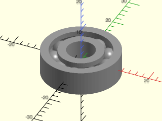
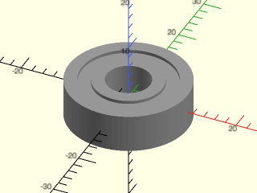
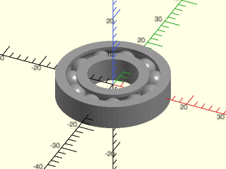
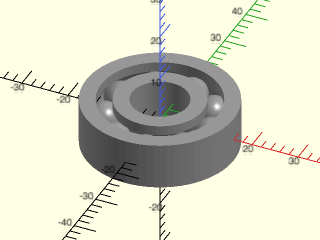
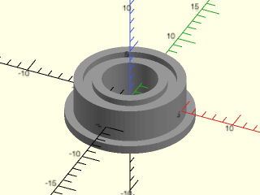
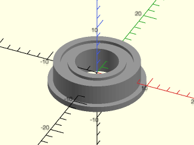
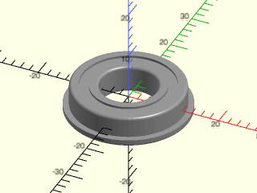

# LibFile: ball\_bearings.scad

Models for standard ball bearing cartridges.

To use, add the following lines to the beginning of your file:

    include <BOSL2/std.scad>
    include <BOSL2/ball_bearings.scad>

## File Contents

1. [Section: Ball Bearing Models](#section-ball-bearing-models)
    - [`ball_bearing()`](#module-ball_bearing) – Creates a standardized ball bearing assembly. [<abbr>Geom</abbr>]

2. [Section: Ball Bearing Info](#section-ball-bearing-info)
    - [`ball_bearing_info()`](#function-ball_bearing_info) – Returns dimensional and feature information for a standardized ball bearing assembly.

## Section: Ball Bearing Models

### Module: ball\_bearing()

**Synopsis:** Creates a standardized ball bearing assembly. [<abbr>Geom</abbr>]

**Topics:** [Parts](Topics#parts), [Bearings](Topics#bearings)

**See Also:** [linear\_bearing()](linear_bearings.scad#module-linear_bearing), [lmXuu\_bearing()](linear_bearings.scad#module-lmxuu_bearing), [lmXuu\_housing()](linear_bearings.scad#module-lmxuu_housing)

**Usage:** 

- ball_bearing(trade_size, [rounding=], [anchor=], [spin=], [orient=]) [ATTACHMENTS];
- ball_bearing(info, [rounding=], [anchor=], [spin=], [orient=]) [ATTACHMENTS];
- ball_bearing(id=, od=, width=, [shield=], [flange=], [fd=], [fw=], [rounding=], [anchor=], [spin=], [orient=]) [ATTACHMENTS];

**Description:** 

Creates a model of a ball bearing assembly. A trade size string selects the complete catalog record.
You can also pass a bearing-info struct returned by `ball_bearing_info(..., struct=true)` as the first
argument.  With either form, id, od, width, shield, flange, fd, and fw are ignored.  Omit the first
argument to give custom dimensions.
The table contains nominal envelopes from the catalogs cited in the source. Check the manufacturer's
drawing for a critical fit, particularly flange dimensions. Rounding is independent of the bearing data.

**Arguments:** 

<abbr title="These args can be used by position or by name.">By&nbsp;Position</abbr> | What it does
-------------------- | ------------
`trade_size`         | String name of a standard ball bearing trade size, such as "608", "6902ZZ", or "R8", or a bearing-info struct returned by `ball_bearing_info(..., struct=true)`.
`id`                 | Inner diameter of ball bearing assembly.
`od`                 | Outer diameter of ball bearing assembly.
`width`              | Width of ball bearing assembly.
`shield`             | If true, the custom ball bearing assembly has a shield. Default for custom dimensions: true
`flange`             | If true, the custom ball bearing assembly has a flange. Default for custom dimensions: false
`fd`                 | Diameter of the flange (required with custom dimensions and flange=true).
`fw`                 | Width of the flange (required with custom dimensions and flange=true).
`rounding`           | Edge rounding radius, if any. The outermost top and bottom edges are rounded by this amount. The edges of the inner hole are also rounded. If you set `trade_size` and you want edges rounded, you must set `rounding` yourself. This parameter has no default value because the rounding depends on manufacturer and bearing size.
`anchor`             | Translate so anchor point is at origin (0,0,0).  See [anchor](attachments.scad#subsection-anchor).  Default: `CENTER`
`spin`               | Rotate this many degrees around the Z axis after anchor.  See [spin](attachments.scad#subsection-spin).  Default: `0`
`orient`             | Vector to rotate top towards, after spin.  See [orient](attachments.scad#subsection-orient).  Default: `UP`

**Example 1:** 

    include <BOSL2/std.scad>
    include <BOSL2/ball_bearings.scad>
    ball_bearing("608", $fn=72);

  

**Example 2:** 

    include <BOSL2/std.scad>
    include <BOSL2/ball_bearings.scad>
    ball_bearing("608ZZ", $fn=72);

  

**Example 3:** 

    include <BOSL2/std.scad>
    include <BOSL2/ball_bearings.scad>
    ball_bearing("R8", $fn=72);

  

**Example 4:** 

    include <BOSL2/std.scad>
    include <BOSL2/ball_bearings.scad>
    ball_bearing(id=12,od=32,width=10,shield=false, $fn=72);

  

**Example 5:** 

    include <BOSL2/std.scad>
    include <BOSL2/ball_bearings.scad>
    ball_bearing("MF105ZZ", $fn=72);

  

**Example 6:** 

    include <BOSL2/std.scad>
    include <BOSL2/ball_bearings.scad>
    ball_bearing("F688ZZ", $fn=72);

  

**Example 7:** With flange, shield, and rounded edges.

 

    include <BOSL2/std.scad>
    include <BOSL2/ball_bearings.scad>
    ball_bearing(id=12,od=24,width=6,shield=true, flange=true, fd=26.5, fw=1.5, rounding=0.6, $fn=72);

**Example 8:** Create bearing data now and use it later.

    include <BOSL2/std.scad>
    include <BOSL2/ball_bearings.scad>
    info = ball_bearing_info("608ZZ", struct=true);
    ball_bearing(info, $fn=72);

  

---

## Section: Ball Bearing Info

### Function: ball\_bearing\_info()

**Synopsis:** Returns dimensional and feature information for a standardized ball bearing assembly.

**Topics:** [Parts](Topics#parts), [Bearings](Topics#bearings)

**See Also:** [ball\_bearing()](#module-ball_bearing), [linear\_bearing()](linear_bearings.scad#module-linear_bearing), [lmXuu\_info()](linear_bearings.scad#function-lmxuu_info), [struct\_val()](structs.scad#function-struct_val), [echo\_struct()](structs.scad#functionmodule-echo_struct)

**Usage:** 

- info = ball_bearing_info(trade_size);
- info = ball_bearing_info(trade_size, struct=true);

**Description:** 

Returns nominal dimensional and feature information for a metric or inch-series ball bearing cartridge.
By default, returns the legacy array
`[INNER_DIAM, OUTER_DIAM, WIDTH, SHIELDED, FLANGED, FLANGE_DIAM, FLANGE_WIDTH]`.
If `struct=true`, returns the same bearing information as a struct, suitable for passing directly
to [`ball_bearing()`](#module-ball_bearing).  All dimensions are in millimeters.

The returned struct contains the following fields:

Key              | Type    | Description
---------------- | ------- | -------------------------------------------------------------
`"trade_size"`   | string  | Bearing designation, such as `"608ZZ"` or `"R8"`.
`"inner_diam"`   | number  | Inner diameter of the bearing.
`"outer_diam"`   | number  | Outer diameter of the bearing.
`"width"`        | number  | Overall axial width of the bearing.
`"shielded"`     | boolean | True if the bearing is shielded.
`"flanged"`      | boolean | True if the bearing has a flange.
`"flange_diam"`  | number  | Outside diameter of the flange.  Zero if unflanged.
`"flange_width"` | number  | Axial width of the flange.  Zero if unflanged.

**Arguments:** 

<abbr title="These args can be used by position or by name.">By&nbsp;Position</abbr> | What it does
-------------------- | ------------
`trade_size`         | String designation of a supported bearing, such as "608ZZ", "R8", or "MF105ZZ".
`struct`             | If true, return a struct instead of the legacy array.  Default: false

**Example 1:** Legacy array return

    include <BOSL2/std.scad>
    include <BOSL2/ball_bearings.scad>
    info = ball_bearing_info("608ZZ");
    assert(info == [8,22,7,true,false,0,0]);

  

**Example 2:** Struct return

    include <BOSL2/std.scad>
    include <BOSL2/ball_bearings.scad>
    info = ball_bearing_info("608ZZ", struct=true);
    assert(struct_val(info,"outer_diam") == 22);

  

**Example 3:** Pass the returned struct directly to ball\_bearing()

    include <BOSL2/std.scad>
    include <BOSL2/ball_bearings.scad>
    info = ball_bearing_info("608ZZ", struct=true);
    ball_bearing(info, $fn=72);

  

---

