# LibFile: beziers.scad

Bezier curves and surfaces are ways to represent smooth curves and smoothly curving
surfaces with a set of control points.  The curve or surface is defined by
the control points, but usually passes through only the first and last control point (the endpoints).
This file provides some
aids to constructing the control points, and highly optimized functions for
computing the Bezier curves and surfaces given by the control points,

To use, add the following lines to the beginning of your file:

    include <BOSL2/std.scad>

**Terminology:** 

Name | Definition
---- | ----------
Path | A series of points joined by straight line segements.
Bezier Curve | A polynomial curve defined by a list of control points.  The curve starts at the first control point and ends at the last one.  The other control points define the shape of the curve and they are often *NOT* on the curve
Control Point | A point that influences the shape of the Bezier curve.
Degree | The degree of the polynomial used to make the bezier curve.  A bezier curve of degree N has N+1 control points.  Most beziers are cubic (degree 3).  The higher the degree, the more the curve can wiggle.
Bezier Parameter | A parameter, usually `u` below, that ranges from 0 to 1 to trace out the bezier curve.  When `u=0` you get the first control point and when `u=1` you get the last control point. Intermediate points are traced out *non-uniformly*.
Bezier Path | A list of bezier control points corresponding to a series of Bezier curves that connect together, end to end.  Because they connect, the endpoints are shared between control points and are not repeated, so a degree 3 bezier path representing two bezier curves has seven entries to represent two sets of four control points.    **NOTE:** A "bezier path" is *NOT* a standard path
Bezier Patch | A two-dimensional arrangement of Bezier control points that generate a bounded curved Bezier surface.  A Bezier patch is a (N+1) by (M+1) grid of control points, which defines surface with four edges (in the non-degenerate case).
Bezier Surface | A surface defined by a list of one or more bezier patches.
Spline Steps | The number of straight-line segments used to approximate a Bezier curve.  The more spline steps, the better the approximation to the curve, but the slower it generates.  This plays a role analogous to `$fn` for circles.  Usually defaults to 16.

## File Contents

1. [Section: Bezier Curves](#section-bezier-curves)
    - [`bezier_points()`](#function-bezier_points) – Computes one or more specified points along a bezier curve. [<abbr>Path</abbr>]
    - [`bezier_curve()`](#function-bezier_curve) – Computes a specified number of points on a bezier curve. [<abbr>Path</abbr>]
    - [`bezier_derivative()`](#function-bezier_derivative) – Evaluates the derivative of the bezier curve at the given point or points.
    - [`bezier_tangent()`](#function-bezier_tangent) – Calculates unit tangent vectors along the bezier curve at one or more given positions.
    - [`bezier_curvature()`](#function-bezier_curvature) – Returns the curvature at one or more given positions along a bezier curve.
    - [`bezier_closest_point()`](#function-bezier_closest_point) – Finds the closest position on a bezier curve to a given point.
    - [`bezier_length()`](#function-bezier_length) – Approximate the length of part of a bezier curve.
    - [`bezier_line_intersection()`](#function-bezier_line_intersection) – Calculates where a bezier curve intersects a line.

2. [Section: Bezier Path Functions](#section-bezier-path-functions)
    - [`bezpath_points()`](#function-bezpath_points) – Computes one or more specified points along a bezier path. [<abbr>Path</abbr>]
    - [`bezpath_curve()`](#function-bezpath_curve) – Converts bezier path into a path of points. [<abbr>Path</abbr>]
    - [`bezpath_closest_point()`](#function-bezpath_closest_point) – Finds the closest point on a bezier path to a given point.
    - [`bezpath_length()`](#function-bezpath_length) – Approximate the length of a bezier path.
    - [`path_to_bezpath()`](#function-path_to_bezpath) – Generates a bezier path that passes through all points in a given linear path. [<abbr>Path</abbr>]
    - [`bezpath_close_to_axis()`](#function-bezpath_close_to_axis) – Closes a 2D bezier path to the specified axis. [<abbr>Path</abbr>]
    - [`bezpath_offset()`](#function-bezpath_offset) – Forms a closed bezier path loop with a translated and reversed copy of itself. [<abbr>Path</abbr>]

3. [Section: Cubic Bezier Path Construction](#section-cubic-bezier-path-construction)
    - [`bez_begin()`](#function-bez_begin) – Calculates starting bezier path control points.
    - [`bez_tang()`](#function-bez_tang) – Calculates control points for a smooth bezier path joint.
    - [`bez_joint()`](#function-bez_joint) – Calculates control points for a disjointed corner bezier path joint.
    - [`bez_end()`](#function-bez_end) – Calculates ending bezier path control points.

4. [Section: Bezier Surfaces](#section-bezier-surfaces)
    - [`is_bezier_patch()`](#function-is_bezier_patch) – Returns true if the given item is a bezier patch.
    - [`bezier_patch_flat()`](#function-bezier_patch_flat) – Creates a flat bezier patch.
    - [`bezier_patch_reverse()`](#function-bezier_patch_reverse) – Reverses the orientation of a bezier patch.
    - [`bezier_patch_points()`](#function-bezier_patch_points) – Computes one or more specified points across a bezier surface patch.
    - [`bezier_vnf()`](#function-bezier_vnf) – Generates a (probably non-manifold) VNF for one or more bezier surface patches. [<abbr>VNF</abbr>]
    - [`bezier_vnf_degenerate_patch()`](#function-bezier_vnf_degenerate_patch) – Generates a VNF for a degenerate bezier surface patch. [<abbr>VNF</abbr>]
    - [`bezier_patch_normals()`](#function-bezier_patch_normals) – Computes surface normals for one or more places on a bezier surface patch.
    - [`bezier_sheet()`](#function-bezier_sheet) – Creates a thin sheet from a bezier patch by extruding in normal to the patch [<abbr>VNF</abbr>]
    - [`bezier_sweep()`](#functionmodule-bezier_sweep) – Sweep a 2d polygon path along a bezier with exact tangents [<abbr>VNF</abbr>] [<abbr>Geom</abbr>]
    - [`bezpath_sweep()`](#functionmodule-bezpath_sweep) – Sweep a 2d polygon path along a bezier path with exact tangents [<abbr>VNF</abbr>] [<abbr>Geom</abbr>]

5. [Section: Debugging Beziers](#section-debugging-beziers)
    - [`debug_bezier()`](#module-debug_bezier) – Shows a bezier path and its associated control points. [<abbr>Geom</abbr>]
    - [`debug_bezier_patches()`](#module-debug_bezier_patches) – Shows a bezier surface patch and its associated control points. [<abbr>Geom</abbr>]

## Section: Bezier Curves

### Function: bezier\_points()

**Synopsis:** Computes one or more specified points along a bezier curve. [<abbr>Path</abbr>]

**Topics:** [Bezier Curves](Topics#bezier-curves)

**See Also:** [bezier\_curve()](#function-bezier_curve), [bezier\_curvature()](#function-bezier_curvature), [bezier\_tangent()](#function-bezier_tangent), [bezier\_derivative()](#function-bezier_derivative)

**Usage:** 

- pt = bezier_points(bezier, u);
- ptlist = bezier_points(bezier, RANGE);
- ptlist = bezier_points(bezier, LIST);

**Description:** 

Computes points on a bezier curve with control points specified by `bezier` at parameter values
specified by `u`, which can be a scalar or a list.  The value `u=0` gives the first endpoint; `u=1` gives the final endpoint,
and intermediate values of `u` fill in the curve in a non-uniform fashion.  This function uses an optimized method that
works best when `u` is a long list and the bezier degree is 10 or less.  The degree of the bezier
curve is `len(bezier)-1`.

Note that if you have a bezier **path** (see below) then you should use [`bezpath_points()`](#function-bezpath_points) to
evaluate the points on that bezier path.  This function is for a single bezier.

**Arguments:** 

<abbr title="These args can be used by position or by name.">By&nbsp;Position</abbr> | What it does
-------------------- | ------------
`bezier`             | The list of endpoints and control points for this bezier curve.
`u`                  | Parameter values for evaluating the curve, given as a single value, a list or a range.

**Example 1:** Quadratic (Degree 2) Bezier.

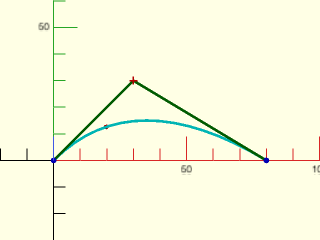

    include <BOSL2/std.scad>
    bez = [[0,0], [30,30], [80,0]];
    debug_bezier(bez, N=len(bez)-1);
    translate(bezier_points(bez, 0.3)) color("red") sphere(1);

  

**Example 2:** Cubic (Degree 3) Bezier

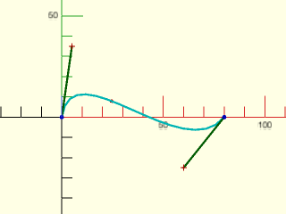

    include <BOSL2/std.scad>
    bez = [[0,0], [5,35], [60,-25], [80,0]];
    debug_bezier(bez, N=len(bez)-1);
    translate(bezier_points(bez, 0.4)) color("red") sphere(1);

  

**Example 3:** Degree 4 Bezier.

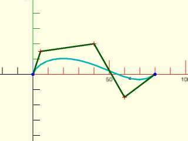

    include <BOSL2/std.scad>
    bez = [[0,0], [5,15], [40,20], [60,-15], [80,0]];
    debug_bezier(bez, N=len(bez)-1);
    translate(bezier_points(bez, 0.8)) color("red") sphere(1);

  

**Example 4:** Giving a List of `u`

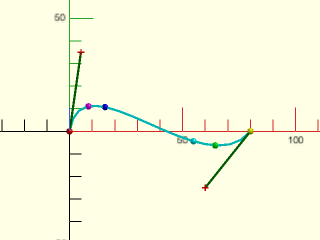

    include <BOSL2/std.scad>
    bez = [[0,0], [5,35], [60,-25], [80,0]];
    debug_bezier(bez, N=len(bez)-1);
    pts = bezier_points(bez, [0, 0.2, 0.3, 0.7, 0.8, 1]);
    rainbow(pts) move($item) sphere(1.5, $fn=12);

  

**Example 5:** Giving a Range of `u`

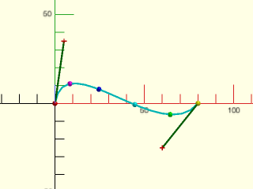

    include <BOSL2/std.scad>
    bez = [[0,0], [5,35], [60,-25], [80,0]];
    debug_bezier(bez, N=len(bez)-1);
    pts = bezier_points(bez, [0:0.2:1]);
    rainbow(pts) move($item) sphere(1.5, $fn=12);

  

---

### Function: bezier\_curve()

**Synopsis:** Computes a specified number of points on a bezier curve. [<abbr>Path</abbr>]

**Topics:** [Bezier Curves](Topics#bezier-curves)

**See Also:** [bezier\_curvature()](#function-bezier_curvature), [bezier\_tangent()](#function-bezier_tangent), [bezier\_derivative()](#function-bezier_derivative), [bezier\_points()](#function-bezier_points)

**Usage:** 

- path = bezier_curve(bezier, [splinesteps], [endpoint]);

**Description:** 

Takes a list of bezier control points and generates splinesteps segments (splinesteps+1 points)
along the bezier curve they define.
Points start at the first control point and are sampled uniformly along the bezier parameter.
The endpoints of the output are *exactly* equal to the first and last bezier control points
when endpoint is true.  If endpoint is false the sampling stops one step before the final point
of the bezier curve, but you still get the same number of (more tightly spaced) points.
The distance between the points are *not* equidistant.
The degree of the bezier curve is one less than the number of points in `curve`.

Note that if you have a bezier **path** (see below) then you should use [`bezpath_curve()`](#function-bezpath_curve) to
evaluate the that bezier path.  This function is for a single bezier.

**Arguments:** 

<abbr title="These args can be used by position or by name.">By&nbsp;Position</abbr> | What it does
-------------------- | ------------
`bezier`             | The list of control points that define the Bezier curve.
`splinesteps`        | The number of segments to create on the bezier curve.  Default: 16
`endpoint`           | if false then exclude the endpoint.  Default: True

**Example 1:** Quadratic (Degree 2) Bezier.

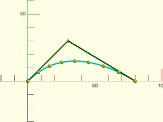

    include <BOSL2/std.scad>
    bez = [[0,0], [30,30], [80,0]];
    move_copies(bezier_curve(bez, 8)) sphere(r=1.5, $fn=12);
    debug_bezier(bez, N=len(bez)-1);

  

**Example 2:** Cubic (Degree 3) Bezier

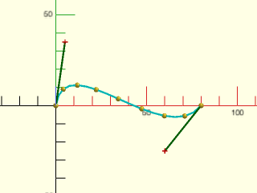

    include <BOSL2/std.scad>
    bez = [[0,0], [5,35], [60,-25], [80,0]];
    move_copies(bezier_curve(bez, 8)) sphere(r=1.5, $fn=12);
    debug_bezier(bez, N=len(bez)-1);

  

**Example 3:** Degree 4 Bezier.

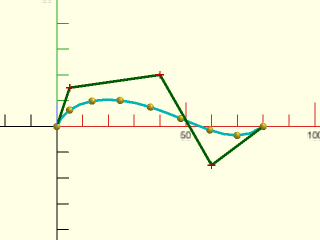

    include <BOSL2/std.scad>
    bez = [[0,0], [5,15], [40,20], [60,-15], [80,0]];
    move_copies(bezier_curve(bez, 8)) sphere(r=1.5, $fn=12);
    debug_bezier(bez, N=len(bez)-1);

  

---

### Function: bezier\_derivative()

**Synopsis:** Evaluates the derivative of the bezier curve at the given point or points.

**Topics:** [Bezier Curves](Topics#bezier-curves)

**See Also:** [bezier\_curvature()](#function-bezier_curvature), [bezier\_tangent()](#function-bezier_tangent), [bezier\_points()](#function-bezier_points)

**Usage:** 

- deriv = bezier_derivative(bezier, u, [order]);
- derivs = bezier_derivative(bezier, LIST, [order]);
- derivs = bezier_derivative(bezier, RANGE, [order]);

**Description:** 

Evaluates the derivative of the bezier curve at the given parameter value or values, `u`.  The `order` gives the order of the derivative.
The degree of the bezier curve is one less than the number of points in `bezier`.

**Arguments:** 

<abbr title="These args can be used by position or by name.">By&nbsp;Position</abbr> | What it does
-------------------- | ------------
`bezier`             | The list of control points that define the Bezier curve.
`u`                  | Parameter values for evaluating the curve, given as a single value, a list or a range.
`order`              | The order of the derivative to return.  Default: 1 (for the first derivative)

---

### Function: bezier\_tangent()

**Synopsis:** Calculates unit tangent vectors along the bezier curve at one or more given positions.

**Topics:** [Bezier Curves](Topics#bezier-curves)

**See Also:** [bezier\_curvature()](#function-bezier_curvature), [bezier\_derivative()](#function-bezier_derivative), [bezier\_points()](#function-bezier_points)

**Usage:** 

- tanvec = bezier_tangent(bezier, u);
- tanvecs = bezier_tangent(bezier, LIST);
- tanvecs = bezier_tangent(bezier, RANGE);

**Description:** 

Returns the unit tangent vector at the given parameter values on a bezier curve with control points `bezier`.

**Arguments:** 

<abbr title="These args can be used by position or by name.">By&nbsp;Position</abbr> | What it does
-------------------- | ------------
`bezier`             | The list of control points that define the Bezier curve.
`u`                  | Parameter values for evaluating the curve, given as a single value, a list or a range.

---

### Function: bezier\_curvature()

**Synopsis:** Returns the curvature at one or more given positions along a bezier curve.

**Topics:** [Bezier Curves](Topics#bezier-curves)

**See Also:** [bezier\_tangent()](#function-bezier_tangent), [bezier\_derivative()](#function-bezier_derivative), [bezier\_points()](#function-bezier_points)

**Usage:** 

- crv = bezier_curvature(curve, u);
- crvlist = bezier_curvature(curve, LIST);
- crvlist = bezier_curvature(curve, RANGE);

**Description:** 

Returns the curvature value for the given parameters `u` on the bezier curve with control points `bezier`.
The curvature is the inverse of the radius of the tangent circle at the given point.
Thus, the tighter the curve, the larger the curvature value.  Curvature is 0 for
a position with no curvature, since 1/0 is not a number.

**Arguments:** 

<abbr title="These args can be used by position or by name.">By&nbsp;Position</abbr> | What it does
-------------------- | ------------
`bezier`             | The list of control points that define the Bezier curve.
`u`                  | Parameter values for evaluating the curve, given as a single value, a list or a range.

---

### Function: bezier\_closest\_point()

**Synopsis:** Finds the closest position on a bezier curve to a given point.

**Topics:** [Bezier Curves](Topics#bezier-curves)

**See Also:** [bezier\_points()](#function-bezier_points)

**Usage:** 

- u = bezier_closest_point(bezier, pt, [max_err]);

**Description:** 

Finds the closest part of the given bezier curve to point `pt`.
The degree of the curve, N, is one less than the number of points in `curve`.
Returns `u` for the closest position on the bezier curve to the given point `pt`.

**Arguments:** 

<abbr title="These args can be used by position or by name.">By&nbsp;Position</abbr> | What it does
-------------------- | ------------
`bezier`             | The list of control points that define the Bezier curve.
`pt`                 | The point to find the closest curve point to.
`max_err`            | The maximum allowed error when approximating the closest approach.

**Example 1:** 

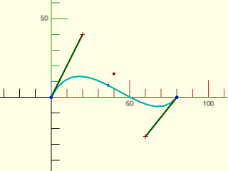

    include <BOSL2/std.scad>
    pt = [40,15];
    bez = [[0,0], [20,40], [60,-25], [80,0]];
    u = bezier_closest_point(bez, pt);
    debug_bezier(bez, N=len(bez)-1);
    color("red") translate(pt) sphere(r=1);
    color("blue") translate(bezier_points(bez,u)) sphere(r=1);

  

---

### Function: bezier\_length()

**Synopsis:** Approximate the length of part of a bezier curve.

**Topics:** [Bezier Curves](Topics#bezier-curves)

**See Also:** [bezier\_points()](#function-bezier_points)

**Usage:** 

- pathlen = bezier_length(bezier, [start_u], [end_u], [max_deflect]);

**Description:** 

Approximates the length of the portion of the bezier curve between start_u and end_u.

**Arguments:** 

<abbr title="These args can be used by position or by name.">By&nbsp;Position</abbr> | What it does
-------------------- | ------------
`bezier`             | The list of control points that define the Bezier curve.
`start_u`            | The Bezier parameter to start measuring measuring from.  Between 0 and 1.
`end_u`              | The Bezier parameter to end measuring at.  Between 0 and 1.  Greater than start_u.
`max_deflect`        | The largest amount of deflection from the true curve to allow for approximation.

**Example 1:** 

    include <BOSL2/std.scad>
    bez = [[0,0], [5,35], [60,-25], [80,0]];
    echo(bezier_length(bez));

  

---

### Function: bezier\_line\_intersection()

**Synopsis:** Calculates where a bezier curve intersects a line.

**Topics:** [Bezier Curves](Topics#bezier-curves), [Geometry](Topics#geometry), [Intersection](Topics#intersection)

**See Also:** [bezier\_points()](#function-bezier_points), [bezier\_length()](#function-bezier_length), [bezier\_closest\_point()](#function-bezier_closest_point)

**Usage:** 

- u = bezier_line_intersection(bezier, line);

**Description:** 

Finds the intersection points of the 2D Bezier curve with control points `bezier` and the given line, specified as a pair of points.
Returns the intersection as a list of `u` values for the Bezier.

**Arguments:** 

<abbr title="These args can be used by position or by name.">By&nbsp;Position</abbr> | What it does
-------------------- | ------------
`bezier`             | The list of control points that define a 2D Bezier curve.
`line`               | a list of two distinct 2d points defining a line

---

## Section: Bezier Path Functions

To contruct more complicated curves you can connect a sequence of Bezier curves end to end.
A Bezier path is a flattened list of control points that, along with the degree, represents such a sequence of bezier curves where all of the curves have the same degree.
A Bezier path looks like a regular path, since it is just a list of points, but it is not a regular path.  Use [`bezpath_curve()`](#function-bezpath_curve) to convert a Bezier path to a regular path.
We interpret a degree N Bezier path as groups of N+1 control points that
share endpoints, so they overlap by one point.  So if you have an order 3 bezier path `[p0,p1,p2,p3,p4,p5,p6]` then the first
Bezier curve control point set is `[p0,p1,p2,p3]` and the second one is `[p3,p4,p5,p6]`.  The endpoint, `p3`, is shared between the control point sets.
The Bezier degree, which must be known to interpret the Bezier path, defaults to 3.

### Function: bezpath\_points()

**Synopsis:** Computes one or more specified points along a bezier path. [<abbr>Path</abbr>]

**Topics:** [Bezier Paths](Topics#bezier-paths)

**See Also:** [bezier\_points()](#function-bezier_points), [bezier\_curve()](#function-bezier_curve)

**Usage:** 

- pt = bezpath_points(bezpath, curveind, u, [N]);
- ptlist = bezpath_points(bezpath, curveind, LIST, [N]);
- path = bezpath_points(bezpath, curveind, RANGE, [N]);

**Description:** 

Extracts from the Bezier path `bezpath` the control points for the Bezier curve whose index is `curveind` and
computes the point or points on the corresponding Bezier curve specified by `u`.  If `curveind` is zero you
get the first curve.  The number of curves is `(len(bezpath)-1)/N` so the maximum index is that number minus one.

**Arguments:** 

<abbr title="These args can be used by position or by name.">By&nbsp;Position</abbr> | What it does
-------------------- | ------------
`bezpath`            | A Bezier path path to approximate.
`curveind`           | Curve number along the path.
`u`                  | Parameter values for evaluating the curve, given as a single value, a list or a range.
`N`                  | The degree of the Bezier path curves.  Default: 3

---

### Function: bezpath\_curve()

**Synopsis:** Converts bezier path into a path of points. [<abbr>Path</abbr>]

**Topics:** [Bezier Paths](Topics#bezier-paths)

**See Also:** [bezier\_points()](#function-bezier_points), [bezier\_curve()](#function-bezier_curve), [bezpath\_points()](#function-bezpath_points)

**Usage:** 

- path = bezpath_curve(bezpath, [splinesteps], [N], [endpoint], [order=])

**Description:** 

Computes a number of uniformly distributed points along a bezier path.  Optionally also compute derivatives along the path.
If order is not given, returns a list of points on the bezier path, with splinesteps segments in each bezier portion, but
with collinear and duplicate points removed. Even if `endpoint=true`, if the curve's first and last points are equal
then the last point is not returned.  Points are always returned at the locations where the individual beziers join,
where corners may be located.

If order is a number or list of numbers then compute derivatives of the specified order(s) and return a list of paths, where
the first entry in the list is the bezier curve and subsequent entries are derivatives of the specified orders.  At the points
where beziers join, returns an average derivative, `(unit(a)+unit(b))*(norm(a)+norm(b))/4`, which has the average direction
and average length of the derivatives from two two curves.

**Arguments:** 

<abbr title="These args can be used by position or by name.">By&nbsp;Position</abbr> | What it does
-------------------- | ------------
`bezpath`            | A bezier path to approximate.
`splinesteps`        | Number of straight lines to split each bezier curve into. default=16
`N`                  | The degree of the bezier curves.  Cubic beziers have N=3.  Default: 3
`endpoint`           | If true, include the last point of the bezier path.  Default: true

<abbr title="These args must be used by name, ie: name=value">By&nbsp;Name</abbr> | What it does
-------------------- | ------------
`order`              | Orders of derivative to compute.  Default: []

**Example 1:** 

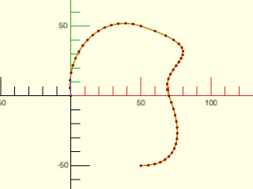

    include <BOSL2/std.scad>
    bez = [
        [0,0], [-5,30],
        [20,60], [50,50], [110,30],
        [60,25], [70,0], [80,-25],
        [80,-50], [50,-50]
    ];
    path = bezpath_curve(bez);
    stroke(path,dots=true,dots_color="red");

  

---

### Function: bezpath\_closest\_point()

**Synopsis:** Finds the closest point on a bezier path to a given point.

**Topics:** [Bezier Paths](Topics#bezier-paths)

**See Also:** [bezpath\_points()](#function-bezpath_points), [bezpath\_curve()](#function-bezpath_curve), [bezier\_points()](#function-bezier_points), [bezier\_curve()](#function-bezier_curve), [bezier\_closest\_point()](#function-bezier_closest_point)

**Usage:** 

- res = bezpath_closest_point(bezpath, pt, [N], [max_err]);

**Description:** 

Finds an approximation to the closest part of the given bezier path to point `pt`.
Returns [segnum, u] for the closest position on the bezier path to the given point `pt`.

**Arguments:** 

<abbr title="These args can be used by position or by name.">By&nbsp;Position</abbr> | What it does
-------------------- | ------------
`bezpath`            | A bezier path to approximate.
`pt`                 | The point to find the closest curve point to.
`N`                  | The degree of the bezier curves.  Cubic beziers have N=3.  Default: 3
`max_err`            | The maximum allowed error when approximating the closest approach.

**Example 1:** 

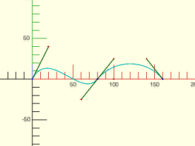

    include <BOSL2/std.scad>
    pt = [100,0];
    bez = [[0,0], [20,40], [60,-25], [80,0],
           [100,25], [140,25], [160,0]];
    pos = bezpath_closest_point(bez, pt);
    xy = bezpath_points(bez,pos[0],pos[1]);
    debug_bezier(bez, N=3);
    color("red") translate(pt) sphere(r=1);
    color("blue") translate(xy) sphere(r=1);

  

---

### Function: bezpath\_length()

**Synopsis:** Approximate the length of a bezier path.

**Topics:** [Bezier Paths](Topics#bezier-paths)

**See Also:** [bezier\_points()](#function-bezier_points), [bezier\_curve()](#function-bezier_curve), [bezier\_length()](#function-bezier_length)

**Usage:** 

- plen = bezpath_length(path, [N], [max_deflect]);

**Description:** 

Approximates the length of the bezier path.

**Arguments:** 

<abbr title="These args can be used by position or by name.">By&nbsp;Position</abbr> | What it does
-------------------- | ------------
`path`               | A bezier path to approximate.
`N`                  | The degree of the bezier curves.  Cubic beziers have N=3.  Default: 3
`max_deflect`        | The largest amount of deflection from the true curve to allow for approximation.

---

### Function: path\_to\_bezpath()

**Synopsis:** Generates a bezier path that passes through all points in a given linear path. [<abbr>Path</abbr>]

**Topics:** [Bezier Paths](Topics#bezier-paths), [Rounding](Topics#rounding)

**See Also:** [path\_tangents()](paths.scad#function-path_tangents)

**Usage:** 

- bezpath = path_to_bezpath(path, [closed], [tangents], [uniform], [size=]|[relsize=]);

**Description:** 

Given a 2d or 3d input path and optional list of tangent vectors, computes a cubic (degree 3) bezier
path that passes through every point on the input path and matches the tangent vectors. If you do not
supply the tangents then they are computed using `path_tangents()` with `uniform=false` by default.
Only the direction of the tangent vectors matter, not their magnitudes.
If the path is closed, specify this by setting `closed=true`.
The `size` or `relsize` parameter determines how far the curve can deviate from
the input path.  In the case where the curve has a single hump, the size specifies the exact distance
between the specified path and the bezier.  If you give relsize then it is relative to the segment
length (e.g. 0.05 means 5% of the segment length).  In 2d when the bezier curve makes an S-curve
the size parameter specifies the sum of the deviations of the two peaks of the curve.  In 3-space
the bezier curve may have three extrema: two maxima and one minimum.  In this case the size specifies
the sum of the maxima minus the minimum. Tangents computed on non-uniform data tend
to display overshoots.  See `smooth_path()` for examples.

**Arguments:** 

<abbr title="These args can be used by position or by name.">By&nbsp;Position</abbr> | What it does
-------------------- | ------------
`path`               | 2D or 3D point list or 1-region that the curve must pass through
`closed`             | true if the curve is closed .  Default: false
`tangents`           | tangents constraining curve direction at each point
`uniform`            | set to true to compute tangents with uniform=true.  Default: false

<abbr title="These args must be used by name, ie: name=value">By&nbsp;Name</abbr> | What it does
-------------------- | ------------
`size`               | absolute size specification for the curve, a number or vector
`relsize`            | relative size specification for the curve, a number or vector.  Default: 0.1.

---

### Function: bezpath\_close\_to\_axis()

**Synopsis:** Closes a 2D bezier path to the specified axis. [<abbr>Path</abbr>]

**Topics:** [Bezier Paths](Topics#bezier-paths)

**See Also:** [bezpath\_offset()](#function-bezpath_offset)

**Usage:** 

- bezpath = bezpath_close_to_axis(bezpath, [axis], [N]);

**Description:** 

Takes a 2D bezier path and closes it to the specified axis.

**Arguments:** 

<abbr title="These args can be used by position or by name.">By&nbsp;Position</abbr> | What it does
-------------------- | ------------
`bezpath`            | The 2D bezier path to close to the axis.
`axis`               | The axis to close to, "X", or "Y".  Default: "X"
`N`                  | The degree of the bezier curves.  Cubic beziers have N=3.  Default: 3

**Example 1:** 

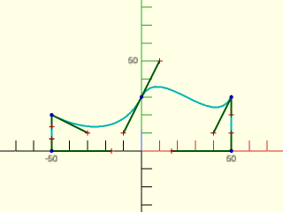

    include <BOSL2/std.scad>
    bez = [[50,30], [40,10], [10,50], [0,30],
           [-10, 10], [-30,10], [-50,20]];
    closed = bezpath_close_to_axis(bez);
    debug_bezier(closed);

  

**Example 2:** 

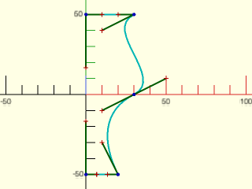

    include <BOSL2/std.scad>
    bez = [[30,50], [10,40], [50,10], [30,0],
           [10, -10], [10,-30], [20,-50]];
    closed = bezpath_close_to_axis(bez, axis="Y");
    debug_bezier(closed);

  

---

### Function: bezpath\_offset()

**Synopsis:** Forms a closed bezier path loop with a translated and reversed copy of itself. [<abbr>Path</abbr>]

**Topics:** [Bezier Paths](Topics#bezier-paths)

**See Also:** [bezpath\_close\_to\_axis()](#function-bezpath_close_to_axis)

**Usage:** 

- bezpath = bezpath_offset(offset, bezier, [N]);

**Description:** 

Takes a 2D bezier path and closes it with a matching reversed path that is offset by the given `offset` [X,Y] distance.

**Arguments:** 

<abbr title="These args can be used by position or by name.">By&nbsp;Position</abbr> | What it does
-------------------- | ------------
`offset`             | Amount to offset second path by.
`bezier`             | The 2D bezier path.
`N`                  | The degree of the bezier curves.  Cubic beziers have N=3.  Default: 3

**Example 1:** 

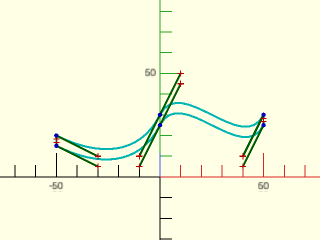

 

    include <BOSL2/std.scad>
    bez = [[50,30], [40,10], [10,50], [0,30], [-10, 10], [-30,10], [-50,20]];
    closed = bezpath_offset([0,-5], bez);
    debug_bezier(closed);

**Example 2:** 

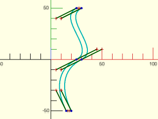

 

    include <BOSL2/std.scad>
    bez = [[30,50], [10,40], [50,10], [30,0], [10, -10], [10,-30], [20,-50]];
    closed = bezpath_offset([-5,0], bez);
    debug_bezier(closed);

---

## Section: Cubic Bezier Path Construction

### Function: bez\_begin()

**Synopsis:** Calculates starting bezier path control points.

**Topics:** [Bezier Paths](Topics#bezier-paths)

**See Also:** [bez\_tang()](#function-bez_tang), [bez\_joint()](#function-bez_joint), [bez\_end()](#function-bez_end)

**Usage:** 

- pts = bez_begin(pt, a, r, [p=]);
- pts = bez_begin(pt, VECTOR, [r], [p=]);

**Description:** 

This is used to create the first endpoint and control point of a cubic bezier path.

**Arguments:** 

<abbr title="These args can be used by position or by name.">By&nbsp;Position</abbr> | What it does
-------------------- | ------------
`pt`                 | The starting endpoint for the bezier path.
`a`                  | If given a scalar, specifies the theta (XY plane) angle in degrees from X+.  If given a vector, specifies the direction and possibly distance of the first control point.
`r`                  | Specifies the distance of the control point from the endpoint `pt`.

<abbr title="These args must be used by name, ie: name=value">By&nbsp;Name</abbr> | What it does
-------------------- | ------------
`p`                  | If given, specifies the number of degrees away from the Z+ axis.

**Example 1:** 2D Bezier Path by Angle

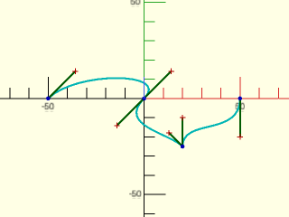

    include <BOSL2/std.scad>
    bezpath = flatten([
        bez_begin([-50,  0],  45,20),
        bez_tang ([  0,  0],-135,20),
        bez_joint([ 20,-25], 135, 90, 10, 15),
        bez_end  ([ 50,  0], -90,20),
    ]);
    debug_bezier(bezpath);

  

**Example 2:** 2D Bezier Path by Vector

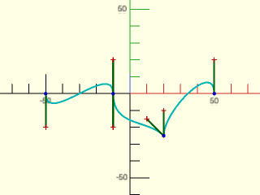

    include <BOSL2/std.scad>
    bezpath = flatten([
        bez_begin([-50,0],[0,-20]),
        bez_tang ([-10,0],[0,-20]),
        bez_joint([ 20,-25], [-10,10], [0,15]),
        bez_end  ([ 50,0],[0, 20]),
    ]);
    debug_bezier(bezpath);

  

**Example 3:** 2D Bezier Path by Vector and Distance

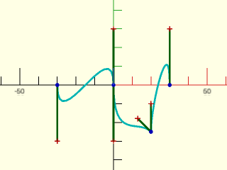

    include <BOSL2/std.scad>
    bezpath = flatten([
        bez_begin([-30,0],FWD, 30),
        bez_tang ([  0,0],FWD, 30),
        bez_joint([ 20,-25], 135, 90, 10, 15),
        bez_end  ([ 30,0],BACK,30),
    ]);
    debug_bezier(bezpath);

  

**Example 4:** 3D Bezier Path by Angle

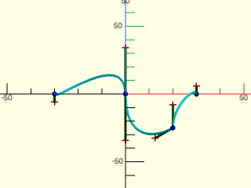

    include <BOSL2/std.scad>
    bezpath = flatten([
        bez_begin([-30,0,0],90,20,p=135),
        bez_tang ([  0,0,0],-90,20,p=135),
        bez_joint([20,-25,0], 135, 90, 15, 10, p1=135, p2=45),
        bez_end  ([ 30,0,0],-90,20,p=45),
    ]);
    debug_bezier(bezpath);

  

**Example 5:** 3D Bezier Path by Vector

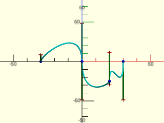

    include <BOSL2/std.scad>
    bezpath = flatten([
        bez_begin([-30,0,0],[0,-20, 20]),
        bez_tang ([  0,0,0],[0,-20,-20]),
        bez_joint([20,-25,0],[0,10,-10],[0,15,15]),
        bez_end  ([ 30,0,0],[0,-20,-20]),
    ]);
    debug_bezier(bezpath);

  

**Example 6:** 3D Bezier Path by Vector and Distance

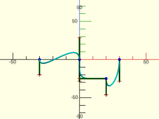

    include <BOSL2/std.scad>
    bezpath = flatten([
        bez_begin([-30,0,0],FWD, 20),
        bez_tang ([  0,0,0],DOWN,20),
        bez_joint([20,-25,0],LEFT,DOWN,r1=20,r2=15),
        bez_end  ([ 30,0,0],DOWN,20),
    ]);
    debug_bezier(bezpath);

  

---

### Function: bez\_tang()

**Synopsis:** Calculates control points for a smooth bezier path joint.

**Topics:** [Bezier Paths](Topics#bezier-paths)

**See Also:** [bez\_begin()](#function-bez_begin), [bez\_joint()](#function-bez_joint), [bez\_end()](#function-bez_end)

**Usage:** 

- pts = bez_tang(pt, a, r1, r2, [p=]);
- pts = bez_tang(pt, VECTOR, [r1], [r2], [p=]);

**Description:** 

This creates a smooth joint in a cubic bezier path.  It creates three points, being the
approaching control point, the fixed bezier control point, and the departing control
point.  The two control points are collinear with the fixed point, making for a
smooth bezier curve at the fixed point. See [`bez_begin()`](#function-bez_begin) for examples.

**Arguments:** 

<abbr title="These args can be used by position or by name.">By&nbsp;Position</abbr> | What it does
-------------------- | ------------
`pt`                 | The fixed point for the bezier path.
`a`                  | If given a scalar, specifies the theta (XY plane) angle in degrees from X+.  If given a vector, specifies the direction and possibly distance of the departing control point.
`r1`                 | Specifies the distance of the approching control point from the fixed point.  Overrides the distance component of the vector if `a` contains a vector.
`r2`                 | Specifies the distance of the departing control point from the fixed point.  Overrides the distance component of the vector if `a` contains a vector.  If `r1` is given and `r2` is not, uses the value of `r1` for `r2`.

<abbr title="These args must be used by name, ie: name=value">By&nbsp;Name</abbr> | What it does
-------------------- | ------------
`p`                  | If given, specifies the number of degrees away from the Z+ axis.

---

### Function: bez\_joint()

**Synopsis:** Calculates control points for a disjointed corner bezier path joint.

**Topics:** [Bezier Paths](Topics#bezier-paths)

**See Also:** [bez\_begin()](#function-bez_begin), [bez\_tang()](#function-bez_tang), [bez\_end()](#function-bez_end)

**Usage:** 

- pts = bez_joint(pt, a1, a2, r1, r2, [p1=], [p2=]);
- pts = bez_joint(pt, VEC1, VEC2, [r1=], [r2=], [p1=], [p2=]);

**Description:** 

This creates a disjoint corner joint in a cubic bezier path.  It creates three points, being
the aproaching control point, the fixed bezier control point, and the departing control point.
The two control points can be directed in different arbitrary directions from the fixed bezier
point. See [`bez_begin()`](#function-bez_begin) for examples.

**Arguments:** 

<abbr title="These args can be used by position or by name.">By&nbsp;Position</abbr> | What it does
-------------------- | ------------
`pt`                 | The fixed point for the bezier path.
`a1`                 | If given a scalar, specifies the theta (XY plane) angle in degrees from X+.  If given a vector, specifies the direction and possibly distance of the approaching control point.
`a2`                 | If given a scalar, specifies the theta (XY plane) angle in degrees from X+.  If given a vector, specifies the direction and possibly distance of the departing control point.
`r1`                 | Specifies the distance of the approching control point from the fixed point.  Overrides the distance component of the vector if `a1` contains a vector.
`r2`                 | Specifies the distance of the departing control point from the fixed point.  Overrides the distance component of the vector if `a2` contains a vector.

<abbr title="These args must be used by name, ie: name=value">By&nbsp;Name</abbr> | What it does
-------------------- | ------------
`p1`                 | If given, specifies the number of degrees away from the Z+ axis of the approaching control point.
`p2`                 | If given, specifies the number of degrees away from the Z+ axis of the departing control point.

---

### Function: bez\_end()

**Synopsis:** Calculates ending bezier path control points.

**Topics:** [Bezier Paths](Topics#bezier-paths)

**See Also:** [bez\_tang()](#function-bez_tang), [bez\_joint()](#function-bez_joint)

**Usage:** 

- pts = bez_end(pt, a, r, [p=]);
- pts = bez_end(pt, VECTOR, [r], [p=]);

**Description:** 

This is used to create the approaching control point, and the endpoint of a cubic bezier path.
See [`bez_begin()`](#function-bez_begin) for examples.

**Arguments:** 

<abbr title="These args can be used by position or by name.">By&nbsp;Position</abbr> | What it does
-------------------- | ------------
`pt`                 | The starting endpoint for the bezier path.
`a`                  | If given a scalar, specifies the theta (XY plane) angle in degrees from X+.  If given a vector, specifies the direction and possibly distance of the first control point.
`r`                  | Specifies the distance of the control point from the endpoint `pt`.
`p`                  | If given, specifies the number of degrees away from the Z+ axis.

---

## Section: Bezier Surfaces

### Function: is\_bezier\_patch()

**Synopsis:** Returns true if the given item is a bezier patch.

**Topics:** [Bezier Patches](Topics#bezier-patches), [Type Checking](Topics#type-checking)

**Usage:** 

- bool = is_bezier_patch(x);

**Description:** 

Returns true if the given item is a bezier patch. (a 2D array of 3D points.)

**Arguments:** 

<abbr title="These args can be used by position or by name.">By&nbsp;Position</abbr> | What it does
-------------------- | ------------
`x`                  | The value to check the type of.

---

### Function: bezier\_patch\_flat()

**Synopsis:** Creates a flat bezier patch.

**Topics:** [Bezier Patches](Topics#bezier-patches)

**See Also:** [bezier\_patch\_points()](#function-bezier_patch_points)

**Usage:** 

- patch = bezier_patch_flat(size, [N=], [spin=], [orient=], [trans=]);

**Description:** 

Returns a flat rectangular bezier patch of degree `N`, centered on the XY plane.

**Arguments:** 

<abbr title="These args can be used by position or by name.">By&nbsp;Position</abbr> | What it does
-------------------- | ------------
`size`               | scalar or 2-vector giving the X and Y dimensions of the patch.

<abbr title="These args must be used by name, ie: name=value">By&nbsp;Name</abbr> | What it does
-------------------- | ------------
`N`                  | Degree of the patch to generate.  Since this is flat, a degree of 1 should usually be sufficient.  Default: 1
`orient`             | A direction vector.  Point the patch normal in this direction.
`spin`               | Spin angle to apply to the patch
`trans`              | Amount to translate patch, after orient and spin.

**Example 1:** 

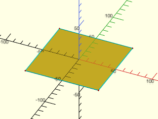

    include <BOSL2/std.scad>
    patch = bezier_patch_flat(size=[100,100]);
    debug_bezier_patches([patch], size=1, showcps=true);

  

---

### Function: bezier\_patch\_reverse()

**Synopsis:** Reverses the orientation of a bezier patch.

**Topics:** [Bezier Patches](Topics#bezier-patches)

**See Also:** [bezier\_patch\_points()](#function-bezier_patch_points), [bezier\_patch\_flat()](#function-bezier_patch_flat)

**Usage:** 

- rpatch = bezier_patch_reverse(patch);

**Description:** 

Reverses the patch, so that the faces generated from it are flipped back to front.

**Arguments:** 

<abbr title="These args can be used by position or by name.">By&nbsp;Position</abbr> | What it does
-------------------- | ------------
`patch`              | The patch to reverse.

---

### Function: bezier\_patch\_points()

**Synopsis:** Computes one or more specified points across a bezier surface patch.

**Topics:** [Bezier Patches](Topics#bezier-patches)

**See Also:** [bezier\_patch\_normals()](#function-bezier_patch_normals), [bezier\_points()](#function-bezier_points), [bezier\_curve()](#function-bezier_curve), [bezpath\_curve()](#function-bezpath_curve)

**Usage:** 

- pt = bezier_patch_points(patch, u, v);
- ptgrid = bezier_patch_points(patch, LIST, LIST);
- ptgrid = bezier_patch_points(patch, RANGE, RANGE);

**Description:** 

Sample a bezier patch on a listed point set.  The bezier patch must be a rectangular array of
points, and it is sampled at all the (u,v) pairs that you specify.  If you give u and v
as single numbers you'll get a single point back.  If you give u and v as lists or ranges you'll
get a 2d rectangular array of points.  If one but not both of u and v is a list or range then you'll
get a list of points.

**Arguments:** 

<abbr title="These args can be used by position or by name.">By&nbsp;Position</abbr> | What it does
-------------------- | ------------
`patch`              | The 2D array of control points for a Bezier patch.
`u`                  | The bezier u parameter (inner list of patch).  Generally between 0 and 1. Can be a list, range or value.
`v`                  | The bezier v parameter (outer list of patch).  Generally between 0 and 1. Can be a list, range or value.

**Example 1:** 

 

    include <BOSL2/std.scad>
    patch = [
        [[-50,-50,  0], [-16,-50,  20], [ 16,-50,  20], [50,-50,  0]],
        [[-50,-16, 20], [-16,-16,  40], [ 16,-16,  40], [50,-16, 20]],
        [[-50, 16, 20], [-16, 16,  40], [ 16, 16,  40], [50, 16, 20]],
        [[-50, 50,  0], [-16, 50,  20], [ 16, 50,  20], [50, 50,  0]]
    ];
    debug_bezier_patches(patches=[patch], size=1, showcps=true);
    pt = bezier_patch_points(patch, 0.6, 0.75);
    translate(pt) color("magenta") sphere(d=3, $fn=12);

**Example 2:** Getting Multiple Points at Once

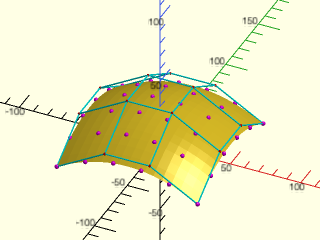

 

    include <BOSL2/std.scad>
    patch = [
        [[-50,-50,  0], [-16,-50,  20], [ 16,-50,  20], [50,-50,  0]],
        [[-50,-16, 20], [-16,-16,  40], [ 16,-16,  40], [50,-16, 20]],
        [[-50, 16, 20], [-16, 16,  40], [ 16, 16,  40], [50, 16, 20]],
        [[-50, 50,  0], [-16, 50,  20], [ 16, 50,  20], [50, 50,  0]]
    ];
    debug_bezier_patches(patches=[patch], size=1, showcps=true);
    pts = bezier_patch_points(patch, [0:0.2:1], [0:0.2:1]);
    for (row=pts) move_copies(row) color("magenta") sphere(d=3, $fn=12);

---

### Function: bezier\_vnf()

**Synopsis:** Generates a (probably non-manifold) VNF for one or more bezier surface patches. [<abbr>VNF</abbr>]

**Topics:** [Bezier Patches](Topics#bezier-patches)

**See Also:** [bezier\_patch\_points()](#function-bezier_patch_points), [bezier\_patch\_flat()](#function-bezier_patch_flat)

**Usage:** 

- vnf = bezier_vnf(patches, [splinesteps], [style]);

**Description:** 

Convert a patch or list of patches into the corresponding Bezier surface, representing the
result as a [VNF structure](vnf.scad).  The `splinesteps` argument specifies the sampling grid of
the surface for each patch by specifying the number of segments on the borders of the surface.
It can be a scalar, which gives a uniform grid, or
it can be [USTEPS, VSTEPS], which gives difference spacing in the U and V parameters.
Note that the surface you produce may be disconnected and is not necessarily a valid manifold in OpenSCAD.
The patches must mate exactly along their edges to ensure a valid VNF.

**Arguments:** 

<abbr title="These args can be used by position or by name.">By&nbsp;Position</abbr> | What it does
-------------------- | ------------
`patches`            | The bezier patch or list of bezier patches to convert into a vnf.
`splinesteps`        | Number of segments on the border of the bezier surface.  You can specify [USTEPS,VSTEPS].  Default: 16
`style`              | The style of subdividing the quads into faces.  Valid options are "default", "alt", "min_edge", "quincunx", "convex" and "concave".  See [`vnf_vertex_array()`](vnf.scad#functionmodule-vnf_vertex_array).  Default: "default"

**Example 1:** 

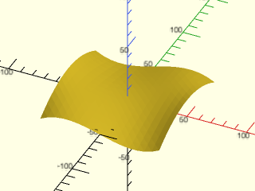

 

    include <BOSL2/std.scad>
    patch = [
        // u=0,v=0                                         u=1,v=0
        [[-50,-50,  0], [-16,-50,  20], [ 16,-50, -20], [50,-50,  0]],
        [[-50,-16, 20], [-16,-16,  20], [ 16,-16, -20], [50,-16, 20]],
        [[-50, 16, 20], [-16, 16, -20], [ 16, 16,  20], [50, 16, 20]],
        [[-50, 50,  0], [-16, 50, -20], [ 16, 50,  20], [50, 50,  0]],
        // u=0,v=1                                         u=1,v=1
    ];
    vnf = bezier_vnf(patch, splinesteps=16);
    vnf_polyhedron(vnf);

**Example 2:** Combining multiple patches

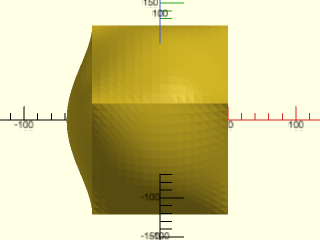

    include <BOSL2/std.scad>
    patch = 100*[
        // u=0,v=0                                u=1,v=0
        [[0,  0,0], [1/3,  0,  0], [2/3,  0,  0], [1,  0,0]],
        [[0,1/3,0], [1/3,1/3,1/3], [2/3,1/3,1/3], [1,1/3,0]],
        [[0,2/3,0], [1/3,2/3,1/3], [2/3,2/3,1/3], [1,2/3,0]],
        [[0,  1,0], [1/3,  1,  0], [2/3,  1,  0], [1,  1,0]],
        // u=0,v=1                                u=1,v=1
    ];
    fpatch = bezier_patch_flat([100,100]);
    tpatch = translate([-50,-50,50], patch);
    flatpatch = translate([0,0,50], fpatch);
    vnf = bezier_vnf([
                      tpatch,
                      xrot(90, tpatch),
                      xrot(-90, tpatch),
                      xrot(180, tpatch),
                      yrot(90, flatpatch),
                      yrot(-90, tpatch)]);
    vnf_polyhedron(vnf);

  

**Example 3:** 

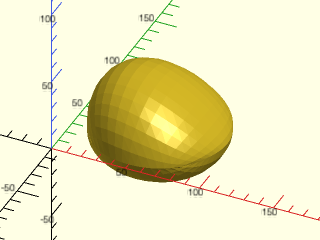

    include <BOSL2/std.scad>
    patch1 = [
        [[18,18,0], [33,  0,  0], [ 67,  0,  0], [ 82, 18,0]],
        [[ 0,40,0], [ 0,  0,100], [100,  0, 20], [100, 40,0]],
        [[ 0,60,0], [ 0,100,100], [100,100, 20], [100, 60,0]],
        [[18,82,0], [33,100,  0], [ 67,100,  0], [ 82, 82,0]],
    ];
    patch2 = [
        [[18,82,0], [33,100,  0], [ 67,100,  0], [ 82, 82,0]],
        [[ 0,60,0], [ 0,100,-50], [100,100,-50], [100, 60,0]],
        [[ 0,40,0], [ 0,  0,-50], [100,  0,-50], [100, 40,0]],
        [[18,18,0], [33,  0,  0], [ 67,  0,  0], [ 82, 18,0]],
    ];
    vnf = bezier_vnf(patches=[patch1, patch2], splinesteps=16);
    vnf_polyhedron(vnf);

  

**Example 4:** Connecting Patches with asymmetric splinesteps.  Note it is fastest to join all the VNFs at once, which happens in vnf\_polyhedron, rather than generating intermediate joined partial surfaces.

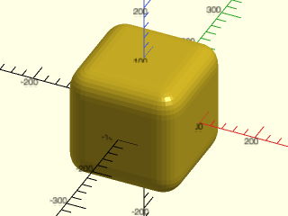

    include <BOSL2/std.scad>
    steps = 8;
    edge_patch = [
        // u=0, v=0                    u=1,v=0
        [[-60, 0,-40], [0, 0,-40], [60, 0,-40]],
        [[-60, 0,  0], [0, 0,  0], [60, 0,  0]],
        [[-60,40,  0], [0,40,  0], [60,40,  0]],
        // u=0, v=1                    u=1,v=1
    ];
    corner_patch = [
        // u=0, v=0                    u=1,v=0
        [[ 0, 40,-40], [ 0,  0,-40], [40,  0,-40]],
        [[ 0, 40,  0], [ 0,  0,  0], [40,  0,  0]],
        [[40, 40,  0], [40, 40,  0], [40, 40,  0]],
        // u=0, v=1                    u=1,v=1
    ];
    face_patch = bezier_patch_flat([120,120],orient=LEFT);
    edges = [
        for (axrot=[[0,0,0],[0,90,0],[0,0,90]], xang=[-90:90:180])
            bezier_vnf(
                splinesteps=[steps,1],
                rot(a=axrot,
                    p=rot(a=[xang,0,0],
                        p=translate(v=[0,-100,100],p=edge_patch)
                    )
                )
            )
    ];
    corners = [
        for (xang=[0,180], zang=[-90:90:180])
            bezier_vnf(
                splinesteps=steps,
                rot(a=[xang,0,zang],
                    p=translate(v=[-100,-100,100],p=corner_patch)
                )
            )
    ];
    faces = [
        for (axrot=[[0,0,0],[0,90,0],[0,0,90]], zang=[0,180])
            bezier_vnf(
                splinesteps=1,
                rot(a=axrot,
                    p=zrot(zang,move([-100,0,0], face_patch))
                )
            )
    ];
    vnf_polyhedron(concat(edges,corners,faces));

  

---

### Function: bezier\_vnf\_degenerate\_patch()

**Synopsis:** Generates a VNF for a degenerate bezier surface patch. [<abbr>VNF</abbr>]

**Topics:** [Bezier Patches](Topics#bezier-patches)

**See Also:** [bezier\_patch\_points()](#function-bezier_patch_points), [bezier\_patch\_flat()](#function-bezier_patch_flat), [bezier\_vnf()](#function-bezier_vnf)

**Usage:** 

- vnf = bezier_vnf_degenerate_patch(patch, [splinesteps], [reverse]);
- vnf_edges = bezier_vnf_degenerate_patch(patch, [splinesteps], [reverse], return_edges=true);

**Description:** 

Returns a [VNF](vnf.scad) for a degenerate rectangular bezier patch where some of the corners of the patch are
equal.  If the resulting patch has no faces then returns an empty VNF.  Note that due to the degeneracy,
the shape of the surface can be triangular even though the underlying patch is a rectangle.
If you specify return_edges then the return is a list whose first element is the VNF and whose second
element lists the edges in the order [left (index zero of rows), right (last index of rows), top (first row), bottom (last row)],
where each list is a list of the actual
point values, but possibly only a single point if that edge is degenerate.
The method checks for various types of degeneracy and uses a triangular or partly triangular array of sample points.
See examples below for the types of degeneracy detected and how the patch is sampled for those cases.
Note that splinesteps is the same for both directions of the patch, so it cannot be an array.

**Arguments:** 

<abbr title="These args can be used by position or by name.">By&nbsp;Position</abbr> | What it does
-------------------- | ------------
`patch`              | Patch to process
`splinesteps`        | Number of segments to produce on each side.  Default: 16
`reverse`            | reverse direction of faces.  Default: false
`return_edges`       | if true return the points on the four edges of the array: [left (index zero of rows), right (last index of rows)  , top (first row), bottom (last row)].  Default: false

**Example 1:** This quartic patch is degenerate at one corner, where a row of control points are equal.  Processing this degenerate patch normally produces excess triangles near the degenerate point.

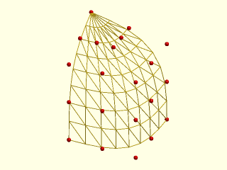

 

    include <BOSL2/std.scad>
    splinesteps=8;
    patch=[
          repeat([-12.5, 12.5, 15],5),
           [[-6.25, 11.25, 15], [-6.25, 8.75, 15], [-6.25, 6.25, 15], [-8.75, 6.25, 15], [-11.25, 6.25, 15]],
           [[0, 10, 15], [0, 5, 15], [0, 0, 15], [-5, 0, 15], [-10, 0, 15]],
           [[0, 10, 8.75], [0, 5, 8.75], [0, 0, 8.75], [-5, 0, 8.75], [-10, 0, 8.75]],
           [[0, 10, 2.5], [0, 5, 2.5], [0, 0, 2.5], [-5, 0, 2.5], [-10, 0, 2.5]]
          ];
    vnf_wireframe((bezier_vnf(patch, splinesteps)),width=0.1);
    color("red")move_copies(flatten(patch)) sphere(r=0.3,$fn=9);

**Example 2:** With bezier\_vnf\_degenerate\_patch the degenerate point does not have excess triangles.  The top half of the patch decreases the number of sampled points by 2 for each row.

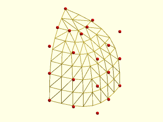

 

    include <BOSL2/std.scad>
    splinesteps=8;
    patch=[
           repeat([-12.5, 12.5, 15],5),
           [[-6.25, 11.25, 15], [-6.25, 8.75, 15], [-6.25, 6.25, 15], [-8.75, 6.25, 15], [-11.25, 6.25, 15]],
           [[0, 10, 15], [0, 5, 15], [0, 0, 15], [-5, 0, 15], [-10, 0, 15]],
           [[0, 10, 8.75], [0, 5, 8.75], [0, 0, 8.75], [-5, 0, 8.75], [-10, 0, 8.75]],
           [[0, 10, 2.5], [0, 5, 2.5], [0, 0, 2.5], [-5, 0, 2.5], [-10, 0, 2.5]]
          ];
    vnf_wireframe(bezier_vnf_degenerate_patch(patch, splinesteps),width=0.1);
    color("red")move_copies(flatten(patch)) sphere(r=0.3,$fn=9);

**Example 3:** With splinesteps odd you get one "odd" row where the point count decreases by 1 instead of 2.  You may prefer even values for splinesteps to avoid this.

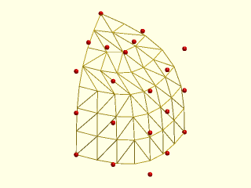

 

    include <BOSL2/std.scad>
    splinesteps=7;
    patch=[
           repeat([-12.5, 12.5, 15],5),
           [[-6.25, 11.25, 15], [-6.25, 8.75, 15], [-6.25, 6.25, 15], [-8.75, 6.25, 15], [-11.25, 6.25, 15]],
           [[0, 10, 15], [0, 5, 15], [0, 0, 15], [-5, 0, 15], [-10, 0, 15]],
           [[0, 10, 8.75], [0, 5, 8.75], [0, 0, 8.75], [-5, 0, 8.75], [-10, 0, 8.75]],
           [[0, 10, 2.5], [0, 5, 2.5], [0, 0, 2.5], [-5, 0, 2.5], [-10, 0, 2.5]]
          ];
    vnf_wireframe(bezier_vnf_degenerate_patch(patch, splinesteps),width=0.1);
    color("red")move_copies(flatten(patch)) sphere(r=0.3,$fn=9);

**Example 4:** A more extreme degeneracy occurs when the top half of a patch is degenerate to a line.  (For odd length patches the middle row must be degenerate to trigger this style.)  In this case the number of points in each row decreases by 1 for every row.  It doesn't matter if splinesteps is odd or even.

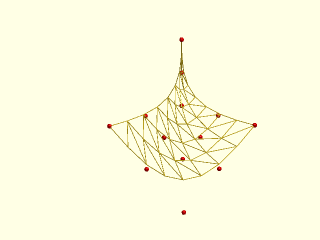

 

    include <BOSL2/std.scad>
    splinesteps=8;
    patch = [[[10, 0, 0], [10, -10.4, 0], [10, -20.8, 0], [1.876, -14.30, 0], [-6.24, -7.8, 0]],
             [[5, 0, 0], [5, -5.2, 0], [5, -10.4, 0], [0.938, -7.15, 0], [-3.12, -3.9, 0]],
             repeat([0,0,0],5),
             repeat([0,0,5],5),
             repeat([0,0,10],5)
            ];
    vnf_wireframe(bezier_vnf_degenerate_patch(patch, splinesteps),width=0.1);
    color("red")move_copies(flatten(patch)) sphere(r=0.3,$fn=9);

**Example 5:** Here is a degenerate cubic patch.

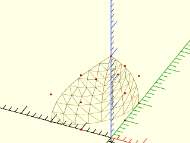

 

    include <BOSL2/std.scad>
    splinesteps=8;
    patch = [ [ [-20,0,0],  [-10,0,0],[0,10,0],[0,20,0] ],
              [ [-20,0,10], [-10,0,10],[0,10,10],[0,20,10]],
              [ [-10,0,20], [-5,0,20], [0,5,20], [0,10,20]],
               repeat([0,0,30],4)
                ];
    color("red")move_copies(flatten(patch)) sphere(r=0.3,$fn=9);
    vnf_wireframe(bezier_vnf_degenerate_patch(patch, splinesteps),width=0.1);

**Example 6:** A more extreme degenerate cubic patch, where two rows are equal.

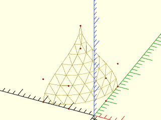

 

    include <BOSL2/std.scad>
    splinesteps=8;
    patch = [ [ [-20,0,0], [-10,0,0],[0,10,0],[0,20,0] ],
              [ [-20,0,10], [-10,0,10],[0,10,10],[0,20,10] ],
               repeat([-10,10,20],4),
               repeat([-10,10,30],4)
            ];
    color("red")move_copies(flatten(patch)) sphere(r=0.3,$fn=9);
    vnf_wireframe(bezier_vnf_degenerate_patch(patch, splinesteps),width=0.1);

**Example 7:** Quadratic patch degenerate at the right side:

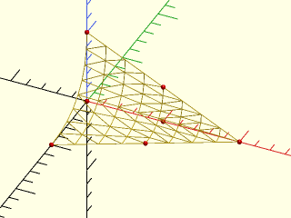

 

    include <BOSL2/std.scad>
    splinesteps=8;
    patch = [[[0, -10, 0],[10, -5, 0],[20, 0, 0]],
             [[0, 0, 0],  [10, 0, 0], [20, 0, 0]],
             [[0, 0, 10], [10, 0, 5], [20, 0, 0]]];
    vnf_wireframe(bezier_vnf_degenerate_patch(patch, splinesteps),width=0.1);
    color("red")move_copies(flatten(patch)) sphere(r=0.3,$fn=9);

**Example 8:** Cubic patch degenerate at both ends.  In this case the point count changes by 2 at every row.

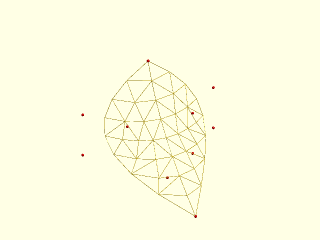

 

    include <BOSL2/std.scad>
    splinesteps=8;
    patch = [
             repeat([10,-10,0],4),
             [ [-20,0,0], [-1,0,0],[0,10,0],[0,20,0] ],
             [ [-20,0,10], [-10,0,10],[0,10,10],[0,20,10] ],
             repeat([-10,10,20],4),
            ];
    vnf_wireframe(bezier_vnf_degenerate_patch(patch, splinesteps),width=0.1);
    color("red")move_copies(flatten(patch)) sphere(r=0.3,$fn=9);

---

### Function: bezier\_patch\_normals()

**Synopsis:** Computes surface normals for one or more places on a bezier surface patch.

**Topics:** [Bezier Patches](Topics#bezier-patches)

**See Also:** [bezier\_patch\_points()](#function-bezier_patch_points), [bezier\_points()](#function-bezier_points), [bezier\_curve()](#function-bezier_curve), [bezpath\_curve()](#function-bezpath_curve)

**Usage:** 

- n = bezier_patch_normals(patch, u, v);
- ngrid = bezier_patch_normals(patch, LIST, LIST);
- ngrid = bezier_patch_normals(patch, RANGE, RANGE);

**Description:** 

Compute the unit normal vector to a bezier patch at the listed point set.  The bezier patch must be a rectangular array of
points, and the normal is computed at all the (u,v) pairs that you specify.  If you give u and v
as single numbers you'll get a single point back.  If you give u and v as lists or ranges you'll
get a 2d rectangular array of points.  If one but not both of u and v is a list or range then you'll
get a list of points.

This function works by computing the cross product of the tangents.  In some degenerate cases the one of the tangents
can be zero, so the normal vector does not exist.  In this case, undef is returned.  Another degenerate case
occurs when the tangents are parallel, or nearly parallel.  In this case you get a unit vector returned but it is not
the correct normal vector. This can happen if you use a degenerate patch, or if you give two of the edges of your patch a smooth "corner"
so that the u and v directions are parallel at the corner.

**Arguments:** 

<abbr title="These args can be used by position or by name.">By&nbsp;Position</abbr> | What it does
-------------------- | ------------
`patch`              | The 2D array of control points for a Bezier patch.
`u`                  | The bezier u parameter (inner list of patch).  Generally between 0 and 1. Can be a list, range or value.
`v`                  | The bezier v parameter (outer list of patch).  Generally between 0 and 1. Can be a list, range or value.

**Example 1:** Normal vectors on a patch

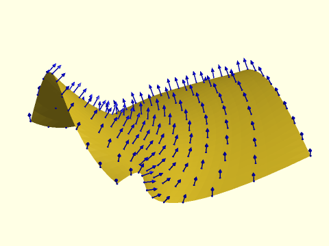

 

    include <BOSL2/std.scad>
    patch = [
         // u=0,v=0                                         u=1,v=0
         [[-50,-50,  0], [-16,-50,  20], [ 16,-50, -20], [50,-50,  0]],
         [[-50,-16, 40], [-16,-16,  20], [ 16,-16, -20], [50,-16, 70]],
         [[-50, 16, 20], [-16, 16, -20], [ 16, 37,  20], [70, 16, 20]],
         [[-50, 50,  0], [73, 50, -40], [ 16, 50,  20], [50, 50,  0]],
         // u=0,v=1                                         u=1,v=1
    ];
    vnf_polyhedron(bezier_vnf(patch,splinesteps=30));
    uv = lerpn(0,1,12);
    pts = bezier_patch_points(patch, uv, uv);
    normals = bezier_patch_normals(patch, uv, uv);
      for(i=idx(uv),j=idx(uv)){
         stroke([pts[i][j],pts[i][j]-6*normals[i][j]], width=0.5,
                endcap1="dot",endcap2="arrow2",color="blue");
    }

**Example 2:** This example gives invalid normal vectors at the four corners of the patch where the u and v directions are parallel.  You can see how the line of triangulation is approaching parallel at the edge, and the invalid vectors in red point in a completely incorrect direction.

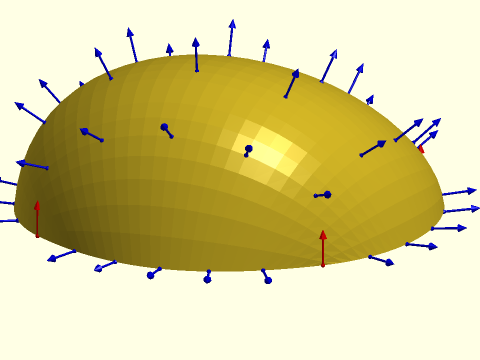

 

    include <BOSL2/std.scad>
    patch = [
        [[18,18,0], [33,  0,  0], [ 67,  0,  0], [ 82, 18,0]],
        [[ 0,40,0], [ 0,  0,100], [100,  0, 20], [100, 40,0]],
        [[ 0,60,0], [ 0,100,100], [100,100, 20], [100, 60,0]],
        [[18,82,0], [33,100,  0], [ 67,100,  0], [ 82, 82,0]],
    ];
    vnf_polyhedron(bezier_vnf(patch,splinesteps=30));
    uv = lerpn(0,1,7);
    pts = bezier_patch_points(patch, uv, uv);
    normals = bezier_patch_normals(patch, uv, uv);
      for(i=idx(uv),j=idx(uv)){
         color=((uv[i]==0 || uv[i]==1) && (uv[j]==0 || uv[j]==1))
              ? "red" : "blue";
         stroke([pts[i][j],pts[i][j]-8*normals[i][j]], width=0.5,
                endcap1="dot",endcap2="arrow2",color=color);
    }

**Example 3:** This degenerate patch has normals everywhere, but computation of the normal fails at the point of degeneracy, the top corner.

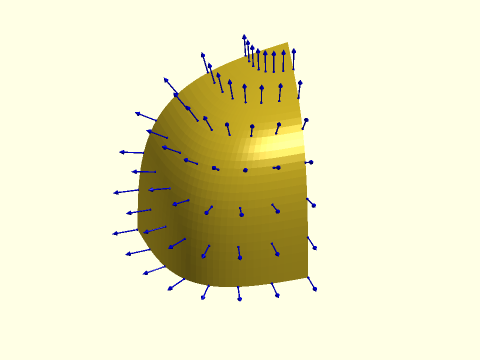

 

    include <BOSL2/std.scad>
    patch=[
             repeat([-12.5, 12.5, 15],5),
              [[-6.25, 11.25, 15], [-6.25, 8.75, 15], [-6.25, 6.25, 15], [-8.75, 6.25, 15], [-11.25, 6.25, 15]],
              [[0, 10, 15], [0, 5, 15], [0, 0, 15], [-5, 0, 15], [-10, 0, 15]],
              [[0, 10, 8.75], [0, 5, 8.75], [0, 0, 8.75], [-5, 0, 8.75], [-10, 0, 8.75]],
              [[0, 10, 2.5], [0, 5, 2.5], [0, 0, 2.5], [-5, 0, 2.5], [-10, 0, 2.5]]
             ];
    vnf_polyhedron(bezier_vnf(patch, 32));
    uv = lerpn(0,1,8);
    pts = bezier_patch_points(patch, uv, uv);
    normals = bezier_patch_normals(patch, uv, uv);
      for(i=idx(uv),j=idx(uv)){
        if (is_def(normals[i][j]))
          stroke([pts[i][j],pts[i][j]-2*normals[i][j]], width=0.1,
                 endcap1="dot",endcap2="arrow2",color="blue");
    }

**Example 4:** This example has a singularities where the tangent lines don't exist, so the normal is undef at those points.

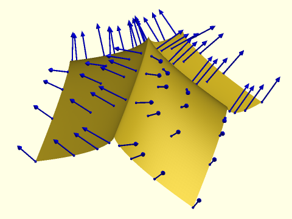

 

    include <BOSL2/std.scad>
    pts1 = [ [-5,0,0], [5,0,5], [-5,0,5], [5,0,0] ];
    pts2 = [ [0,-5,0], [0,5,5], [0,-5,5], [0,5,0] ];
    patch = [for(i=[0:3])
            [for(j=[0:3]) pts1[i]+pts2[j] ] ];
    vnf_polyhedron(bezier_vnf(patch, 163));
    uv = [0,.1,.2,.3,.7,.8,.9,1];//lerpn(0,1,8);
    pts = bezier_patch_points(patch, uv, uv);
    normals = bezier_patch_normals(patch, uv, uv);
    for(i=idx(uv),j=idx(uv))
      stroke([pts[i][j],pts[i][j]+2*normals[i][j]], width=0.08,
               endcap1="dot",endcap2="arrow2",color="blue");

---

### Function: bezier\_sheet()

**Synopsis:** Creates a thin sheet from a bezier patch by extruding in normal to the patch [<abbr>VNF</abbr>]

**Topics:** [Bezier Patches](Topics#bezier-patches)

**See Also:** [bezier\_patch\_normals()](#function-bezier_patch_normals), [vnf\_sheet()](vnf.scad#function-vnf_sheet)

**Usage:** 

- vnf = bezier_sheet(patch, delta, [splinesteps=], [style=]);

**Description:** 

Constructs a thin sheet from a bezier patch by offsetting the given patch along the normal vectors
to the patch surface.
The `delta` parameter is a 2-vector specifying the offset distances for both surfaces that form the
final sheet. The values for each offset must be small enough so that no points cross each other
when the offset is computed, because that results in invalid geometry and rendering errors.
Rendering errors may not manifest until you add other objects to your model.
**It is your responsibility to avoid invalid geometry!**

Once the offset surfaces from the bezier patch are computed, they are connected by filling
in the boundary strips between them.

A negative offset value extends the patch toward its "inside", which is the side that appears purple
in the "thrown together" view when the patch is viewed by itself. Extending only toward the inside with a delta of `[0,-value]` or
`[-value,0]` (the order doesn't matter) means that your original bezier patch surface remains unchanged in the output.
Both offset surfaces may be extended in the same direction as long as the offset values are different.

**Arguments:** 

<abbr title="These args can be used by position or by name.">By&nbsp;Position</abbr> | What it does
-------------------- | ------------
`patch`              | bezier patch to process
`delta`              | a 2-vector specifying two different offsets from the bezier patch, in any order. Positive values offset the patch from its "exterior" side, and negative values offset from the "interior" side.

<abbr title="These args must be used by name, ie: name=value">By&nbsp;Name</abbr> | What it does
-------------------- | ------------
`splinesteps`        | Number of segments on the border edges of the bezier surface.  You can specify [USTEPS,VSTEPS].  Default: 16
`style`              | [`vnf_vertex_array()`](vnf.scad#functionmodule-vnf_vertex_array) style to use.  Default: "default"

**Example 1:** A negative delta extends downward from the "inside" surface of the bezier patch, leaving the original bezier patch unchanged on the top surface.

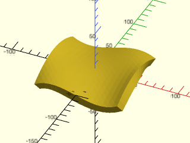

 

    include <BOSL2/std.scad>
    patch = [
         // u=0,v=0                                         u=1,v=0
         [[-50,-50,  0], [-16,-50,  20], [ 16,-50, -20], [50,-50,  0]],
         [[-50,-16, 20], [-16,-16,  20], [ 16,-16, -20], [50,-16, 20]],
         [[-50, 16, 20], [-16, 16, -20], [ 16, 16,  20], [50, 16, 20]],
         [[-50, 50,  0], [-16, 50, -20], [ 16, 50,  20], [50, 50,  0]],
         // u=0,v=1                                         u=1,v=1
    ];
    vnf_polyhedron(bezier_sheet(patch, [0,-10]));

**Example 2:** Using the previous example, setting two positive offsets results in a sheet above the original bezier patch. The original bezier patch is shown in green for comparison.

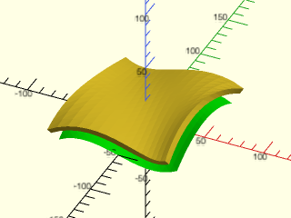

 

    include <BOSL2/std.scad>
    patch = [
         // u=0,v=0                                         u=1,v=0
         [[-50,-50,  0], [-16,-50,  20], [ 16,-50, -20], [50,-50,  0]],
         [[-50,-16, 20], [-16,-16,  20], [ 16,-16, -20], [50,-16, 20]],
         [[-50, 16, 20], [-16, 16, -20], [ 16, 16,  20], [50, 16, 20]],
         [[-50, 50,  0], [-16, 50, -20], [ 16, 50,  20], [50, 50,  0]],
         // u=0,v=1                                         u=1,v=1
    ];
    color("lime") vnf_polyhedron(bezier_vnf(patch));
    vnf_polyhedron(bezier_sheet(patch, [10,15]));

---

### Function/Module: bezier\_sweep()

**Synopsis:** Sweep a 2d polygon path along a bezier with exact tangents [<abbr>VNF</abbr>] [<abbr>Geom</abbr>]

**Topics:** [Extrusion](Topics#extrusion), [Sweep](Topics#sweep), [Paths](Topics#paths), [Textures](Topics#textures), [Bezier Curves](Topics#bezier-curves)

**See Also:** [sweep\_attach()](skin.scad#module-sweep_attach), [linear\_sweep()](skin.scad#functionmodule-linear_sweep), [rotate\_sweep()](skin.scad#functionmodule-rotate_sweep), [sweep()](skin.scad#functionmodule-sweep), [spiral\_sweep()](skin.scad#functionmodule-spiral_sweep), [path\_sweep2d()](skin.scad#functionmodule-path_sweep2d), [offset\_sweep()](rounding.scad#functionmodule-offset_sweep), [path\_sweep()](skin.scad#functionmodule-path_sweep), [bezpath\_sweep()](#functionmodule-bezpath_sweep)

**Usage:** As module

- bezier_sweep(shape, bezier, [splinesteps], [method], [endpoint=], [normal=], [closed=], [twist=], [twist_by_length=], [symmetry=], [scale=], [scale_by_length=], [last_normal=], [caps=], [style=], [convexity=], [anchor=], [cp=], [spin=], [orient=], [atype=]) [ATTACHMENTS];

**Usage:** As function

- vnf = path_sweep(shape, bezier, [splinesteps], [method], [endpoint=], [normal=], [closed=], [twist=], [twist_by_length=], [symmetry=], [scale=], [scale_by_length=], [last_normal=], [caps=], [style=], [transforms=], [anchor=], [cp=], [spin=], [orient=], [atype=]);

**Description:** 

Takes as input `shape`, a 2D polygon path (list of points), and `bezier`, a list of bezier control points (2d or 3d), and
constructs a polyhedron by sweeping the shape along the bezier curve. The bezier curve is sampled into `splinesteps` segments.
This is a passthrough to [`path_sweep()`](skin.scad#functionmodule-path_sweep).  The reason it exists is that it uses the exact derivative computed from the bezier
instead of an approximation.  This can be crucial for joints at the ends of your curve, where the approximate derivative is often incorrect.
For full information about the operation and parameters of `bezier_sweep` see [`path_sweep()`](skin.scad#functionmodule-path_sweep).   If you have a bezier path instead of a bezier
use [`bezpath_sweep()`](#functionmodule-bezpath_sweep).

**Arguments:** 

<abbr title="These args can be used by position or by name.">By&nbsp;Position</abbr> | What it does
-------------------- | ------------
`shape`              | A 2D polygon path or region describing the shape to be swept.
`bezier`             | The list of control points that define the Bezier curve to sweep over
`splinesteps`        | number of segments to create on the bezier curve.  Default: 16
`method`             | one of "incremental", "natural" or "manual".  Default: "incremental"

<abbr title="These args must be used by name, ie: name=value">By&nbsp;Name</abbr> | What it does
-------------------- | ------------
`normal`             | normal vector for initializing the incremental method, or for setting normals with method="manual".  Default: UP if the path makes an angle lower than 45 degrees to the xy plane, BACK otherwise.
`closed`             | path is a closed loop.  Default: false
`twist`              | amount of twist to add in degrees.  For closed sweeps must be a multiple of 360/symmetry.  Default: 0
`twist_by_length`    | if true then interpolate twist based on the path length of the path. If false interoplate based on point count.  Default: true
`symmetry`           | symmetry of the shape when closed=true.  Allows the shape to join with a 360/symmetry rotation instead of a full 360 rotation.  Default: 1
`scale`              | Amount to scale the profiles.  If you give a scalar the scale starts at 1 and ends at your specified value. The same is true for a 2-vector, but x and y are scaled separately.   You can also give a vector of values, one for each path point, and you can give a list of 2-vectors that give the x and y scales of your profile for every point on the path (a Nx2 matrix for a path of length N.  Default: 1 (no scaling)
`scale_by_length`    | if true then interpolate scale based on the path length of the path. If false interoplate based on point count.  Default: true
`last_normal`        | normal to last point in the path for the "incremental" method.  Constrains the orientation of the last cross section if you supply it.
`caps`               | if closed is false, set caps to false to leave the ends open.  Other values are true to create a flat cap, a number a rounded cap, or an [`offset_sweep()`](rounding.scad#functionmodule-offset_sweep) end treatment to create the specified offset sweep.  Can be a single value or pair of values to control the caps independently at each end.  Default: true
`style`              | vnf_vertex_array style.  Default: "min_edge"
`profiles`           | if true then display all the cross section profiles instead of the solid shape.  Can help debug a sweep.  (module only) Default: false
`width`              | the width of lines used for profile display.  (module only) Default: 1
`transforms`         | set to true to return transforms instead of a VNF.  These transforms can be manipulated and passed to sweep().  (function only)  Default: false.
`convexity`          | convexity parameter for polyhedron().  (module only)  Default: 10
`texture`            | A texture name string, or a rectangular array of scalar height values (0.0 to 1.0), or a VNF tile that defines the texture to apply to vertical surfaces.  See [`texture()`](skin.scad#function-texture) for what named textures are supported.
`tex_size`           | An optional 2D target size (2-vector or scalar) for the texture at the first point of your shape and first path point.  Actual texture sizes are scaled somewhat to evenly fit the available surface. Default: `[5,5]`
`tex_reps`           | If given instead of tex_size, a scalar or 2-vector giving the integer number of texture tile repetitions in the horizontal and vertical directions.
`tex_inset`          | If numeric, lowers the texture into the surface by the specified proportion, e.g. 0.5 would lower it half way into the surface.  If `true`, insets by exactly its full depth.  Default: `false`
`tex_rot`            | Rotate texture by specified angle, which must be a multiple of 90 degrees.  Default: 0
`tex_depth`          | Specify texture depth; if negative, invert the texture.  Default: 1.
`tex_samples`        | Minimum number of "bend points" to have in VNF texture tiles.  Default: 8
`tex_extra`          | number of extra lines of a hightfield texture to add at the end.  Can be a scalar or 2-vector to give x and y values.  Default: 1
`tex_skip`           | number of lines of a heightfield texture to skip when starting.  Can be a scalar or two vector to give x and y values.  Default: 0
`anchor`             | Translate so anchor point is at the origin. Default: "origin"
`spin`               | Rotate this many degrees around Z axis after anchor. Default: 0
`orient`             | Vector to rotate top toward after spin
`atype`              | Select "hull" or "intersect" anchor types.  Default: "hull"
`cp`                 | Centerpoint for determining "intersect" anchors or centering the shape.  Determintes the base of the anchor vector.  Can be "centroid", "mean", "box" or a 3D point.  Default: "centroid"

**Side Effects:** 

- `$sweep_path` is set to the path defining the swept object
- `$sweep_shape` is set to the shape being swept
- `$sweep_closed` is true if the sweep is closed and false otherwise
- `$sweep_transforms` is set to the array of transformation matrices that define the swept object.
- `$sweep_scales` is set to the array of scales that were applied at each point to create the swept object.
- `$sweep_twist` set to a scalar value giving the total twist across the path sweep object.

**Anchor Types:** 

Anchor Type | What it is
----------- | ----------
"hull" | Anchors to the virtual convex hull of the shape.
"intersect" | Anchors to the surface of the shape.

**Named Anchors:** 

Anchor Name | Position
----------- | --------
"origin" | The native position of the shape
"start" | When `closed==false`, the origin point of the shape, on the starting face of the object
"end" | When `closed==false`, the origin point of the shape, on the ending face of the object
"start-centroid" | When `closed==false`, the centroid of the shape, on the starting face of the object
"end-centroid" | When `closed==false`, the centroid of the shape, on the ending face of the object

**Example 1:** This bezier is perpendicular to the cylinder top, but [`path_sweep()`](skin.scad#functionmodule-path\_sweep) approximates the derivative at the end, resulting in a gap.  The gap is highly visible because of the small splinesteps value, but it will be present, albeit smaller, even for large values of splinesteps.

    include <BOSL2/std.scad>
    $fn=32;
    bez = [[0,0,5],
           [0,0,10],
           [15,7,9],
           [17,2,4],
          ];
    color("lightblue")
      cyl(r=2,h=5,anchor=BOT);
    path_sweep(circle(r=2),
            bezier_curve(bez, 6));

  

**Example 2:** Using `bezier_curve()` instead produces the correct derivatives at the ends and the swept object mates correctly with the cylinder.

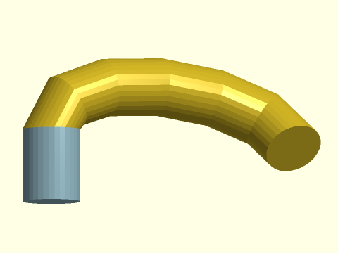

    include <BOSL2/std.scad>
    $fn=32;
    bez = [[0,0,5],
           [0,0,10],
           [15,7,9],
           [17,2,4],
          ];
    color("lightblue")
      cyl(r=2,h=5,anchor=BOT);
    bezier_sweep(circle(r=2,$fn=32), bez, 6);

  

---

### Function/Module: bezpath\_sweep()

**Synopsis:** Sweep a 2d polygon path along a bezier path with exact tangents [<abbr>VNF</abbr>] [<abbr>Geom</abbr>]

**Topics:** [Extrusion](Topics#extrusion), [Sweep](Topics#sweep), [Paths](Topics#paths), [Textures](Topics#textures), [Bezier Curves](Topics#bezier-curves)

**See Also:** [sweep\_attach()](skin.scad#module-sweep_attach), [linear\_sweep()](skin.scad#functionmodule-linear_sweep), [rotate\_sweep()](skin.scad#functionmodule-rotate_sweep), [sweep()](skin.scad#functionmodule-sweep), [spiral\_sweep()](skin.scad#functionmodule-spiral_sweep), [path\_sweep2d()](skin.scad#functionmodule-path_sweep2d), [offset\_sweep()](rounding.scad#functionmodule-offset_sweep), [path\_sweep()](skin.scad#functionmodule-path_sweep), [bezier\_sweep()](#functionmodule-bezier_sweep)

**Usage:** As module

- bezier_sweep(shape, bezier, [splinesteps], [method], [endpoint=], [normal=], [closed=], [twist=], [twist_by_length=], [symmetry=], [scale=], [scale_by_length=], [last_normal=], [caps=], [style=], [convexity=], [anchor=], [cp=], [spin=], [orient=], [atype=]) [ATTACHMENTS];

**Usage:** As function

- vnf = path_sweep(shape, bezier, [splinesteps], [method], [endpoint=], [normal=], [closed=], [twist=], [twist_by_length=], [symmetry=], [scale=], [scale_by_length=], [last_normal=], [caps=], [style=], [transforms=], [anchor=], [cp=], [spin=], [orient=], [atype=]);

**Description:** 

Takes as input `shape` (a 2D polygon path) and `bezpath`, a bezier path in 2d or 3d, and
constructs a polyhedron by sweeping the shape along the bezier path. The bezier curve is sampled into `splinesteps` segments.
This is a passthrough to [`path_sweep()`](skin.scad#functionmodule-path_sweep).  The reason it exists is that it uses the exact derivative computed from the beziers in the bezier path
instead of an approximation.  This can be crucial for joints at the ends of your curve, where the approximate derivative is often incorrect.
For full information about the operation and parameters of `bezpath_sweep` see [`path_sweep()`](skin.scad#functionmodule-path_sweep).  If you have a bezier instead of a bezier path use [`bezier_sweep()`](#functionmodule-bezier_sweep).

**Arguments:** 

<abbr title="These args can be used by position or by name.">By&nbsp;Position</abbr> | What it does
-------------------- | ------------
`shape`              | A 2D polygon path or region describing the shape to be swept.
`bezpath`            | A 2D or 3D bezier path giving the path to sweep over
`splinesteps`        | number of segments to create on each section of the bezier path.  Default: 16
`N`                  | Degree of the bezier path.  Default: 3
`method`             | one of "incremental", "natural" or "manual".  Default: "incremental"

<abbr title="These args must be used by name, ie: name=value">By&nbsp;Name</abbr> | What it does
-------------------- | ------------
`normal`             | normal vector for initializing the incremental method, or for setting normals with method="manual".  Default: UP if the path makes an angle lower than 45 degrees to the xy plane, BACK otherwise.
`closed`             | path is a closed loop.  Default: false
`twist`              | amount of twist to add in degrees.  For closed sweeps must be a multiple of 360/symmetry.  Default: 0
`twist_by_length`    | if true then interpolate twist based on the path length of the path. If false interoplate based on point count.  Default: true
`symmetry`           | symmetry of the shape when closed=true.  Allows the shape to join with a 360/symmetry rotation instead of a full 360 rotation.  Default: 1
`scale`              | Amount to scale the profiles.  If you give a scalar the scale starts at 1 and ends at your specified value. The same is true for a 2-vector, but x and y are scaled separately.   You can also give a vector of values, one for each path point, and you can give a list of 2-vectors that give the x and y scales of your profile for every point on the path (a Nx2 matrix for a path of length N.  Default: 1 (no scaling)
`scale_by_length`    | if true then interpolate scale based on the path length of the path. If false interoplate based on point count.  Default: true
`last_normal`        | normal to last point in the path for the "incremental" method.  Constrains the orientation of the last cross section if you supply it.
`caps`               | if closed is false, set caps to false to leave the ends open.  Other values are true to create a flat cap, a number a rounded cap, or an [`offset_sweep()`](rounding.scad#functionmodule-offset_sweep) end treatment to create the specified offset sweep.  Can be a single value or pair of values to control the caps independently at each end.  Default: true
`style`              | vnf_vertex_array style.  Default: "min_edge"
`profiles`           | if true then display all the cross section profiles instead of the solid shape.  Can help debug a sweep.  (module only) Default: false
`width`              | the width of lines used for profile display.  (module only) Default: 1
`transforms`         | set to true to return transforms instead of a VNF.  These transforms can be manipulated and passed to sweep().  (function only)  Default: false.
`convexity`          | convexity parameter for polyhedron().  (module only)  Default: 10
`texture`            | A texture name string, or a rectangular array of scalar height values (0.0 to 1.0), or a VNF tile that defines the texture to apply to vertical surfaces.  See [`texture()`](skin.scad#function-texture) for what named textures are supported.
`tex_size`           | An optional 2D target size (2-vector or scalar) for the texture at the first point of your shape and first path point.  Actual texture sizes are scaled somewhat to evenly fit the available surface. Default: `[5,5]`
`tex_reps`           | If given instead of tex_size, a scalar or 2-vector giving the integer number of texture tile repetitions in the horizontal and vertical directions.
`tex_inset`          | If numeric, lowers the texture into the surface by the specified proportion, e.g. 0.5 would lower it half way into the surface.  If `true`, insets by exactly its full depth.  Default: `false`
`tex_rot`            | Rotate texture by specified angle, which must be a multiple of 90 degrees.  Default: 0
`tex_depth`          | Specify texture depth; if negative, invert the texture.  Default: 1.
`tex_samples`        | Minimum number of "bend points" to have in VNF texture tiles.  Default: 8
`tex_extra`          | number of extra lines of a hightfield texture to add at the end.  Can be a scalar or 2-vector to give x and y values.  Default: 1
`tex_skip`           | number of lines of a heightfield texture to skip when starting.  Can be a scalar or two vector to give x and y values.  Default: 0
`anchor`             | Translate so anchor point is at the origin. Default: "origin"
`spin`               | Rotate this many degrees around Z axis after anchor. Default: 0
`orient`             | Vector to rotate top toward after spin
`atype`              | Select "hull" or "intersect" anchor types.  Default: "hull"
`cp`                 | Centerpoint for determining "intersect" anchors or centering the shape.  Determintes the base of the anchor vector.  Can be "centroid", "mean", "box" or a 3D point.  Default: "centroid"

**Side Effects:** 

- `$sweep_path` is set to the path defining the swept object
- `$sweep_shape` is set to the shape being swept
- `$sweep_closed` is true if the sweep is closed and false otherwise
- `$sweep_transforms` is set to the array of transformation matrices that define the swept object.
- `$sweep_scales` is set to the array of scales that were applied at each point to create the swept object.
- `$sweep_twist` set to a scalar value giving the total twist across the path sweep object.

**Anchor Types:** 

Anchor Type | What it is
----------- | ----------
"hull" | Anchors to the virtual convex hull of the shape.
"intersect" | Anchors to the surface of the shape.

**Named Anchors:** 

Anchor Name | Position
----------- | --------
"origin" | The native position of the shape
"start" | When `closed==false`, the origin point of the shape, on the starting face of the object
"end" | When `closed==false`, the origin point of the shape, on the ending face of the object
"start-centroid" | When `closed==false`, the centroid of the shape, on the starting face of the object
"end-centroid" | When `closed==false`, the centroid of the shape, on the ending face of the object

**Example 1:** In this case the bezier path is constructed so that its end faces in the Z direction, but you can see a gap appears when the shape is mated to a cylinder because the angle at the end is not accurate.

    include <BOSL2/std.scad>
    bezpath = flatten([
        bez_begin([0,0,0], UP, 3),
        bez_tang([0,0,1],UP,8,p=52),
        bez_end  ([8,9,3], FWD,10)
    ]);
    cyl(d=4,h=3,anchor=TOP,$fn=12);
    path_sweep(circle(r=2,$fn=12),
            bezpath_curve(bezpath));

  

**Example 2:** When the above example is implemented using `bezpath_sweep` the gap vanishes.

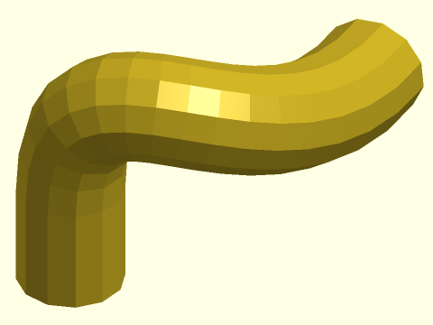

    include <BOSL2/std.scad>
    bezpath = flatten([
        bez_begin([0,0,0], UP, 3),
        bez_tang([0,0,1],UP,8,p=52),
        bez_end  ([8,9,3], FWD,10)
    ]);
    cyl(d=4,h=3,anchor=TOP,$fn=12);
    bezpath_sweep(circle(r=2,$fn=12),
                  bezpath);

  

---

## Section: Debugging Beziers

### Module: debug\_bezier()

**Synopsis:** Shows a bezier path and its associated control points. [<abbr>Geom</abbr>]

**Topics:** [Bezier Paths](Topics#bezier-paths), [Debugging](Topics#debugging)

**See Also:** [bezpath\_curve()](#function-bezpath_curve)

**Usage:** 

- debug_bezier(bez, [size], [N=]);

**Description:** 

Renders 2D or 3D bezier paths and their associated control points to help debug bezier paths.
The endpoints of each bezier curve in the bezier path are marked with a blue circle and the intermediate control
points with a red plus sign.  For cubic (degree 3) bezier paths, the module displays the standard representation
of the control points as "handles" at each endpoint.  For other degrees the control points are drawn as
a polygon.  You can of course give a single bezier curve as input, but you must in that case explicitly specify
the bezier degree when it is not a cubic bezier.

**Arguments:** 

<abbr title="These args can be used by position or by name.">By&nbsp;Position</abbr> | What it does
-------------------- | ------------
`bez`                | the array of points in the bezier.
`size`               | diameter of the lines drawn.

<abbr title="These args must be used by name, ie: name=value">By&nbsp;Name</abbr> | What it does
-------------------- | ------------
`N`                  | The degree of the bezier curves.  Cubic beziers have N=3.  Default: 3

**Example 1:** Cubic bezier path

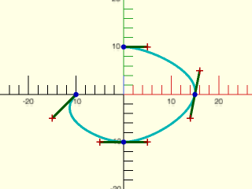

    include <BOSL2/std.scad>
    bez = [
        [-10,   0],  [-15,  -5],
        [ -5, -10],  [  0, -10],  [ 5, -10],
        [ 14,  -5],  [ 15,   0],  [16,   5],
        [  5,  10],  [  0,  10]
    ];
    debug_bezier(bez, N=3, width=0.5);

  

**Example 2:** Quartic (degree 4) bezier path

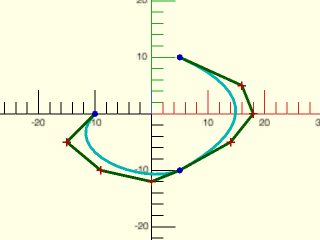

    include <BOSL2/std.scad>
    bez = [
        [-10,   0],  [-15,  -5],
        [ -9, -10],  [  0, -12],  [ 5, -10],
        [ 14,  -5],  [ 18,   0],  [16,   5],
        [  5,  10]
    ];
    debug_bezier(bez, N=4, width=0.5);

  

---

### Module: debug\_bezier\_patches()

**Synopsis:** Shows a bezier surface patch and its associated control points. [<abbr>Geom</abbr>]

**Topics:** [Bezier Patches](Topics#bezier-patches), [Debugging](Topics#debugging)

**See Also:** [bezier\_patch\_points()](#function-bezier_patch_points), [bezier\_patch\_flat()](#function-bezier_patch_flat), [bezier\_vnf()](#function-bezier_vnf)

**Usage:** 

- debug_bezier_patches(patches, [size=], [splinesteps=], [showcps=], [showdots=], [showpatch=], [convexity=], [style=]);

**Description:** 

Shows the surface, and optionally, control points of a list of bezier patches.

**Arguments:** 

<abbr title="These args can be used by position or by name.">By&nbsp;Position</abbr> | What it does
-------------------- | ------------
`patches`            | A list of rectangular bezier patches.

<abbr title="These args must be used by name, ie: name=value">By&nbsp;Name</abbr> | What it does
-------------------- | ------------
`splinesteps`        | Number of segments to divide each bezier curve into. Default: 16
`showcps`            | If true, show the controlpoints as well as the surface.  Default: true.
`showdots`           | If true, shows the calculated surface vertices.  Default: false.
`showpatch`          | If true, shows the surface faces.  Default: true.
`size`               | Size to show control points and lines.  Default: 1% of the maximum side length of a box bounding the patch.
`style`              | The style of subdividing the quads into faces.  Valid options are "default", "alt", and "quincunx".
`convexity`          | Max number of times a line could intersect a wall of the shape.

**Example 1:** 

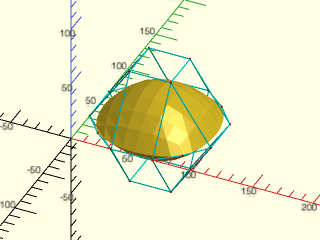

 

    include <BOSL2/std.scad>
    patch1 = [
        [[15,15,0], [33,  0,  0], [ 67,  0,  0], [ 85, 15,0]],
        [[ 0,33,0], [33, 33, 50], [ 67, 33, 50], [100, 33,0]],
        [[ 0,67,0], [33, 67, 50], [ 67, 67, 50], [100, 67,0]],
        [[15,85,0], [33,100,  0], [ 67,100,  0], [ 85, 85,0]],
    ];
    patch2 = [
        [[15,85,0], [33,100,  0], [ 67,100,  0], [ 85, 85,0]],
        [[ 0,67,0], [33, 67,-50], [ 67, 67,-50], [100, 67,0]],
        [[ 0,33,0], [33, 33,-50], [ 67, 33,-50], [100, 33,0]],
        [[15,15,0], [33,  0,  0], [ 67,  0,  0], [ 85, 15,0]],
    ];
    debug_bezier_patches(patches=[patch1, patch2], splinesteps=8, showcps=true);

---

