# LibFile: bottlecaps.scad

Caps and necks for PCO18XX standard plastic beverage bottles, SPI bottles and jars, and mason jars.

To use, add the following lines to the beginning of your file:

    include <BOSL2/std.scad>
    include <BOSL2/bottlecaps.scad>

## File Contents

1. [Section: PCO-1810 Bottle Threading](#section-pco-1810-bottle-threading)
    - [`pco1810_neck()`](#module-pco1810_neck) – Creates a neck for a PCO1810 standard bottle. [<abbr>Geom</abbr>]
    - [`pco1810_cap()`](#module-pco1810_cap) – Creates a cap for a PCO1810 standard bottle. [<abbr>Geom</abbr>]

2. [Section: PCO-1881 Bottle Threading](#section-pco-1881-bottle-threading)
    - [`pco1881_neck()`](#module-pco1881_neck) – Creates a neck for a PCO1881 standard bottle. [<abbr>Geom</abbr>]
    - [`pco1881_cap()`](#module-pco1881_cap) – Creates a cap for a PCO1881 standard bottle. [<abbr>Geom</abbr>]

3. [Section: Generic Bottle Connectors](#section-generic-bottle-connectors)
    - [`generic_bottle_neck()`](#module-generic_bottle_neck) – Creates a generic neck for a bottle. [<abbr>Geom</abbr>]
    - [`generic_bottle_cap()`](#module-generic_bottle_cap) – Creates a generic cap for a bottle. [<abbr>Geom</abbr>]
    - [`bottle_adapter_neck_to_cap()`](#module-bottle_adapter_neck_to_cap) – Creates a generic adapter between a neck and a cap. [<abbr>Geom</abbr>]
    - [`bottle_adapter_cap_to_cap()`](#module-bottle_adapter_cap_to_cap) – Creates a generic adaptor between a cap and a cap. [<abbr>Geom</abbr>]
    - [`bottle_adapter_neck_to_neck()`](#module-bottle_adapter_neck_to_neck) – Creates a generic adaptor between a neck and a neck. [<abbr>Geom</abbr>]

4. [Section: SPI Bottle Threading](#section-spi-bottle-threading)
    - [`sp_neck()`](#module-sp_neck) – Creates an SPI threaded bottle neck. [<abbr>Geom</abbr>]
    - [`sp_cap()`](#module-sp_cap) – Creates an SPI threaded bottle cap. [<abbr>Geom</abbr>]
    - [`sp_diameter()`](#function-sp_diameter) – Returns the base diameter of an SPI bottle neck from the nominal diameter and type number.

5. [Section: Mason Jar Threading](#section-mason-jar-threading)
    - [`mason_neck()`](#module-mason_neck) – Creates a threaded glass mason jar neck. [<abbr>Geom</abbr>]
    - [`mason_cap()`](#module-mason_cap) – Creates a threaded mason jar cap. [<abbr>Geom</abbr>]

## Section: PCO-1810 Bottle Threading

The PCO (Plastic Closure Only) 1810 is a bottle neck standard for water and drink bottles typically ranging from 250 ml to 2 L.
PCO1810 is the original specification, using a 21 mm thread height, 810° thread travel, and 3.18 mm thread pitch. An [updated standard PCO1881](bottlecaps.scad#section-pco-1881-bottle-threading) uses a shorter neck and thinner threads to save material.

### Module: pco1810\_neck()

**Synopsis:** Creates a neck for a PCO1810 standard bottle. [<abbr>Geom</abbr>]

**Topics:** [Bottles](Topics#bottles), [Threading](Topics#threading)

**See Also:** [pco1810\_cap()](#module-pco1810_cap)

**Usage:** 

- pco1810_neck([wall]) [ATTACHMENTS];

**Description:** 

Creates an approximation of a standard PCO-1810 threaded beverage bottle neck.

**Arguments:** 

<abbr title="These args can be used by position or by name.">By&nbsp;Position</abbr> | What it does
-------------------- | ------------
`wall`               | Wall thickness in mm.

<abbr title="These args must be used by name, ie: name=value">By&nbsp;Name</abbr> | What it does
-------------------- | ------------
`anchor`             | Translate so anchor point is at origin (0,0,0). See [anchor](attachments.scad#subsection-anchor).  Default: "support-ring"
`spin`               | Rotate this many degrees around the Z axis after anchor.  See [spin](attachments.scad#subsection-spin). Default: 0
`orient`             | Vector to rotate top toward, after spin.  See [orient](attachments.scad#subsection-orient).  Default: `UP`

**Named Anchors:** 

Anchor Name | Position
----------- | --------
"tamper-ring" | Centered at the top of the anti-tamper ring channel.
"support-ring" | Centered at the bottom of the support ring.

**Example 1:** 

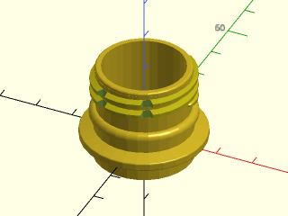

    include <BOSL2/std.scad>
    include <BOSL2/bottlecaps.scad>
    pco1810_neck();

  

**Example 2:** Standard anchors

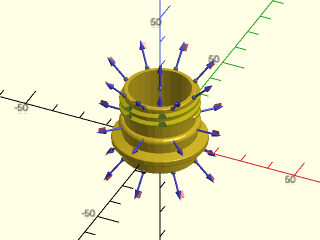

    include <BOSL2/std.scad>
    include <BOSL2/bottlecaps.scad>
    pco1810_neck() show_anchors(custom=false);

  

**Example 3:** Custom named anchors

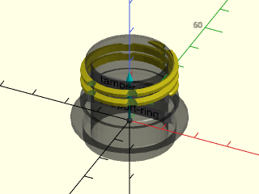

    include <BOSL2/std.scad>
    include <BOSL2/bottlecaps.scad>
    expose_anchors(0.3)
        pco1810_neck()
            show_anchors(std=false);

  

---

### Module: pco1810\_cap()

**Synopsis:** Creates a cap for a PCO1810 standard bottle. [<abbr>Geom</abbr>]

**Topics:** [Bottles](Topics#bottles), [Threading](Topics#threading)

**See Also:** [pco1810\_neck()](#module-pco1810_neck)

**Usage:** 

- pco1810_cap([h], [r|d], [wall], [texture]) [ATTACHMENTS];

**Description:** 

Creates a basic cap for a PCO1810 threaded beverage bottle.

**Arguments:** 

<abbr title="These args can be used by position or by name.">By&nbsp;Position</abbr> | What it does
-------------------- | ------------
`h`                  | The height of the cap.
`r`                  | Outer radius of the cap.
`d`                  | Outer diameter of the cap.
`wall`               | Wall thickness in mm.
`texture`            | The surface texture of the cap.  Valid values are "none", "knurled", "sharp_knurled", "ribbed", "sharp_ribbed", or "hex_faces". Default: "none"

<abbr title="These args must be used by name, ie: name=value">By&nbsp;Name</abbr> | What it does
-------------------- | ------------
`anchor`             | Translate so anchor point is at origin (0,0,0).  See [anchor](attachments.scad#subsection-anchor).  Default: `BOTTOM`
`spin`               | Rotate this many degrees around the Z axis after anchor. See [spin](attachments.scad#subsection-spin)  Default: 0
`orient`             | Vector to rotate top toward, after spin. See [orient](attachments.scad#subsection-orient). Default: `UP`

**Named Anchors:** 

Anchor Name | Position
----------- | --------
"inside-top" | Centered on the inside top of the cap.

**Example 1:** 

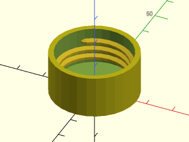

    include <BOSL2/std.scad>
    include <BOSL2/bottlecaps.scad>
    pco1810_cap();

  

**Example 2:** PCO1810 caps with different texture options. Clockwise from top: knurled, sharp\_knurled, ribbed, sharp\_ribbed. Center: hex\_faces. All textures increase the overall diameter of the part to preserve the original wall thickness.

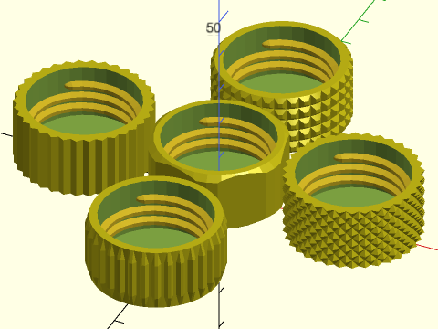

 

    include <BOSL2/std.scad>
    include <BOSL2/bottlecaps.scad>
    back(36) pco1810_cap(texture="knurled");
    right(36) pco1810_cap(texture="sharp_knurled");
    fwd(36) pco1810_cap(texture="ribbed");
    left(36) pco1810_cap(texture="sharp_ribbed");
    pco1810_cap(texture="hex_faces");

**Example 3:** Standard anchors

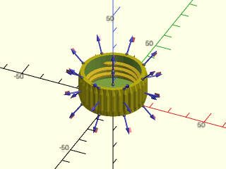

    include <BOSL2/std.scad>
    include <BOSL2/bottlecaps.scad>
    pco1810_cap(texture="ribbed") show_anchors(custom=false);

  

**Example 4:** Custom named anchors

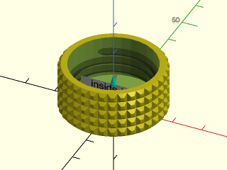

    include <BOSL2/std.scad>
    include <BOSL2/bottlecaps.scad>
    expose_anchors(0.3)
        pco1810_cap(texture="knurled")
            show_anchors(std=false);

  

---

## Section: PCO-1881 Bottle Threading

The PCO (Plastic Closure Only) 1881 standard is an update to the [PCO1810](bottlecaps.scad#section-pco-1810-bottle-threading). Both are used for plastic water and drink bottles typically ranging from 250 ml to 2 L. Both standards have a neck diameter of 28 mm.
Because the neck and cap account for a large fraction of the total material used in a plastic bottle, the PCO1881 standard was developed to reduce material compared to the PCO1810 standard by using a shorter neck (17 mm thread height) and thinner threads (650° thread travel with 2.7 mm pitch).

### Module: pco1881\_neck()

**Synopsis:** Creates a neck for a PCO1881 standard bottle. [<abbr>Geom</abbr>]

**Topics:** [Bottles](Topics#bottles), [Threading](Topics#threading)

**See Also:** [pco1881\_cap()](#module-pco1881_cap)

**Usage:** 

- pco1881_neck([wall]) [ATTACHMENTS];

**Description:** 

Creates an approximation of a standard PCO-1881 threaded beverage bottle neck.

**Arguments:** 

<abbr title="These args can be used by position or by name.">By&nbsp;Position</abbr> | What it does
-------------------- | ------------
`wall`               | Wall thickness in mm.

<abbr title="These args must be used by name, ie: name=value">By&nbsp;Name</abbr> | What it does
-------------------- | ------------
`anchor`             | Translate so anchor point is at origin (0,0,0).  See [anchor](attachments.scad#subsection-anchor).  Default: "support_ring"
`spin`               | Rotate this many degrees around the Z axis after anchor.  See [spin](attachments.scad#subsection-spin). Default: 0
`orient`             | Vector to rotate top toward, after spin.  See [orient](attachments.scad#subsection-orient).  Default: `UP`

**Named Anchors:** 

Anchor Name | Position
----------- | --------
"tamper-ring" | Centered at the top of the anti-tamper ring channel.
"support-ring" | Centered at the bottom of the support ring.

**Example 1:** 

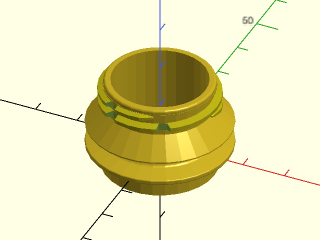

    include <BOSL2/std.scad>
    include <BOSL2/bottlecaps.scad>
    pco1881_neck();

  

**Example 2:** 

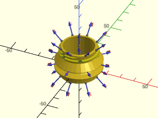

    include <BOSL2/std.scad>
    include <BOSL2/bottlecaps.scad>
    pco1881_neck() show_anchors(custom=false);

  

**Example 3:** 

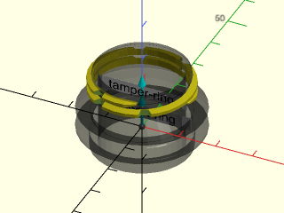

    include <BOSL2/std.scad>
    include <BOSL2/bottlecaps.scad>
    expose_anchors(0.3)
        pco1881_neck()
            show_anchors(std=false);

  

---

### Module: pco1881\_cap()

**Synopsis:** Creates a cap for a PCO1881 standard bottle. [<abbr>Geom</abbr>]

**Topics:** [Bottles](Topics#bottles), [Threading](Topics#threading)

**See Also:** [pco1881\_neck()](#module-pco1881_neck)

**Usage:** 

- pco1881_cap(wall, [texture]) [ATTACHMENTS];

**Description:** 

Creates a basic cap for a PCO1881 threaded beverage bottle.

**Arguments:** 

<abbr title="These args can be used by position or by name.">By&nbsp;Position</abbr> | What it does
-------------------- | ------------
`wall`               | Wall thickness in mm.
`texture`            | The surface texture of the cap.  Valid values are "none", "knurled", "sharp_knurled", "ribbed", "sharp_ribbed", or "hex_faces". Default: "none"

<abbr title="These args must be used by name, ie: name=value">By&nbsp;Name</abbr> | What it does
-------------------- | ------------
`anchor`             | Translate so anchor point is at origin (0,0,0).  See [anchor](attachments.scad#subsection-anchor).  Default: `BOTTOM`
`spin`               | Rotate this many degrees around the Z axis after anchor. See [spin](attachments.scad#subsection-spin). Default: 0
`orient`             | Vector to rotate top toward, after spin.  See [orient](attachments.scad#subsection-orient).  Default: `UP`

**Named Anchors:** 

Anchor Name | Position
----------- | --------
"inside-top" | Centered on the inside top of the cap.

**Example 1:** 

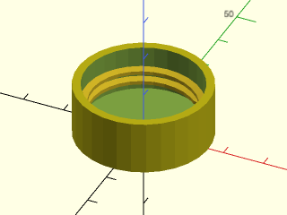

    include <BOSL2/std.scad>
    include <BOSL2/bottlecaps.scad>
    pco1881_cap();

  

**Example 2:** PCO1881 caps with different texture options. Clockwise from top: knurled, sharp\_knurled, ribbed, sharp\_ribbed. Center: hex\_faces. All textures increase the overall diameter to preserve the original wall thickness.

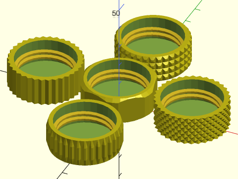

 

    include <BOSL2/std.scad>
    include <BOSL2/bottlecaps.scad>
    back(36) pco1881_cap(texture="knurled");
    right(36) pco1881_cap(texture="sharp_knurled");
    fwd(36) pco1881_cap(texture="ribbed");
    left(36) pco1881_cap(texture="sharp_ribbed");
    pco1881_cap(texture="hex_faces");

**Example 3:** Standard anchors

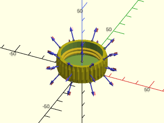

    include <BOSL2/std.scad>
    include <BOSL2/bottlecaps.scad>
    pco1881_cap(texture="ribbed") show_anchors(custom=false);

  

**Example 4:** Custom named anchors

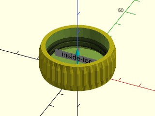

    include <BOSL2/std.scad>
    include <BOSL2/bottlecaps.scad>
    expose_anchors(0.5)
        pco1881_cap(texture="ribbed")
            show_anchors(std=false);

  

---

## Section: Generic Bottle Connectors

All of these connectors default to the PCO1881 standard, if applicable, for arguments that are left blank.

### Module: generic\_bottle\_neck()

**Synopsis:** Creates a generic neck for a bottle. [<abbr>Geom</abbr>]

**Topics:** [Bottles](Topics#bottles), [Threading](Topics#threading)

**See Also:** [generic\_bottle\_cap()](#module-generic_bottle_cap)

**Usage:** 

- generic_bottle_neck([wall], ...) [ATTACHMENTS];

**Description:** 

Creates a bottle neck given specifications.

**Arguments:** 

<abbr title="These args can be used by position or by name.">By&nbsp;Position</abbr> | What it does
-------------------- | ------------
`wall`               | distance between ID and any wall that may be below the support

<abbr title="These args must be used by name, ie: name=value">By&nbsp;Name</abbr> | What it does
-------------------- | ------------
`neck_d`             | Outer diameter of neck without threads. Default: 26.19
`id`                 | Inner diameter of neck. Default: 21.74
`thread_od`          | Outer diameter of thread. Default: 27.4
`height`             | Height of neck above support. Default: 17
`support_d`          | Outer diameter of support ring. Set to 0 for no support. Default: 33
`pitch`              | Thread pitch. Default: 2.7
`round_supp`         | True to round the lower edge of the support ring. Default: false
`anchor`             | Translate so anchor point is at origin (0,0,0). See [anchor](attachments.scad#subsection-anchor).  Default: "support-ring"
`spin`               | Rotate this many degrees around the Z axis after anchor.  See [spin](attachments.scad#subsection-spin).  Default: 0
`orient`             | Vector to rotate top toward, after spin.  See [orient](attachments.scad#subsection-orient).  Default: `UP`

**Named Anchors:** 

Anchor Name | Position
----------- | --------
"support-ring" | Centered at the bottom of the support ring.

**Example 1:** 

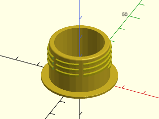

    include <BOSL2/std.scad>
    include <BOSL2/bottlecaps.scad>
    generic_bottle_neck();

  

---

### Module: generic\_bottle\_cap()

**Synopsis:** Creates a generic cap for a bottle. [<abbr>Geom</abbr>]

**Topics:** [Bottles](Topics#bottles), [Threading](Topics#threading)

**See Also:** [generic\_bottle\_neck()](#module-generic_bottle_neck), [sp\_cap()](#module-sp_cap)

**Usage:** 

- generic_bottle_cap(wall, [texture], ...) [ATTACHMENTS];

**Description:** 

Creates a basic threaded cap given specifications. You must give exactly two of `thread_od`, `neck_od` and `thread_depth` to
specify the thread geometry. Most glass bottles conform to the SPI standard and caps for them may be more easily produced using [`sp_cap()`](#module-sp_cap).

**Arguments:** 

<abbr title="These args can be used by position or by name.">By&nbsp;Position</abbr> | What it does
-------------------- | ------------
`wall`               | Wall thickness.  Default: 2
`texture`            | The surface texture of the cap.  Valid values are "none", "knurled", "sharp_knurled", "ribbed", "sharp_ribbed", or "hex_faces". Default: "none"

<abbr title="These args must be used by name, ie: name=value">By&nbsp;Name</abbr> | What it does
-------------------- | ------------
`height`             | Interior height of the cap.
`thread_od`          | Outer diameter of the threads.
`neck_od`            | Outer diameter of neck.
`thread_depth`       | Depth of the threads.
`tolerance`          | Extra space to add to the outer diameter of threads and neck. Applied to radius. Default: 0.2
`flank_angle`        | Angle of taper on threads. Default: 15
`pitch`              | Thread pitch. Default: 2.7
`anchor`             | Translate so anchor point is at origin (0,0,0).  See [anchor](attachments.scad#subsection-anchor).  Default: `BOTTOM`
`spin`               | Rotate this many degrees around the Z axis after anchor.  See [spin](attachments.scad#subsection-spin).  Default: 0
`orient`             | Vector to rotate top toward, after spin.  See [orient](attachments.scad#subsection-orient).  Default: `UP`

**Named Anchors:** 

Anchor Name | Position
----------- | --------
"inside-top" | Centered on the inside top of the cap.

**Example 1:** 

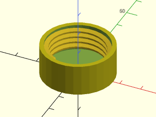

    include <BOSL2/std.scad>
    include <BOSL2/bottlecaps.scad>
    generic_bottle_cap(thread_depth=2,neck_od=INCH,height=INCH/2);

  

**Example 2:** 

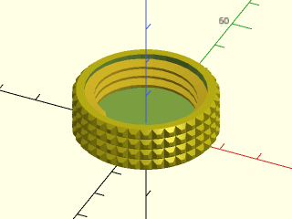

 

    include <BOSL2/std.scad>
    include <BOSL2/bottlecaps.scad>
    generic_bottle_cap(texture="knurled",neck_od=25,thread_od=30,height=10);

**Example 3:** 

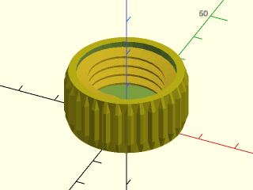

 

    include <BOSL2/std.scad>
    include <BOSL2/bottlecaps.scad>
    generic_bottle_cap(texture="ribbed",thread_depth=3,thread_od=25,height=13);

---

### Module: bottle\_adapter\_neck\_to\_cap()

**Synopsis:** Creates a generic adapter between a neck and a cap. [<abbr>Geom</abbr>]

**Topics:** [Bottles](Topics#bottles), [Threading](Topics#threading)

**See Also:** [bottle\_adapter\_neck\_to\_neck()](#module-bottle_adapter_neck_to_neck)

**Usage:** 

- bottle_adapter_neck_to_cap(wall, [texture], ...) [ATTACHMENTS];

**Description:** 

Creates a threaded neck to cap adapter

**Arguments:** 

<abbr title="These args can be used by position or by name.">By&nbsp;Position</abbr> | What it does
-------------------- | ------------
`wall`               | Thickness of wall between neck and cap when d=0.  Leave undefined to have the outside of the tube go from the OD of the neck support ring to the OD of the cap.  Default: undef
`texture`            | The surface texture of the cap.  Valid values are "none", "knurled", "sharp_knurled", "ribbed", "sharp_ribbed", or "hex_faces". Default: "none"
`cap_wall`           | Wall thickness of the cap in mm. Default: 2
`cap_h`              | Interior height of the cap in mm. Default: 11.2
`cap_thread_depth`   | Cap thread depth.  Default: 1.6
`tolerance`          | Extra space to add to the outer diameter of threads and neck in mm.  Applied to radius. Default: 0.2
`cap_neck_od`        | Inner diameter of the cap threads. Default: 25.5
`cap_neck_id`        | Inner diameter of the hole through the cap. Default: undef
`cap_thread_taper`   | Angle of taper on threads. Default: 15
`cap_thread_pitch`   | Thread pitch in mm. Default: 2.7
`neck_d`             | Outer diameter of neck w/o threads. Default: 24.8
`neck_id`            | Inner diameter of neck. Default: 21.4
`neck_thread_od`     | Outer diameter of neck with threads. Default: 27.6
`neck_h`             | Height of neck down to support ring. Default: 17
`neck_thread_pitch`  | Thread pitch in mm. Default: 2.7
`neck_support_od`    | Outer diameter of neck support ring.  Leave undefined to set equal to OD of cap.  Set to 0 for no ring.  Default: undef
`d`                  | Distance between bottom of neck and top of cap. Default: 0
`taper_lead_in`      | Length to leave straight before tapering on tube between neck and cap if exists. Default: 0
`anchor`             | Translate so anchor point is at origin (0,0,0).  See [anchor](attachments.scad#subsection-anchor).  Default: `CENTER`
`spin`               | Rotate this many degrees around the Z axis after anchor.  See [spin](attachments.scad#subsection-spin). Default: 0
`orient`             | Vector to rotate top toward, after spin.  See [orient](attachments.scad#subsection-orient).  Default: `UP`

**Example 1:** 

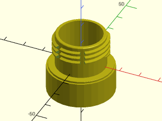

    include <BOSL2/std.scad>
    include <BOSL2/bottlecaps.scad>
    bottle_adapter_neck_to_cap();

  

---

### Module: bottle\_adapter\_cap\_to\_cap()

**Synopsis:** Creates a generic adaptor between a cap and a cap. [<abbr>Geom</abbr>]

**Topics:** [Bottles](Topics#bottles), [Threading](Topics#threading)

**See Also:** [bottle\_adapter\_neck\_to\_cap()](#module-bottle_adapter_neck_to_cap), [bottle\_adapter\_neck\_to\_neck()](#module-bottle_adapter_neck_to_neck)

**Usage:** 

- bottle_adapter_cap_to_cap(wall, [texture]) [ATTACHMENTS];

**Description:** 

Creates a threaded cap to cap adapter.

**Arguments:** 

<abbr title="These args can be used by position or by name.">By&nbsp;Position</abbr> | What it does
-------------------- | ------------
`wall`               | Wall thickness in mm.
`texture`            | The surface texture of the cap.  Valid values are "none", "knurled", "sharp_knurled", "ribbed", "sharp_ribbed", or "hex_faces". Default: "none"
`cap_h1`             | Interior height of top cap. Default: 11.2
`cap_thread_depth1`  | Thread depth on top cap. Default: 1.6
`tolerance`          | Extra space to add to the outer diameter of threads and neck in mm. Applied to radius. Default: 0.2
`cap_neck_od1`       | Inner diameter of threads on top cap. Default: 25.5
`cap_thread_pitch1`  | Thread pitch of top cap in mm. Default: 2.7
`cap_h2`             | Interior height of bottom cap.  Leave undefined to duplicate cap_h1.
`cap_thread_depth2`  | Thread depth on bottom cap.  Default: same as cap_thread_depth1
`cap_neck_od2`       | Inner diameter of threads on top cap.  Leave undefined to duplicate cap_neck_od1.
`cap_thread_pitch2`  | Thread pitch of bottom cap in mm.  Leave undefinced to duplicate cap_thread_pitch1.
`d`                  | Distance between caps.
`neck_id1`           | Inner diameter of cutout in top cap.
`neck_id2`           | Inner diameter of cutout in bottom cap.
`taper_lead_in`      | Length to leave straight before tapering on tube between caps if exists.
`anchor`             | Translate so anchor point is at origin (0,0,0).  See [anchor](attachments.scad#subsection-anchor).  Default: `CENTER`
`spin`               | Rotate this many degrees around the Z axis after anchor.  See [spin](attachments.scad#subsection-spin). Default: 0
`orient`             | Vector to rotate top toward, after spin.  See [orient](attachments.scad#subsection-orient).  Default: `UP`

**Example 1:** 

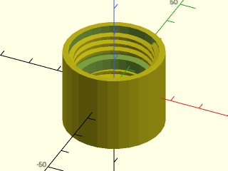

    include <BOSL2/std.scad>
    include <BOSL2/bottlecaps.scad>
    bottle_adapter_cap_to_cap();

  

---

### Module: bottle\_adapter\_neck\_to\_neck()

**Synopsis:** Creates a generic adaptor between a neck and a neck. [<abbr>Geom</abbr>]

**Topics:** [Bottles](Topics#bottles), [Threading](Topics#threading)

**See Also:** [bottle\_adapter\_neck\_to\_cap()](#module-bottle_adapter_neck_to_cap), [bottle\_adapter\_cap\_to\_cap()](#module-bottle_adapter_cap_to_cap)

**Usage:** 

- bottle_adapter_neck_to_neck(...) [ATTACHMENTS];

**Description:** 

Creates a threaded neck to neck adapter.

**Arguments:** 

<abbr title="These args can be used by position or by name.">By&nbsp;Position</abbr> | What it does
-------------------- | ------------
`d`                  | Distance between bottoms of necks. Default: 0
`neck_od1`           | Outer diameter of top neck without threads. Default: 24.8
`neck_id1`           | Inner diameter of top neck. Default 21.4
`thread_od1`         | Outer diameter of threads on top neck. Default: 27.6
`height1`            | Height of top neck above support ring. Default: 17
`support_od1`        | Outer diameter of the support ring on the top neck. Set to 0 for no ring. Default: 33
`thread_pitch1`      | Thread pitch of top neck. Default: 2.7
`neck_od2`           | Outer diameter of bottom neck w/o threads.  Leave undefined to duplicate neck_od1
`neck_id2`           | Inner diameter of bottom neck.  Leave undefined to duplicate neck_id1
`thread_od2`         | Outer diameter of threads on bottom neck.  Leave undefined to duplicate thread_od1
`height2`            | Height of bottom neck above support ring.  Leave undefined to duplicate height1
`support_od2`        | Outer diameter of the support ring on bottom neck.  Set to 0 for no ring.  Leave undefined to duplicate support_od1
`pitch2`             | Thread pitch of bottom neck.  Leave undefined to duplicate thread_pitch1
`taper_lead_in`      | Length to leave straight before tapering on tube between necks if exists.
`wall`               | Thickness of tube wall between necks.  Leave undefined to match outer diameters with the neckODs/supportODs.
`anchor`             | Translate so anchor point is at origin (0,0,0).  See [anchor](attachments.scad#subsection-anchor).  Default: `CENTER`
`spin`               | Rotate this many degrees around the Z axis after anchor.  See [spin](attachments.scad#subsection-spin). Default: 0
`orient`             | Vector to rotate top toward, after spin.  See [orient](attachments.scad#subsection-orient).  Default: `UP`

**Example 1:** 

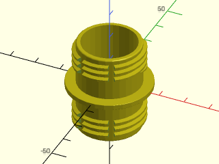

    include <BOSL2/std.scad>
    include <BOSL2/bottlecaps.scad>
    bottle_adapter_neck_to_neck();

  

---

## Section: SPI Bottle Threading

### Module: sp\_neck()

**Synopsis:** Creates an SPI threaded bottle neck. [<abbr>Geom</abbr>]

**Topics:** [Bottles](Topics#bottles), [Threading](Topics#threading)

**See Also:** [sp\_cap()](#module-sp_cap)

**Usage:** 

- sp_neck(diam, type, wall|id=, [style=], [bead=]) [ATTACHMENTS];

**Description:** 

Make a SPI (Society of Plastics Industry) threaded bottle or jar neck. You must
supply the nominal outer diameter of the threads and the thread type, one of
400, 410 and 415. The 400 type neck has 360° of thread, the 410
neck has 540° of thread, and the 415 neck has 720° of thread.
You can also choose between the symmetric L style thread and the asymmetric
M style buttress thread.  The M style may be good for 3d printing if printed with the flat face up.
You can specify the wall thickness (measured from the base of the threads) or
the inner diameter, and you can specify an optional bead at the base of the threads.

**Arguments:** 

<abbr title="These args can be used by position or by name.">By&nbsp;Position</abbr> | What it does
-------------------- | ------------
`diam`               | nominal outer diameter of threads
`type`               | thread type, one of 400, 410, and 415
`wall`               | wall thickness

<abbr title="These args must be used by name, ie: name=value">By&nbsp;Name</abbr> | What it does
-------------------- | ------------
`id`                 | inner diameter
`style`              | Either "L" or "M" to specify the thread style.  Default: "L"
`bead`               | if true apply a bead to the neck.  Default: false
`anchor`             | Translate so anchor point is at origin (0,0,0).  See [anchor](attachments.scad#subsection-anchor).  Default: `BOTTOM`
`spin`               | Rotate this many degrees around the Z axis after anchor.  See [spin](attachments.scad#subsection-spin). Default: 0
`orient`             | Vector to rotate top toward, after spin.  See [orient](attachments.scad#subsection-orient).  Default: `UP`

**Example 1:** 

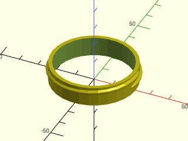

    include <BOSL2/std.scad>
    include <BOSL2/bottlecaps.scad>
    sp_neck(48,400,2);

  

**Example 2:** 

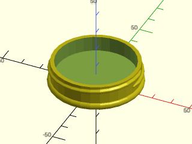

    include <BOSL2/std.scad>
    include <BOSL2/bottlecaps.scad>
    sp_neck(48,400,2,bead=true);

  

**Example 3:** 

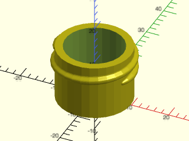

    include <BOSL2/std.scad>
    include <BOSL2/bottlecaps.scad>
    sp_neck(22,410,2);

  

**Example 4:** 

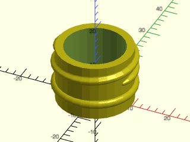

    include <BOSL2/std.scad>
    include <BOSL2/bottlecaps.scad>
    sp_neck(22,410,2,bead=true);

  

**Example 5:** 

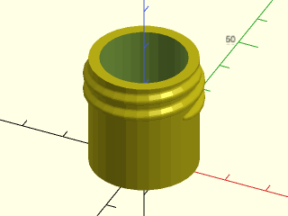

    include <BOSL2/std.scad>
    include <BOSL2/bottlecaps.scad>
    sp_neck(28,415,id=20,style="M");

  

**Example 6:** 

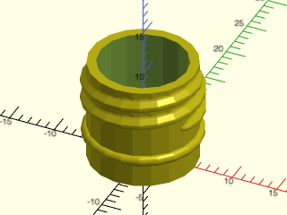

    include <BOSL2/std.scad>
    include <BOSL2/bottlecaps.scad>
    sp_neck(13,415,wall=1,style="M",bead=true);

  

---

### Module: sp\_cap()

**Synopsis:** Creates an SPI threaded bottle cap. [<abbr>Geom</abbr>]

**Topics:** [Bottles](Topics#bottles), [Threading](Topics#threading)

**See Also:** [sp\_neck()](#module-sp_neck)

**Usage:** 

- sp_cap(diam, type, wall, [style=], [top_adj=], [bot_adj=], [texture=], [$slop]) [ATTACHMENTS];

**Description:** 

Make a SPI (Society of Plastics Industry) threaded bottle or jar cap. You must
supply the nominal outer diameter of the threads and the thread type, one of
400, 410 and 415. The 400 type neck has 360° of thread, the 410
neck has 540° of thread, and the 415 neck has 720° of thread.
You can also choose between the symmetric L style thread and
the asymmetric M style buttress thread.
It is OK to mix styles, so you can put an L-style cap onto an M-style neck.

The 410 and 415 caps have long unthreaded sections at the bottom.
The bot_adj parameter specifies an amount to reduce that bottom extension, which might be
necessary if the cap bottoms out on the bead.  Be careful that you don't shrink past the threads,
especially if making adjustments to 400 caps that have a small bottom extension.
These caps often contain a cardboard or foam sealer disk, which can be as much as 1mm thick, and
would cause the cap to stop in a higher position.

You can also adjust the space between the top of the cap and the threads using top_adj. This
changes how the threads engage when the cap is fully seated.

The inner diameter of the cap is set to allow 10% of the thread depth in clearance.  The diameter
is further increased by `2 * $slop` so you can increase clearance if necessary.

Note: there is a published SPI standard for necks, but absolutely nothing for caps.  This
cap module was designed based on the neck standard to mate reasonably well, but if you
find ways that it does the wrong thing, file a report.

**Arguments:** 

<abbr title="These args can be used by position or by name.">By&nbsp;Position</abbr> | What it does
-------------------- | ------------
`diam`               | nominal outer diameter of threads
`type`               | thread type, one of 400, 410, or 415
`wall`               | wall thickness

<abbr title="These args must be used by name, ie: name=value">By&nbsp;Name</abbr> | What it does
-------------------- | ------------
`style`              | Either "L" or "M" to specify the thread style.  Default: "L"
`top_adj`            | Amount to reduce top space in the cap, which means it doesn't screw down as far.  Default: 0
`bot_adj`            | Amount to reduce extension of cap at the bottom, which also means it doesn't screw down as far.  Default: 0
`texture`            | The surface texture of the cap.  Valid values are "none", "knurled", "sharp_knurled", "ribbed", "sharp_ribbed", or "hex_faces". Default: "none"
`$slop`              | Increase inner diameter by `2 * $slop`.
`anchor`             | Translate so anchor point is at origin (0,0,0).  See [anchor](attachments.scad#subsection-anchor).  Default: `BOTTOM`
`spin`               | Rotate this many degrees around the Z axis after anchor.  See [spin](attachments.scad#subsection-spin). Default: 0
`orient`             | Vector to rotate top toward, after spin.  See [orient](attachments.scad#subsection-orient).  Default: `UP`

**Example 1:** 

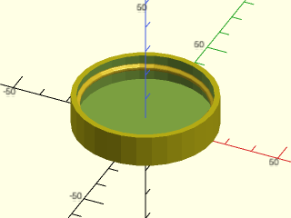

    include <BOSL2/std.scad>
    include <BOSL2/bottlecaps.scad>
    sp_cap(48,400,2);

  

**Example 2:** 

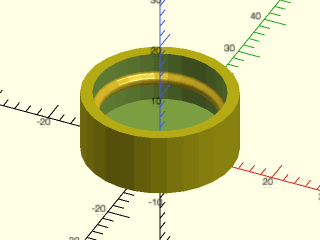

    include <BOSL2/std.scad>
    include <BOSL2/bottlecaps.scad>
    sp_cap(22,400,2);

  

**Example 3:** 

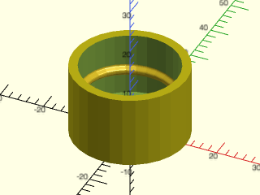

    include <BOSL2/std.scad>
    include <BOSL2/bottlecaps.scad>
    sp_cap(22,410,2);

  

**Example 4:** 

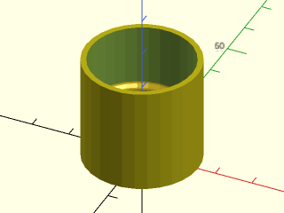

    include <BOSL2/std.scad>
    include <BOSL2/bottlecaps.scad>
    sp_cap(28,415,1.5,style="M");

  

---

### Function: sp\_diameter()

**Synopsis:** Returns the base diameter of an SPI bottle neck from the nominal diameter and type number.

**Topics:** [Bottles](Topics#bottles), [Threading](Topics#threading)

**See Also:** [sp\_neck()](#module-sp_neck), [sp\_cap()](#module-sp_cap)

**Usage:** 

- true_diam = sp_diameter(diam,type)

**Description:** 

Returns the actual base diameter (root of the threads) for a SPI plastic bottle neck given the nominal diameter and type number (400, 410, 415).

**Arguments:** 

<abbr title="These args can be used by position or by name.">By&nbsp;Position</abbr> | What it does
-------------------- | ------------
`diam`               | nominal diameter
`type`               | closure type number (400, 410 or 415)

---

## Section: Mason Jar Threading

The Mason jar is a glass container with a threaded neck and two-piece metal lid consisting of a sealing disk and a threaded retaining ring. It has been widely used in North America since it was patented in 1858 by American tinsmith John Landis Mason.
Brands like Ball and Kerr established the two dominant thread geometries still in use today: 70-450G (standard glass Mason jar with 70 mm outer thread diameter) and 86-400 (wide mouth Mason jar with 86 mm outer thread diameter). The 450G designation has a taller thread engagement area compared to the 400 series.
One may also run across a 70-400 thread finish designed for plastic caps (different from the SPI 70-400), and the 89-400 finish used by some international suppliers.

The Glass Packaging Institute (GPI) maintains standards and drawings for Mason jar threads, but does not make them publicly available. The specs used in these modules were derived from various online sources and physical measurements.

### Module: mason\_neck()

**Synopsis:** Creates a threaded glass mason jar neck. [<abbr>Geom</abbr>]

**Topics:** [Bottles](Topics#bottles), [Threading](Topics#threading)

**See Also:** [mason\_cap()](#module-mason_cap)

**Usage:** 

- mason_neck(diam, type, wall|id=, [style=], [bead=]) [ATTACHMENTS];

**Description:** 

Make a threaded Mason jar neck. You must
supply the nominal outer diameter of the threads and the thread type,
400 or 450. The 400 type neck is generated with 370° of thread, and the 450
neck has 460° of thread (slightly more than 1.25 turns).
You can also choose between the symmetric L style thread and the asymmetric
M style buttress thread.  The M style may be good for 3d printing if printed with the flat face up.
You can specify the wall thickness (measured from the base of the threads) or
the inner diameter, and you can specify an optional bead at the base of the threads.

**Arguments:** 

<abbr title="These args can be used by position or by name.">By&nbsp;Position</abbr> | What it does
-------------------- | ------------
`diam`               | nominal outer diameter of threads
`type`               | thread type, 400 or 450
`wall`               | wall thickness

<abbr title="These args must be used by name, ie: name=value">By&nbsp;Name</abbr> | What it does
-------------------- | ------------
`id`                 | inner diameter
`style`              | Either "L" or "M" to specify the thread style.  Default: "L"
`bead`               | if true apply a bead to the neck.  Default: false
`anchor`             | Translate so anchor point is at origin (0,0,0).  See [anchor](attachments.scad#subsection-anchor).  Default: `BOTTOM`
`spin`               | Rotate this many degrees around the Z axis after anchor.  See [spin](attachments.scad#subsection-spin). Default: 0
`orient`             | Vector to rotate top toward, after spin.  See [orient](attachments.scad#subsection-orient).  Default: `UP`

**Example 1:** 

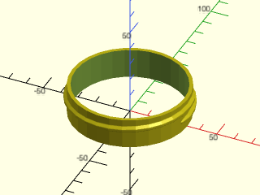

    include <BOSL2/std.scad>
    include <BOSL2/bottlecaps.scad>
    mason_neck(70,400,2);

  

**Example 2:** 

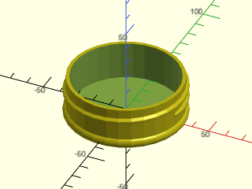

    include <BOSL2/std.scad>
    include <BOSL2/bottlecaps.scad>
    mason_neck(70,450,2,bead=true);

  

**Example 3:** 

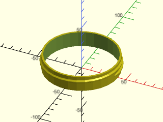

    include <BOSL2/std.scad>
    include <BOSL2/bottlecaps.scad>
    mason_neck(86,400,2);

  

**Example 4:** 

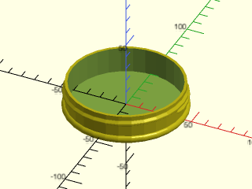

    include <BOSL2/std.scad>
    include <BOSL2/bottlecaps.scad>
    mason_neck(89,400,2,style="M",bead=true);

  

---

### Module: mason\_cap()

**Synopsis:** Creates a threaded mason jar cap. [<abbr>Geom</abbr>]

**Topics:** [Bottles](Topics#bottles), [Threading](Topics#threading)

**See Also:** [mason\_neck()](#module-mason_neck)

**Usage:** 

- mason_cap(diam, type, wall, [style=], [top_adj=], [bot_adj=], [texture=], [$slop]) [ATTACHMENTS];

**Description:** 

Make a GPI (Glass Packaging Institute) threaded mason jar cap. You must
supply the nominal outer diameter of the threads and the thread type,
400 or 450. While the 400 type neck has 370° of thread, and the 450
neck has 460° of thread, the cap thread is increased by 1.35 times these amounts.
You can also choose between the symmetric L style thread and the asymmetric
M style buttress thread.  The M style may be good for 3d printing if printed with the flat face up.
It is OK to mix styles, so you can put an L-style cap onto an M-style neck.

The bot_adj parameter specifies an amount to reduce that bottom extension, which might be
necessary if the cap bottoms out on the bead.  Be careful that you don't shrink past the threads,
especially if making adjustments to type 400 caps that have a small bottom extension.
These caps often contain a cardboard or foam sealer disk, which can be as much as 1mm thick, and
would cause the cap to stop in a higher position.

You can also adjust the space between the top of the cap and the threads using `top_adj`. This
changes how the threads engage when the cap is fully seated.

The inner diameter of the cap is set to allow 10% of the thread depth in clearance.  The diameter
is further increased by `2 * $slop` so you can increase clearance if necessary.

**Arguments:** 

<abbr title="These args can be used by position or by name.">By&nbsp;Position</abbr> | What it does
-------------------- | ------------
`diam`               | nominal outer diameter of threads
`type`               | thread type, 400 or 450
`wall`               | wall thickness

<abbr title="These args must be used by name, ie: name=value">By&nbsp;Name</abbr> | What it does
-------------------- | ------------
`style`              | Either "L" or "M" to specify the thread style.  Default: "L"
`top_adj`            | Amount to reduce top space in the cap, which means it doesn't screw down as far.  Default: 3
`bot_adj`            | Amount to reduce extension of cap at the bottom, which also means it doesn't screw down as far.  Default: 0
`texture`            | The surface texture of the cap.  Valid values are "none", "knurled", "sharp_knurled", "ribbed", "sharp_ribbed", or "hex_faces". Default: "none"
`$slop`              | Increase inner diameter by `2 * $slop`.
`anchor`             | Translate so anchor point is at origin (0,0,0).  See [anchor](attachments.scad#subsection-anchor).  Default: `BOTTOM`
`spin`               | Rotate this many degrees around the Z axis after anchor.  See [spin](attachments.scad#subsection-spin). Default: 0
`orient`             | Vector to rotate top toward, after spin.  See [orient](attachments.scad#subsection-orient).  Default: `UP`

**Example 1:** 

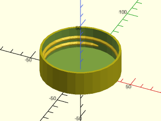

    include <BOSL2/std.scad>
    include <BOSL2/bottlecaps.scad>
    mason_cap(70,450,2);

  

**Example 2:** 

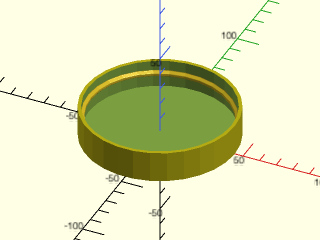

    include <BOSL2/std.scad>
    include <BOSL2/bottlecaps.scad>
    mason_cap(86,400,2);

  

---

