# LibFile: color.scad

In OpenSCAD the `color()` module sets the color immutably for its geometry subtree:
nested `color()` calls cannot override it. In BOSL2, [`recolor()`](#module-recolor) provides mutable
coloring for attachable objects, so that descendants can change their colors.
Use `mutable=false` when an immutable color is needed, including for geometry
that is not attachable. The [`color_this()`](#module-color_this) module changes color at just one
level, with descendants reverting to the previous color and alpha.

The [`rainbow()`](#module-rainbow) module assigns different colors to items in a list, for example
for debugging. This file also provides HSL, HSV, and D65 CIE LCh conversions.

To use, add the following lines to the beginning of your file:

    include <BOSL2/std.scad>

## File Contents

1. [Section: Coloring Objects](#section-coloring-objects)
    - [`recolor()`](#module-recolor) – Sets the color for attachable children and their descendants. [<abbr>Trans</abbr>]
    - [`color_this()`](#module-color_this) – Sets the color for attachable children at the current level only. [<abbr>Trans</abbr>]
    - [`rainbow()`](#module-rainbow) – Iterates through a list, displaying children in different colors. [<abbr>Trans</abbr>]
    - [`color_overlaps()`](#module-color_overlaps) – Shows ghostly children, with overlaps highlighted in color. [<abbr>Trans</abbr>]

2. [Section: Setting Object Modifiers](#section-setting-object-modifiers)
    - [`highlight()`](#module-highlight) – Sets # modifier for attachable children and their descendants. [<abbr>Trans</abbr>]
    - [`highlight_this()`](#module-highlight_this) – Apply # modifier to children at a single level. [<abbr>Trans</abbr>]
    - [`ghost()`](#module-ghost) – Sets % modifier for attachable children and their descendants. [<abbr>Trans</abbr>]
    - [`ghost_this()`](#module-ghost_this) – Apply % modifier to children at a single level. [<abbr>Trans</abbr>]

3. [Section: Colorspace Conversion](#section-colorspace-conversion)
    - [`hsl()`](#functionmodule-hsl) – Converts HSL to RGB or colors children with an HSL color. [<abbr>Trans</abbr>]
    - [`hsv()`](#functionmodule-hsv) – Converts HSV to RGB or colors children with an HSV color. [<abbr>Trans</abbr>]
    - [`lch()`](#functionmodule-lch) – Converts D65 CIE LCh to sRGB or colors children with an LCh color. [<abbr>Trans</abbr>]

## Section: Coloring Objects

### Module: recolor()

**Synopsis:** Sets the color for attachable children and their descendants. [<abbr>Trans</abbr>]

**Topics:** [Attachments](Topics#attachments), [Colors](Topics#colors)

**See Also:** [color\_this()](#module-color_this), [hsl()](#functionmodule-hsl), [hsv()](#functionmodule-hsv), [lch()](#functionmodule-lch)

**Usage:** 

- recolor([c], [a], [mutable=]) CHILDREN;

**Description:** 

This is the BOSL2 replacement for `color()`.  Unlike `color()` it enables children
to change their color even when a parent has set a color.
With `mutable=true` (the default) it sets the color for attachable children and their descendants
until another [`recolor()`](#module-recolor) or [`color_this()`](#module-color_this) changes it. This sets the special
`$color` variable, which attachable objects use to apply the color.

With `mutable=false` it behaves like the native module and applies an immutable color to all of the children and descendants.
No operation performed by a child can override that color.

A separate `a` specifies alpha and overrides alpha given in an RGBA vector.
Each call replaces the alpha rather than multiplying alpha values.
Omitting `c`, or giving `c="default"` sets the color to the default for your color scheme.

The color can be an RGB vector with values between 0 and 1, or an RGBA vector that includes an alpha component.
You can also give the name (as a string) for a standard
web [color name](https://htmlpreview.github.io/?https://github.com/BelfrySCAD/BOSL2/blob/master/scripts/openscad_colors.html), and
in development snapshots after July 2026 you
can use [xkcd colors](https://xkcd.com/color/rgb/) with the format `"xkcd:<name>"`.

**Arguments:** 

<abbr title="These args can be used by position or by name.">By&nbsp;Position</abbr> | What it does
-------------------- | ------------
`c`                  | Color name, RGB vector, or RGBA vector. Default: the default color in your color scheme.
`a`                  | Alpha from 0 (transparent) to 1 (opaque), overriding embedded alpha when supplied. Default: preserve embedded alpha, otherwise opaque. Ignored for the default color.

<abbr title="These args must be used by name, ie: name=value">By&nbsp;Name</abbr> | What it does
-------------------- | ------------
`mutable`            | If true, use mutable attachable coloring. If false, apply immutable coloring to the complete child geometry. Default: true

**Side Effects:** 

- Sets `$color` to the color/alpha pair used by attachable objects.

**Example 1:** 

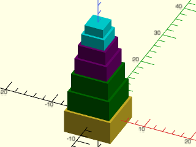

    include <BOSL2/std.scad>
    cuboid([10,10,5])
      recolor("green")attach(TOP,BOT) cuboid([9,9,4.5])
        attach(TOP,BOT) cuboid([8,8,4])
          recolor("purple") attach(TOP,BOT) cuboid([7,7,3.5])
            attach(TOP,BOT) cuboid([6,6,3])
              recolor("cyan")attach(TOP,BOT) cuboid([5,5,2.5])
                attach(TOP,BOT) cuboid([4,4,2]);

  

---

### Module: color\_this()

**Synopsis:** Sets the color for attachable children at the current level only. [<abbr>Trans</abbr>]

**Topics:** [Attachments](Topics#attachments), [Colors](Topics#colors)

**See Also:** [recolor()](#module-recolor), [hsl()](#functionmodule-hsl), [hsv()](#functionmodule-hsv), [lch()](#functionmodule-lch)

**Usage:** 

- color_this([c], [a]) CHILDREN;

**Description:** 

Sets the color for attachable children at one level, reverting to the previous
color and alpha for their descendants. This uses `$color` and
`$save_color`, which attachable objects interpret. An enclosing native `color()`
or immutable [`recolor()`](#module-recolor) cannot be overridden.

As with [`recolor()`](#module-recolor), a separate `a` overrides alpha embedded in `c`.
Omitting the color or giving `c="default"` selects the default color for your OpenSCAD color scheme.

**Arguments:** 

<abbr title="These args can be used by position or by name.">By&nbsp;Position</abbr> | What it does
-------------------- | ------------
`c`                  | Color name, RGB vector, or RGBA vector. Default: the default color in your color scheme.
`a`                  | Alpha from 0 (transparent) to 1 (opaque), overriding any alpha specified in the `c` vector

**Side Effects:** 

- Sets `$color` and saves the previous color/alpha pair in `$save_color`.

**Example 1:** 

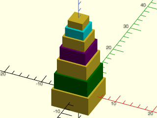

    include <BOSL2/std.scad>
    cuboid([10,10,5])
      color_this("green")attach(TOP,BOT) cuboid([9,9,4.5])
        attach(TOP,BOT) cuboid([8,8,4])
          color_this("purple") attach(TOP,BOT) cuboid([7,7,3.5])
            attach(TOP,BOT) cuboid([6,6,3])
              color_this("cyan")attach(TOP,BOT) cuboid([5,5,2.5])
                attach(TOP,BOT) cuboid([4,4,2]);

  

---

### Module: rainbow()

**Synopsis:** Iterates through a list, displaying children in different colors. [<abbr>Trans</abbr>]

**Topics:** [Colors](Topics#colors), [List Handling](Topics#list-handling), [Debugging](Topics#debugging)

**See Also:** [hsl()](#functionmodule-hsl), [hsv()](#functionmodule-hsv), [recolor()](#module-recolor), [color\_this()](#module-color_this)

**Usage:** 

- rainbow(list, [stride], [maxhues], [shuffle=], [seed=], [mutable=]) CHILDREN;

**Description:** 

Iterates over a list or string, invoking the children once per item. Use `$item`
for the current item and `$idx` for its index. An empty input generates no children.
Assigns color to each child using [`recolor()`](#module-recolor) with `mutable=true` by default.

Colors use uniformly spaced HSV hues at full saturation and value. The `maxhues` parameter
specifies the number hues to use and defaults to the number of items in `list`;
colors repeat when there are more items than hues.
The integer `stride` controls the step through those hues. A stride of 1 selects
adjacent hues; a negative stride reverses traversal, and 0 repeats one hue.
The default stride is a number near `maxhues` divided by the golden ratio and also
coprime with `maxhues`.  This is meant to separate nearby colors while visiting
every hue.  If you give a stride that has common factors with `maxhue` then
some hues will be skipped.

Set `shuffle=true` to shuffle the resulting color assignments.

**Arguments:** 

<abbr title="These args can be used by position or by name.">By&nbsp;Position</abbr> | What it does
-------------------- | ------------
`list`               | List of items, or a string to iterate character by character.
`stride`             | Integer step through the available hues. Default: see description.
`maxhues`            | Positive integer number of available hues. Default: the input length, or 1 for empty input.

<abbr title="These args must be used by name, ie: name=value">By&nbsp;Name</abbr> | What it does
-------------------- | ------------
`shuffle`            | If true, shuffle the color assignments. Default: false
`seed`               | Optional finite numeric random seed passed to [`shuffle()`](lists.scad#function-shuffle).
`mutable`            | If true, use mutable attachable coloring. If false, color complete child geometry immutably. Default: true

**Side Effects:** 

- Sets the color of each item using recolor().
- Sets `$idx` to the index of the current item.
- Sets `$item` to the current item.

**Example 1:** 

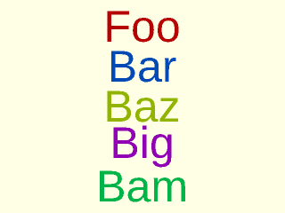

    include <BOSL2/std.scad>
    rainbow(["Foo","Bar","Baz","Big","Bam"])
      fwd($idx*10)
        text(text=$item,size=8,halign="center",
             valign="center");

  

**Example 2:** 

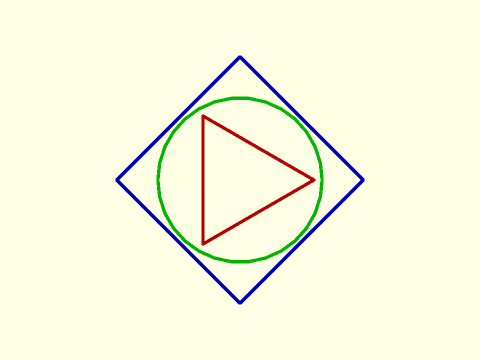

    include <BOSL2/std.scad>
    rgn = [circle(d=45,$fn=3),
           circle(d=75,$fn=4),
           circle(d=50)];
    rainbow(rgn) stroke($item, closed=true);

  

**Example 3:** 

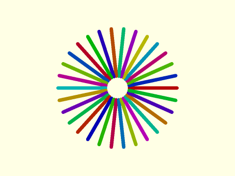

    include <BOSL2/std.scad>
    rainbow(lerpn(0,360,30,endpoint=false))
      zrot($item)
        stroke([[10,0],[50,0]],width=3);

  

**Example 4:** Setting maxhues to a small value

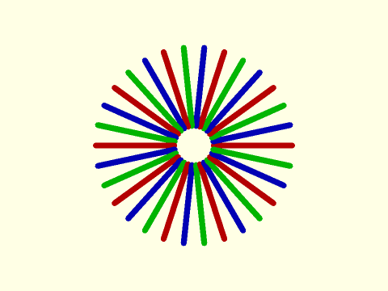

 

    include <BOSL2/std.scad>
    rainbow(lerpn(0,360,30,endpoint=false),maxhues=3)
      zrot($item)
        stroke([[10,0],[50,0]],width=3);

**Example 5:** Changing stride to 1

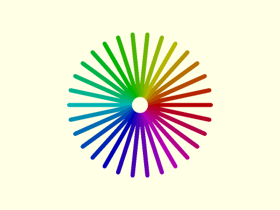

 

    include <BOSL2/std.scad>
    rainbow(lerpn(0,360,30,endpoint=false),stride=1)
      zrot($item)
        stroke([[7,0],[50,0]],width=3);

---

### Module: color\_overlaps()

**Synopsis:** Shows ghostly children, with overlaps highlighted in color. [<abbr>Trans</abbr>]

**Topics:** [Debugging](Topics#debugging)

**See Also:** [rainbow()](#module-rainbow), [debug\_vnf()](vnf.scad#module-debug_vnf)

**Usage:** 

- color_overlaps([color]) CHILDREN;

**Description:** 

Displays the given children in ghostly transparent gray, while the places where
they overlap are highlighted with the given color. Uses immutable coloring.

**Arguments:** 

<abbr title="These args can be used by position or by name.">By&nbsp;Position</abbr> | What it does
-------------------- | ------------
`color`              | The color to highlight overlaps with.  Default: "red"

**Example 1:** 2D Overlaps

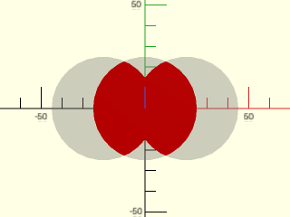

    include <BOSL2/std.scad>
    color_overlaps() {
        circle(d=50);
        left(20) circle(d=50);
        right(20) circle(d=50);
    }

  

**Example 2:** 3D Overlaps

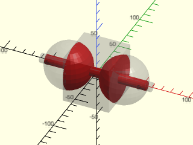

    include <BOSL2/std.scad>
    color_overlaps() {
        cuboid(50);
        left(30) sphere(d=50);
        right(30) sphere(d=50);
        xcyl(d=10,l=120);
    }

  

---

## Section: Setting Object Modifiers

### Module: highlight()

**Synopsis:** Sets # modifier for attachable children and their descendants. [<abbr>Trans</abbr>]

**Topics:** [Attachments](Topics#attachments), [Modifiers](Topics#modifiers), [Debugging](Topics#debugging)

**See Also:** [highlight\_this()](#module-highlight_this), [ghost()](#module-ghost), [ghost\_this()](#module-ghost_this), [recolor()](#module-recolor), [color\_this()](#module-color_this)

**Usage:** 

- highlight([highlight]) CHILDREN;

**Description:** 

Sets the `#` modifier for the attachable children and their descendents until another [`highlight()`](#module-highlight) or [`highlight_this()`](#module-highlight_this).
By default, turns `#` on, which makes the children transparent pink and displays them even if they are subtracted from the model.
Give the `false` parameter to disable the modifier and restore children to normal.
Do not mix this with user supplied `#` modifiers anywhere in the geometry tree.

**Arguments:** 

<abbr title="These args can be used by position or by name.">By&nbsp;Position</abbr> | What it does
-------------------- | ------------
`highlight`          | If true set the descendants to use `#`; if false, disable `#` for descendants.  Default: true

**Example 1:** 

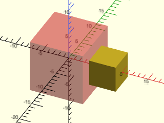

    include <BOSL2/std.scad>
    highlight() cuboid(10)
      highlight(false) attach(RIGHT,BOT)cuboid(5);

  

---

### Module: highlight\_this()

**Synopsis:** Apply # modifier to children at a single level. [<abbr>Trans</abbr>]

**Topics:** [Attachments](Topics#attachments), [Modifiers](Topics#modifiers), [Debugging](Topics#debugging)

**See Also:** [highlight()](#module-highlight), [ghost()](#module-ghost), [ghost\_this()](#module-ghost_this), [recolor()](#module-recolor), [color\_this()](#module-color_this)

**Usage:** 

- highlight_this() CHILDREN;

**Description:** 

Applies the `#` modifier to the children at a single level, reverting to the previous highlight state for further descendants.
This works only with attachables and you cannot give the `#` operator anywhere in the geometry tree.

**Example 1:** 

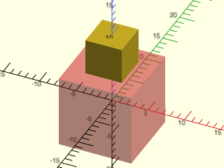

    include <BOSL2/std.scad>
    highlight_this()
    cuboid(10)
       attach(TOP,BOT)cuboid(5);

  

---

### Module: ghost()

**Synopsis:** Sets % modifier for attachable children and their descendants. [<abbr>Trans</abbr>]

**Topics:** [Attachments](Topics#attachments), [Modifiers](Topics#modifiers), [Debugging](Topics#debugging)

**See Also:** [ghost\_this()](#module-ghost_this), [recolor()](#module-recolor), [color\_this()](#module-color_this)

**Usage:** 

- ghost([ghost]) CHILDREN;

**Description:** 

Sets the `%` modifier for the attachable children and their descendents until another [`ghost()`](#module-ghost) or [`ghost_this()`](#module-ghost_this).
By default, turns `%` on, which makes the children gray and also removes them from interaction with the model.
Give the `false` parameter to disable the modifier and restore children to normal.
Do not mix this with user supplied `%` modifiers anywhere in the geometry tree.

**Arguments:** 

<abbr title="These args can be used by position or by name.">By&nbsp;Position</abbr> | What it does
-------------------- | ------------
`ghost`              | If true set the descendants to use `%`; if false, disable `%` for descendants.  Default: true

**Example 1:** 

    include <BOSL2/std.scad>
    ghost() cuboid(10)
      ghost(false) cuboid(5);

  

---

### Module: ghost\_this()

**Synopsis:** Apply % modifier to children at a single level. [<abbr>Trans</abbr>]

**Topics:** [Attachments](Topics#attachments), [Modifiers](Topics#modifiers), [Debugging](Topics#debugging)

**See Also:** [ghost()](#module-ghost), [recolor()](#module-recolor), [color\_this()](#module-color_this)

**Usage:** 

- ghost_this() CHILDREN;

**Description:** 

Applies the `%` modifier to the children at a single level, reverting to the previous ghost state for further descendants.
This works only with attachables and you cannot give the `%` operator anywhere in the geometry tree.

**Example 1:** 

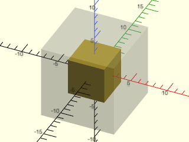

    include <BOSL2/std.scad>
    ghost_this() cuboid(10)
       cuboid(5);

  

---

## Section: Colorspace Conversion

### Function/Module: hsl()

**Synopsis:** Converts HSL to RGB or colors children with an HSL color. [<abbr>Trans</abbr>]

**Topics:** [Colors](Topics#colors), [Colorspace](Topics#colorspace)

**See Also:** [hsv()](#functionmodule-hsv), [lch()](#functionmodule-lch), [recolor()](#module-recolor), [color\_this()](#module-color_this)

**Usage:** As a function

- rgb = hsl(h, [s], [l], [a]);

**Usage:** As a module

- hsl(h, [s], [l], [a], [mutable=]) CHILDREN;

**Description:** 

**Description:** 

When called as a function, returns the `[R,G,B]` color for the given hue `h`, saturation `s`, and
lightness `l` from the [HSL colorspace](https://en.wikipedia.org/wiki/HSL_and_HSV).  If you supply the `a` value then you'll get a length 4
list `[R,G,B,A]`.  When called as a module, sets the color using [`recolor()`](#module-recolor) with `mutable=true` by default.

**Arguments:** 

<abbr title="These args can be used by position or by name.">By&nbsp;Position</abbr> | What it does
-------------------- | ------------
`h`                  | Hue angle in degrees, wrapped mod 360. 0=red, 60=yellow, 120=green, 180=cyan, 240=blue, 300=magenta.
`s`                  | Saturation from 0 (grayscale) to 1 (vivid colors). Default: 1
`l`                  | Lightness from 0 (black) to 1 (white); 0.5 gives bright colors. Default: 0.5
`a`                  | Alpha from 0 (transparent) to 1 (opaque). Default: 1 (opaque)

<abbr title="These args must be used by name, ie: name=value">By&nbsp;Name</abbr> | What it does
-------------------- | ------------
`mutable`            | Module only. Specifies whether color applies to children mutably or immutably.  Default: true

**Side Effects:** 

- The module sets `$color` through recolor().

**Example 1:** 

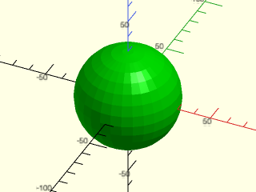

    include <BOSL2/std.scad>
    hsl(h=120,s=1,l=0.5) sphere(d=60);

  

**Example 2:** 

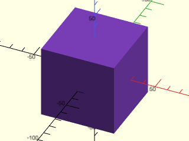

    include <BOSL2/std.scad>
    rgb = hsl(h=270,s=0.75,l=0.6);
    recolor(rgb) cuboid(60);

  

---

### Function/Module: hsv()

**Synopsis:** Converts HSV to RGB or colors children with an HSV color. [<abbr>Trans</abbr>]

**Topics:** [Colors](Topics#colors), [Colorspace](Topics#colorspace)

**See Also:** [hsl()](#functionmodule-hsl), [lch()](#functionmodule-lch), [recolor()](#module-recolor), [color\_this()](#module-color_this)

**Usage:** As a function

- rgb = hsv(h, [s], [v], [a]);

**Usage:** As a module

- hsv(h, [s], [v], [a], [mutable=]) CHILDREN;

**Description:** 

When called as a function, returns the `[R,G,B]` color for the given hue `h`, saturation `s`, and
value `v` from the [HSV colorspace](https://en.wikipedia.org/wiki/HSL_and_HSV).
If you supply the `a` value then you'll get a length 4 list
`[R,G,B,A]`.  When called as a module, sets the color using the color() module to the given hue
`h`, saturation `s`, and value `v` from the HSV colorspace.
When called as a module, sets the color using [`recolor()`](#module-recolor) with `mutable=true` by default.

**Arguments:** 

<abbr title="These args can be used by position or by name.">By&nbsp;Position</abbr> | What it does
-------------------- | ------------
`h`                  | Hue angle in degrees, wrapped mod 360. 0=red, 60=yellow, 120=green, 180=cyan, 240=blue, 300=magenta.
`s`                  | Saturation from 0 (grayscale) to 1 (vivid colors). Default: 1
`v`                  | Value from 0 (black) to 1 (full brightness). Default: 1
`a`                  | Alpha from 0 (transparent) to 1 (opaque). Default: 1 (opaque)

<abbr title="These args must be used by name, ie: name=value">By&nbsp;Name</abbr> | What it does
-------------------- | ------------
`mutable`            | Module only. Specifies whether color applies to children mutably or immutably.  Default: true

**Side Effects:** 

- The module sets `$color` through {{recolor()}}.

**Example 1:** 

    include <BOSL2/std.scad>
    hsv(h=120,s=1,v=1) sphere(d=60);

  

**Example 2:** 

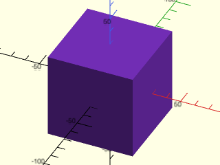

    include <BOSL2/std.scad>
    rgb = hsv(h=270,s=0.75,v=0.9);
    recolor(rgb) cube(60, center=true);

  

---

### Function/Module: lch()

**Synopsis:** Converts D65 CIE LCh to sRGB or colors children with an LCh color. [<abbr>Trans</abbr>]

**Topics:** [Colors](Topics#colors), [Colorspace](Topics#colorspace)

**See Also:** [hsl()](#functionmodule-hsl), [hsv()](#functionmodule-hsv), [recolor()](#module-recolor), [color\_this()](#module-color_this)

**Usage:** As a function

- rgb = lch(l, c, h, [a], [clip=]);

**Usage:** As a module

- lch(l, c, h, [a], [clip=], [mutable=]) CHILDREN;

**Description:** 

As a function, converts D65-referenced CIE LCh coordinates to sRGB `[R,G,B]`.
If you give `a` it returns `[R,G,B,A]`. Lightness `l` uses the range 0-100,
corresponding to CIE Lab lightness 0-100. Chroma `c` uses absolute CIE Lab
units. Hue is an angle in the Lab a*-b* plane, not the HSL/HSV hue wheel.

As a rough guide to hue, the fully saturated sRGB primaries are approximately
| Color   | approx. h |
|---------|-----------|
| red     | 40°       |
| yellow  | 103°      |
| green   | 136°      |
| cyan    | 196°      |
| blue    | 306°      |
| magenta | 328°      |

Unlike HSL/HSV, these are not exact or fixed: which hue angle looks like a given
named color shifts with `l` and `c`.  Unlike the [`hsl()`](#functionmodule-hsl) and [`hsv()`](#functionmodule-hsv) functions,
this function follows the CIE Lab convention with values ranging from 0 to 100, not 0 to 1.

For a given lightness and hue only some chroma values result in colors
that can be represented in sRGB.  There is no simple way to identify which
chroma values are valid, and it is not even a simple range of continuous
values.  Your requested color is tested after conversion.  By default, if it
is out of gamut you will get an error showing its RGB components.  If you set
`clip=true` then the converted RGB values will be clipped into the valid range.
Clipping can change the requested lightness and hue.

When called as a module, sets the color using [`recolor()`](#module-recolor) with `mutable=true` by default.

**Arguments:** 

<abbr title="These args can be used by position or by name.">By&nbsp;Position</abbr> | What it does
-------------------- | ------------
`l`                  | Lightness, CIE Lab L* from 0 (black) to 100 (white)
`c`                  | Chroma in CIE Lab units. 0 is gray. There is no fixed upper limit; representability is tested in sRGB.
`h`                  | Hue angle in degrees, wrapped modulo 360. 0 is the +a* axis, 90 is +b*, 180 is -a*, and 270 is -b*.
`a`                  | Optional alpha from 0 (transparent) to 1 (opaque). Omitted by default from the function result; the module is opaque when omitted.

<abbr title="These args must be used by name, ie: name=value">By&nbsp;Name</abbr> | What it does
-------------------- | ------------
`clip`               | If true, clamp out-of-gamut RGB components to [0,1]. Otherwise, assert an error for out-of-gamut colors beyond the roundoff tolerance. Default: false
`mutable`            | Module only. If true, use mutable attachable coloring; if false, color complete child geometry immutably. Default: true

**Side Effects:** 

- The module sets `$color` through recolor().

**Example 1:** 

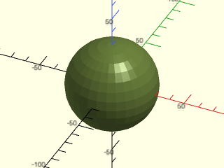

    include <BOSL2/std.scad>
    lch(l=60,c=45,h=120) sphere(d=60);

  

**Example 2:** 

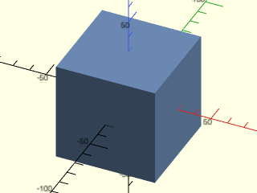

    include <BOSL2/std.scad>
    rgb = lch(l=70,c=30,h=270);
    recolor(rgb) cube(60, center=true);

  

**Example 3:** Clip an out-of-gamut color to displayable RGB.

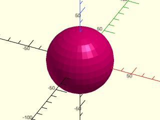

    include <BOSL2/std.scad>
    lch(l=50,c=150,h=0,clip=true) sphere(d=60);

  

**Example 4:** Apply alpha to the converted color.

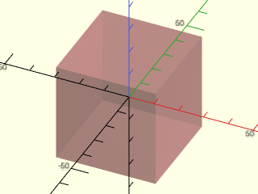

    include <BOSL2/std.scad>
    lch(l=60,c=45,h=20,a=0.4) cuboid(40);

  

---

