# LibFile: constants.scad

Constants for directions (used with anchoring), and for specifying line termination for
use with geometry.scad.

To use, add the following lines to the beginning of your file:

    include <BOSL2/std.scad>

## File Contents

1. [Section: General Constants](#section-general-constants)
    - [`$slop`](#constant-slop) – The slop amount to make printed items fit closely. `0.0` by default.
    - [`get_slop()`](#function-get_slop) – Returns the $slop value.
    - [`INCH`](#constant-inch) – A constant, the  number of millimeters in an inch. `25.4`
    - [`IDENT`](#constant-ident) – A constant, the 3D identity transformation matrix. [<abbr>Mat</abbr>]

2. [Section: Directional Vectors](#section-directional-vectors)
    - [`LEFT`](#constant-left) – The left-wards (X-) direction vector constant `[-1,0,0]`.
    - [`RIGHT`](#constant-right) – The right-wards (X+) direction vector constant `[1,0,0]`.
    - [`FRONT`](#constant-front) – The front-wards (Y-) direction vector constant `[0,-1,0]`.
    - [`BACK`](#constant-back) – The backwards (Y+) direction vector constant `[0,1,0]`.
    - [`BOTTOM`](#constant-bottom) – The down-wards (Z-) direction vector constant `[0,0,-1]`.
    - [`TOP`](#constant-top) – The top-wards (Z+) direction vector constant `[0,0,1]`.
    - [`CENTER`](#constant-center) – The center vector constant `[0,0,0]`.
    - [`EDGE()`](#function-edge) – Named edge anchor constants
    - [`FACE()`](#function-face) – Named face anchor constants

3. [Section: Line specifiers](#section-line-specifiers)
    - [`SEGMENT`](#constant-segment) – A constant for specifying a line segment in various geometry.scad functions.  `[true,true]`
    - [`RAY`](#constant-ray) – A constant for specifying a ray line in various geometry.scad functions.  `[true,false]`
    - [`LINE`](#constant-line) – A constant for specifying an unbounded line in various geometry.scad functions.  `[false,false]`

## Section: General Constants

### Constant: $slop

**Synopsis:** The slop amount to make printed items fit closely. `0.0` by default.

**Topics:** [Constants](Topics#constants)

**Description:** 

Engineering drawings always include allowable tolerance. You cannot ask for a 10mm hole and
a 10mm cylinder and expect them to always fit together; instead you could say the hole must
be _at least_ 10mm and the cylinder must be _no more than_ 10mm and you would expect them to
always fit together. `$slop` is currently used [many libraries](https://github.com/search?q=repo%3ABelfrySCAD%2FBOSL2%20get_slop&type=code) to increase hole and internal
feature sizes so joiners, partitions, and threaded parts can mate even though 3D printing
is imperfect.

Slop has some limitations:
  1. Slop generally works for a wide range of shapes and sizes, but problems like bulging corners,
     shrinkage, arc compensation, under- or over-extrusion, etc. means the ideal value for a large
     square peg and socket may not be the same as a small cylinder and hole without further
     changes (like filleting, changing print orientation, calibrating slicer settings, etc).
  2. It only affects "internal" parts. If you were using the `screws.scad` library to produce a
     bolt intended to mate with a mass-manufactured nut, and your screw is printing smaller than
     expected, you cannot use `$slop` to help increase the size.
  3. For smaller 3d-printed holes, `$slop` becomes inaccurate and varies based on printing
     orientation. See [issue#1679](https://github.com/BelfrySCAD/BOSL2/issues/1679) for a discussion on this point and a [design you can print](https://github.com/BelfrySCAD/BOSL2/issues/1679#issuecomment-2871104521)
     to measure the effect. The intended workaround is to pass `$slop` with a customized value as
     a keyword argument (i.e. `threaded_nut(..., $slop=0.17)`) to any functions or modules
     creating small internal features or by altering the requested internal diameter.
  4. It may vary by printer and material type, along with slicer settings like wall order,
     seam settings, wall generator, etc.
  5. It varies some depending on the final printing orientation. As this information isn't
     knowable at module instantiation, it's not possible to do better than a single constant.

Your own part libraries should add a single `$slop` to every mating surface. For holes, increase
the hole radius by [`get_slop()`](#function-get_slop) or diameter by `2*`[`get_slop()`](#function-get_slop). A shiplap pattern would reduce
the tab thickness on only one end by [`get_slop()`](#function-get_slop) and the overall length by [`get_slop()`](#function-get_slop), while
a tongue-and-groove joint would increase the size of the groove thickness by `2*`[`get_slop()`](#function-get_slop)
and reduce the overall length by [`get_slop()`](#function-get_slop).

Note that the slop value is accessed using the [`get_slop()`](#function-get_slop) function.  This function provides
the default value of 0 if you have not set `$slop`. This approach makes it possible for you to
set `$slop` in your programs without experiencing peculiar OpenSCAD issues having to do with multiple
definitions of the variable.  If you write code that uses `$slop` be sure to reference it using [`get_slop()`](#function-get_slop).

**Calibration:** To calibrate the `$slop` value for your printer, follow this procedure:

1. Print the Slop Calibration part from the example below. By default it uses cubes and that usually works well enough, but if you want to test cylinders, then adjust the code as the comments suggest. Suggest using 2 walls, 5% infill, and minimal top/bottom (3/2?) layers to save filament.
2. Take the long block and orient it so the numbers are upright, facing you.
3. Take the plug and orient it so that the arrow points down, facing you.
4. Starting with the hole with the largest number in front of it, insert the small end of the plug into the hole.
5. If you can insert and remove the small end of the plug from the hole without much force, then try again with the hole with the next smaller number.
6. Repeat the previous step until you have found the hole with the smallest number that the plug fits into without much force.
7. The correct hole should hold the plug when the long block is turned upside-down.
8. The number in front of that hole will indicate the `$slop` value that is ideal for your printer.
9. Remember to set that slop value in your scripts after you include the BOSL2 library:  ie: `$slop = 0.15;`
10. If trying to test the proper `$slop` value for a mating cube and matching socket without any filleting or chamfers, you can turn the plug 180 degrees and follow the above procedure again.

**Example 1:** Slop Calibration Part.

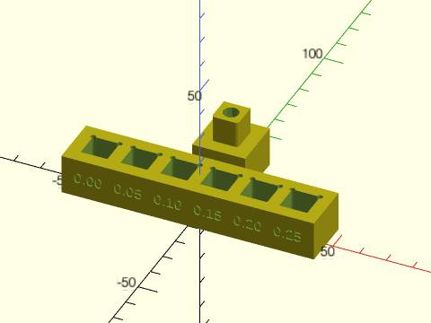

 

    include <BOSL2/std.scad>
    min_slop = 0.00;
    slop_step = 0.05;
    holes = 6;
    holesize = [10,10,10];
    gap = 5;
    l = holes * (holesize.x + gap) + gap;
    w = holesize.y + 2*gap;
    h = holesize.z + 5;
    // To test cylinders instead, comment out the cuboid (add "//" to the beginning) and
    // remove the comment in front of the cyl in both hole() and plug().
    module hole(s) {
      cuboid([holesize.x + 2*s, holesize.y + 2*s, h+0.2]) position([BACK+LEFT,BACK+RIGHT]) cylinder(h+0.2,r=1, center=true, $fn=16);
    //  cyl(d=holesize.x + 2*s, h=h+0.2, $fn=48);
    }
    module plug() {
      cuboid([holesize.x, holesize.y, holesize.z], anchor=BOT, rounding=1, edges="Z", except=BACK);
    //  cyl(d=holesize.x, h=holesize.z, anchor=BOT, $fn=48);
    }
    diff("holes")
    cuboid([l, w, h], anchor=BOT) {
      for (i=[0:holes-1]) {
        right((i-holes/2+0.5)*(holesize.x+gap)) {
          s = min_slop + slop_step * i;
          tag("holes") {
            hole(s);
            fwd(w/2-1) xrot(90) linear_extrude(1.1) {
              text(
                text=format_fixed(s,2),
                size=0.4*holesize.x,
                halign="center",
                valign="center"
              );
            }
          }
        }
      }
    }
    back(holesize.y*2.5) {
      diff() {
        cuboid([holesize.x+10, holesize.y+10, 15], anchor=BOT) {
          position(TOP) plug();
          tag("remove") position(BOT) cylinder(h=15+holesize.z,d=min(holesize.x, holesize.y)*.6); // Reinforce the plug end so you can use weaker infill.
        }
        up(3) fwd((holesize.y+10)/2) {
          tag("remove") prismoid([holesize.x/2,1], [0,1], h=holesize.y-6); // Arrow
        }
      }
    }

**Example 2:** Where to add `$slop` gaps.

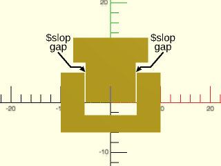

    include <BOSL2/std.scad>
    $slop = 0.2;
    difference() {
      square([20,12],center=true);
      back(3) square([10+2*$slop,11],center=true);
    }
    back(8) {
      rect([15,5],anchor=FWD);
      rect([10,8],anchor=BACK);
    }
    color("#000") {
      arrow_path = [[5.1,6.1], [6.0,7.1], [8,7.1], [10.5,10]];
      xflip_copy()
        stroke(arrow_path, width=0.3, endcap1="arrow2");
      xcopies(21) back(10.5) {
          back(1.8) text("$slop", size=1.5, halign="center");
          text("gap", size=1.5, halign="center");
      }
    }

  

---

### Function: get\_slop()

**Synopsis:** Returns the $slop value.

**Topics:** [Slop](Topics#slop)

**See Also:** [$slop](#constant-slop)

**Usage:** 

- slop = get_slop();

**Description:** 

Returns the current $slop value or 0 if `$slop` is not set.
Always access the `$slop` variable using this function.

---

### Constant: INCH

**Synopsis:** A constant, the  number of millimeters in an inch. `25.4`

**Topics:** [Constants](Topics#constants)

**Description:** 

The exact number of millimeters in an inch.

**Example 1:** 

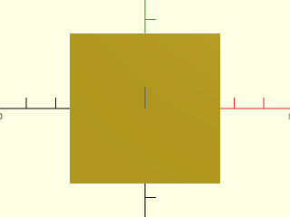

    include <BOSL2/std.scad>
    square(2*INCH, center=true);

  

**Example 2:** 

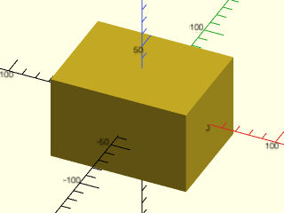

    include <BOSL2/std.scad>
    cube([4,3,2.5]*INCH, center=true);

  

---

### Constant: IDENT

**Synopsis:** A constant, the 3D identity transformation matrix. [<abbr>Mat</abbr>]

**Topics:** [Constants](Topics#constants), [Affine](Topics#affine), [Matrices](Topics#matrices), [Transforms](Topics#transforms)

**See Also:** [ident()](linalg.scad#function-ident)

**Description:** 

Identity transformation matrix for three-dimensional transforms.  Equal to `ident(4)`.

---

## Section: Directional Vectors

Vectors useful for `rotate()`, `mirror()`, and `anchor` arguments for `cuboid()`, `cyl()`, etc.

### Constant: LEFT

**Synopsis:** The left-wards (X-) direction vector constant `[-1,0,0]`.

**Topics:** [Constants](Topics#constants), [Vectors](Topics#vectors)

**See Also:** [RIGHT](#constant-right), [FRONT](#constant-front), [BACK](#constant-back), [TOP](#constant-top), [BOTTOM](#constant-bottom), [CENTER](#constant-center)

**Description:** 

Vector pointing left.  [-1,0,0]

**Example 1:** Usage with `anchor`

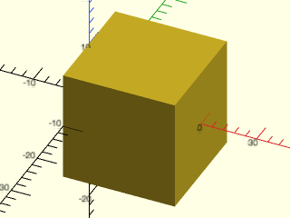

    include <BOSL2/std.scad>
    cuboid(20, anchor=LEFT);

  

---

### Constant: RIGHT

**Synopsis:** The right-wards (X+) direction vector constant `[1,0,0]`.

**Topics:** [Constants](Topics#constants), [Vectors](Topics#vectors)

**See Also:** [LEFT](#constant-left), [FRONT](#constant-front), [BACK](#constant-back), [TOP](#constant-top), [BOTTOM](#constant-bottom), [CENTER](#constant-center)

**Description:** 

Vector pointing right.  [1,0,0]

**Example 1:** Usage with `anchor`

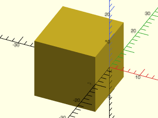

    include <BOSL2/std.scad>
    cuboid(20, anchor=RIGHT);

  

---

### Constant: FRONT

**Aliases:** FWD, FORWARD

**Synopsis:** The front-wards (Y-) direction vector constant `[0,-1,0]`.

**Topics:** [Constants](Topics#constants), [Vectors](Topics#vectors)

**See Also:** [LEFT](#constant-left), [RIGHT](#constant-right), [BACK](#constant-back), [TOP](#constant-top), [BOTTOM](#constant-bottom), [CENTER](#constant-center)

**Description:** 

Vector pointing forward.  [0,-1,0]

**Example 1:** Usage with `anchor`

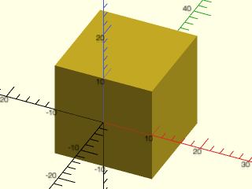

    include <BOSL2/std.scad>
    cuboid(20, anchor=FRONT);

  

---

### Constant: BACK

**Synopsis:** The backwards (Y+) direction vector constant `[0,1,0]`.

**Topics:** [Constants](Topics#constants), [Vectors](Topics#vectors)

**See Also:** [LEFT](#constant-left), [RIGHT](#constant-right), [FRONT](#constant-front), [TOP](#constant-top), [BOTTOM](#constant-bottom), [CENTER](#constant-center)

**Description:** 

Vector pointing back.  [0,1,0]

**Example 1:** Usage with `anchor`

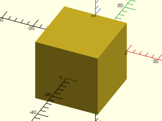

    include <BOSL2/std.scad>
    cuboid(20, anchor=BACK);

  

---

### Constant: BOTTOM

**Aliases:** BOT, DOWN

**Synopsis:** The down-wards (Z-) direction vector constant `[0,0,-1]`.

**Topics:** [Constants](Topics#constants), [Vectors](Topics#vectors)

**See Also:** [LEFT](#constant-left), [RIGHT](#constant-right), [FRONT](#constant-front), [BACK](#constant-back), [TOP](#constant-top), [CENTER](#constant-center)

**Description:** 

Vector pointing down.  [0,0,-1]

**Example 1:** Usage with `anchor`

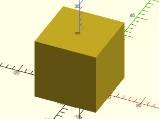

    include <BOSL2/std.scad>
    cuboid(20, anchor=BOTTOM);

  

---

### Constant: TOP

**Aliases:** UP

**Synopsis:** The top-wards (Z+) direction vector constant `[0,0,1]`.

**Topics:** [Constants](Topics#constants), [Vectors](Topics#vectors)

**See Also:** [LEFT](#constant-left), [RIGHT](#constant-right), [FRONT](#constant-front), [BACK](#constant-back), [BOTTOM](#constant-bottom), [CENTER](#constant-center)

**Description:** 

Vector pointing up.  [0,0,1]

**Example 1:** Usage with `anchor`

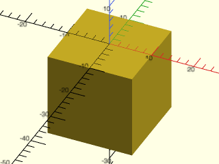

    include <BOSL2/std.scad>
    cuboid(20, anchor=TOP);

  

---

### Constant: CENTER

**Aliases:** CTR, CENTRE

**Synopsis:** The center vector constant `[0,0,0]`.

**Topics:** [Constants](Topics#constants), [Vectors](Topics#vectors)

**See Also:** [LEFT](#constant-left), [RIGHT](#constant-right), [FRONT](#constant-front), [BACK](#constant-back), [TOP](#constant-top), [BOTTOM](#constant-bottom)

**Description:** 

Zero vector.  Centered.  [0,0,0]

**Example 1:** Usage with `anchor`

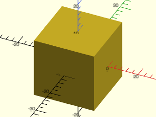

    include <BOSL2/std.scad>
    cuboid(20, anchor=CENTER);

  

---

### Function: EDGE()

**Synopsis:** Named edge anchor constants

**Topics:** [Constants](Topics#constants), [Attachment](Topics#attachment)

**Usage:** 

- EDGE(i)
- EDGE(direction,i)

**Description:** 

A shorthand for the named anchors "edge0", "top_edge0", "bot_edge0", etc.
Use `EDGE(i)` to get "edge<i>", or use `EDGE(direction,i)` where `direction` may
be `TOP`, `BOT`, or `CENTER`, or the corresponding values `, 1, -1, or 0.  In this case
the returned anchor will select the edge in the given direction:
top_edge<i>", "bot_edge<i>" or "edge<i>".

---

### Function: FACE()

**Synopsis:** Named face anchor constants

**Topics:** [Constants](Topics#constants), [Attachment](Topics#attachment)

**Usage:** 

- FACE(i)

**Description:** 

A shorthand for the named anchors "face0", "face1", etc.

---

## Section: Line specifiers

Used by functions in geometry.scad for specifying whether two points
are treated as an unbounded line, a ray with one endpoint, or a segment
with two endpoints.

### Constant: SEGMENT

**Synopsis:** A constant for specifying a line segment in various geometry.scad functions.  `[true,true]`

**Topics:** [Constants](Topics#constants), [Lines](Topics#lines)

**See Also:** [RAY](#constant-ray), [LINE](#constant-line)

**Description:** 

Treat a line as a segment.  [true, true]

**Example 1:** Usage with line\_intersection:

    include <BOSL2/std.scad>
    line1 = 10*[[9, 4], [5, 7]];
    line2 = 10*[[2, 3], [6, 5]];
    isect = line_intersection(line1, line2, SEGMENT, SEGMENT);

  

---

### Constant: RAY

**Synopsis:** A constant for specifying a ray line in various geometry.scad functions.  `[true,false]`

**Topics:** [Constants](Topics#constants), [Lines](Topics#lines)

**See Also:** [SEGMENT](#constant-segment), [LINE](#constant-line)

**Description:** 

Treat a line as a ray, based at the first point extending through the second point.  [true, false]

**Example 1:** Usage with line\_intersection:

    include <BOSL2/std.scad>
    line = [[-30,0],[30,30]];
    pt = [40,25];
    closest = line_closest_point(line,pt,RAY);

  

---

### Constant: LINE

**Synopsis:** A constant for specifying an unbounded line in various geometry.scad functions.  `[false,false]`

**Topics:** [Constants](Topics#constants), [Lines](Topics#lines)

**See Also:** [RAY](#constant-ray), [SEGMENT](#constant-segment)

**Description:** 

Treat a line as an unbounded line.  [false, false]

**Example 1:** Usage with line\_intersection:

    include <BOSL2/std.scad>
    line1 = 10*[[9, 4], [5, 7]];
    line2 = 10*[[2, 3], [6, 5]];
    isect = line_intersection(line1, line2, LINE, SEGMENT);

  

---

