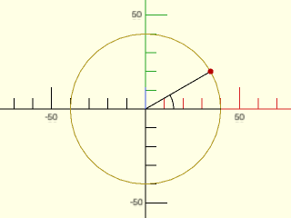
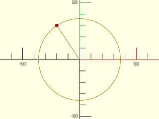
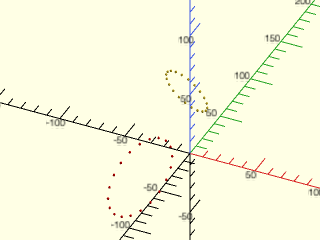
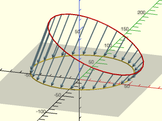

# LibFile: coords.scad

Coordinate transformations and coordinate system conversions.

To use, add the following lines to the beginning of your file:

    include <BOSL2/std.scad>

## File Contents

1. [Section: Coordinate Manipulation](#section-coordinate-manipulation)
    - [`point2d()`](#function-point2d) – Convert a vector to 2D.
    - [`path2d()`](#function-path2d) – Convert a path to 2D. [<abbr>Path</abbr>]
    - [`point3d()`](#function-point3d) – Convert a vector to 3D.
    - [`path3d()`](#function-path3d) – Convert a path to 3D. [<abbr>Path</abbr>]
    - [`point4d()`](#function-point4d) – Convert a vector to 4d.
    - [`path4d()`](#function-path4d) – Convert a path to 4d. [<abbr>Path</abbr>]

2. [Section: Coordinate Systems](#section-coordinate-systems)
    - [`polar_to_xy()`](#function-polar_to_xy) – Convert 2D polar coordinates to cartesian coordinates. [<abbr>Path</abbr>]
    - [`xy_to_polar()`](#function-xy_to_polar) – Convert 2D cartesian coordinates to polar coordinates (radius and angle)
    - [`project_plane()`](#function-project_plane) – Project a set of points onto a specified plane, returning 2D points. [<abbr>Path</abbr>]
    - [`lift_plane()`](#function-lift_plane) – Map a list of 2D points onto a plane in 3D. [<abbr>Path</abbr>]
    - [`cylindrical_to_xyz()`](#function-cylindrical_to_xyz) – Convert cylindrical coordinates to cartesian coordinates. [<abbr>Path</abbr>]
    - [`xyz_to_cylindrical()`](#function-xyz_to_cylindrical) – Convert 3D cartesian coordinates to cylindrical coordinates.
    - [`spherical_to_xyz()`](#function-spherical_to_xyz) – Convert spherical coordinates to 3D cartesian coordinates. [<abbr>Path</abbr>]
    - [`xyz_to_spherical()`](#function-xyz_to_spherical) – Convert 3D cartesian coordinates to spherical coordinates.
    - [`altaz_to_xyz()`](#function-altaz_to_xyz) – Convert altitude/azimuth/range to 3D cartesian coordinates. [<abbr>Path</abbr>]
    - [`xyz_to_altaz()`](#function-xyz_to_altaz) – Convert 3D cartesian coordinates to [altitude,azimuth,range].

## Section: Coordinate Manipulation

### Function: point2d()

**Synopsis:** Convert a vector to 2D.

**Topics:** [Coordinates](Topics#coordinates), [Points](Topics#points)

**See Also:** [path2d()](#function-path2d), [point3d()](#function-point3d), [path3d()](#function-path3d)

**Usage:** 

- pt = point2d(p, [fill]);

**Description:** 

Returns a 2D vector/point from a 2D or 3D vector.  If given a 3D point, removes the Z coordinate.

**Arguments:** 

<abbr title="These args can be used by position or by name.">By&nbsp;Position</abbr> | What it does
-------------------- | ------------
`p`                  | The coordinates to force into a 2D vector/point.
`fill`               | Value to fill missing values in vector with.  Default: 0

---

### Function: path2d()

**Synopsis:** Convert a path to 2D. [<abbr>Path</abbr>]

**Topics:** [Coordinates](Topics#coordinates), [Points](Topics#points), [Paths](Topics#paths)

**See Also:** [point2d()](#function-point2d), [point3d()](#function-point3d), [path3d()](#function-path3d), [point4d()](#function-point4d), [path4d()](#function-path4d), [hstack()](linalg.scad#function-hstack)

**Usage:** 

- pts = path2d(points);

**Description:** 

Returns a list of 2D vectors/points from a list of 2D, 3D or higher dimensional vectors/points.
Removes the extra coordinates from higher dimensional points.  The input must be a path, where
every vector has the same length.

**Arguments:** 

<abbr title="These args can be used by position or by name.">By&nbsp;Position</abbr> | What it does
-------------------- | ------------
`points`             | A list of 2D or 3D points/vectors.

---

### Function: point3d()

**Synopsis:** Convert a vector to 3D.

**Topics:** [Coordinates](Topics#coordinates), [Points](Topics#points)

**See Also:** [path2d()](#function-path2d), [point2d()](#function-point2d), [path3d()](#function-path3d)

**Usage:** 

- pt = point3d(p, [fill]);

**Description:** 

Returns a 3D vector/point from a 2D or 3D vector.

**Arguments:** 

<abbr title="These args can be used by position or by name.">By&nbsp;Position</abbr> | What it does
-------------------- | ------------
`p`                  | The coordinates to force into a 3D vector/point.
`fill`               | Value to fill missing values in vector with.  Default: 0

---

### Function: path3d()

**Synopsis:** Convert a path to 3D. [<abbr>Path</abbr>]

**Topics:** [Coordinates](Topics#coordinates), [Points](Topics#points), [Paths](Topics#paths)

**See Also:** [point2d()](#function-point2d), [path2d()](#function-path2d), [point3d()](#function-point3d), [point4d()](#function-point4d), [path4d()](#function-path4d), [hstack()](linalg.scad#function-hstack)

**Usage:** 

- pts = path3d(points, [fill]);

**Description:** 

Returns a list of 3D vectors/points from a list of 2D or higher dimensional vectors/points
by removing extra coordinates or adding the z coordinate.

**Arguments:** 

<abbr title="These args can be used by position or by name.">By&nbsp;Position</abbr> | What it does
-------------------- | ------------
`points`             | A list of 2D, 3D or higher dimensional points/vectors.
`fill`               | Scalar value to fill missing values in vectors with (in the 2D case).  Default: 0

---

### Function: point4d()

**Synopsis:** Convert a vector to 4d.

**Topics:** [Coordinates](Topics#coordinates), [Points](Topics#points)

**See Also:** [point2d()](#function-point2d), [path2d()](#function-path2d), [point3d()](#function-point3d), [path3d()](#function-path3d), [path4d()](#function-path4d)

**Usage:** 

- pt = point4d(p, [fill]);

**Description:** 

Returns a 4D vector/point from a 2D or 3D vector.

**Arguments:** 

<abbr title="These args can be used by position or by name.">By&nbsp;Position</abbr> | What it does
-------------------- | ------------
`p`                  | The coordinates to force into a 4D vector/point.
`fill`               | Scalar value to fill missing values in vector with.  Default: 0

---

### Function: path4d()

**Synopsis:** Convert a path to 4d. [<abbr>Path</abbr>]

**Topics:** [Coordinates](Topics#coordinates), [Points](Topics#points), [Paths](Topics#paths)

**See Also:** [point2d()](#function-point2d), [path2d()](#function-path2d), [point3d()](#function-point3d), [path3d()](#function-path3d), [point4d()](#function-point4d), [hstack()](linalg.scad#function-hstack)

**Usage:** 

- pt = path4d(points, [fill]);

**Description:** 

Returns a list of 4D vectors/points from a list of vectors/points of some other length.
When the vectors are being extended, the `fill` parameter gives the value(s) to fill the missing coordinates with.
If fill is a scalar the same value will be used everywhere, so a 2D vector `[3,4]` with `fill=7`
becomes `[3,4,7,7]`.  If fill is a vector each vector in `points` is extended by the given
vector.  So a 2D vector `[3,4]` with `fill=[7,8]` becomes `[3,4,7,8]`.  The length of `fill` must
match the number of missing dimensions.

**Arguments:** 

<abbr title="These args can be used by position or by name.">By&nbsp;Position</abbr> | What it does
-------------------- | ------------
`points`             | A list of 2D or 3D points/vectors.
`fill`               | Value(s) to fill missing coordinates with: a scalar fills every missing coordinate with the same value; a vector supplies one fill value per missing coordinate (its length must match the number of missing dimensions).  Default: 0

---

## Section: Coordinate Systems

### Function: polar\_to\_xy()

**Synopsis:** Convert 2D polar coordinates to cartesian coordinates. [<abbr>Path</abbr>]

**Topics:** [Coordinates](Topics#coordinates), [Points](Topics#points), [Paths](Topics#paths)

**See Also:** [xy\_to\_polar()](#function-xy_to_polar), [xyz\_to\_cylindrical()](#function-xyz_to_cylindrical), [cylindrical\_to\_xyz()](#function-cylindrical_to_xyz), [xyz\_to\_spherical()](#function-xyz_to_spherical), [spherical\_to\_xyz()](#function-spherical_to_xyz)

**Usage:** 

- pt = polar_to_xy(r, theta);
- pt = polar_to_xy([R, THETA]);
- pts = polar_to_xy([[R,THETA], [R,THETA], ...]);

**Description:** 

Called with two arguments, converts the `r` and `theta` 2D polar coordinate into an `[X,Y]` cartesian coordinate.
Called with one `[R,THETA]` vector argument, converts the 2D polar coordinate into an `[X,Y]` cartesian coordinate.
Called with a list of `[R,THETA]` vector arguments, converts each 2D polar coordinate into `[X,Y]` cartesian coordinates.
Theta is the angle counter-clockwise of X+ on the XY plane.

**Arguments:** 

<abbr title="These args can be used by position or by name.">By&nbsp;Position</abbr> | What it does
-------------------- | ------------
`r`                  | distance from the origin.
`theta`              | angle in degrees, counter-clockwise of X+.

**Example 1:** 

    include <BOSL2/std.scad>
    xy = polar_to_xy(20,45);    // Returns: ~[14.1421365, 14.1421365]
    xy = polar_to_xy(40,30);    // Returns: ~[34.6410162, 20]
    xy = polar_to_xy([40,30]);  // Returns: ~[34.6410162, 20]
    xy = polar_to_xy([[40,30],[20,120]]);  // Returns: ~[[34.6410162, 20], [-10, 17.3205]]

  

**Example 2:** 

    include <BOSL2/std.scad>
    r=40; ang=30; $fn=36;
    pt = polar_to_xy(r,ang);
    stroke(circle(r=r), closed=true, width=0.5);
    color("black") stroke([[r,0], [0,0], pt], width=0.5);
    color("black") stroke(arc(r=15, angle=ang), width=0.5);
    color("red") move(pt) circle(d=3);

  

---

### Function: xy\_to\_polar()

**Synopsis:** Convert 2D cartesian coordinates to polar coordinates (radius and angle)

**Topics:** [Coordinates](Topics#coordinates), [Points](Topics#points), [Paths](Topics#paths)

**See Also:** [polar\_to\_xy()](#function-polar_to_xy), [xyz\_to\_cylindrical()](#function-xyz_to_cylindrical), [cylindrical\_to\_xyz()](#function-cylindrical_to_xyz), [xyz\_to\_spherical()](#function-xyz_to_spherical), [spherical\_to\_xyz()](#function-spherical_to_xyz)

**Usage:** 

- r_theta = xy_to_polar(x,y);
- r_theta = xy_to_polar([X,Y]);
- r_thetas = xy_to_polar([[X,Y], [X,Y], ...]);

**Description:** 

Called with two arguments, converts the `x` and `y` 2D cartesian coordinate into a `[RADIUS,THETA]` polar coordinate.
Called with one `[X,Y]` vector argument, converts the 2D cartesian coordinate into a `[RADIUS,THETA]` polar coordinate.
Called with a list of `[X,Y]` vector arguments, converts each 2D cartesian coordinate into `[RADIUS,THETA]` polar coordinates.
Theta is the angle counter-clockwise of X+ on the XY plane.

**Arguments:** 

<abbr title="These args can be used by position or by name.">By&nbsp;Position</abbr> | What it does
-------------------- | ------------
`x`                  | X coordinate.
`y`                  | Y coordinate.

**Example 1:** 

    include <BOSL2/std.scad>
    plr = xy_to_polar(20,30);
    plr = xy_to_polar([40,60]);
    plrs = xy_to_polar([[40,60],[-10,20]]);

  

**Example 2:** 

    include <BOSL2/std.scad>
    pt = [-20,30]; $fn = 36;
    rt = xy_to_polar(pt);
    r = rt[0]; ang = rt[1];
    stroke(circle(r=r), closed=true, width=0.5);
    zrot(ang) stroke([[0,0],[r,0]],width=0.5);
    color("red") move(pt) circle(d=3);

  

---

### Function: project\_plane()

**Synopsis:** Project a set of points onto a specified plane, returning 2D points. [<abbr>Path</abbr>]

**Topics:** [Coordinates](Topics#coordinates), [Points](Topics#points), [Paths](Topics#paths)

**See Also:** [lift\_plane()](#function-lift_plane)

**Usage:** 

- xy = project_plane(plane, p);

**Usage:** To get a transform matrix

- M = project_plane(plane)

**Description:** 

Maps the provided 3D point(s) from 3D coordinates to a 2D coordinate system defined by `plane`.  Points that are not
on the specified plane are projected orthogonally onto the plane.  This coordinate system is useful if you need
to perform 2D operations on a coplanar set of data.  After those operations are done you can return the data
to 3D with `lift_plane()`.  You could also use this to force approximately coplanar data to be exactly coplanar.
The parameter p can be a point, path, region, bezier patch or VNF.
A VNF is returned as a VNF-like structure with 2D vertices.  This projected
representation can be passed to [`lift_plane()`](#function-lift_plane), but is not a standard 3D VNF. An empty VNF is returned unchanged.
Projection discards distance from the plane; lifting the result restores points on the plane, not their original depth.
The plane can be specified as
- A list of three points.  The planar coordinate system should have [0,0] at plane[0], with plane[1] lying on the Y+ axis.
- A list of non-collinear, coplanar points that define a plane.
- A plane definition `[A,B,C,D]` where `Ax+By+CZ=D`.  The closest point on that plane to the origin maps to the origin in the new coordinate system.

If you omit the point specification then `project_plane()` returns a transformation matrix that maps the specified plane to the XY plane.
Note that if you apply this transformation to data lying on the plane, it produces 3D points with the Z coordinate of zero.

**Arguments:** 

<abbr title="These args can be used by position or by name.">By&nbsp;Position</abbr> | What it does
-------------------- | ------------
`plane`              | plane specification or point list defining the plane
`p`                  | 3D point, path, region, VNF or bezier patch to project

**Example 1:** 

    include <BOSL2/std.scad>
    pt = [5,-5,5];
    a=[0,0,0];  b=[10,-10,0];  c=[10,0,10];
    xy = project_plane([a,b,c],pt);

  

**Example 2:** The yellow points in 3D project onto the red points in 2D

 

    include <BOSL2/std.scad>
    M = [[-1, 2, -1, -2], [-1, -3, 2, -1], [2, 3, 4, 53], [0, 0, 0, 1]];
    data = apply(M,path3d(circle(r=10, $fn=20)));
    move_copies(data) sphere(r=1);
    color("red") move_copies(project_plane(data, data)) sphere(r=1);

**Example 3:** The arrows show the projection from the red circle to its projection in yellow.  Since we didn't use [`path2d()`](#function-path2d) the projected curve is still a 3D curve with zero $z$ component.

 

    include <BOSL2/std.scad>
    xyzpath = move([10,20,30], p=yrot(25, p=path3d(circle(d=100))));
    mat = project_plane(xyzpath);
    xypath = apply(mat, xyzpath);
    %show_plane([0,0,1,0],[140,180]);
    stroke(xyzpath,closed=true,color="red");
    stroke(xypath,closed=true);
    color("lightblue")
      for(i=idx(xyzpath))
        stroke([xyzpath[i], point3d(xypath[i])], endcap2="arrow2");

---

### Function: lift\_plane()

**Synopsis:** Map a list of 2D points onto a plane in 3D. [<abbr>Path</abbr>]

**Topics:** [Coordinates](Topics#coordinates), [Points](Topics#points), [Paths](Topics#paths)

**See Also:** [project\_plane()](#function-project_plane)

**Usage:** 

- xyz = lift_plane(plane, p);

**Usage:** to get transform matrix

- M =  lift_plane(plane);

**Description:** 

Converts the given 2D point on the plane to 3D coordinates of the specified plane.
The parameter `p` can be a 2D point, path, region, bezier patch, or a projected VNF (a VNF with 2d vertices)
returned by [`project_plane()`](#function-project_plane).
Lifting a projection does not recover any distance from the plane that was discarded during projection.
The plane can be specified as
- A list of three points.  The planar coordinate system will have [0,0] at plane[0], with plane[1] lying on the Y+ axis.
- A list of non-collinear, coplanar points that define a plane.
- A plane definition `[A,B,C,D]` where `Ax+By+CZ=D`.  The closest point on that plane to the origin maps to the origin in the new coordinate system.

If you do not supply `p` then you get a transformation matrix that operates in 3D, assuming that the Z coordinate of the points is zero.
This rotation matrix is the inverse of the one produced by [`project_plane()`](#function-project_plane).

**Arguments:** 

<abbr title="These args can be used by position or by name.">By&nbsp;Position</abbr> | What it does
-------------------- | ------------
`plane`              | Plane specification or list of points to define a plane
`p`                  | 2D point, path, region, projected VNF, or bezier patch to transform.

---

### Function: cylindrical\_to\_xyz()

**Synopsis:** Convert cylindrical coordinates to cartesian coordinates. [<abbr>Path</abbr>]

**Topics:** [Coordinates](Topics#coordinates), [Points](Topics#points), [Paths](Topics#paths)

**See Also:** [xyz\_to\_cylindrical()](#function-xyz_to_cylindrical), [xy\_to\_polar()](#function-xy_to_polar), [polar\_to\_xy()](#function-polar_to_xy), [xyz\_to\_spherical()](#function-xyz_to_spherical), [spherical\_to\_xyz()](#function-spherical_to_xyz)

**Usage:** 

- pt = cylindrical_to_xyz(r, theta, z);
- pt = cylindrical_to_xyz([RADIUS,THETA,Z]);
- pts = cylindrical_to_xyz([[RADIUS,THETA,Z], [RADIUS,THETA,Z], ...]);

**Description:** 

Called with three arguments, converts the `r`, `theta`, and 'z' 3D cylindrical coordinate into an `[X,Y,Z]` cartesian coordinate.
Called with one `[RADIUS,THETA,Z]` vector argument, converts the 3D cylindrical coordinate into an `[X,Y,Z]` cartesian coordinate.
Called with a list of `[RADIUS,THETA,Z]` vector arguments, converts each 3D cylindrical coordinate into `[X,Y,Z]` cartesian coordinates.
Theta is the angle counter-clockwise of X+ on the XY plane.  Z is height above the XY plane.

**Arguments:** 

<abbr title="These args can be used by position or by name.">By&nbsp;Position</abbr> | What it does
-------------------- | ------------
`r`                  | distance from the Z axis.
`theta`              | angle in degrees, counter-clockwise of X+ on the XY plane.
`z`                  | Height above XY plane.

**Example 1:** 

    include <BOSL2/std.scad>
    xyz = cylindrical_to_xyz(20,30,40);
    xyz = cylindrical_to_xyz([40,60,50]);

  

---

### Function: xyz\_to\_cylindrical()

**Synopsis:** Convert 3D cartesian coordinates to cylindrical coordinates.

**Topics:** [Coordinates](Topics#coordinates), [Points](Topics#points), [Paths](Topics#paths)

**See Also:** [cylindrical\_to\_xyz()](#function-cylindrical_to_xyz), [xy\_to\_polar()](#function-xy_to_polar), [polar\_to\_xy()](#function-polar_to_xy), [xyz\_to\_spherical()](#function-xyz_to_spherical), [spherical\_to\_xyz()](#function-spherical_to_xyz)

**Usage:** 

- rtz = xyz_to_cylindrical(x,y,z);
- rtz = xyz_to_cylindrical([X,Y,Z]);
- rtzs = xyz_to_cylindrical([[X,Y,Z], [X,Y,Z], ...]);

**Description:** 

Called with three arguments, converts the `x`, `y`, and `z` 3D cartesian coordinate into a `[RADIUS,THETA,Z]` cylindrical coordinate.
Called with one `[X,Y,Z]` vector argument, converts the 3D cartesian coordinate into a `[RADIUS,THETA,Z]` cylindrical coordinate.
Called with a list of `[X,Y,Z]` vector arguments, converts each 3D cartesian coordinate into `[RADIUS,THETA,Z]` cylindrical coordinates.
Theta is the angle counter-clockwise of X+ on the XY plane.  Z is height above the XY plane.

**Arguments:** 

<abbr title="These args can be used by position or by name.">By&nbsp;Position</abbr> | What it does
-------------------- | ------------
`x`                  | X coordinate.
`y`                  | Y coordinate.
`z`                  | Z coordinate.

**Example 1:** 

    include <BOSL2/std.scad>
    cyl = xyz_to_cylindrical(20,30,40);
    cyl = xyz_to_cylindrical([40,50,70]);
    cyls = xyz_to_cylindrical([[40,50,70], [-10,15,-30]]);

  

---

### Function: spherical\_to\_xyz()

**Synopsis:** Convert spherical coordinates to 3D cartesian coordinates. [<abbr>Path</abbr>]

**Topics:** [Coordinates](Topics#coordinates), [Points](Topics#points), [Paths](Topics#paths)

**See Also:** [cylindrical\_to\_xyz()](#function-cylindrical_to_xyz), [xyz\_to\_spherical()](#function-xyz_to_spherical), [xyz\_to\_cylindrical()](#function-xyz_to_cylindrical), [altaz\_to\_xyz()](#function-altaz_to_xyz), [xyz\_to\_altaz()](#function-xyz_to_altaz)

**Usage:** 

- pt = spherical_to_xyz(r, theta, phi);
- pt = spherical_to_xyz([RADIUS,THETA,PHI]);
- pts = spherical_to_xyz([[RADIUS,THETA,PHI], [RADIUS,THETA,PHI], ...]);

**Description:** 

Called with three arguments, converts the `r`, `theta`, and 'phi' 3D spherical coordinate into an `[X,Y,Z]` cartesian coordinate.
Called with one `[RADIUS,THETA,PHI]` vector argument, converts the 3D spherical coordinate into an `[X,Y,Z]` cartesian coordinate.
Called with a list of `[RADIUS,THETA,PHI]` vector arguments, converts each 3D spherical coordinate into `[X,Y,Z]` cartesian coordinates.
Theta is the angle counter-clockwise of X+ on the XY plane.  Phi is the angle down from the Z+ pole.

**Arguments:** 

<abbr title="These args can be used by position or by name.">By&nbsp;Position</abbr> | What it does
-------------------- | ------------
`r`                  | distance from origin.
`theta`              | angle in degrees, counter-clockwise of X+ on the XY plane.
`phi`                | angle in degrees from the vertical Z+ axis.

**Example 1:** 

    include <BOSL2/std.scad>
    xyz = spherical_to_xyz(20,30,40);
    xyz = spherical_to_xyz([40,60,50]);
    xyzs = spherical_to_xyz([[40,60,50], [50,120,100]]);

  

---

### Function: xyz\_to\_spherical()

**Synopsis:** Convert 3D cartesian coordinates to spherical coordinates.

**Topics:** [Coordinates](Topics#coordinates), [Points](Topics#points), [Paths](Topics#paths)

**See Also:** [cylindrical\_to\_xyz()](#function-cylindrical_to_xyz), [spherical\_to\_xyz()](#function-spherical_to_xyz), [xyz\_to\_cylindrical()](#function-xyz_to_cylindrical), [altaz\_to\_xyz()](#function-altaz_to_xyz), [xyz\_to\_altaz()](#function-xyz_to_altaz)

**Usage:** 

- r_theta_phi = xyz_to_spherical(x,y,z)
- r_theta_phi = xyz_to_spherical([X,Y,Z])
- r_theta_phis = xyz_to_spherical([[X,Y,Z], [X,Y,Z], ...])

**Description:** 

Called with three arguments, converts the `x`, `y`, and `z` 3D cartesian coordinate into a `[RADIUS,THETA,PHI]` spherical coordinate.
Called with one `[X,Y,Z]` vector argument, converts the 3D cartesian coordinate into a `[RADIUS,THETA,PHI]` spherical coordinate.
Called with a list of `[X,Y,Z]` vector arguments, converts each 3D cartesian coordinate into `[RADIUS,THETA,PHI]` spherical coordinates.
Theta is the angle counter-clockwise of X+ on the XY plane.  Phi is the angle down from the Z+ pole.

**Arguments:** 

<abbr title="These args can be used by position or by name.">By&nbsp;Position</abbr> | What it does
-------------------- | ------------
`x`                  | X coordinate.
`y`                  | Y coordinate.
`z`                  | Z coordinate.

**Example 1:** 

    include <BOSL2/std.scad>
    sph = xyz_to_spherical(20,30,40);
    sph = xyz_to_spherical([40,50,70]);
    sphs = xyz_to_spherical([[40,50,70], [25,-14,27]]);

  

---

### Function: altaz\_to\_xyz()

**Synopsis:** Convert altitude/azimuth/range to 3D cartesian coordinates. [<abbr>Path</abbr>]

**Topics:** [Coordinates](Topics#coordinates), [Points](Topics#points), [Paths](Topics#paths)

**See Also:** [cylindrical\_to\_xyz()](#function-cylindrical_to_xyz), [xyz\_to\_spherical()](#function-xyz_to_spherical), [spherical\_to\_xyz()](#function-spherical_to_xyz), [xyz\_to\_cylindrical()](#function-xyz_to_cylindrical), [xyz\_to\_altaz()](#function-xyz_to_altaz)

**Usage:** 

- pt = altaz_to_xyz(alt, az, r);
- pt = altaz_to_xyz([ALT,AZ,R]);
- pts = altaz_to_xyz([[ALT,AZ,R], [ALT,AZ,R], ...]);

**Description:** 

Convert altitude/azimuth/range coordinates to 3D cartesian coordinates.
Called with three arguments, converts the `alt`, `az`, and 'r' 3D altitude-azimuth coordinate into an `[X,Y,Z]` cartesian coordinate.
Called with one `[ALTITUDE,AZIMUTH,RANGE]` vector argument, converts the 3D alt-az coordinate into an `[X,Y,Z]` cartesian coordinate.
Called with a list of `[ALTITUDE,AZIMUTH,RANGE]` vector arguments, converts each 3D alt-az coordinate into `[X,Y,Z]` cartesian coordinates.
Altitude is the angle above the XY plane, Azimuth is degrees clockwise of Y+ on the XY plane, and Range is the distance from the origin.

**Arguments:** 

<abbr title="These args can be used by position or by name.">By&nbsp;Position</abbr> | What it does
-------------------- | ------------
`alt`                | altitude angle in degrees above the XY plane.
`az`                 | azimuth angle in degrees clockwise of Y+ on the XY plane.
`r`                  | distance from origin.

**Example 1:** 

    include <BOSL2/std.scad>
    xyz = altaz_to_xyz(20,30,40);
    xyz = altaz_to_xyz([40,60,50]);

  

---

### Function: xyz\_to\_altaz()

**Synopsis:** Convert 3D cartesian coordinates to [altitude,azimuth,range].

**Topics:** [Coordinates](Topics#coordinates), [Points](Topics#points), [Paths](Topics#paths)

**See Also:** [cylindrical\_to\_xyz()](#function-cylindrical_to_xyz), [xyz\_to\_spherical()](#function-xyz_to_spherical), [spherical\_to\_xyz()](#function-spherical_to_xyz), [xyz\_to\_cylindrical()](#function-xyz_to_cylindrical), [altaz\_to\_xyz()](#function-altaz_to_xyz)

**Usage:** 

- alt_az_r = xyz_to_altaz(x,y,z);
- alt_az_r = xyz_to_altaz([X,Y,Z]);
- alt_az_rs = xyz_to_altaz([[X,Y,Z], [X,Y,Z], ...]);

**Description:** 

Converts 3D cartesian coordinates to altitude/azimuth/range coordinates.
Called with three arguments, converts the `x`, `y`, and `z` 3D cartesian coordinate into an `[ALTITUDE,AZIMUTH,RANGE]` coordinate.
Called with one `[X,Y,Z]` vector argument, converts the 3D cartesian coordinate into a `[ALTITUDE,AZIMUTH,RANGE]` coordinate.
Called with a list of `[X,Y,Z]` vector arguments, converts each 3D cartesian coordinate into `[ALTITUDE,AZIMUTH,RANGE]` coordinates.
Altitude is the angle above the XY plane, Azimuth is degrees clockwise of Y+ on the XY plane, and Range is the distance from the origin.

**Arguments:** 

<abbr title="These args can be used by position or by name.">By&nbsp;Position</abbr> | What it does
-------------------- | ------------
`x`                  | X coordinate.
`y`                  | Y coordinate.
`z`                  | Z coordinate.

**Example 1:** 

    include <BOSL2/std.scad>
    aa = xyz_to_altaz(20,30,40);
    aa = xyz_to_altaz([40,50,70]);

  

---

