# LibFile: distributors.scad

Functions and modules to distribute children or copies of children onto
a line, a grid, or an arbitrary path.  The $idx mechanism means that
the "copies" of children can vary.  Also includes shortcuts for mirroring.

To use, add the following lines to the beginning of your file:

    include <BOSL2/std.scad>

## File Contents

1. [Section: Adaptive Children Using `$` Variables](#section-adaptive-children-using--variables)

2. [Section: Translating copies of all the children](#section-translating-copies-of-all-the-children)
    - [`move_copies()`](#functionmodule-move_copies) – Translates copies of all children. <sup title="Can return a list of transformation matrices.">[<abbr>MatList</abbr>]</sup> <sup title="Can transform children.">[<abbr>Trans</abbr>]</sup>
    - [`xcopies()`](#functionmodule-xcopies) – Places copies of children along the X axis. <sup title="Can return a list of transformation matrices.">[<abbr>MatList</abbr>]</sup> <sup title="Can transform children.">[<abbr>Trans</abbr>]</sup>
    - [`ycopies()`](#functionmodule-ycopies) – Places copies of children along the Y axis. <sup title="Can return a list of transformation matrices.">[<abbr>MatList</abbr>]</sup> <sup title="Can transform children.">[<abbr>Trans</abbr>]</sup>
    - [`zcopies()`](#functionmodule-zcopies) – Places copies of children along the Z axis. <sup title="Can return a list of transformation matrices.">[<abbr>MatList</abbr>]</sup> <sup title="Can transform children.">[<abbr>Trans</abbr>]</sup>
    - [`line_copies()`](#functionmodule-line_copies) – Places copies of children along an arbitrary line. <sup title="Can return a list of transformation matrices.">[<abbr>MatList</abbr>]</sup> <sup title="Can transform children.">[<abbr>Trans</abbr>]</sup>
    - [`grid_copies()`](#functionmodule-grid_copies) – Places copies of children in an [X,Y] grid. <sup title="Can return a list of transformation matrices.">[<abbr>MatList</abbr>]</sup> <sup title="Can transform children.">[<abbr>Trans</abbr>]</sup>

3. [Section: Rotating copies of all children](#section-rotating-copies-of-all-children)
    - [`rot_copies()`](#functionmodule-rot_copies) – Rotates copies of children. <sup title="Can return a list of transformation matrices.">[<abbr>MatList</abbr>]</sup> <sup title="Can transform children.">[<abbr>Trans</abbr>]</sup>
    - [`xrot_copies()`](#functionmodule-xrot_copies) – Rotates copies of children around the X axis. <sup title="Can return a list of transformation matrices.">[<abbr>MatList</abbr>]</sup> <sup title="Can transform children.">[<abbr>Trans</abbr>]</sup>
    - [`yrot_copies()`](#functionmodule-yrot_copies) – Rotates copies of children around the Y axis. <sup title="Can return a list of transformation matrices.">[<abbr>MatList</abbr>]</sup> <sup title="Can transform children.">[<abbr>Trans</abbr>]</sup>
    - [`zrot_copies()`](#functionmodule-zrot_copies) – Rotates copies of children around the Z axis. <sup title="Can return a list of transformation matrices.">[<abbr>MatList</abbr>]</sup> <sup title="Can transform children.">[<abbr>Trans</abbr>]</sup>
    - [`arc_copies()`](#functionmodule-arc_copies) – Distributes duplicates of children along an arc. <sup title="Can return a list of transformation matrices.">[<abbr>MatList</abbr>]</sup> <sup title="Can transform children.">[<abbr>Trans</abbr>]</sup>
    - [`sphere_copies()`](#functionmodule-sphere_copies) – Distributes copies of children over the surface of a sphere. <sup title="Can return a list of transformation matrices.">[<abbr>MatList</abbr>]</sup> <sup title="Can transform children.">[<abbr>Trans</abbr>]</sup>

4. [Section: Placing copies of all children on a path](#section-placing-copies-of-all-children-on-a-path)
    - [`path_copies()`](#functionmodule-path_copies) – Uniformly distributes copies of children along a path. <sup title="Can return a list of transformation matrices.">[<abbr>MatList</abbr>]</sup> <sup title="Can transform children.">[<abbr>Trans</abbr>]</sup>

5. [Section: Making a copy of all children with reflection](#section-making-a-copy-of-all-children-with-reflection)
    - [`xflip_copy()`](#functionmodule-xflip_copy) – Makes a copy of children mirrored across the X axis. <sup title="Can return a list of transformation matrices.">[<abbr>MatList</abbr>]</sup> <sup title="Can transform children.">[<abbr>Trans</abbr>]</sup>
    - [`yflip_copy()`](#functionmodule-yflip_copy) – Makes a copy of children mirrored across the Y axis. <sup title="Can return a list of transformation matrices.">[<abbr>MatList</abbr>]</sup> <sup title="Can transform children.">[<abbr>Trans</abbr>]</sup>
    - [`zflip_copy()`](#functionmodule-zflip_copy) – Makes a copy of children mirrored across the Z axis. <sup title="Can return a list of transformation matrices.">[<abbr>MatList</abbr>]</sup> <sup title="Can transform children.">[<abbr>Trans</abbr>]</sup>
    - [`mirror_copy()`](#functionmodule-mirror_copy) – Makes a copy of children mirrored across a given plane. <sup title="Can return a list of transformation matrices.">[<abbr>MatList</abbr>]</sup> <sup title="Can transform children.">[<abbr>Trans</abbr>]</sup>

6. [Section: Distributing children individually along a line](#section-distributing-children-individually-along-a-line)
    - [`xdistribute()`](#module-xdistribute) – Distributes each child, individually, out along the X axis. <sup title="Can transform children.">[<abbr>Trans</abbr>]</sup>
    - [`ydistribute()`](#module-ydistribute) – Distributes each child, individually, out along the Y axis. <sup title="Can transform children.">[<abbr>Trans</abbr>]</sup>
    - [`zdistribute()`](#module-zdistribute) – Distributes each child, individually, out along the Z axis. <sup title="Can transform children.">[<abbr>Trans</abbr>]</sup>
    - [`distribute()`](#module-distribute) – Distributes each child, individually, out along an arbitrary line. <sup title="Can transform children.">[<abbr>Trans</abbr>]</sup>


## Section: Adaptive Children Using `$` Variables

The distributor methods create multiple copies of their children and place them in various ways.  While many models
require multiple identical copies of an object, this framework is more powerful than
might be immediately obvious because of `$` variables.  The distributors set `$` variables that the children can use to change their
behavior from one child to the next within a single distributor invocation.  This means the copies need not be identical.
The [`xcopies()`](#functionmodule-xcopies) module sets `$idx` to the index number of the copy, and in the examples below we use `$idx`, but the various
distributors offer a variety of `$` variables that you can use in your children.  Check the "Side Effects" section for each module
to learn what variables that module provides.

Two gotchas may lead to models that don't behave as expected.  While `if` statements work to control modules, you cannot
use them to make variable assignments in your child object.  If you write a statement like
```
if (condition) { c="red";}
else {c="green";}
```
then the `c` variable is set only in the scope of the `if` and `else` clauses and is not available later on when you actually
try to use it.  Instead you must use the ternary operator and write:
```
c = condition ? "red" : "green";
```
The second complication is
that in OpenSCAD version 2021.01 and earlier, assignments in children were executed before their parent.  This means
that `$` variables like `$idx` are not available in assignments because the parent hasn't run to set them, so if you use them
you will get a warning about an unknown variable.
Two workarounds exist, neither of which are needed in newer versions of OpenSCAD.  The workarounds solve the problem because
**modules** execute after their parent, so the `$` variables **are** available in modules.  You can put your assignments
in a `let()` module, or you can wrap your child in a `union()`.  Both methods appear below.

**Figure 1.1:** This example shows how we can use `$idx` to produce **different** geometry at each index.


<br clear="all" /><br/>


```
xcopies(n=10, spacing=10)
  text(str($idx));
```

**Figure 1.2:** Here the children are sometimes squares and sometimes circles as determined by the conditional `if` module. This use of `if` is OK because no variables are assigned.


<br clear="all" /><br/>


```
xcopies(n=4, spacing=10)
  if($idx%2==0) circle(r=3,$fn=16);
  else rect(6);
```

**Figure 1.3:** Suppose we would like to color odd and even index copies differently.  In this example we compute the color for a given child from `$idx` using the ternary operator.  The `let()` module is a module that sets variables and makes them available to its children.  Note that multiple assignments in `let()` are separated by commas, not semicolons.


<br clear="all" /><br/>


```
xcopies(n=6, spacing=10){
    let(c = $idx % 2 == 0 ? "red" : "green")
        color(c) rect(6);
}
```

**Figure 1.4:** This example shows how you can change the position of children adaptively.  If you want to avoid repeating your code for each case, this requires storing a transformation matrix in a variable and then applying it using `multmatrix()`.  We wrap our code in `union()` to ensure that it works in OpenSCAD 2021.01.


<br clear="all" />


```
xcopies(n=5,spacing=10)
  union()
  {
    shiftback = $idx%2==0 ? back(10) : IDENT;
    spin = zrot(180*$idx/4);
    multmatrix(shiftback*spin) stroke([[-4,0],[4,0]],endcap2="arrow2",width=3/4,color="red");
  }
```

## Section: Translating copies of all the children


### Function/Module: move\_copies()

**Synopsis:** Translates copies of all children. <sup title="Can return a list of transformation matrices.">[<abbr>MatList</abbr>]</sup> <sup title="Can transform children.">[<abbr>Trans</abbr>]</sup>

**Topics:** [Transformations](Topics#transformations), [Distributors](Topics#distributors), [Translation](Topics#translation), [Copiers](Topics#copiers)

**See Also:** [xcopies()](#functionmodule-xcopies), [ycopies()](#functionmodule-ycopies), [zcopies()](#functionmodule-zcopies), [line\_copies()](#functionmodule-line_copies), [grid\_copies()](#functionmodule-grid_copies), [rot\_copies()](#functionmodule-rot_copies), [xrot\_copies()](#functionmodule-xrot_copies), [yrot\_copies()](#functionmodule-yrot_copies), [zrot\_copies()](#functionmodule-zrot_copies), [arc\_copies()](#functionmodule-arc_copies), [sphere\_copies()](#functionmodule-sphere_copies)

**Usage:** 

- move_copies(a) CHILDREN;

**Usage:** As a function to translate points, VNF, or Bezier patches

- copies = move_copies(a, p=);

**Usage:** Get Translation Matrices

- mats = move_copies(a);

**Description:** 

When called as a module, translates copies of all children to each given translation offset.
When called as a function, with no `p=` argument, returns a list of transformation matrices, one for each copy.
When called as a function, *with* a `p=` argument, returns a list of transformed copies of `p=`.

**Arguments:** 

<abbr title="These args can be used by position or by name.">By&nbsp;Position</abbr> | What it does
-------------------- | ------------
`a`                  | Array of XYZ offset vectors. Default `[[0,0,0]]`

<abbr title="These args must be used by name, ie: name=value">By&nbsp;Name</abbr> | What it does
-------------------- | ------------
`p`                  | Either a point, pointlist, VNF or Bezier patch to be translated when used as a function.

**Side Effects:** 

- `$pos` is set to the relative centerpoint of each child copy, and can be used to modify each child individually.
- `$idx` is set to the index number of each child being copied.

**Example 1:** 

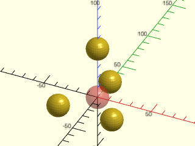

<br clear="all" />

    include <BOSL2/std.scad>
    #sphere(r=10);
    move_copies([[-25,-25,0], [25,-25,0], [0,0,50], [0,25,0]]) sphere(r=10);

---

### Function/Module: xcopies()

**Synopsis:** Places copies of children along the X axis. <sup title="Can return a list of transformation matrices.">[<abbr>MatList</abbr>]</sup> <sup title="Can transform children.">[<abbr>Trans</abbr>]</sup>

**Topics:** [Transformations](Topics#transformations), [Distributors](Topics#distributors), [Translation](Topics#translation), [Copiers](Topics#copiers)

**See Also:** [move\_copies()](#functionmodule-move_copies), [ycopies()](#functionmodule-ycopies), [zcopies()](#functionmodule-zcopies), [line\_copies()](#functionmodule-line_copies), [grid\_copies()](#functionmodule-grid_copies), [rot\_copies()](#functionmodule-rot_copies), [xrot\_copies()](#functionmodule-xrot_copies), [yrot\_copies()](#functionmodule-yrot_copies), [zrot\_copies()](#functionmodule-zrot_copies), [arc\_copies()](#functionmodule-arc_copies), [sphere\_copies()](#functionmodule-sphere_copies)

**Usage:** 

- xcopies(spacing, [n], [sp=]) CHILDREN;
- xcopies(l=, [n=], [sp=]) CHILDREN;
- xcopies(LIST) CHILDREN;

**Usage:** As a function to translate points, VNF, or Bezier patches

- copies = xcopies(spacing, [n], [sp=], p=);
- copies = xcopies(l=, [n=], [sp=], p=);
- copies = xcopies(LIST, p=);

**Usage:** Get Translation Matrices

- mats = xcopies(spacing, [n], [sp=]);
- mats = xcopies(l=, [n=], [sp=]);
- mats = xcopies(LIST);

**Description:** 

When called as a module, places `n` copies of the children along a line on the X axis.
When called as a function, *without* a `p=` argument, returns a list of transformation matrices, one for each copy.
When called as a function, *with* a `p=` argument, returns a list of transformed copies of `p=`.

**Arguments:** 

<abbr title="These args can be used by position or by name.">By&nbsp;Position</abbr> | What it does
-------------------- | ------------
`spacing`            | Given a scalar, specifies a uniform spacing between copies. Given a list of scalars, each one gives a specific position along the line.
`n`                  | Number of copies to place. (Default: 2)

<abbr title="These args must be used by name, ie: name=value">By&nbsp;Name</abbr> | What it does
-------------------- | ------------
`l`                  | If given, the length to place copies over.
`sp`                 | If given as a point, copies will be placed on a line to the right of starting position `sp`.  If given as a scalar, copies will be placed on a line segment to the right of starting position `[sp,0,0]`.  If not given, copies will be placed along a line segment that is centered at [0,0,0].
`p`                  | Either a point, pointlist, VNF or Bezier patch to be translated when used as a function.

**Side Effects:** 

- `$pos` is set to the relative centerpoint of each child copy, and can be used to modify each child individually.
- `$idx` is set to the index number of each child being copied.

**Example 1:** 

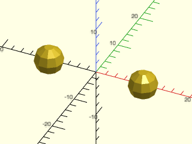

    include <BOSL2/std.scad>
    xcopies(20) sphere(3);

<br clear="all" /><br/>

**Example 2:** 

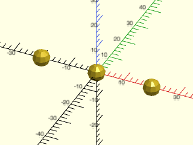

    include <BOSL2/std.scad>
    xcopies(20, n=3) sphere(3);

<br clear="all" /><br/>

**Example 3:** 

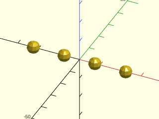

    include <BOSL2/std.scad>
    xcopies(spacing=15, l=50) sphere(3);

<br clear="all" /><br/>

**Example 4:** 

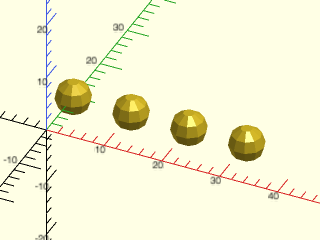

    include <BOSL2/std.scad>
    xcopies(n=4, l=30, sp=[0,10,0]) sphere(3);

<br clear="all" /><br/>

**Example 5:** 


    include <BOSL2/std.scad>
    xcopies(10, n=3) {
        cube(size=[1,3,1],center=true);
        cube(size=[3,1,1],center=true);
    }

<br clear="all" /><br/>

**Example 6:** 

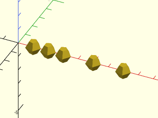

    include <BOSL2/std.scad>
    xcopies([1,2,3,5,7]) sphere(d=1);

<br clear="all" /><br/>

---

### Function/Module: ycopies()

**Synopsis:** Places copies of children along the Y axis. <sup title="Can return a list of transformation matrices.">[<abbr>MatList</abbr>]</sup> <sup title="Can transform children.">[<abbr>Trans</abbr>]</sup>

**Topics:** [Transformations](Topics#transformations), [Distributors](Topics#distributors), [Translation](Topics#translation), [Copiers](Topics#copiers)

**See Also:** [move\_copies()](#functionmodule-move_copies), [xcopies()](#functionmodule-xcopies), [zcopies()](#functionmodule-zcopies), [line\_copies()](#functionmodule-line_copies), [grid\_copies()](#functionmodule-grid_copies), [rot\_copies()](#functionmodule-rot_copies), [xrot\_copies()](#functionmodule-xrot_copies), [yrot\_copies()](#functionmodule-yrot_copies), [zrot\_copies()](#functionmodule-zrot_copies), [arc\_copies()](#functionmodule-arc_copies), [sphere\_copies()](#functionmodule-sphere_copies)

**Usage:** 

- ycopies(spacing, [n], [sp=]) CHILDREN;
- ycopies(l=, [n=], [sp=]) CHILDREN;
- ycopies(LIST) CHILDREN;

**Usage:** As a function to translate points, VNF, or Bezier patches

- copies = ycopies(spacing, [n], [sp=], p=);
- copies = ycopies(l=, [n=], [sp=], p=);
- copies = ycopies(LIST, p=);

**Usage:** Get Translation Matrices

- mats = ycopies(spacing, [n], [sp=]);
- mats = ycopies(l=, [n=], [sp=]);
- mats = ycopies(LIST);

**Description:** 

When called as a module, places `n` copies of the children along a line on the Y axis.
When called as a function, *without* a `p=` argument, returns a list of transformation matrices, one for each copy.
When called as a function, *with* a `p=` argument, returns a list of transformed copies of `p=`.

**Arguments:** 

<abbr title="These args can be used by position or by name.">By&nbsp;Position</abbr> | What it does
-------------------- | ------------
`spacing`            | Given a scalar, specifies a uniform spacing between copies. Given a list of scalars, each one gives a specific position along the line.
`n`                  | Number of copies to place on the line. (Default: 2)

<abbr title="These args must be used by name, ie: name=value">By&nbsp;Name</abbr> | What it does
-------------------- | ------------
`l`                  | If given, the length to place copies over.
`sp`                 | If given as a point, copies will be place on a line back from starting position `sp`.  If given as a scalar, copies will be placed on a line back from starting position `[0,sp,0]`.  If not given, copies will be placed along a line that is centered at [0,0,0].
`p`                  | Either a point, pointlist, VNF or Bezier patch to be translated when used as a function.

**Side Effects:** 

- `$pos` is set to the relative centerpoint of each child copy, and can be used to modify each child individually.
- `$idx` is set to the index number of each child being copied.

**Example 1:** 

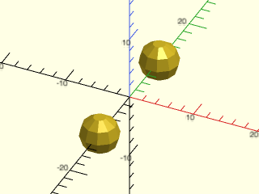

    include <BOSL2/std.scad>
    ycopies(20) sphere(3);

<br clear="all" /><br/>

**Example 2:** 

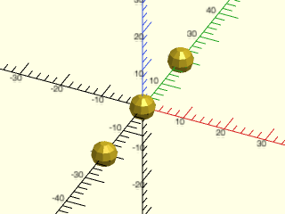

    include <BOSL2/std.scad>
    ycopies(20, n=3) sphere(3);

<br clear="all" /><br/>

**Example 3:** 

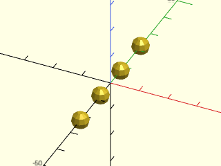

    include <BOSL2/std.scad>
    ycopies(spacing=15, l=50) sphere(3);

<br clear="all" /><br/>

**Example 4:** 

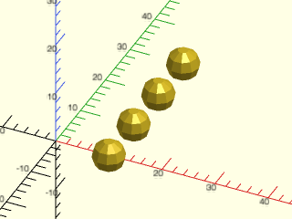

    include <BOSL2/std.scad>
    ycopies(n=4, l=30, sp=[10,0,0]) sphere(3);

<br clear="all" /><br/>

**Example 5:** 

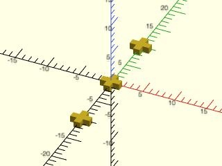

    include <BOSL2/std.scad>
    ycopies(10, n=3) {
        cube(size=[1,3,1],center=true);
        cube(size=[3,1,1],center=true);
    }

<br clear="all" /><br/>

**Example 6:** 

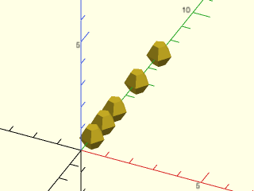

    include <BOSL2/std.scad>
    ycopies([1,2,3,5,7]) sphere(d=1);

<br clear="all" /><br/>

---

### Function/Module: zcopies()

**Synopsis:** Places copies of children along the Z axis. <sup title="Can return a list of transformation matrices.">[<abbr>MatList</abbr>]</sup> <sup title="Can transform children.">[<abbr>Trans</abbr>]</sup>

**Topics:** [Transformations](Topics#transformations), [Distributors](Topics#distributors), [Translation](Topics#translation), [Copiers](Topics#copiers)

**See Also:** [move\_copies()](#functionmodule-move_copies), [xcopies()](#functionmodule-xcopies), [ycopies()](#functionmodule-ycopies), [line\_copies()](#functionmodule-line_copies), [grid\_copies()](#functionmodule-grid_copies), [rot\_copies()](#functionmodule-rot_copies), [xrot\_copies()](#functionmodule-xrot_copies), [yrot\_copies()](#functionmodule-yrot_copies), [zrot\_copies()](#functionmodule-zrot_copies), [arc\_copies()](#functionmodule-arc_copies), [sphere\_copies()](#functionmodule-sphere_copies)

**Usage:** 

- zcopies(spacing, [n], [sp=]) CHILDREN;
- zcopies(l=, [n=], [sp=]) CHILDREN;
- zcopies(LIST) CHILDREN;

**Usage:** As a function to translate points, VNF, or Bezier patches

- copies = zcopies(spacing, [n], [sp=], p=);
- copies = zcopies(l=, [n=], [sp=], p=);
- copies = zcopies(LIST, p=);

**Usage:** Get Translation Matrices

- mats = zcopies(spacing, [n], [sp=]);
- mats = zcopies(l=, [n=], [sp=]);
- mats = zcopies(LIST);

**Description:** 

When called as a module, places `n` copies of the children along a line on the Z axis.
When called as a function, *without* a `p=` argument, returns a list of transformation matrices, one for each copy.
When called as a function, *with* a `p=` argument, returns a list of transformed copies of `p=`.

**Arguments:** 

<abbr title="These args can be used by position or by name.">By&nbsp;Position</abbr> | What it does
-------------------- | ------------
`spacing`            | Given a scalar, specifies a uniform spacing between copies. Given a list of scalars, each one gives a specific position along the line.
`n`                  | Number of copies to place. (Default: 2)

<abbr title="These args must be used by name, ie: name=value">By&nbsp;Name</abbr> | What it does
-------------------- | ------------
`l`                  | If given, the length to place copies over.
`sp`                 | If given as a point, copies will be placed on a line up from starting position `sp`.  If given as a scalar, copies will be placed on a line up from starting position `[0,0,sp]`.  If not given, copies will be placed on a line that is centered at [0,0,0].
`p`                  | Either a point, pointlist, VNF or Bezier patch to be translated when used as a function.

**Side Effects:** 

- `$pos` is set to the relative centerpoint of each child copy, and can be used to modify each child individually.
- `$idx` is set to the index number of each child being copied.

**Example 1:** 

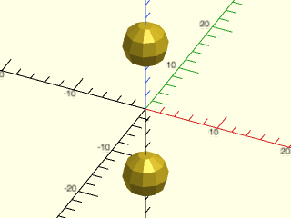

    include <BOSL2/std.scad>
    zcopies(20) sphere(3);

<br clear="all" /><br/>

**Example 2:** 

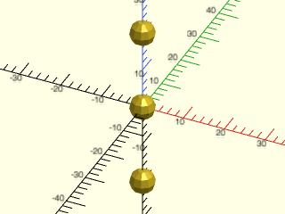

    include <BOSL2/std.scad>
    zcopies(20, n=3) sphere(3);

<br clear="all" /><br/>

**Example 3:** 

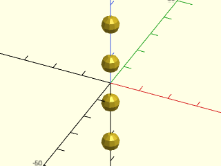

    include <BOSL2/std.scad>
    zcopies(spacing=15, l=50) sphere(3);

<br clear="all" /><br/>

**Example 4:** 

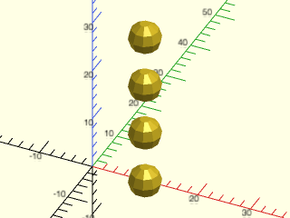

    include <BOSL2/std.scad>
    zcopies(n=4, l=30, sp=[10,0,0]) sphere(3);

<br clear="all" /><br/>

**Example 5:** 

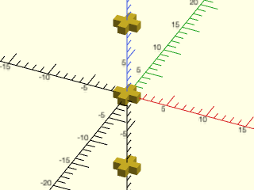

    include <BOSL2/std.scad>
    zcopies(10, n=3) {
        cube(size=[1,3,1],center=true);
        cube(size=[3,1,1],center=true);
    }

<br clear="all" /><br/>

**Example 6:** Cubic sphere packing

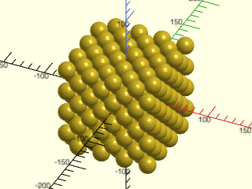

    include <BOSL2/std.scad>
    s = 20;
    s2 = s * sin(45);
    zcopies(s2,n=8)
        grid_copies([s2,s2],n=8,stagger=($idx%2)? true : "alt")
           sphere(d=s);

<br clear="all" /><br/>

**Example 7:** Hexagonal sphere packing

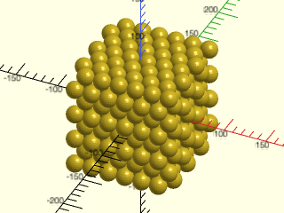

    include <BOSL2/std.scad>
    s = 20;
    xyr = adj_ang_to_hyp(s/2,30);
    h = hyp_adj_to_opp(s,xyr);
    zcopies(h,n=8)
        back(($idx%2)*xyr*cos(60))
            grid_copies(s,n=[12,7],stagger=($idx%2)? "alt" : true)
                sphere(d=s);

<br clear="all" /><br/>

**Example 8:** 

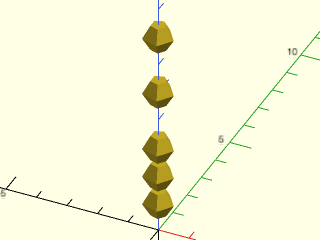

    include <BOSL2/std.scad>
    zcopies([1,2,3,5,7]) sphere(d=1);

<br clear="all" /><br/>

---

### Function/Module: line\_copies()

**Synopsis:** Places copies of children along an arbitrary line. <sup title="Can return a list of transformation matrices.">[<abbr>MatList</abbr>]</sup> <sup title="Can transform children.">[<abbr>Trans</abbr>]</sup>

**Topics:** [Transformations](Topics#transformations), [Distributors](Topics#distributors), [Translation](Topics#translation), [Copiers](Topics#copiers)

**See Also:** [move\_copies()](#functionmodule-move_copies), [xcopies()](#functionmodule-xcopies), [ycopies()](#functionmodule-ycopies), [zcopies()](#functionmodule-zcopies), [rot\_copies()](#functionmodule-rot_copies), [xrot\_copies()](#functionmodule-xrot_copies), [yrot\_copies()](#functionmodule-yrot_copies), [zrot\_copies()](#functionmodule-zrot_copies), [arc\_copies()](#functionmodule-arc_copies), [sphere\_copies()](#functionmodule-sphere_copies)

**Usage:** Place `n` copies at a given spacing along the line

- line_copies(spacing, [n], [p1=]) CHILDREN;

**Usage:** Place as many copies as will fit at a given spacing

- line_copies(spacing, [l=], [p1=]) CHILDREN;

**Usage:** Place `n` copies along the length of the line

- line_copies([n=], [l=], [p1=]) CHILDREN;

**Usage:** Place `n` copies along the line from `p1` to `p2`

- line_copies([n=], [p1=], [p2=]) CHILDREN;

**Usage:** Place copies at the given spacing, centered along the line from `p1` to `p2`

- line_copies([spacing], [p1=], [p2=]) CHILDREN;

**Usage:** As a function to translate points, VNF, or Bezier patches

- copies = line_copies([spacing], [n], [p1=], p=);
- copies = line_copies([spacing], [l=], [p1=], p=);
- copies = line_copies([n=], [l=], [p1=], p=);
- copies = line_copies([n=], [p1=], [p2=], p=);
- copies = line_copies([spacing], [p1=], [p2=], p=);

**Usage:** Get Translation Matrices

- mats = line_copies([spacing], [n], [p1=]);
- mats = line_copies([spacing], [l=], [p1=]);
- mats = line_copies([n=], [l=], [p1=]);
- mats = line_copies([n=], [p1=], [p2=]);
- mats = line_copies([spacing], [p1=], [p2=]);

**Description:** 

When called as a function, *without* a `p=` argument, returns a list of transformation matrices, one for each copy.
When called as a function, *with* a `p=` argument, returns a list of transformed copies of `p=`.
When called as a module, copies `children()` at one or more evenly spaced positions along a line.
By default, the line will be centered at the origin, unless the starting point `p1` is given.
The line will be pointed towards `RIGHT` (X+) unless otherwise given as a vector in `l`,
`spacing`, or `p1`/`p2`.  The position of the copies is specified in one of several ways:

If You Know...                   | Then Use Something Like...
-------------------------------- | --------------------------------
Spacing distance, Count          | `line_copies(spacing=10, n=5) ...` or `line_copies(10, n=5) ...`
Spacing vector, Count            | `line_copies(spacing=[10,5], n=5) ...` or `line_copies([10,5], n=5) ...`
Spacing distance, Line length    | `line_copies(spacing=10, l=50) ...` or `line_copies(10, l=50) ...`
Spacing distance, Line vector    | `line_copies(spacing=10, l=[50,30]) ...` or `line_copies(10, l=[50,30]) ...`
Spacing vector, Line length      | `line_copies(spacing=[10,5], l=50) ...` or `line_copies([10,5], l=50) ...`
Line length, Count               | `line_copies(l=50, n=5) ...`
Line vector, Count               | `line_copies(l=[50,40], n=5) ...`
Line endpoints, Count            | `line_copies(p1=[10,10], p2=[60,-10], n=5) ...`
Line endpoints, Spacing distance | `line_copies(p1=[10,10], p2=[60,-10], spacing=10) ...`

**Arguments:** 

<abbr title="These args can be used by position or by name.">By&nbsp;Position</abbr> | What it does
-------------------- | ------------
`spacing`            | Either the scalar spacing distance along the X+ direction, or the vector giving both the direction and spacing distance between each set of copies.
`n`                  | Number of copies to distribute along the line. (Default: 2)

<abbr title="These args must be used by name, ie: name=value">By&nbsp;Name</abbr> | What it does
-------------------- | ------------
`l`                  | Either the scalar length of the line, or a vector giving both the direction and length of the line.
`p1`                 | If given, specifies the starting point of the line.
`p2`                 | If given with `p1`, specifies the ending point of line, and indirectly calculates the line length.
`p`                  | Either a point, pointlist, VNF or Bezier patch to be translated when used as a function.

**Side Effects:** 

- `$pos` is set to the relative centerpoint of each child copy, and can be used to modify each child individually.
- `$idx` is set to the index number of each child being copied.

**Example 1:** 

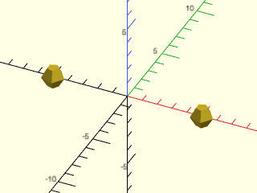

    include <BOSL2/std.scad>
    line_copies(10) sphere(d=1.5);

<br clear="all" /><br/>

**Example 2:** 

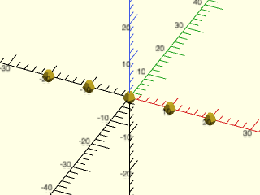

    include <BOSL2/std.scad>
    line_copies(10, n=5) sphere(d=3);

<br clear="all" /><br/>

**Example 3:** 


    include <BOSL2/std.scad>
    line_copies([10,5], n=5) sphere(d=3);

<br clear="all" /><br/>

**Example 4:** 


    include <BOSL2/std.scad>
    line_copies(spacing=10, n=6) sphere(d=3);

<br clear="all" /><br/>

**Example 5:** 

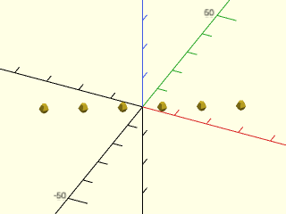

    include <BOSL2/std.scad>
    line_copies(spacing=[10,5], n=6) sphere(d=3);

<br clear="all" /><br/>

**Example 6:** 

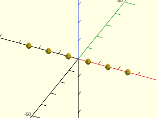

    include <BOSL2/std.scad>
    line_copies(spacing=10, l=50) sphere(d=3);

<br clear="all" /><br/>

**Example 7:** 

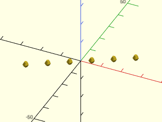

    include <BOSL2/std.scad>
    line_copies(spacing=10, l=[50,30]) sphere(d=3);

<br clear="all" /><br/>

**Example 8:** 


    include <BOSL2/std.scad>
    line_copies(spacing=[10,5], l=50) sphere(d=3);

<br clear="all" /><br/>

**Example 9:** 

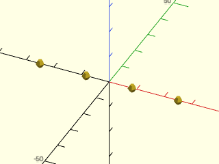

    include <BOSL2/std.scad>
    line_copies(l=50, n=4) sphere(d=3);

<br clear="all" /><br/>

**Example 10:** 

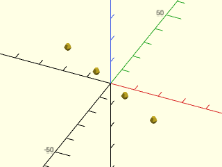

    include <BOSL2/std.scad>
    line_copies(l=[50,-30], n=4) sphere(d=3);

<br clear="all" /><br/>

**Example 11:** 

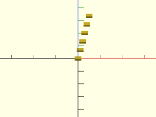

    include <BOSL2/std.scad>
    line_copies(p1=[0,0,0], p2=[5,5,20], n=6) cuboid([3,2,1]);

<br clear="all" /><br/>

**Example 12:** 

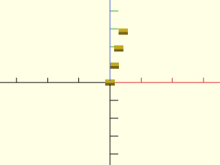

<br clear="all" />

    include <BOSL2/std.scad>
    line_copies(p1=[0,0,0], p2=[5,5,20], spacing=6) cuboid([3,2,1]);

**Example 13:** All children are copied to each position

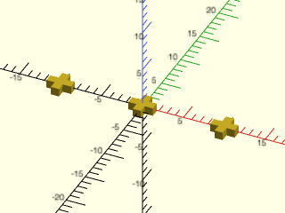

    include <BOSL2/std.scad>
    line_copies(l=20, n=3) {
        cube(size=[1,3,1],center=true);
        cube(size=[3,1,1],center=true);
    }

<br clear="all" /><br/>

**Example 14:** The functional form of line\_copies() returns a list of transform matrices.


    include <BOSL2/std.scad>
    mats = line_copies([10,5],n=5);
    for (m = mats) multmatrix(m)  circle(d=3);

<br clear="all" /><br/>

**Example 15:** The functional form of line\_copies() returns a list of points if given a point.

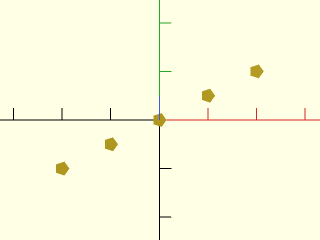

    include <BOSL2/std.scad>
    pts = line_copies([10,5],n=5,p=[0,0,0]);
    move_copies(pts) circle(d=3);

<br clear="all" /><br/>

---

### Function/Module: grid\_copies()

**Synopsis:** Places copies of children in an [X,Y] grid. <sup title="Can return a list of transformation matrices.">[<abbr>MatList</abbr>]</sup> <sup title="Can transform children.">[<abbr>Trans</abbr>]</sup>

**Topics:** [Transformations](Topics#transformations), [Distributors](Topics#distributors), [Translation](Topics#translation), [Copiers](Topics#copiers)

**See Also:** [move\_copies()](#functionmodule-move_copies), [xcopies()](#functionmodule-xcopies), [ycopies()](#functionmodule-ycopies), [zcopies()](#functionmodule-zcopies), [line\_copies()](#functionmodule-line_copies), [rot\_copies()](#functionmodule-rot_copies), [xrot\_copies()](#functionmodule-xrot_copies), [yrot\_copies()](#functionmodule-yrot_copies), [zrot\_copies()](#functionmodule-zrot_copies), [arc\_copies()](#functionmodule-arc_copies), [sphere\_copies()](#functionmodule-sphere_copies)

**Usage:** 

- grid_copies(spacing, size=, [stagger=], [inside=], [axes=]) CHILDREN;
- grid_copies(n=, size=, [stagger=], [inside=], [axes=]) CHILDREN;
- grid_copies(spacing, [n], [stagger=], [inside=], [axes=]) CHILDREN;
- grid_copies(n=, inside=, [stagger=], [axes=]) CHILDREN;

**Usage:** As a function to translate points, VNF, or Bezier patches

- copies = grid_copies(spacing, size=, [stagger=], [inside=], [axes=], p=);
- copies = grid_copies(n=, size=, [stagger=], [inside=], [axes=], p=);
- copies = grid_copies(spacing, [n], [stagger=], [inside=], [axes=], p=);
- copies = grid_copies(n=, inside=, [stagger=], [axes=], p=);

**Usage:** Get Translation Matrices

- mats = grid_copies(spacing, size=, [stagger=], [inside=], [axes=]);
- mats = grid_copies(n=, size=, [stagger=], [inside=], [axes=]);
- mats = grid_copies(spacing, [n], [stagger=], [inside=], [axes=]);
- mats = grid_copies(n=, inside=, [stagger=], [axes=]);

**Description:** 

When called as a module, makes a square or hexagonal grid of copies of children, with an optional masking polygon or region.
When called as a function, *without* a `p=` argument, returns a list of transformation matrices, one for each copy.
When called as a function, *with* a `p=` argument, returns a list of transformed copies of `p=`.

The `stagger` parameter causes each row to be offset from the one below.
By default the layout is in the xy plane where a row runs in the x direction.  You can choose
any pair of axes for the layout using the `axes` parameter, which is a two letter parameter
where the first letter gives the direction of a row.  The default is "xy".  The order matters because
whichever axis is first will correspond to the first entry in `size`, and if you set `stagger=true` that
operates on rows, so interchanging the axes will produce a different result.  Staggering works by
skipping items, so you will get about half as many child objects as when `stagger=false`.

**Arguments:** 

<abbr title="These args can be used by position or by name.">By&nbsp;Position</abbr> | What it does
-------------------- | ------------
`spacing`            | Distance between copies in [X,Y] or scalar distance.
`n`                  | How many columns and rows of copies to make.  Can be given as `[COLS,ROWS]`, or just as a scalar that specifies both.  If staggered, count both staggered and unstaggered columns and rows.  Each count must be at least 2. Default: 2 (3 if staggered), unless derived from size and spacing
`size`               | The [X,Y] size to spread the copies over.

<abbr title="These args must be used by name, ie: name=value">By&nbsp;Name</abbr> | What it does
-------------------- | ------------
`stagger`            | If true, make a staggered (hexagonal) grid.  If false, make square grid.  If `"alt"`, makes alternate staggered pattern.  Default: false
`inside`             | If given a list of polygon points, or a region, only creates copies whose center would be inside the polygon or region.  Polygon can be concave and/or self crossing.
`nonzero`            | If inside is set to a polygon with self-crossings then use the nonzero method for deciding if points are in the polygon.  Default: false
`axes`               | Specify the axes to use for the row and column directions as a 2 character string.  Default: "xy"
`p`                  | Either a point, pointlist, VNF or Bezier patch to be translated when used as a function.

**Side Effects:** 

- `$pos` is set to the relative centerpoint of each child copy, and can be used to modify each child individually.
- `$col` is set to the integer column number for each child.
- `$row` is set to the integer row number for each child.
- `$idx` is set to a unique index for each child, progressing across rows first, from the bottom

**Example 1:** 

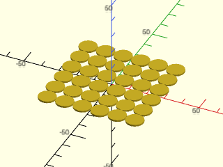

    include <BOSL2/std.scad>
    grid_copies(size=50, spacing=10) cylinder(d=10, h=1);

<br clear="all" /><br/>

**Example 2:** 

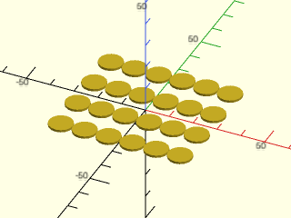

    include <BOSL2/std.scad>
    grid_copies(size=50, spacing=[10,15]) cylinder(d=10, h=1);

<br clear="all" /><br/>

**Example 3:** 

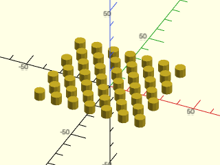

<br clear="all" />

    include <BOSL2/std.scad>
    grid_copies(spacing=10, n=[13,7], stagger=true) cylinder(d=6, h=5);

**Example 4:** 

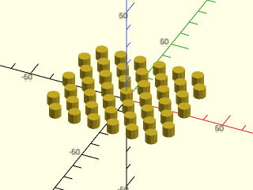

<br clear="all" />

    include <BOSL2/std.scad>
    grid_copies(spacing=10, n=[13,7], stagger="alt") cylinder(d=6, h=5);

**Example 5:** 

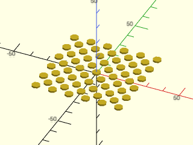

    include <BOSL2/std.scad>
    grid_copies(size=50, n=11, stagger=true) cylinder(d=5, h=1);

<br clear="all" /><br/>

**Example 6:** Setting the axes to "xz"

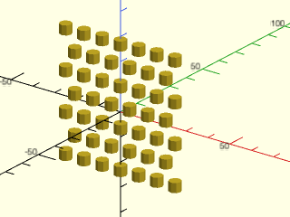

<br clear="all" />

    include <BOSL2/std.scad>
    grid_copies(size=50, n=[13,7], stagger=true, axes="xz") cylinder(d=5, h=4);

**Example 7:** The layout is different with axes="zx"

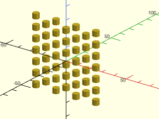

<br clear="all" />

    include <BOSL2/std.scad>
    grid_copies(size=50, n=[13,7], stagger=true, axes="zx") cylinder(d=5, h=4);

**Example 8:** 

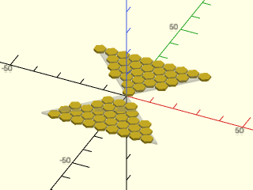

    include <BOSL2/std.scad>
    poly = [[-25,-25], [25,25], [-25,25], [25,-25]];
    grid_copies(spacing=5, stagger=true, inside=poly)
       zrot(180/6) cylinder(d=5, h=1, $fn=6);
    %polygon(poly);

<br clear="all" /><br/>

**Example 9:** Using `$row` and `$col`

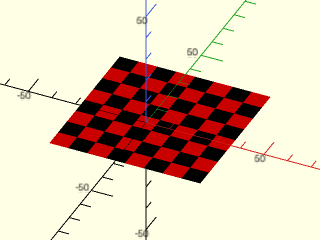

    include <BOSL2/std.scad>
    grid_copies(spacing=8, n=8)
        color(($row+$col)%2?"black":"red")
            cube([8,8,0.01], center=false);

<br clear="all" /><br/>

**Example 10:** Makes a grid of hexagon pillars whose tops are all angled to reflect light at [0,0,50], if they were shiny.

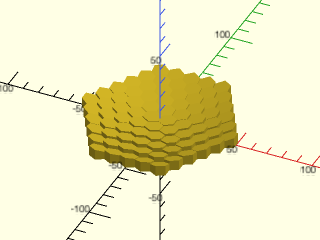

    include <BOSL2/std.scad>
    hexregion = circle(r=50.01,$fn=6);
    grid_copies(spacing=10, stagger=true, inside=hexregion)
      union() {   // Needed for OpenSCAD 2021.01 as noted above
        ref_v = (unit([0,0,50]-point3d($pos)) + UP)/2;
        half_of(v=-ref_v, cp=[0,0,5])
            zrot(180/6)
                cylinder(h=20, d=10/cos(180/6)+0.01, $fn=6);
      }

<br clear="all" /><br/>

---

## Section: Rotating copies of all children


### Function/Module: rot\_copies()

**Synopsis:** Rotates copies of children. <sup title="Can return a list of transformation matrices.">[<abbr>MatList</abbr>]</sup> <sup title="Can transform children.">[<abbr>Trans</abbr>]</sup>

**Topics:** [Transformations](Topics#transformations), [Distributors](Topics#distributors), [Rotation](Topics#rotation), [Copiers](Topics#copiers)

**See Also:** [xrot\_copies()](#functionmodule-xrot_copies), [yrot\_copies()](#functionmodule-yrot_copies), [zrot\_copies()](#functionmodule-zrot_copies), [arc\_copies()](#functionmodule-arc_copies), [sphere\_copies()](#functionmodule-sphere_copies), [move\_copies()](#functionmodule-move_copies), [xcopies()](#functionmodule-xcopies), [ycopies()](#functionmodule-ycopies), [zcopies()](#functionmodule-zcopies), [line\_copies()](#functionmodule-line_copies), [grid\_copies()](#functionmodule-grid_copies)

**Usage:** 

- rot_copies(rots, [cp=], [sa=], [delta=], [subrot=]) CHILDREN;
- rot_copies(rots, v, [cp=], [sa=], [delta=], [subrot=]) CHILDREN;
- rot_copies(n=, [v=], [cp=], [sa=], [delta=], [subrot=]) CHILDREN;

**Usage:** As a function to translate points, VNF, or Bezier patches

- copies = rot_copies(rots, [cp=], [sa=], [delta=], [subrot=], p=);
- copies = rot_copies(rots, v, [cp=], [sa=], [delta=], [subrot=], p=);
- copies = rot_copies(n=, [v=], [cp=], [sa=], [delta=], [subrot=], p=);

**Usage:** Get Translation Matrices

- mats = rot_copies(rots, [cp=], [sa=], [delta=], [subrot=]);
- mats = rot_copies(rots, v, [cp=], [sa=], [delta=], [subrot=]);
- mats = rot_copies(n=, [v=], [cp=], [sa=], [delta=], [subrot=]);

**Description:** 

When called as a module:
- Given a list of [X,Y,Z] rotation angles in `rots`, rotates copies of the children to each of those angles, regardless of axis of rotation.
- Given a list of scalar angles in `rots`, rotates copies of the children to each of those angles around the axis of rotation.
- If given a vector `v`, that becomes the axis of rotation.  Default axis of rotation is UP.
- If given a count `n`, makes that many copies, rotated evenly around the axis.
- If given an offset `delta`, translates each child by that amount before rotating them into place.  This makes rings.
- If given a centerpoint `cp`, centers the ring around that centerpoint.
- If `subrot` is true, each child will be rotated in place to keep the same side towards the center when making rings.
- The first (unrotated) copy will be placed at the relative starting angle `sa`.

When called as a function, *without* a `p=` argument, returns a list of transformation matrices, one for each copy.
When called as a function, *with* a `p=` argument, returns a list of transformed copies of `p=`.

**Arguments:** 

<abbr title="These args can be used by position or by name.">By&nbsp;Position</abbr> | What it does
-------------------- | ------------
`rots`               | A list of [X,Y,Z] rotation angles in degrees.  If `v` is given, this will be a list of scalar angles in degrees to rotate around `v`.
`v`                  | If given, this is the vector of the axis to rotate around.
`cp`                 | Centerpoint to rotate around. Default: [0,0,0]

<abbr title="These args must be used by name, ie: name=value">By&nbsp;Name</abbr> | What it does
-------------------- | ------------
`n`                  | Optional number of evenly distributed copies, rotated around the axis.
`sa`                 | Starting angle, in degrees.  For use with `n`.  Angle is in degrees counter-clockwise.  Default: 0
`delta`              | [X,Y,Z] amount to move away from cp before rotating.  Makes rings of copies.  Default: `[0,0,0]`
`subrot`             | If false, don't sub-rotate children as they are copied around the ring.  Instead maintain their native orientation.  The false setting is only allowed when `delta` is given.  Default: `true`
`p`                  | Either a point, pointlist, VNF or Bezier patch to be translated when used as a function.

**Side Effects:** 

- `$ang` is set to the rotation angle (or XYZ rotation triplet) of each child copy, and can be used to modify each child individually.
- `$idx` is set to the index value of each child copy.
- `$axis` is set to the axis to rotate around, if `rots` was given as a list of angles instead of a list of [X,Y,Z] rotation angles.

**Example 1:** 

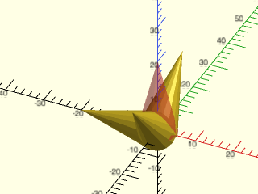

<br clear="all" />

    include <BOSL2/std.scad>
    #cylinder(h=20, r1=5, r2=0);
    rot_copies([[45,0,0],[0,45,90],[90,-45,270]]) cylinder(h=20, r1=5, r2=0);

**Example 2:** 

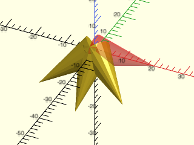

    include <BOSL2/std.scad>
    rot_copies([45, 90, 135], v=DOWN+BACK)
        yrot(90) cylinder(h=20, r1=5, r2=0);
    color("red",0.333) yrot(90) cylinder(h=20, r1=5, r2=0);

<br clear="all" /><br/>

**Example 3:** 

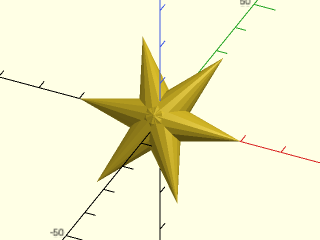

    include <BOSL2/std.scad>
    rot_copies(n=6, v=DOWN+BACK)
        yrot(90) cylinder(h=20, r1=5, r2=0);
    color("red",0.333) yrot(90) cylinder(h=20, r1=5, r2=0);

<br clear="all" /><br/>

**Example 4:** 

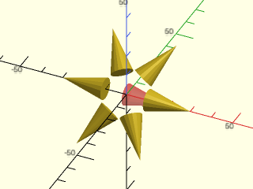

    include <BOSL2/std.scad>
    rot_copies(n=6, v=DOWN+BACK, delta=[10,0,0])
        yrot(90) cylinder(h=20, r1=5, r2=0);
    color("red",0.333) yrot(90) cylinder(h=20, r1=5, r2=0);

<br clear="all" /><br/>

**Example 5:** 

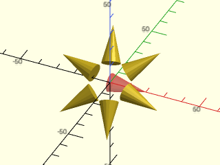

    include <BOSL2/std.scad>
    rot_copies(n=6, v=UP+FWD, delta=[10,0,0], sa=45)
        yrot(90) cylinder(h=20, r1=5, r2=0);
    color("red",0.333) yrot(90) cylinder(h=20, r1=5, r2=0);

<br clear="all" /><br/>

**Example 6:** 

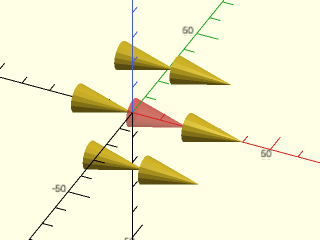

    include <BOSL2/std.scad>
    rot_copies(n=6, v=DOWN+BACK, delta=[20,0,0], subrot=false)
        yrot(90) cylinder(h=20, r1=5, r2=0);
    color("red",0.333) yrot(90) cylinder(h=20, r1=5, r2=0);

<br clear="all" /><br/>

---

### Function/Module: xrot\_copies()

**Synopsis:** Rotates copies of children around the X axis. <sup title="Can return a list of transformation matrices.">[<abbr>MatList</abbr>]</sup> <sup title="Can transform children.">[<abbr>Trans</abbr>]</sup>

**Topics:** [Transformations](Topics#transformations), [Distributors](Topics#distributors), [Rotation](Topics#rotation), [Copiers](Topics#copiers)

**See Also:** [rot\_copies()](#functionmodule-rot_copies), [yrot\_copies()](#functionmodule-yrot_copies), [zrot\_copies()](#functionmodule-zrot_copies), [arc\_copies()](#functionmodule-arc_copies), [sphere\_copies()](#functionmodule-sphere_copies), [move\_copies()](#functionmodule-move_copies), [xcopies()](#functionmodule-xcopies), [ycopies()](#functionmodule-ycopies), [zcopies()](#functionmodule-zcopies), [line\_copies()](#functionmodule-line_copies), [grid\_copies()](#functionmodule-grid_copies)

**Usage:** 

- xrot_copies(rots, [cp], [r=|d=], [sa=], [subrot=]) CHILDREN;
- xrot_copies(n=, [cp=], [r=|d=], [sa=], [subrot=]) CHILDREN;

**Usage:** As a function to translate points, VNF, or Bezier patches

- copies = xrot_copies(rots, [cp], [r=|d=], [sa=], [subrot=], p=);
- copies = xrot_copies(n=, [cp=], [r=|d=], [sa=], [subrot=], p=);

**Usage:** Get Translation Matrices

- mats = xrot_copies(rots, [cp], [r=|d=], [sa=], [subrot=]);
- mats = xrot_copies(n=, [cp=], [r=|d=], [sa=], [subrot=]);

**Description:** 

When called as a module:
- Given an array of angles, rotates copies of the children to each of those angles around the X axis.
- If given a count `n`, makes that many copies, rotated evenly around the X axis.
- If given a radius `r` (or diameter `d`), distributes children around a ring of that size around the X axis.
- If given a centerpoint `cp`, centers the rotation around that centerpoint.
- If `subrot` is true, each child will be rotated in place to keep the same side towards the center when making rings.
- The first (unrotated) copy will be placed at the relative starting angle `sa`.

When called as a function, *without* a `p=` argument, returns a list of transformation matrices, one for each copy.
When called as a function, *with* a `p=` argument, returns a list of transformed copies of `p=`.

**Arguments:** 

<abbr title="These args can be used by position or by name.">By&nbsp;Position</abbr> | What it does
-------------------- | ------------
`rots`               | Optional array of rotation angles, in degrees, to make copies at.
`cp`                 | Centerpoint to rotate around. Default: [0,0,0]

<abbr title="These args must be used by name, ie: name=value">By&nbsp;Name</abbr> | What it does
-------------------- | ------------
`n`                  | Optional number of evenly distributed copies to be rotated around the ring.
`sa`                 | Starting angle, in degrees. For use with n. Counter-clockwise from Y+, when facing the origin from X+. Default: 0
`r`                  | If given, makes a ring of child copies around the X axis, at the given radius.  Default: 0
`d`                  | If given, makes a ring of child copies around the X axis, at the given diameter.
`subrot`             | If false, don't sub-rotate children as they are copied around the ring.  Instead maintain their native orientation.  The false setting is only allowed when `d` or `r` is given.  Default: `true`
`p`                  | Either a point, pointlist, VNF or Bezier patch to be translated when used as a function.

**Side Effects:** 

- `$idx` is set to the index value of each child copy.
- `$ang` is set to the rotation angle of each child copy, and can be used to modify each child individually.
- `$axis` is set to the axis vector rotated around.

**Example 1:** 

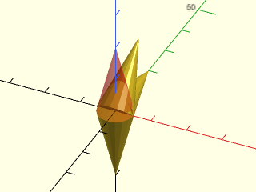

    include <BOSL2/std.scad>
    xrot_copies([180, 270, 315])
        cylinder(h=20, r1=5, r2=0);
    color("red",0.333) cylinder(h=20, r1=5, r2=0);

<br clear="all" /><br/>

**Example 2:** 

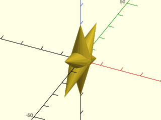

    include <BOSL2/std.scad>
    xrot_copies(n=6)
        cylinder(h=20, r1=5, r2=0);
    color("red",0.333) cylinder(h=20, r1=5, r2=0);

<br clear="all" /><br/>

**Example 3:** 

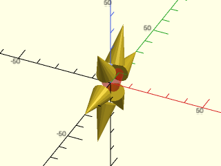

    include <BOSL2/std.scad>
    xrot_copies(n=6, r=10)
        xrot(-90) cylinder(h=20, r1=5, r2=0);
    color("red",0.333) xrot(-90) cylinder(h=20, r1=5, r2=0);

<br clear="all" /><br/>

**Example 4:** 


    include <BOSL2/std.scad>
    xrot_copies(n=6, r=10, sa=45)
        xrot(-90) cylinder(h=20, r1=5, r2=0);
    color("red",0.333) xrot(-90) cylinder(h=20, r1=5, r2=0);

<br clear="all" /><br/>

**Example 5:** 


<br clear="all" />

    include <BOSL2/std.scad>
    xrot_copies(n=6, r=20, subrot=false)
        xrot(-90) cylinder(h=20, r1=5, r2=0, center=true);
    color("red",0.333) xrot(-90) cylinder(h=20, r1=5, r2=0, center=true);

---

### Function/Module: yrot\_copies()

**Synopsis:** Rotates copies of children around the Y axis. <sup title="Can return a list of transformation matrices.">[<abbr>MatList</abbr>]</sup> <sup title="Can transform children.">[<abbr>Trans</abbr>]</sup>

**Topics:** [Transformations](Topics#transformations), [Distributors](Topics#distributors), [Rotation](Topics#rotation), [Copiers](Topics#copiers)

**See Also:** [rot\_copies()](#functionmodule-rot_copies), [xrot\_copies()](#functionmodule-xrot_copies), [zrot\_copies()](#functionmodule-zrot_copies), [arc\_copies()](#functionmodule-arc_copies), [sphere\_copies()](#functionmodule-sphere_copies), [move\_copies()](#functionmodule-move_copies), [xcopies()](#functionmodule-xcopies), [ycopies()](#functionmodule-ycopies), [zcopies()](#functionmodule-zcopies), [line\_copies()](#functionmodule-line_copies), [grid\_copies()](#functionmodule-grid_copies)

**Usage:** 

- yrot_copies(rots, [cp], [r=|d=], [sa=], [subrot=]) CHILDREN;
- yrot_copies(n=, [cp=], [r=|d=], [sa=], [subrot=]) CHILDREN;

**Usage:** As a function to translate points, VNF, or Bezier patches

- copies = yrot_copies(rots, [cp], [r=|d=], [sa=], [subrot=], p=);
- copies = yrot_copies(n=, [cp=], [r=|d=], [sa=], [subrot=], p=);

**Usage:** Get Translation Matrices

- mats = yrot_copies(rots, [cp], [r=|d=], [sa=], [subrot=]);
- mats = yrot_copies(n=, [cp=], [r=|d=], [sa=], [subrot=]);

**Description:** 

When called as a module:
- Given an array of angles, rotates copies of the children to each of those angles around the Y axis.
- If given a count `n`, makes that many copies, rotated evenly around the Y axis.
- If given a radius `r` (or diameter `d`), distributes children around a ring of that size around the Y axis.
- If given a centerpoint `cp`, centers the rotation around that centerpoint.
- If `subrot` is true, each child will be rotated in place to keep the same side towards the center when making rings.
- The first (unrotated) copy will be placed at the relative starting angle `sa`.

When called as a function, *without* a `p=` argument, returns a list of transformation matrices, one for each copy.
When called as a function, *with* a `p=` argument, returns a list of transformed copies of `p=`.

**Arguments:** 

<abbr title="These args can be used by position or by name.">By&nbsp;Position</abbr> | What it does
-------------------- | ------------
`rots`               | Optional array of rotation angles, in degrees, to make copies at.
`cp`                 | Centerpoint to rotate around. Default: [0,0,0]

<abbr title="These args must be used by name, ie: name=value">By&nbsp;Name</abbr> | What it does
-------------------- | ------------
`n`                  | Optional number of evenly distributed copies to be rotated around the ring.
`sa`                 | Starting angle, in degrees. For use with n. Counter-clockwise from X-, when facing the origin from Y+. Default: 0
`r`                  | If given, makes a ring of child copies around the Y axis, at the given radius.  Default: 0
`d`                  | If given, makes a ring of child copies around the Y axis, at the given diameter.
`subrot`             | If false, don't sub-rotate children as they are copied around the ring.  Instead maintain their native orientation.  The false setting is only allowed when `d` or `r` is given.  Default: `true`
`p`                  | Either a point, pointlist, VNF or Bezier patch to be translated when used as a function.

**Side Effects:** 

- `$idx` is set to the index value of each child copy.
- `$ang` is set to the rotation angle of each child copy, and can be used to modify each child individually.
- `$axis` is set to the axis vector rotated around.

**Example 1:** 


    include <BOSL2/std.scad>
    yrot_copies([180, 270, 315])
        cylinder(h=20, r1=5, r2=0);
    color("red",0.333) cylinder(h=20, r1=5, r2=0);

<br clear="all" /><br/>

**Example 2:** 


    include <BOSL2/std.scad>
    yrot_copies(n=6)
        cylinder(h=20, r1=5, r2=0);
    color("red",0.333) cylinder(h=20, r1=5, r2=0);

<br clear="all" /><br/>

**Example 3:** 


    include <BOSL2/std.scad>
    yrot_copies(n=6, r=10)
        yrot(-90) cylinder(h=20, r1=5, r2=0);
    color("red",0.333) yrot(-90) cylinder(h=20, r1=5, r2=0);

<br clear="all" /><br/>

**Example 4:** 


    include <BOSL2/std.scad>
    yrot_copies(n=6, r=10, sa=45)
        yrot(-90) cylinder(h=20, r1=5, r2=0);
    color("red",0.333) yrot(-90) cylinder(h=20, r1=5, r2=0);

<br clear="all" /><br/>

**Example 5:** 


<br clear="all" />

    include <BOSL2/std.scad>
    yrot_copies(n=6, r=20, subrot=false)
        yrot(-90) cylinder(h=20, r1=5, r2=0, center=true);
    color("red",0.333) yrot(-90) cylinder(h=20, r1=5, r2=0, center=true);

---

### Function/Module: zrot\_copies()

**Synopsis:** Rotates copies of children around the Z axis. <sup title="Can return a list of transformation matrices.">[<abbr>MatList</abbr>]</sup> <sup title="Can transform children.">[<abbr>Trans</abbr>]</sup>

**Topics:** [Transformations](Topics#transformations), [Distributors](Topics#distributors), [Rotation](Topics#rotation), [Copiers](Topics#copiers)

**See Also:** [rot\_copies()](#functionmodule-rot_copies), [xrot\_copies()](#functionmodule-xrot_copies), [yrot\_copies()](#functionmodule-yrot_copies), [arc\_copies()](#functionmodule-arc_copies), [sphere\_copies()](#functionmodule-sphere_copies), [move\_copies()](#functionmodule-move_copies), [xcopies()](#functionmodule-xcopies), [ycopies()](#functionmodule-ycopies), [zcopies()](#functionmodule-zcopies), [line\_copies()](#functionmodule-line_copies), [grid\_copies()](#functionmodule-grid_copies)

**Usage:** 

- zrot_copies(rots, [cp], [r=|d=], [sa=], [subrot=]) CHILDREN;
- zrot_copies(n=, [cp=], [r=|d=], [sa=], [subrot=]) CHILDREN;

**Usage:** As a function to translate points, VNF, or Bezier patches

- copies = zrot_copies(rots, [cp], [r=|d=], [sa=], [subrot=], p=);
- copies = zrot_copies(n=, [cp=], [r=|d=], [sa=], [subrot=], p=);

**Usage:** Get Translation Matrices

- mats = zrot_copies(rots, [cp], [r=|d=], [sa=], [subrot=]);
- mats = zrot_copies(n=, [cp=], [r=|d=], [sa=], [subrot=]);

**Description:** 

When called as a module:
- Given an array of angles, rotates copies of the children to each of those angles around the Z axis.
- If given a count `n`, makes that many copies, rotated evenly around the Z axis.
- If given a radius `r` (or diameter `d`), distributes children around a ring of that size around the Z axis.
- If given a centerpoint `cp`, centers the rotation around that centerpoint.
- If `subrot` is true, each child will be rotated in place to keep the same side towards the center when making rings.
- The first (unrotated) copy will be placed at the relative starting angle `sa`.

When called as a function, *without* a `p=` argument, returns a list of transformation matrices, one for each copy.
When called as a function, *with* a `p=` argument, returns a list of transformed copies of `p=`.

**Arguments:** 

<abbr title="These args can be used by position or by name.">By&nbsp;Position</abbr> | What it does
-------------------- | ------------
`rots`               | Optional array of rotation angles, in degrees, to make copies at.
`cp`                 | Centerpoint to rotate around. Default: [0,0,0]

<abbr title="These args must be used by name, ie: name=value">By&nbsp;Name</abbr> | What it does
-------------------- | ------------
`n`                  | Optional number of evenly distributed copies to be rotated around the ring.
`sa`                 | Starting angle, in degrees.  For use with `n`.  Angle is in degrees counter-clockwise from X+, when facing the origin from Z+.  Default: 0
`r`                  | If given, makes a ring of child copies around the Z axis, at the given radius.  Default: 0
`d`                  | If given, makes a ring of child copies around the Z axis, at the given diameter.
`subrot`             | If false, don't sub-rotate children as they are copied around the ring.  Instead maintain their native orientation.  The false setting is only allowed when `d` or `r` is given.  Default: `true`
`p`                  | Either a point, pointlist, VNF or Bezier patch to be translated when used as a function.

**Side Effects:** 

- `$idx` is set to the index value of each child copy.
- `$ang` is set to the rotation angle of each child copy, and can be used to modify each child individually.
- `$axis` is set to the axis vector rotated around.

**Example 1:** 


    include <BOSL2/std.scad>
    zrot_copies([180, 270, 315])
        yrot(90) cylinder(h=20, r1=5, r2=0);
    color("red",0.333) yrot(90) cylinder(h=20, r1=5, r2=0);

<br clear="all" /><br/>

**Example 2:** 


    include <BOSL2/std.scad>
    zrot_copies(n=6)
        yrot(90) cylinder(h=20, r1=5, r2=0);
    color("red",0.333) yrot(90) cylinder(h=20, r1=5, r2=0);

<br clear="all" /><br/>

**Example 3:** 


    include <BOSL2/std.scad>
    zrot_copies(n=6, r=10)
        yrot(90) cylinder(h=20, r1=5, r2=0);
    color("red",0.333) yrot(90) cylinder(h=20, r1=5, r2=0);

<br clear="all" /><br/>

**Example 4:** 


<br clear="all" />

    include <BOSL2/std.scad>
    zrot_copies(n=6, r=20, sa=45)
        yrot(90) cylinder(h=20, r1=5, r2=0, center=true);
    color("red",0.333) yrot(90) cylinder(h=20, r1=5, r2=0, center=true);

**Example 5:** 


<br clear="all" />

    include <BOSL2/std.scad>
    zrot_copies(n=6, r=20, subrot=false)
        yrot(-90) cylinder(h=20, r1=5, r2=0, center=true);
    color("red",0.333) yrot(-90) cylinder(h=20, r1=5, r2=0, center=true);

---

### Function/Module: arc\_copies()

**Synopsis:** Distributes duplicates of children along an arc. <sup title="Can return a list of transformation matrices.">[<abbr>MatList</abbr>]</sup> <sup title="Can transform children.">[<abbr>Trans</abbr>]</sup>

**Topics:** [Transformations](Topics#transformations), [Distributors](Topics#distributors), [Rotation](Topics#rotation), [Copiers](Topics#copiers)

**See Also:** [rot\_copies()](#functionmodule-rot_copies), [xrot\_copies()](#functionmodule-xrot_copies), [yrot\_copies()](#functionmodule-yrot_copies), [zrot\_copies()](#functionmodule-zrot_copies), [sphere\_copies()](#functionmodule-sphere_copies), [move\_copies()](#functionmodule-move_copies), [xcopies()](#functionmodule-xcopies), [ycopies()](#functionmodule-ycopies), [zcopies()](#functionmodule-zcopies), [line\_copies()](#functionmodule-line_copies), [grid\_copies()](#functionmodule-grid_copies)

**Usage:** 

- arc_copies(n, r|d=, [sa=], [ea=], [rot=]) CHILDREN;
- arc_copies(n, rx=|dx=, ry=|dy=, [sa=], [ea=], [rot=]) CHILDREN;

**Usage:** As a function to translate points, VNF, or Bezier patches

- copies = arc_copies(n, r|d=, [sa=], [ea=], [rot=], p=);
- copies = arc_copies(n, rx=|dx=, ry=|dy=, [sa=], [ea=], [rot=], p=);

**Usage:** Get Translation Matrices

- mats = arc_copies(n, r|d=, [sa=], [ea=], [rot=]);
- mats = arc_copies(n, rx=|dx=, ry=|dy=, [sa=], [ea=], [rot=]);

**Description:** 

When called as a module, evenly distributes n duplicate children around an elliptical arc on the XY plane.
When called as a function, *without* a `p=` argument, returns a list of transformation matrices, one for each copy.
When called as a function, *with* a `p=` argument, returns a list of transformed copies of `p=`.

**Arguments:** 

<abbr title="These args can be used by position or by name.">By&nbsp;Position</abbr> | What it does
-------------------- | ------------
`n`                  | Number of copies to distribute around the arc. With n=1, place the copy at sa. Default: 6
`r`                  | radius of circle (Default: 1)

<abbr title="These args must be used by name, ie: name=value">By&nbsp;Name</abbr> | What it does
-------------------- | ------------
`rx`                 | radius of ellipse on X axis. Used instead of r.
`ry`                 | radius of ellipse on Y axis. Used instead of r.
`d`                  | diameter of circle. (Default: 2)
`dx`                 | diameter of ellipse on X axis. Used instead of d.
`dy`                 | diameter of ellipse on Y axis. Used instead of d.
`rot`                | whether to rotate the copied children.  (Default: true)
`sa`                 | starting angle. (Default: 0.0)
`ea`                 | ending angle. Will distribute copies CCW from sa to ea. (Default: 360.0)
`p`                  | Either a point, pointlist, VNF or Bezier patch to be translated when used as a function.

**Side Effects:** 

- `$ang` is set to the rotation angle of each child copy, and can be used to modify each child individually.
- `$pos` is set to the relative centerpoint of each child copy, and can be used to modify each child individually.
- `$idx` is set to the index value of each child copy.

**Example 1:** 


    include <BOSL2/std.scad>
    #cube(size=[10,3,3],center=true);
    arc_copies(d=40, n=5) cube(size=[10,3,3],center=true);

<br clear="all" /><br/>

**Example 2:** 


<br clear="all" />

    include <BOSL2/std.scad>
    #cube(size=[10,3,3],center=true);
    arc_copies(d=40, n=5, sa=45, ea=225) cube(size=[10,3,3],center=true);

**Example 3:** 


<br clear="all" />

    include <BOSL2/std.scad>
    #cube(size=[10,3,3],center=true);
    arc_copies(r=15, n=8, rot=false) cube(size=[10,3,3],center=true);

**Example 4:** 


    include <BOSL2/std.scad>
    #cube(size=[10,3,3],center=true);
    arc_copies(rx=20, ry=10, n=8) cube(size=[10,3,3],center=true);

<br clear="all" /><br/>

**Example 5:** Using `$idx` to alternate shapes


    include <BOSL2/std.scad>
    arc_copies(r=50, n=19, sa=0, ea=180)
        if ($idx % 2 == 0) rect(6);
        else circle(d=6);

<br clear="all" /><br/>

---

### Function/Module: sphere\_copies()

**Synopsis:** Distributes copies of children over the surface of a sphere. <sup title="Can return a list of transformation matrices.">[<abbr>MatList</abbr>]</sup> <sup title="Can transform children.">[<abbr>Trans</abbr>]</sup>

**Topics:** [Transformations](Topics#transformations), [Distributors](Topics#distributors), [Rotation](Topics#rotation), [Copiers](Topics#copiers)

**See Also:** [rot\_copies()](#functionmodule-rot_copies), [xrot\_copies()](#functionmodule-xrot_copies), [yrot\_copies()](#functionmodule-yrot_copies), [zrot\_copies()](#functionmodule-zrot_copies), [arc\_copies()](#functionmodule-arc_copies), [move\_copies()](#functionmodule-move_copies), [xcopies()](#functionmodule-xcopies), [ycopies()](#functionmodule-ycopies), [zcopies()](#functionmodule-zcopies), [line\_copies()](#functionmodule-line_copies), [grid\_copies()](#functionmodule-grid_copies)

**Usage:** 

- sphere_copies(n, r|d=, [cone_ang=|fraction=], [scale=], [perp=]) CHILDREN;

**Usage:** As a function to translate points, VNF, or Bezier patches

- copies = sphere_copies(n, r|d=, [cone_ang=|fraction=], [scale=], [perp=], p=);

**Usage:** Get Translation Matrices

- mats = sphere_copies(n, r|d=, [cone_ang=|fraction=], [scale=], [perp=]);

**Description:** 

When called as a module, spreads children semi-evenly over the surface of a sphere or ellipsoid.
When called as a function, *without* a `p=` argument, returns a list of transformation matrices, one for each copy.
When called as a function, *with* a `p=` argument, returns a list of transformed copies of `p=`.
Versions of BOSL2 prior to Oct 1, 2026 had a bug where cone_angle produced the wrong distribution.
To obtain the old behavior use the `fraction=` parameter with your old cone angle divided by 180.

**Arguments:** 

<abbr title="These args can be used by position or by name.">By&nbsp;Position</abbr> | What it does
-------------------- | ------------
`n`                  | How many copies to evenly spread over the surface. Default: 100
`r`                  | Radius of the sphere to distribute over. Default: 50

<abbr title="These args must be used by name, ie: name=value">By&nbsp;Name</abbr> | What it does
-------------------- | ------------
`d`                  | Diameter of the sphere to distribute over
`cone_ang`           | Angle of the cone, in degrees, to limit how much of the sphere gets covered.  For full sphere coverage, use 180.  Measured from the positive-Z pole before scaling. Cannot combine with fraction. Default: 180
`fraction`           | Fraction of the sphere's surface area to cover, starting at the positive-Z pole; greater than 0 and at most 1. Use fraction=A/180 to reproduce positions from the former cone_ang=A behavior. Cannot combine with cone_ang. Default: 1
`scale`              | The [X,Y,Z] scaling factors to reshape the sphere being covered. Default: [1,1,1]
`perp`               | If true, rotate children to be perpendicular to the sphere or ellipsoid surface. Nonzero scale components are required.  Default: true
`p`                  | Either a point, pointlist, VNF or Bezier patch to be translated when used as a function.

**Side Effects:** 

- `$pos` is set to the relative post-scaled centerpoint of each child copy, and can be used to modify each child individually.
- `$theta` is set to the theta angle of the child from the center of the sphere.
- `$phi` is set to the pre-scaled phi angle of the child from the center of the sphere.
- `$rad` is set to the pre-scaled radial distance of the child from the center of the sphere.
- `$idx` is set to the index number of each child being copied.

**Example 1:** 


    include <BOSL2/std.scad>
    sphere_copies(n=250, d=100, cone_ang=45, scale=[3,3,1])
        cylinder(d=10, h=10, center=false);

<br clear="all" /><br/>

**Example 2:** 


    include <BOSL2/std.scad>
    sphere_copies(n=500, d=100, cone_ang=180)
        color(unit(point3d(v_abs($pos))))
            cylinder(d=8, h=10, center=false);

<br clear="all" /><br/>

---

## Section: Placing copies of all children on a path


### Function/Module: path\_copies()

**Synopsis:** Uniformly distributes copies of children along a path. <sup title="Can return a list of transformation matrices.">[<abbr>MatList</abbr>]</sup> <sup title="Can transform children.">[<abbr>Trans</abbr>]</sup>

**Topics:** [Transformations](Topics#transformations), [Distributors](Topics#distributors), [Copiers](Topics#copiers)

**See Also:** [line\_copies()](#functionmodule-line_copies), [move\_copies()](#functionmodule-move_copies), [xcopies()](#functionmodule-xcopies), [ycopies()](#functionmodule-ycopies), [zcopies()](#functionmodule-zcopies), [grid\_copies()](#functionmodule-grid_copies), [xflip\_copy()](#functionmodule-xflip_copy), [yflip\_copy()](#functionmodule-yflip_copy), [zflip\_copy()](#functionmodule-zflip_copy), [mirror\_copy()](#functionmodule-mirror_copy)

**Usage:** Uniformly distribute copies

- path_copies(path, [n], [spacing], [sp], [rotate_children], [closed=]) CHILDREN;

**Usage:** Place copies at specified locations

- path_copies(path, dist=, [rotate_children=], [closed=]) CHILDREN;

**Usage:** As a function to translate points, VNF, or Bezier patches

- copies = path_copies(path, [n], [spacing], [sp], [rotate_children], [closed=], p=);
- copies = path_copies(path, dist=, [rotate_children=], [closed=], p=);

**Usage:** Get Translation Matrices

- mats = path_copies(path, [n], [spacing], [sp], [rotate_children], [closed=]);
- mats = path_copies(path, dist=, [rotate_children=], [closed=]);

**Description:** 

When called as a module:
- Place copies all of the children at points along the path based on path length.  You can specify `dist` as
- a scalar or distance list and the children will be placed at the specified distances from the start of the path.  Otherwise the children are
- placed at uniformly spaced points along the path.  If you specify `n` but not `spacing` then `n` copies will be placed
- with one at path[0] if `closed` is true, or spanning the entire path from start to end if `closed` is false.
- If you specify `spacing` but not `n` then copies will spread out starting from one set at path[0] for `closed=true` or at the path center for open paths.
- If you specify `sp` then the copies will start at distance `sp` from the start of the path.

When called as a function, *without* a `p=` argument, returns a list of transformation matrices, one for each copy.
When called as a function, *with* a `p=` argument, returns a list of transformed copies of `p=`.

**Arguments:** 

<abbr title="These args can be used by position or by name.">By&nbsp;Position</abbr> | What it does
-------------------- | ------------
`path`               | path or 1-region where children are placed
`n`                  | number of copies
`spacing`            | space between copies
`sp`                 | if given, copies will start distance sp from the path start and spread beyond that point
`rotate_children`    | if true, rotate children to line up with curve normal.  Default: true

<abbr title="These args must be used by name, ie: name=value">By&nbsp;Name</abbr> | What it does
-------------------- | ------------
`dist`               | Specify a distance or list of distances to determine placement of children.
`closed`             | If true treat path as a closed curve.  Default: false
`p`                  | Either a point, pointlist, VNF or Bezier patch to be translated when used as a function.

**Side Effects:** 

- `$pos` is set to the center of each copy
- `$idx` is set to the index number of each copy.  In the case of closed paths the first copy is at `path[0]` unless you give `sp`.
- `$dir` is set to the direction vector of the path at the point where the copy is placed.
- `$normal` is set to the direction of the normal vector to the path direction that is coplanar with the path at this point

**Example 1:** 


<br clear="all" />

    include <BOSL2/std.scad>
    spiral = [for(theta=[0:360*8]) theta * [cos(theta), sin(theta)]]/100;
    stroke(spiral,width=.25);
    color("red") path_copies(spiral, n=100) circle(r=1);

**Example 2:** 


<br clear="all" />

    include <BOSL2/std.scad>
    circle = regular_ngon(n=64, or=10);
    stroke(circle,width=1,closed=true);
    color("green") path_copies(circle, n=7, closed=true) circle(r=1+$idx/3);

**Example 3:** 


<br clear="all" />

    include <BOSL2/std.scad>
    heptagon = regular_ngon(n=7, or=10);
    stroke(heptagon, width=1, closed=true);
    color("purple") path_copies(heptagon, n=9, closed=true) rect([0.5,3],anchor=FRONT);

**Example 4:** Direction at the corners is the average of the two adjacent edges


<br clear="all" />

    include <BOSL2/std.scad>
    heptagon = regular_ngon(n=7, or=10);
    stroke(heptagon, width=1, closed=true);
    color("purple") path_copies(heptagon, n=7, closed=true) rect([0.5,3],anchor=FRONT);

**Example 5:** Don't rotate the children


<br clear="all" />

    include <BOSL2/std.scad>
    heptagon = regular_ngon(n=7, or=10);
    stroke(heptagon, width=1, closed=true);
    color("red") path_copies(heptagon, n=9, closed=true, rotate_children=false) rect([0.5,3],anchor=FRONT);

**Example 6:** Open path, specify `n`


<br clear="all" />

    include <BOSL2/std.scad>
    sinwav = [for(theta=[0:360]) 5*[theta/180, sin(theta)]];
    stroke(sinwav,width=.1);
    color("red") path_copies(sinwav, n=5) rect([.2,1.5],anchor=FRONT);

**Example 7:** Open path, specify `n` and `spacing`


<br clear="all" />

    include <BOSL2/std.scad>
    sinwav = [for(theta=[0:360]) 5*[theta/180, sin(theta)]];
    stroke(sinwav,width=.1);
    color("red") path_copies(sinwav, n=5, spacing=1) rect([.2,1.5],anchor=FRONT);

**Example 8:** Closed path, specify `n` and `spacing`, copies centered around circle[0]


<br clear="all" />

    include <BOSL2/std.scad>
    circle = regular_ngon(n=64,or=10);
    stroke(circle,width=.1,closed=true);
    color("red") path_copies(circle, n=10, spacing=1, closed=true) rect([.2,1.5],anchor=FRONT);

**Example 9:** Open path, specify `spacing`


<br clear="all" />

    include <BOSL2/std.scad>
    sinwav = [for(theta=[0:360]) 5*[theta/180, sin(theta)]];
    stroke(sinwav,width=.1);
    color("red") path_copies(sinwav, spacing=5) rect([.2,1.5],anchor=FRONT);

**Example 10:** Open path, specify `sp`


<br clear="all" />

    include <BOSL2/std.scad>
    sinwav = [for(theta=[0:360]) 5*[theta/180, sin(theta)]];
    stroke(sinwav,width=.1);
    color("red") path_copies(sinwav, n=5, sp=18) rect([.2,1.5],anchor=FRONT);

**Example 11:** Open path, specify `dist`


<br clear="all" />

    include <BOSL2/std.scad>
    sinwav = [for(theta=[0:360]) 5*[theta/180, sin(theta)]];
    stroke(sinwav,width=.1);
    color("red") path_copies(sinwav, dist=[1,4,9,16]) rect([.2,1.5],anchor=FRONT);

**Example 12:** 


<br clear="all" />

    include <BOSL2/std.scad>
    wedge = arc(angle=[0,100], r=10, $fn=64);
    difference(){
      polygon(concat([[0,0]],wedge));
      path_copies(wedge,n=5,spacing=3) fwd(.1) rect([1,4],anchor=FRONT);
    }

**Example 13:** 3d example, with children rotated into the plane of the path


<br clear="all" />

    include <BOSL2/std.scad>
    tilted_circle = lift_plane([[0,0,0], [5,0,5], [0,2,3]],regular_ngon(n=64, or=12));
    path_sweep(regular_ngon(n=16,or=.1),tilted_circle);
    path_copies(tilted_circle, n=15,closed=true) {
       color("blue") cyl(h=3,r=.2, anchor=BOTTOM);      // z-aligned cylinder
       color("red") xcyl(h=10,r=.2, anchor=FRONT+LEFT); // x-aligned cylinder
    }

**Example 14:** 3d example, with rotate\_children set to false


<br clear="all" />

    include <BOSL2/std.scad>
    tilted_circle = lift_plane([[0,0,0], [5,0,5], [0,2,3]], regular_ngon(n=64, or=12));
    path_sweep(regular_ngon(n=16,or=.1),tilted_circle);
    path_copies(tilted_circle, n=25,rotate_children=false,closed=true) {
       color("blue") cyl(h=3,r=.2, anchor=BOTTOM);       // z-aligned cylinder
       color("red") xcyl(h=10,r=.2, anchor=FRONT+LEFT);  // x-aligned cylinder
    }

---

## Section: Making a copy of all children with reflection


### Function/Module: xflip\_copy()

**Synopsis:** Makes a copy of children mirrored across the X axis. <sup title="Can return a list of transformation matrices.">[<abbr>MatList</abbr>]</sup> <sup title="Can transform children.">[<abbr>Trans</abbr>]</sup>

**Topics:** [Transformations](Topics#transformations), [Distributors](Topics#distributors), [Translation](Topics#translation), [Copiers](Topics#copiers)

**See Also:** [yflip\_copy()](#functionmodule-yflip_copy), [zflip\_copy()](#functionmodule-zflip_copy), [mirror\_copy()](#functionmodule-mirror_copy), [path\_copies()](#functionmodule-path_copies), [move\_copies()](#functionmodule-move_copies), [xcopies()](#functionmodule-xcopies), [ycopies()](#functionmodule-ycopies), [zcopies()](#functionmodule-zcopies), [line\_copies()](#functionmodule-line_copies), [grid\_copies()](#functionmodule-grid_copies)

**Usage:** 

- xflip_copy([offset], [x]) CHILDREN;

**Usage:** As a function to translate points, VNF, or Bezier patches

- copies = xflip_copy([offset], [x], p=);

**Usage:** Get Translation Matrices

- mats = xflip_copy([offset], [x]);

**Description:** 

When called as a module, makes a copy of the children, mirrored across the X axis.
When called as a function, *without* a `p=` argument, returns a list of transformation matrices, one for each copy.
When called as a function, *with* a `p=` argument, returns a list of transformed copies of `p=`.

**Arguments:** 

<abbr title="These args can be used by position or by name.">By&nbsp;Position</abbr> | What it does
-------------------- | ------------
`offset`             | Distance to offset children right, before copying.
`x`                  | The X coordinate of the mirroring plane.  Default: 0

<abbr title="These args must be used by name, ie: name=value">By&nbsp;Name</abbr> | What it does
-------------------- | ------------
`p`                  | Either a point, pointlist, VNF or Bezier patch to be translated when used as a function.

**Side Effects:** 

- `$orig` is true for the original instance of children.  False for the copy.
- `$idx` is set to the index value of each copy.

**Example 1:** 


    include <BOSL2/std.scad>
    xflip_copy() yrot(90) cylinder(h=20, r1=4, r2=0);
    color("blue",0.25) cube([0.01,15,15], center=true);

<br clear="all" /><br/>

**Example 2:** 


    include <BOSL2/std.scad>
    xflip_copy(offset=5) yrot(90) cylinder(h=20, r1=4, r2=0);
    color("blue",0.25) cube([0.01,15,15], center=true);

<br clear="all" /><br/>

**Example 3:** 


    include <BOSL2/std.scad>
    xflip_copy(x=-5) yrot(90) cylinder(h=20, r1=4, r2=0);
    color("blue",0.25) left(5) cube([0.01,15,15], center=true);

<br clear="all" /><br/>

---

### Function/Module: yflip\_copy()

**Synopsis:** Makes a copy of children mirrored across the Y axis. <sup title="Can return a list of transformation matrices.">[<abbr>MatList</abbr>]</sup> <sup title="Can transform children.">[<abbr>Trans</abbr>]</sup>

**Topics:** [Transformations](Topics#transformations), [Distributors](Topics#distributors), [Translation](Topics#translation), [Copiers](Topics#copiers)

**See Also:** [xflip\_copy()](#functionmodule-xflip_copy), [zflip\_copy()](#functionmodule-zflip_copy), [mirror\_copy()](#functionmodule-mirror_copy), [path\_copies()](#functionmodule-path_copies), [move\_copies()](#functionmodule-move_copies), [xcopies()](#functionmodule-xcopies), [ycopies()](#functionmodule-ycopies), [zcopies()](#functionmodule-zcopies), [line\_copies()](#functionmodule-line_copies), [grid\_copies()](#functionmodule-grid_copies)

**Usage:** 

- yflip_copy([offset], [y]) CHILDREN;

**Usage:** As a function to translate points, VNF, or Bezier patches

- copies = yflip_copy([offset], [y], p=);

**Usage:** Get Translation Matrices

- mats = yflip_copy([offset], [y]);

**Description:** 

When called as a module, makes a copy of the children, mirrored across the Y axis.
When called as a function, *without* a `p=` argument, returns a list of transformation matrices, one for each copy.
When called as a function, *with* a `p=` argument, returns a list of transformed copies of `p=`.

**Arguments:** 

<abbr title="These args can be used by position or by name.">By&nbsp;Position</abbr> | What it does
-------------------- | ------------
`offset`             | Distance to offset children back, before copying.
`y`                  | The Y coordinate of the mirroring plane.  Default: 0

<abbr title="These args must be used by name, ie: name=value">By&nbsp;Name</abbr> | What it does
-------------------- | ------------
`p`                  | Either a point, pointlist, VNF or Bezier patch to be translated when used as a function.

**Side Effects:** 

- `$orig` is true for the original instance of children.  False for the copy.
- `$idx` is set to the index value of each copy.

**Example 1:** 


    include <BOSL2/std.scad>
    yflip_copy() xrot(-90) cylinder(h=20, r1=4, r2=0);
    color("blue",0.25) cube([15,0.01,15], center=true);

<br clear="all" /><br/>

**Example 2:** 


    include <BOSL2/std.scad>
    yflip_copy(offset=5) xrot(-90) cylinder(h=20, r1=4, r2=0);
    color("blue",0.25) cube([15,0.01,15], center=true);

<br clear="all" /><br/>

**Example 3:** 


    include <BOSL2/std.scad>
    yflip_copy(y=-5) xrot(-90) cylinder(h=20, r1=4, r2=0);
    color("blue",0.25) fwd(5) cube([15,0.01,15], center=true);

<br clear="all" /><br/>

---

### Function/Module: zflip\_copy()

**Synopsis:** Makes a copy of children mirrored across the Z axis. <sup title="Can return a list of transformation matrices.">[<abbr>MatList</abbr>]</sup> <sup title="Can transform children.">[<abbr>Trans</abbr>]</sup>

**Topics:** [Transformations](Topics#transformations), [Distributors](Topics#distributors), [Translation](Topics#translation), [Copiers](Topics#copiers)

**See Also:** [xflip\_copy()](#functionmodule-xflip_copy), [yflip\_copy()](#functionmodule-yflip_copy), [mirror\_copy()](#functionmodule-mirror_copy), [path\_copies()](#functionmodule-path_copies), [move\_copies()](#functionmodule-move_copies), [xcopies()](#functionmodule-xcopies), [ycopies()](#functionmodule-ycopies), [zcopies()](#functionmodule-zcopies), [line\_copies()](#functionmodule-line_copies), [grid\_copies()](#functionmodule-grid_copies)

**Usage:** 

- zflip_copy([offset], [z]) CHILDREN;

**Usage:** As a function to translate points, VNF, or Bezier patches

- copies = zflip_copy([offset], [z], p=);

**Usage:** Get Translation Matrices

- mats = zflip_copy([offset], [z]);

**Description:** 

When called as a module, makes a copy of the children, mirrored across the Z axis.
When called as a function, *without* a `p=` argument, returns a list of transformation matrices, one for each copy.
When called as a function, *with* a `p=` argument, returns a list of transformed copies of `p=`.

**Arguments:** 

<abbr title="These args can be used by position or by name.">By&nbsp;Position</abbr> | What it does
-------------------- | ------------
`offset`             | Distance to offset children up, before copying.
`z`                  | The Z coordinate of the mirroring plane.  Default: 0

<abbr title="These args must be used by name, ie: name=value">By&nbsp;Name</abbr> | What it does
-------------------- | ------------
`p`                  | Either a point, pointlist, VNF or Bezier patch to be translated when used as a function.

**Side Effects:** 

- `$orig` is true for the original instance of children.  False for the copy.
- `$idx` is set to the index value of each copy.

**Example 1:** 


    include <BOSL2/std.scad>
    zflip_copy() cylinder(h=20, r1=4, r2=0);
    color("blue",0.25) cube([15,15,0.01], center=true);

<br clear="all" /><br/>

**Example 2:** 


    include <BOSL2/std.scad>
    zflip_copy(offset=5) cylinder(h=20, r1=4, r2=0);
    color("blue",0.25) cube([15,15,0.01], center=true);

<br clear="all" /><br/>

**Example 3:** 


    include <BOSL2/std.scad>
    zflip_copy(z=-5) cylinder(h=20, r1=4, r2=0);
    color("blue",0.25) down(5) cube([15,15,0.01], center=true);

<br clear="all" /><br/>

---

### Function/Module: mirror\_copy()

**Synopsis:** Makes a copy of children mirrored across a given plane. <sup title="Can return a list of transformation matrices.">[<abbr>MatList</abbr>]</sup> <sup title="Can transform children.">[<abbr>Trans</abbr>]</sup>

**Topics:** [Transformations](Topics#transformations), [Distributors](Topics#distributors), [Translation](Topics#translation), [Copiers](Topics#copiers)

**See Also:** [xflip\_copy()](#functionmodule-xflip_copy), [yflip\_copy()](#functionmodule-yflip_copy), [zflip\_copy()](#functionmodule-zflip_copy), [path\_copies()](#functionmodule-path_copies), [move\_copies()](#functionmodule-move_copies), [xcopies()](#functionmodule-xcopies), [ycopies()](#functionmodule-ycopies), [zcopies()](#functionmodule-zcopies), [line\_copies()](#functionmodule-line_copies), [grid\_copies()](#functionmodule-grid_copies)

**Usage:** 

- mirror_copy(v, [offset=], [cp=]) CHILDREN;

**Usage:** As a function to translate points, VNF, or Bezier patches

- copies = mirror_copy(v, [offset=], [cp=], p=);

**Usage:** Get Translation Matrices

- mats = mirror_copy(v, [offset=], [cp=]);

**Description:** 

When called as a module, makes a copy of the children, mirrored across the given plane.
When called as a function, *without* a `p=` argument, returns a list of transformation matrices, one for each copy.
When called as a function, *with* a `p=` argument, returns a list of transformed copies of `p=`.

**Arguments:** 

<abbr title="These args can be used by position or by name.">By&nbsp;Position</abbr> | What it does
-------------------- | ------------
`v`                  | The normal vector of the plane to mirror across, or a plane [A,B,C,D] specifying A*x+B*y+C*z=D. Default: UP
`offset`             | Distance to offset along the plane normal before copying. Default: 0
`cp`                 | A point on the mirroring plane, or its signed distance from the origin along the unit normal. Ignored when v is a plane. Default: [0,0,0]

<abbr title="These args must be used by name, ie: name=value">By&nbsp;Name</abbr> | What it does
-------------------- | ------------
`p`                  | Either a point, pointlist, VNF or Bezier patch to be translated when used as a function.

**Side Effects:** 

- `$orig` is true for the original instance of children.  False for the copy.
- `$idx` is set to the index value of each copy.

**Example 1:** 


<br clear="all" />

    include <BOSL2/std.scad>
    mirror_copy([1,-1,0]) zrot(-45) yrot(90) cylinder(d1=10, d2=0, h=20);
    color("blue",0.25) zrot(-45) cube([0.01,15,15], center=true);

**Example 2:** 


<br clear="all" />

    include <BOSL2/std.scad>
    mirror_copy([1,1,0], offset=5) rot(a=90,v=[-1,1,0]) cylinder(d1=10, d2=0, h=20);
    color("blue",0.25) zrot(45) cube([0.01,15,15], center=true);

**Example 3:** 


<br clear="all" />

    include <BOSL2/std.scad>
    mirror_copy(UP+BACK, cp=[0,-5,-5]) rot(from=UP, to=BACK+UP) cylinder(d1=10, d2=0, h=20);
    color("blue",0.25) translate([0,-5,-5]) rot(from=UP, to=BACK+UP) cube([15,15,0.01], center=true);

---

## Section: Distributing children individually along a line


### Module: xdistribute()

**Synopsis:** Distributes each child, individually, out along the X axis. <sup title="Can transform children.">[<abbr>Trans</abbr>]</sup>

**See Also:** [ydistribute()](#module-ydistribute), [zdistribute()](#module-zdistribute), [distribute()](#module-distribute)

**Usage:** 

- xdistribute(spacing, [sizes]) CHILDREN;
- xdistribute(l=, [sizes=]) CHILDREN;

**Description:** 

Spreads out the children individually along the X axis.
Every child is placed at a different position, in order.
This is useful for laying out groups of disparate objects
where you only really care about the spacing between them.

**Arguments:** 

<abbr title="These args can be used by position or by name.">By&nbsp;Position</abbr> | What it does
-------------------- | ------------
`spacing`            | spacing between each child. (Default: 10.0)
`sizes`              | Array containing how much space each child will need.
`l`                  | Length to distribute copies along.

**Side Effects:** 

- `$pos` is set to the relative centerpoint of each child copy, and can be used to modify each child individually.
- `$idx` is set to the index number of each child being copied.

**Example 1:** 


    include <BOSL2/std.scad>
    xdistribute(sizes=[100, 10, 30], spacing=40) {
        sphere(r=50);
        cube([10,20,30], center=true);
        cylinder(d=30, h=50, center=true);
    }

<br clear="all" /><br/>

---

### Module: ydistribute()

**Synopsis:** Distributes each child, individually, out along the Y axis. <sup title="Can transform children.">[<abbr>Trans</abbr>]</sup>

**See Also:** [xdistribute()](#module-xdistribute), [zdistribute()](#module-zdistribute), [distribute()](#module-distribute)

**Usage:** 

- ydistribute(spacing, [sizes]) CHILDREN;
- ydistribute(l=, [sizes=]) CHILDREN;

**Description:** 

Spreads out the children individually along the Y axis.
Every child is placed at a different position, in order.
This is useful for laying out groups of disparate objects
where you only really care about the spacing between them.

**Arguments:** 

<abbr title="These args can be used by position or by name.">By&nbsp;Position</abbr> | What it does
-------------------- | ------------
`spacing`            | spacing between each child. (Default: 10.0)
`sizes`              | Array containing how much space each child will need.
`l`                  | Length to distribute copies along.

**Side Effects:** 

- `$pos` is set to the relative centerpoint of each child copy, and can be used to modify each child individually.
- `$idx` is set to the index number of each child being copied.

**Example 1:** 


    include <BOSL2/std.scad>
    ydistribute(sizes=[30, 20, 100], spacing=40) {
        cylinder(d=30, h=50, center=true);
        cube([10,20,30], center=true);
        sphere(r=50);
    }

<br clear="all" /><br/>

---

### Module: zdistribute()

**Synopsis:** Distributes each child, individually, out along the Z axis. <sup title="Can transform children.">[<abbr>Trans</abbr>]</sup>

**See Also:** [xdistribute()](#module-xdistribute), [ydistribute()](#module-ydistribute), [distribute()](#module-distribute)

**Usage:** 

- zdistribute(spacing, [sizes]) CHILDREN;
- zdistribute(l=, [sizes=]) CHILDREN;

**Description:** 

Spreads out each individual child along the Z axis.
Every child is placed at a different position, in order.
This is useful for laying out groups of disparate objects
where you only really care about the spacing between them.

**Arguments:** 

<abbr title="These args can be used by position or by name.">By&nbsp;Position</abbr> | What it does
-------------------- | ------------
`spacing`            | spacing between each child. (Default: 10.0)
`sizes`              | Array containing how much space each child will need.
`l`                  | Length to distribute copies along.

**Side Effects:** 

- `$pos` is set to the relative centerpoint of each child copy, and can be used to modify each child individually.
- `$idx` is set to the index number of each child being copied.

**Example 1:** 


    include <BOSL2/std.scad>
    zdistribute(sizes=[30, 20, 100], spacing=40) {
        cylinder(d=30, h=50, center=true);
        cube([10,20,30], center=true);
        sphere(r=50);
    }

<br clear="all" /><br/>

---

### Module: distribute()

**Synopsis:** Distributes each child, individually, out along an arbitrary line. <sup title="Can transform children.">[<abbr>Trans</abbr>]</sup>

**See Also:** [xdistribute()](#module-xdistribute), [ydistribute()](#module-ydistribute), [zdistribute()](#module-zdistribute)

**Usage:** 

- distribute(spacing, sizes, dir) CHILDREN;
- distribute(l=, [sizes=], [dir=]) CHILDREN;

**Description:** 

Spreads out the children individually along the direction `dir`.
Every child is placed at a different position, in order.
This is useful for laying out groups of disparate objects
where you only really care about the spacing between them.

**Arguments:** 

<abbr title="These args can be used by position or by name.">By&nbsp;Position</abbr> | What it does
-------------------- | ------------
`spacing`            | Spacing to add between each child. (Default: 10.0)
`sizes`              | Array containing how much space each child will need.
`dir`                | Vector direction to distribute copies along.  Default: RIGHT
`l`                  | Length to distribute copies along.

**Side Effects:** 

- `$pos` is set to the relative centerpoint of each child copy, and can be used to modify each child individually.
- `$idx` is set to the index number of each child being copied.

**Example 1:** 


    include <BOSL2/std.scad>
    distribute(sizes=[100, 30, 50], dir=UP) {
        sphere(r=50);
        cube([10,20,30], center=true);
        cylinder(d=30, h=50, center=true);
    }

<br clear="all" /><br/>

---

