# LibFile: drawing.scad

This file includes stroke(), which converts a path into a
geometric object, like drawing with a pen.  It even works on
three-dimensional paths.  You can make a dashed line or add arrow
heads.  The turtle() function provides a turtle graphics style
approach for producing paths.  The arc() function produces arc paths,
and helix() produces helical paths.

To use, add the following lines to the beginning of your file:

    include <BOSL2/std.scad>

## File Contents

1. [Section: Line Drawing](#section-line-drawing)
    - [`stroke()`](#module-stroke) – Draws a line along a path or region boundary. [<abbr>Geom</abbr>]
    - [`dashed_stroke()`](#functionmodule-dashed_stroke) – Draws a dashed line along a path or region boundary. [<abbr>Geom</abbr>] [<abbr>PathList</abbr>]

2. [Section: Computing paths](#section-computing-paths)
    - [`arc()`](#functionmodule-arc) – Draws a 2D pie-slice or returns 2D or 3D path forming an arc. [<abbr>Geom</abbr>] [<abbr>Path</abbr>]
    - [`catenary()`](#functionmodule-catenary) – Returns a 2D Catenary chain or arch path. [<abbr>Path</abbr>]
    - [`helix()`](#function-helix) – Creates a 3D helical path, including flat spirals. [<abbr>Path</abbr>]
    - [`turtle()`](#function-turtle) – Uses [turtle graphics](https://en.wikipedia.org/wiki/Turtle\_graphics) to generate a 2D path. [<abbr>Path</abbr>]

3. [Section: Debugging polygons](#section-debugging-polygons)
    - [`debug_polygon()`](#module-debug_polygon) – Draws an annotated polygon. [<abbr>Geom</abbr>]

## Section: Line Drawing

### Module: stroke()

**Synopsis:** Draws a line along a path or region boundary. [<abbr>Geom</abbr>]

**Topics:** [Paths (2D)](Topics#paths-2d), [Paths (3D)](Topics#paths-3d), [Drawing Tools](Topics#drawing-tools)

**See Also:** [dashed\_stroke()](#functionmodule-dashed_stroke), [offset\_stroke()](rounding.scad#functionmodule-offset_stroke), [path\_sweep()](skin.scad#functionmodule-path_sweep)

**Usage:** 

- stroke(path, [width], [closed], [endcaps=], [endcap_width=], [endcap_length=], [endcap_extent=], [trim=]);
- stroke(path, [width], [closed], [endcap1=], [endcap2=], [endcap_width1=], [endcap_width2=], [endcap_length1=], [endcap_length2=], [endcap_extent1=], [endcap_extent2=], [trim1=], [trim2=]);

**Description:** 

Draws a 2D or 3D path with a given line width.  Joints and each endcap can be replaced with
various marker shapes, and can be assigned different colors.  If passed a region instead of
a path, draws each path in the region as a closed polygon by default. If `closed=false` is
given with a region or list of paths, then each path is drawn without the closing line segment.
When drawing a closed path or region, there are no endcaps, so you cannot give the endcap parameters.
To facilitate debugging, stroke() accepts "paths" that have a single point.  These are drawn with
the style of endcap1, but have their own scale parameter, `singleton_scale`, which defaults to 2
so that singleton dots with endcap "round" are clearly visible. An explicit "butt" singleton uses
the "square" profile: a square in 2D, a cylinder when revolved in 3D, or an extruded marker
when endcap_angle is specified. Setting the endcap to false suppresses the singleton marker.

In 2d the stroke module works by creating a sequence of rectangles (or trapezoids if line width varies) and
filling in the gaps with rounded wedges.  This is fast and produces a good result.  In 3d the modules
creates a cylinders (or cones) and fills the gaps with rounded wedges made using rotate_extrude.  This process is slow for
long paths due to the 3d unions, and the faces on sequential cylinders may not line up.  In many cases, [`path_sweep()`](skin.scad#functionmodule-path_sweep) is
a better choice, both running faster and producing superior output, when working in three dimensions.

**Figure 1.1.1:** Endcap Types

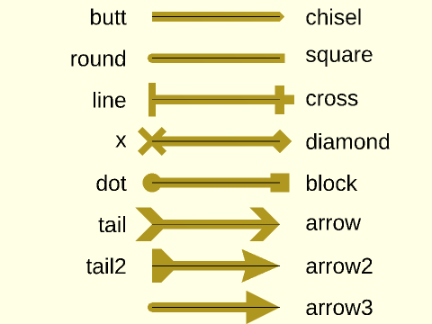

 

**Arguments:** 

<abbr title="These args can be used by position or by name.">By&nbsp;Position</abbr> | What it does
-------------------- | ------------
`path`               | The path to draw along.
`width`              | The width of the line to draw. If given as a list of widths (one for each path point), draws the line with varying thickness. Default: 1
`closed`             | If true, draw an additional line from the end of the path to the start. Default: true for regions, false for paths

<abbr title="These args must be used by name, ie: name=value">By&nbsp;Name</abbr> | What it does
-------------------- | ------------
`joints`             | Specifies the joint shape for each joint of the line. If a 2D polygon is given, use that to draw custom joints. Default: "round"
`endcaps`            | Specifies the endcap type for both ends of the line. If a 2D polygon is given, use that to draw custom endcaps. Default: "round"
`endcap1`            | Specifies the endcap type for the start of the line.  If a 2D polygon is given, use that to draw a custom endcap.
`endcap2`            | Specifies the endcap type for the end of the line.  If a 2D polygon is given, use that to draw a custom endcap.
`dots`               | Specifies both the endcap and joint types with one argument.  If given `true`, sets both to "dot".  If a 2D polygon is given, uses that to draw custom dots.
`joint_width`        | Some joint shapes are wider than the line.  This specifies the width of the shape, in multiples of the line width.
`endcap_width`       | Some endcap types are wider than the line.  This specifies the size of endcaps, in multiples of the line width.
`endcap_width1`      | This specifies the size of starting endcap, in multiples of the line width.
`endcap_width2`      | This specifies the size of ending endcap, in multiples of the line width.
`dots_width`         | This specifies the size of the joints and endcaps, in multiples of the line width.
`joint_length`       | Length of joint shape, in multiples of the line width.
`endcap_length`      | Length of endcaps, in multiples of the line width.
`endcap_length1`     | Length of starting endcap, in multiples of the line width.
`endcap_length2`     | Length of ending endcap, in multiples of the line width.
`dots_length`        | Length of both joints and endcaps, in multiples of the line width.
`joint_extent`       | Extents length of joint shape, in multiples of the line width.
`endcap_extent`      | Extents length of endcaps, in multiples of the line width.
`endcap_extent1`     | Extents length of starting endcap, in multiples of the line width.
`endcap_extent2`     | Extents length of ending endcap, in multiples of the line width.
`dots_extent`        | Extents length of both joints and endcaps, in multiples of the line width.
`joint_angle`        | Extra rotation given to joint shapes, in degrees.  If not given, the shapes are fully spun (for 3D lines).
`endcap_angle`       | Extra rotation given to endcaps, in degrees.  If not given, the endcaps are fully spun (for 3D lines).
`endcap_angle1`      | Extra rotation given to a starting endcap, in degrees.  If not given, the endcap is fully spun (for 3D lines).
`endcap_angle2`      | Extra rotation given to a ending endcap, in degrees.  If not given, the endcap is fully spun (for 3D lines).
`dots_angle`         | Extra rotation given to both joints and endcaps, in degrees.  If not given, the endcap is fully spun (for 3D lines).
`trim`               | Trim both ends, in multiples of appropriate line width, to avoid interference with custom endcaps.
`trim1`              | Trim the start, in multiples of starting line width, to avoid interference with a custom endcap.
`trim2`              | Trim the end, in multiples of ending line width, to avoid interference with a custom endcap.
`color`              | If given, sets the color of the line segments, joints and endcap.
`endcap_color`       | If given, sets the color of both endcaps.  Overrides `color=` and `dots_color=`.
`endcap_color1`      | If give, sets the color of the starting endcap.  Overrides `color=`, `dots_color=`,  and `endcap_color=`.
`endcap_color2`      | If given, sets the color of the ending endcap.  Overrides `color=`, `dots_color=`,  and `endcap_color=`.
`joint_color`        | If given, sets the color of the joints.  Overrides `color=` and `dots_color=`.
`dots_color`         | If given, sets the color of the endcaps and joints.  Overrides `color=`.
`singleton_scale`    | Change the scale of the endcap shape drawn for singleton paths.  Default: 2.
`convexity`          | Max number of times a line could intersect a wall of an endcap. Default: 10

**Example 1:** Drawing a Path

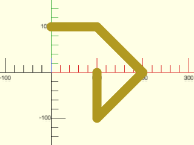

    include <BOSL2/std.scad>
    path = [[0,100], [100,100], [200,0], [100,-100], [100,0]];
    stroke(path, width=20);

  

**Example 2:** Closing a Path

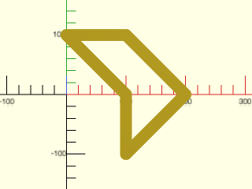

    include <BOSL2/std.scad>
    path = [[0,100], [100,100], [200,0], [100,-100], [100,0]];
    stroke(path, width=20, closed=true);

  

**Example 3:** Fancy Arrow Endcaps

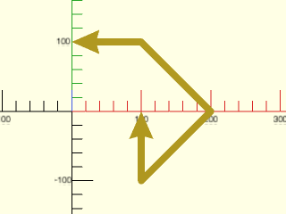

    include <BOSL2/std.scad>
    path = [[0,100], [100,100], [200,0], [100,-100], [100,0]];
    stroke(path, width=10, endcaps="arrow2");

  

**Example 4:** Modified Fancy Arrow Endcaps

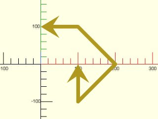

 

    include <BOSL2/std.scad>
    path = [[0,100], [100,100], [200,0], [100,-100], [100,0]];
    stroke(path, width=10, endcaps="arrow2", endcap_width=6, endcap_length=3, endcap_extent=2);

**Example 5:** Mixed Endcaps

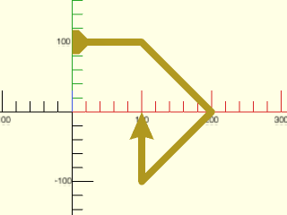

    include <BOSL2/std.scad>
    path = [[0,100], [100,100], [200,0], [100,-100], [100,0]];
    stroke(path, width=10, endcap1="tail2", endcap2="arrow2");

  

**Example 6:** Plotting Points.  Setting endcap\_angle to zero results in the weird arrow orientation.

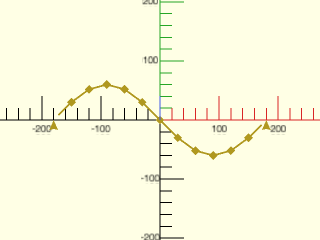

 

    include <BOSL2/std.scad>
    path = [for (a=[0:30:360]) [a-180, 60*sin(a)]];
    stroke(path, width=3, joints="diamond", endcaps="arrow2", endcap_angle=0, endcap_width=5, joint_angle=0, joint_width=5);

**Example 7:** Default joint gives curves along outside corners of the path:

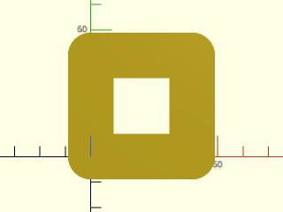

    include <BOSL2/std.scad>
    stroke([square(40)], width=18);

  

**Example 8:** Setting `joints="square"` gives flat outside corners

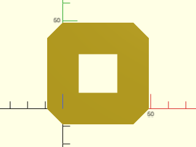

    include <BOSL2/std.scad>
    stroke([square(40)], width=18, joints="square");

  

**Example 9:** Setting `joints="butt"` does not draw any transitions, just rectangular strokes for each segment, meeting at their centers:

    include <BOSL2/std.scad>
    stroke([square(40)], width=18, joints="butt");

  

**Example 10:** Joints and Endcaps

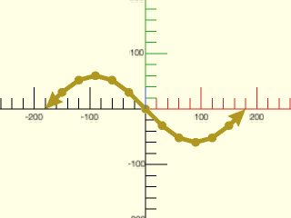

    include <BOSL2/std.scad>
    path = [for (a=[0:30:360]) [a-180, 60*sin(a)]];
    stroke(path, width=8, joints="dot", endcaps="arrow2");

  

**Example 11:** Custom Endcap Shapes

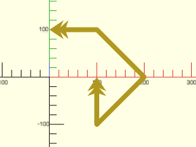

 

    include <BOSL2/std.scad>
    path = [[0,100], [100,100], [200,0], [100,-100], [100,0]];
    arrow = [[0,0], [2,-3], [0.5,-2.3], [2,-4], [0.5,-3.5], [-0.5,-3.5], [-2,-4], [-0.5,-2.3], [-2,-3]];
    stroke(path, width=10, trim=3.5, endcaps=arrow);

**Example 12:** Variable Line Width

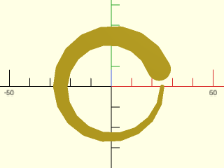

    include <BOSL2/std.scad>
    path = circle(d=50,$fn=18);
    widths = [for (i=idx(path)) 10*i/len(path)+2];
    stroke(path,width=widths,$fa=1,$fs=1);

  

**Example 13:** 3D Path with Endcaps

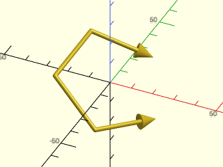

    include <BOSL2/std.scad>
    path = rot([15,30,0], p=path3d(pentagon(d=50)));
    stroke(path, width=2, endcaps="arrow2", $fn=18);

  

**Example 14:** 3D Path with Flat Endcaps

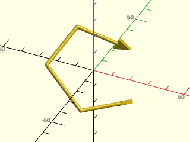

 

    include <BOSL2/std.scad>
    path = rot([15,30,0], p=path3d(pentagon(d=50)));
    stroke(path, width=2, endcaps="arrow2", endcap_angle=0, $fn=18);

**Example 15:** 3D Path with Mixed Endcaps

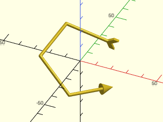

 

    include <BOSL2/std.scad>
    path = rot([15,30,0], p=path3d(pentagon(d=50)));
    stroke(path, width=2, endcap1="arrow2", endcap2="tail", endcap_angle2=0, $fn=18);

**Example 16:** 3D Path with Joints and Endcaps

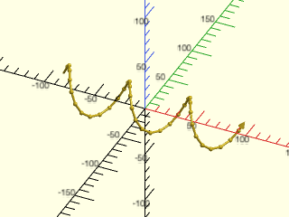

 

    include <BOSL2/std.scad>
    path = [for (i=[0:10:360]) [(i-180)/2,20*cos(3*i),20*sin(3*i)]];
    stroke(path, width=2, joints="dot", endcap1="round", endcap2="arrow2", joint_width=2.0, endcap_width2=3, $fn=18);

**Example 17:** Coloring Lines, Joints, and Endcaps

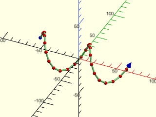

 

    include <BOSL2/std.scad>
    path = [for (i=[0:15:360]) [(i-180)/3,20*cos(2*i),20*sin(2*i)]];
    stroke(
        path, width=2, joints="dot", endcap1="dot", endcap2="arrow2",
        color="lightgreen", joint_color="red", endcap_color="blue",
        joint_width=2.0, endcap_width2=3, $fn=18
    );

**Example 18:** Simplified Plotting

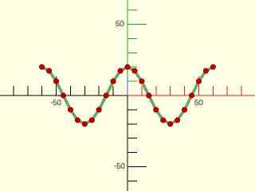

 

    include <BOSL2/std.scad>
    path = [for (i=[0:15:360]) [(i-180)/3,20*cos(2*i)]];
    stroke(path, width=2, dots=true, color="lightgreen", dots_color="red", $fn=18);

**Example 19:** Drawing a Region

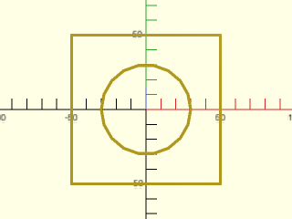

    include <BOSL2/std.scad>
    rgn = [square(100,center=true), circle(d=60,$fn=18)];
    stroke(rgn, width=2);

  

**Example 20:** Drawing a List of Lines

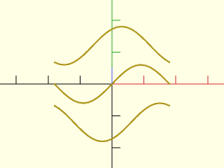

    include <BOSL2/std.scad>
    paths = [
        for (y=[-60:60:60]) [
            for (a=[-180:15:180])
            [a, 2*y+60*sin(a+y)]
        ]
    ];
    stroke(paths, closed=false, width=5);

  

**Example 21:** Paths with a singleton.  Note that the singleton is not a single point, but a list containing a single point.

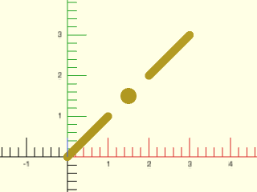

    include <BOSL2/std.scad>
    stroke([
            [[0,0],[1,1]],
            [[1.5,1.5]],
            [[2,2],[3,3]]
           ],width=0.2,closed=false,$fn=16);

  

---

### Function/Module: dashed\_stroke()

**Synopsis:** Draws a dashed line along a path or region boundary. [<abbr>Geom</abbr>] [<abbr>PathList</abbr>]

**Topics:** [Paths](Topics#paths), [Drawing Tools](Topics#drawing-tools)

**See Also:** [stroke()](#module-stroke), [path\_cut()](paths.scad#function-path_cut)

**Usage:** As a Module

- dashed_stroke(path, dashpat, [width=], [closed=]);

**Usage:** As a Function

- dashes = dashed_stroke(path, dashpat, [closed=]);

**Description:** 

Given a path (or region) and a dash pattern, creates a dashed line that follows that
path or region boundary with the given dash pattern.
- When called as a function, returns a list of dash sub-paths.
- When called as a module, draws all those subpaths using `stroke()`.

When called as a module the dash pattern is multiplied by the line width.  When called as
a function the dash pattern applies as you specify it.

**Arguments:** 

<abbr title="These args can be used by position or by name.">By&nbsp;Position</abbr> | What it does
-------------------- | ------------
`path`               | The path or region to subdivide into dashes.
`dashpat`            | Alternating dash and space lengths. The module scales these by width; the function uses them directly. Default: [3,3]

<abbr title="These args must be used by name, ie: name=value">By&nbsp;Name</abbr> | What it does
-------------------- | ------------
`width`              | The width of the dashed line to draw.  Module only.  Default: 1
`closed`             | If true, treat path as a closed polygon.  Default: false
`fit`                | If true, shrink or stretch the dash pattern so that the path ends after a complete dash.  Default: true
`roundcaps`          | (Module only) If true, draws dashes with rounded caps.  This often looks better.  Default: true
`mindash`            | (Function only) Specifies the minimal dash length to return at the end of a path when fit is false.  Default: 0.5

**Example 1:** Open Path

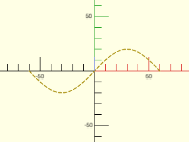

    include <BOSL2/std.scad>
    path = [for (a=[-180:10:180]) [a/3,20*sin(a)]];
    dashed_stroke(path, [3,2], width=1);

  

**Example 2:** Closed Polygon

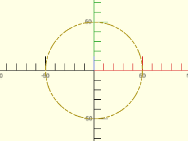

    include <BOSL2/std.scad>
    path = circle(d=100,$fn=72);
    dashpat = [10,2, 3,2, 3,2];
    dashed_stroke(path, dashpat, width=1, closed=true);

  

**Example 3:** 3D Dashed Path

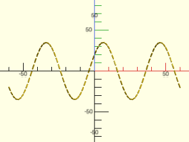

    include <BOSL2/std.scad>
    path = [for (a=[-180:5:180]) [a/3, 20*cos(3*a), 20*sin(3*a)]];
    dashed_stroke(path, [3,2], width=1);

  

---

## Section: Computing paths

### Function/Module: arc()

**Synopsis:** Draws a 2D pie-slice or returns 2D or 3D path forming an arc. [<abbr>Geom</abbr>] [<abbr>Path</abbr>]

**Topics:** [Paths (2D)](Topics#paths-2d), [Paths (3D)](Topics#paths-3d), [Shapes (2D)](Topics#shapes-2d), [Path Generators](Topics#path-generators), [Rounding](Topics#rounding)

**See Also:** [pie\_slice()](shapes3d.scad#functionmodule-pie_slice), [stroke()](#module-stroke), [ring()](shapes2d.scad#functionmodule-ring)

**Usage:** 2D arc from 0º to `angle` degrees.

- path=arc(n, r|d=, angle);

**Usage:** 2D arc from START to END degrees.

- path=arc(n, r|d=, angle=[START,END]);

**Usage:** 2D arc from `start` to `start+angle` degrees.

- path=arc(n, r|d=, start=, angle=);

**Usage:** 2D circle segment by `width` and `thickness`, starting and ending on the X axis.

- path=arc(n, width=, thickness=);

**Usage:** Shortest 2D or 3D arc around centerpoint `cp`, starting at P0 and ending on the vector pointing from `cp` to `P1`.

- path=arc(n, cp=, points=[P0,P1], [long=], [cw=], [ccw=]);

**Usage:** 2D or 3D arc, starting at `P0`, passing through `P1` and ending at `P2`.

- path=arc(n, points=[P0,P1,P2]);

**Usage:** 2D or 3D arc, fron tangent point on segment `[P0,P1]` to the tangent point on segment `[P1,P2]`.

- path=arc(n, corner=[P0,P1,P2], r=);

**Usage:** Create a wedge using any other arc parameters

- path=arc(wedge=true,[rounding=],...)

**Usage:** as module

- arc(...) [ATTACHMENTS];

**Description:** 

If called as a function, returns a 2D or 3D path forming an arc.  Numerous methods are available to specify the arc as listed in the Arguments section.
If called as a module, the arc must be 2D and the module creates the segment of the circle obtained by adding
the closing segment to the arc.
If `wedge` is true, the centerpoint of the arc appears as the first point in the result, which is now a sector of a circle.
The module produces the sector of the circle, or pie shape, bounded by the arc.

If `endpoint=false`, which is only accepted by the functional form, then the arc stops one step before the final point.
The `rounding` parameter, which is permitted only when `wedge=true`, applies specified radius roundings at each of the corners, with `rounding[0]` giving
the rounding at the center point, and then the other two the two outer corners in the direction that the arc travels.

If you give `n` for an arc without roundings then the curve of the arc will use `n` points.  If `endpoint=false` the arc still has `n` points, but
they are closer together.  When wedge is true the output has an extra point.  If you use rounding on a wedge then each rounding will have the specified
number of points, but note that the points of adjacent rounded areas overlap.  It may be easier to think that each curve in the output has n-1 facets.  With rounding,
the total number of points on a wedge will be $n + 1 + (n-1) k$ where $k$ is the number of roundings that are nonzero.
To get enough points on corner roundings you may need an `n` that is very large and produces more points than needed on the main curved portion of the arc.
Using `$fs` and `$fa` makes it possible to have differing numbers of points on the various roundings in your arc based on their radius and angle.

The module form with `wedge=false` must have 3 points on the arc to produce non-empty geometry.  If you specify `n=2` in this case it is an error.  If you use `$fn`, `$fa` and/or `$fs` to control the faceting the point count will be rounded up so that the output always has at least 3 points (2 facets).  The functional form does **not** round the point count up to 3, so this means that for small point counts, the module and function will produce different results.

**Arguments:** 

<abbr title="These args can be used by position or by name.">By&nbsp;Position</abbr> | What it does
-------------------- | ------------
`n`                  | Number of vertices to use in the arc.  If `wedge=true` you will get `n+1` points.
`r`                  | Radius of the arc.
`angle`              | If a scalar, specifies the end angle in degrees (relative to start parameter).  If a vector of two scalars, specifies start and end angles.

<abbr title="These args must be used by name, ie: name=value">By&nbsp;Name</abbr> | What it does
-------------------- | ------------
`d`                  | Diameter of the arc.
`cp`                 | Centerpoint of arc.
`points`             | Points on the arc.
`corner`             | A path of two segments to fit an arc tangent to.
`long`               | if given with cp and points takes the long arc instead of the default short arc.  Default: false
`cw`                 | if given with cp and 2 points takes the arc in the clockwise direction.  Default: false
`ccw`                | if given with cp and 2 points takes the arc in the counter-clockwise direction.  Default: false
`width`              | If given with `thickness`, arc starts and ends on X axis, to make a circle segment.
`thickness`          | If given with `width`, arc starts and ends on X axis, to make a circle segment.
`start`              | Start angle of arc.  Default: 0
`wedge`              | If true, include centerpoint `cp` in output to form pie slice shape.  Default: false
`endpoint`           | If false exclude the last point (function only).  Default: true
`rounding`           | Can set to a scalar or list of three rounding values to round the corners of an arc when wedge=true.  Default: 0
`anchor`             | Translate so anchor point is at origin (0,0,0).  See [anchor](attachments.scad#subsection-anchor).  (Module only) Default: `CENTER`
`spin`               | Rotate this many degrees around the Z axis after anchor.  See [spin](attachments.scad#subsection-spin).  (Module only) Default: `0`

**Example 1:** 

    include <BOSL2/std.scad>
    arc(n=4, r=30, angle=30, wedge=true);

  

**Example 2:** 

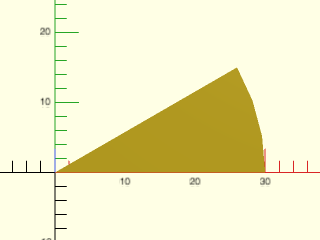

    include <BOSL2/std.scad>
    arc(r=30, angle=30, wedge=true);

  

**Example 3:** 

    include <BOSL2/std.scad>
    arc(d=60, angle=30, wedge=true);

  

**Example 4:** 

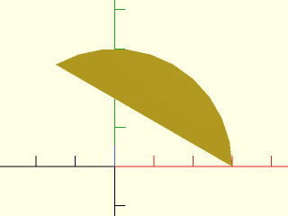

    include <BOSL2/std.scad>
    arc(d=60, angle=120);

  

**Example 5:** 

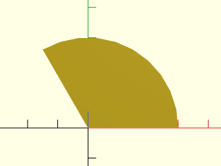

    include <BOSL2/std.scad>
    arc(d=60, angle=120, wedge=true);

  

**Example 6:** 

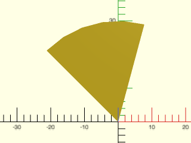

    include <BOSL2/std.scad>
    arc(r=30, angle=[75,135], wedge=true);

  

**Example 7:** 

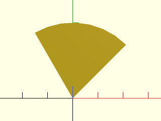

    include <BOSL2/std.scad>
    arc(r=30, start=45, angle=75, wedge=true);

  

**Example 8:** 

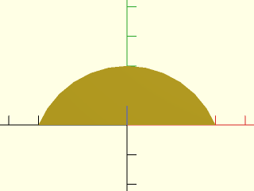

    include <BOSL2/std.scad>
    arc(width=60, thickness=20);

  

**Example 9:** 

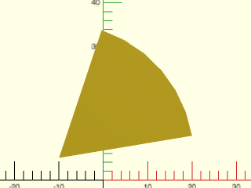

    include <BOSL2/std.scad>
    arc(cp=[-10,5], points=[[20,10],[0,35]], wedge=true);

  

**Example 10:** 

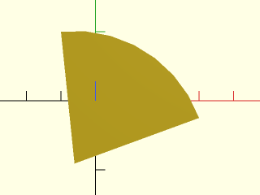

    include <BOSL2/std.scad>
    arc(points=[[30,-5],[20,10],[-10,20]], wedge=true);

  

**Example 11:** Fit to three points.

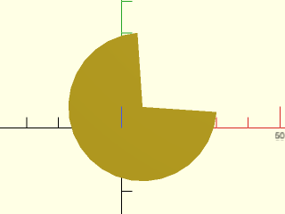

    include <BOSL2/std.scad>
    arc(points=[[5,30],[-10,-10],[30,5]], wedge=true);

  

**Example 12:** 

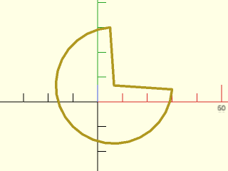

    include <BOSL2/std.scad>
    path = arc(points=[[5,30],[-10,-10],[30,5]], wedge=true);
    stroke(closed=true, path);

  

**Example 13:** 

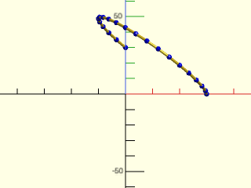

    include <BOSL2/std.scad>
    path = arc(points=[[0,30,0],[0,0,30],[30,0,0]]);
    stroke(path, dots=true, dots_color="blue");

  

**Example 14:** Fit to a corner.

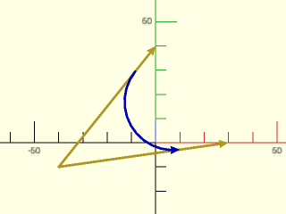

    include <BOSL2/std.scad>
    pts = [[0,40], [-40,-10], [30,0]];
    path = arc(corner=pts, r=20);
    stroke(pts, endcaps="arrow2");
    stroke(path, endcap2="arrow2", color="blue");

  

**Example 15:** Rounding the corners

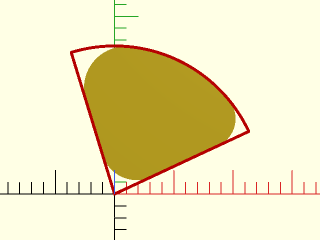

 

    include <BOSL2/std.scad>
    $fs=.5; $fa=1;
    arc(r=25, angle=[25,107], rounding=[6,5,7], wedge=true);
    stroke(arc(r=25, angle=[25,107], wedge=true), color="red",closed=true, width=.5);

**Example 16:** Negative roundings are permitted on the two outside corners, but not the center corner.

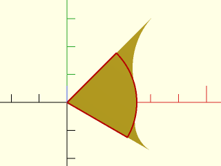

 

    include <BOSL2/std.scad>
    $fs=.5; $fa=1;
    arc(r=25, angle=[-30,45], rounding=[0,-12, -27], wedge=true);
    stroke(arc(r=25, angle=[-30,45], wedge=true), color="red",closed=true, width=.5);

---

### Function/Module: catenary()

**Synopsis:** Returns a 2D Catenary chain or arch path. [<abbr>Path</abbr>]

**Topics:** [Paths](Topics#paths)

**See Also:** [circle()](shapes2d.scad#functionmodule-circle), [stroke()](#module-stroke)

**Usage:** 

- path = catenary(width, droop=|angle=, [n=]);

**Usage:** As a module

- catenary(width, droop=|angle=, [n=], [anchor=], [spin=]) [ATTACHMENTS];

**Description:** 

Returns a 2D catenary path, which is the path a chain held at both ends will take.
The module draws the filled region bounded by this path and its closing segment.
The path will have the endpoints at `[±width/2, 0]`, and the middle of the path will droop
towards Y- if the given `droop=` or `angle=` is positive.  It will arch up towards Y+ if
`droop=` or `angle=` is negative.  You *must* specify one of `droop=` or `angle=`.

**Arguments:** 

<abbr title="These args can be used by position or by name.">By&nbsp;Position</abbr> | What it does
-------------------- | ------------
`width`              | The straight-line distance between the endpoints of the path.
`droop`              | If given, specifies the height difference between the endpoints and the hanging middle of the path.  If given a negative value, returns an arch *above* the Y axis.
`n`                  | The number of points to return in the path.  Default: 100

<abbr title="These args must be used by name, ie: name=value">By&nbsp;Name</abbr> | What it does
-------------------- | ------------
`angle`              | If given, specifies the angle that the path will droop by at the endpoints.  If given a negative value, returns an arch *above* the Y axis.
`anchor`             | Translate so anchor point is at origin (0,0,0).  See [anchor](attachments.scad#subsection-anchor).  (Module only) Default: `CENTER`
`spin`               | Rotate this many degrees around the Z axis after anchor.  See [spin](attachments.scad#subsection-spin).  (Module only) Default: `0`

**Example 1:** By Droop

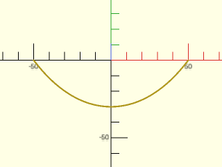

    include <BOSL2/std.scad>
    stroke(catenary(100, droop=30));

  

**Example 2:** By Angle

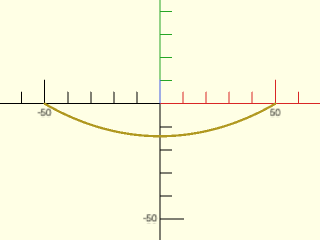

    include <BOSL2/std.scad>
    stroke(catenary(100, angle=30));

  

**Example 3:** Upwards Arch by Angle

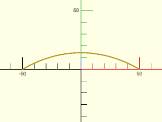

    include <BOSL2/std.scad>
    stroke(catenary(100, angle=-30));

  

**Example 4:** Upwards Arch by Height Delta

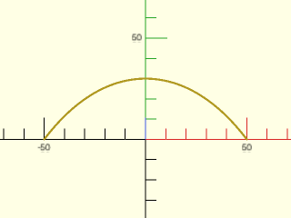

    include <BOSL2/std.scad>
    stroke(catenary(100, droop=-30));

  

**Example 5:** Specifying Vertex Count

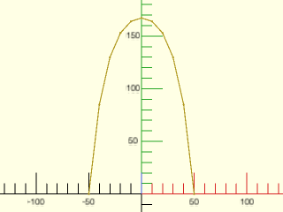

    include <BOSL2/std.scad>
    stroke(catenary(100, angle=-85, n=11), dots="dot");

  

**Example 6:** Sweeping a Catenary Path

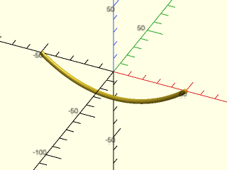

    include <BOSL2/std.scad>
    path = xrot(90, p=path3d(catenary(100, droop=20, n=41)));
    path_sweep(circle(r=1.5, $fn=24), path);

  

---

### Function: helix()

**Synopsis:** Creates a 3D helical path, including flat spirals. [<abbr>Path</abbr>]

**Topics:** [Path Generators](Topics#path-generators), [Paths](Topics#paths), [Drawing Tools](Topics#drawing-tools)

**See Also:** [pie\_slice()](shapes3d.scad#functionmodule-pie_slice), [stroke()](#module-stroke), [thread\_helix()](threading.scad#module-thread_helix), [path\_sweep()](skin.scad#functionmodule-path_sweep)

**Usage:** 

- path = helix(l|h, [turns=], [angle=], r=|r1=|r2=, d=|d1=|d2=);

**Description:** 

Returns a 3D helical path on a cone, including the degenerate case of flat spirals.
You can specify start and end radii.  You can give the length, the helix angle, or the number of turns: two
of these three parameters define the helix.  For a flat helix you must give length 0 and a turn count.
Helix will be right handed if turns is positive and left handed if it is negative.
The angle is calculated based on the radius at the base of the helix.

**Arguments:** 

<abbr title="These args can be used by position or by name.">By&nbsp;Position</abbr> | What it does
-------------------- | ------------
`h`                  / `l`                  | Height/length of helix, zero for a flat spiral

<abbr title="These args must be used by name, ie: name=value">By&nbsp;Name</abbr> | What it does
-------------------- | ------------
`turns`              | Number of turns in helix, positive for right handed
`angle`              | Helix angle at the starting radius. With length supplied, its sign relative to length determines handedness; the path still ends at the supplied length.
`r`                  | Radius of helix
`r1`                 | Radius of bottom of helix
`r2`                 | Radius of top of helix
`d`                  | Diameter of helix
`d1`                 | Diameter of bottom of helix
`d2`                 | Diameter of top of helix

**Example 1:** 

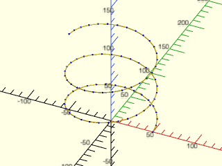

 

    include <BOSL2/std.scad>
    stroke(helix(turns=2.5, h=100, r=50), dots=true, dots_color="blue");

**Example 2:** Helix that turns the other way

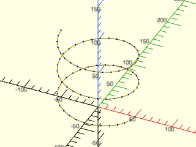

 

    include <BOSL2/std.scad>
    stroke(helix(turns=-2.5, h=100, r=50), dots=true, dots_color="blue");

**Example 3:** Flat helix (note points are still 3d)

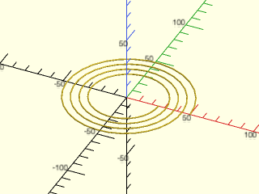

    include <BOSL2/std.scad>
    stroke(helix(h=0,r1=50,r2=25, turns=4));

  

---

### Function: turtle()

**Synopsis:** Uses [turtle graphics](https://en.wikipedia.org/wiki/Turtle\_graphics) to generate a 2D path. [<abbr>Path</abbr>]

**Topics:** [Shapes (2D)](Topics#shapes-2d), [Path Generators (2D)](Topics#path-generators-2d), [Mini-Language](Topics#mini-language)

**See Also:** [turtle3d()](turtle3d.scad#function-turtle3d), [stroke()](#module-stroke), [path\_sweep()](skin.scad#functionmodule-path_sweep)

**Usage:** 

- path = turtle(commands, [state], [full_state=], [repeat=])

**Description:** 

Use a sequence of [turtle graphics](https://en.wikipedia.org/wiki/Turtle_graphics) commands to generate a path.  The parameter `commands` is a list of
turtle commands and optional parameters for each command.  The turtle state has a position, movement direction,
movement distance, and default turn angle.  If you do not give `state` as input then the turtle starts at the
origin, pointed along the positive x axis with a movement distance of 1.  By default, `turtle` returns just
the computed turtle path.  If you set `full_state` to true then it instead returns the full turtle state.
You can invoke `turtle` again with this full state to continue the turtle path where you left off.

The turtle state is a list with four entries: the path constructed so far, the current step as a 2-vector, the current default angle,
and the current arcsteps setting.

Commands     | Arguments          | What it does
------------ | ------------------ | -------------------------------
"move"       | [dist]             | Move turtle scale*dist units in the turtle direction.  Default dist=1.
"xmove"      | [dist]             | Move turtle scale*dist units in the x direction. Default dist=1.  Does not change turtle direction.
"ymove"      | [dist]             | Move turtle scale*dist units in the y direction. Default dist=1.  Does not change turtle direction.
"xymove"     | vector             | Move turtle by the specified vector.  Does not change turtle direction.
"untilx"     | xtarget            | Move turtle in turtle direction until x==xtarget.  Produces an error if xtarget is not reachable.
"untily"     | ytarget            | Move turtle in turtle direction until y==ytarget.  Produces an error if ytarget is not reachable.
"jump"       | point              | Move the turtle to the specified point
"xjump"      | x                  | Move the turtle's x position to the specified value
"yjump"      | y                  | Move the turtle's y position to the specified value
"turn"       | [angle]            | Turn turtle direction by specified angle, or the turtle's default turn angle.  The default angle starts at 90.
"left"       | [angle]            | Same as "turn"
"right"      | [angle]            | Same as "turn", -angle
"angle"      | angle              | Set the default turn angle.
"setdir"     | dir                | Set turtle direction.  The parameter `dir` can be an angle or a vector. (A 3d vector with zero Z component is allowed.)
"length"     | length             | Change the turtle move distance to `length`
"scale"      | factor             | Multiply turtle move distance by `factor`
"addlength"  | length             | Add `length` to the turtle move distance
"repeat"     | count, commands    | Repeats a list of commands `count` times.
"arcleft"    | radius, [angle]    | Draw an arc from the current position toward the left at the specified radius and angle.  The turtle turns by `angle`.  A negative angle draws the arc to the right instead of the left, and leaves the turtle facing right.  A negative radius draws the arc to the right but leaves the turtle facing left.
"arcright"   | radius, [angle]    | Draw an arc from the current position toward the right at the specified radius and angle
"arcleftto"  | radius, angle      | Draw an arc at the given radius turning toward the left until reaching the specified absolute angle.
"arcrightto" | radius, angle      | Draw an arc at the given radius turning toward the right until reaching the specified absolute angle.
"arcsteps"   | count              | Specifies the number of segments to use for drawing arcs.  If you set it to zero then the standard `$fn`, `$fa` and `$fs` variables define the number of segments.

**Arguments:** 

<abbr title="These args can be used by position or by name.">By&nbsp;Position</abbr> | What it does
-------------------- | ------------
`commands`           | List of turtle commands
`state`              | Starting turtle state (from previous call) or starting point.  Default: start at the origin, pointing right.

<abbr title="These args must be used by name, ie: name=value">By&nbsp;Name</abbr> | What it does
-------------------- | ------------
`full_state`         | If true return the full turtle state for continuing the path in subsequent turtle calls.  Default: false
`repeat`             | Number of times to repeat the command list.  Default: 1

**Example 1:** Simple rectangle

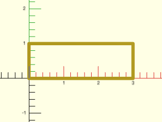

    include <BOSL2/std.scad>
    path = turtle(["xmove",3, "ymove", "xmove",-3, "ymove",-1]);
    stroke(path,width=.1);

  

**Example 2:** Pentagon

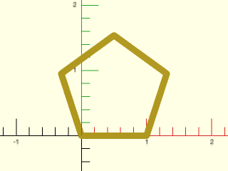

 

    include <BOSL2/std.scad>
    path=turtle(["angle",360/5,"move","turn","move","turn","move","turn","move"]);
    stroke(path,width=.1,closed=true);

**Example 3:** Pentagon using the repeat argument

    include <BOSL2/std.scad>
    path=turtle(["move","turn",360/5],repeat=5);
    stroke(path,width=.1,closed=true);

  

**Example 4:** Pentagon using the repeat turtle command, setting the turn angle

    include <BOSL2/std.scad>
    path=turtle(["angle",360/5,"repeat",5,["move","turn"]]);
    stroke(path,width=.1,closed=true);

  

**Example 5:** Pentagram

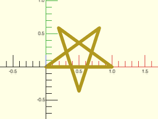

    include <BOSL2/std.scad>
    path = turtle(["move","left",144], repeat=4);
    stroke(path,width=.05,closed=true);

  

**Example 6:** Sawtooth path

    include <BOSL2/std.scad>
    path = turtle([
        "turn", 55,
        "untily", 2,
        "turn", -55-90,
        "untily", 0,
        "turn", 55+90,
        "untily", 2.5,
        "turn", -55-90,
        "untily", 0,
        "turn", 55+90,
        "untily", 3,
        "turn", -55-90,
        "untily", 0
    ]);
    stroke(path, width=.1);

  

**Example 7:** Simpler way to draw the sawtooth.  The direction of the turtle is preserved when executing "yjump".

    include <BOSL2/std.scad>
    path = turtle([
        "turn", 55,
        "untily", 2,
        "yjump", 0,
        "untily", 2.5,
        "yjump", 0,
        "untily", 3,
        "yjump", 0,
    ]);
    stroke(path, width=.1);

  

**Example 8:** square spiral

 

    include <BOSL2/std.scad>
    path = turtle(["move","left","addlength",1],repeat=50);
    stroke(path,width=.2);

**Example 9:** pentagonal spiral

 

    include <BOSL2/std.scad>
    path = turtle(["move","left",360/5,"addlength",1],repeat=50);
    stroke(path,width=.7);

**Example 10:** yet another spiral, without using `repeat`

 

    include <BOSL2/std.scad>
    path = turtle(concat(["angle",71],flatten(repeat(["move","left","addlength",1],50))));
    stroke(path,width=.7);

**Example 11:** The previous spiral grows linearly and eventually intersects itself.  This one grows geometrically and does not.

 

    include <BOSL2/std.scad>
    path = turtle(["move","left",71,"scale",1.05],repeat=50);
    stroke(path,width=.15);

**Example 12:** Koch Snowflake

 

    include <BOSL2/std.scad>
    function koch_unit(depth) =
        depth==0 ? ["move"] :
        concat(
            koch_unit(depth-1),
            ["right"],
            koch_unit(depth-1),
            ["left","left"],
            koch_unit(depth-1),
            ["right"],
            koch_unit(depth-1)
        );
    koch=concat(["angle",60,"repeat",3],[concat(koch_unit(3),["left","left"])]);
    polygon(turtle(koch));

**Example 13:** Here we use `full_state=true` to create the turtle path using two calls to `turtle()`.  We extract the partial path from the state data to display that partial path with a dashed line.

    include <BOSL2/std.scad>
    state = turtle(["move", 10, "arcright", 40], full_state=true);
    final = turtle(["move", 13, "arcleft", 33], state=state);
    stroke(final,width=2);
    color("black")dashed_stroke(state[0],width=2);

  

---

## Section: Debugging polygons

### Module: debug\_polygon()

**Synopsis:** Draws an annotated polygon. [<abbr>Geom</abbr>]

**Topics:** [Shapes (2D)](Topics#shapes-2d), [Debugging](Topics#debugging)

**See Also:** [debug\_region()](regions.scad#module-debug_region), [debug\_vnf()](vnf.scad#module-debug_vnf), [debug\_bezier()](beziers.scad#module-debug_bezier)

**Usage:** 

- debug_polygon(points, [paths], [vertices=], [edges=], [convexity=], [size=]);

**Description:** 

A drop-in replacement for `polygon()` that renders and labels the path points and
edges.  The start of each path is marked with a blue circle and the end with a pink diamond.
You can suppress the display of vertex or edge labeling using the `vertices` and `edges` arguments.

**Arguments:** 

<abbr title="These args can be used by position or by name.">By&nbsp;Position</abbr> | What it does
-------------------- | ------------
`points`             | The array of 2D polygon vertices.
`paths`              | The path connections between the vertices.

<abbr title="These args must be used by name, ie: name=value">By&nbsp;Name</abbr> | What it does
-------------------- | ------------
`vertices`           | if true display vertex labels and start/end markers.  Default: true
`edges`              | if true display edge labels.  Default: true
`convexity`          | The max number of walls a ray can pass through the given polygon paths. Default: 2
`size`               | The base size of the line and labels. Default: 1

**Example 1:** 

 

    include <BOSL2/std.scad>
    debug_polygon(
        points=concat(
            regular_ngon(or=10, n=8),
            regular_ngon(or=8, n=8)
        ),
        paths=[
            [for (i=[0:7]) i],
            [for (i=[15:-1:8]) i]
        ]
    );

---

