# LibFile: gears.scad

Spur Gears, Bevel Gears, Racks, Worms and Worm Gears.
Inspired by code by Leemon Baird, 2011, Leemon@Leemon.com

To use, add the following lines to the beginning of your file:

    include <BOSL2/std.scad>
    include <BOSL2/gears.scad>

## File Contents

1. [Section: Quick Introduction to Gears](#section-quick-introduction-to-gears)
    1. [Subsection: Involute Spur Gears](#subsection-involute-spur-gears)
    2. [Subsection: Corrected Gears and Profile Shifting](#subsection-corrected-gears-and-profile-shifting)
    3. [Subsection: Helical Gears](#subsection-helical-gears)
    4. [Subsection: Herringbone Gears](#subsection-herringbone-gears)
    5. [Subsection: Ring Gears (Internal Gears)](#subsection-ring-gears-internal-gears)
    6. [Subsection: Worm Drive](#subsection-worm-drive)
    7. [Subsection: Bevel Gears](#subsection-bevel-gears)
    8. [Subsection: Crown Gears (Face Gears)](#subsection-crown-gears-face-gears)
    

2. [Section: Backlash (Fitting Real Gears Together)](#section-backlash-fitting-real-gears-together)

3. [Section: Gears](#section-gears)
    - [`spur_gear()`](#functionmodule-spur_gear) – Creates a spur gear, helical gear, or internal ring gear. [<abbr>Geom</abbr>] [<abbr>VNF</abbr>]
    - [`spur_gear2d()`](#functionmodule-spur_gear2d) – Creates a 2D spur gear or internal ring gear. [<abbr>Geom</abbr>] [<abbr>Region</abbr>]
    - [`ring_gear()`](#module-ring_gear) – Creates a 3D ring gear. [<abbr>Geom</abbr>]
    - [`ring_gear2d()`](#module-ring_gear2d) – Creates a 2D ring gear. [<abbr>Geom</abbr>]
    - [`rack()`](#functionmodule-rack) – Creates a straight or helical gear rack. [<abbr>Geom</abbr>] [<abbr>VNF</abbr>]
    - [`rack2d()`](#functionmodule-rack2d) – Creates a 2D gear rack. [<abbr>Geom</abbr>] [<abbr>Path</abbr>]
    - [`crown_gear()`](#functionmodule-crown_gear) – Creates a crown gear that can mesh with a spur gear. [<abbr>Geom</abbr>] [<abbr>VNF</abbr>]
    - [`bevel_gear()`](#functionmodule-bevel_gear) – Creates a straight, zerol, or spiral bevel gear. [<abbr>Geom</abbr>] [<abbr>VNF</abbr>]
    - [`worm()`](#functionmodule-worm) – Creates a worm that will mate with a worm gear. [<abbr>Geom</abbr>] [<abbr>VNF</abbr>]
    - [`enveloping_worm()`](#functionmodule-enveloping_worm) – Creates a double-enveloping worm that will mate with a worm gear. [<abbr>Geom</abbr>] [<abbr>VNF</abbr>]
    - [`worm_gear()`](#functionmodule-worm_gear) – Creates a worm gear that will mate with a worm. [<abbr>Geom</abbr>] [<abbr>VNF</abbr>]

4. [Section: Gear Assemblies](#section-gear-assemblies)
    - [`planetary_gears()`](#function-planetary_gears) – Calculate teeth counts and angles for planetary gear assembly with specified ratio.

5. [Section: Computing Gear Dimensions](#section-computing-gear-dimensions)
    - [`circular_pitch()`](#function-circular_pitch) – Returns tooth density expressed as "circular pitch".
    - [`diametral_pitch()`](#function-diametral_pitch) – Returns tooth density expressed as "diametral pitch".
    - [`module_value()`](#function-module_value) – Returns tooth density expressed as "module"
    - [`pitch_radius()`](#function-pitch_radius) – Returns the pitch radius for a gear.
    - [`outer_radius()`](#function-outer_radius) – Returns the outer radius for a gear.
    - [`root_radius()`](#function-root_radius) – Returns the radius of the roots of the teeth
    - [`bevel_pitch_angle()`](#function-bevel_pitch_angle) – Returns the pitch cone angle for a bevel gear.
    - [`worm_gear_thickness()`](#function-worm_gear_thickness) – Returns the thickness for a worm gear.
    - [`worm_dist()`](#function-worm_dist) – Returns the distance between a worm and a worm gear
    - [`gear_dist()`](#function-gear_dist) – Returns the distance between two gear centers for spur gears or parallel axis helical gears.
    - [`gear_dist_skew()`](#function-gear_dist_skew) – Returns the distance between two helical gear centers with skew axes.
    - [`gear_skew_angle()`](#function-gear_skew_angle) – Returns corrected skew angle between two profile shifted helical gears.
    - [`get_profile_shift()`](#function-get_profile_shift) – Returns total profile shift needed to achieve a desired spacing between two gears
    - [`auto_profile_shift()`](#function-auto_profile_shift) – Returns the recommended profile shift for a gear.
    - [`gear_shorten()`](#function-gear_shorten) – Returns the tip shortening parameter for profile shifted parallel axis gears.
    - [`gear_shorten_skew()`](#function-gear_shorten_skew) – Returns the tip shortening parameter for profile shifted skew axis helical gears.

## Section: Quick Introduction to Gears

This section gives a quick overview of gears with a focus on the information you need
to know to understand the gear parameters and create some gears.  The topic of gears is very complex and highly technical and
this section provides the minimal information needed for gear making.  If you want more information about the
details of gears, consult the references below, which are the ones that we consulted when writing the library code.
- Tec Science
    * [Involute Gears](https://www.tec-science.com/mechanical-power-transmission/involute-gear/geometry-of-involute-gears/)
    * [Gear engagement](https://www.tec-science.com/mechanical-power-transmission/involute-gear/meshing-line-action-contact-pitch-circle-law/)
    * [Gears meshing with racks](https://www.tec-science.com/mechanical-power-transmission/involute-gear/rack-meshing/)
    * [Gear undercutting](https://www.tec-science.com/mechanical-power-transmission/involute-gear/undercut/)
    * [Profile shifting](https://www.tec-science.com/mechanical-power-transmission/involute-gear/profile-shift/)
    * [Detailed gear calculations](https://www.tec-science.com/mechanical-power-transmission/involute-gear/calculation-of-involute-gears/)
    * [Worm drive](https://www.tec-science.com/mechanical-power-transmission/gear-types/worms-and-worm-gears/)
    * [Bevel gears](https://www.tec-science.com/mechanical-power-transmission/gear-types/bevel-gears/)
- SDPSI (A long document covering a variety of gear types and gear calculations)
    * [Elements of Gear Technology](https://www.sdp-si.com/resources/elements-of-metric-gear-technology/index.php)
- Drivetrain Hub (A collection of "notebooks" on some gear topics)
    * [Gear Geometry, Strength, Tooling and Mechanics](https://drivetrainhub.com/notebooks/#toc)
- Crown Face Gears
    * [Crown Gearboxes](https://mag.ebmpapst.com/en/industries/drives/crown-gearboxes-efficiency-energy-savings-decentralized-drive-technology_14834/)
    * [Crown gear pressure angle](https://mag.ebmpapst.com/en/industries/drives/the-formula-for-the-pressure-angle_14624/)
    * [Face Gears: Geometry and Strength](https://www.geartechnology.com/ext/resources/issues/0107x/kissling.pdf)

## Subsection: Involute Spur Gears

**Figure 1.1.1:** Involute Spur Gear

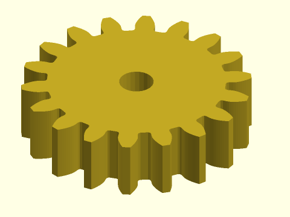

 

The term "involute" refers to the shape of the teeth:  the curves of the teeth are involutes of circles,
which are curves that optimize gear performance.

**Figure 1.1.2:** The three marked circles are key references on gear teeth.  The pitch circle, which is roughly in the middle of the teeth, is the reference used to define the pitch of teeth on the gear.  The pressure angle is the angle the tooth makes with the pitch circle.  In this example, the pressure angle is 20 degrees as shown by the red lines.

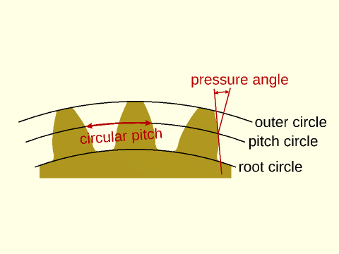

 

The size of the teeth can be specified as the *circular pitch*, which is the tooth width, or more precisely,
the distance along the pitch circle from the start of one tooth to the start of the text tooth.
The circular pitch can be computed as
`PI*d/teeth` where `d` is the diameter of the pitch circle and `teeth` is the number of teeth on the gear.
This simply divides up the pitch circle into the specified number of teeth.  However, the customary
way to specify metric gears is using the module, ratio of the diameter of the gear to the number of teeth: `m=d/teeth`.
The module is hence the circular pitch divided by a factor of π.  A third way to specify gear sizes is the diametral pitch,
which is the number of teeth that fit on a gear with a diameter of one inch, or π times the number of teeth per inch.
Note that for the module or circular pitch, larger values make larger teeth,
but for the diametral pitch, the opposite is true.  Throughout this library, module and circular pitch
are specified basic OpenSCAD units, so if you work in millimeters and want to give circular pitch in inches, be
sure to multiply by `INCH`.  The diametral pitch is given based on inches under the assumption that OpenSCAD units are millimeters.

You cannot directly specify the size of a gear.  The diameter of a gear depends on its tooth count
and tooth size.  If you want a gear with a particular diameter you can get close by seeting the module to `d/teeth`,
but that specifies the pitch circle, so the gear teeth will have a somewhat larger radius.  You should **not**
apply scale() to gears.  Always change their size by adjusting the tooth size parameters.

Basic gears as shown above will mesh when their pitch circles are tangent.
The critical requirements for two gears to mesh are that
- The teeth are the same size
- The pressure angles are identical

Increasing pressure angle makes the tooth stronger, increases power transmission, and can reduce tooth interference for
gears with a small number of teeth, but it also increases gear wear and meshing noise.  Higher pressure angles also
increase the force that tries to push the gears apart, and hence the load on the gear axles.  The current standard pressure
angle is 20 degrees.  It replaces an old 14.5 degree standard.

**Figure 1.1.3:** Teeth of the same size with different pressure angles.  The industry standard is 20°.

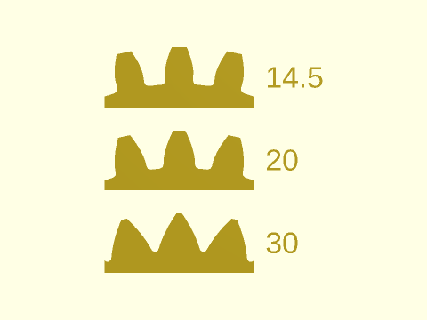

 

In order for the gear teeth to fit together, and to allow space for lubricant, the valleys of the teeth
are made deeper by the `clearance` distance.  This defaults to `module/4`.

**Figure 1.1.4:** The clearance is extra space at the tooth valley that separates the tooth tip (in green) from the tooth valley below it.

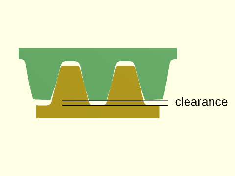

 

If the clearance is too large it can lead to a self-intersecting gear profile.  When this occurs, you
will see a message indicating that the profile was clipped, and what the required clearance is to
avoid the clipping.  This can be a starting point for adjusting the clipping.  Typical gear pressure angles,
as noted above, are 14.5, 20, or sometimes 25 degrees, but in some cases, larger pressure angles
may be useful.  These large pressure angles can give rise to self-intersecting gear geometry even
with a zero clearance.  To get a valid model, such gears need a **negative** clearance value.

**Figure 1.1.5:** This gear has a 55 degree pressure angle. If you don't specify clearance, the message tells you it clipped at -2.2.  Here we have used -2.3 to avoid a sharp corner in the valleys between teeth.

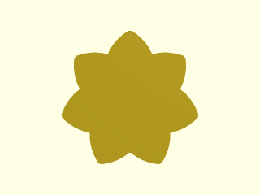

 

Another clearance requirement can present a serious problem when the number of teeth is low.  As the gear rotates, the
teeth may interfere with each other.  This may require undercutting the gear teeth to create space, which weakens the teeth.
Is is best to avoid gears with very small numbers of teeth when possible.

**Figure 1.1.6:** The green gear with only five teeth has a severe undercut, which weakens its teeth.  This undercut is necessary to avoid interference with the teeth from the other gear during rotation.  Note that the yellow rack tooth is deep into the undercut space.

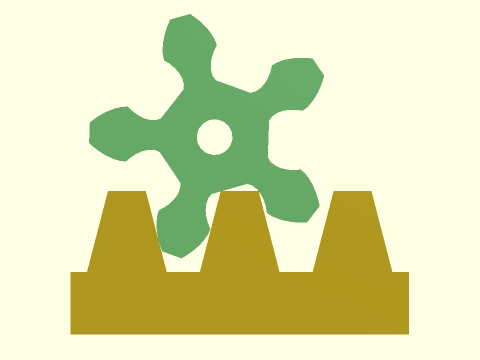

 

## Subsection: Corrected Gears and Profile Shifting

A solution to the problem of undercutting is to use profile shifting.  Profile shifting uses a different portion of the
involute curve to form the gear teeth, and this adjustment to the tooth form can eliminate undercutting, while
still allowing the gear to mesh with unmodified gears.  Profile shifting
changes the diameter at which the gear meshes so it no longer meshes at the pitch circle.
A profile shift of `x`
will increase the mesh distance by approximately `x*m` where `m` is the gear module.  The exact adjustment,
which you compute with [`gear_dist()`](#function-gear_dist), is a complex calculation that depends on the profile shifts of both meshing gears.  This means that profile shifting
can also be used to fine tune the spacing between gears.  When the gear has many teeth a negative profile shift may
be able to bring the gears slightly closer together, while still avoiding undercutting.
Profile shifting also changes the effective pressure angle of the gear engagement.

**Figure 1.2.1:** The green gear is a 7 tooth gear without profile shifting.  Its teeth are narrow and weak at their base.  In yellow is the same gear, profile shifted.  It has much stronger teeth.  The profile shifted gear also has a larger root circle radius and longer teeth.

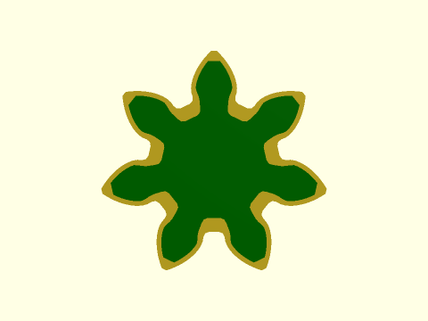

 

The minimum number of teeth to avoid undercutting is 17 for a pressure angle of 20, but it is 32 for a pressure
angle of 14.5 degrees.  It can be computed as `2/(sin(alpha))^2` where `alpha` is the pressure angle.
By default, the gear modules produce corrected gears.  You can override this by specifying the profile shift
yourself.  A small undercut may be acceptable, for example: a rule of thumb indicates that gears as small as 14
teeth are OK with a 20 degree pressure angle, because the undercut is too small to weaken the teeth significantly.

**Figure 1.2.2:** Basic five tooth gear form on the left.  Corrected gear with profile shifting on the right.  The profile shifted teeth lack the weak undercut section.  The axis of the corrected gear is shifted away from the mating rack.

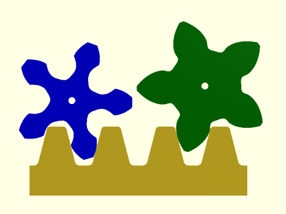

 

Profile shifting brings with it another complication: in order to maintain the specified clearance, the tips of the
gear teeth need to be shortened.  The shortening factor depends on characteristics of both gears, so it cannot
be automatically incorporated.  (Consider the situation where one gear mates with multiple other gears.)  With modest
profile shifts, you can probably ignore this adjustment, but with more extreme profile shifts, it may be important.
You can compute the shortening parameter using [`gear_shorten()`](#function-gear_shorten).  The actual shortening distance is obtained
by scaling the shortening factor by the gear's module.

**Figure 1.2.3:** With large profile shifts the teeth need to be shortened or they don't have clearance in the valleys of the teeth in the meshing gear.

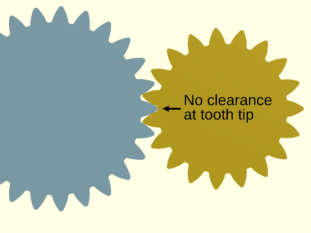

 

**Figure 1.2.4:** Applying the correct shortening factor restores the clearance to its set value.

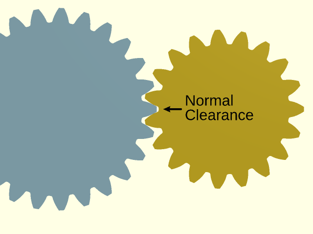

 

## Subsection: Helical Gears

Helicals gears are a modification of spur gears.  They can replace spur gears in any application.  The teeth are cut
following a slanted, helical path.  The angled teeth engage more gradually than spur gear teeth, so they run more smoothly
and quietly.  A disadvantage of helical gears is that they have thrust along the axis of the gear that must be
accomodated.  Helical gears also have more sliding friction between the meshing teeth compared to spur gears.

**Figure 1.3.1:** A Helical Gear

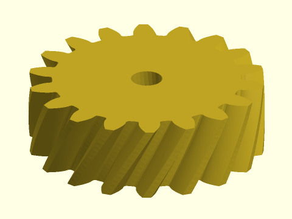

 

Helical gears have the same compatibility requirements as spur gears, with the additional requirement that
the helical angles must be opposite each other, so a gear with a helical angle of 35 must mesh with one
that has an angle of −35.  The industry convention refers to these as left-handed and right handed.  In
this library, positive helical angles produce a left handed gear and negative angles produce a right handed gear.

**Figure 1.3.2:** Left and right handed helical gears at 35 degrees.

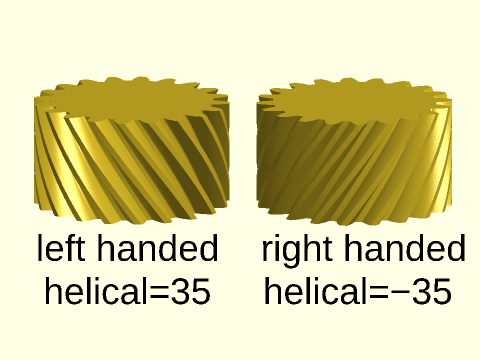

 

The pitch circle of a helical gear is larger compared to a spur gear
by the cosine of the helical angle, so you cannot simply drop helical gears in to replace spur gears without
making other adjustments.  This dependence does allow you to make
make much bigger spacing adjustments than are possible with profile shifting—without changing the tooth count.
The [`gear_dist()`](#function-gear_dist) function will also compute the appropriate gear spacing for helical gears.
The effective pressure angle of helical gears is larger than the nominal pressure angle.  This can make it possible
to avoid undercutting without having to use profile shifting, so smaller tooth count gears can be more effective
using the helical form.

**Figure 1.3.3:** Meshing compatible helical gears

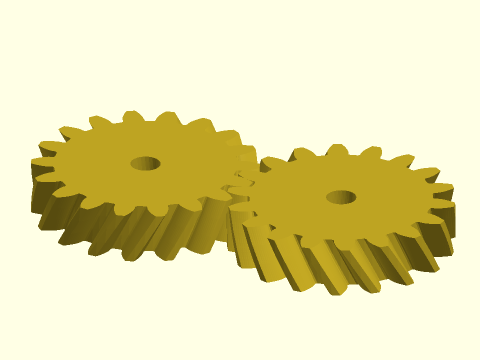

 

Helical gears can mesh in a second manner that is different from spur gears: they can turn on skew, or crossed axes.  These are also
sometimes called "screw gears".  The general requirement for two non-profile-shifted helical gears to mesh is that the angle
between the gears' axes must equal the sum of the helical angles of the two gears, thus for parallel axes, the helical
angles must sum to zero.  If helical gears are profile shifted, then in addition to adjusting the distance between the
gears, a small adjustment in the angle is needed, so profile shifted gears won't mesh exactly at the sum of their angles.
The calculation for gear spacing is different for skew axis gears than for parallel gears, so you do this using [`gear_dist_skew()`](#function-gear_dist_skew),
and if you use profile shifting, then you can compute the angle using [`gear_skew_angle()`](#function-gear_skew_angle).

**Figure 1.3.4:** Two helical gears meshing with axes at a 45 degree angle

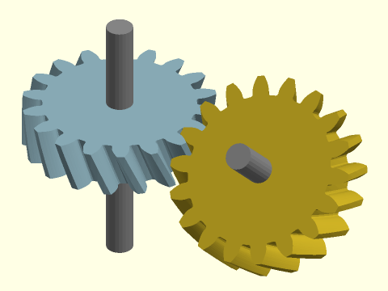

 

## Subsection: Herringbone Gears

The herringbone gear is made from two stacked helical gears with opposite angles.  This design addresses the problem
of axial forces that afflict helical gears by having one section that slopes to the
right and another that slopes to the left.  Herringbone gears also have the advantage of being self-aligning.

**Figure 1.4.1:** A herringbone gear

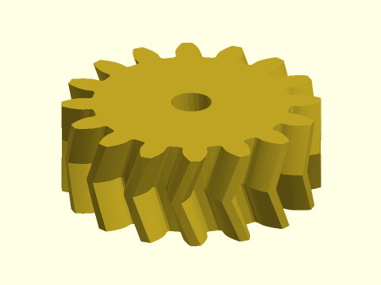

 

## Subsection: Ring Gears (Internal Gears)

A ring gear (or internal gear) is a gear where the teeth are on the inside of a circle.  Such gears must be mated
to a regular (external) gear, which rotates around the inside.

**Figure 1.5.1:** A interior or ring gear (yellow) with a mating spur gear (blue)

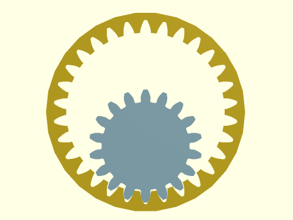

 

Ring gears are subject to all the usual mesh requirements: the teeth must be the same size, the pressure angles must
match and they must have opposite helical angles.  The [`gear_dist()`](#function-gear_dist) function can give the center separation of
a ring gear and its mating spur gear.  Ring gears have additional complications that tend to arise when the number of
teeth is small or the teeth counts of the ring gear and spur gear are too close together.  The mating spur gear must
have few enough teeth so that the teeth don't interfere on the other side of the ring.  Very small spur gears can interfere
on the tips of the ring gear's teeth.

**Figure 1.5.2:** The red regions show interference between the two gears: the 18 tooth spur gear does not fit inside the 20 tooth ring gear.

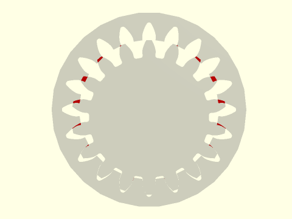

 

**Figure 1.5.3:** Interference at teeth tips, shown in red, with a 5 tooth and 19 tooth gear.

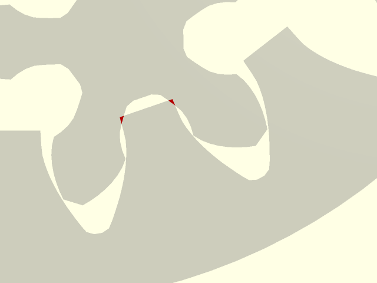

 

The tooth tip interference can often be controlled using profile shifting of the ring gear, but another requirement is
that the profile shift of the ring gear must be at least as big as the profile shift of the mated spur gear.  In order
to ensure that this condition holds, you may need to use [`auto_profile_shift()`](#function-auto_profile_shift) to find the profile shift that is
automatically applied to the spur gear you want to use.

**Figure 1.5.4:** Ring gear without profile shifting doesn't have room for the fat profile shifted teeth of the 5-tooth spur gear, with overlaps shown in red.

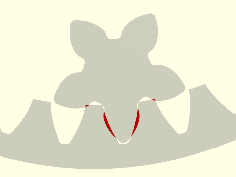

 

**Figure 1.5.5:** When the ring gear is profile shifted to match the spur gear, then the gears mesh without interference.

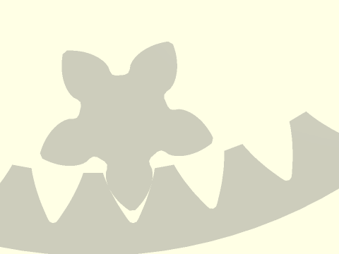

 

**Figure 1.5.6:** A helical ring gear (yellow) mating with the compatible spur gear (blue)

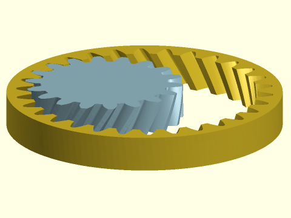

 

## Subsection: Worm Drive

A worm drive is a gear system for connecting skew shafts at 90 degrees.  They offer higher load capacity compared to
crossed helical gears.  The assembly is driven by the "worm", which is a gear that resembles a screw.
Like a screw, it can have one, or several starts.  These starts correspond to teeth on a helical gear;
in fact, the worm can be regarded as a type of helical gear at a very extreme angle, where the teeth wrap
around the gear.  The worm mates with the "worm gear" which is also called the "worm wheel".  The worm gear
resembles a helical gear at a very slight angle.

**Figure 1.6.1:** Worm drive assembly, with worm on the left and worm gear (worm wheel) on the right.  When the worm turns, its screwing action drives the worm gear.

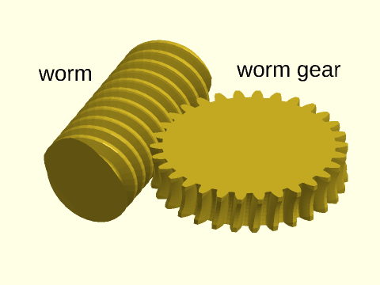

 

A close look at the worm gear reveals that it differs significantly from a helical or spur gear.
This gear is an "enveloping" gear, which is designed to follow the curved profile of the worm,
resulting in much better contact between the teeth of the worm and the teeth of the worm gear.
The worm shown above is a cylindrical worm, which is the most common type.
It is possible to design the worm to follow the curved shape of its mated gear, resulting
in an enveloping (also called "globoid") worm.  This type of worm makes better contact with
the worm gear, but is less often used due to manufacturing complexity and consequent expense.

**Figure 1.6.2:** The enveloping (globoid) worm appears on the left in green.  Its sides curve so several teeth can mate with the worm gear, and it requires a complex tooth form.  A cylindrical worm appears on the right in blue.  Note its straight sides.

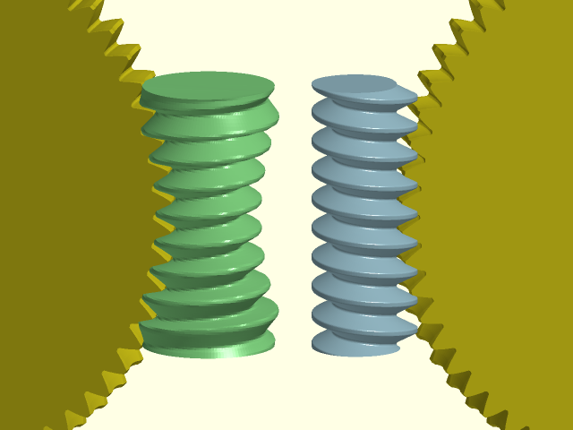

 

As usual, a proper mesh requires that the pressure angles match and the teeth of the worm and worm gear
are the same size.  Additionally the worm gear must be constructed to match the diameter of the worm
and the number of starts on the worm.  Note that the number of starts changes the angle at of the
teeth on the worm, and hence requires a change to the angle of teeth on the worm gear.
Of course an enveloping worm needs to know the diameter of the worm gear; you provide this
information indirectly by giving the number of teeth on the worm gear.
The [`worm_dist()`](#function-worm_dist) function will give the correct center spacing for the worm from its mating worm gear.

Worm drives are often "self-locking", which means that torque transmission can occur only from the worm to the worm gear,
so they must be driven by the worm.  Self-locking results from the small lead angle of the worm threads, which produces
high frictional forces at contact.  A multi-start worm has a higher lead angle and as a result is less likely
to be self-locking, so a multi-start worm can be chosen to avoid self-locking.
Since self-locking is associated with friction, self-locking drives have lower efficiency,
usually less than 50%.  Worm drive efficiency can exceed 90% if self-locking is not required.  One consideration
with self-locking systems is that if the worm gear moves a large mass and the drive is suddenly shut off, the
worm gear is still trying to move due to inertia, which can create large loads that fracture the worm.
In such cases, the worm cannot be stopped abruptly but must be allowed to rotate a little further (called "over travel")
after switching off the drive.

## Subsection: Bevel Gears

Bevel gearing is another way of dealing with intersecting gear shafts.  For bevel gears, the teeth centers lie on
the surface of an imaginary cone, which is the "pitch cone" of the bevel gear.  Two bevel gears can mesh when their pitch cone
apexes coincide and the cones touch along their length.  The teeth of bevel gears shrink as they get closer to the center of the gear.
Tooth dimensions and pitch diameter (the base of the pitch cone) are referenced to the outer end of the teeth.
The pitch radius, computed the same was as for other gears, gives the radius of the pitch cone's base.
Bevel gears can be made with straight teeth, analogous to spur gears, and with the
same disadvantage of sudden full contact that is noisy.  Spiral teeth are analogous to helical
teeth on cylindrical gears: the teeth engage gradually and smoothly, transmitting motion more smoothly
and quietly.  Also like helical gears, they have the disadvantage of introducing axial forces, and
usually they can only operate in one rotation direction.
A third type of tooth is the zerol tooth, which has curved teeth like the spiral teeth,
but with a zero angle.  These share advantages of straight teeth and spiral teeth: they are quiet like
straight teeth but they lack the axial thrust of spiral gears, and they can operate in both directions.
They are also reportedly stronger than either spiral or bevel gears.

**Figure 1.7.1:** Straight tooth bevel gear with 45 degree angled teeth.  To get a gear like this you must specify a spiral angle of zero and a cutter radius of zero.  This gear would mate with a copy of itself and would change direction of rotation without changing the rotation rate.

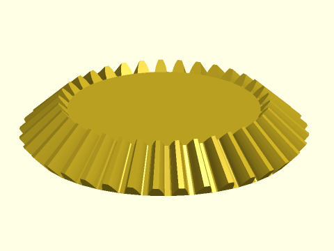

 

**Figure 1.7.2:** Straight tooth bevel gear with 45 degree angled teeth.  A gear like this has a positive spiral angle, which determines how sloped the teeth are and a positive cutter radius, which determines how curved the teeth are.

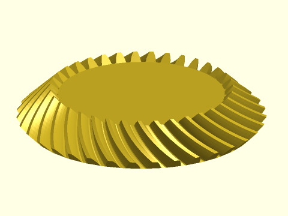

 

**Figure 1.7.3:** Zerol tooth bevel gear with 45 degree angled teeth.  A gear like this has a spiral angle of zero, but a positive cutter radius, which determines how curved the teeth are.

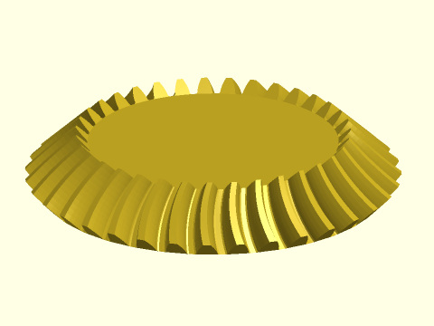

 

Bevel gears have demanding requirements for successful mating of two gears.  Of course the tooth size
and pressure angle must match.  But beyond that, their pitch cones have to meet at their points.
This means that if you specify the tooth counts
of two gears and the desired shaft angle, then that information completely determines the pitch cones, and hence
the geometry of the gear.  You cannot simply mate two arbitary gears that have the same tooth size
and pressure angle like you can with helical gears: the gears must be designed in pairs to work together.

It is most common to design bevel gears so operate with their shafts at 90 degree angles, but
this is not required, and you can design pairs of bevel gears for any desired shaft angle.
Note, however, that some shaft angles may result in extreme bevel gear configurations.

**Figure 1.7.4:** Two zerol bevel gears mated with shafts at 90 degrees.

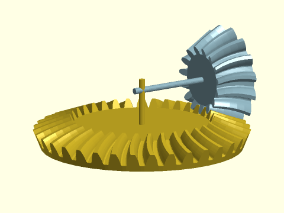

 

**Figure 1.7.5:** Two zerol bevel gears mated with shafts at a 115.38 deg angle.  This is a planar bevel gear.  The axes intersect on the pitch base of the yellow gear.  If the blue gear is tipped slightly more its shaft will intersect the shaft of the yellow gear underneath that gear's pitch base, indicating an impossible angle for a normal bevel gear at this pair of teeth counts.

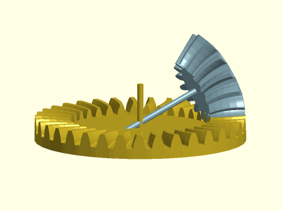

 

In the above figure you can see a flat bevel gear.  Such a bevel gear is called a planar bevel gear or
sometimes also a crown gear.  The latter term may be confusing because it also refers to a similar looking
but very different type of gear that is described below.  A planar bevel gear can only mate with another
compatible bevel gear.  It has a degenerate cone with its apex on the gear itself, so the mating pinion gear cannot
mate at a 90 degree angle because if it did, its cone could not meet the center of the planar bevel gear.
If you request a larger shaft angle, the teeth of the bevel gear will tilt inward, producing an internal bevel gear.
Gears with this design are rarely used.  The mate of an interior gear is always an exterior gear.

**Figure 1.7.6:** Internal bevel gear (yellow) mated to an external bevel gear (blue) to achieve a 135 degree shaft angle.

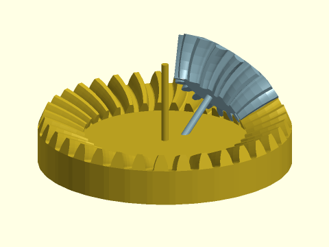

 

## Subsection: Crown Gears (Face Gears)

Crown gears, sometimes called Face Crown Gears or just Face Gears, are gears with teeth pointing straight up so
the gear resembles a crown.  This type of gear is not the same as a bevel gear with vertical teeth, which would mate
to another bevel gear.  A crown gear mates to a spur gear at a ninety degree angle.  A feature of the crown gear assembly
is that the spur gear can shift along its axis without affecting the mesh.

**Figure 1.8.1:** A Crown or Face gear with its mating spur gear in blue.

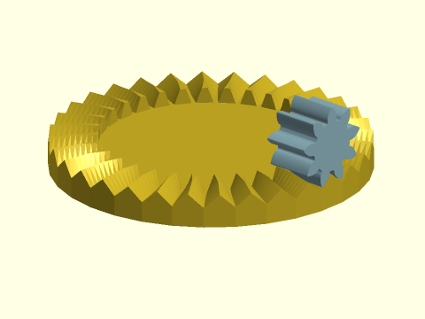

 

When constructing a crown gear you need to make it with the same given pressure and and tooth size as
the spur gear you wish to mate to it.  However, the teeth of a crown gear have pressure angle that varies
along the width of the tooth.  The vertical separation of the spur gear from the crown gear is given
by [`gear_dist()`](#function-gear_dist) where you treat the crown gear as a rack.  The inner radius of the teeth on the
crown gear is the pitch radius determined by the gear's tooth size and number of teeth.  The face width
of a crown gear is limited by geometry, so if you make it too large you will get an error.

The geometry of these crown gears is tricky and not well documented by sources we have found.
If you know something about crown gears that could improve the implementation, please open an issue
on github.

## Section: Backlash (Fitting Real Gears Together)

You may have noticed that the example gears shown fit together perfectly, making contact on both sides of
the teeth.  Real gears need space between the teeth to prevent the gears from jamming, to provide space
for lubricant, and to provide allowance for fabrication error.  This space is called backlash.  Excessive backlash
is undesirable, especially if the drive reverses frequently.

Backlash can be introduced in two ways.  One is to make the teeth narrower, so the gaps between the teeth are
larger than the teeth.  Alternatively, you can move the gears farther apart than their ideal spacing.
Backlash can be measured in several different ways.  The gear modules in this library accept a backlash
parameter which specifies backlash as a circular distance at the pitch circle.  The modules narrow
the teeth by the amount specified, which means the spaces between the teeth grow larger.  Of course, if you apply
backlash to both gears then the total backlash in the system is the combined amount from both gears.
Usually it is best to apply backlash symmetrically to both gears, but if one gear is very small it may
be better to place the backlash entirely on the larger gear to avoid weakening the teeth of the small gear.

**Figure 2.1:** Backlash narrows the teeth by the specified length along the pitch circle.  Below the ideal gear appears in the lighter color and the darker color shows the same gear with a very large backlash, which appears with half of the backlash on either side of the tooth.

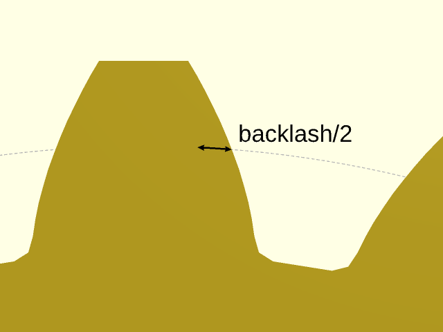

 

**Figure 2.2:** Here two gears appear together with a more reasonable backlash applied to both gears. Again the lighter color shows the ideal gears and the darker shade shows the gear with backlash.  In this example, backlash is present on both of the meshing gears, so the total backlash of the system is the combined backlash from both gears.

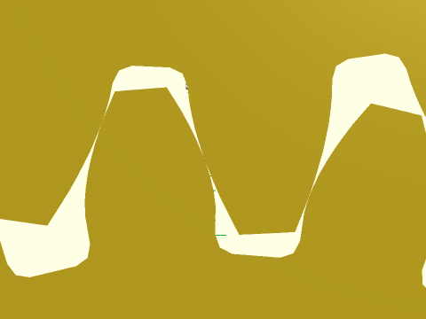

 

**Figure 2.3:** Here the same gears as in the previous figure appear with backlash applied using the `backlash` parameter to [`gear_dist()`](#function-gear\_dist) to shift them apart.  The original ideal gears are in the lighter shade and the darker colored gears have been separated to create the backlash.

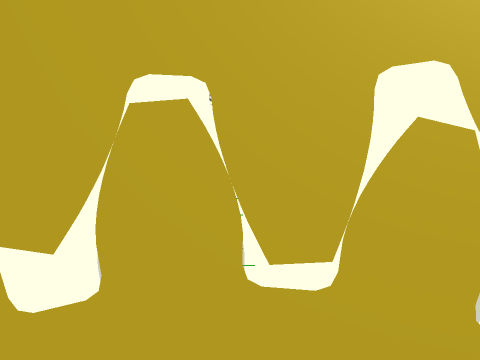

 

## Section: Gears

### Function/Module: spur\_gear()

**Synopsis:** Creates a spur gear, helical gear, or internal ring gear. [<abbr>Geom</abbr>] [<abbr>VNF</abbr>]

**Topics:** [Gears](Topics#gears), [Parts](Topics#parts)

**See Also:** [rack()](#functionmodule-rack), [spur\_gear2d()](#functionmodule-spur_gear2d), [bevel\_gear()](#functionmodule-bevel_gear)

**Usage:** As a Module

- spur_gear(circ_pitch, teeth, [thickness], [helical=], [pressure_angle=], [profile_shift=], [backlash=], [shaft_diam=], [hide=], [clearance=], [slices=], [internal=], [herringbone=]) [ATTACHMENTS];
- spur_gear(mod=|diam_pitch=, teeth=, [thickness=], ...) [ATTACHMENTS];

**Usage:** As a Function

- vnf = spur_gear(circ_pitch, teeth, [thickness], ...);
- vnf = spur_gear(mod=|diam_pitch=, teeth=, [thickness=], ...);

**Description:** 

Creates a involute spur gear, helical gear, herringbone gear, or a mask for an internal ring gear.
For more information about gears, see [A Quick Introduction to Gears](gears.scad#section-a-quick-introduction-to-gears).
You must specify the teeth size using either `mod=`, `circ_pitch=` or `diam_pitch=`, and you
must give the number of teeth of the gear.   Spur gears have straight teeth and
mesh together on parallel shafts without creating any axial thrust.  The teeth engage suddenly across their
entire width, creating stress and noise.  Helical gears have angled teeth and engage more gradually, so they
run more smoothly and quietly, however they do produce thrust along the gear axis.  This can be
circumvented using herringbone or double helical gears, which have no axial thrust and also self-align.
Helical gears can mesh along shafts that are not parallel, where the angle between the shafts is
the sum of the helical angles of the two gears.

The module creates the gear in the XY plane, centered on the origin, with one tooth centered on the positive Y axis.
In order for two gears to mesh they must have the same tooth size and `pressure_angle`, and
generally the helical angles should be of opposite sign.
The usual pressure angle (and default) is 20 degrees.  Another common value is 14.5 degrees.
Ideally the teeth count of two meshing gears will be relatively prime because this ensures that
every tooth on one gear will meet every tooth on the other, creating even wear.

The "pitch circle" of the gear is a reference circle where the circular pitch is defined that
is used to construct the gear.  It runs approximately through the centers of the teeth.
Two basic gears will mesh when their pitch circles are tangent.  Anchoring for these gears is
done on the pitch circle by default, so basic gears can be meshed using anchoring.
However, when a gear has a small number of teeth, the basic gear form will result in undercutting,
which weakens the teeth.  To avoid this, profile shifting is automatically applied and in this
case, the distance between the gears is a complicated calculation and must be determined using [`gear_dist()`](#function-gear_dist).
If you wish to override this correction, you can use `profile_shift=0`, or set it to a specific
value like 0.5.  Another complication with profile shifted gears is that the tips may be too long,
which can eat into the clearance space.  To address this problem you can use the `shorten` parameter,
which you can compute using [`gear_shorten()`](#function-gear_shorten).

Helical gears can mesh with skew or crossed axes, a configuration sometimes called "screw gears".
Without profile shifting, that angle is the  sum of the helical angles.
With profile shifting it is slightly different and is given by [`gear_skew_angle()`](#function-gear_skew_angle).
These gears still mesh on the pitch circle when they are not profile shifted, but the correction to
gear separation for a proper mesh of profile shifted gears is different for skew gears and is
computed using [`gear_dist_skew()`](#function-gear_dist_skew).

To create space for gears to mesh in practice you will need to set a positive value for backlash, or
use the `backlash` argument to [`gear_dist()`](#function-gear_dist).

**Arguments:** 

<abbr title="These args can be used by position or by name.">By&nbsp;Position</abbr> | What it does
-------------------- | ------------
`circ_pitch`         | The circular pitch, the distance between teeth centers around the pitch circle.
`teeth`              | Total number of teeth around the entire perimeter
`thickness`          | Thickness of gear.  Default: 10

<abbr title="These args must be used by name, ie: name=value">By&nbsp;Name</abbr> | What it does
-------------------- | ------------
`mod`                | The module of the gear (pitch diameter / teeth)
`diam_pitch`         | The diametral pitch, or number of teeth per inch of pitch diameter.  The diametral pitch is a completely different thing than the pitch diameter.
`helical`            | Teeth spiral around the gear at this angle, positive for left handed, negative for right handed.  Default: 0
`herringbone`        | If true, and helical is set, creates a herringbone gear.  Default: False
`pressure_angle`     | Controls how straight or bulged the tooth sides are. In degrees.  Default: 20
`profile_shift`      | Profile shift factor x.  Default: "auto"
`shorten`            | Shorten gear tips by the module times this value.  Needed for large profile shifted gears.  Default: 0
`backlash`           | Gap between two meshing teeth, in the direction along the circumference of the pitch circle.  Default: 0
`shaft_diam`         | Diameter of the hole in the center.  Default: 0 (no shaft hole)
`hide`               | Number of teeth to delete to make this only a fraction of a circle.  Default: 0
`gear_spin`          | Rotate gear and children around the gear center, regardless of how gear is anchored.  Default: 0
`clearance`          | Clearance gap at the bottom of the inter-tooth valleys.  Default: mod/4
`slices`             | Number of vertical layers to divide gear into.  Useful for refining gears with `helical`.
`internal`           | If true, create a mask for difference()ing from something else.
`$gear_steps`        | Number of points to sample gear profile.  Default: 16
`atype`              | Set to "root", "tip" or "pitch" to determine anchoring circle.  Default: "pitch"
`anchor`             | Translate so anchor point is at origin (0,0,0).  See [anchor](attachments.scad#subsection-anchor).  Default: `CENTER`
`spin`               | Rotate this many degrees around the Z axis after anchor.  See [spin](attachments.scad#subsection-spin).  Default: `0`
`orient`             | Vector to rotate top toward, after spin.  See [orient](attachments.scad#subsection-orient).  Default: `UP`

**Side Effects:** 

- If internal is true then the default tag is "remove"

**Anchor Types:** 

Anchor Type | What it is
----------- | ----------
root | anchor on the root circle
pitch | anchor on the pitch circle (default)
tip | anchor on the tip circle

**Example 1:** Spur Gear

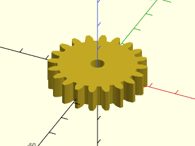

    include <BOSL2/std.scad>
    include <BOSL2/gears.scad>
    spur_gear(circ_pitch=5, teeth=20, thickness=8, shaft_diam=5);

  

**Example 2:** Metric Gear

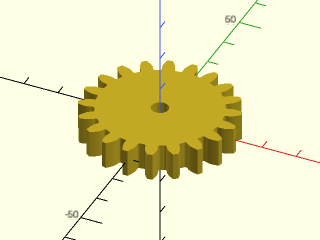

    include <BOSL2/std.scad>
    include <BOSL2/gears.scad>
    spur_gear(mod=2, teeth=20, thickness=8, shaft_diam=5);

  

**Example 3:** Helical Gear

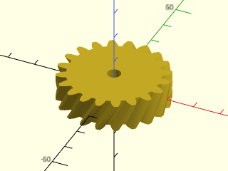

    include <BOSL2/std.scad>
    include <BOSL2/gears.scad>
    spur_gear(
        circ_pitch=5, teeth=20, thickness=10,
        shaft_diam=5, helical=-30, slices=12,
        $fa=1, $fs=1
    );

  

**Example 4:** Herringbone Gear

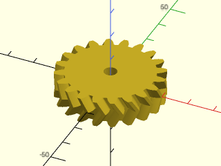

    include <BOSL2/std.scad>
    include <BOSL2/gears.scad>
    spur_gear(
        circ_pitch=5, teeth=20, thickness=10, shaft_diam=5,
        helical=30, herringbone=true, slices=5
    );

  

**Example 5:** Effects of Profile Shifting.

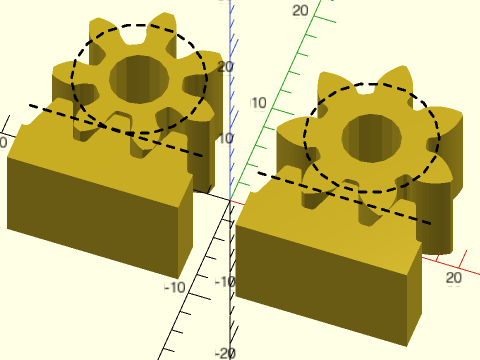

 

    include <BOSL2/std.scad>
    include <BOSL2/gears.scad>
    circ_pitch=5; teeth=7; thick=10; shaft=5; strokewidth=0.2;
    pr = pitch_radius(circ_pitch, teeth);
    left(10) {
        profile_shift = 0;
        d = gear_dist(circ_pitch=circ_pitch,teeth,0,profile_shift1=profile_shift);
        back(d) spur_gear(circ_pitch, teeth, thick, shaft, profile_shift=profile_shift);
        rack(circ_pitch, teeth=3, thickness=thick, orient=BACK);
        color("black") up(thick/2) linear_extrude(height=0.1) {
            back(d) dashed_stroke(circle(r=pr), width=strokewidth, closed=true);
            dashed_stroke([[-7.5,0],[7.5,0]], width=strokewidth);
        }
    }
    right(10) {
        profile_shift = 0.59;
        d = gear_dist(circ_pitch=circ_pitch,teeth,0,profile_shift1=profile_shift);
        back(d) spur_gear(circ_pitch, teeth, thick, shaft, profile_shift=profile_shift);
        rack(circ_pitch, teeth=3, thickness=thick, orient=BACK);
        color("black") up(thick/2) linear_extrude(height=0.1) {
            back(d)
                dashed_stroke(circle(r=pr), width=strokewidth, closed=true);
            dashed_stroke([[-7.5,0],[7.5,0]], width=strokewidth);
        }
    }

**Example 6:** Assembly of Gears

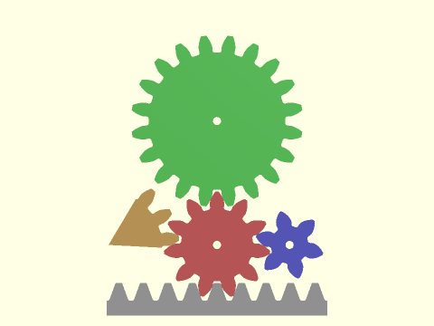

 

    include <BOSL2/std.scad>
    include <BOSL2/gears.scad>
    $fn=12;
    n1 = 11; //red gear number of teeth
    n2 = 20; //green gear
    n3 = 6;  //blue gear
    n4 = 16; //orange gear
    n5 = 9;  //gray rack
    circ_pitch = 9; //all meshing gears need the same `circ_pitch` (and the same `pressure_angle`)
    thickness    = 6;
    hole         = 3;
    rack_base    = 12;
    d12 = gear_dist(circ_pitch=circ_pitch,teeth1=n1,teeth2=n2);
    d13 = gear_dist(circ_pitch=circ_pitch,teeth1=n1,teeth2=n3);
    d14 = gear_dist(circ_pitch=circ_pitch,teeth1=n1,teeth2=n4);
    d1r = gear_dist(circ_pitch=circ_pitch,teeth1=n1,teeth2=0);
    a1 =  $t * 360 / n1;
    a2 = -$t * 360 / n2 + 180/n2;
    a3 = -$t * 360 / n3 - 3*90/n3;
    a4 = -$t * 360 / n4 - 3.5*180/n4;
    color("#f77")              zrot(a1) spur_gear(circ_pitch,n1,thickness,hole);
    color("#7f7") back(d12)  zrot(a2) spur_gear(circ_pitch,n2,thickness,hole);
    color("#77f") right(d13) zrot(a3) spur_gear(circ_pitch,n3,thickness,hole);
    color("#fc7") left(d14)  zrot(a4) spur_gear(circ_pitch,n4,thickness,hole,hide=n4-3);
    color("#ccc") fwd(d1r) right(circ_pitch*$t)
        rack(pitch=circ_pitch,teeth=n5,thickness=thickness,width=rack_base,anchor=CENTER,orient=BACK);

**Example 7:** Helical gears meshing with non-parallel shafts

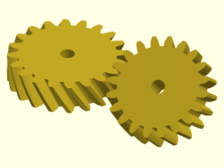

    include <BOSL2/std.scad>
    include <BOSL2/gears.scad>
    ang1 = 30;
    ang2 = 10;
    circ_pitch = 5;
    n = 20;
    dist = gear_dist_skew(
       circ_pitch=circ_pitch,
       teeth1=n, teeth2=n,
       helical1=ang1, helical2=ang2);
    left(dist/2) spur_gear(
           circ_pitch, teeth=n, thickness=10,
           shaft_diam=5, helical=ang1, slices=12,
           gear_spin=-90
       );
    right(dist/2)
    xrot(ang1+ang2)
    spur_gear(
           circ_pitch=circ_pitch, teeth=n, thickness=10,
           shaft_diam=5, helical=ang2, slices=12,
           gear_spin=90-180/n
       );

  

**Example 8:** Planetary Gear Assembly

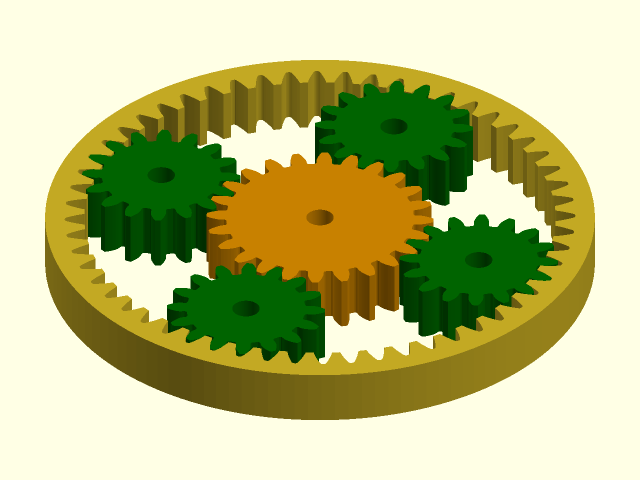

 

    include <BOSL2/std.scad>
    include <BOSL2/gears.scad>
    $fn=128;
    rteeth=56; pteeth=16; cteeth=24;
    circ_pitch=5; thick=10; pa=20;
    gd = gear_dist(circ_pitch=circ_pitch, cteeth, pteeth);
    ring_gear(
        circ_pitch=circ_pitch,
        teeth=rteeth,
        thickness=thick,
        pressure_angle=pa);
    for (a=[0:3]) {
        zrot($t*90+a*90) back(gd) {
            color("green")
            spur_gear(
                circ_pitch=circ_pitch,
                teeth=pteeth,
                thickness=thick,
                shaft_diam=5,
                pressure_angle=pa,
                spin=-$t*90*rteeth/pteeth);
        }
    }
    color("orange")
    zrot($t*90*rteeth/cteeth+$t*90+180/cteeth)
    spur_gear(
        circ_pitch=circ_pitch,
        teeth=cteeth,
        thickness=thick,
        shaft_diam=5,
        pressure_angle=pa);

---

### Function/Module: spur\_gear2d()

**Synopsis:** Creates a 2D spur gear or internal ring gear. [<abbr>Geom</abbr>] [<abbr>Region</abbr>]

**Topics:** [Gears](Topics#gears), [Parts](Topics#parts)

**See Also:** [rack()](#functionmodule-rack), [spur\_gear()](#functionmodule-spur_gear), [bevel\_gear()](#functionmodule-bevel_gear)

**Usage:** As Module

- spur_gear2d(circ_pitch, teeth, [pressure_angle=], [profile_shift=], [shorten=], [hide=], [shaft_diam=], [clearance=], [backlash=], [internal=]) [ATTACHMENTS];
- spur_gear2d(mod=|diam_pitch=, teeth=, [pressure_angle=], [profile_shift=], [shorten=], [hide=], [shaft_diam=], [clearance=], [backlash=], [internal=]) [ATTACHMENTS];

**Usage:** As Function

- rgn = spur_gear2d(circ_pitch, teeth, [pressure_angle=], [profile_shift=], [shorten=], [hide=], [shaft_diam=], [clearance=], [backlash=], [internal=]);
- rgn = spur_gear2d(mod=, teeth=, [pressure_angle=], [profile_shift=], [shorten=], [hide=], [shaft_diam=], [clearance=], [backlash=], [internal=]);

**Description:** 

Creates a 2D involute spur gear, or a mask for an internal ring gear.
For more information about gears, see [A Quick Introduction to Gears](gears.scad#section-a-quick-introduction-to-gears).
You must specify the teeth size using either `mod=`, `circ_pitch=` or `diam_pitch=`, and you
must give the number of teeth.

The module creates the gear in centered on the origin, with one tooth centered on the positive Y axis.
In order for two gears to mesh they must have the same tooth size and `pressure_angle`
The usual pressure angle (and default) is 20 degrees.  Another common value is 14.5 degrees.
Ideally the teeth count of two meshing gears will be relatively prime because this ensures that
every tooth on one gear will meet every tooth on the other, creating even wear.

The "pitch circle" of the gear is a reference circle where the circular pitch is defined that
is used to construct the gear.  It runs approximately through the centers of the teeth.
Two basic gears will mesh when their pitch circles are tangent.  Anchoring for these gears is
done on the pitch circle by default, so basic gears can be meshed using anchoring.
However, when a gear has a small number of teeth, the basic gear form will result in undercutting,
which weakens the teeth.  To avoid this, profile shifting is automatically applied and in this
case, the distance between the gears is a complicated calculation and must be determined using [`gear_dist()`](#function-gear_dist).
If you wish to override this correction, you can use `profile_shift=0`, or set it to a specific
value like 0.5.  Another complication with profile shifted gears is that the tips may be too long,
which can eat into the clearance space.  To address this problem you can use the `shorten` parameter,
which you can compute using [`gear_shorten()`](#function-gear_shorten).

To create space for gears to mesh in practice you will need to set a positive value for backlash, or
use the `backlash` argument to [`gear_dist()`](#function-gear_dist).

**Arguments:** 

<abbr title="These args can be used by position or by name.">By&nbsp;Position</abbr> | What it does
-------------------- | ------------
`circ_pitch`         | The circular pitch, the distance between teeth centers around the pitch circle.
`teeth`              | Total number of teeth around the spur gear.

<abbr title="These args must be used by name, ie: name=value">By&nbsp;Name</abbr> | What it does
-------------------- | ------------
`mod`                | The module of the gear (pitch diameter / teeth)
`diam_pitch`         | The diametral pitch, or number of teeth per inch of pitch diameter.  The diametral pitch is a completely different thing than the pitch diameter.
`pressure_angle`     | Controls how straight or bulged the tooth sides are. In degrees.
`profile_shift`      | Profile shift factor x.  Default: "auto"
`shorten`            | Shorten gear tips by the module times this value.  Needed for large profile shifted gears.  Default: 0
`backlash`           | Gap between two meshing teeth, in the direction along the circumference of the pitch circle.  Default: 0
`helical`            | Adjust teeth form (stretch out the teeth) to give the cross section of a gear with this helical angle.  Default: 0
`hide`               | Number of teeth to delete to make this only a fraction of a circle
`gear_spin`          | Rotate gear and children around the gear center, regardless of how gear is anchored.  Default: 0
`clearance`          | Gap between top of a tooth on one gear and bottom of valley on a meshing gear.  Default: mod/4
`internal`           | If true, create a mask for difference()ing from something else.
`$gear_steps`        | Number of points to sample gear profile.  Default: 16
`shaft_diam`         | If given, the diameter of the central shaft hole.
`atype`              | Set to "root", "tip" or "pitch" to determine anchoring circle.  Default: "pitch"
`anchor`             | Translate so anchor point is at origin (0,0,0).  See [anchor](attachments.scad#subsection-anchor).  Default: `CENTER`
`spin`               | Rotate this many degrees around the Z axis after anchor.  See [spin](attachments.scad#subsection-spin).  Default: `0`

**Side Effects:** 

- If internal is true then the default tag is "remove"

**Anchor Types:** 

Anchor Type | What it is
----------- | ----------
root | anchor on the root circle
pitch | anchor on the pitch circle (default)
tip | anchor on the tip circle

**Example 1:** Typical Gear Shape

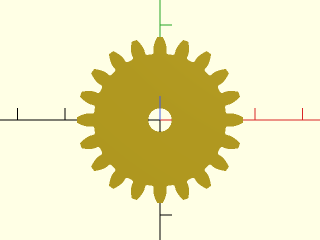

    include <BOSL2/std.scad>
    include <BOSL2/gears.scad>
    spur_gear2d(circ_pitch=5, teeth=20, shaft_diam=5);

  

**Example 2:** By Metric Module

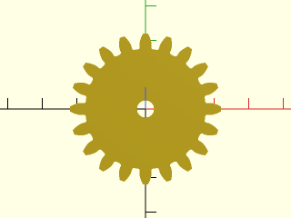

    include <BOSL2/std.scad>
    include <BOSL2/gears.scad>
    spur_gear2d(mod=2, teeth=20, shaft_diam=5);

  

**Example 3:** By Imperial Gear Pitch

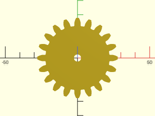

    include <BOSL2/std.scad>
    include <BOSL2/gears.scad>
    spur_gear2d(diam_pitch=10, teeth=20, shaft_diam=5);

  

**Example 4:** Lower Pressure Angle

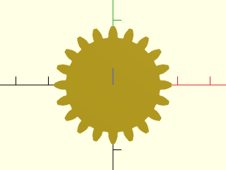

    include <BOSL2/std.scad>
    include <BOSL2/gears.scad>
    spur_gear2d(circ_pitch=5, teeth=20, pressure_angle=14);

  

**Example 5:** Partial Gear

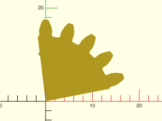

 

    include <BOSL2/std.scad>
    include <BOSL2/gears.scad>
    spur_gear2d(circ_pitch=5, teeth=20, hide=15, pressure_angle=20);

**Example 6:** Effects of Profile Shifting.

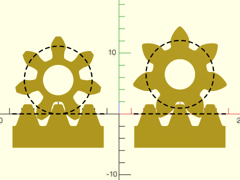

 

    include <BOSL2/std.scad>
    include <BOSL2/gears.scad>
    circ_pitch=5; teeth=7; shaft=5; strokewidth=0.2;
    module the_gear(profile_shift=0) {
        $fn=72;
        pr = pitch_radius(circ_pitch,teeth);
        mr = gear_dist(circ_pitch=circ_pitch,teeth,profile_shift1=profile_shift,teeth2=0);
        back(mr) {
            spur_gear2d(circ_pitch, teeth, shaft_diam=shaft, profile_shift=profile_shift);
            up(0.1) color("black")
                dashed_stroke(circle(r=pr), width=strokewidth, closed=true);
        }
    }
    module the_rack() {
        $fn=72;
        rack2d(circ_pitch, teeth=3);
        up(0.1) color("black")
            dashed_stroke([[-7.5,0],[7.5,0]], width=strokewidth);
    }
    left(10) { the_gear(0); the_rack(); }
    right(10) { the_gear(0.59); the_rack(); }

**Example 7:** Planetary Gear Assembly

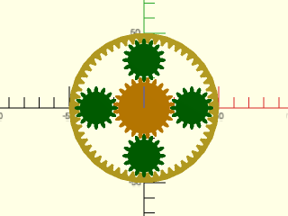

    include <BOSL2/std.scad>
    include <BOSL2/gears.scad>
    rteeth=56; pteeth=16; cteeth=24;
    circ_pitch=5; pa=20;
    gd = gear_dist(circ_pitch=circ_pitch, cteeth,pteeth);
    ring_gear2d(
        circ_pitch=circ_pitch,
        teeth=rteeth,
        pressure_angle=pa);
    for (a=[0:3]) {
        zrot(a*90) back(gd) {
            color("green")
            spur_gear2d(
                circ_pitch=circ_pitch,
                teeth=pteeth,
                pressure_angle=pa);
        }
    }
    color("orange")
      zrot(180/cteeth)
        spur_gear2d(
            circ_pitch=circ_pitch,
            teeth=cteeth,
            pressure_angle=pa);

  

**Example 8:** Called as a Function

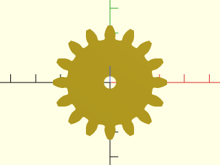

    include <BOSL2/std.scad>
    include <BOSL2/gears.scad>
    rgn = spur_gear2d(circ_pitch=8, teeth=16, shaft_diam=5);
    region(rgn);

  

---

### Module: ring\_gear()

**Synopsis:** Creates a 3D ring gear. [<abbr>Geom</abbr>]

**Topics:** [Gears](Topics#gears), [Parts](Topics#parts)

**See Also:** [rack()](#functionmodule-rack), [ring\_gear2d()](#module-ring_gear2d), [spur\_gear()](#functionmodule-spur_gear), [spur\_gear2d()](#functionmodule-spur_gear2d), [bevel\_gear()](#functionmodule-bevel_gear)

**Usage:** 

- ring_gear(circ_pitch, teeth, thickness, [backing|od=|or=|width=], [pressure_angle=], [helical=], [herringbone=], [profile_shift=], [clearance=], [backlash=]) [ATTACHMENTS];
- ring_gear(mod=, teeth=, thickness=, [backing=|od=|or=|width=], [pressure_angle=], [helical=], [herringbone=], [profile_shift=], [clearance=], [backlash=]) [ATTACHMENTS];
- ring_gear(diam_pitch=, teeth=, thickness=, [backing=|od=|or=|width=], [pressure_angle=], [helical=], [herringbone=], [profile_shift=], [clearance=], [backlash=]) [ATTACHMENTS];

**Description:** 

Creates a 3D involute ring gear.
Meshing gears must have the same tooth size, pressure angle and helical angle as usual.
Additionally, you must have more teeth on an internal gear than its mating external gear, and
the profile shift on the ring gear must be at least as big as the profile shift on the mating gear.
You may need to use [`auto_profile_shift()`](#function-auto_profile_shift) to find this value if your mating gear has a small number of teeth.
The gear spacing is given by [`gear_dist()`](#function-gear_dist).

**Arguments:** 

<abbr title="These args can be used by position or by name.">By&nbsp;Position</abbr> | What it does
-------------------- | ------------
`circ_pitch`         | The circular pitch, the distance between teeth centers around the pitch circle.
`teeth`              | Total number of teeth around the spur gear.
`thickness`          | Thickness of ring gear
`backing`            | The width of the ring gear backing.  Default: height of teeth

<abbr title="These args must be used by name, ie: name=value">By&nbsp;Name</abbr> | What it does
-------------------- | ------------
`od`                 | outer diameter of the ring
`or`                 | outer radius of the ring
`width`              | width of the ring, measuring from tips of teeth to outside of ring.
`pressure_angle`     | Controls how straight or bulged the tooth sides are. In degrees.
`helical`            | The angle of the rack teeth away from perpendicular to the gear axis of rotation.  Stretches out the tooth shapes.  Used to match helical spur gear pinions.  Default: 0
`herringbone`        | If true, and helical is set, creates a herringbone gear.
`profile_shift`      | Profile shift factor x for tooth profile.  Default: 0
`clearance`          | Gap between top of a tooth on one gear and bottom of valley on a meshing gear (in millimeters)
`backlash`           | Gap between two meshing teeth, in the direction along the circumference of the pitch circle
`diam_pitch`         | The diametral pitch, or number of teeth per inch of pitch diameter.  The diametral pitch is a completely different thing than the pitch diameter.
`mod`                | The module of the gear (pitch diameter / teeth)
`$gear_steps`        | Number of points to sample gear profile.  Default: 16
`anchor`             | Translate so anchor point is at origin (0,0,0).  See [anchor](attachments.scad#subsection-anchor).  Default: `CENTER`
`spin`               | Rotate this many degrees around the Z axis after anchor.  See [spin](attachments.scad#subsection-spin).  Default: `0`
`orient`             | Vector to rotate top toward, after spin.  See [orient](attachments.scad#subsection-orient).  Default: `UP`

**Example 1:** 

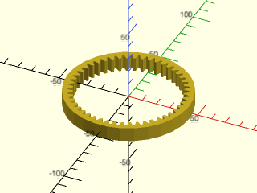

    include <BOSL2/std.scad>
    include <BOSL2/gears.scad>
    ring_gear(circ_pitch=5, teeth=48, thickness=10);

  

**Example 2:** Adjusting Backing

    include <BOSL2/std.scad>
    include <BOSL2/gears.scad>
    ring_gear(circ_pitch=5, teeth=48, thickness=10, backing=30);

  

**Example 3:** Adjusting Pressure Angle

 

    include <BOSL2/std.scad>
    include <BOSL2/gears.scad>
    ring_gear(circ_pitch=5, teeth=48, thickness=10, pressure_angle=28);

**Example 4:** Tooth Profile Shifting

 

    include <BOSL2/std.scad>
    include <BOSL2/gears.scad>
    ring_gear(circ_pitch=5, teeth=48, thickness=10, profile_shift=0.5);

**Example 5:** Helical Ring Gear

 

    include <BOSL2/std.scad>
    include <BOSL2/gears.scad>
    ring_gear(circ_pitch=5, teeth=48, thickness=15, helical=30);

**Example 6:** Herringbone Ring Gear

 

    include <BOSL2/std.scad>
    include <BOSL2/gears.scad>
    ring_gear(circ_pitch=5, teeth=48, thickness=30, helical=30, herringbone=true);

---

### Module: ring\_gear2d()

**Synopsis:** Creates a 2D ring gear. [<abbr>Geom</abbr>]

**Topics:** [Gears](Topics#gears), [Parts](Topics#parts)

**See Also:** [rack()](#functionmodule-rack), [spur\_gear()](#functionmodule-spur_gear), [spur\_gear2d()](#functionmodule-spur_gear2d), [bevel\_gear()](#functionmodule-bevel_gear)

**Usage:** 

- ring_gear2d(circ_pitch, teeth, [backing|od=|or=|width=], [pressure_angle=], [helical=], [profile_shift=], [clearance=], [backlash=]) [ATTACHMENTS];
- ring_gear2d(mod=, teeth=, [backing=|od=|or=|width=], [pressure_angle=], [helical=], [profile_shift=], [clearance=], [backlash=]) [ATTACHMENTS];
- ring_gear2d(diam_pitch=, teeth=, [backing=|od=|or=|width=], [pressure_angle=], [helical=], [profile_shift=], [clearance=], [backlash=]) [ATTACHMENTS];

**Description:** 

Creates a 2D involute ring gear.
Meshing gears must have the same tooth size, pressure angle and helical angle as usual.
Additionally, you must have more teeth on an internal gear than its mating external gear, and
the profile shift on the ring gear must be at least as big as the profile shift on the mating gear.
You may need to use [`auto_profile_shift()`](#function-auto_profile_shift) to find this value if your mating gear has a small number of teeth.
The gear spacing is given by [`gear_dist()`](#function-gear_dist).

**Arguments:** 

<abbr title="These args can be used by position or by name.">By&nbsp;Position</abbr> | What it does
-------------------- | ------------
`circ_pitch`         | The circular pitch, the distance between teeth centers around the pitch circle.
`teeth`              | Total number of teeth around the spur gear.
`backing`            | The width of the ring gear backing.  Default: height of teeth

<abbr title="These args must be used by name, ie: name=value">By&nbsp;Name</abbr> | What it does
-------------------- | ------------
`od`                 | outer diameter of the ring
`or`                 | outer radius of the ring
`width`              | width of the ring, measuring from tips of teeth to outside of ring.
`helical`            | The angle of the rack teeth away from perpendicular to the gear axis of rotation.  Stretches out the tooth shapes.  Used to match helical spur gear pinions.  Default: 0
`pressure_angle`     | Controls how straight or bulged the tooth sides are. In degrees.
`profile_shift`      | Profile shift factor x for tooth profile.  Default: 0
`clearance`          | Gap between top of a tooth on one gear and bottom of valley on a meshing gear (in millimeters)
`backlash`           | Gap between two meshing teeth, in the direction along the circumference of the pitch circle
`diam_pitch`         | The diametral pitch, or number of teeth per inch of pitch diameter.  The diametral pitch is a completely different thing than the pitch diameter.
`mod`                | The module of the gear (pitch diameter / teeth)
`$gear_steps`        | Number of points to sample gear profile.  Default: 16
`anchor`             | Translate so anchor point is at origin (0,0,0).  See [anchor](attachments.scad#subsection-anchor).  Default: `CENTER`
`spin`               | Rotate this many degrees around the Z axis after anchor.  See [spin](attachments.scad#subsection-spin).  Default: `0`

**Anchor Types:** 

Anchor Type | What it is
----------- | ----------
pitch | anchor on the pitch circle (default)
outside | outside edge of the gear

**Example 1:** Meshing a ring gear with a spur gear

 

    include <BOSL2/std.scad>
    include <BOSL2/gears.scad>
    circ_pitch=5; teeth1=50; teeth2=18;
    dist = gear_dist(circ_pitch=circ_pitch, teeth1, teeth2, internal1=true);
    ring_gear2d(circ_pitch=circ_pitch, teeth=teeth1);
    color("lightblue")back(dist)
      spur_gear2d(circ_pitch=circ_pitch, teeth=teeth2);

**Example 2:** Meshing a ring gear with an auto-profile-shifted spur gear:

 

    include <BOSL2/std.scad>
    include <BOSL2/gears.scad>
    teeth1=7;    teeth2=15;
    ps1=undef;     // Allow auto profile shifting for first gear
    ps2=auto_profile_shift(teeth=teeth1);
    mod=3;
    d = gear_dist(mod=mod, teeth1=teeth1, teeth2=teeth2, profile_shift1=ps1, profile_shift2=ps2, internal2=true);
    ring_gear2d(mod=mod, teeth=teeth2,profile_shift=ps2);
    color("lightblue") fwd(d)
       spur_gear2d(mod=mod, teeth=teeth1, profile_shift=ps1);

---

### Function/Module: rack()

**Synopsis:** Creates a straight or helical gear rack. [<abbr>Geom</abbr>] [<abbr>VNF</abbr>]

**Topics:** [Gears](Topics#gears), [Parts](Topics#parts)

**See Also:** [rack2d()](#functionmodule-rack2d), [spur\_gear()](#functionmodule-spur_gear), [spur\_gear2d()](#functionmodule-spur_gear2d), [bevel\_gear()](#functionmodule-bevel_gear)

**Usage:** As a Module

- rack(pitch, teeth, thickness, [base|bottom=|width=], [helical=], [pressure_angle=], [backlash=], [clearance=]) [ATTACHMENTS];
- rack(mod=, teeth=, thickness=, [base=|bottom=|width=], [helical=], [pressure_angle=], [backlash]=, [clearance=]) [ATTACHMENTS];

**Usage:** As a Function

- vnf = rack(pitch, teeth, thickness, [base|bottom=|width=], [helical=], [pressure_angle=], [backlash=], [clearance=]);
- vnf = rack(mod=, teeth=, thickness=, [base=|bottom=|width=], [helical=], [pressure_angle=], [backlash=], [clearance=]);

**Description:** 

This is used to create a 3D rack, which is a linear bar with teeth that a gear can roll along.
A rack can mesh with any gear that has the same `pitch` and `pressure_angle`.  A helical rack meshes with a gear with the opposite
helical angle.
When called as a function, returns a 3D [VNF](vnf.scad) for the rack.
When called as a module, creates a 3D rack shape.

By default the rack has a backing whose height is equal to the height of the teeth.  You can specify a different backing size
or you can specify the total width of the rack (from the bottom of the rack to tooth tips) or the
bottom point of the rack, which is the distance from the pitch line to the bottom of the rack.

The rack appears oriented with
its teeth pointed UP, so to mesh with gears in the XY plane, use `orient=BACK` or `orient=FWD` and apply any desired rotation.
The pitch line of the rack is aligned with the x axis, the TOP anchors are at the tips of the teeth and the BOTTOM anchors at
the bottom of the backing.  Note that for helical racks the corner anchors still point at 45° angles.

**Arguments:** 

<abbr title="These args can be used by position or by name.">By&nbsp;Position</abbr> | What it does
-------------------- | ------------
`pitch`              | The pitch, or distance between teeth centers along the rack. Matches up with circular pitch on a spur gear.  Default: 5
`teeth`              | Total number of teeth along the rack.  Default: 20
`thickness`          | Thickness of rack.  Default: 5
`backing`            | Distance from bottom of rack to the roots of the rack's teeth.  (Alternative to bottom or width.)  Default: height of rack teeth

<abbr title="These args must be used by name, ie: name=value">By&nbsp;Name</abbr> | What it does
-------------------- | ------------
`bottom`             | Distance from rack's pitch line (the x-axis) to the bottom of the rack.  (Alternative to backing or width)
`width`              | Distance from base of rack to tips of teeth (alternative to bottom and backing).
`mod`                | The module of the gear (pitch diameter / teeth)
`diam_pitch`         | The diametral pitch, or number of teeth per inch of pitch diameter.  The diametral pitch is a completely different thing than the pitch diameter.
`helical`            | The angle of the rack teeth away from perpendicular to the rack length.  Used to match helical spur gear pinions.  Default: 0
`herringbone`        | If true, and helical is set, creates a herringbone rack.
`profile_shift`      | Profile shift factor x.  Default: 0
`pressure_angle`     | Controls how straight or bulged the tooth sides are. In degrees.  Default: 20
`backlash`           | Gap between two meshing teeth, in the direction along the circumference of the pitch circle.  Default: 0
`clearance`          | Clearance gap at the bottom of the inter-tooth valleys.  Default: module/4
`anchor`             | Translate so anchor point is at origin (0,0,0).  See [anchor](attachments.scad#subsection-anchor).  Default: `CENTER`
`spin`               | Rotate this many degrees around the Z axis after anchor.  See [spin](attachments.scad#subsection-spin).  Default: `0`
`orient`             | Vector to rotate top toward, after spin.  See [orient](attachments.scad#subsection-orient).  Default: `UP`

**Named Anchors:** 

Anchor Name | Position
----------- | --------
"root" | At the base of the teeth, at the center of rack.
"root-left" | At the base of the teeth, at the left end of the rack.
"root-right" | At the base of the teeth, at the right end of the rack.
"root-back" | At the base of the teeth, at the back of the rack.
"root-front" | At the base of the teeth, at the front of the rack.

**Example 1:** 

    include <BOSL2/std.scad>
    include <BOSL2/gears.scad>
    rack(pitch=5, teeth=10, thickness=5);

  

**Example 2:** Rack for Helical Gear

    include <BOSL2/std.scad>
    include <BOSL2/gears.scad>
    rack(pitch=5, teeth=10, thickness=5, backing=5, helical=30);

  

**Example 3:** Metric Rack, oriented BACK to align with a gear in default orientation.  With profile shifting set to zero the gears mesh at their pitch circles.

 

    include <BOSL2/std.scad>
    include <BOSL2/gears.scad>
    rack(mod=2, teeth=10, thickness=5, bottom=5, pressure_angle=14.5,orient=BACK);
    color("red") spur_gear(mod=2, teeth=18, thickness=5, pressure_angle=14.5,anchor=FRONT,profile_shift=0);

**Example 4:** Orienting the rack to the right using {zrot()}.  In this case the gear has automatic profile shifting so we must use [`gear_dist()`](#function-gear\_dist) to correctly position the gear.

 

    include <BOSL2/std.scad>
    include <BOSL2/gears.scad>
    zrot(-90)rack(mod=2, teeth=6, thickness=5, bottom=5, pressure_angle=14.5,orient=BACK);
    color("red")
     right(gear_dist(mod=2,0,12,pressure_angle=14.5))
       spur_gear(mod=2, teeth=12, thickness=5, pressure_angle=14.5);

**Example 5:** Rack and Pinion with helical teeth

    include <BOSL2/std.scad>
    include <BOSL2/gears.scad>
    teeth1 = 16; teeth2 = 16;
    pitch = 5; thick = 5; helical = 30;
    pr = pitch_radius(pitch, teeth2, helical=helical);
    pos = 3*(1-2*abs($t-1/2))-1.5;
    right(pr*2*PI/teeth2*pos)
        rack(pitch, teeth1, thickness=thick, helical=helical);
    up(pr)
        spur_gear(
            pitch, teeth2,
            thickness = thick,
            helical = -helical,
            shaft_diam = 5,
            orient = BACK,
            gear_spin = 180-pos*360/teeth2);

  

**Example 6:** Skew axis helical gear and rack engagement.

 

    include <BOSL2/std.scad>
    include <BOSL2/gears.scad>
    mod=5; teeth=8; helical1=17.5; helical2=22.5;
    d = gear_dist_skew(mod=mod, teeth, 0, helical1,helical2);
    rack(mod=mod, teeth=5, thickness=30, helical=helical2, orient=FWD);
    color("lightblue")
      yrot(-helical1-helical2) fwd(d)
      spur_gear(mod=mod, teeth=teeth, helical=helical1, gear_spin=180/teeth, thickness=30);

---

### Function/Module: rack2d()

**Synopsis:** Creates a 2D gear rack. [<abbr>Geom</abbr>] [<abbr>Path</abbr>]

**Topics:** [Gears](Topics#gears), [Parts](Topics#parts)

**See Also:** [rack()](#functionmodule-rack), [spur\_gear()](#functionmodule-spur_gear), [spur\_gear2d()](#functionmodule-spur_gear2d), [bevel\_gear()](#functionmodule-bevel_gear)

**Usage:** As a Module

- rack2d(pitch, teeth, [base|bottom=|width=], [pressure_angle=], [backlash=], [clearance=]) [ATTACHMENTS];
- rack2d(mod=, teeth=, [base=|bottom=|width=], [pressure_angle=], [backlash=], [clearance=]) [ATTACHMENTS];

**Usage:** As a Function

- path = rack2d(pitch, teeth, [base|bottom=|width=], [pressure_angle=], [backlash=], [clearance=]);
- path = rack2d(mod=, teeth=, [base=|bottom=|width=], [pressure_angle=], [backlash=], [clearance=]);

**Description:** 

Create a 2D rack, a linear bar with teeth that a gear can roll along.
A rack can mesh with any spur gear or helical gear that has the same `pitch` and `pressure_angle`.
When called as a function, returns a 2D path for the outline of the rack.
When called as a module, creates a 2D rack shape.

By default the rack has a backing whose height is equal to the height of the teeth.  You can specify a different backing size
or you can specify the total width of the rack (from the bottom of the rack to tooth tips) or the
bottom point of the rack, which is the distance from the pitch line to the bottom of the rack.

The rack appears with its pitch line on top of the x axis.  The BACK anchor refers to the tips of the teeth and the FRONT
anchor refers to the front of the backing.  You can use named anchors to access the roots of the teeth.

**Arguments:** 

<abbr title="These args can be used by position or by name.">By&nbsp;Position</abbr> | What it does
-------------------- | ------------
`pitch`              | The pitch, or distance between teeth centers along the rack. Matches up with circular pitch on a spur gear.  Default: 5
`teeth`              | Total number of teeth along the rack
`backing`            | Distance from bottom of rack to the roots of the rack's teeth.  (Alternative to bottom or width.)  Default: height of rack teeth

<abbr title="These args must be used by name, ie: name=value">By&nbsp;Name</abbr> | What it does
-------------------- | ------------
`bottom`             | Distance from rack's pitch line (the x-axis) to the bottom of the rack.  (Alternative to backing or width)
`width`              | Distance from base of rack to tips of teeth (alternative to bottom and backing).
`mod`                | The module of the gear (pitch diameter / teeth)
`diam_pitch`         | The diametral pitch, or number of teeth per inch of pitch diameter.  The diametral pitch is a completely different thing than the pitch diameter.
`helical`            | The angle of the rack teeth away from perpendicular to the rack length.  Stretches out the tooth shapes.  Used to match helical spur gear pinions.  Default: 0
`pressure_angle`     | Controls how straight or bulged the tooth sides are. In degrees.
`profile_shift`      | Profile shift factor x for tooth shape.  Default: 0
`backlash`           | Gap between two meshing teeth, in the direction along the circumference of the pitch circle
`clearance`          | Clearance gap at the bottom of the inter-tooth valleys.  Default: module/4
`gear_travel`        | The distance the rack should be moved by linearly.  Default: 0
`rounding`           | If true, rack tips and valleys are slightly rounded.  Default: true
`anchor`             | Translate so anchor point is at origin (0,0,0).  See [anchor](attachments.scad#subsection-anchor).  Default: `CENTER`
`spin`               | Rotate this many degrees around the Z axis after anchor.  See [spin](attachments.scad#subsection-spin).  Default: `0`

**Named Anchors:** 

Anchor Name | Position
----------- | --------
"root" | At the height of the teeth, at the center of rack.
"root-left" | At the height of the teeth, at the left end of the rack.
"root-right" | At the height of the teeth, at the right end of the rack.

**Example 1:** 

    include <BOSL2/std.scad>
    include <BOSL2/gears.scad>
    rack2d(pitch=5, teeth=10);

  

**Example 2:** Called as a Function

    include <BOSL2/std.scad>
    include <BOSL2/gears.scad>
    path = rack2d(pitch=8, teeth=8, pressure_angle=25);
    polygon(path);

  

---

### Function/Module: crown\_gear()

**Synopsis:** Creates a crown gear that can mesh with a spur gear. [<abbr>Geom</abbr>] [<abbr>VNF</abbr>]

**Topics:** [Gears](Topics#gears), [Parts](Topics#parts)

**See Also:** [rack()](#functionmodule-rack), [rack2d()](#functionmodule-rack2d), [spur\_gear()](#functionmodule-spur_gear), [spur\_gear2d()](#functionmodule-spur_gear2d), [bevel\_pitch\_angle()](#function-bevel_pitch_angle), [bevel\_gear()](#functionmodule-bevel_gear)

**Usage:** As a Module

- crown_gear(circ_pitch, teeth, backing, face_width, [pressure_angle=], [clearance=], [backlash=], [profile_shift=], [slices=]);
- crown_gear(diam_pitch=, teeth=, backing=, face_width=, [pressure_angle=], [clearance=], [backlash=], [profile_shift=], [slices=]);
- crown_gear(mod=, teeth=, backing=, face_width=, [pressure_angle=], [clearance=], [backlash=], [profile_shift=], [slices=]);

**Usage:** As a Function

- vnf = crown_gear(circ_pitch, teeth, backing, face_width, [pressure_angle=], [clearance=], [backlash=], [profile_shift=], [slices=]);
- vnf = crown_gear(diam_pitch=, teeth=, backing=, face_width=, [pressure_angle=], [clearance=], [backlash=], [profile_shift=], [slices=]);
- vnf = crown_gear(mod=, teeth=, backing=, face_width=, [pressure_angle=], [clearance=], [backlash=], [profile_shift=], [slices=]);

**Description:** 

Creates a crown gear.  The module `crown_gear()` gives a crown gear, with reasonable defaults
for all the parameters.  Normally, you should just choose the first 4 parameters, and let the
rest be default values.

The module `crown_gear()` gives a crown gear in the XY plane, centered on the origin, with one tooth
centered on the positive Y axis.  The crown gear will have the pitch circle of the teeth at Z=0 by default.
The inner radius of the crown teeth can be calculated with the `pitch_radius()` function, and the outer
radius of the teeth is `face_width=` more than that.

**Arguments:** 

<abbr title="These args can be used by position or by name.">By&nbsp;Position</abbr> | What it does
-------------------- | ------------
`circ_pitch`         | The circular pitch, the distance between teeth centers around the pitch circle.  Default: 5
`teeth`              | Total number of teeth around the entire perimeter.  Default: 20
`backing`            | Distance from base of crown gear to roots of teeth (alternative to bottom and thickness).
`face_width`         | Width of the toothed surface, from inside radius to outside.  Default: 5

<abbr title="These args must be used by name, ie: name=value">By&nbsp;Name</abbr> | What it does
-------------------- | ------------
`bottom`             | Distance from crown's pitch plane (Z=0) to the bottom of the crown gear.  (Alternative to backing or thickness)
`thickness`          | Distance from base of crown gear to tips of teeth (alternative to bottom and backing).
`pitch_angle`        | Angle of beveled gear face.  Default: 45
`pressure_angle`     | Controls how straight or bulged the tooth sides are. In degrees. Default: 20
`clearance`          | Clearance gap at the bottom of the inter-tooth valleys.  Default: module/4
`backlash`           | Gap between two meshing teeth, in the direction along the circumference of the pitch circle.  Default: 0
`slices`             | Number of vertical layers to divide gear into.  Useful for refining gears with `spiral`.  Default: 1
`diam_pitch`         | The diametral pitch, or number of teeth per inch of pitch diameter.  The diametral pitch is a completely different thing than the pitch diameter.
`mod`                | The module of the gear (pitch diameter / teeth)
`anchor`             | Translate so anchor point is at origin (0,0,0).  See [anchor](attachments.scad#subsection-anchor).  Default: `CENTER`
`spin`               | Rotate this many degrees around the Z axis after anchor.  See [spin](attachments.scad#subsection-spin).  Default: `0`
`orient`             | Vector to rotate top toward, after spin.  See [orient](attachments.scad#subsection-orient).  Default: `UP`

**Example 1:** 

 

    include <BOSL2/std.scad>
    include <BOSL2/gears.scad>
    crown_gear(mod=1, teeth=40, backing=3, face_width=5, pressure_angle=20);

**Example 2:** 

    include <BOSL2/std.scad>
    include <BOSL2/gears.scad>
    mod=1; cteeth=40; pteeth=17; backing=3; PA=20; face=5;
    cpr = pitch_radius(mod=mod, teeth=cteeth);
    ppr = pitch_radius(mod=mod, teeth=pteeth);
    crown_gear(mod=mod, teeth=cteeth, backing=backing,
        face_width=face, pressure_angle=PA);
    back(cpr+face/2)
      up(ppr)
        spur_gear(mod=mod, teeth=pteeth,
            pressure_angle=PA, thickness=face,
            orient=BACK, gear_spin=180/pteeth,
            profile_shift=0);

  

---

### Function/Module: bevel\_gear()

**Synopsis:** Creates a straight, zerol, or spiral bevel gear. [<abbr>Geom</abbr>] [<abbr>VNF</abbr>]

**Topics:** [Gears](Topics#gears), [Parts](Topics#parts)

**See Also:** [rack()](#functionmodule-rack), [rack2d()](#functionmodule-rack2d), [spur\_gear()](#functionmodule-spur_gear), [spur\_gear2d()](#functionmodule-spur_gear2d), [bevel\_pitch\_angle()](#function-bevel_pitch_angle)

**Usage:** As a Module

- gear_dist(mod=|diam_pitch=|circ_pitch=, teeth, mate_teeth, [shaft_angle], [shaft_diam], [face_width=], [hide=], [spiral=], [cutter_radius=], [right_handed=], [pressure_angle=], [backing=|thickness=|bottom=], [cone_backing=], [backlash=], [slices=], [internal=], [gear_spin=], ...) [ATTACHMENTS];

**Usage:** As a Function

- vnf = gear_dist(mod=|diam_pitch=|circ_pitch=, teeth, mate_teeth, [shaft_angle], [face_width=], [hide=], [spiral=], [cutter_radius=], [right_handed=], [pressure_angle=], , [backing=|thickness=|bottom=], [cone_backing=], [backlash=], [slices=], [internal=], [gear_spin=], ...);

**Description:** 

Creates a spiral, zerol, or straight bevel gear.  In straight bevel gear sets, when each tooth
engages it inpacts the corresponding tooth.  The abrupt tooth engagement causes impact stress
which makes them more prone to breakage.  Spiral bevel gears have teeth formed along spirals so
they engage more gradually, resulting in a less abrupt transfer of force, so they are quieter
in operation and less likely to break.

Bevel gears must be created in mated pairs to work together at a chosen shaft angle.  You therefore
must specify both the number of teeth on the gear and the number of teeth on its mating gear.
Additional requirements for bevel gears to mesh are that they share the same
tooth size and the same pressure angle and they must be of opposite handedness.
The pressure angle controls how much the teeth bulge at their
sides and is almost always 20 degrees for standard bevel gears.  The ratio of `teeth` for two meshing gears
gives how many times one will make a full
revolution when the the other makes one full revolution.  If the two numbers are coprime (i.e.
are not both divisible by the same number greater than 1), then every tooth on one gear will meet
every tooth on the other, for more even wear.  So relatively prime numbers of teeth are good.

The gear appears centered on the origin, with one tooth
centered on the positive Y axis.  The base of the pitch cone (the "pitchbase") will lie in the XY plane.  This is
the natural position: in order to mesh the mating gear must be positioned so their pitch bases are tangent.
The apexes of the pitch cones must coincide.

By default backing will be added to ensure
that the center of the gear (where there are no teeth) is at least half the face width in thickness.
You can change this using the `backing`, `thickness` or `bottom` parameters.  The backing appears with
a conical shape, extended the sloped edges of the teeth.  You can set `cone_backing=false` if your application
requires cylindrical backing.

**Arguments:** 

<abbr title="These args can be used by position or by name.">By&nbsp;Position</abbr> | What it does
-------------------- | ------------
`teeth`              | Number of teeth on the gear
`mate_teeth`         | Number of teeth on the gear that will mate to this gear
`shaft_angle`        | Angle between the shafts of the two gears.  Default: 90

<abbr title="These args must be used by name, ie: name=value">By&nbsp;Name</abbr> | What it does
-------------------- | ------------
`mod`                | The module of the gear (pitch diameter / teeth)
`diam_pitch`         | The diametral pitch, or number of teeth per inch of pitch diameter.  The diametral pitch is a completely different thing than the pitch diameter.
`circ_pitch`         | The circular pitch, the distance between teeth centers around the pitch circle.
`backing`            | Distance from bottom of bevel gear to bottom corner of teeth (Alternative to bottom or thickness).  Default: 0 if the gear is thick enough (see above)
`bottom`             | Distance from bevel gear's pitch base to the bottom of the bevel gear.  (Alternative to backing or thickness)
`thickness`          | Thickness of bevel gear at the center, where there are no teeth.  (Alternative to backing or bottom).
`cone_backing`       | If true backing extends conical shape of the gear; otherwise backing is an attached cylinder.  Default: true
`face_width`         | Width of teeth.  Default: minimum of one third the cone distance and 10*module
`shaft_diam`         | Diameter of the hole in the center, or zero for no hole.  (Module only.)  Default: 0
`hide`               | Number of teeth to delete to make this only a fraction of a circle.  Default: 0
`pressure_angle`     | Controls how straight or bulged the tooth sides are. In degrees. Default: 20
`clearance`          | Clearance gap at the bottom of the inter-tooth valleys.  Default: module/4
`backlash`           | Gap between two meshing teeth, in the direction along the circumference of the pitch circle.  Default: 0
`spiral`             | The base angle for spiral teeth.  If zero the teeth will be zerol or straight.  Default: 35
`cutter_radius`      | Radius of spiral arc for teeth.  If 0, then gear will have straight teeth.  Default: face_width/2/cos(spiral)
`right_handed`       | If true, the gear returned will have a right-handed teeth.  Default: false
`slices`             | Number of vertical layers to divide gear into.  Useful for refining gears with `spiral`.  Default: 1
`gear_spin`          | Rotate gear and children around the gear center, regardless of how gear is anchored.  Default: 0
`anchor`             | Translate so anchor point is at origin (0,0,0).  See [anchor](attachments.scad#subsection-anchor).  Default: "pitchbase"
`spin`               | Rotate this many degrees around the Z axis after anchor.  See [spin](attachments.scad#subsection-spin).  Default: `0`
`orient`             | Vector to rotate top toward, after spin.  See [orient](attachments.scad#subsection-orient).  Default: `UP`

**Named Anchors:** 

Anchor Name | Position
----------- | --------
"pitchbase" | With the base of the pitch cone in the XY plane, centered at the origin.  This is the natural height for the gear, and the default anchor.
"apex" | At the pitch cone apex for the bevel gear.
"flattop" | At the top of the flat top of the bevel gear.

**Example 1:** Bevel Gear with zerol teeth

    include <BOSL2/std.scad>
    include <BOSL2/gears.scad>
    bevel_gear(
        circ_pitch=5, teeth=36, mate_teeth=36,
        shaft_diam=5, spiral=0
    );

  

**Example 2:** Spiral Beveled Gear and Pinion.  Conical backing added to the yellow gear to prevents it from being thin.

    include <BOSL2/std.scad>
    include <BOSL2/gears.scad>
    t1 = 16; t2 = 28;
    color("lightblue")bevel_gear(
        circ_pitch=5, teeth=t1, mate_teeth=t2,
        slices=12, anchor="apex", orient=FWD
    );
    bevel_gear(
        circ_pitch=5, teeth=t2, mate_teeth=t1, right_handed=true,
        slices=12, anchor="apex", backing=3, spin=180/t2
    );

  

**Example 3:** Manual Spacing of Pinion and Gear.  Here conical backing has been turned off.

 

    include <BOSL2/std.scad>
    include <BOSL2/gears.scad>
    t1 = 14; t2 = 28; circ_pitch=5;
    color("lightblue")back(pitch_radius(circ_pitch, t2)) {
      yrot($t*360/t1)
      bevel_gear(
        circ_pitch=circ_pitch, teeth=t1, mate_teeth=t2, shaft_diam=5,
        slices=12, orient=FWD
      );
    }
    down(pitch_radius(circ_pitch, t1)) {
      zrot($t*360/t2)
      bevel_gear(
        circ_pitch=circ_pitch, teeth=t2, mate_teeth=t1, right_handed=true,
        shaft_diam=5, slices=12, backing=3, spin=180/t2, cone_backing=false
      );
    }

**Example 4:** Placing bevel gears onto a frame using the `bottom=` parameter to get the correct position, and with holes cut in the frame for the shafts.

 

    include <BOSL2/std.scad>
    include <BOSL2/gears.scad>
    t1=17; t2=29; mod=2; bot=4; wall=2; shaft=5;
    r1 = pitch_radius(mod=mod, teeth=t1);
    r2 = pitch_radius(mod=mod, teeth=t2);
    difference(){
      move([0,bot,-bot]){
         cuboid([60,40,wall], anchor=TOP+BACK);
         down(wall)cuboid([60,wall,70], anchor=BOT+FWD);
      }
      up(r2) ycyl(d=shaft, l=100);
      fwd(r1) zcyl(d=shaft, l=100);
    }
    fwd(r1) color("lightblue")
      bevel_gear(mod=mod, teeth=t1,mate_teeth=t2, bottom=bot, shaft_diam=shaft, slices=12);
    up(r2) color("orange")
      bevel_gear(mod=mod, teeth=t2,mate_teeth=t1, bottom=bot, right_handed=true, orient=FWD, shaft_diam=shaft, slices=12);

**Example 5:** Bevel gears at a non right angle, positioned by aligning the pitch cone apexes.

 

    include <BOSL2/std.scad>
    include <BOSL2/gears.scad>
    ang=65;
    bevel_gear(mod=3,35,15,ang,spiral=0,backing=5,anchor="apex")
      cyl(h=48,d=3,$fn=16,anchor=BOT);
    color("lightblue")
    xrot(ang)
      bevel_gear(mod=3,15,35,ang,spiral=0,right_handed=true,anchor="apex")
        cyl(h=65,d=3,$fn=16,anchor=BOT);

**Example 6:** Non-right angled bevel gear pair positioned in a frame, with holes cut in the frame for the shafts.  When rotating a gear to its appropriate angle, you must rotate around an axis tangent to the gear's pitch base, **not** the gear center.  This is accomplished by shifting the gear by its pitch radius before applying the rotation.

 

    include <BOSL2/std.scad>
    include <BOSL2/gears.scad>
    angle = 60;
    t1=17; t2=29; mod=2; bot=4; wall=2; shaft=5;
    r1 = pitch_radius(mod=mod, teeth=t1);
    r2 = pitch_radius(mod=mod, teeth=t2);
    difference(){
      move(bot*[0, 1/tan(90-angle/2),-1])
        rot(90)xrot(90)
        linear_extrude(height=60,center=true,convexity=5)
        offset_stroke([[-40,0],[0,0], polar_to_xy(60,angle)], width=[-wall,0]);
      move(r2*[0,cos(angle),sin(angle)])
        xrot(angle)zcyl(d=shaft, l=50);
      fwd(r1)
        zcyl(d=shaft, l=50);
    }
    fwd(r1) color("lightblue")
      bevel_gear(mod=mod, teeth=t1,mate_teeth=t2, bottom=bot, shaft_angle=angle, shaft_diam=shaft, slices=12);
    xrot(angle) back(r2) color("orange")
      bevel_gear(mod=mod, teeth=t2,mate_teeth=t1, bottom=bot, shaft_angle=angle, shaft_diam=shaft, right_handed=true, slices=12);

**Example 7:** At this extreme 135 degree angle the yellow gear has internal teeth.  This is a rare configuration.

 

    include <BOSL2/std.scad>
    include <BOSL2/gears.scad>
    ang=135;
    bevel_gear(mod=3,35,15,ang);
    color("lightblue")
      back(pitch_radius(mod=3,teeth=35)+pitch_radius(mod=3,teeth=15))
      xrot(ang,cp=[0,-pitch_radius(mod=3,teeth=15),0])
          bevel_gear(mod=3,15,35,ang,right_handed=true);

---

### Function/Module: worm()

**Synopsis:** Creates a worm that will mate with a worm gear. [<abbr>Geom</abbr>] [<abbr>VNF</abbr>]

**Topics:** [Gears](Topics#gears), [Parts](Topics#parts)

**See Also:** [worm\_gear()](#functionmodule-worm_gear), [rack()](#functionmodule-rack), [rack2d()](#functionmodule-rack2d), [spur\_gear()](#functionmodule-spur_gear), [spur\_gear2d()](#functionmodule-spur_gear2d), [bevel\_pitch\_angle()](#function-bevel_pitch_angle), [bevel\_gear()](#functionmodule-bevel_gear)

**Usage:** As a Module

- worm(circ_pitch, d, l, [starts=], [left_handed=], [pressure_angle=], [backlash=], [clearance=]);
- worm(mod=, d=, l=, [starts=], [left_handed=], [pressure_angle=], [backlash=], [clearance=]);

**Usage:** As a Function

- vnf = worm(circ_pitch, d, l, [starts=], [left_handed=], [pressure_angle=], [backlash=], [clearance=]);
- vnf = worm(mod=, d=, l=, [starts=], [left_handed=], [pressure_angle=], [backlash=], [clearance=]);

**Description:** 

Creates a worm shape that can be matched to a worm gear.

**Arguments:** 

<abbr title="These args can be used by position or by name.">By&nbsp;Position</abbr> | What it does
-------------------- | ------------
`circ_pitch`         | The circular pitch, the distance between teeth centers around the pitch circle.  Default: 5
`d`                  | The diameter of the worm.  Default: 30
`l`                  | The length of the worm.  Default: 100
`starts`             | The number of lead starts.  Default: 1
`left_handed`        | If true, the gear returned will have a left-handed spiral.  Default: false
`pressure_angle`     | Controls how straight or bulged the tooth sides are. In degrees. Default: 20
`backlash`           | Gap between two meshing teeth, in the direction along the circumference of the pitch circle.  Default: 0
`clearance`          | Clearance gap at the bottom of the inter-tooth valleys.  Default: module/4
`diam_pitch`         | The diametral pitch, or number of teeth per inch of pitch diameter.  The diametral pitch is a completely different thing than the pitch diameter.
`mod`                | The module of the gear (pitch diameter / teeth)
`anchor`             | Translate so anchor point is at origin (0,0,0).  See [anchor](attachments.scad#subsection-anchor).  Default: `CENTER`
`spin`               | Rotate this many degrees around the Z axis after anchor.  See [spin](attachments.scad#subsection-spin).  Default: `0`
`orient`             | Vector to rotate top toward, after spin.  See [orient](attachments.scad#subsection-orient).  Default: `UP`

**Example 1:** 

    include <BOSL2/std.scad>
    include <BOSL2/gears.scad>
    worm(circ_pitch=8, d=30, l=50, $fn=72);

  

**Example 2:** Multiple Starts.

    include <BOSL2/std.scad>
    include <BOSL2/gears.scad>
    worm(circ_pitch=8, d=30, l=50, starts=3, $fn=72);

  

**Example 3:** Left Handed

 

    include <BOSL2/std.scad>
    include <BOSL2/gears.scad>
    worm(circ_pitch=8, d=30, l=50, starts=3, left_handed=true, $fn=72);

**Example 4:** Called as Function

 

    include <BOSL2/std.scad>
    include <BOSL2/gears.scad>
    vnf = worm(circ_pitch=8, d=35, l=50, starts=2, left_handed=true, pressure_angle=20, $fn=72);
    vnf_polyhedron(vnf);

---

### Function/Module: enveloping\_worm()

**Synopsis:** Creates a double-enveloping worm that will mate with a worm gear. [<abbr>Geom</abbr>] [<abbr>VNF</abbr>]

**Topics:** [Gears](Topics#gears), [Parts](Topics#parts)

**See Also:** [worm()](#functionmodule-worm), [worm\_gear()](#functionmodule-worm_gear), [rack()](#functionmodule-rack), [rack2d()](#functionmodule-rack2d), [spur\_gear()](#functionmodule-spur_gear), [spur\_gear2d()](#functionmodule-spur_gear2d), [bevel\_pitch\_angle()](#function-bevel_pitch_angle), [bevel\_gear()](#functionmodule-bevel_gear)

**Usage:** As a Module

- enveloping_worm(circ_pitch, mate_teeth, d, [left_handed=], [starts=], [arc=], [pressure_angle=]);
- enveloping_worm(mod=, mate_teeth=, d=, [left_handed=], [starts=], [arc=], [pressure_angle=]);
- enveloping_worm(diam_pitch=, mate_teeth=, d=, [left_handed=], [starts=], [arc=], [pressure_angle=]);

**Usage:** As a Function

- vnf = enveloping_worm(circ_pitch, mate_teeth, d, [left_handed=], [starts=], [arc=], [pressure_angle=]);
- vnf = enveloping_worm(mod=, mate_teeth=, d=, [left_handed=], [starts=], [arc=], [pressure_angle=]);
- vnf = enveloping_worm(diam_pitch=, mate_teeth=, d=, [left_handed=], [starts=], [arc=], [pressure_angle=]);

**Description:** 

Creates a double-enveloping worm shape that can be matched to a worm gear.

**Arguments:** 

<abbr title="These args can be used by position or by name.">By&nbsp;Position</abbr> | What it does
-------------------- | ------------
`circ_pitch`         | The circular pitch, the distance between teeth centers around the pitch circle.  Default: 5
`mate_teeth`         | The number of teeth in the mated worm gear.
`d`                  | The pitch diameter of the worm at its middle.
`left_handed`        | If true, the gear returned will have a left-handed spiral.  Default: false

<abbr title="These args must be used by name, ie: name=value">By&nbsp;Name</abbr> | What it does
-------------------- | ------------
`starts`             | The number of lead starts.  Default: 1
`arc`                | Arc angle of the mated worm gear to envelop.  Default: `2 * pressure_angle`
`pressure_angle`     | Controls how straight or bulged the tooth sides are. In degrees. Default: 20
`diam_pitch`         | The diametral pitch, or number of teeth per inch of pitch diameter.  The diametral pitch is a completely different thing than the pitch diameter.
`mod`                | The module of the gear (pitch diameter / teeth)
`anchor`             | Translate so anchor point is at origin (0,0,0).  See [anchor](attachments.scad#subsection-anchor).  Default: `CENTER`
`spin`               | Rotate this many degrees around the Z axis after anchor.  See [spin](attachments.scad#subsection-spin).  Default: `0`
`orient`             | Vector to rotate top toward, after spin.  See [orient](attachments.scad#subsection-orient).  Default: `UP`

**Example 1:** 

    include <BOSL2/std.scad>
    include <BOSL2/gears.scad>
    enveloping_worm(circ_pitch=8, mate_teeth=45, d=30, $fn=72);

  

**Example 2:** Multiple Starts.

 

    include <BOSL2/std.scad>
    include <BOSL2/gears.scad>
    enveloping_worm(circ_pitch=8, mate_teeth=33, d=30, starts=3, $fn=72);

**Example 3:** Left Handed

 

    include <BOSL2/std.scad>
    include <BOSL2/gears.scad>
    enveloping_worm(circ_pitch=8, mate_teeth=33, d=30, starts=3, left_handed=true, $fn=72);

**Example 4:** Called as Function

 

    include <BOSL2/std.scad>
    include <BOSL2/gears.scad>
    vnf = enveloping_worm(circ_pitch=8, mate_teeth=37, d=35, starts=2, left_handed=true, pressure_angle=20, $fn=72);
    vnf_polyhedron(vnf);

---

### Function/Module: worm\_gear()

**Synopsis:** Creates a worm gear that will mate with a worm. [<abbr>Geom</abbr>] [<abbr>VNF</abbr>]

**Topics:** [Gears](Topics#gears), [Parts](Topics#parts)

**See Also:** [worm()](#functionmodule-worm), [rack()](#functionmodule-rack), [rack2d()](#functionmodule-rack2d), [spur\_gear()](#functionmodule-spur_gear), [spur\_gear2d()](#functionmodule-spur_gear2d), [bevel\_pitch\_angle()](#function-bevel_pitch_angle), [bevel\_gear()](#functionmodule-bevel_gear)

**Usage:** As a Module

- worm_gear(circ_pitch, teeth, worm_diam, [worm_starts=], [worm_arc=], [crowning=], [left_handed=], [pressure_angle=], [backlash=], [clearance=], [slices=], [shaft_diam=]) [ATTACHMENTS];
- worm_gear(mod=, teeth=, worm_diam=, [worm_starts=], [worm_arc=], [crowning=], [left_handed=], [pressure_angle=], [backlash=], [clearance=], [slices=], [shaft_diam=]) [ATTACHMENTS];

**Usage:** As a Function

- vnf = worm_gear(circ_pitch, teeth, worm_diam, [worm_starts=], [worm_arc=], [crowning=], [left_handed=], [pressure_angle=], [backlash=], [clearance=], [slices=]);
- vnf = worm_gear(mod=, teeth=, worm_diam=, [worm_starts=], [worm_arc=], [crowning=], [left_handed=], [pressure_angle=], [backlash=], [clearance=], [slices=]);

**Description:** 

Creates a worm gear to match with a worm.

**Arguments:** 

<abbr title="These args can be used by position or by name.">By&nbsp;Position</abbr> | What it does
-------------------- | ------------
`circ_pitch`         | The circular pitch, the distance between teeth centers around the pitch circle.  Default: 5
`teeth`              | Total number of teeth along the rack.  Default: 30
`worm_diam`          | The pitch diameter of the worm gear to match to.  Default: 30
`worm_starts`        | The number of lead starts on the worm gear to match to.  Default: 1
`worm_arc`           | The arc of the worm to mate with, in degrees. Default: 45 degrees
`crowning`           | The amount to oversize the virtual hobbing cutter used to make the teeth, to add a slight crowning to the teeth to make them fit the work easier.  Default: 0.1
`left_handed`        | If true, the gear returned will have a left-handed spiral.  Default: false
`pressure_angle`     | Controls how straight or bulged the tooth sides are. In degrees. Default: 20
`backlash`           | Gap between two meshing teeth, in the direction along the circumference of the pitch circle.  Default: 0
`clearance`          | Clearance gap at the bottom of the inter-tooth valleys.  Default: module/4
`profile_shift`      | Profile shift factor x.  Default: "auto"
`slices`             | The number of vertical slices to refine the curve of the worm throat.  Default: 10
`diam_pitch`         | The diametral pitch, or number of teeth per inch of pitch diameter.  The diametral pitch is a completely different thing than the pitch diameter.
`mod`                | The module of the gear (pitch diameter / teeth)
`anchor`             | Translate so anchor point is at origin (0,0,0).  See [anchor](attachments.scad#subsection-anchor).  Default: `CENTER`
`spin`               | Rotate this many degrees around the Z axis after anchor.  See [spin](attachments.scad#subsection-spin).  Default: `0`
`orient`             | Vector to rotate top toward, after spin.  See [orient](attachments.scad#subsection-orient).  Default: `UP`

**Example 1:** Right-Handed

 

    include <BOSL2/std.scad>
    include <BOSL2/gears.scad>
    worm_gear(circ_pitch=5, teeth=36, worm_diam=30, worm_starts=1);

**Example 2:** Left-Handed

 

    include <BOSL2/std.scad>
    include <BOSL2/gears.scad>
    worm_gear(circ_pitch=5, teeth=36, worm_diam=30, worm_starts=1, left_handed=true);

**Example 3:** Multiple Starts

 

    include <BOSL2/std.scad>
    include <BOSL2/gears.scad>
    worm_gear(circ_pitch=5, teeth=36, worm_diam=30, worm_starts=4);

**Example 4:** Metric Worm Gear

    include <BOSL2/std.scad>
    include <BOSL2/gears.scad>
    worm_gear(mod=2, teeth=32, worm_diam=30, worm_starts=1);

  

**Example 5:** Meshing Worm and Gear

    include <BOSL2/std.scad>
    include <BOSL2/gears.scad>
    $fn=36;
    circ_pitch = 5; starts = 4;
    worm_diam = 30; worm_length = 50;
    gear_teeth=36;
    right(worm_diam/2)
      yrot($t*360/starts)
        worm(
           d=worm_diam,
           l=worm_length,
           circ_pitch=circ_pitch,
           starts=starts,
           orient=BACK);
    left(pitch_radius(circ_pitch, gear_teeth))
      zrot(-$t*360/gear_teeth)
        worm_gear(
           circ_pitch=circ_pitch,
           teeth=gear_teeth,
           worm_diam=worm_diam,
           worm_starts=starts);

  

**Example 6:** Meshing Worm and Gear Metricly

 

    include <BOSL2/std.scad>
    include <BOSL2/gears.scad>
    $fn = 72;
    modulus = 2; starts = 3;
    worm_diam = 30; worm_length = 50;
    gear_teeth=36;
    right(worm_diam/2)
        worm(d=worm_diam, l=worm_length, mod=modulus, starts=starts, orient=BACK);
    left(pitch_radius(mod=modulus, teeth=gear_teeth))
        worm_gear(mod=modulus, teeth=gear_teeth, worm_diam=worm_diam, worm_starts=starts);

**Example 7:** Called as Function

 

    include <BOSL2/std.scad>
    include <BOSL2/gears.scad>
    vnf = worm_gear(circ_pitch=8, teeth=30, worm_diam=30, worm_starts=1);
    vnf_polyhedron(vnf);

---

## Section: Gear Assemblies

### Function: planetary\_gears()

**Synopsis:** Calculate teeth counts and angles for planetary gear assembly with specified ratio.

**Usage:** 

- gear_data = planetary_gears(mod=|circ_pitch=|diam_pitch=, n, max_teeth, ring_carrier=|carrier_ring=|sun_carrier=|carrier_sun=|sun_ring=|ring_sun=, [helical=], [gear_spin=]);

**Description:** 

Calculates a planetary gear assembly that approximates a desired transmission ratio.  A planetary gear assembly can be regarded as having three
elements: the outer ring gear, the central sun gear, and a carrier that holds several planet gears, which fit between the sun and ring.
The transmission ratio of a planetary gear assembly depends on which element is fixed and which ones are considered the input and output shafts.
The fixed element can be the ring gear, the sun gear, or the carrier, and then you specify the desired ratio between the other two.
You must also specify a maximum number of teeth on the ring gear.  The function calculates the best approximation to your desired
transmission ratio under that constraint: a large enough increase in the allowed number of teeth will yield a more accurate approximation.  The planet gears
appear uniformly spaced around the sun gear, but this uniformity is often only approximate.  Exact uniformity occurs when teeth_sun+teeth_ring
is a multiple of the number of planet gears.

You specify the desired ratio using one of six parameters that identify which ratio you want to specify, and which is the driven element.
Each different ratio is limited to certain bounds.  For the case of the fixed carrier system, the sun and ring rotate in opposite directions.
This is sometimes indicated by a negative transmission ratio.  For these cases you can give a positive or negative value.

The return is a list of entries that describe the elements of the planetary assembly.  The list entries are:
- ["sun", teeth, profile_shift, spin]
- ["ring", teeth, profile_shift, spin]
- ["planets", teeth, profile_shift, spins, positions, angles]
- ["ratio", realized_ratio]

The sun and ring gear are assumed to be placed at the origin.  The planet gears are placed at the list of positions.  The gears all
have a spin in degrees.  The planets list also includes the angular position of each planet in the `angles` list.
One of the planets always appears on the X+ axis when `gear_spin` is zero.  The final list entry gives the realized ratio of
the assembly, so you can determine how closely it approaches your desired ratio.  This will always be a positive value.

The sun gear appears by default with a tooth pointing on the Y+ axis with no spin, so if gear_spin is not used then the sun gear spin will
always be zero.  If you set `gear_spin` then the drive gear for the ratio you specified will be rotated by the specified angle and all
of the other gears will be rotated appropriately.

The computation of planetary gear assembles is about determining the teeth counts on the sun, ring and planet gears,
and the angular positions of the planet gears.
The tooth size or helical angle are needed only for determining proper profile shifting and for determining the
gear positions for the profiled shifted gears.  To control the size of the assembly, do a planetary calculation
with a module of 1 and then scale the module to produce the required gear dimensions.  Remember, you should never
use `scale()` on gears; change their size by scaling the module or one of the other tooth size parameters.

**Arguments:** 

<abbr title="These args can be used by position or by name.">By&nbsp;Position</abbr> | What it does
-------------------- | ------------
`n`                  | Number of planetary gears
`max_teeth`          | maximum number of teeth allowed on the ring gear

<abbr title="These args must be used by name, ie: name=value">By&nbsp;Name</abbr> | What it does
-------------------- | ------------
`mod`                | The module of the gear, pitch diameter divided by tooth count.
`diam_pitch`         | The diametral pitch, or number of teeth per inch of pitch diameter.  The diametral pitch is a completely different thing than the pitch diameter.
`circ_pitch`         | distance between teeth centers around the pitch circle.
`ring_carrier`       | set ring/carrier transmission ratio to this value in a ring driven system, must be between 1 and 2
`carrier_ring`       | set carrier/ring transmission ratio to this value in a carrier driven system, must be between 1/2 and 1
`sun_carrier`        | set sun/carrier transmission ratio to this value in a sun driven system, must be larger than 2
`carrier_sun`        | set carrier/sun transmission ratio to this value in a carrier driven system, must be smaller than 1/2
`ring_sun`           | set ring/sun transmission ratio to this value in a ring driven system, must have absolute value smaller than 1
`sun_ring`           | set sun/ring transmission ratio to this value in a sun driven system, must have absolute value larger than 1
`helical`            | create gears with specified helical angle.  Default: 0
`gear_spin`          | rotate the driven gear by this number of degrees.  Default:0

**Example 1:** In this example we request a ring/carrier ratio of 1.341 and the system produced has a ratio of 4/3.  The sun is fixed, the input is carried by the ring, and the carrier, shown as the blue triangle, is the output, rotating approximately in accordance with the requested ratio.

 

    include <BOSL2/std.scad>
    include <BOSL2/gears.scad>
    mod=1;
    gear_data = planetary_gears(mod=mod, n=3, max_teeth=28, ring_carrier=1.341, gear_spin=4/3*360/3*$t);
    ring_gear2d(mod=mod, teeth=gear_data[1][1], profile_shift=gear_data[1][2], gear_spin=gear_data[1][3],backing=2);
    stroke(gear_data[2][4],closed=true,color="blue",width=2);
      spur_gear2d(mod=mod, teeth=gear_data[0][1], profile_shift=gear_data[0][2], gear_spin=gear_data[0][3]);  //sun
    color("red")move_copies(gear_data[2][4])
      spur_gear2d(mod=mod, teeth=gear_data[2][1], profile_shift=gear_data[2][2], gear_spin=gear_data[2][3][$idx]);

**Example 2:** In this example we request a sun/carrier ratio of 3.6 and get exactly that ratio.  The carrier shown as the blue pentagon moves very slowly as the central sun turns.  The ring is fixed.

 

    include <BOSL2/std.scad>
    include <BOSL2/gears.scad>
    mod=1;
    gear_data = planetary_gears(mod=mod, n=5, max_teeth=70, sun_carrier=3.6, gear_spin=3.6*360/5*$t);
    ring_gear2d(mod=mod, teeth=gear_data[1][1], profile_shift=gear_data[1][2], gear_spin=gear_data[1][3],backing=2);
    stroke(gear_data[2][4],closed=true,color="blue");
    color("gold")
      spur_gear2d(mod=mod, teeth=gear_data[0][1], profile_shift=gear_data[0][2], gear_spin=gear_data[0][3]);  //sun
    color("red")move_copies(gear_data[2][4])
        spur_gear2d(mod=mod, teeth=gear_data[2][1], profile_shift=gear_data[2][2], gear_spin=gear_data[2][3][$idx]);

**Example 3:** Here we request a sun/ring ratio of 3 and it is exactly achieved.  The carrier, shown in blue, is fixed.  This example is shown with helical gears.  It is important to remember to flip the sign of the helical angle for the planet gears.

 

    include <BOSL2/std.scad>
    include <BOSL2/gears.scad>
    $fn=81;
    mod=1;
    helical=25;
    gear_data = planetary_gears(mod=mod, n=4, max_teeth=82, sun_ring=3, helical=helical,gear_spin=360/27*$t);
    ring_gear(mod=mod, teeth=gear_data[1][1], profile_shift=gear_data[1][2], helical=helical, gear_spin=gear_data[1][3],backing=4,thickness=7);
    color("blue"){
        move_copies(gear_data[2][4]) cyl(h=12,d=4);
        down(9)linear_extrude(height=3)scale(1.2)polygon(gear_data[2][4]);
    }
    spur_gear(mod=mod, teeth=gear_data[0][1], profile_shift=gear_data[0][2], helical=helical, gear_spin=gear_data[0][3]);  //sun
    color("red")move_copies(gear_data[2][4])
        spur_gear(mod=mod, teeth=gear_data[2][1], profile_shift=gear_data[2][2], helical=-helical, gear_spin=gear_data[2][3][$idx]);

---

## Section: Computing Gear Dimensions

These functions let the user find the derived dimensions of the gear.
A gear fits within a circle of radius outer_radius, and two gears should have
their centers separated by the sum of their pitch_radius.

### Function: circular\_pitch()

**Synopsis:** Returns tooth density expressed as "circular pitch".

**Topics:** [Gears](Topics#gears), [Parts](Topics#parts)

**See Also:** [spur\_gear()](#functionmodule-spur_gear), [diametral\_pitch()](#function-diametral_pitch), [module\_value()](#function-module_value)

**Usage:** 

- circ_pitch = circular_pitch(circ_pitch);
- circ_pitch = circular_pitch(mod=);
- circ_pitch = circular_pitch(diam_pitch=);

**Description:** 

Get tooth size expressed as "circular pitch", or the distance between teeth centers around the pitch circle.
For example, an 11 tooth gear with a pitch circumference of 110 mm has a circular pitch of 110 mm /11, or 10 mm / tooth.
Note that this calculation is does not depend on units for circ_pitch or mod, but the `diam_pitch` argument is based
on inches and returns its value in millimeters.

**Arguments:** 

<abbr title="These args can be used by position or by name.">By&nbsp;Position</abbr> | What it does
-------------------- | ------------
`circ_pitch`         | The circular pitch, the distance between teeth centers around the pitch circle.

<abbr title="These args must be used by name, ie: name=value">By&nbsp;Name</abbr> | What it does
-------------------- | ------------
`mod`                | The module of the gear (pitch diameter / teeth)
`diam_pitch`         | The diametral pitch, or number of teeth per inch of pitch diameter.  The diametral pitch is a completely different thing than the pitch diameter.

**Example 1:** 

 

    include <BOSL2/std.scad>
    include <BOSL2/gears.scad>
    $fn=144;
    teeth=20;
    circ_pitch = circular_pitch(diam_pitch=8);
    pr = pitch_radius(circ_pitch, teeth);
    stroke(spur_gear2d(circ_pitch, teeth), width=0.1);
    color("cyan")
        dashed_stroke(circle(r=pr), width=0.1);
    color("black") {
        stroke(
            arc(r=pr, start=90+90/teeth, angle=-360/teeth),
            width=0.2, endcaps="arrow");
        back(pr+1) right(3)
           zrot(30) text("Circular Pitch", size=1);
    }

**Example 2:** 

    include <BOSL2/std.scad>
    include <BOSL2/gears.scad>
    circ_pitch1 = circular_pitch(circ_pitch=5);
    circ_pitch2 = circular_pitch(diam_pitch=12);
    circ_pitch3 = circular_pitch(mod=2);

  

---

### Function: diametral\_pitch()

**Synopsis:** Returns tooth density expressed as "diametral pitch".

**Topics:** [Gears](Topics#gears), [Parts](Topics#parts)

**See Also:** [spur\_gear()](#functionmodule-spur_gear), [circular\_pitch()](#function-circular_pitch), [module\_value()](#function-module_value)

**Usage:** 

- dp = diametral_pitch(circ_pitch);
- dp = diametral_pitch(mod=);
- dp = diametral_pitch(diam_pitch=);

**Description:** 

Returns tooth density expressed as "diametral pitch", the number of teeth per inch of pitch diameter.
For example, if you have a gear with 30 teeth, with a 1.5 inch pitch diameter, then you have a
diametral pitch of 20 teeth/inch.

**Arguments:** 

<abbr title="These args can be used by position or by name.">By&nbsp;Position</abbr> | What it does
-------------------- | ------------
`circ_pitch`         | The circular pitch, the distance between teeth centers around the pitch circle.

<abbr title="These args must be used by name, ie: name=value">By&nbsp;Name</abbr> | What it does
-------------------- | ------------
`mod`                | The module of the gear (pitch diameter / teeth)
`diam_pitch`         | The diametral pitch, or number of teeth per inch of pitch diameter.  The diametral pitch is a completely different thing than the pitch diameter.

**Example 1:** 

    include <BOSL2/std.scad>
    include <BOSL2/gears.scad>
    diam_pitch1 = diametral_pitch(mod=2);
    diam_pitch2 = diametral_pitch(circ_pitch=8);
    diam_pitch3 = diametral_pitch(diam_pitch=16);

  

---

### Function: module\_value()

**Synopsis:** Returns tooth density expressed as "module"

**Topics:** [Gears](Topics#gears), [Parts](Topics#parts)

**See Also:** [spur\_gear()](#functionmodule-spur_gear), [diametral\_pitch()](#function-diametral_pitch), [circular\_pitch()](#function-circular_pitch)

**Usage:** 

- mod = module_value(circ_pitch);
- mod = module_value(mod=);
- mod = module_value(diam_pitch=);

**Description:** 

Get tooth size expressed as "module".  The module is the pitch
diameter of the gear divided by the number of teeth on the gear.  For example, a gear with a pitch
diameter of 40 mm, with 20 teeth on it will have a modulus of 2 mm.  For circ_pitch and mod this
calculation does not depend on untis.  If you give diametral pitch, which is based on inputs, then
the module is returned in millimeters.

**Arguments:** 

<abbr title="These args can be used by position or by name.">By&nbsp;Position</abbr> | What it does
-------------------- | ------------
`circ_pitch`         | The circular pitch, the distance between teeth centers around the pitch circle.

<abbr title="These args must be used by name, ie: name=value">By&nbsp;Name</abbr> | What it does
-------------------- | ------------
`mod`                | The module of the gear (pitch diameter / teeth)
`diam_pitch`         | The diametral pitch, or number of teeth per inch of pitch diameter.  The diametral pitch is a completely different thing than the pitch diameter.

**Example 1:** 

    include <BOSL2/std.scad>
    include <BOSL2/gears.scad>
    mod1 = module_value(circ_pitch=8);
    mod2 = module_value(mod=2);
    mod3 = module_value(diam_pitch=16);

  

---

### Function: pitch\_radius()

**Synopsis:** Returns the pitch radius for a gear.

**Topics:** [Gears](Topics#gears), [Parts](Topics#parts)

**See Also:** [spur\_gear()](#functionmodule-spur_gear), [diametral\_pitch()](#function-diametral_pitch), [circular\_pitch()](#function-circular_pitch), [module\_value()](#function-module_value), [outer\_radius()](#function-outer_radius)

**Usage:** 

- pr = pitch_radius(pitch, teeth, [helical]);
- pr = pitch_radius(mod=, teeth=, [helical=]);

**Description:** 

Calculates the pitch radius for the gear.  Two mated gears will have their centers spaced apart
by the sum of the two gear's pitch radii.

**Arguments:** 

<abbr title="These args can be used by position or by name.">By&nbsp;Position</abbr> | What it does
-------------------- | ------------
`circ_pitch`         | The circular pitch, the distance between teeth centers around the pitch circle.
`teeth`              | The number of teeth on the gear.
`helical`            | The helical angle (from vertical) of the teeth on the gear.  Default: 0

<abbr title="These args must be used by name, ie: name=value">By&nbsp;Name</abbr> | What it does
-------------------- | ------------
`mod`                | The module of the gear (pitch diameter / teeth)
`diam_pitch`         | The diametral pitch, or number of teeth per inch of pitch diameter.  The diametral pitch is a completely different thing than the pitch diameter.

**Example 1:** 

    include <BOSL2/std.scad>
    include <BOSL2/gears.scad>
    pr = pitch_radius(circ_pitch=5, teeth=11);
    pr = pitch_radius(circ_pitch=5, teeth=11, helical=30);
    pr = pitch_radius(diam_pitch=10, teeth=11);
    pr = pitch_radius(mod=2, teeth=20);
    pr = pitch_radius(mod=2, teeth=20, helical=30);

  

**Example 2:** 

 

    include <BOSL2/std.scad>
    include <BOSL2/gears.scad>
    $fn=144;
    teeth=17; circ_pitch = 5;
    pr = pitch_radius(circ_pitch, teeth);
    stroke(spur_gear2d(circ_pitch, teeth), width=0.2);
    color("blue") dashed_stroke(circle(r=pr), width=0.2);
    color("black") {
        stroke([[0,0],polar_to_xy(pr,45)],
            endcaps="arrow", width=0.3);
        fwd(1)
            text("Pitch Radius", size=1.5,
                halign="center", valign="top");
    }

---

### Function: outer\_radius()

**Synopsis:** Returns the outer radius for a gear.

**Topics:** [Gears](Topics#gears), [Parts](Topics#parts)

**See Also:** [spur\_gear()](#functionmodule-spur_gear), [diametral\_pitch()](#function-diametral_pitch), [circular\_pitch()](#function-circular_pitch), [module\_value()](#function-module_value), [pitch\_radius()](#function-pitch_radius)

**Usage:** 

- or = outer_radius(circ_pitch, teeth, [helical=], [clearance=], [internal=], [profile_shift=], [shorten=]);
- or = outer_radius(mod=, teeth=, [helical=], [clearance=], [internal=], [profile_shift=], [shorten=]);
- or = outer_radius(diam_pitch=, teeth=, [helical=], [clearance=], [internal=], [profile_shift=], [shorten=]);

**Description:** 

Calculates the standard outer radius for the gear. The gear fits entirely within a cylinder of this radius.  The gear
will fit exactly in the cylinder except in two cases:
   1.  It has been strongly profile shifted, in which case it will be undersized due to tip clipping.
   2.  The pressure angle is very high, in which case the tips meet in points before the standard radius, also resulting in undersized teeth

**Arguments:** 

<abbr title="These args can be used by position or by name.">By&nbsp;Position</abbr> | What it does
-------------------- | ------------
`circ_pitch`         | The circular pitch, the distance between teeth centers around the pitch circle.
`teeth`              | The number of teeth on the gear.

<abbr title="These args must be used by name, ie: name=value">By&nbsp;Name</abbr> | What it does
-------------------- | ------------
`clearance`          | If given, sets the clearance between meshing teeth.  Default: module/4
`profile_shift`      | Profile shift factor x.  Default: "auto"
`pressure_angle`     | Pressure angle.  Default: 20
`helical`            | The helical angle (from vertical) of the teeth on the gear.  Default: 0
`shorten`            | Shortening factor, needed to maintain clearance with profile shifting.  Default: 0
`internal`           | If true, calculate for an internal gear.
`mod`                | The module of the gear (pitch diameter / teeth)
`diam_pitch`         | The diametral pitch, or number of teeth per inch of pitch diameter.  The diametral pitch is a completely different thing than the pitch diameter.

**Example 1:** 

    include <BOSL2/std.scad>
    include <BOSL2/gears.scad>
    or = outer_radius(circ_pitch=5, teeth=20);
    or = outer_radius(circ_pitch=5, teeth=20, helical=30);
    or = outer_radius(diam_pitch=10, teeth=17);
    or = outer_radius(mod=2, teeth=16);

  

**Example 2:** 

 

    include <BOSL2/std.scad>
    include <BOSL2/gears.scad>
    $fn=144;
    teeth=17; circ_pitch = 5;
    or = outer_radius(circ_pitch, teeth);
    stroke(spur_gear2d(circ_pitch, teeth), width=0.2);
    color("blue") dashed_stroke(circle(r=or), width=0.2);
    color("black") {
        stroke([[0,0],polar_to_xy(or,45)],
            endcaps="arrow", width=0.3);
        fwd(1)
            text("Outer Radius", size=1.5,
                halign="center", valign="top");
    }

---

### Function: root\_radius()

**Synopsis:** Returns the radius of the roots of the teeth

**Topics:** [Gears](Topics#gears), [Parts](Topics#parts)

**See Also:** [spur\_gear()](#functionmodule-spur_gear), [diametral\_pitch()](#function-diametral_pitch), [circular\_pitch()](#function-circular_pitch), [module\_value()](#function-module_value), [pitch\_radius()](#function-pitch_radius), [outer\_radius()](#function-outer_radius)

**Usage:** 

- rr = outer_radius(mod=|circ_pitch=|diam_pitch=, teeth, [helical], [pressure_angle=], [clearance=], [internal=], [profile_shift=], [backlash=]);

**Description:** 

Calculates the actual radius of the roots of the teeth.  The root radius is usually given as a straight forward calcluation, but
when large pressure-angle teeth are clipped, it is more difficult to determine this radius.  This function calculates the actual
root radius so that you can, for example, place a partial tooth gear onto a matching circle.   The `backlash` parameter may seem
unnecessary, but when large pressure angle teeth are clipped, the value of backlash changes the clipping radius.  For regular
gear teeth, `backlash` has no effect on the radius.

**Arguments:** 

<abbr title="These args can be used by position or by name.">By&nbsp;Position</abbr> | What it does
-------------------- | ------------
`teeth`              | The number of teeth on the gear.
`helical`            | The helical angle (from vertical) of the teeth on the gear.  Default: 0

<abbr title="These args must be used by name, ie: name=value">By&nbsp;Name</abbr> | What it does
-------------------- | ------------
`mod`                | The module of the gear (pitch diameter / teeth)
`diam_pitch`         | The diametral pitch, or number of teeth per inch of pitch diameter.  The diametral pitch is a completely different thing than the pitch diameter.
`circ_pitch`         | The circular pitch, the distance between teeth centers around the pitch circle.
`profile_shift`      | Profile shift factor x.  Default: "auto"
`pressure_angle`     | Pressure angle.  Default: 20
`clearance`          | If given, sets the clearance between meshing teeth.  Default: module/4
`backlash`           | Add extra space to produce a total of 2*backlash between the two gears.
`internal`           | If true, calculate for an internal gear.

**Example 1:** A partial gear with its circle added to complete it.

    include <BOSL2/std.scad>
    include <BOSL2/gears.scad>
    teeth=5;
    mod=5;
    rr = root_radius(mod=mod, teeth);
    spur_gear2d(mod=mod, teeth=teeth, hide=floor(teeth/2));
    circle(r=rr, $fn=64);

  

---

### Function: bevel\_pitch\_angle()

**Synopsis:** Returns the pitch cone angle for a bevel gear.

**Topics:** [Gears](Topics#gears), [Parts](Topics#parts)

**See Also:** [bevel\_gear()](#functionmodule-bevel_gear), [pitch\_radius()](#function-pitch_radius), [outer\_radius()](#function-outer_radius)

**Usage:** 

- ang = bevel_pitch_angle(teeth, mate_teeth, [drive_angle=]);

**Description:** 

Returns the correct pitch cone angle for a bevel gear with a given number of teeth, that is
matched to another bevel gear with a (possibly different) number of teeth.

**Arguments:** 

<abbr title="These args can be used by position or by name.">By&nbsp;Position</abbr> | What it does
-------------------- | ------------
`teeth`              | Number of teeth that this gear has.
`mate_teeth`         | Number of teeth that the matching gear has.
`drive_angle`        | Angle between the drive shafts of each gear.  Default: 90º.

**Example 1:** 

    include <BOSL2/std.scad>
    include <BOSL2/gears.scad>
    ang = bevel_pitch_angle(teeth=18, mate_teeth=30);

  

**Example 2:** 

 

    include <BOSL2/std.scad>
    include <BOSL2/gears.scad>
    t1 = 13; t2 = 19; pitch=5;
    pang = bevel_pitch_angle(teeth=t1, mate_teeth=t2, drive_angle=90);
    color("black") {
        zrot_copies([0,pang])
            stroke([[0,0,0], [0,-20,0]],width=0.2);
        stroke(arc(r=3, angle=[270,270+pang]),width=0.2);
    }
    #bevel_gear(
        pitch=5, teeth=t1, mate_teeth=t2,
        spiral=0, cutter_radius=1000,
        slices=12, anchor="apex", orient=BACK
    );

---

### Function: worm\_gear\_thickness()

**Synopsis:** Returns the thickness for a worm gear.

**Topics:** [Gears](Topics#gears), [Parts](Topics#parts)

**See Also:** [worm()](#functionmodule-worm), [worm\_gear()](#functionmodule-worm_gear), [pitch\_radius()](#function-pitch_radius), [outer\_radius()](#function-outer_radius)

**Usage:** 

- thick = worm_gear_thickness(pitch, teeth, worm_diam, [worm_arc=], [crowning=], [clearance=]);
- thick = worm_gear_thickness(mod=, teeth=, worm_diam=, [worm_arc=], [crowning=], [clearance=]);

**Description:** 

Calculate the thickness of the worm gear.

**Arguments:** 

<abbr title="These args can be used by position or by name.">By&nbsp;Position</abbr> | What it does
-------------------- | ------------
`circ_pitch`         | The circular pitch, the distance between teeth centers around the pitch circle.  Default: 5
`teeth`              | Total number of teeth along the rack.  Default: 30
`worm_diam`          | The pitch diameter of the worm gear to match to.  Default: 30

<abbr title="These args must be used by name, ie: name=value">By&nbsp;Name</abbr> | What it does
-------------------- | ------------
`worm_arc`           | The arc of the worm to mate with, in degrees. Default: 45 degrees
`pressure_angle`     | Pressure angle in degrees.  Controls how straight or bulged the tooth sides are.  Default: 20º
`crowning`           | The amount to oversize the virtual hobbing cutter used to make the teeth, to add a slight crowning to the teeth to make them fit the work easier.  Default: 0.1
`clearance`          | Clearance gap at the bottom of the inter-tooth valleys.  Default: module/4
`mod`                | The module of the gear (pitch diameter / teeth)
`diam_pitch`         | The diametral pitch, or number of teeth per inch of pitch diameter.  The diametral pitch is a completely different thing than the pitch diameter.

**Example 1:** 

    include <BOSL2/std.scad>
    include <BOSL2/gears.scad>
    thick = worm_gear_thickness(circ_pitch=5, teeth=36, worm_diam=30);
    thick = worm_gear_thickness(mod=2, teeth=28, worm_diam=25);

  

**Example 2:** 

    include <BOSL2/std.scad>
    include <BOSL2/gears.scad>
    circ_pitch = 5;
    teeth = 17;
    worm_diam = 30;
    worm_starts = 2;
    worm_arc = 40;
    y = worm_gear_thickness(
        circ_pitch=circ_pitch,
        teeth=teeth,
        worm_diam=worm_diam,
        worm_arc=worm_arc
    );
    #worm_gear(
        circ_pitch=circ_pitch,
        teeth=teeth,
        worm_diam=worm_diam,
        worm_arc=worm_arc,
        worm_starts=worm_starts,
        orient=BACK
    );
    color("black") {
        ycopies(y) stroke([[-25,0],[25,0]], width=0.5);
        stroke([[-20,-y/2],[-20,y/2]],width=0.5,endcaps="arrow");
    }

  

---

### Function: worm\_dist()

**Synopsis:** Returns the distance between a worm and a worm gear

**Topics:** [Gears](Topics#gears), [Parts](Topics#parts)

**See Also:** [worm()](#functionmodule-worm), [worm\_gear()](#functionmodule-worm_gear), [pitch\_radius()](#function-pitch_radius), [outer\_radius()](#function-outer_radius)

**Usage:** 

- dist = worm_dist(mod=|diam_pitch=|circ_pitch=, d, starts, teeth, [profile_shift], [pressure_angle=]);

**Description:** 

Calculate the distance between the centers of a worm and its mating worm gear, taking account
possible profile shifting of the worm gear.

**Arguments:** 

<abbr title="These args can be used by position or by name.">By&nbsp;Position</abbr> | What it does
-------------------- | ------------
`d`                  | diameter of worm
`starts`             | number of starts of worm
`teeth`              | number of teeth on worm gear
`profile_shift`      | profile shift of worm gear

<abbr title="These args must be used by name, ie: name=value">By&nbsp;Name</abbr> | What it does
-------------------- | ------------
`mod`                | The module of the gear (pitch diameter / teeth)
`diam_pitch`         | The diametral pitch, or number of teeth per inch of pitch diameter.  The diametral pitch is a completely different thing than the pitch diameter.
`circ_pitch`         | The circular pitch, the distance between teeth centers around the pitch circle.
`pressure_angle`     | The pressure angle of the gear.
`backlash`           | Add extra space to produce a total of 2*backlash between the two gears.

---

### Function: gear\_dist()

**Synopsis:** Returns the distance between two gear centers for spur gears or parallel axis helical gears.

**Topics:** [Gears](Topics#gears), [Parts](Topics#parts)

**See Also:** [worm()](#functionmodule-worm), [worm\_gear()](#functionmodule-worm_gear), [pitch\_radius()](#function-pitch_radius), [outer\_radius()](#function-outer_radius)

**Usage:** 

- dist = gear_dist(mod=|diam_pitch=|circ_pitch=, teeth1, teeth2, [helical], [profile_shift1], [profile_shift2], [pressure_angle=], [backlash=]);

**Description:** 

Calculate the distance between the centers of two spur gears gears or helical gears with parallel axes,
taking into account profile shifting and helical angle.  You can give the helical angle as either positive or negative.
If you set one of the tooth counts to zero than that gear will be treated as a rack and the distance returned is the
distance between the rack's pitch line and the gear's center.  If you set internal1 or internal2 to true then the
specified gear is a ring gear;  the returned distance is still the distance between the centers of the gears.
For a regular gear and ring gear to be compatible the ring gear must have more teeth and at least as much profile shift
as the regular gear.

The backlash parameter computes the distance offset that produces a total backlash of `2*backlash` in the
two gear mesh system.  This is equivalent to giving the same backlash argument to both gears.

**Arguments:** 

<abbr title="These args can be used by position or by name.">By&nbsp;Position</abbr> | What it does
-------------------- | ------------
`teeth1`             | Total number of teeth in the first gear.  If given 0, we assume this is a rack or worm.
`teeth2`             | Total number of teeth in the second gear.  If given 0, we assume this is a rack or worm.
`helical`            | The value of the helical angle (from vertical) of the teeth on the two gears (either sign).  Default: 0
`profile_shift1`     | Profile shift factor x for the first gear.  Default: 0
`profile_shift2`     | Profile shift factor x for the second gear.  Default: 0

<abbr title="These args must be used by name, ie: name=value">By&nbsp;Name</abbr> | What it does
-------------------- | ------------
`mod`                | The module of the gear (pitch diameter / teeth)
`diam_pitch`         | The diametral pitch, or number of teeth per inch of pitch diameter.  The diametral pitch is a completely different thing than the pitch diameter.
`circ_pitch`         | The circular pitch, the distance between teeth centers around the pitch circle.
`internal1`          | first gear is an internal (ring) gear.  Default: false
`internal2`          | second gear is an internal (ring) gear.  Default: false
`pressure_angle`     | The pressure angle of the gear.
`backlash`           | Add extra space to produce a total of 2*backlash between the two gears.

**Example 1:** Spur gears (with automatic profile shifting on both)

 

    include <BOSL2/std.scad>
    include <BOSL2/gears.scad>
    circ_pitch=5; teeth1=7; teeth2=24;
    d = gear_dist(circ_pitch=circ_pitch, teeth1, teeth2);
    spur_gear2d(circ_pitch, teeth1, gear_spin=-90);
    right(d) spur_gear2d(circ_pitch, teeth2, gear_spin=90-180/teeth2);

**Example 2:** Helical gears (with auto profile shifting on one of the gears)

 

    include <BOSL2/std.scad>
    include <BOSL2/gears.scad>
    circ_pitch=5; teeth1=7; teeth2=24; helical=37;
    d = gear_dist(circ_pitch=circ_pitch, teeth1, teeth2, helical);
    spur_gear(circ_pitch, teeth1, helical=helical, gear_spin=-90,slices=15);
    right(d) spur_gear(circ_pitch, teeth2, helical=-helical, gear_spin=-90-180/teeth2,slices=9);

**Example 3:** Disable Auto Profile Shifting on the smaller gear

 

    include <BOSL2/std.scad>
    include <BOSL2/gears.scad>
    circ_pitch=5; teeth1=7; teeth2=24;
    d = gear_dist(circ_pitch=circ_pitch, teeth1, teeth2, profile_shift1=0);
    spur_gear2d(circ_pitch, teeth1, profile_shift=0, gear_spin=-90);
    right(d) spur_gear2d(circ_pitch, teeth2, gear_spin=90-180/teeth2);

**Example 4:** Manual Profile Shifting

 

    include <BOSL2/std.scad>
    include <BOSL2/gears.scad>
    circ_pitch=5; teeth1=7; teeth2=24; ps1 = 0.5; ps2 = -0.2;
    d = gear_dist(circ_pitch=circ_pitch, teeth1, teeth2, profile_shift1=ps1, profile_shift2=ps2);
    spur_gear2d(circ_pitch, teeth1, profile_shift=ps1, gear_spin=-90);
    right(d) spur_gear2d(circ_pitch, teeth2, profile_shift=ps2, gear_spin=90-180/teeth2);

**Example 5:** Profile shifted gear and a rack

 

    include <BOSL2/std.scad>
    include <BOSL2/gears.scad>
    mod=3; teeth=8;
    d = gear_dist(mod=mod, teeth, 0);
    rack2d(mod=mod, teeth=5, bottom=9);
    back(d) spur_gear2d(mod=mod, teeth=teeth, gear_spin=180/teeth);

**Example 6:** Profile shifted helical gear and rack

 

    include <BOSL2/std.scad>
    include <BOSL2/gears.scad>
    mod=3; teeth=8; helical=29;
    d = gear_dist(mod=mod, teeth, 0, helical);
    rack(mod=mod, teeth=5, helical=helical, orient=FWD);
    color("lightblue")
      fwd(d) spur_gear(mod=mod, teeth=teeth, helical=-helical, gear_spin=180/teeth);

---

### Function: gear\_dist\_skew()

**Synopsis:** Returns the distance between two helical gear centers with skew axes.

**Topics:** [Gears](Topics#gears), [Parts](Topics#parts)

**See Also:** [gear\_dist()](#function-gear_dist), [worm()](#functionmodule-worm), [worm\_gear()](#functionmodule-worm_gear), [pitch\_radius()](#function-pitch_radius), [outer\_radius()](#function-outer_radius)

**Usage:** 

**Usage:** 

- dist = gear_dist_skew(mod=|diam_pitch=|circ_pitch=, teeth1, teeth2, helical1, helical2, [profile_shift1], [profile_shift2], [pressure_angle=]

**Description:** 

Calculate the distance between two helical gears that mesh with non-parallel axes, taking into account
profile shift and the helical angles.

**Arguments:** 

<abbr title="These args can be used by position or by name.">By&nbsp;Position</abbr> | What it does
-------------------- | ------------
`teeth1`             | Total number of teeth in the first gear.  If given 0, we assume this is a rack or worm.
`teeth2`             | Total number of teeth in the second gear.  If given 0, we assume this is a rack or worm.
`helical1`           | The helical angle (from vertical) of the teeth on the first gear.
`helical1`           | The helical angle (from vertical) of the teeth on the second gear.
`profile_shift1`     | Profile shift factor x for the first gear.  Default: "auto"
`profile_shift2`     | Profile shift factor x for the second gear.  Default: "auto"

<abbr title="These args must be used by name, ie: name=value">By&nbsp;Name</abbr> | What it does
-------------------- | ------------
`diam_pitch`         | The diametral pitch, or number of teeth per inch of pitch diameter.  The diametral pitch is a completely different thing than the pitch diameter.
`mod`                | The module of the gear (pitch diameter / teeth)
`circ_pitch`         | The circular pitch, the distance between teeth centers around the pitch circle.
`pressure_angle`     | The pressure angle of the gear.
`backlash`           | Add extra space to produce a total of 2*backlash between the two gears.

**Example 1:** Non-parallel Helical Gears (without any profile shifting)

 

    include <BOSL2/std.scad>
    include <BOSL2/gears.scad>
    circ_pitch=5; teeth1=15; teeth2=24; ha1=45; ha2=30; thick=10;
    d = gear_dist_skew(circ_pitch=circ_pitch, teeth1, teeth2, helical1=ha1, helical2=ha2);
    left(d/2) spur_gear(circ_pitch, teeth1, helical=ha1, thickness=thick, gear_spin=-90);
    right(d/2) xrot(ha1+ha2) spur_gear(circ_pitch, teeth2, helical=ha2, thickness=thick, gear_spin=90-180/teeth2);

---

### Function: gear\_skew\_angle()

**Synopsis:** Returns corrected skew angle between two profile shifted helical gears.

**Usage:** 

- ang = gear_skew_angle(teeth1, teeth2, helical1, helical2, [profile_shift1], [profile_shift2], [pressure_angle=]

**Description:** 

Compute the correct skew angle between the axes of two profile shifted helical gears.  When profile shifting is zero, or when one of
the gears is a rack, this angle is simply the sum of the helical angles of the two gears.  But with profile shifted gears, a small
correction to the skew angle is needed for proper meshing.

**Arguments:** 

<abbr title="These args can be used by position or by name.">By&nbsp;Position</abbr> | What it does
-------------------- | ------------
`teeth1`             | Total number of teeth in the first gear.  If given 0, we assume this is a rack or worm.
`teeth2`             | Total number of teeth in the second gear.  If given 0, we assume this is a rack or worm.
`helical1`           | The helical angle (from vertical) of the teeth on the first gear.
`helical1`           | The helical angle (from vertical) of the teeth on the second gear.
`profile_shift1`     | Profile shift factor x for the first gear.  Default: "auto"
`profile_shift2`     | Profile shift factor x for the second gear.  Default: "auto"

<abbr title="These args must be used by name, ie: name=value">By&nbsp;Name</abbr> | What it does
-------------------- | ------------
`pressure_angle`     | The pressure angle of the gear.

**Example 1:** These gears are auto profile shifted and as a result, do not mesh at the sum of their helical angles, but at 2.5 degrees more.

 

    include <BOSL2/std.scad>
    include <BOSL2/gears.scad>
    circ_pitch=5; teeth1=12; teeth2=7; ha1=25; ha2=30; thick=10;
    d = gear_dist_skew(circ_pitch=circ_pitch, teeth1, teeth2, ha1, ha2);
    ang = gear_skew_angle(teeth1, teeth2, helical1=ha1, helical2=ha2);  // Returns 57.7
    left(d/2)
      spur_gear(circ_pitch, teeth1, helical=ha1, thickness=thick, gear_spin=-90);
    right(d/2) color("lightblue")
      xrot(ang) spur_gear(circ_pitch, teeth2, helical=ha2, thickness=thick, gear_spin=90-180/teeth2);

---

### Function: get\_profile\_shift()

**Synopsis:** Returns total profile shift needed to achieve a desired spacing between two gears

**Usage:** 

- total_shift = get_profile_shift(mod=|diam_pitch=|circ_pitch=, desired, teeth1, teeth2, [helical], [pressure_angle=],

**Description:** 

Compute the total profile shift, split between two gears, needed to place those gears with a specified separation.
If the requested separation is too small, returns NaN.  The profile shift returned may also be impractically
large or small and does not necessarily lead to a valid gear configuration.  You will need to split the profile shift
between the two gears.  Note that for helical gears, much more adjustment is available by modifying the helical angle.

For a ring gear you can specify internal teeth.  The computed profile shift must equal the **difference** of the ring gear
profile shift and its mated spur gear profile shift.  You can only increase the spacing using profile shifting, because
decreasing spacing would require that the profile shift of the ring gear is smaller than that of the spur gear, and
that is not a valid configuration.

**Arguments:** 

<abbr title="These args can be used by position or by name.">By&nbsp;Position</abbr> | What it does
-------------------- | ------------
`desired`            | desired gear center separation
`teeth1`             | number of teeth on first gear
`teeth2`             | number of teeth on second gear
`helical`            | The helical angle (from vertical) of the teeth on the gear.  Default: 0

<abbr title="These args must be used by name, ie: name=value">By&nbsp;Name</abbr> | What it does
-------------------- | ------------
`internal1`          | first gear is a ring gear with internal teeth.  Default: false
`internal2`          | second gear is a ring gear with internal teeth.  Default: false
`mod`                | The module of the gear (pitch diameter / teeth)
`diam_pitch`         | The diametral pitch, or number of teeth per inch of pitch diameter.  The diametral pitch is a completely different thing than the pitch diameter.
`circ_pitch`         | The circular pitch, the distance between teeth centers around the pitch circle.
`pressure_angle`     | normal pressure angle of gear teeth.  Default: 20

**Example 1:** For a pair of module 4 gears with 19, and 37 teeth, the separation without profile shifting is 112.  Suppose we want it instead to be 115.  A positive profile shift, split evenly between the gears, achieves the goal, as shown by the red rectangle, with width 115.

 

    include <BOSL2/std.scad>
    include <BOSL2/gears.scad>
    teeth1=37;
    teeth2=19;
    mod=4;
    desired=115;
    pshift = get_profile_shift(desired,teeth1,teeth2,mod=mod);  // Returns 0.82
    ps1 = pshift/2;
    ps2 = pshift/2;
    shorten=gear_shorten(teeth1,teeth2,0,ps1,ps2);       // Returns 0.07
    d = gear_dist(mod=mod, teeth1,teeth2,0,ps1,ps2);
    spur_gear2d(mod=mod,teeth=teeth1,profile_shift=ps1,shorten=shorten,gear_spin=-90,shaft_diam=5);
    right(d)
      spur_gear2d(mod=mod,teeth=teeth2,profile_shift=ps2,shorten=shorten,gear_spin=-90,shaft_diam=5);
    stroke([rect([desired,40], anchor=LEFT)],color="red");

**Example 2:** For the same pair of module 4 gears with 19, and 37 teeth, suppose we want a closer spacing of 110 instead of 112.  A negative profile shift does the job, as shown by the red rectangle with width 110.  More of the negative shift is assigned to the large gear, to avoid undercutting the smaller gear.

 

    include <BOSL2/std.scad>
    include <BOSL2/gears.scad>
    teeth1=37;
    teeth2=19;
    mod=4;
    desired=110;
    pshift = get_profile_shift(desired,teeth1,teeth2,mod=mod);  // Returns -0.46
    ps1 = 0.8*pshift;
    ps2 = 0.2*pshift;
    shorten=gear_shorten(teeth1,teeth2,0,ps1,ps2);  // Returns 0.04
    d = gear_dist(mod=mod, teeth1,teeth2,0,ps1,ps2);
    spur_gear2d(mod=mod,teeth=teeth1,profile_shift=ps1,shorten=shorten,gear_spin=-90,shaft_diam=5);
    right(d)
      spur_gear2d(mod=mod,teeth=teeth2,profile_shift=ps2,shorten=shorten,gear_spin=-90,shaft_diam=5);
    stroke([rect([desired,40], anchor=LEFT)],color="red");

**Example 3:** The natural center distance between these gears is 32.  Using profile shifting we increase this to 34. With a ring gear and spur gear the **difference** in profile shifts must equal the computed value.  The only way to divide the profile shift is hence to place negative shift onto the spur gear, which is only acceptable for large tooth count spur gears.  It is not possible to use profile shifting to decrease the distance, because that would requires the ring gear profile shift to be less than the spur gear profile shift.

 

    include <BOSL2/std.scad>
    include <BOSL2/gears.scad>
    teeth_ring = 57;
    teeth_spur = 25;
    mod = 2;
    desired = 34;
    ps = get_profile_shift(desired, teeth1=teeth_ring, internal1=true,  // Returns 1.2
                                    teeth2=teeth_spur, mod=mod);
    ps_spur = -0.4;       // The biggest negative profile shift that looks reasonable
    ps_ring = ps+ps_spur; // Must have ps_ring - ps_spur = ps
    d = gear_dist(mod=mod, teeth1=teeth_ring, internal1=true, profile_shift1=ps_ring,
                           teeth2=teeth_spur, profile_shift2=ps_spur);
    ring_gear2d(mod=mod, teeth=teeth_ring, profile_shift=ps_ring)
    back(d)
      spur_gear2d(mod=mod, teeth=teeth_spur, profile_shift=ps_spur, shaft_diam=3);
    stroke([[0,0],[0,desired]], endcaps="arrow2", color="red");

---

### Function: auto\_profile\_shift()

**Synopsis:** Returns the recommended profile shift for a gear.

**Topics:** [Gears](Topics#gears), [Parts](Topics#parts)

**See Also:** [worm()](#functionmodule-worm), [worm\_gear()](#functionmodule-worm_gear), [pitch\_radius()](#function-pitch_radius), [outer\_radius()](#function-outer_radius)

**Usage:** 

- x = auto_profile_shift(teeth, [pressure_angle], [helical], [profile_shift=]);
- x = auto_profile_shift(teeth, [pressure_angle], [helical], get_min=);
- x = auto_profile_shift(teeth, min_teeth=);

**Description:** 

Calculates the recommended profile shift to avoid gear tooth undercutting.  You can set `min_teeth` to a
value to allow small undercutting, and only activate the profile shift for more extreme cases.  Is is common
practice to make gears with 15-17 teeth with undercutting with the standard 20 deg pressure angle.

The `get_min` argument returns the minimum profile shift needed to avoid undercutting for the specified
number of teeth.  This will be a negative value for gears with a large number of teeth; such gears can
be given a negative profile shift without undercutting.

**Arguments:** 

<abbr title="These args can be used by position or by name.">By&nbsp;Position</abbr> | What it does
-------------------- | ------------
`teeth`              | Total number of teeth in the gear.
`pressure_angle`     | The pressure angle of the gear.
`helical`            | helical angle

<abbr title="These args must be used by name, ie: name=value">By&nbsp;Name</abbr> | What it does
-------------------- | ------------
`min_teeth`          | If given, the minimum number of teeth on a gear that has acceptable undercut.
`get_min`            | If true then return the minimum profile shift to avoid undercutting, which may be a negative value for large gears.
`profile_shift`      | If numerical then just return this value; if "auto" or not given then compute the automatic profile shift.

---

### Function: gear\_shorten()

**Synopsis:** Returns the tip shortening parameter for profile shifted parallel axis gears.

**Usage:** 

- shorten = gear_shorten(teeth1, teeth2, [helical], [profile_shift1], [profile_shift2], [pressure_angle=]);

**Description:** 

Compute the gear tip shortening factor for gears that have profile shifts.  This factor depends on both
gears in a pair and when applied, will results in teeth that meet the specified clearance distance.
Generally if you don't apply it the teeth clearance will be decreased due to the profile shifting.
Because it operates pairwise, if a gear mates with more than one other gear, you may have to decide
which shortening factor to use.  The shortening factor is independent of the size of the teeth.

**Arguments:** 

<abbr title="These args can be used by position or by name.">By&nbsp;Position</abbr> | What it does
-------------------- | ------------
`teeth1`             | number of teeth on first gear
`teeth2`             | number of teeth on second gear
`helical`            | The helical angle (from vertical) of the teeth on the gear.  Default: 0
`profile_shift1`     | Profile shift factor x for the first gear.  Default: "auto"
`profile_shift2`     | Profile shift factor x for the second gear.  Default: "auto"

<abbr title="These args must be used by name, ie: name=value">By&nbsp;Name</abbr> | What it does
-------------------- | ------------
`pressure_angle`     | normal pressure angle of gear teeth.  Default: 20

**Example 1:** Big profile shift eliminates the clearance between the teeth

 

    include <BOSL2/std.scad>
    include <BOSL2/gears.scad>
    teeth1=25;
    teeth2=19;
    mod=4;
    ps1 = 0.75;
    ps2 = 0.75;
    d = gear_dist(mod=mod, teeth1,teeth2,0,ps1,ps2);
    color("lightblue")
      spur_gear2d(mod=mod,teeth=teeth1,profile_shift=ps1,gear_spin=-90);
    right(d)
      spur_gear2d(mod=mod,teeth=teeth2,profile_shift=ps2,gear_spin=-90);

**Example 2:** Applying the correct shortening factor restores the clearance to its normal value.

 

    include <BOSL2/std.scad>
    include <BOSL2/gears.scad>
    teeth1=25;
    teeth2=19;
    mod=4;
    ps1 = 0.75;
    ps2 = 0.75;
    d = gear_dist(mod=mod, teeth1,teeth2,0,ps1,ps2);
    shorten=gear_shorten(teeth1,teeth2,0,ps1,ps2);
    color("lightblue")
      spur_gear2d(mod=mod,teeth=teeth1,profile_shift=ps1,shorten=shorten,gear_spin=-90);
    right(d)
      spur_gear2d(mod=mod,teeth=teeth2,profile_shift=ps2,shorten=shorten,gear_spin=-90);

---

### Function: gear\_shorten\_skew()

**Synopsis:** Returns the tip shortening parameter for profile shifted skew axis helical gears.

**Usage:** 

- shorten = gear_shorten_skew(teeth1, teeth2, helical1, helical2, [profile_shift1], [profile_shift2], [pressure_angle=]);

**Description:** 

Compute the gear tip shortening factor for skew axis helical gears that have profile shifts.  This factor depends on both
gears in a pair and when applied, will results in teeth that meet the specified clearance distance.
Generally if you don't apply it the teeth clearance will be decreased due to the profile shifting.
Because it operates pairwise, if a gear mates with more than one other gear, you may have to decide
which shortening factor to use.  The shortening factor is independent of the size of the teeth.

**Arguments:** 

<abbr title="These args can be used by position or by name.">By&nbsp;Position</abbr> | What it does
-------------------- | ------------
`teeth1`             | Total number of teeth in the first gear.  If given 0, we assume this is a rack or worm.
`teeth2`             | Total number of teeth in the second gear.  If given 0, we assume this is a rack or worm.
`helical1`           | The helical angle (from vertical) of the teeth on the first gear.
`helical1`           | The helical angle (from vertical) of the teeth on the second gear.
`profile_shift1`     | Profile shift factor x for the first gear.  Default: "auto"
`profile_shift2`     | Profile shift factor x for the second gear.  Default: "auto"

<abbr title="These args must be used by name, ie: name=value">By&nbsp;Name</abbr> | What it does
-------------------- | ------------
`pressure_angle`     | The pressure angle of the gear.

---

