# LibFile: hooks.scad

Functions and modules for creating hooks and hook like parts.
At the moment only one part is supported, a ring hook.

To use, add the following lines to the beginning of your file:

    include <BOSL2/std.scad>
    include <BOSL2/hooks.scad>

## File Contents

- [`ring_hook()`](#module-ring_hook) – A hook with a circular hole or attached cylinder [<abbr>Geom</abbr>]

### Module: ring\_hook()

**Synopsis:** A hook with a circular hole or attached cylinder [<abbr>Geom</abbr>]

**Topics:** [Parts](Topics#parts)

**See Also:** [prismoid()](shapes3d.scad#functionmodule-prismoid), [rounded\_prism()](rounding.scad#functionmodule-rounded_prism), [ycyl()](shapes3d.scad#functionmodule-ycyl)

**Usage:** 

- ring_hook(base_size, hole_z, [or], [od=], [ir=|id=], [wall=], [hole=], [rounding=], [fillet=], [hole_rounding=], [anchor=], [spin=], [orient=])

**Description:** 

Form a part that attaches a loop hook with a cylindrical hole a specified distance away from its mount point.
You specify a rectangle defining the base a hole diameter or radius, and `hole_z`, a distance from the base to the hole.
Specify exactly two of outer radius/diameter, inner radius/diameter, and wall thickness, unless supplying a custom hole path.
You can set the hole diameter to zero to create a solid paddle with no hole.

In order to calculate a tangent where the base joins the cylinder,
the lower corners of the base must be outside the cylinder (see Example 3).  This scenario occurs when
the base is narrower than the Y-cylinder and hole_z is less than Y-cylinder radius.  Also, hole_z must
be large enough to accommodate hole rounding and base rounding.

The roundings use `$fn`, `$fa` and `$fs`, but if you want to explicitly control the outer shape of the hook
you can separately specify a facet count for the curved portion using `outside_segments`.

**Arguments:** 

<abbr title="These args can be used by position or by name.">By&nbsp;Position</abbr> | What it does
-------------------- | ------------
`base_size`          | 2-vector specifying x and y sizes of the base
`hole_z`             | distance in the z direction from the base to the center of the hole
`or`                 | Radius of the cylindrical portion of the part.

<abbr title="These args must be used by name, ie: name=value">By&nbsp;Name</abbr> | What it does
-------------------- | ------------
`od`                 | diameter of the cylindrical portion of the part
`ir`                 / `id`                 | Radius/diameter of the center hole.  Set to zero for no hole.
`wall`               | set thickness of the wall around the central hole
`hole`               | Set to "circle" for a circle hole, "D" for a D-shaped (semicircular) hole or a path to create a custom hole.  Default: "circle"
`rounding`           | rounding of the vertical-ish edges of the prismoid and the exposed edges of the cylinder.  Default: 0
`fillet`             | base fillet.  If negative produces a rounded edge instead of a fillet.  Default: 0
`hole_rounding`      | rounding of the optional hole.  Default: 0
`outside_segments`   | number of segments to use for the outer curved part of the hook instead of using `$fn`, `$fa` and `$fs`.
`anchor`             | Translate so anchor point is at origin (0,0,0).  See [anchor](attachments.scad#subsection-anchor).  Default: BOTTOM
`spin`               | Rotate this many degrees around the Z axis.  See [spin](attachments.scad#subsection-spin).  Default: 0
`orient`             | Vector to rotate top towards.  See [orient](attachments.scad#subsection-orient).  Default: UP

**Attachable Parts:** 

Attachable Part | What it is
--------------- | ----------
"inside" | The inner hole (not defined if there is no hole)

**Example 1:** Ring connector

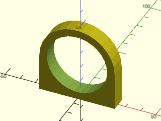

    include <BOSL2/std.scad>
    include <BOSL2/hooks.scad>
    ring_hook([50, 10], 25, 25, ir=20);

  

**Example 2:** Widen the base, add base fillet, no hole

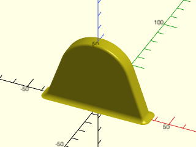

    include <BOSL2/std.scad>
    include <BOSL2/hooks.scad>
    $fa=4;$fs=1/2;
    ring_hook([70, 10], 25, or=25, ir=0, fillet=3, rounding=1.5);

  

**Example 3:** Narrow base

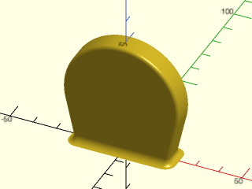

    include <BOSL2/std.scad>
    include <BOSL2/hooks.scad>
    $fa=4;$fs=1/2;
    ring_hook([40, 10], 25, or=25, ir=0, fillet=3, rounding=1.5);

  

**Example 4:** Negative fillet value

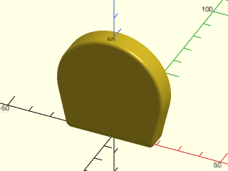

    include <BOSL2/std.scad>
    include <BOSL2/hooks.scad>
    $fa=4;$fs=1/2;
    ring_hook([40, 10], 25, or=25, ir=0, fillet=-3, rounding=1.5);

  

**Example 5:** If the base is narrower than the cylinder diameter then its corners have to be outside the cylinder for this shape to be defined because it requires a tangent line to the cylinder.  This example shows a valid base corner point in blue.  An invalid corner point appears in red: no tangent to the circle exists through the red point.

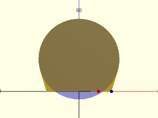

 

    include <BOSL2/std.scad>
    include <BOSL2/hooks.scad>
    hole_z = 20;
    base_size = [40, 10];
    outer_radius = 25;
    ring_hook(base_size, hole_z, outer_radius, ir=0);
    up(hole_z) color("blue", 0.25) ycyl(r=outer_radius, h=base_size.y + 2);
    right(0.5*base_size.x) color("blue") ycyl(r=1, h=base_size.y + 2, $fn=12);
    right(0.3*base_size.x) color("red") ycyl(r=1, h=base_size.y + 2, $fn=12);

**Example 6:** Through hole can be specified using or/od, ir/id, wall variables.  All of these are equivalent.

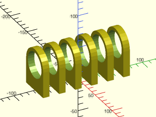

    include <BOSL2/std.scad>
    include <BOSL2/hooks.scad>
    ydistribute(spacing = 25) {
      ring_hook([50, 10], 40, or=25, ir=20);
      ring_hook([50, 10], 40, 25, wall=5);
      ring_hook([50, 10], 40, wall=5, ir=20);
      ring_hook([50, 10], 40, od=50, id=40);
      ring_hook([50, 10], 40, od=50, wall=5);
      ring_hook([50, 10], 40, wall=5, id=40);
    }

  

**Example 7:** Semi-circular through hole (a D-hole):

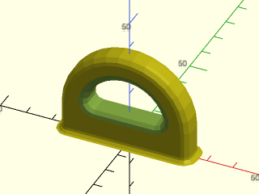

 

    include <BOSL2/std.scad>
    include <BOSL2/hooks.scad>
    ring_hook([50, 10], 12, 25, ir=15, hole="D", rounding=3, hole_rounding=3, fillet=2);

**Example 8:** hole\_z must be greater than 0 with no hole or with hole="D".  Here hole\_z is 1, close to the minimum value of zero.

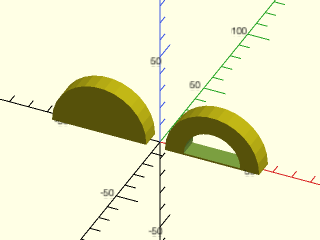

    include <BOSL2/std.scad>
    include <BOSL2/hooks.scad>
    xdistribute(spacing=60){
      ring_hook([50, 10], 1, 25, ir=0);
      ring_hook([50, 10], 1, 25, ir=15, hole="D");
    }

  

**Example 9:** hole\_z must be greater than ir + hole\_rounding + fillet when hole="circle".  Here hole\_z is only 1 larger than the minimum.

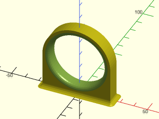

 

    include <BOSL2/std.scad>
    include <BOSL2/hooks.scad>
    $fs=1;$fa=5;
    ring_hook([50, 10], hole_z=27, or=25, ir=20, hole_rounding=3, fillet=3);

**Example 10:** Rounding all edges

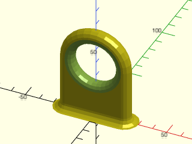

 

    include <BOSL2/std.scad>
    include <BOSL2/hooks.scad>
    ring_hook([50, 10], 40, 25, ir=15, rounding=5, hole_rounding=5, fillet=5);

**Example 11:** Giving an arbitrary path for the hole, in this case an octagon to make the object printable without support.

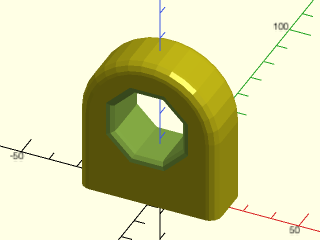

 

    include <BOSL2/std.scad>
    include <BOSL2/hooks.scad>
    ring_hook([50, 20],30, 25, hole=octagon(side=10,realign=true), hole_rounding=3, rounding=4) ;

**Example 12:** Using `outside_segments`

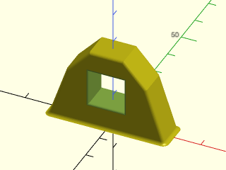

 

    include <BOSL2/std.scad>
    include <BOSL2/hooks.scad>
    $fs=.2;$fa=2;
    ring_hook(base_size=[40,10],hole_z=14, od=29,hole=rect(12),
              rounding=1,hole_rounding=1,fillet=1,outside_segments=3);

**Example 13:** The ring\_hook includes 4 custom anchors: front &amp; back at the center of the cylinder component and left &amp; right at the tangent points.

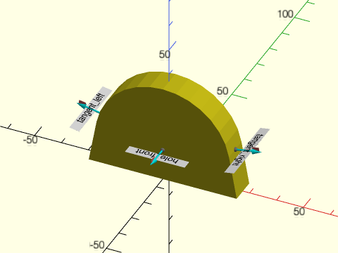

 

    include <BOSL2/std.scad>
    include <BOSL2/hooks.scad>
    ring_hook([55, 10], 12, 25, ir=0) show_anchors(std=false);

**Example 14:** Use the custom anchor to place a screw hole

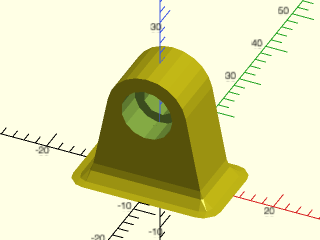

 

    include <BOSL2/std.scad>
    include <BOSL2/hooks.scad>
    include <BOSL2/screws.scad>
    diff()
    ring_hook([20, 10], 15, 7, ir=0, fillet=3)
       attach("hole_front")
         screw_hole("M5", length=20, head="socket", atype="head", anchor=TOP, orient=UP);

**Example 15:** Use the custom anchor to create a cylindrical extension instead of a hole

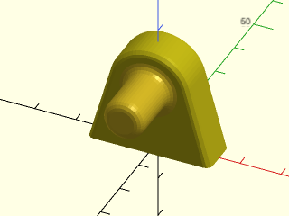

    include <BOSL2/std.scad>
    include <BOSL2/hooks.scad>
    $fs=1;$fa=2;
    ring_hook([30,10], hole_z=17, or=10, ir=0, rounding=1.5)
       attach("hole_front", BOT)
         cyl(d=10, h=14, rounding1=-2, rounding2=2);

  

**Example 16:** Use the "inside" part to create a bar across the hole:

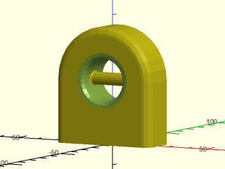

    include <BOSL2/std.scad>
    include <BOSL2/hooks.scad>
    diff()
    ring_hook([50, 20],30, 25, ir=10, hole_rounding=3, rounding=4)
      attach_part("inside")
      prism_connector( circle(3, $fn=16),
         parent(), LEFT,
         parent(), RIGHT, fillet=1);

  

---

