# LibFile: isosurface.scad

[Metaballs](https://en.wikipedia.org/wiki/Metaballs) (also known as "blobby objects"), are
bounded and closed organic surfaces that smoothly blend together. Metaballs are a specific kind
of [isosurface](https://en.wikipedia.org/wiki/Isosurface).

An isosurface, or implicit surface, is a three-dimensional surface representing all points of a
constant value (e.g. pressure, temperature, electric potential, density) in a 3D volume. It's
the 3D version of a 2D contour; in fact, any 2D cross-section of an isosurface **is** a 2D
contour.

For computer-aided design, isosurfaces of abstract functions can generate complex curved
surfaces and organic shapes. For example, spherical metaballs can be formulated using a set of
point centers that define the metaball locations. For each metaball, a function is defined to
compute the contribution of the metaball to any point in a 3D volume. The combined
contributions from all the metaballs results in a function that varies in a complicated way
throughout the volume. When two metaballs are far apart, they appear simply as spheres, but
when they are close together they enlarge, reach toward each other, and meld together in a
smooth fashion. The resulting metaball model appears as smoothly blended blobby shapes. The
implementation below provides metaballs of a variety of types including spheres, cuboids, and
cylinders (cones), with optional parameters to adjust the influence of one metaball on others,
and the cutoff distance where the metaball's influence stops.

In general, an isosurface can be defined using any function of three variables $x, y, z$. The
isosurface of a function $f(x,y,z)$ is the set of points where $f(x,y,z)=c$ for some constant
value $c$. Such a function is also known as an "implicit surface" because the function
*implies* a surface of constant value within a volume of space. The constant $c$ is referred to
as the "isovalue". Changing the isovalue changes the position of the isosurface, depending on
how the function is defined. Because metaballs are isosurfaces, they also have an isovalue. The
isovalue is also known as the "threshold".

Some isosurface functions are unbounded, extending infinitely in all directions. A familiar
example may be a [gryoid](https://en.wikipedia.org/wiki/Gyroid), which is often used as a
volume infill pattern in
[fused filament fabrication](https://en.wikipedia.org/wiki/Fused_filament_fabrication). The
gyroid isosurface is unbounded and periodic in all three dimensions.

This file provides modules and functions to create a [VNF](vnf.scad) using metaballs, or from
general isosurfaces. This file also provides modules and functions to create 2d metaballs and
contours, where the output is a list of [paths](paths.scad), which can be open or closed paths.

For isosurfaces and 3D metaballs, the point list in the generated VNF structure contains many
duplicated points. This is normally not a problem for rendering the shape, but machine roundoff
differences may result in Manifold issuing warnings when doing the final render, causing
rendering to abort if you have enabled the "stop on first warning" setting. You can prevent
this by passing the VNF through [`vnf_quantize()`](vnf.scad#function-vnf_quantize) using a quantization of 1e-7, or you can
pass the VNF structure into [`vnf_merge_points()`](vnf.scad#function-vnf_merge_points), which also removes the duplicates.
Additionally, flat surfaces (often resulting from clipping by the bounding box) are
triangulated at the voxel size resolution, and these can be unified into a single face by
passing the vnf structure to [`vnf_unify_faces()`](vnf.scad#function-vnf_unify_faces). These steps can be computationally
expensive and are not normally necessary.

To use, add the following lines to the beginning of your file:

    include <BOSL2/std.scad>
    include <BOSL2/isosurface.scad>

## File Contents

1. [Section: Metaballs](#section-metaballs)
    - [`metaballs()`](#functionmodule-metaballs) – Creates a group of 3D metaballs (smoothly connected blobs). [<abbr>Geom</abbr>] [<abbr>VNF</abbr>]
    - [`metaballs2d()`](#functionmodule-metaballs2d) – Creates a group of 2D metaballs (smoothly connected blobs). [<abbr>Geom</abbr>] [<abbr>Region</abbr>]

2. [Section: Isosurfaces (3D) and contours (2D)](#section-isosurfaces-3d-and-contours-2d)
    - [`isosurface()`](#functionmodule-isosurface) – Creates a 3D isosurface (a 3D contour) from a function or array of values. [<abbr>Geom</abbr>] [<abbr>VNF</abbr>]
    - [`contour()`](#functionmodule-contour) – Creates a 2D contour from a function or array of values. [<abbr>Geom</abbr>] [<abbr>Path</abbr>] [<abbr>Region</abbr>]

## Section: Metaballs

[Metaballs](https://en.wikipedia.org/wiki/Metaballs), also known as "blobby objects", can
produce smoothly varying blobs and organic forms. You create metaballs by placing metaball
objects at different locations. These objects have a basic size and shape when placed in
isolation, but if another metaball object is nearby, the two objects interact, growing larger
and melding together. The closer the objects are, the more they blend and meld.

The `metaballs()` module and function produce scenes of 3D metaballs. The `metaballs2d()`
module and function produces scenes of 2D metaballs. The metaball specification method,
tranformations, bounding box, and other parameters are used the say way in 3D and 2D, but in
2D, pixels replace voxels. This introductory section describes features common to both 3D and
2D cases.

***Parameters common to 3D and 2D metaballs***

**Parameter `spec`:** The simplest metaball specification is a 1D list of alternating
transformation matrices and metaball functions: `[trans0, func0, trans1, func1, ... ]`, passed
as the `spec` parameter. Each transformation matrix you supply can be constructed using the
usual transformation commands such as [`up()`](transforms.scad#functionmodule-up), [`right()`](transforms.scad#functionmodule-right), [`back()`](transforms.scad#functionmodule-back), [`move()`](transforms.scad#functionmodule-move),
[`scale()`](transforms.scad#functionmodule-scale), [`rot()`](transforms.scad#functionmodule-rot) and so on. You can multiply the transformations together, similar to how
the transformations can be applied to regular objects in OpenSCAD. For example, to transform an
object in regular OpenSCAD you might write `up(5) zrot(45) scale(4)`. You would provide that
transformation as the transformation matrix `up(5) * zrot(45) * scale(4)`. You can use scaling
to produce an ellipsoid from a sphere, and you can even use [`skew()`](transforms.scad#functionmodule-skew) if desired. When no
transformation is needed, give `IDENT` as the transformation.

The `spec` parameter is flexible. It doesn't have to be just a list of alternating
transformation matrices and metaball functions. It can also be a list of alternating transforms
and *other specs*, as `[trans0, spec0, trans1, spec1, ...]`, in which `spec0`, `spec1`, etc.
can be one of:
* A built-in metaball function name as described below, such as `mb_sphere(r=10)`.
* A function literal accepting a vector representing a point in space relative to the metaball's center.
* An array containing a function literal and a debug VNF, as `[custom_func, [sign, vnf]]`, where `sign` is the sign of the metaball and `vnf` is the VNF to show in the debug view when `debug=true` is set.
* Another spec array, for nesting metaball specs together.

Nested metaball specs allow for complicated assemblies in which you can arrange components in a
logical way, or repeat a structure with different transformation matrices. That is, instead of
specifying a transform and function, you specify a transform and then another metaball
specification. For example, you could set `finger=[t0,f0,t1,f1,t2,f2]` and then set
`hand=[u0,finger,u1,finger,...]` and then invoke `metaballs()` with `spec=[s0, hand]`. In
effect, any metaball specification array can be treated as a single metaball in another
specification array. This is a powerful technique that lets you make groups of metaballs that
you can use as individual metaballs in other groups, and can make your code compact and simpler
to understand. Keep in mind that nested components aren't independent; they still interact with
all other components. See Example 24.

**Parameters `bounding_box` and grid units:** The metaballs are evaluated over a bounding box.
The `bounding_box` parameter can be specified by its minimum and maximum corners:
`[[xmin,ymin,zmin],[xmax,ymax,zmax]]` in 3D, or `[[xmin,ymin],[xmax,ymax]]` in 2D. The bounding
box can also be specified as a scalar size of a cube (in 3D) or square (in 2D) centered on the
origin. The contributions from **all**  metaballs, even those outside the box, are evaluated
over the bounding box.

This bounding box is divided into grid units, specified as `voxel_size` in 3D or `pixel_size`
in 2D, which can be a scalar or a vector size. Alternately, you can set the grid count
(`voxel_count` or `pixel_count`) to fit approximately the specified number of grid units into
the bounding box.

Objects in the scene having any dimension smaller than the grid spacing may not be displayed,
so if objects seem to be missing, try making the grid units smaller or the grid count larger.
By default, if the voxel size or pixel size doesn't exactly divide your specified bounding box,
then the bounding box is enlarged to contain whole grid units, and centered on your requested
box. Alternatively, you may set `exact_bounds=true`, which causes the grid units to adjust to
fit instead, resulting in non-square grid units. Either way, if the bounding box clips a
metaball and `closed=true` (the default), the object is closed at the intersection. Setting
`closed=false` causes the object to end at the bounding box. In 3D, this results in a
non-manifold shape with holes, exposing the inside of the object. In 2D, this results in an
open-ended contour path with higher values on the right with respect to the path direction.

For metaballs with flat surfaces or sides, avoid letting any side of the bounding box coincide
with one of these flat surfaces or sides, otherwise unpredictable triangulation around the edge
may result.

**Parameter `isovalue`:** The `isovalue` parameter applies globally to **all** your metaballs
and changes the appearance of your entire metaball object, possibly dramatically. It defaults
to 1 and you don't usually need to change it. If you increase the isovalue, then all the
objects in your model shrink, causing some melded objects to separate. If you decrease it, each
metaball grows and melds more with others. As with `isosurface()`, a range may be specified for
isovalue, which can result in hollow metaballs, although this isn't particularly useful except
possibly in 2D.

***Metaballs debug view***

The module form of `metaballs()` and `metaballs2d()` can take a `debug` argument. When you set
`debug=true`, the scene is rendered as a transparency (in 3D) or outline (in 2D) with the
primitive metaball shapes shown inside, colored blue for positive, orange for negative, or gray
for custom metaballs with no sign specified. These shapes are displayed at the sizes specified
by the dimensional parameters in the corresponding metaball functions, regardless of isovalue.
Setting `hide_debug=true` in individual metaball functions hides primitive shape from the debug
view. Regardless the `debug` setting, child modules can access the metaball geometry via
`$metaball_vnf` in 3D, or `$metaball_pathlist` in 2D.

User-defined metaball functions are displayed by default as gray tetrahedrons (3D) or triangles
(2D) with a corner radius of 5, unless you also designate a shape for your custom function, as
described below in the documentation for [`metaballs()`](#functionmodule-metaballs) and [`metaballs2d()`](#functionmodule-metaballs2d).

***Metaballs run time***

The size of the grid units (voxels or pixels) and size of the bounding box affects the run
time, which can be long, especially in 3D. Smaller grid units produce a finer, smoother result
at the expense of execution time. Larger grid units shorten execution time. The effect on run
time is most evident for 3D metaballs, less so for 2D metaballs.

For example, in 3D, a voxel size of 1 with a bounding box volume of 200×200×200 may be slow
because it requires the calculation and storage of eight million function values, and more
processing and memory to generate the triangulated mesh.  On the other hand, a voxel size of 5
over a 100×100×100 bounding box requires only 8,000 function values and a modest computation
time. A good rule is to keep the number of voxels below 10,000 for preview, and adjust the
voxel size smaller for final rendering. If you don't specify `voxel_size` or `voxel_count`,
then a default count of 10,000 voxels is used, which should be reasonable for initial preview.

In 2D, If you don't specify `pixel_size` or `pixel_count`, then a default count of 1024 pixels
is used, which is reasonable for initial preview. You may find, however, that 2D metaballs are
reasonably fast even at finer resolution.

Because a bounding box that is too large wastes time computing function values that are not
needed, you can also set the parameter `show_stats=true` to get the actual bounds of the voxels
intersected by the surface. With this information, you may be able to decrease run time, or
keep the same run time but increase the resolution.

***Metaball functions and user defined functions***

You can construct complicated metaball models using only the built-in metaball functions
described in the documentation below for [`metaballs()`](#functionmodule-metaballs) and [`metaballs2d()`](#functionmodule-metaballs2d). However, you
can create your own custom metaballs if desired.

When multiple metaballs are in a model, their functions are summed and compared to the isovalue
to determine the final shape of the metaball object. Each metaball is defined as a function of
a vector that gives the value of the metaball function for that point in space. As is common in
metaball implementations, we define the built-in metaballs using an inverse relationship where
the metaball functions fall off as $1/d$, where $d$ is distance measured from the center or
core of the metaball. The 3D spherical metaball and 2D circular metaball therefore have a
simple basic definition as $f(v) = 1/\text{norm}(v)$. If we choose an isovalue $c$, then the
set of points $v$ such that $f(v) >= c$ defines a bounded set; for example, a sphere with
radius depending on the isovalue $c$. The default isovalue is $c=1$. Increasing the isovalue
shrinks the object, and decreasing the isovalue grows the object.

To adjust interaction strength, the influence parameter applies an exponent, so if `influence=a`
then the decay becomes $1/d^{1/a}$. This means, for example, that if you set influence to
0.5 you get a $1/d^2$ falloff. Changing this exponent changes how the balls interact.

You can pass a custom function as a
[function literal](https://en.wikibooks.org/wiki/OpenSCAD_User_Manual/User-Defined_Functions_and_Modules#Function_literals)
that takes a vector as its first argument and returns a single numerical value. Generally, the
function should return a scalar value that drops below the isovalue somewhere within your
bounding box. If you want your custom metaball function to behave similar to to the built-in
functions, the return value should fall off with distance as $1/d$. See `metaballs()` Examples
20, 21, and 22 for demonstrations of creating custom metaball functions. Example 22 also shows
how to make a complete custom metaball function that handles the `influence` and `cutoff`
parameters.

By default, when `debug=true`, a custom 3D metaball function displays a gray tetrahedron with
corner radius 5, and a custom 2D metaball function displays a gray triangle with corner radius
5. To specify a custom VNF for a custom function literal, enclose it in square brackets to make
a  list with the function literal as the first element, and another list as the second element,
for example:

`[ function (point) custom_func(point, arg1,...), [sign, vnf] ]`

where `sign` is the sign of the metaball and `vnf` is the VNF to show in the debug view when
`debug=true`. For 2D metaballs, you would specify a polygon path instead of a VNF. The sign
determines the color of the debug object: `1` is blue, `-1` is orange, and `0` is gray. See
`metaballs()` Example 31 below for a demonstration of setting a VNF for a custom function.

### Function/Module: metaballs()

**Synopsis:** Creates a group of 3D metaballs (smoothly connected blobs). [<abbr>Geom</abbr>] [<abbr>VNF</abbr>]

**Topics:** [Metaballs](Topics#metaballs), [Isosurfaces](Topics#isosurfaces), [VNF Generators](Topics#vnf-generators)

**See Also:** [isosurface()](#functionmodule-isosurface)

**Usage:** As a module

- metaballs(spec, bounding_box, voxel_size, [voxel_count=], [isovalue=], [closed=], [exact_bounds=], [convexity=], [show_stats=], [show_box=], [debug=] ...) [ATTACHMENTS];

**Usage:** As a function

- vnf = metaballs(spec, bounding_box, voxel_size, [voxel_count=], [isovalue=], [closed=], [exact_bounds=], [convexity=], [show_stats=]);

**Description:** 

Computes a [VNF structure](vnf.scad) of a 3D metaball scene within a specified bounding box.

See [metaball parameters](#metaball-parameters) for details on the primary parameters common to
`metaballs()` and `metaballs2d()`. The `spec` parameter is described in more detail there. The
`spec` parameter is a 1D list of alternating transforms and metaball functions; for example,
the array `spec= [ left(9), mb_sphere(5), right(9), mb_sphere(5) ]` defines a scene with two
spheres of radius 5 shifted 9 units to the left and right of the origin. The `spec` parameter
completely defines the metaballs in your scene, including their position, orientation, and
scaling, as well as different shapes.

You can create metaballs in a variety of standard shapes using the predefined functions listed
below. If you wish, you can also create custom metaball shapes using your own functions (see
Examples 20 and 21). For all of the built-in metaballs, three parameters are available to
control the interaction of the metaballs with each other: `cutoff`, `influence`, and
`negative`. These parameters apply to the individual metaball functions specified in your
`spec` array; they are **not** parameters of `metaballs()`.

The `cutoff` parameter specifies the distance beyond which the metaball has no interaction with
other balls. When you apply `cutoff`, a smooth suppression factor begins decreasing the
interaction strength at half the cutoff distance and reduces the interaction to zero at the
cutoff. Note that the smooth decrease may cause the interaction to become negligible closer
than the actual cutoff distance, depending on the voxel size and `influence` of the ball. Also,
depending on the value of `influence`, a cutoff that ends in the middle of another ball can
result in strange shapes, as shown in Example 17, with the metaball interacting on one side of
the boundary and not interacting on the other side. If you scale a ball, the cutoff value is
also scaled.

The `influence` parameter adjusts the strength of the interaction that metaball objects have
with each other. If you increase `influence` of one metaball from its default of 1, then that
metaball interacts with others at a longer range, and surrounding balls grow bigger. The
metaball with larger influence can also grow bigger because it couples more strongly with other
nearby balls, but it can also remain nearly unchanged while influencing others when `isovalue`
is greater than 1. Decreasing influence has the reverse effect. Small changes in influence can
have a large effect; for example, setting `influence=2` dramatically increases the interactions
at longer distances, and you may want to set the `cutoff` argument to limit the range
influence. At the other exteme, small influence values can produce ridge-like artifacts or
texture on the model. Example 14 demonstrates this effect. To avoid these artifacts, keep
`influence` above about 0.5 and consider using `cutoff` instead of using small influence.

The `negative` parameter, if set to `true`, creates a negative metaball, which can result in
hollows, dents, or reductions in size of other metaballs. Negative metaballs are never directly
visible; only their effects are visible. The `influence` argument may also behave in ways you
don't expect with a negative metaball. See Examples 16 and 17.

***Built-in metaball functions***

Several metaballs are defined for you to use in your models. All of the built-in metaballs take
positional and named parameters that specify the size of the metaball (such as height or
radius). The size arguments are the same as those for the regular objects of the same type
(e.g. a sphere accepts both `r` for radius and the named parameter `d=` for diameter). The size
parameters always specify the size of the metaball **in isolation** with `isovalue=1`. The
metaballs can grow much bigger than their specified sizes when they interact with each other.
Changing `isovalue` also changes the sizes of metaballs. They grow bigger than their specified
sizes, even in isolation, if `isovalue < 1` and smaller than their specified sizes if `isovalue
> 1`.

The built-in metaball functions are listed below. As usual, arguments without a trailing `=`
can be used positionally; arguments with a trailing `=` must be used as named arguments.

* `mb_sphere(r|d=)` &mdash; spherical metaball, with radius `r` or diameter `d`.  You can create an ellipsoid using `scale()` as the last transformation entry of the metaball `spec` array.
* `mb_cuboid(size, [squareness=])` &mdash; cuboid metaball with rounded edges and corners. The corner sharpness is controlled by the `squareness` parameter ranging from 0 (spherical) to 1 (cubical), and defaults to 0.5. The `size` parameter specifies the dimensions of the cuboid that circumscribes the rounded shape, which is tangent to the center of each cube face. The `size` parameter may be a scalar or a vector, as in [`cuboid()`](shapes3d.scad#module-cuboid). Except when `squareness=1`, the faces are always a little bit curved.
* `mb_cyl(h|l|height|length, [r|d=], [r1=|d1=], [r2=|d2=], [rounding=])` &mdash; vertical cylinder or cone metaball with similar dimensional arguments as [`cyl()`](shapes3d.scad#functionmodule-cyl). At least one of the radius or diameter arguments is required. The `rounding` argument defaults to 0 (sharp edge) if not specified. Only one rounding value is allowed: the rounding is the same at both ends. For a fully rounded cylindrical shape, consider using `mb_disk()` or `mb_capsule()`, which are less flexible but have faster execution times.
* `mb_disk(h|l|height|length, r|d=)` &mdash; flat disk with rounded edge, using similar dimensional arguments as [`cyl()`](shapes3d.scad#functionmodule-cyl). The diameter specifies the total diameter of the shape including the rounded sides, and must be greater than its height.
* `mb_capsule(h|l|height|length, [r|d=]` &mdash; vertical cylinder with rounded caps, using similar dimensional arguments as [`cyl()`](shapes3d.scad#functionmodule-cyl). The object is a convex hull of two spheres. The height or length specifies the distance between the ends of the hemispherical caps.
* `mb_connector(p1, p2, [r|d=])` &mdash; a connecting rod of radius `r` or diameter `d` with hemispherical caps (like `mb_capsule()`), but specified to connect point `p1` to point `p2` (which must be different 3D coordinates). As with `mb_capsule()`, the object is a convex hull of two spheres. The points `p1` and `p2` are at the centers of the two round caps. The connectors themselves are still influenced by other metaballs, but it may be undesirable to have them influence others, or each other. If two connectors are connected, the joint may appear swollen unless `influence` or `cutoff` is reduced. Reducing `cutoff` is preferable if feasible, because reducing `influence` can produce interpolation artifacts.
* `mb_torus([r_maj|d_maj=], [r_min|d_min=], [or=|od=], [ir=|id=])` &mdash; torus metaball oriented perpendicular to the z axis. You can specify the torus dimensions using the same arguments as [`torus()`](shapes3d.scad#functionmodule-torus); that is, major radius (or diameter) with `r_maj` or `d_maj`, and minor radius and diameter using `r_min` or `d_min`. Alternatively you can give the inner radius or diameter with `ir` or `id` and the outer radius or diameter with `or` or `od`. You must provide a combination of inputs that completely specifies the torus. If `cutoff` is applied, it is measured from the circle represented by `r_min=0`.
* `mb_octahedron(size, [squareness=])` &mdash; octahedron metaball with rounded edges and corners. The corner sharpness is controlled by the `squareness` parameter ranging from 0 (spherical) to 1 (sharp), and defaults to 0.5. The `size` parameter specifies the tip-to-tip distance of the octahedron that circumscribes the rounded shape, which is tangent to the center of each octahedron face. The `size` parameter may be a scalar or a vector, as in [`octahedron()`](shapes3d.scad#functionmodule-octahedron). At `squareness=0`, the shape reduces to a sphere curcumscribed by the octahedron. Except when `squareness=1`, the faces are always curved.

In addition to the dimensional arguments described above, all of the built-in functions accept
the following named arguments:
* `cutoff` &mdash; positive value giving the distance beyond which the metaball does not interact with other balls.  Cutoff is measured from the object's center. Default: INF
* `influence` &mdash; a positive number specifying the strength of interaction this ball has with other balls.  Default: 1
* `negative` &mdash; when true, creates a negative metaball. Default: false
* `hide_debug` &mdash; when true, suppresses the display of the underlying metaball shape when `debug=true` is set in the `metaballs()` module. This is useful to hide shapes that may be overlapping others in the debug view. Default: false

***Duplicated vertices***

The point list in the generated VNF structure contains many duplicated points. This is normally
not a problem for rendering the shape, but machine roundoff differences may result in Manifold
issuing warnings when doing the final render, causing rendering to abort if you have enabled
the "stop on first warning" setting. You can prevent this by passing the VNF through
[`vnf_quantize()`](vnf.scad#function-vnf_quantize) using a quantization of 1e-7, or you can pass the VNF structure into
[`vnf_merge_points()`](vnf.scad#function-vnf_merge_points), which also removes the duplicates. Additionally, flat surfaces (often
resulting from clipping by the bounding box) are triangulated at the voxel size resolution, and
these can be unified into a single face by passing the vnf structure to [`vnf_unify_faces()`](vnf.scad#function-vnf_unify_faces).
These steps can be computationally expensive and are not normally necessary.

**Arguments:** 

<abbr title="These args can be used by position or by name.">By&nbsp;Position</abbr> | What it does
-------------------- | ------------
`spec`               | Metaball specification in the form `[trans0, spec0, trans1, spec1, ...]`, with alternating transformation matrices and metaball specs, where `spec0`, `spec1`, etc. can be a metaball function or another metaball specification. See above for more details, and see Example 24 for a demonstration.
`bounding_box`       | The volume in which to perform computations, expressed as a scalar size of a cube centered on the origin, or a pair of 3D points `[[xmin,ymin,zmin], [xmax,ymax,zmax]]` specifying the minimum and maximum box corner coordinates. Unless you set `exact_bounds=true`, the bounding box size may be enlarged to fit whole voxels.
`voxel_size`         | Size of the voxels used to sample the bounding box volume, can be a scalar or 3-vector, or omitted if `voxel_count` is set. You may get a non-cubical voxels of a slightly different size than requested if `exact_bounds=true`.

<abbr title="These args must be used by name, ie: name=value">By&nbsp;Name</abbr> | What it does
-------------------- | ------------
`voxel_count`        | Approximate number of voxels in the bounding box. If `exact_bounds=true` then the voxels may not be cubes. Use with `show_stats=true` to see the corresponding voxel size. Default: 22^3 (10648) if `voxel_size` not set
`isovalue`           | A scalar value specifying the isosurface value (threshold value) of the metaballs. At the default value of 1.0, the internal metaball functions are designd so the size arguments correspond to the size parameter (such as radius) of the metaball, when rendered in isolation with no other metaballs. You can also specify an isovalue range such as `[1,1.1]`, which creates hollow metaballs, where the hollow is evident when clipped by the bounding box. A scalar isovalue is equivalent to the range `[isovalue,INF]`. Default: 1.0
`closed`             | When true, close the surface if it intersects the bounding box by adding a closing face. When false, do not add a closing face, possibly producing non-manfold metaballs with holes where the bounding box intersects them.  Default: true
`exact_bounds`       | When true, shrinks voxels as needed to fit whole voxels inside the requested bounding box. When false, enlarges `bounding_box` as needed to fit whole voxels of `voxel_size`, and centers the new bounding box over the requested box. Default: false
`show_stats`         | If true, display statistics about the metaball isosurface in the console window. Besides the number of voxels that the surface passes through, and the number of triangles making up the surface, this is useful for getting information about a possibly smaller bounding box to improve speed for subsequent renders. Enabling this parameter has a small speed penalty. Default: false
`convexity`          | (Module only) Maximum number of times a line could intersect a wall of the shape. Affects preview only. Default: 6
`show_box`           | (Module only) Display the requested bounding box as transparent. This box may appear slightly different than specified if the actual bounding box had to be expanded to accommodate whole voxels. Default: false
`debug`              | (Module only) Display the underlying primitive metaball shapes using your specified dimensional arguments, overlaid by the transparent metaball scene. Positive metaballs appear blue, negative appears orange, and any custom function with no debug VNF defined appears as a gray tetrahedron of corner radius 5.
`cp`                 | (Module only) Center point for determining intersection anchors or centering the shape.  Determines the base of the anchor vector. Can be "centroid", "mean", "box" or a 3D point.  Default: "centroid"
`anchor`             | (Module only) Translate so anchor point is at origin (0,0,0).  See [anchor](attachments.scad#subsection-anchor).  Default: `"origin"`
`spin`               | (Module only) Rotate this many degrees around the Z axis after anchor.  See [spin](attachments.scad#subsection-spin).  Default: `0`
`orient`             | (Module only) Vector to rotate top toward, after spin. See [orient](attachments.scad#subsection-orient).  Default: `UP`
`atype`              | (Module only) Select "hull" or "intersect" anchor type.  Default: "hull"

**Anchor Types:** 

Anchor Type | What it is
----------- | ----------
"hull" | Anchors to the virtual convex hull of the shape.
"intersect" | Anchors to the surface of the shape.

**Named Anchors:** 

Anchor Name | Position
----------- | --------
"origin" | Anchor at the origin, oriented UP.

**Side Effects:** 

- `$metaball_vnf` is set to the VNF of the metaball scene.

**Example 1:** Two spheres interacting.

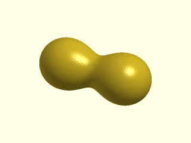

    include <BOSL2/std.scad>
    include <BOSL2/isosurface.scad>
    spec = [
        left(9), mb_sphere(5),
        right(9), mb_sphere(5)
    ];
    metaballs(spec, voxel_size=0.5,
        bounding_box=[[-16,-7,-7], [16,7,7]]);

  

**Example 2:** Two rounded cuboids interacting.

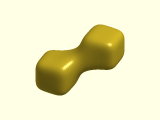

    include <BOSL2/std.scad>
    include <BOSL2/isosurface.scad>
    spec = [
        move([-8,-5,-5]), mb_cuboid(10),
        move([8,5,5]), mb_cuboid(10)
    ];
    metaballs(spec, voxel_size=0.5,
        bounding_box=[[-15,-12,-12], [15,12,12]]);

  

**Example 3:** Two rounded `mb_cyl()` cones interacting.

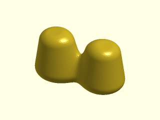

    include <BOSL2/std.scad>
    include <BOSL2/isosurface.scad>
    spec = [
        left(10), mb_cyl(15, r1=6, r2=4, rounding=2),
        right(10), mb_cyl(15, r1=6, r2=4, rounding=2)
    ];
    metaballs(spec, voxel_size=0.5,
        bounding_box=[[-17,-8,-10], [17,8,10]]);

  

**Example 4:** Two disks interacting. Here the arguments are in order and not named.

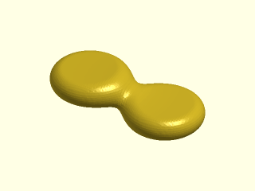

    include <BOSL2/std.scad>
    include <BOSL2/isosurface.scad>
    metaballs([
        move([-10,0,2]), mb_disk(5,9),
        move([10,0,-2]), mb_disk(5,9)
        ], [[-20,-10,-6], [20,10,6]], 0.5);

  

**Example 5:** Two capsules interacting.

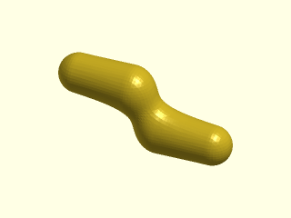

    include <BOSL2/std.scad>
    include <BOSL2/isosurface.scad>
    metaballs([
        move([-8,0,4])*yrot(90), mb_capsule(16,3),
        move([8,0,-4])*yrot(90), mb_capsule(16,3)
        ], [[-17,-5,-8], [17,5,8]],  0.5);

  

**Example 6:** A sphere with two connectors.

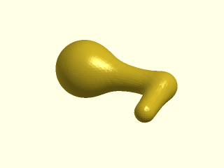

    include <BOSL2/std.scad>
    include <BOSL2/isosurface.scad>
    path = [[-20,0,0], [0,0,1], [0,-10,0]];
    spec = [
        move(path[0]), mb_sphere(6),
        for(seg=pair(path)) each
           [IDENT, mb_connector(seg[0],seg[1],
            2, influence=0.5)]
    ];
    metaballs(spec, voxel_size=0.5,
        bounding_box=[[-27,-13,-7], [4,7,14]]);

  

**Example 7:** Interaction between two tori in different orientations.

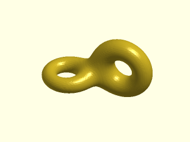

    include <BOSL2/std.scad>
    include <BOSL2/isosurface.scad>
    spec = [
        move([-10,0,17]),        mb_torus(r_maj=6, r_min=2),
        move([7,6,21])*xrot(90), mb_torus(r_maj=7, r_min=3)
    ];
    voxel_size = 0.5;
    boundingbox = [[-19,-9,9], [18,10,32]];
    metaballs(spec, boundingbox, voxel_size);

  

**Example 8:** Two octahedrons interacting. Here `voxel_size` is not given, so it defaults to a value that results in approximately 10,000 voxels in the bounding box. Adding the parameter `show_stats=true` displays the voxel size used, along with other information.

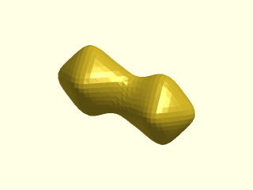

    include <BOSL2/std.scad>
    include <BOSL2/isosurface.scad>
    metaballs([
        move([-11,0,4]), mb_octahedron(20),
        move([11,0,-4]), mb_octahedron(20)
        ], [[-21,-11,-14], [21,11,14]]);

  

**Example 9:** These next five examples demonstrate the different types of metaball interactions. We start with two spheres 30 units apart. Each would have a radius of 10 in isolation, but because they are influencing their surroundings, each sphere mutually contributes to the size of the other. The sum of contributions between the spheres add up so that a surface plotted around the region exceeding the threshold defined by `isovalue=1` looks like a peanut shape surrounding the two spheres.

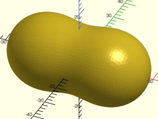

    include <BOSL2/std.scad>
    include <BOSL2/isosurface.scad>
    spec = [
        left(15),  mb_sphere(10),
        right(15), mb_sphere(10)
    ];
    voxel_size = 1;
    boundingbox = [[-30,-19,-19], [30,19,19]];
    metaballs(spec, boundingbox, voxel_size);

  

**Example 10:** Adding a cutoff of 25 to the left sphere causes its influence to disappear completely 25 units away (5 units from the center of the right sphere). The left sphere is bigger because it still receives the full influence of the right sphere, but the right sphere is smaller because the left sphere has no contribution past 25 units. The right sphere is not abruptly cut off because the cutoff function is smooth and influence is normal. Setting cutoff too small can remove the interactions of one metaball from all other metaballs, leaving that metaball alone by itself.

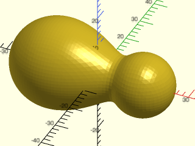

    include <BOSL2/std.scad>
    include <BOSL2/isosurface.scad>
    spec = [
        left(15),  mb_sphere(10, cutoff=25),
        right(15), mb_sphere(10)
    ];
    voxel_size = 1;
    boundingbox = [[-30,-19,-19], [30,19,19]];
    metaballs(spec, boundingbox, voxel_size);

  

**Example 11:** Here, the left sphere has less influence in addition to a cutoff. Setting `influence=0.5` results in a steeper falloff of contribution from the left sphere. Each sphere has a different size and shape due to unequal contributions based on distance.

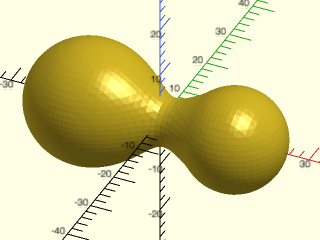

    include <BOSL2/std.scad>
    include <BOSL2/isosurface.scad>
    spec = [
        left(15),  mb_sphere(10, influence=0.5, cutoff=25),
        right(15), mb_sphere(10)
    ];
    voxel_size = 1;
    boundingbox = [[-30,-19,-19], [30,19,19]];
    metaballs(spec, boundingbox, voxel_size);

  

**Example 12:** In this example, we have two size-10 spheres as before and one tiny sphere of 1.5 units radius offset a bit on the y axis. With an isovalue of 1, this figure would appear similar to Example 9 above, but here the isovalue has been set to 2, causing the surface to shrink around a smaller volume values greater than 2. Remember, higher isovalue thresholds cause metaballs to shrink.

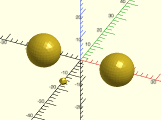

    include <BOSL2/std.scad>
    include <BOSL2/isosurface.scad>
    spec = [
       left(15),  mb_sphere(10),
       right(15), mb_sphere(10),
       fwd(15),   mb_sphere(1.5)
    ];
    voxel_size = 1;
    boundingbox = [[-30,-19,-19], [30,19,19]];
    metaballs(spec, boundingbox, voxel_size,
        isovalue=2);

  

**Example 13:** Keeping `isovalue=2`, the influence of the tiny sphere has been set quite high, to 10. Notice that the tiny sphere shrinks a bit, but it has dramatically increased its contribution to its surroundings, causing the two other spheres to grow and meld into each other. The `influence` argument on a small metaball affects its surroundings more than itself.

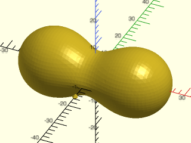

    include <BOSL2/std.scad>
    include <BOSL2/isosurface.scad>
    spec = [
       move([-15,0,0]), mb_sphere(10),
       move([15,0,0]),  mb_sphere(10),
       move([0,-15,0]), mb_sphere(1.5, influence=10)
    ];
    voxel_size = 1;
    boundingbox = [[-30,-19,-19], [30,19,19]];
    metaballs(spec, boundingbox, voxel_size,
        isovalue=2);

  

**Example 14:** Setting `influence` to less than 0.5 can cause interpolation artifacts in the surface. The only difference between these two spheres is `influence`. Both have `cutoff` set to prevent them from affecting each other. The sphere on the right has a low influence of 0.02, which translates to a falloff with distance $d$ proportional to $1/d^{50}$. That high exponent increases the *non-linear* nature of the function gradient at the isosurface, reducing the accuracy of the *linear* interpolation of where the the surface intersects each voxel, causing ridges to appear. You could use this to create a texture deliberately, but it is usually better to use `cutoff` to limit the range of influence rather than reducing `influence` significantly below 1.

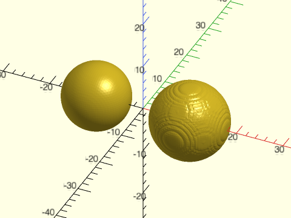

 

    include <BOSL2/std.scad>
    include <BOSL2/isosurface.scad>
    spec = [
        left(10), mb_sphere(8, cutoff=10, influence=1),
        right(10), mb_sphere(8, cutoff=10, influence=0.02)
    ];
    bbox = [[-18,-8,-8], [18,8,8]];
    metaballs(spec, bounding_box=bbox, voxel_size=0.4);

**Example 15:** A group of five spherical metaballs with different sizes. The parameter `show_stats=true` (not shown here) was used to find a compact bounding box for this figure. Here instead of setting `voxel_size`, we set `voxel_count` for approximate number of voxels in the bounding box, and the voxel size is adjusted to fit. Setting `exact_bounds=true` forces the bounding box to be fixed, and a non-cubic voxel is then used to fit within that box.

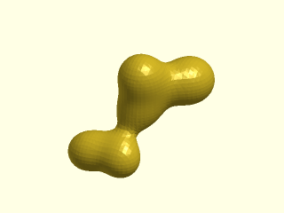

    include <BOSL2/std.scad>
    include <BOSL2/isosurface.scad>
    spec = [ // spheres of different sizes
        move([-20,-20,-20]), mb_sphere(5),
        move([0,-20,-20]),   mb_sphere(4),
        IDENT,               mb_sphere(3),
        move([0,0,20]),      mb_sphere(5),
        move([20,20,10]),    mb_sphere(7)
    ];
    voxel_size = 1.5;
    boundingbox = [[-30,-31,-31], [32,31,30]];
    metaballs(spec, boundingbox,
        exact_bounds=true, voxel_count=40000);

  

**Example 16:** A metaball can be negative. In this case we have two metaballs in close proximity, with the small negative metaball creating a dent in the large positive one. The positive metaball is shown transparent, and small spheres show the center of each metaball. The negative metaball isn't visible because its field is negative; the isosurface encloses only field values greater than the isovalue of 1.

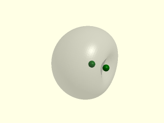

    include <BOSL2/std.scad>
    include <BOSL2/isosurface.scad>
    centers = [[-1,0,0], [1.25,0,0]];
    spec = [
        move(centers[0]), mb_sphere(8),
        move(centers[1]), mb_sphere(3, negative=true)
    ];
    voxel_size = 0.25;
    boundingbox = [[-7,-6,-6], [3,6,6]];
    %metaballs(spec, boundingbox, voxel_size);
    color("green") move_copies(centers) sphere(d=1, $fn=16);

  

**Example 17:** When a positive and negative metaball interact, the negative metaball reduces the influence of the positive one, causing it to shrink, but not disappear because its contribution approaches infinity at its center. In this example we have a large positive metaball near a small negative metaball at the origin. The negative ball has high influence, and a cutoff limiting its influence to 20 units. The negative metaball influences the positive one up to the cutoff, causing the positive metaball to appear smaller inside the cutoff range, and appear its normal size outside the cutoff range. The positive metaball has a small dimple at the origin (the center of the negative metaball) because it cannot overcome the infinite negative contribution of the negative metaball at the origin.

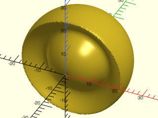

    include <BOSL2/std.scad>
    include <BOSL2/isosurface.scad>
    spec = [
        back(10), mb_sphere(20),
        IDENT, mb_sphere(2, influence=30,
            cutoff=20, negative=true),
    ];
    voxel_size = 0.5;
    boundingbox = [[-20,-4,-20], [20,30,20]];
    metaballs(spec, boundingbox, voxel_size);

  

**Example 18:** A sharp cube, a rounded cube, and a sharp octahedron interacting. Because the surface is generated through cubical voxels, voxel corners are always cut off, resulting in difficulty resolving some sharp edges.

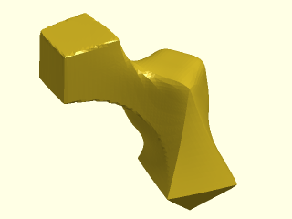

    include <BOSL2/std.scad>
    include <BOSL2/isosurface.scad>
    spec = [
        move([-7,-3,27])*zrot(55), mb_cuboid(6, squareness=1),
        move([5,5,21]),   mb_cuboid(5),
        move([10,0,10]),  mb_octahedron(10, squareness=1)
    ];
    voxel_size = 0.5; // a bit slow at this resolution
    boundingbox = [[-12,-9,3], [18,10,32]];
    metaballs(spec, boundingbox, voxel_size);

  

**Example 19:** A toy airplane, constructed only from metaball spheres with scaling. The bounding box is used to clip the wingtips, tail, and belly of the fuselage.

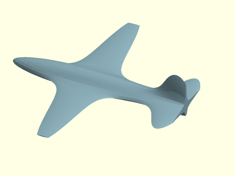

 

    include <BOSL2/std.scad>
    include <BOSL2/isosurface.scad>
    bounding_box = [[-55,-50,-5],[35,50,17]];
    spec = [
        move([-20,0,0])*scale([25,4,4]),   mb_sphere(1), // fuselage
        move([30,0,5])*scale([4,0.5,8]),   mb_sphere(1), // vertical stabilizer
        move([30,0,0])*scale([4,15,0.5]),  mb_sphere(1), // horizontal stabilizer
        move([-15,0,0])*scale([6,45,0.5]), mb_sphere(1)  // wing
    ];
    voxel_size = 1;
    color("lightblue") metaballs(spec, bounding_box, voxel_size);

**Example 20:** Custom metaballs are an advanced technique in which you define your own metaball shape by passing a function literal that takes a single argument: a coordinate in space relative to the metaball center called `point` here, but can be given any name. This distance vector from the origin is calculated internally and always passed to the function. Inside the function, it is converted to a scalar distance `dist`. The function literal expression sets all of your parameters. Only `point` is not set, and it becomes the single parameter to the function literal. The `spec` argument invokes your custom function as a function literal that passes `point` into it.

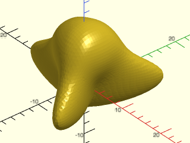

    include <BOSL2/std.scad>
    include <BOSL2/isosurface.scad>
    function threelobe(point) =
       let(
            ang=atan2(point.y, point.x),
            r=norm([point.x,point.y])*(1.3+cos(3*ang)),
            dist=norm([point.z, r])
       ) 3/dist;
    metaballs(
        spec = [
            IDENT, function (point) threelobe(point),
            up(7), mb_sphere(r=4)
        ],
        bounding_box = [[-14,-12,-5],[8,12,13]],
        voxel_size=0.5);

  

**Example 21:** Here is a function nearly identical to the previous example, introducing additional dimensional parameters into the function to control its size and number of lobes. The bounding box size here is as small as possible for calculation efficiency, but if you expiriment with this using different argument values, you should increase the bounding box along with voxel size.

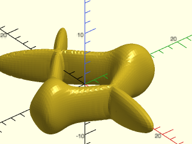

    include <BOSL2/std.scad>
    include <BOSL2/isosurface.scad>
    function multilobe(point, size, lobes) =
       let(
            ang=atan2(point.y, point.x),
            r=norm([point.x,point.y])*(1.3+cos(lobes*ang)),
            dist=norm([point.z, r])
       ) size/dist;
    metaballs(
        spec = [
            left(7),
               function (point) multilobe(point, 3, 4),
            right(7)*zrot(60),
               function (point) multilobe(point, 3, 3)
        ],
        bounding_box = [[-16,-13,-5],[18,13,6]],
        voxel_size=0.4);

  

**Example 22:** Next we show how to create a function that works like the built-ins. **This is a full implementation** that allows you to specify the function directly by name in the `spec` argument without needing the function literal syntax, and without needing the `point` argument in `spec`, as in the prior examples. Here, `noisy_sphere_calcs()` is the calculation function that accepts the `point` position argument and any other parameters needed (here `r` and `noise_level`), and returns a single value. Then there is a "master" function `noisy_sphere()` that does some error checking and returns an array consisting of (a) a function literal expression that sets all of your parameters, and (b) another array containing the metaball sign and a simple "debug" VNF representation of the metaball for viewing when `debug=true` is passed to `metaballs()`. The call to `mb_cutoff()` at the end handles the cutoff function for the noisy ball consistent with the other internal metaball functions; it requires `dist` and `cutoff` as arguments. You are not required to use this implementation in your own custom functions; in fact it's easier simply to declare the function literal in your `spec` argument, but this example shows how to do it all.

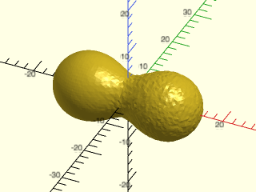

 

    include <BOSL2/std.scad>
    include <BOSL2/isosurface.scad>
    //
    // noisy sphere internal calculation function
    
    function noisy_sphere_calcs(point, r, noise_level, cutoff, exponent, neg) =
        let(
            noise = rands(0, noise_level, 1)[0],
            dist = norm(point) + noise // distance to point from metaball center
        ) neg * mb_cutoff(dist,cutoff) * (r/dist)^exponent;
    
    // noisy sphere "master" entry function to use in spec argument
    
    function noisy_sphere(r, noise_level, cutoff=INF, influence=1, negative=false, hide_debug=false, d) =
       assert(is_num(cutoff) && cutoff>0, "\ncutoff must be a positive number.")
       assert(is_finite(influence) && influence>0, "\ninfluence must be a positive number.")
       let(
           r = get_radius(r=r,d=d),
           dummy=assert(is_finite(r) && r>0, "\ninvalid radius or diameter."),
           neg = negative ? -1 : 1,
           // create [sign, vnf] for debug view; show tiny shape if hide_debug=true
           debug_vnf = [neg, hide_debug ? debug_tetra(0.02) : sphere(r, $fn=16)]
       ) [
           // pass control as a function literal to the calc function
           function (point) noisy_sphere_calcs(point, r, noise_level, cutoff, 1/influence, neg),
           debug_vnf
       ];
    
    // define the scene and render it
    
    spec = [
        left(9),  mb_sphere(5),
        right(9), noisy_sphere(r=5, noise_level=0.2)
    ];
    voxel_size = 0.5;
    boundingbox = [[-16,-8,-8], [16,8,8]];
    metaballs(spec, boundingbox, voxel_size);

**Example 23:** Demonstration of `debug=true` with a more complex example using ellipsoids, a capsule, spheres, and a torus to make a tetrahedral object with rounded feet and a ring on top. The bottoms of the feet are flattened by clipping with the bottom of the bounding box. The center of the object is thick due to the contributions of three ellipsoids and a capsule converging. Designing an object like this using metaballs requires trial and error with low-resolution renders.

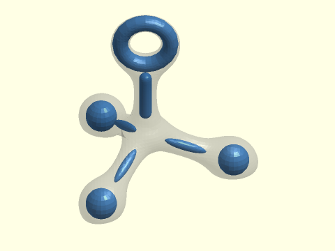

 

    include <BOSL2/std.scad>
    include <BOSL2/isosurface.scad>
    include <BOSL2/polyhedra.scad>
    tetpts = zrot(15, p = 22 * regular_polyhedron_info("vertices", "tetrahedron"));
    tettransform = [ for(pt = tetpts) move(pt)*rot(from=RIGHT, to=pt)*scale([7,1.5,1.5]) ];
    
    spec = [
        // vertical cylinder arm
        up(15), mb_capsule(17, 2, influence=0.8),
        // ellipsoid arms
        for(i=[0:2]) each [tettransform[i], mb_sphere(1, cutoff=30)],
        // ring on top
        up(35)*xrot(90), mb_torus(r_maj=8, r_min=2.5, cutoff=35),
        // feet
        for(i=[0:2]) each [move(2.2*tetpts[i]), mb_sphere(5, cutoff=30)],
    ];
    voxel_size = 1;
    boundingbox = [[-22,-32,-13], [36,32,46]];
    metaballs(spec, boundingbox, voxel_size, isovalue=1, debug=true);

**Example 24:** This example demonstrates grouping metaballs together and nesting them in lists of other metaballs, to make a crude model of a hand. Here, just one finger is defined, and a thumb is defined from one less joint in the finger. Individual fingers are grouped together with different positions and scaling, along with the thumb. Finally, this group of all fingers is used to combine with a rounded cuboid, with a slight ellipsoid dent subtracted to hollow out the palm, to make the hand.

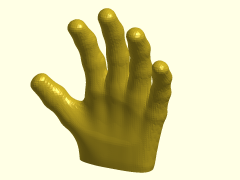

 

    include <BOSL2/std.scad>
    include <BOSL2/isosurface.scad>
    joints = [[0,0,1], [0,0,85], [0,-5,125], [0,-16,157], [0,-30,178]];
    finger = [
        for(i=[0:3]) each
            [IDENT, mb_connector(joints[i], joints[i+1], 9+i/5, influence=0.22)]
    ];
    thumb = [
        for(i=[0:2]) each [
            scale([1,1,1.2]),
            mb_connector(joints[i], joints[i+1], 9+i/2, influence=0.28)
        ]
    ];
    allfingers = [
        left(15)*zrot(5)*yrot(-50)*scale([1,1,0.6])*zrot(30), thumb,
        left(15)*yrot(-9)*scale([1,1,0.9]), finger,
        IDENT, finger,
        right(15)*yrot(8)*scale([1,1,0.92]), finger,
        right(30)*yrot(17)*scale([0.9,0.9,0.75]), finger
    ];
    hand = [
        IDENT, allfingers,
        move([-5,0,5])*scale([1,0.36,1.55]), mb_cuboid(90, squareness=0.3, cutoff=80),
        move([-10,-95,50])*yrot(10)*scale([2,2,0.95]),
            mb_sphere(r=15, cutoff=50, influence=1.5, negative=true)
    ];
    voxel_size=2.5;
    bbox = [[-104,-40,-10], [79,18,188]];
    metaballs(hand, bbox, voxel_size, isovalue=1);

**Example 25:** A model of an elephant using cylinders, capsules, and disks.

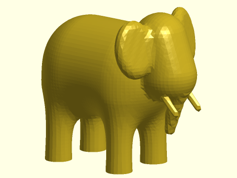

 

    include <BOSL2/std.scad>
    include <BOSL2/isosurface.scad>
    legD1 = 4.6;
    legD2 = 1;
    spec = [
        // legs
        up(1)*fwd(8)*left(13), mb_cyl(d1=legD1, d2=legD2, h=20),
        up(1)*fwd(8)*right(10), mb_cyl(d1=legD1, d2=legD2, h=20),
        up(1)*back(8)*left(13), mb_cyl(d1=legD1, d2=legD2, h=20),
        up(1)*back(8)*right(10), mb_cyl(d1=legD1, d2=legD2, h=20),
        up(20)*yrot(90), mb_capsule(d=21, h=36, influence=0.5), // body
        right(21)*up(25)*yrot(-20), mb_capsule(r=7, h=25, influence=0.5, cutoff=9), // head
        right(24)*up(10)*yrot(15), mb_cyl(d1=3, d2=6, h=15, cutoff=3), // trunk
        // ears
        right(18)*up(29)*fwd(11)*zrot(-20)*yrot(80)*scale([1.4,1,1]), mb_disk(r=5,h=2, cutoff=3),
        right(18)*up(29)*back(11)*zrot(20)*yrot(80)*scale([1.4,1,1]), mb_disk(r=5,h=2, cutoff=3),
        // tusks
        right(26)*up(13)*fwd(5)*yrot(135), mb_capsule(r=1, h=10, cutoff=1),
        right(26)*up(13)*back(5)*yrot(135), mb_capsule(r=1, h=10, cutoff=1)
    ];
    bbox = [[-21,-17,-9], [31,17,38]];
    metaballs(spec, bounding_box=bbox, voxel_size=1, isovalue=1);

**Example 26:** A model of a giraffe using a variety of different metaball shapes. Features such as the tail and lower legs are thin, so a small voxel size is required to render them.

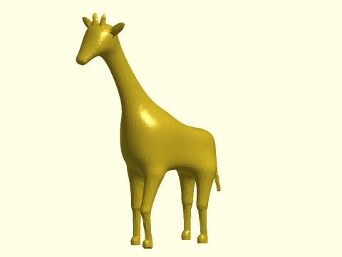

 

    include <BOSL2/std.scad>
    include <BOSL2/isosurface.scad>
    legD = 1;
    tibia = 14;
    femur = 12;
    head = [-35,0,78];  // head position
    stance = [12,6];    // leg position offsets
    
    spec = [
        // Lower legs
        move([-stance.x,-stance.y]), mb_connector([-4,0,0.25],[-6,0,tibia],legD, influence = 0.2),
        move([-stance.x,stance.y]),  mb_connector([0,0,0],[0,0,tibia],legD, influence = 0.2),
        move([stance.x,-stance.y]),  mb_connector([-2,0,0],[-3,0,tibia],legD, influence = 0.2),
        move([stance.x,stance.y]),   mb_connector([0,0,0],[0,0,tibia],legD, influence = 0.2),
        // Upper legs
        move([-stance.x,-stance.y,tibia]), mb_connector([-6,0,0],[-2,0,femur],legD),
        move([-stance.x,stance.y,tibia]),  mb_connector([0,0,0],[0,0,femur],legD),
        move([stance.x,-stance.y,tibia]),  mb_connector([-3,0,0],[-1,0,femur],legD),
        move([stance.x,stance.y,tibia]),   mb_connector([0,0,0],[0,0,femur],legD),
    
        // Hooves
        move([-stance.x-5.5,-stance.y,1.25])*yrot(-5), mb_capsule(d=2, h=3, cutoff=2),
        move([-stance.x-4.5,-stance.y,-1.4])*yrot(-5), mb_cuboid(size=4, squareness=1, cutoff=1, influence=20, negative=true), // truncate bottom of raised hoof
        move([-stance.x-1,stance.y,1]),     mb_capsule(d=2, h=3, cutoff=2),
        move([stance.x-3.5,-stance.y,1]),   mb_capsule(d=2, h=3, cutoff=2),
        move([stance.x-1,stance.y,1]),      mb_capsule(d=2, h=3, cutoff=2),
    
        // Body
        up(tibia+femur+10) * yrot(10),        mb_cuboid([16,7,7]),
        up(tibia+femur+15)*left(10),          mb_sphere(2),
        up(tibia+femur+8)*right(13)*xrot(90), mb_disk(1,4),
    
        // Tail
        up(tibia+femur+8), mb_connector([18,0,0],[22,0,-16], 0.4, cutoff = 1),
    
        // Neck
        up(tibia+femur+35)*left(22)*yrot(-30)* yscale(0.75), mb_cyl(d1 = 5, d2 = 3, l = 38),
    
        // Head
        move(head + [-4,0,-3])*yrot(45)*xscale(0.75), mb_cyl(d1 = 1.5, d2 = 4, l = 12, rounding=0),
        move(head), mb_cuboid(2),
    
        // Horns
        move(head), mb_connector([0,-2,5],[0,-2.5,8],0.3, cutoff = 1),
        move(head + [0,-2.5,8]), mb_sphere(0.5, cutoff = 1),
        move(head), mb_connector([0,2,5],[0,2.5,8],0.3, cutoff = 1),
        move(head + [0,2.5,8]), mb_sphere(0.5, cutoff = 1),
    
        // Ears
        move(head + [2,-8,4])* xrot(60) * scale([0.5,1,3]) , mb_sphere(d = 2, cutoff = 2),
        move(head + [2,8,4])* xrot(-60) * scale([0.5,1,3]) , mb_sphere(d = 2, cutoff = 2),
    ];
    vsize = 0.85;
    bbox =  [[-45.5, -11.5, 0], [23, 11.5, 87.55]];
    metaballs(spec, bbox, voxel_size=vsize);

**Example 27:** A model of a bunny, assembled from separate body components made with metaballs, with each component rendered at a different voxel size, and then combined together along with eyes and teeth. In this way, smaller bounding boxes can be defined for each component, which speeds up rendering. A bit more time is saved by saving the repeated components (ear, front leg, hind leg) in VNF structures, to render copies with [`vnf_polyhedron()`](vnf.scad#module-vnf\_polyhedron).

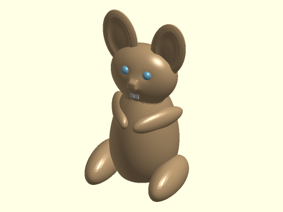

 

    include <BOSL2/std.scad>
    include <BOSL2/isosurface.scad>
    torso = [
        up(20) * scale([1,1.2,2]), mb_sphere(10),
        up(10), mb_sphere(5) // fatten lower torso
    ];
    head = [
        up(50) * scale([1.2,0.8,1]), mb_sphere(10, cutoff = 15),
        // nose
        move([0,-11,50]), mb_cuboid(2),
        // eye sockets
        move([5,-10,54]), mb_sphere(0.5, negative = true),
        move([-5,-10,54]), mb_sphere(0.5, negative = true),
        // tail
        move([0,15,6]), mb_sphere(2, cutoff = 5)
    ];
    hind_leg = [
        move([-15,-5,3]) * scale([1.5,4,1.75]), mb_sphere(5),
        move([-15,10,3]), mb_sphere(3, negative = true)
    ];
    front_leg = [
        move([-9,-4,30]) * zrot(30) * scale([1.5,5,1.75]), mb_sphere(3),
        move([-9,10,30]), mb_sphere(2, negative = true)
    ];
    ear = [
        yrot(10) * move([0,0,65]) * scale([4,1,7]), mb_sphere(2),
        yrot(10)*move([0,-3,65])*scale([3,2,6]), mb_sphere(2, cutoff = 2, influence =2, negative = true)
    ];
    vnf_hindleg = metaballs(hind_leg, [[-22,-24,0],[-8,7,11]], voxel_size=0.8);
    vnf_frontleg = metaballs(front_leg, [[-16,-17,25], [-1,7,35]], voxel_size=0.6);
    vnf_ear = metaballs(ear, [[3,-2,50],[20,2,78]], voxel_size=0.6);
    color("BurlyWood") {
        metaballs([IDENT, torso, IDENT, head],
            [[-16,-17,0],[16,20,63]], voxel_size=0.7);
        xflip_copy() {
            vnf_polyhedron(vnf_hindleg);
            vnf_polyhedron(vnf_frontleg);
            vnf_polyhedron(vnf_ear);;
        }
    }
    // add eyes
    xflip_copy() move([5,-8,54]) color("skyblue") sphere(2, $fn = 32);
    // add teeth
    xflip_copy() move([1.1,-10,44]) color("white") cuboid([2,0.5,4], rounding = 0.15);

**Example 28:** A model of a duck made from spheres, disks, a capsule, and a cone for the tail.

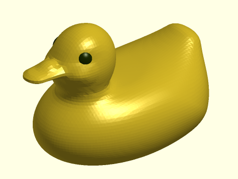

 

    include <BOSL2/std.scad>
    include <BOSL2/isosurface.scad>
    b_box = [[-31,-18,-10], [29,18,31]];
    headZ = 21;
    headX = 11;
    spec = [
        // head
        left(headX)*up(headZ)*scale([1,0.9,1]), mb_sphere(10,cutoff=11), //skull
        left(headX)*up(14), mb_disk(3,5, influence=0.5), //neck shim
        left(headX+5)*up(headZ-1)*fwd(5),  mb_disk(1,2, cutoff=4), //cheek bulge
        left(headX+5)*up(headZ-1)*back(5), mb_disk(1,2, cutoff=4), //cheek bulge
        // eye indentations
        move([-headX,0,headZ+3])*zrot(70)*left(9)*yrot(25)*scale([1,3,1.3]), mb_sphere(1, negative=true, influence=1, cutoff=10),
        move([-headX,0,headZ+3])*zrot(-70)*left(9)*yrot(25)*scale([1,3,1.3]), mb_sphere(1, negative=true, influence=1, cutoff=10),
        // beak
        left(headX+13)*up(headZ)*zscale(0.4)*yrot(90), mb_capsule(12,3, cutoff=5),
        left(headX+8)*up(headZ), mb_disk(2,4),
        left(headX+16)*up(30), mb_sphere(5, negative=true, cutoff=8),
        left(headX+12)*up(headZ+1)*scale([1.2,1,0.75]), mb_sphere(2, cutoff = 3),
        // body
        scale([1.5,1,1]), mb_disk(17,15), //body
        // tail
        right(20)*up(8)*yscale(1.7)*yrot(35), mb_cyl(h=15, r1=4, r2=0.5)
    ];
    metaballs(spec, b_box, voxel_size=0.75);
    // add eyeballs
    yflip_copy()
        move([-headX,0,headZ+2.5])zrot(53)left(4.9) color("#223300") sphere(3,$fn=64);

**Example 29:** Specifying `debug=true`, we can see the elements used to construct the duck. Positive metaballs are blue and negative metaballs are orange. Unfortunately, although the head is a rather complex structure, the big blue skull element covers up other details. Note also that removing the voxel\_size parameter from `metaballs()` speeds up the preview.

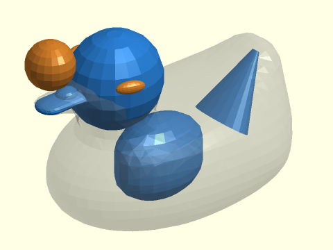

 

    include <BOSL2/std.scad>
    include <BOSL2/isosurface.scad>
    b_box = [[-31,-18,-10], [29,18,31]];
    headZ = 21;
    headX = 11;
    spec = [
        // head
        left(headX)*up(headZ)*scale([1,0.9,1]), mb_sphere(10,cutoff=11), //skull
        left(headX)*up(14), mb_disk(3,5, influence=0.5), //neck shim
        left(headX+5)*up(headZ-1)*fwd(5),  mb_disk(1,2, cutoff=4), //cheek bulge
        left(headX+5)*up(headZ-1)*back(5), mb_disk(1,2, cutoff=4), //cheek bulge
        // eye indentations
        move([-headX,0,headZ+3])*zrot(70)*left(9)*yrot(25)*scale([1,3,1.3]), mb_sphere(1, negative=true, influence=1, cutoff=10),
        move([-headX,0,headZ+3])*zrot(-70)*left(9)*yrot(25)*scale([1,3,1.3]), mb_sphere(1, negative=true, influence=1, cutoff=10),
        // beak
        left(headX+13)*up(headZ)*zscale(0.4)*yrot(90), mb_capsule(12,3, cutoff=5),
        left(headX+8)*up(headZ), mb_disk(2,4),
        left(headX+16)*up(30), mb_sphere(5, negative=true, cutoff=8),
        left(headX+12)*up(headZ+1)*scale([1.2,1,0.75]), mb_sphere(2, cutoff = 3),
        // body
        scale([1.5,1,1]), mb_disk(17,15), //body
        // tail
        right(20)*up(8)*yscale(1.7)*yrot(35), mb_cyl(h=15, r1=4, r2=0.5)
    ];
    metaballs(spec, b_box, debug=true); // removed voxel_size, set debug=true
    // add eyeballs
    yflip_copy()
        move([-headX,0,headZ+2.5])zrot(53)left(4.9) color("#223300") sphere(3,$fn=64);

**Example 30:** Adding `hide_debug=true` to the skull metaball function suppresses its display and reveals the neck and cheek components formerly covered by the skull metaball. Here we also disabled the addition of eyeballs, and reduced the size of the bounding box to enclose only the head. The bounding box is for computing the metaball surface; the debug components still display outside these bounds.

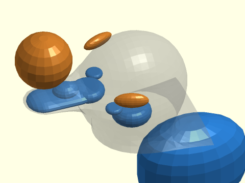

 

    include <BOSL2/std.scad>
    include <BOSL2/isosurface.scad>
    b_box = [[-31,-18,11], [0,18,31]];
    headZ = 21;
    headX = 11;
    spec = [
        // head
        left(headX)*up(headZ)*scale([1,0.9,1]), mb_sphere(10,cutoff=11,hide_debug=true), //skull
        left(headX)*up(14), mb_disk(3,5, influence=0.5), //neck shim
        left(headX+5)*up(headZ-1)*fwd(5),  mb_disk(1,2, cutoff=4), //cheek bulge
        left(headX+5)*up(headZ-1)*back(5), mb_disk(1,2, cutoff=4), //cheek bulge
        // eye indentations
        move([-headX,0,headZ+3])*zrot(70)*left(9)*yrot(25)*scale([1,3,1.3]), mb_sphere(1, negative=true, influence=1, cutoff=10),
        move([-headX,0,headZ+3])*zrot(-70)*left(9)*yrot(25)*scale([1,3,1.3]), mb_sphere(1, negative=true, influence=1, cutoff=10),
        // beak
        left(headX+13)*up(headZ)*zscale(0.4)*yrot(90), mb_capsule(12,3, cutoff=5),
        left(headX+8)*up(headZ), mb_disk(2,4),
        left(headX+16)*up(30), mb_sphere(5, negative=true, cutoff=8),
        left(headX+12)*up(headZ+1)*scale([1.2,1,0.75]), mb_sphere(2, cutoff = 3),
        // body
        scale([1.5,1,1]), mb_disk(17,15), //body
        // tail
        right(20)*up(8)*yscale(1.7)*yrot(35), mb_cyl(h=15, r1=4, r2=0.5)
    ];
    metaballs(spec, b_box, debug=true); // removed voxel_size, set debug=true
    // add eyeballs
    * yflip_copy()
        move([-headX,0,headZ+2.5])zrot(53)left(4.9) color("#223300") sphere(3,$fn=64);

**Example 31:** Adapting the multi-lobe function from Example 21 above, here we show how to display a debug-view VNF approximating the shape of the metaball when `debug=true`, *without* resorting to the full custom function implementation demonstrated in Example 22. Rather than having just the function literal in the `spec` array, we use `[function_literal, [sign,vnf]]` instead, where `sign` is the sign of the metaball (-1 or 1) and `vnf` is the VNF of the debug-view shape.

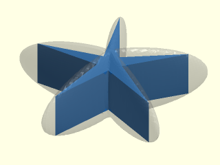

    include <BOSL2/std.scad>
    include <BOSL2/isosurface.scad>
    // custom metaball function - a lobed object
    function multilobe(point, size, lobes) =
       let(
            ang=atan2(point.y, point.x),
            r=norm([point.x,point.y])*(1.4+cos(lobes*ang)),
            dist=norm([point.z, r])
       ) size/dist;
    
    // custom metaball debug VNF - n-pointed star
    function lobes_debug_vnf(r, n) =
        let(nstar=zrot(180/n,p=path3d(star(n,r,r/6),0)))
           vnf_vertex_array(
             [down(0.3*r,nstar), up(0.3*r,nstar)],
             col_wrap=true, caps=true);
    
    // show the object with debug VNF defined
    lobes = 5;
    size = 8;
    spec = [
        IDENT,
        [ // use [func,[sign,vnf]] instead of func
            function(point) multilobe(point,size,lobes),
            [1, lobes_debug_vnf(size*2, lobes)]
        ]
    ];
    metaballs(spec,
        bounding_box = [[-20,-20,-8],[20,20,8]],
        voxel_size=0.5, debug=true);

  

---

### Function/Module: metaballs2d()

**Synopsis:** Creates a group of 2D metaballs (smoothly connected blobs). [<abbr>Geom</abbr>] [<abbr>Region</abbr>]

**Topics:** [Metaballs](Topics#metaballs), [Contours](Topics#contours), [Path Generators (2D)](Topics#path-generators-2d), [Regions](Topics#regions)

**See Also:** [contour()](#functionmodule-contour), [metaballs()](#functionmodule-metaballs)

**Usage:** As a module

- metaballs2d(spec, bounding_box, pixel_size, [pixel_count=], [isovalue=], [use_centers=], [smoothing=], [exact_bounds=], [show_stats=], [show_box=], [debug=] ...) [ATTACHMENTS];

**Usage:** As a function

- region = metaballs2d(spec, bounding_box, pixel_size, [pixel_count=], [isovalue=], [closed=], [use_centers=], [smoothing=], [exact_bounds=], [show_stats=]);

**Description:** 

2D metaball shapes can be useful to create interesting polygons for extrusion. When invoked as
a module, a 2D metaball scene is displayed. When called as a function, a [region](regions.scad)
or list of [paths](paths.scad) is returned.

For a full explanation of metaballs, see [introduction](#section-metaballs) above. The
specification method, tranformations, bounding box, and other parameters are the same as in 3D,
but in 2D, pixels replace voxels.

See [metaball parameters](#metaball-parameters) for details on the primary parameters common to
`metaballs()` and `metaballs2d()`. The `spec` parameter is described in more detail there. The
`spec` parameter is a 1D list of alternating transforms and metaball functions; for example,
the array `spec= [ left(9), mb_circle(5), right(9), mb_circle(5) ]` defines a scene with two
circles of radius 5 shifted 9 units to the left and right of the origin. The `spec` parameter
completely defines the metaballs in your scene, including their position, orientation, and
scaling, as well as different shapes.

You can create 2D metaballs in a variety of standard shapes using the predefined functions
listed below. If you wish, you can also create custom metaball shapes using your own functions.
For all of the built-in 2D metaballs, three parameters are available to control the interaction
of the metaballs with each other: `cutoff`, `influence`, and `negative`.

The `cutoff` parameter specifies the distance beyond which the metaball has no interaction with
other balls. When you apply `cutoff`, a smooth suppression factor begins decreasing the
interaction strength at half the cutoff distance and reduces the interaction to zero at the
cutoff. Depending on the value of `influence`, a cutoff that ends in the middle of another ball
can result in strange shapes, as shown in Example 9, with the metaball interacting on one side
of the boundary and not interacting on the other side. If you scale a ball, the cutoff value is
also scaled.

The `influence` parameter adjusts the strength of the interaction that metaball objects have
with each other. If you increase `influence` of one metaball from its default of 1, then that
metaball interacts with others at a longer range, and surrounding balls grow bigger. The
metaball with larger influence can also grow bigger because it couples more strongly with other
nearby balls, but it can also remain nearly unchanged while influencing others when `isovalue`
is greater than 1. Decreasing influence has the reverse effect. Small changes in influence can
have a large effect; for example, setting `influence=2` dramatically increases the interactions
at longer distances, and you may want to set the `cutoff` argument to limit the range
influence. At the other exteme, small influence values can produce ridge-like artifacts or
texture on the model. Example 8 demonstrates this effect. To avoid these artifacts, keep
`influence` above about 0.5 and consider using `cutoff` instead of using small influence.

The `negative` parameter, if set to `true`, creates a negative metaball, which can result in
hollows, dents, or reductions in size of other metaballs. Negative metaballs are never directly
visible; only their effects are visible. The `influence` argument may also behave in ways you
don't expect with a negative metaball. See Examples 16 and 17.

***Built-in 2D metaball functions***

Several metaballs are defined for you to use in your models. All of the built-in metaballs take
positional and named parameters that specify the size of the metaball (such as height or
radius). The size arguments are the same as those for the regular objects of the same type
(e.g. a circle accepts both `r` for radius and the named parameter `d=` for diameter). The size
parameters always specify the size of the metaball **in isolation** with `isovalue=1`. The
metaballs can grow much bigger than their specified sizes when they interact with each other.
Changing `isovalue` also changes the sizes of metaballs. They grow bigger than their specified
sizes, even in isolation, if `isovalue < 1` and smaller than their specified sizes if
`isovalue > 1`.

The built-in 2D metaball functions are listed below. As usual, arguments without a trailing `=`
can be used positionally; arguments with a trailing `=` must be used as named arguments.

* `mb_circle(r|d=)` &mdash; circular metaball, with radius `r` or diameter `d`.  You can create an ellipse using `scale()` as the last transformation entry of the metaball `spec` array.
* `mb_rect(size, [squareness=])` &mdash; a square/circle hybrid known as a squircle, appearing as a square with rounded edges and corners. The corner sharpness is controlled by the `squareness` parameter ranging from 0 (circular) to 1 (square), and defaults to 0.5. The `size` parameter specifies the dimensions of the squircle that circumscribes the rounded shape, which is tangent to the center of each square side. The `size` parameter may be a scalar or a vector, as in [`squircle()`](shapes2d.scad#functionmodule-squircle). Except when `squareness=1`, the sides are always a little bit curved.
* `mb_trapezoid(h, w1|w=, w2|w=, [ang=], [rounding=])` &mdash; rounded trapezoid metaball with arguments similar to [`trapezoid()`](shapes2d.scad#functionmodule-trapezoid). Any three of the arguments `h` (height), `w1` (bottom width), `w2` (top width), or `ang` (bottom corner angle) may be specified, and `w` sets both `w1` and `w2` to the same size. The `rounding` argument defaults to 0 (sharp edge) if not specified. Only one rounding value is allowed: the rounding is the same at both ends. For a rounded rectangular shape, consider using `mb_rect()`, or `mb_stadium()`, which are less flexible but have faster execution time.
* `mb_stadium(size)` &mdash; rectangle with rounded caps on the narrow ends. The object is a convex hull of two circles. Set the `size` parameter to `[width,height]` to get an object that fits inside a rectangle of that size. Giving a scalar size produces a circle.
* `mb_connector2d(p1, p2, [r|d=])` &mdash; a stadium shape specified to connect point `p1` to point `p2` (which must be different 2D coordinates). As with `mb_stadium()`, the object is a convex hull of two circles. The points `p1` and `p2` are at the centers of the two round caps. The connectors themselves are still influenced by other metaballs, but it may be undesirable to have them influence others, or each other. If two connectors are connected, the joint may appear swollen unless `influence` or `cutoff` is reduced. Reducing `cutoff` is preferable if feasible, because reducing `influence` can produce interpolation artifacts.
* `mb_ring(r1|d1=, r2|d2=)` &mdash; 2D ring metaball using a subset of [`ring()`](shapes2d.scad#functionmodule-ring) parameters, with inner radius being the smaller of `r1` and `r2`, and outer radius being the larger of `r1` and `r2`. If `cutoff` is applied, it is measured from the circle midway between `r1` and `r2`.

In addition to the dimensional arguments described above, all of the built-in functions accept the
following named arguments:
* `cutoff` &mdash; positive value giving the distance beyond which the metaball does not interact with other balls.  Cutoff is measured from the object's center. Default: INF
* `influence` &mdash; a positive number specifying the strength of interaction this ball has with other balls.  Default: 1
* `negative` &mdash; when true, creates a negative metaball. Default: false
* `hide_debug` &mdash; when true, suppresses the display of the underlying metaball shape when `debug=true` is set in the `metaballs()` module. This is useful to hide shapes that may be overlapping others in the debug view. Default: false

***Closed and unclosed paths***

The functional form of `metaballs2d()` supports a `closed` parameter. When `closed=true` (the
default) and a polygon is clipped by the bounding box, the bounding box edges are included in
the polygon. The resulting path list is a valid region with no duplicated vertices in any path.
The module form of `metaballs2d()` always closes the polygons.

When `closed=false`, paths that intersect the edge of the bounding box end at the bounding box.
This means that the list of paths may include a mixture of closed and open paths. Regardless of
whether any of the output paths are open, all closed paths have identical first and last points
so that  closed and open paths can be distinguished. You can use [`are_ends_equal()`](comparisons.scad#function-are_ends_equal) to
determine if a path is closed. A path list that includes open paths is not a region, because
regions are lists of closed polygons. Duplicating the ends of closed paths can cause problems
for functions such as [`offset()`](regions.scad#function-offset), which would complain about repeated points. You can pass a
closed path to [`list_unwrap()`](comparisons.scad#function-list_unwrap) to remove the extra endpoint.

**Arguments:** 

<abbr title="These args can be used by position or by name.">By&nbsp;Position</abbr> | What it does
-------------------- | ------------
`spec`               | Metaball specification in the form `[trans0, spec0, trans1, spec1, ...]`, with alternating transformation matrices and metaball specs, where `spec0`, `spec1`, etc. can be a metaball function or another metaball specification.
`bounding_box`       | The volume in which to perform computations, expressed as a scalar size of a square centered on the origin, or a pair of 2D points `[[xmin,ymin], [xmax,ymax]]` specifying the minimum and maximum box corner coordinates. Unless you set `exact_bounds=true`, the bounding box size may be enlarged to fit whole pixels.
`pixel_size`         | Size of the pixels used to sample the bounding box area, can be a scalar or 2-vector, or omitted if `pixel_count` is set. You may get a non-square pixels of a slightly different size than requested if `exact_bounds=true`.

<abbr title="These args must be used by name, ie: name=value">By&nbsp;Name</abbr> | What it does
-------------------- | ------------
`pixel_count`        | Approximate number of pixels in the bounding box. If `exact_bounds=true` then the pixels may not be squares. Use with `show_stats=true` to see the corresponding pixel size. Default: 1024 (if `pixel_size` not set)
`isovalue`           | A scalar value specifying the isosurface value (threshold value) of the metaballs. At the default value of 1.0, the internal metaball functions are designd so the size arguments correspond to the size parameter (such as radius) of the metaball, when rendered in isolation with no other metaballs. You can also specify a range for isovalue, such as `[1,1.1]` in which case the metaball is displayed as a shell with the hollow inside corresponding to the higher isovalue. A scalar isovalue is equivalent to the vector `[isovalue,INF]`. Default: 1.0
`closed`             | (Function only) When true, close the path if it intersects the bounding box by adding a closing side. When false, do not add a closing side. Default: true, and always true when called as a module.
`use_centers`        | When true, uses the center value of each pixel as an additional data point to refine the contour path through the pixel. Default: false
`smoothing`          | Number of times to apply a 2-point moving average to the contours. This can remove small zig-zag artifacts resulting from a contour that follows the profile of a triangulated 3D surface when `use_centers` is set. Default: 2 if `use_centers=true`, 0 otherwise.
`exact_bounds`       | When true, shrinks pixels as needed to fit whole pixels inside the requested bounding box. When false, enlarges `bounding_box` as needed to fit whole pixels of `pixel_size`, and centers the new bounding box over the requested box. Default: false
`show_stats`         | If true, display statistics about the metaball isosurface in the console window. Besides the number of pixels that the contour passes through, and the number of segments making up the contour, this is useful for getting information about a possibly smaller bounding box to improve speed for subsequent renders. Default: false
`show_box`           | (Module only) Display the requested bounding box as a transparent rectangle. This box may appear slightly different than specified if the actual bounding box had to be expanded to accommodate whole pixels. Default: false
`debug`              | (Module only) Display the underlying primitive metaball shapes using your specified dimensional arguments, overlaid by the metaball scene rendered as outlines. Positive metaballs appear blue, negative appears orange, and any custom function with no debug polygon defined appears as a gray triangle of radius 5.
`cp`                 | (Module only) Center point for determining intersection anchors or centering the shape. Determines the base of the anchor vector. Can be "centroid", "mean", "box" or a 3D point.  Default: "centroid"
`anchor`             | (Module only) Translate so anchor point is at origin (0,0,0). See [anchor](attachments.scad#subsection-anchor).  Default: `"origin"`
`spin`               | (Module only) Rotate this many degrees around the Z axis after anchor. See [spin](attachments.scad#subsection-spin).  Default: `0`
`orient`             | (Module only) Vector to rotate top toward, after spin. See [orient](attachments.scad#subsection-orient).  Default: `UP`
`atype`              | (Module only) Select "hull" or "intersect" anchor type.  Default: "hull"

**Anchor Types:** 

Anchor Type | What it is
----------- | ----------
"hull" | Anchors to the virtual convex hull of the shape.
"intersect" | Anchors to the surface of the shape.

**Side Effects:** 

- `$metaball_pathlist` is set to the region (array of contor paths) of the metaball scene.

**Example 1:** Two circles interacting.

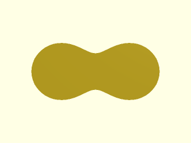

    include <BOSL2/std.scad>
    include <BOSL2/isosurface.scad>
    spec = [
        left(9), mb_circle(5),
        right(9), mb_circle(5)
    ];
    metaballs2d(spec, pixel_size=1,
        bounding_box=[[-16,-7], [16,7]]);

  

**Example 2:** Two rounded rectangles (squircles) interacting.

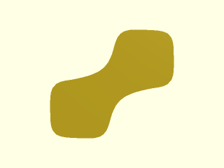

    include <BOSL2/std.scad>
    include <BOSL2/isosurface.scad>
    spec = [
        move([-8,-6]), mb_rect(10),
        move([8,6]), mb_rect(10)
    ];
    metaballs2d(spec, pixel_size=1,
        bounding_box=[[-15,-13], [15,13]]);

  

**Example 3:** Two rounded trapezoids interacting.

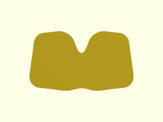

    include <BOSL2/std.scad>
    include <BOSL2/isosurface.scad>
    spec = [
        left(10), mb_trapezoid(15, w1=12, w2=8, rounding=2),
        right(10), mb_trapezoid(15, w1=12, w2=8, rounding=2)
    ];
    metaballs2d(spec, pixel_size=1,
        bounding_box=[[-17,-10], [17,10]]);

  

**Example 4:** Two stadiums interacting. The first stadium of size `[6,16]` has width less than height, which would normally be oriented vertically unless rotated 90° as done here. The second stadum of size `[16,6]` has width greater than height and is already oriented horizontally without rotation.

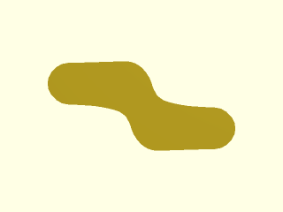

    include <BOSL2/std.scad>
    include <BOSL2/isosurface.scad>
    metaballs2d([
        move([-8,4])*zrot(90), mb_stadium([6,16]),
        move([8,-4]), mb_stadium([16,6])
        ], [[-17,-8], [17,8]], 1);

  

**Example 5:** A circle with two connectors.

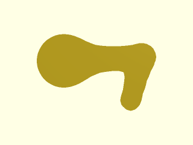

    include <BOSL2/std.scad>
    include <BOSL2/isosurface.scad>
    path = [[-20,0], [0,1], [-3,-10]];
    spec = [
        move(path[0]), mb_circle(6),
        for(seg=pair(path)) each
           [IDENT, mb_connector2d(seg[0],seg[1],
            2, influence=0.5)]
    ];
    metaballs2d(spec, pixel_size=1,
        bounding_box=[[-27,-13], [4,14]]);

  

**Example 6:** Interaction between two rings.

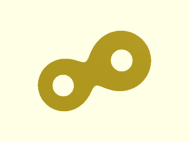

    include <BOSL2/std.scad>
    include <BOSL2/isosurface.scad>
    spec = [
        move([-7,-3]), mb_ring(3,6),
        move([7,3]),   mb_ring(3,7)
    ];
    pixel_size = 0.5;
    boundingbox = [[-14,-11], [16,11]];
    metaballs2d(spec, boundingbox, pixel_size);

  

**Example 7:** Setting `influence` to less than 0.5 can cause interpolation artifacts in the contour. The only difference between these two circles is `influence`. Both have `cutoff` set to prevent them from affecting each other. The circle on the right has a low influence of 0.02, which translates to a falloff with distance $d$ proportional to $1/d^{50}$. That high exponent increases the *non-linear* nature of the function gradient at the contour isovalue, reducing the accuracy of the *linear* interpolation of where the the contour intersects each pixel, causing bumps to appear. It is usually better to use `cutoff` to limit the range of influence rather than reducing `influence` significantly below 1.

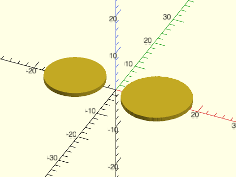

 

    include <BOSL2/std.scad>
    include <BOSL2/isosurface.scad>
    spec = [
        left(10), mb_circle(8, cutoff=10, influence=1),
        right(10), mb_circle(8, cutoff=10, influence=0.02)
    ];
    bbox = [[-18,-8], [18,8]];
    metaballs2d(spec, bounding_box=bbox, pixel_size=0.4);

**Example 8:** A positive and negative metaball in close proximity, with the small negative metaball creating a dent in the large positive one. Small green cylinders indicate the center of each metaball. The negative metaball isn't visible because its field is negative; the contour encloses only field values greater than the isovalue of 1.

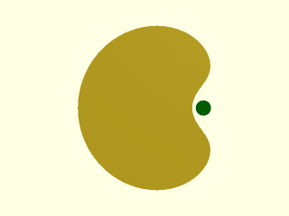

    include <BOSL2/std.scad>
    include <BOSL2/isosurface.scad>
    centers = [[-1,0], [1.25,0]];
    spec = [
        move(centers[0]), mb_circle(8),
        move(centers[1]), mb_circle(3, negative=true)
    ];
    voxel_size = 0.25;
    boundingbox = [[-7,-6], [3,6]];
    metaballs2d(spec, boundingbox, voxel_size);
    color("green") move_copies(centers) cylinder(h=1,d=1,$fn=16);

  

**Example 9:** When a positive and negative metaball interact, the negative metaball reduces the influence of the positive one, causing it to shrink, but not disappear because its contribution approaches infinity at its center. This example shows a large positive metaball near a small negative metaball at the origin. The negative ball has high influence, and a cutoff limiting its influence to 20 units. The negative metaball influences the positive one up to the cutoff, causing the positive metaball to appear smaller inside the cutoff range, and appear its normal size outside the cutoff range. The positive metaball has a small dimple at the origin (the center of the negative metaball) because it cannot overcome the infinite negative contribution of the negative metaball at the origin.

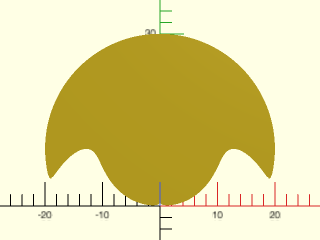

    include <BOSL2/std.scad>
    include <BOSL2/isosurface.scad>
    spec = [
        back(10), mb_circle(20),
        IDENT, mb_circle(2, influence=30,
            cutoff=20, negative=true),
    ];
    pixel_size = 0.5;
    boundingbox = [[-20,-1], [20,31]];
    metaballs2d(spec, boundingbox, pixel_size);

  

**Example 10:** Profile of an airplane, constructed only from metaball circles with scaling. The bounding box is used to clip the wingtips and tail.

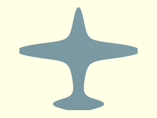

    include <BOSL2/std.scad>
    include <BOSL2/isosurface.scad>
    bounding_box = [[-55,-50],[35,50]];
    spec = [
        // fuselage
        move([-18,0])*scale([27,4]), mb_circle(1),
        // tail
        move([30,0])*scale([3,15]),  mb_circle(1),
        // wing
        move([-15,0])*scale([6,45]), mb_circle(1)
    ];
    pixel_size = 1;
    color("lightblue") zrot(-90)
      metaballs2d(spec, bounding_box, pixel_size);

  

**Example 11:** This is the 2D version of the 3D Example 20 above, showing a custom metaball defined and passed as a function literal that takes a single [x,y] argument representing a coordinate relative to the metaball center, called `point` here, but can have any name. This distance vector from the origin is calculated internally and always passed to the function. Inside the function, it is converted to a scalar distance `dist`. The function literal expression sets all of your parameters. Only `point` is not set, and it becomes the single parameter to the function literal. The `spec` argument invokes your custom function as a function literal that passes `point` into it.

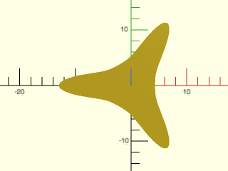

    include <BOSL2/std.scad>
    include <BOSL2/isosurface.scad>
    function threelobe2d(point) =
       let(
            ang=atan2(point.y, point.x),
            dist=norm([point.x,point.y])*(1.3+cos(3*ang))
       ) 3/dist;
    metaballs2d(
        spec = [
            IDENT, function (point) threelobe2d(point),
            IDENT, mb_circle(r=3)
        ],
        bounding_box = [[-14,-12],[8,12]],
        pixel_size=0.5);

  

**Example 12:** Analogous to the 3D Example 21 above, here is a 2D function nearly identical to the previous example, introducing additional dimensional parameters into the function to control its size and number of lobes. If you expiriment with this using different argument values, you should increase the bounding box along with pixel size.

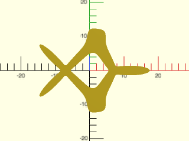

    include <BOSL2/std.scad>
    include <BOSL2/isosurface.scad>
    function multilobe2d(point, size, lobes) =
       let(
            ang=atan2(point.y, point.x),
            dist = norm([point.x,point.y])
                * (1.3+cos(lobes*ang))
       ) size/dist;
    metaballs2d(
        spec = [
            left(7),
               function (point) multilobe2d(point,3,4),
            right(7)*zrot(60),
               function (point) multilobe2d(point,3,3)
        ],
        bounding_box = [[-16,-13],[18,13]],
        pixel_size=0.4);

  

---

## Section: Isosurfaces (3D) and contours (2D)

The isosurface of a function $f(x,y,z)$ is the set of points where $f(x,y,z)=c$ for some
constant isovalue $c$.

The contour of a function $f(x,y)$ is the set of points where $f(x,y)=c$ for some constant
isovalue $c$. Considered in the context of an elevation map, the function returns an elevation
associated with any $(x,y)$ point, and the isovalue $c$ is a specific elevation at which to
compute the contour paths. Any 2D cross-section of an isosurface is a contour.

***Parameters common to `isosurface()` and `contour()`***

**Parameter `f` (function):** The
[function literal](https://en.wikibooks.org/wiki/OpenSCAD_User_Manual/User-Defined_Functions_and_Modules#Function_literals)
must take 3 parameters (x, y and z) for isosurface or two parameters (x and y) for contour, and
must return a single numerical value. You can also define an isosurface or contour using an
array of values instead of a function, in which case the isosurface or contour is the set of
points equal to the isovalue as interpolated from the array. The array indices are in the order
`[x][y][z]` in 3D, and `[x][y]` in 2D.

**Parameter `isovalue:`** The isovalue must be specified as a range `[c_min,c_max]`. The range
can be finite or unbounded at one end, with either `c_min=-INF` or `c_max=INF`. For isosurface,
the returned object is the set of points `[x,y,z]` that satisfy `c_min <= f(x,y,z) <= c_max`,
or in 2D, the points `[x,y]` satisfying `c_min <= f(x,y) <= c_max`.  Strictly speaking, this
means the isosurface and contour modules don't return a single contour or isovalue by the shape
**bounded** by isosurfaces or contours.  If the function has values larger than `c_min` and
values smaller than `c_max`, then the result is a shell object (3D) or ring object (2D) with
two bounding surfaces/curves corresponding to the isovalues of `c_min` and `c_max`. If the
function is smaller than `c_max` everywhere (which is true when `c_max = INF`), then no
isosurface exists for `c_max`, so the object has only one bounding surface: the one defined by
`c_min`. This can result in a bounded object&mdash;a sphere or circle&mdash;or an unbounded
object such as all the points outside of a sphere out to infinity. A similar situation arises
if the function is larger than `c_min` everywhere (which is true when `c_min = -INF`). Setting
isovalue to `[-INF,c_max]` or `[c_min,INF]` always produces an object with a single bounding
isosurface or contour, which itself can be unbounded. To obtain a bounded object, think about
whether the function values inside your object are smaller or larger than your iso value. If
the values inside are smaller, you produce a bounded object using `[-INF,c_max]`. If the values
inside are larger, you get a bounded object using `[c_min,INF]`.  When your object is
unbounded, it will be truncated at the bounded box, which can result in an object that looks
like a simple cube.

**Parameters `bounding_box` and grid units:** The isosurface or contour is evaluated over a
bounding box. The `bounding_box` parameter can be specified by its minimum and maximum corners:
`[[xmin,ymin,zmin],[xmax,ymax,zmax]]` in 3D, or `[[xmin,ymin],[xmax,ymax]]` in 2D. The bounding
box can also be specified as a scalar of a cube (in 3D) or square (in 2D) centered on the
origin.

This bounding box is divided into grid units, specified as `voxel_size` in 3D or `pixel_size`
in 2D, which can be a scalar or a vector size. Alternately, you can set the grid count
(`voxel_count` or `pixel_count`) to fit approximately the specified number of grid units into
the bounding box.

Features in the scene having any dimension smaller than the grid spacing may not be displayed,
so if something seems to be missing, try making the grid units smaller or the grid count
larger. By default, if the voxel size or pixel size doesn't exactly divide your specified
bounding box, then the bounding box is enlarged to contain whole grid units, and centered on
your requested box. Alternatively, you may set `exact_bounds=true` to cause the grid units to
adjust in size to fit instead, resulting in non-square grid units.

The isosurface or contour object is clipped by the bounding box.  The contour module always
closes the shapes at the boundary to produce displayable polygons.  The isosurface module and
the function forms accept a `closed` parameter.  Setting `closed=false` causes the closing
segments or surfaces along the bounding box to be excluded from the model.  In 3D, this results
in a non-manifold shape with holes, exposing the inside of the object. In 2D, this results in
an open-ended contour path with higher values on the right with respect to the path direction.

***Isosurface and contour run time***

The size of the voxels or pixels, and size of the bounding box affects the run time, which can
be long. This is usually more noticeable in 3D than 2D. In 3D, a voxel size of 1 with a
bounding box volume of 200×200×200 may be slow because it requires the calculation and storage
of eight million function values, and more processing and memory to generate the triangulated
mesh. On the other hand, a voxel size of 5 over a 100×100×100 bounding box requires only 8,000
function values and a modest computation time. A good rule is to keep the number of voxels
below 10,000 for preview, and adjust the voxel size smaller for final rendering. If you don't
specify voxel_size or voxel_count then metaballs uses a default voxel_count of 22^3 (10,648),
which should be reasonable for initial preview. Because a bounding box that is too large wastes
time computing function values that are not needed, you can also set the parameter
`show_stats=true` to get the actual bounds of the voxels intersected by the surface. With this
information, you may be able to decrease run time, or keep the same run time but increase the
resolution.

### Function/Module: isosurface()

**Synopsis:** Creates a 3D isosurface (a 3D contour) from a function or array of values. [<abbr>Geom</abbr>] [<abbr>VNF</abbr>]

**Topics:** [Isosurfaces](Topics#isosurfaces), [VNF Generators](Topics#vnf-generators)

**Usage:** As a module

- isosurface(f, isovalue, bounding_box, voxel_size, [voxel_count=], [reverse=], [closed=], [exact_bounds=], [show_stats=], ...) [ATTACHMENTS];

**Usage:** As a function

- vnf = isosurface(f, isovalue, bounding_box, voxel_size, [voxel_count=], [reverse=], [closed=], [exact_bounds=], [show_stats=]);

**Description:** 

Computes a [VNF structure](vnf.scad) of an object bounded by an isosurface or a range between two isosurfaces, within a specified bounding box.

See [Isosurface contour parameters](#isosurface-contour-parameters) for details about how the
primary parameters work for isosurfaces.

**Why does my object appear as a cube?** If your object is unbounded, then when it intersects
with the bounding box and `closed=true`, the result may appear to be a solid cube, because the
clipping faces are all you can see and the bounding surface is hidden inside. Setting
`closed=false` removes the bounding box faces and exposes the inside structure (with inverted
faces). If you want the bounded object, you can correct this problem by changing your isovalue
range. If you were using a finite range `[c1,c2]`, try changing it to `[c2,INF]` or
`[-INF,c1]`. If you were using an unbounded range like `[c,INF]`, try switching the range to
`[-INF,c]`.

**Manifold warnings:**
The point list in the generated VNF structure contains many duplicated points. This is normally
not a problem for rendering the shape, but machine roundoff differences may result in Manifold
issuing warnings when doing the final render, causing rendering to abort if you have enabled
the "stop on first warning" setting. You can prevent this by passing the VNF through
[`vnf_quantize()`](vnf.scad#function-vnf_quantize) using a quantization of 1e-7, or you can pass the VNF structure into
[`vnf_merge_points()`](vnf.scad#function-vnf_merge_points), which also removes the duplicates. Additionally, flat surfaces (often
resulting from clipping by the bounding box) are triangulated at the voxel size resolution, and
these can be unified into a single face by passing the vnf structure to [`vnf_unify_faces()`](vnf.scad#function-vnf_unify_faces).
These steps can be computationally expensive and are not normally necessary.

**Arguments:** 

<abbr title="These args can be used by position or by name.">By&nbsp;Position</abbr> | What it does
-------------------- | ------------
`f`                  | The isosurface function literal or array. As a function literal, `x,y,z` must be the first arguments.
`isovalue`           | A 2-vector giving an isovalue range. For an unbounded range, use `[-INF, max_isovalue]` or `[min_isovalue, INF]`.
`bounding_box`       | The volume in which to perform computations, expressed as a scalar size of a cube centered on the origin, or a pair of 3D points `[[xmin,ymin,zmin], [xmax,ymax,zmax]]` specifying the minimum and maximum box corner coordinates. Unless you set `exact_bounds=true`, the bounding box size may be enlarged to fit whole voxels. When `f` is an array of values, `bounding_box` cannot be supplied if `voxel_size` is supplied because the bounding box is already implied by the array size combined with `voxel_size`, in which case this implied bounding box is centered around the origin.
`voxel_size`         | Size of the voxels used to sample the bounding box volume, can be a scalar or 3-vector, or omitted if `voxel_count` is set. You may get non-cubical voxels of a slightly different size than requested if `exact_bounds=true`.

<abbr title="These args must be used by name, ie: name=value">By&nbsp;Name</abbr> | What it does
-------------------- | ------------
`voxel_count`        | Approximate number of voxels in the bounding box. If `exact_bounds=true` then the voxels may not be cubes. Use with `show_stats=true` to see the corresponding voxel size. Default: 22^3 (10648) if `voxel_size` not set
`closed`             | When true, close the surface if it intersects the bounding box by adding a closing face. When false, do not add a closing face and instead produce a non-manfold VNF that has holes.  Default: true
`reverse`            | When true, reverses the orientation of the VNF faces. Default: false
`exact_bounds`       | When true, shrinks voxels as needed to fit whole voxels inside the requested bounding box. When false, enlarges `bounding_box` as needed to fit whole voxels of `voxel_size`, and centers the new bounding box over the requested box. Default: false
`show_stats`         | If true, display statistics in the console window about the isosurface: number of voxels that the surface passes through, number of triangles, VNF bounds, and voxel-rounded bounding box of the surface, which may help you reduce your bounding box to improve speed. Enabling this parameter has a slight speed penalty. Default: false
`show_box`           | (Module only) display the requested bounding box as transparent. This box may appear slightly different than specified if the actual bounding box had to be expanded to accommodate whole voxels. Default: false
`convexity`          | (Module only) Maximum number of times a line could intersect a wall of the shape. Affects preview only. Default: 6
`cp`                 | (Module only) Center point for determining intersection anchors or centering the shape. Determines the base of the anchor vector. Can be "centroid", "mean", "box" or a 3D point.  Default: "centroid"
`anchor`             | (Module only) Translate so anchor point is at origin (0,0,0). See [anchor](attachments.scad#subsection-anchor).  Default: `"origin"`
`spin`               | (Module only) Rotate this many degrees around the Z axis after anchor. See [spin](attachments.scad#subsection-spin).  Default: `0`
`orient`             | (Module only) Vector to rotate top toward, after spin. See [orient](attachments.scad#subsection-orient).  Default: `UP`
`atype`              | (Module only) Select "hull" or "intersect" anchor type.  Default: "hull"

**Anchor Types:** 

Anchor Type | What it is
----------- | ----------
"hull" | Anchors to the virtual convex hull of the shape.
"intersect" | Anchors to the surface of the shape.

**Named Anchors:** 

Anchor Name | Position
----------- | --------
"origin" | Anchor at the origin, oriented UP.

**Example 1:** These first three examples demonstrate the effect of isovalue range for the simplest of all surfaces: a sphere where $r=\sqrt{x^2+y^2+z^2}$, or `r = norm([x,y,z])` in OpenSCAD. Then, the isosurface corresponding to an isovalue of 10 is every point where the expression `norm([x,y,z])` equals a radius of 10. We use the isovalue range `[-INF,10]` here to make the sphere, with a bounding box that cuts off half the sphere. The isovalue range could also be `[0,10]` because the minimum value of the expression is zero.

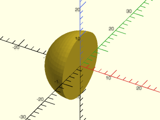

    include <BOSL2/std.scad>
    include <BOSL2/isosurface.scad>
    isovalue = [-INF,10];
    bbox = [[-11,-11,-11], [0,11,11]];
    isosurface(function (x,y,z) norm([x,y,z]),
       isovalue, bbox, voxel_size = 1);

  

**Example 2:** An isovalue range `[8,10]` gives a shell with inner radius 8 and outer radius 10.

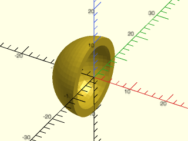

    include <BOSL2/std.scad>
    include <BOSL2/isosurface.scad>
    isovalue = [8,10];
    bbox = [[-11,-11,-11], [0,11,11]];
    isosurface(function (x,y,z) norm([x,y,z]),
       isovalue, bbox, voxel_size = 1);

  

**Example 3:** Here we set the isovalue range to `[10,INF]`. Because the sphere expression `norm(xyz)` has larger values growing to infinity with distance from the origin, the resulting object appears as the bounding box with a radius-10 spherical hole.

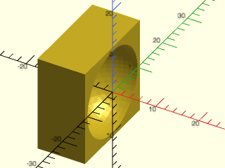

    include <BOSL2/std.scad>
    include <BOSL2/isosurface.scad>
    isovalue = [10,INF];
    bbox = [[-11,-11,-11], [0,11,11]];
    isosurface(function (x,y,z) norm([x,y,z]),
       isovalue, bbox, voxel_size = 1);

  

**Example 4:** Unlike a sphere, a gyroid is unbounded; it's an isosurface defined by all the zero values of a 3D periodic function. To illustrate what the surface looks like, `closed=false` has been set to expose both sides of the surface. The surface is periodic and tileable along all three axis directions. This is a non-manifold surface as displayed, not useful for 3D modeling. This example also demonstrates using an additional parameter in the field function beyond just the `[x,y,z]` input; in this case to control the wavelength of the gyroid.

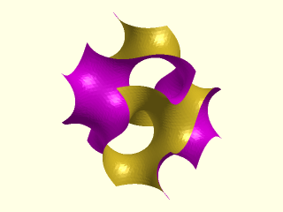

    include <BOSL2/std.scad>
    include <BOSL2/isosurface.scad>
    function gyroid(x,y,z, wavelength) = let(
        p = 360/wavelength * [x,y,z]
    ) sin(p.x)*cos(p.y)+sin(p.y)*cos(p.z)+sin(p.z)*cos(p.x);
    isovalue = [0,INF];
    bbox = [[-100,-100,-100], [100,100,100]];
    isosurface(function(x,y,z) gyroid(x,y,z, wavelength=200),
        isovalue, bbox, voxel_size=5, closed=false);

  

**Example 5:** If we remove the `closed` parameter or set it to true, the isosurface algorithm encloses the entire half-space bounded by the "inner" gyroid surface, leaving only the "outer" surface exposed. This is a manifold shape but not what we want if trying to model a gyroid.

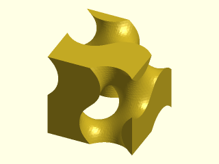

    include <BOSL2/std.scad>
    include <BOSL2/isosurface.scad>
    function gyroid(x,y,z, wavelength) = let(
        p = 360/wavelength * [x,y,z]
    ) sin(p.x)*cos(p.y)+sin(p.y)*cos(p.z)+sin(p.z)*cos(p.x);
    isovalue = [0,INF];
    bbox = [[-100,-100,-100], [100,100,100]];
    isosurface(function(x,y,z) gyroid(x,y,z, wavelength=200),
        isovalue, bbox, voxel_size=5, closed=true);

  

**Example 6:** To make the gyroid a double-sided surface, we need to specify a small range around zero for `isovalue`. Now we have a double-sided surface although with `closed=false` the edges are not closed where the surface is clipped by the bounding box.

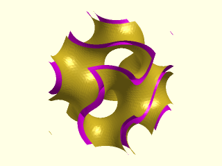

    include <BOSL2/std.scad>
    include <BOSL2/isosurface.scad>
    function gyroid(x,y,z, wavelength) = let(
        p = 360/wavelength * [x,y,z]
    ) sin(p.x)*cos(p.y)+sin(p.y)*cos(p.z)+sin(p.z)*cos(p.x);
    isovalue = [-0.3, 0.3];
    bbox = [[-100,-100,-100], [100,100,100]];
    isosurface(function(x,y,z) gyroid(x,y,z, wavelength=200),
        isovalue, bbox, voxel_size=5, closed=false);

  

**Example 7:** To make the gyroid a valid manifold 3D object, we remove the `closed` parameter (same as setting `closed=true`), which closes the edges where the surface is clipped by the bounding box.

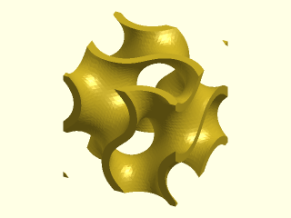

    include <BOSL2/std.scad>
    include <BOSL2/isosurface.scad>
    function gyroid(x,y,z, wavelength) = let(
        p = 360/wavelength * [x,y,z]
    ) sin(p.x)*cos(p.y)+sin(p.y)*cos(p.z)+sin(p.z)*cos(p.x);
    isovalue = [-0.3, 0.3];
    bbox = [[-100,-100,-100], [100,100,100]];
    isosurface(function(x,y,z) gyroid(x,y,z, wavelength=200),
        isovalue, bbox, voxel_size=5);

  

**Example 8:** An approximation of the triply-periodic minimal surface known as [Schwartz P](https://en.wikipedia.org/wiki/Schwarz\_minimal\_surface).

    include <BOSL2/std.scad>
    include <BOSL2/isosurface.scad>
    function schwartz_p(x,y,z, wavelength) = let(
        p = 360/wavelength,
        px = p*x, py = p*y, pz = p*z
    )  cos(px) + cos(py) + cos(pz);
    isovalue = [-0.2, 0.2];
    bbox = [[-100,-100,-100], [100,100,100]];
    isosurface(function (x,y,z) schwartz_p(x,y,z, 100),
        isovalue, bounding_box=bbox, voxel_size=4);

  

**Example 9:** Another approximation of the triply-periodic minimal surface known as [Neovius](https://en.wikipedia.org/wiki/Neovius\_surface).

 

    include <BOSL2/std.scad>
    include <BOSL2/isosurface.scad>
    function neovius(x,y,z, wavelength) = let(
        p = 360/wavelength,
        px = p*x, py = p*y, pz = p*z
    )  3*(cos(px) + cos(py) + cos(pz)) + 4*cos(px)*cos(py)*cos(pz);
    bbox = [[-100,-100,-100], [100,100,100]];
    isosurface(function (x,y,z) neovius(x,y,z, 200),
        isovalue = [-0.3, 0.3],
        bounding_box = bbox, voxel_size=4);

**Example 10:** Example of a bounded isosurface.

    include <BOSL2/std.scad>
    include <BOSL2/isosurface.scad>
    isosurface(
        function (x,y,z)
            let(a=xyz_to_spherical([x,y,z]),
                r=a[0],
                phi=a[1],
                theta=a[2]
            ) 1/(r*(3+cos(5*phi)+cos(4*theta))),
        isovalue = [0.1,INF],
        bounding_box = [[-8,-7,-8],[6,7,8]],
        voxel_size = 0.25);

  

**Example 11:** Another example of a bounded isosurface.

    include <BOSL2/std.scad>
    include <BOSL2/isosurface.scad>
    isosurface(function (x,y,z)
          2*(x^4 - 2*x*x + y^4
             - 2*y*y + z^4 - 2*z*z) + 3,
        bounding_box=3, voxel_size=0.07,
        isovalue=[-INF,0]);

  

**Example 12:** For shapes that occupy a cubical bounding box centered on the origin, you can simply specify a scalar for the size of the box.

    include <BOSL2/std.scad>
    include <BOSL2/isosurface.scad>
    isosurface(
        function (x,y,z) let(np=norm([x,y,z]))
           (x*y*z^3 + 19*x^2*z^2) / np^2 + np^2,
        isovalue=[-INF,35], bounding_box=12, voxel_size=0.25);

  

**Example 13:** An object that could be a sort of support pillar. Here we set `show_box=true` to reveal that the bounding box is slightly bigger than it needs to be. The argument `show_stats=true` also outputs the voxel bounding box size as a suggestion of what it should be.

 

    include <BOSL2/std.scad>
    include <BOSL2/isosurface.scad>
    isosurface(
        function (x,y,z) let(np=norm([x,y,z]))
           (x*y*z^3 - 3*x^2*z^2) / np^2 + np^2,
        isovalue=[-INF,35], bounding_box=[[-32,-32,-14],[32,32,14]],
        voxel_size = 0.8, show_box=true);

**Example 14:** You can specify non-cubical voxels for efficiency. This example shows the result of two identical surface functions. The figure on the left uses `voxel_size=1`, which washes out the detail in the z direction. The figure on the right shows the same shape with `voxel_size=[0.5,1,0.2]` to give a bit more resolution in the x direction and much more resolution in the z direction. This example runs about six times faster than if we used a cubical voxel of size 0.2 to capture the detail in only one axis at the expense of unnecessary detail in other axes.

 

    include <BOSL2/std.scad>
    include <BOSL2/isosurface.scad>
    function shape(x,y,z, r=5) =
        r / sqrt(x^2 + 0.5*(y^2 + z^2) + 0.5*r*cos(200*z));
    bbox = [[-6,-8,0], [6,8,7]];
    
    left(6) isosurface(function (x,y,z) shape(x,y,z),
        isovalue=[1,INF], bounding_box=bbox, voxel_size=1);
    
    right(6) isosurface(function (x,y,z) shape(x,y,z),
        isovalue=[1,INF], bounding_box=bbox, voxel_size=[0.5,1,0.2]);

**Example 15:** Nonlinear functions with steep gradients between voxel corners at the isosurface value can show interpolation ridges because the surface position is approximated by a linear interpolation of a highly nonlinear function. The appearance of the artifacts depends on the combination of function, voxel size, and isovalue, and can look different in different circumstances. If your isovalue is positive, then you may be able to smooth out the artifacts by using the log of your function and the log of your isovalue range to get the same isosurface without artifacts. On the left, an isosurface around a steep nonlinear function (clipped on the left by the bounding box) exhibits severe interpolation artifacts. On the right, the log of the isosurface around the log of the function smooths it out nicely.

    include <BOSL2/std.scad>
    include <BOSL2/isosurface.scad>
    bbox = [[0,-10,-5],[9,10,6]];
    
    function shape(x,y,z) =
            exp(-((x+5)/5-3)^2-y^2)
            *exp(-((x+5)/3)^2-y^2-z^2)
            + exp(-((y+4)/5-3)^2-x^2)
            *exp(-((y+4)/3)^2-x^2-0.5*z^2);
    
    left(6) isosurface(function(x,y,z) shape(x,y,z),
        isovalue = [EPSILON,INF],
        bounding_box=bbox, voxel_size=0.25);
    right(6) isosurface(function(x,y,z) log(shape(x,y,z)),
        isovalue = [log(EPSILON),INF],
        bounding_box=bbox, voxel_size=0.25);

  

**Example 16:** Using an array for the `f` argument instead of a function literal. Each row of the array represents an X index for a YZ plane with the array Z indices changing fastest in each plane. The final object may need rotation to get the orientation you want. You don't pass the `bounding_box` argument here; it is implied by the array size and voxel size, and centered on the origin.

    include <BOSL2/std.scad>
    include <BOSL2/isosurface.scad>
    field = [
      repeat(0,[6,6]),
      [ [0,1,2,2,1,0],
        [1,2,3,3,2,1],
        [2,3,4,4,3,2],
        [2,3,4,4,3,2],
        [1,2,3,3,2,1],
        [0,1,2,2,1,0]
      ],
      [ [0,0,0,0,0,0],
        [0,0,1,1,0,0],
        [0,2,3,3,2,0],
        [0,2,3,3,2,0],
        [0,0,1,1,0,0],
        [0,0,0,0,0,0]
      ],
      [ [0,0,0,0,0,0],
        [0,0,0,0,0,0],
        [0,1,2,2,1,0],
        [0,1,2,2,1,0],
        [0,0,0,0,0,0],
        [0,0,0,0,0,0]
      ],
      repeat(0,[6,6])
    ];
    rotate([0,-90,180])
       isosurface(field, isovalue=[0.5,INF],
           voxel_size=10);

  

---

### Function/Module: contour()

**Synopsis:** Creates a 2D contour from a function or array of values. [<abbr>Geom</abbr>] [<abbr>Path</abbr>] [<abbr>Region</abbr>]

**Topics:** [Contours](Topics#contours), [Path Generators (2D)](Topics#path-generators-2d), [Regions](Topics#regions)

**Usage:** As a module

- contour(f, isovalue, bounding_box, pixel_size, [pixel_count=], [use_centers=], [smoothing=], [exact_bounds=], [show_stats=], [show_box=], ...) [ATTACHMENTS];

**Usage:** As a function

- region = contour(f, isovalue, bounding_box, pixel_size, [pixel_count=], [use_centers=], [smoothing=], [closed=], [show_stats=]);

**Description:** 

Computes a [region](regions.scad) that contains one or more 2D contour [paths](paths.scad)
within a bounding box at a single isovalue.

See [Isosurface contour parameters](#isosurface-contour-parameters) for details about how the
primary parameters work for contours.

To provide a function, you supply a

**Arguments:** 

<abbr title="These args can be used by position or by name.">By&nbsp;Position</abbr> | What it does
-------------------- | ------------
`f`                  | The contour function or array.
`isovalue`           | A scalar giving the isovalue for the contour, or a 2-vector giving an isovalue range (resulting in a polygon bounded by two contours). For an unbounded range, use `[-INF,max_isovalue]` or `[min_isovalue,INF]`.
`bounding_box`       | The area in which to perform computations, expressed as a scalar size of a square centered on the origin, or a pair of 2D points `[[xmin,ymin], [xmax,ymax]]` specifying the minimum and maximum box corner coordinates. Unless you set `exact_bounds=true`, the bounding box size may be enlarged to fit whole pixels. When `f` is an array of values, `bounding_box` cannot be supplied if `pixel_size` is supplied because the bounding box is already implied by the array size combined with `pixel_size`, in which case this implied bounding box is centered around the origin.
`pixel_size`         | Size of the pixels used to sample the bounding box volume, can be a scalar or 2-vector, or omitted if `pixel_count` is set. You may get rectangular pixels of a slightly different size than requested if `exact_bounds=true`.

<abbr title="These args must be used by name, ie: name=value">By&nbsp;Name</abbr> | What it does
-------------------- | ------------
`pixel_count`        | Approximate number of pixels in the bounding box. If `exact_bounds=true` then the pixels may not be square. Use with `show_stats=true` to see the corresponding pixel size. Default: 1024 (if `pixel_size` not set)
`use_centers`        | When true, uses the center value of each pixel as an additional data point to refine the contour path through the pixel. The center value is the function value if `f` is a function, or the average of the four pixel corners if `f` is an array. If `use_centers` is set to another array of center values, then those values are used. If false, the contour path doesn't account for the pixel center. Default: true
`smoothing`          | Number of times to apply a 2-point moving average to the contours. This can remove small zig-zag artifacts resulting from a contour that follows the profile of a triangulated 3D surface when `use_centers` is set. Default: 2 if `use_centers=true`, 0 otherwise.
`closed`             | (Function only) When true, close the contour path if it intersects the bounding box by adding closing edges. When false, do not add closing edges. Default: true, and always true when called as a module.
`exact_bounds`       | When true, shrinks pixels as needed to fit whole pixels inside the requested bounding box. When false, enlarges `bounding_box` as needed to fit whole pixels of `pixel_size`, and centers the new bounding box over the requested box. Default: false
`show_stats`         | If true, display statistics in the console window about the contour: number of pixels that the surface passes through, number of points in all contours, bounding box of the pixels, and pixel-rounded bounding box of the contours, which may help you reduce your bounding box to improve speed. Default: false
`show_box`           | (Module only) display the requested bounding box as a transparent rectangle. This box may appear slightly different than specified if the actual bounding box had to be expanded to accommodate whole pixels. Default: false
`cp`                 | (Module only) Center point for determining intersection anchors or centering the shape. Determines the base of the anchor vector. Can be "centroid", "mean", "box" or a 3D point.  Default: "centroid"
`anchor`             | (Module only) Translate so anchor point is at origin (0,0,0). See [anchor](attachments.scad#subsection-anchor).  Default: `"origin"`
`spin`               | (Module only) Rotate this many degrees around the Z axis after anchor. See [spin](attachments.scad#subsection-spin).  Default: `0`
`atype`              | (Module only) Select "hull" or "intersect" anchor type.  Default: "hull"

**Anchor Types:** 

Anchor Type | What it is
----------- | ----------
"hull" | Anchors to the virtual convex hull of the shape.
"intersect" | Anchors to the surface of the shape.

**Example 1:** A small height map consisting of 8×8 data values to create a 7×7 pixel area, showing a contour at one isovalue. When passing an array as the first argument, rotating the output 90° clockwise using `zrot(-90)` causes the features of the contour to correspond visually to features in the array. Setting `use_centers=false` results in only the corner values of each pixel to be considered when drawing contour lines, resulting in coarse outlines.

    include <BOSL2/std.scad>
    include <BOSL2/isosurface.scad>
    field =[
        [0,2,2,1,0,0,0,0],
        [2,4,1,0,0,0,0,0],
        [2,2,2,1,0,0,0,0],
        [0,0,1,2,2,2,1,1],
        [0,0,2,1,0,3,1,0],
        [0,2,0,2,0,3,4,0],
        [0,0,0,1,2,3,2,0],
        [0,0,0,0,0,1,0,0]
    ];
    isoval=[0.7,INF];
    pixsize = 5;
    color("lightgreen") zrot(-90)
        contour(field, isoval, pixel_size=pixsize,
            use_centers=false);
    color("blue") down(1)
        square((len(field)-1)*pixsize, true);

  

**Example 2:** The same height map with the same isovalue, this time setting `use_centers=true` to cause the pixel center values (average of the four corners) to be considered when drawing contours, giving somewhat finer resolution. When `use_centers=true`, some smoothing is applied to avoid some additional crookedness in the contours that occurs due to the contours following a slice of a triangulated mesh with triangles in varying orientations.

    include <BOSL2/std.scad>
    include <BOSL2/isosurface.scad>
    field =[
        [0,2,2,1,0,0,0,0],
        [2,4,1,0,0,0,0,0],
        [2,2,2,1,0,0,0,0],
        [0,0,1,2,2,2,1,1],
        [0,0,2,1,0,3,1,0],
        [0,2,0,2,0,3,4,0],
        [0,0,0,1,2,3,2,0],
        [0,0,0,0,0,1,0,0]
    ];
    isoval=[0.7,INF];
    pixsize = 5;
    color("lightgreen") zrot(-90)
        contour(field, isoval, pixel_size=pixsize,
            use_centers=true);
    color("blue") down(1)
        square((len(field)-1)*pixsize, true);

  

**Example 3:** You can pass a function literal taking x,y arguments, in which case the center value of each pixel is computed in addition to the corners for somewhat greater resolution than the specified pixel size. By default, two smoothing passes are performed on the output paths when making contours from a function.

    include <BOSL2/std.scad>
    include <BOSL2/isosurface.scad>
    wavelen=42;
    wave2d = function(x,y)
        40*cos(180/wavelen*norm([x,y]));
    isoval=-30;
    pixsize = 10;
    translate([0,0,isoval]) color("green") zrot(-90)
        contour(wave2d,
            bounding_box=[[-50,-50],[50,50]],
            isovalue=[isoval,INF], pixel_size=pixsize);
    %plot3d(wave2d, [-50:pixsize:50],[-50:pixsize:50],
           style="quincunx",base=5);

  

**Example 4:** Here's a simple function that produces a contour in the shape of a flower with some petals. Note that the function has smaller values inside the shape so we choose a `-INF` bound for the isovalue.

    include <BOSL2/std.scad>
    include <BOSL2/isosurface.scad>
    f = function (x, y, petals=5)
        sin(petals*atan2(y,x)) + norm([x,y]);
    contour(f, isovalue=[-INF,3], bounding_box=8.1);

  

**Example 5:** If we instead use a `+INF` bound then we get the bounding box with the flower shape removed.

    include <BOSL2/std.scad>
    include <BOSL2/isosurface.scad>
    f = function (x, y, petals=5)
        sin(petals*atan2(y,x)) + norm([x,y]);
    contour(f, isovalue=[3,INF], bounding_box=8.1);

  

**Example 6:** We can take the previous function a step further and make the isovalue range bounded on both ends, resulting in a hollow shell shape. The nature of the function causes the thickness to vary, which is different from the constant thickness you would get if you subtracted an `offset()` polygon from the inside. Here we extrude this polygon with a twist.

    include <BOSL2/std.scad>
    include <BOSL2/isosurface.scad>
    f = function (x, y, petals=5)
       sin(petals*atan2(y,x)) + norm([x,y]);
    linear_extrude(6, twist=30, scale=0.75, slices=10)
       contour(f, isovalue=[2,3], bounding_box=8.1);

  

**Example 7:** Another function that needs an isovalue range to create a solid polygon. Increasing the minimum value results in holes in the object.

    include <BOSL2/std.scad>
    include <BOSL2/isosurface.scad>
    f = function(x,y) (x^2+y-11)^2 + (x+y^2-7)^2;
    contour(f, bounding_box=12, isovalue=[0,125]);

  

**Example 8:** The shape of these contours are somewhat sensitive to pixel size.

    include <BOSL2/std.scad>
    include <BOSL2/isosurface.scad>
    f = function(x,y)  x^2+y^2 + 10*(1-cos(360*x)-cos(360*y));
    contour(f, bounding_box=13, isovalue=[-INF,35],
        pixel_size=0.25);

  

**Example 9:** An infinite periodic pattern showing contours at one elevation in red, overlaid with a transparent render of the 3D heightmap generated by the function.

    include <BOSL2/std.scad>
    include <BOSL2/isosurface.scad>
    f = function(x,y) 100*(sin(x)*sin(y) * sin(x+y));
    pixel_size = 20;
    isovalue = 1;
    bbox = 720;
    up(isovalue) color("red") linear_extrude(1)
        contour(f, [isovalue,INF], bbox, pixel_size);
    %plot3d(f, [-360:pixel_size/2:360],
            [-360:pixel_size/2:360], style="quincunx");

  

**Example 10:** A [Cassini oval](https://en.wikipedia.org/wiki/Cassini\_oval) is a curve drawn such that for any point on the perimeter, the product of the distances from two fixed points is constant. The curve resembles two circular [metaballs](#functionmodule-metaballs2d) interacting. When the ratio `b/a=1`, there is a cusp where two contours meet at the origin, although the contour algorithm doesn't allow the two contours to touch.

    include <BOSL2/std.scad>
    include <BOSL2/isosurface.scad>
    a=4;  b=4.1;
    f = function(x,y) (x^2+y^2)^2 - 2*a^2*(x^2-y^2) + a^4;
    contour(f,bounding_box=[[-6,-3],[6,3]], isovalue=[-INF,b^4]);

  

**Example 11:** A contour of a function that looks like the contour should intersect itself at the origin, but if you zoom in, you see that it doesn't actually cross or intersect. It is theoretically possible to obtain a crossing path with `contour()` although the algorithm attempts to avoid it, primarily by disallowing the function values at the sample points to be equal to the specified isovalue.

    include <BOSL2/std.scad>
    include <BOSL2/isosurface.scad>
    g = function(x,y)
        let(
            theta=atan2(y,x),
            r = norm([x,y])
        )
        r*sin(3*theta-theta^2/20+40*r);
    contour(g, bounding_box=[[-23,-13],[9,13]],
        isovalue=[0,INF], pixel_size=0.2);

  

---

