# LibFile: joiners.scad

Modules for joining separately printed parts including screw together, snap-together and dovetails.

To use, add the following lines to the beginning of your file:

    include <BOSL2/std.scad>
    include <BOSL2/joiners.scad>

## File Contents

1. [Section: Half Joiners](#section-half-joiners)
    - [`half_joiner_clear()`](#functionmodule-half_joiner_clear) – Creates a mask to clear space for a [`half_joiner()`](#functionmodule-half\_joiner). [<abbr>Geom</abbr>] [<abbr>VNF</abbr>]
    - [`half_joiner()`](#functionmodule-half_joiner) – Creates a half-joiner shape to mate with a [`half_joiner2()`](#functionmodule-half\_joiner2) shape.. [<abbr>Geom</abbr>] [<abbr>VNF</abbr>]
    - [`half_joiner2()`](#functionmodule-half_joiner2) – Creates a half\_joiner2 shape to mate with a [`half_joiner()`](#functionmodule-half\_joiner) shape.. [<abbr>Geom</abbr>] [<abbr>VNF</abbr>]

2. [Section: Full Joiners](#section-full-joiners)
    - [`joiner_clear()`](#module-joiner_clear) – Creates a mask to clear space for a [`joiner()`](#module-joiner) shape. [<abbr>Geom</abbr>]
    - [`joiner()`](#module-joiner) – Creates a joiner shape that can mate with another rotated joiner shape. [<abbr>Geom</abbr>]

3. [Section: Dovetails](#section-dovetails)
    - [`dovetail()`](#module-dovetail) – Creates a possibly tapered dovetail shape. [<abbr>Geom</abbr>]

4. [Section: Tension Clips](#section-tension-clips)
    - [`snap_pin()`](#module-snap_pin) – Creates a snap-pin that can slot into a [`snap_pin_socket()`](#module-snap\_pin\_socket) to join two parts. [<abbr>Geom</abbr>]
    - [`snap_pin_socket()`](#module-snap_pin_socket) – Creates a snap-pin socket for a [`snap_pin()`](#module-snap\_pin) to slot into. [<abbr>Geom</abbr>]
    - [`rabbit_clip()`](#module-rabbit_clip) – Creates a rabbit-eared clip that can snap into a slot. [<abbr>Geom</abbr>]

5. [Section: Splines](#section-splines)
    - [`hirth()`](#module-hirth) – Creates a Hirth face spline that locks together two cylinders. [<abbr>Geom</abbr>]

## Section: Half Joiners

### Function/Module: half\_joiner\_clear()

**Synopsis:** Creates a mask to clear space for a [`half_joiner()`](#functionmodule-half\_joiner). [<abbr>Geom</abbr>] [<abbr>VNF</abbr>]

**Topics:** [Joiners](Topics#joiners), [Parts](Topics#parts)

**See Also:** [half\_joiner()](#functionmodule-half_joiner), [half\_joiner2()](#functionmodule-half_joiner2), [joiner\_clear()](#module-joiner_clear), [joiner()](#module-joiner), [snap\_pin()](#module-snap_pin), [rabbit\_clip()](#module-rabbit_clip), [dovetail()](#module-dovetail)

**Usage:** As Module

- half_joiner_clear(l, w, [ang=], [clearance=], [overlap=]) [ATTACHMENTS];

**Usage:** As Function

- vnf = half_joiner_clear(l, w, [ang=], [clearance=], [overlap=]);

**Description:** 

Creates a mask to clear an area so that a half_joiner can be placed there.

**Arguments:** 

<abbr title="These args can be used by position or by name.">By&nbsp;Position</abbr> | What it does
-------------------- | ------------
`l`                  | Length of the joiner to clear space for.  Default: 20
`w`                  | Width of the joiner to clear space for.  Default: 10
`ang`                | Overhang angle of the joiner.  Default: 30

<abbr title="These args must be used by name, ie: name=value">By&nbsp;Name</abbr> | What it does
-------------------- | ------------
`clearance`          | Extra width to clear.  Default: 0
`overlap`            | Extra depth to clear.  Default: 0.01
`anchor`             | Translate so anchor point is at origin (0,0,0).  See [anchor](attachments.scad#subsection-anchor).  Default: `CENTER`
`spin`               | Rotate this many degrees around the Z axis after anchor.  See [spin](attachments.scad#subsection-spin).  Default: `0`
`orient`             | Vector to rotate top towards, after spin.  See [orient](attachments.scad#subsection-orient).  Default: `UP`

**Example 1:** 

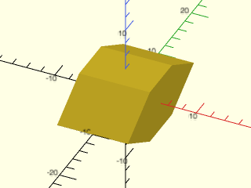

    include <BOSL2/std.scad>
    include <BOSL2/joiners.scad>
    half_joiner_clear();

  

---

### Function/Module: half\_joiner()

**Synopsis:** Creates a half-joiner shape to mate with a [`half_joiner2()`](#functionmodule-half\_joiner2) shape.. [<abbr>Geom</abbr>] [<abbr>VNF</abbr>]

**Topics:** [Joiners](Topics#joiners), [Parts](Topics#parts)

**See Also:** [half\_joiner\_clear()](#functionmodule-half_joiner_clear), [half\_joiner2()](#functionmodule-half_joiner2), [joiner\_clear()](#module-joiner_clear), [joiner()](#module-joiner), [snap\_pin()](#module-snap_pin), [rabbit\_clip()](#module-rabbit_clip), [dovetail()](#module-dovetail)

**Usage:** As Module

- half_joiner(l, w, [base=], [ang=], [screwsize=], [$slop=]) [ATTACHMENTS];

**Usage:** As Function

- vnf = half_joiner(l, w, [base=], [ang=], [screwsize=], [$slop=]);

**Description:** 

Creates a half_joiner object that can be attached to a matching half_joiner2 object.
The length runs along Y.  The mating interface is at Z=0, with nominal anchors based on a box of size `[w,l,2*base]`.

**Arguments:** 

<abbr title="These args can be used by position or by name.">By&nbsp;Position</abbr> | What it does
-------------------- | ------------
`l`                  | Length of the half_joiner.  Default: 20
`w`                  | Width of the half_joiner.  Default: 10

<abbr title="These args must be used by name, ie: name=value">By&nbsp;Name</abbr> | What it does
-------------------- | ------------
`base`               | Length of the backing to the half_joiner.  Default: 10
`ang`                | Overhang angle of the half_joiner.  Default: 30
`screwsize`          | If given, diameter of screwhole.
`anchor`             | Translate so anchor point is at origin (0,0,0).  See [anchor](attachments.scad#subsection-anchor).  Default: `CENTER`
`spin`               | Rotate this many degrees around the Z axis after anchor.  See [spin](attachments.scad#subsection-spin).  Default: `0`
`orient`             | Vector to rotate top towards, after spin.  See [orient](attachments.scad#subsection-orient).  Default: `UP`
`$slop`              | Printer specific slop value to make parts fit more closely.

**Example 1:** 

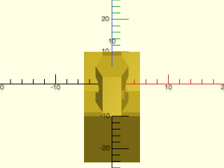

    include <BOSL2/std.scad>
    include <BOSL2/joiners.scad>
    half_joiner(screwsize=3);

  

**Example 2:** 

    include <BOSL2/std.scad>
    include <BOSL2/joiners.scad>
    half_joiner(l=20,w=10,base=10);

  

**Example 3:** 

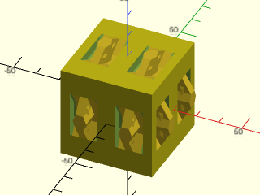

    include <BOSL2/std.scad>
    include <BOSL2/joiners.scad>
    diff()
    cuboid(40)
        attach([FWD,TOP,RIGHT])
            xcopies(20) half_joiner();

  

---

### Function/Module: half\_joiner2()

**Synopsis:** Creates a half\_joiner2 shape to mate with a [`half_joiner()`](#functionmodule-half\_joiner) shape.. [<abbr>Geom</abbr>] [<abbr>VNF</abbr>]

**Topics:** [Joiners](Topics#joiners), [Parts](Topics#parts)

**See Also:** [half\_joiner\_clear()](#functionmodule-half_joiner_clear), [half\_joiner()](#functionmodule-half_joiner), [joiner\_clear()](#module-joiner_clear), [joiner()](#module-joiner), [snap\_pin()](#module-snap_pin), [rabbit\_clip()](#module-rabbit_clip), [dovetail()](#module-dovetail)

**Usage:** As Module

- half_joiner2(l, w, [base=], [ang=], [screwsize=])

**Usage:** As Function

- vnf = half_joiner2(l, w, [base=], [ang=], [screwsize=])

**Description:** 

Creates a half_joiner2 object that can be attached to half_joiner object.
The length runs along Y.  The mating interface is at Z=0, with nominal anchors based on a box of size `[w,l,2*base]`.

**Arguments:** 

<abbr title="These args can be used by position or by name.">By&nbsp;Position</abbr> | What it does
-------------------- | ------------
`l`                  | Length of the half_joiner.  Default: 20
`w`                  | Width of the half_joiner.  Default: 10

<abbr title="These args must be used by name, ie: name=value">By&nbsp;Name</abbr> | What it does
-------------------- | ------------
`base`               | Length of the backing to the half_joiner.  Default: 10
`ang`                | Overhang angle of the half_joiner.  Default: 30
`screwsize`          | Diameter of screwhole.
`anchor`             | Translate so anchor point is at origin (0,0,0).  See [anchor](attachments.scad#subsection-anchor).  Default: `CENTER`
`spin`               | Rotate this many degrees around the Z axis after anchor.  See [spin](attachments.scad#subsection-spin).  Default: `0`
`orient`             | Vector to rotate top towards, after spin.  See [orient](attachments.scad#subsection-orient).  Default: `UP`

**Example 1:** 

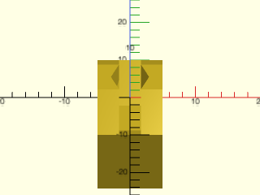

    include <BOSL2/std.scad>
    include <BOSL2/joiners.scad>
    half_joiner2(screwsize=3);

  

**Example 2:** 

    include <BOSL2/std.scad>
    include <BOSL2/joiners.scad>
    half_joiner2(w=10,base=10,l=20);

  

**Example 3:** 

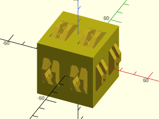

    include <BOSL2/std.scad>
    include <BOSL2/joiners.scad>
    diff()
    cuboid(40)
        attach([FWD,TOP,RIGHT])
            xcopies(20) half_joiner2();

  

---

## Section: Full Joiners

### Module: joiner\_clear()

**Synopsis:** Creates a mask to clear space for a [`joiner()`](#module-joiner) shape. [<abbr>Geom</abbr>]

**Topics:** [Joiners](Topics#joiners), [Parts](Topics#parts)

**See Also:** [half\_joiner\_clear()](#functionmodule-half_joiner_clear), [half\_joiner()](#functionmodule-half_joiner), [half\_joiner2()](#functionmodule-half_joiner2), [joiner()](#module-joiner), [snap\_pin()](#module-snap_pin), [rabbit\_clip()](#module-rabbit_clip), [dovetail()](#module-dovetail)

**Usage:** 

- joiner_clear(l, w, [ang=], [clearance=], [overlap=]) [ATTACHMENTS];

**Description:** 

Creates a mask to clear an area so that a joiner can be placed there.

**Arguments:** 

<abbr title="These args can be used by position or by name.">By&nbsp;Position</abbr> | What it does
-------------------- | ------------
`l`                  | Length of the joiner to clear space for.  Default: 40
`w`                  | Width of the joiner to clear space for.  Default: 10
`ang`                | Overhang angle of the joiner.  Default: 30

<abbr title="These args must be used by name, ie: name=value">By&nbsp;Name</abbr> | What it does
-------------------- | ------------
`clearance`          | Extra width to clear.  Default: 0
`overlap`            | Extra depth to clear.  Default: 0.01
`anchor`             | Translate so anchor point is at origin (0,0,0).  See [anchor](attachments.scad#subsection-anchor).  Default: `CENTER`
`spin`               | Rotate this many degrees around the Z axis after anchor.  See [spin](attachments.scad#subsection-spin).  Default: `0`
`orient`             | Vector to rotate top towards, after spin.  See [orient](attachments.scad#subsection-orient).  Default: `UP`

**Example 1:** 

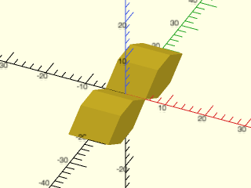

    include <BOSL2/std.scad>
    include <BOSL2/joiners.scad>
    joiner_clear();

  

---

### Module: joiner()

**Synopsis:** Creates a joiner shape that can mate with another rotated joiner shape. [<abbr>Geom</abbr>]

**Topics:** [Joiners](Topics#joiners), [Parts](Topics#parts)

**See Also:** [half\_joiner\_clear()](#functionmodule-half_joiner_clear), [half\_joiner()](#functionmodule-half_joiner), [half\_joiner2()](#functionmodule-half_joiner2), [joiner\_clear()](#module-joiner_clear), [snap\_pin()](#module-snap_pin), [rabbit\_clip()](#module-rabbit_clip), [dovetail()](#module-dovetail)

**Usage:** 

- joiner(l, w, base, [ang=], [screwsize=], [$slop=]) [ATTACHMENTS];

**Description:** 

Creates a joiner object that can be attached to another joiner object.

**Arguments:** 

<abbr title="These args can be used by position or by name.">By&nbsp;Position</abbr> | What it does
-------------------- | ------------
`l`                  | Length of the joiner.  Default: 40
`w`                  | Width of the joiner.  Default: 10
`base`               | Length of the backing to the joiner.  Default: 10
`ang`                | Overhang angle of the joiner.  Default: 30

<abbr title="These args must be used by name, ie: name=value">By&nbsp;Name</abbr> | What it does
-------------------- | ------------
`screwsize`          | If given, diameter of screwhole.
`anchor`             | Translate so anchor point is at origin (0,0,0).  See [anchor](attachments.scad#subsection-anchor).  Default: `CENTER`
`spin`               | Rotate this many degrees around the Z axis after anchor.  See [spin](attachments.scad#subsection-spin).  Default: `0`
`orient`             | Vector to rotate top towards, after spin.  See [orient](attachments.scad#subsection-orient).  Default: `UP`
`$slop`              | Printer specific slop value to make parts fit more closely.

**Example 1:** 

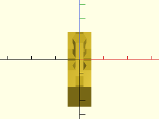

    include <BOSL2/std.scad>
    include <BOSL2/joiners.scad>
    joiner(screwsize=3);

  

**Example 2:** 

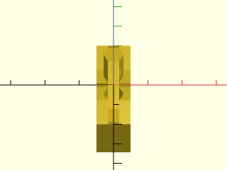

    include <BOSL2/std.scad>
    include <BOSL2/joiners.scad>
    joiner(l=40, w=10, base=10);

  

**Example 3:** 

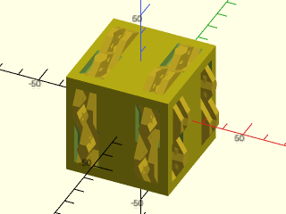

    include <BOSL2/std.scad>
    include <BOSL2/joiners.scad>
    diff()
    cuboid(50)
      attach([FWD,TOP,RIGHT])
        zrot_copies(n=2,r=15)
          joiner();

  

---

## Section: Dovetails

### Module: dovetail()

**Synopsis:** Creates a possibly tapered dovetail shape. [<abbr>Geom</abbr>]

**Topics:** [Joiners](Topics#joiners), [Parts](Topics#parts)

**See Also:** [joiner()](#module-joiner), [snap\_pin()](#module-snap_pin), [rabbit\_clip()](#module-rabbit_clip), [partition()](partitions.scad#module-partition), [partition\_mask()](partitions.scad#module-partition_mask), [partition\_cut\_mask()](partitions.scad#module-partition_cut_mask)

**Usage:** 

- dovetail(gender, w=|width, h=|height, slide|thickness=, [slope=|angle=], [taper=|back_width=], [chamfer=], [r=|radius=], [round=], [extra=], [entry_slot_length=], [$slop=])

**Description:** 

Produces a possibly tapered dovetail joint shape to attach to or subtract from two parts you wish to join together.
The tapered dovetail is particularly advantageous for long joints because the joint assembles without binding until
it is fully closed, and then wedges tightly.  You can chamfer or round the corners of the dovetail shape for better
printing and assembly, or choose a fully rounded joint that looks more like a puzzle piece.  The dovetail appears
parallel to the Y axis and projecting upwards, so in its default orientation it will slide together with a translation
in the positive Y direction.  The gender determines whether the shape is meant to be added to your model or
differenced, and it also changes the anchor and orientation.  The default anchor for dovetails is BOTTOM;
the default orientation depends on the gender, with male dovetails oriented UP and female ones DOWN.

For a male dovetail of length X to slide into a female dovetail, there must be a space of length X at the
end of the dovetail.  In many cases, this space is naturally present, but if you want to create dovetails
in the middle of a surface, you need cut cut out an additional space to allow the male dovetail space to enter.
Setting `entry_slot_length=X` for a female dovetail will add an entry slot of length X, projecting forward
from the dovetail mask.  Anchoring is done on the dovetail itself: the slot is ignored by anchoring.

The dovetails by default have extra extension of 0.01 for unions and differences.
You should ensure that attachment is done with overlap=0 to ensure
sizing and positioning is correct.  To adjust the fit, use the $slop variable, which increases the depth and width of
the female part of the joint to allow a clearance gap of $slop on each of the three sides.

**Arguments:** 

<abbr title="These args can be used by position or by name.">By&nbsp;Position</abbr> | What it does
-------------------- | ------------
`gender`             | A string, "male" or "female", to specify the gender of the dovetail.
`w`                  / `width`              | Width (at the wider, top end) of the dovetail before tapering
`h`                  / `height`             | Height of the dovetail (the amount it projects from its base)
`slide`              / `thickness`          | Distance the dovetail slides when you assemble it (length of sliding dovetails, thickness of regular dovetails)

<abbr title="These args must be used by name, ie: name=value">By&nbsp;Name</abbr> | What it does
-------------------- | ------------
`slope`              | slope of the dovetail.  Standard woodworking slopes are 4, 6, or 8.  Default: 6.
`angle`              | angle (in degrees) of the dovetail.  Specify only one of slope and angle.
`taper`              | taper angle (in degrees). Dovetail gets narrower by this angle.  Default: no taper
`back_width`         | width of right hand end of the dovetail.  This alternate method of specifying the taper may be easier to manage.  Specify only one of `taper` and `back_width`.  Note that `back_width` should be smaller than `width` to taper in the customary direction, with the smaller end at the back.
`chamfer`            | amount to chamfer the corners of the joint (Default: no chamfer)
`r`                  / `radius`             | amount to round over the corners of the joint (Default: no rounding)
`round`              | true to round both corners of the dovetail and give it a puzzle piece look.  Default: false.
`$slop`              | Clearance measured normal to the mating faces of the female joint.
`extra`              | amount of extra length and base extension added to dovetails for unions and differences.  Default: 0.01
`entry_slot_length`  | length of a mask of sufficient width and depth for a male dovetail to fit ahead of the female dovetail. Ignored when gender == "male".  Default: 0
`anchor`             | Translate so anchor point is at origin (0,0,0).  See [anchor](attachments.scad#subsection-anchor).  Default: `BOTTOM`
`spin`               | Rotate this many degrees around the Z axis after anchor.  See [spin](attachments.scad#subsection-spin).  Default: `0`
`orient`             | Vector to rotate top towards, after spin.  See [orient](attachments.scad#subsection-orient).  Default: `UP` for male, `DOWN` for female

**Example 1:** Ordinary straight dovetail, male version (sticking up) and female version (below the xy plane)

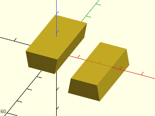

    include <BOSL2/std.scad>
    include <BOSL2/joiners.scad>
    dovetail("male", width=15, height=8, slide=30);
    right(20) dovetail("female", width=15, height=8, slide=30);

  

**Example 2:** Adding a 6 degree taper (Such a big taper is usually not necessary, but easier to see for the example.)

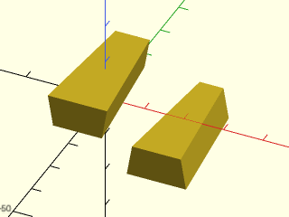

 

    include <BOSL2/std.scad>
    include <BOSL2/joiners.scad>
    dovetail("male", w=15, h=8, slide=30, taper=6);
    right(20) dovetail("female", 15, 8, 30, taper=6);  // Same as above

**Example 3:** A block that can link to itself

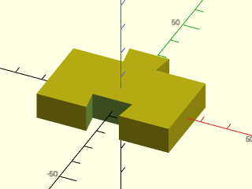

 

    include <BOSL2/std.scad>
    include <BOSL2/joiners.scad>
    diff()
      cuboid([50,30,10]){
        attach(BACK) dovetail("male", slide=10, width=15, height=8);
        tag("remove")attach(FRONT) dovetail("female", slide=10, width=15, height=8);
      }

**Example 4:** Setting the dovetail angle.  This is too extreme to be useful.

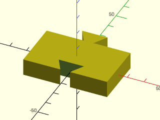

 

    include <BOSL2/std.scad>
    include <BOSL2/joiners.scad>
    diff()
      cuboid([50,30,10]){
        attach(BACK) dovetail("male", slide=10, width=15, height=8, angle=30);
        tag("remove")attach(FRONT) dovetail("female", slide=10, width=15, height=8, angle=30);
      }

**Example 5:** Adding a chamfer helps printed parts fit together without problems at the corners

 

    include <BOSL2/std.scad>
    include <BOSL2/joiners.scad>
    diff("remove")
      cuboid([50,30,10]){
        attach(BACK) dovetail("male", slide=10, width=15, height=8, chamfer=1);
        tag("remove")attach(FRONT) dovetail("female", slide=10, width=15, height=8,chamfer=1);
      }

**Example 6:** Rounding the outside corners is another option

 

    include <BOSL2/std.scad>
    include <BOSL2/joiners.scad>
    diff("remove")
    cuboid([50,30,10]) {
        attach(BACK)  dovetail("male", slide=10, width=15, height=8, radius=1, $fn=32);
        tag("remove") attach(FRONT) dovetail("female", slide=10, width=15, height=8, radius=1, $fn=32);
    }

**Example 7:** Or you can make a fully rounded joint

 

    include <BOSL2/std.scad>
    include <BOSL2/joiners.scad>
    $fn=32;
    diff("remove")
    cuboid([50,30,10]){
        attach(BACK) dovetail("male", slide=10, width=15, height=8, radius=1.5, round=true);
        tag("remove")attach(FRONT) dovetail("female", slide=10, width=15, height=8, radius=1.5, round=true);
    }

**Example 8:** With a long joint like this, a taper makes the joint easy to assemble.  It will go together easily and wedge tightly if you get the tolerances right.  Specifying the taper with `back_width` may be easier than using a taper angle.

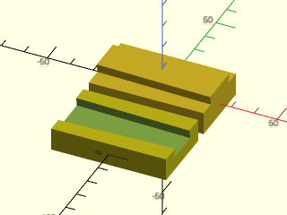

 

    include <BOSL2/std.scad>
    include <BOSL2/joiners.scad>
    cuboid([50,30,10])
      attach(TOP) dovetail("male", slide=50, width=18, height=4, back_width=15, spin=90);
    fwd(35)
      diff("remove")
        cuboid([50,30,10])
          tag("remove") attach(TOP) dovetail("female", slide=50, width=18, height=4, back_width=15, spin=90);

**Example 9:** A series of dovetails forming a tail board, with the inside of the joint up.  A standard wood joint would have a zero taper.

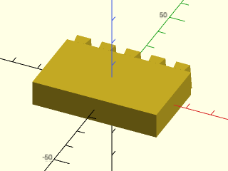

 

    include <BOSL2/std.scad>
    include <BOSL2/joiners.scad>
    cuboid([50,30,10])
      attach(BACK) xcopies(10,5) dovetail("male", slide=10, width=7, taper=4, height=4);

**Example 10:** Mating pin board for a half-blind right angle joint, where the joint only shows on the side but not the front.  Note that the anchor method and use of `spin` ensures that the joint works even with a taper.

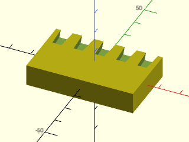

 

    include <BOSL2/std.scad>
    include <BOSL2/joiners.scad>
    diff("remove")
      cuboid([50,30,10])
        tag("remove")position(TOP+BACK) xcopies(10,5) dovetail("female", slide=10, width=7, taper=4, height=4, anchor=BOTTOM+FRONT,spin=180);

**Example 11:** Housed sliding dovetail (similar to okuri ari).  If the left piece is rotated 90 degrees clockwise, it can be inserted downward with the male dovetail entering the entry slot, then sliding backward, making a 40x40x20 cuboid with no visible connectors. The opening is 2 units longer than the male dovetail so it's easier to assemble.

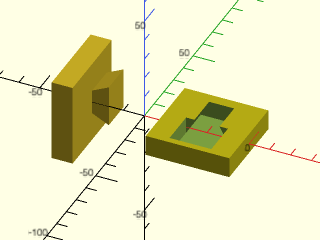

 

    include <BOSL2/std.scad>
    include <BOSL2/joiners.scad>
    xdistribute(spacing=60){
      cuboid([10,40,40])
        attach(RIGHT,BOT,align=BACK,spin=90,inset=5)
        dovetail("male", slide=15, width=20, height=8, slope=2);
      diff()
        cuboid([40,40,10])
          attach(TOP,BOT,align=BACK,inside=true,inset=5)
            tag("remove") dovetail("female", slide=15, width=20,
                                   height=8, slope=2, entry_slot_length=17);
    }

---

## Section: Tension Clips

### Module: snap\_pin()

**Synopsis:** Creates a snap-pin that can slot into a [`snap_pin_socket()`](#module-snap\_pin\_socket) to join two parts. [<abbr>Geom</abbr>]

**Topics:** [Joiners](Topics#joiners), [Parts](Topics#parts)

**See Also:** [snap\_pin\_socket()](#module-snap_pin_socket), [joiner()](#module-joiner), [dovetail()](#module-dovetail), [rabbit\_clip()](#module-rabbit_clip)

**Usage:** 

- snap_pin(size, [pointed=], [anchor=], [spin=], [orient=]) [ATTACHMENTS];
- snap_pin(r=|radius=|d=|diameter=, l=|length=, nub_depth=, snap=, thickness=, [clearance=], [preload=], [pointed=]) [ATTACHMENTS];

**Description:** 

Creates a snap pin that can be inserted into an appropriate socket to connect two objects together.  You can choose from some standard
pin dimensions by giving a size, or you can specify all the pin geometry parameters yourself.  If you use a standard size you can
override the standard parameters by specifying other ones.  The pins have flat sides so they can
be printed.  When oriented UP the shaft of the pin runs in the Z direction and the flat sides are the front and back.  The default
orientation (FRONT) and anchor (FRONT) places the pin in a printable configuration, flat side down on the xy plane.
The tightness of fit is determined by `preload` and `clearance`.  To make pins tighter increase `preload` and/or decrease `clearance`.

The standard preset pin dimensions in mm are:

Size | length | diameter | snap | nub_depth | thickness | preload
---- | ------ | -------- | ---- | --------- | --------- | -------
"tiny" | 4 | 2.5 | 0.25 | 0.9 | 0.8 | 0.10
"small" | 6 | 3.2 | 0.40 | 1.2 | 1.0 | 0.16
"medium" | 8 | 4.6 | 0.45 | 1.5 | 1.4 | 0.20
"standard" / "large" | 10.8 | 7 | 0.50 | 1.8 | 1.8 | 0.20

This pin is based on https://www.thingiverse.com/thing:213310 by Emmett Lalishe
and a modified version at https://www.thingiverse.com/thing:3218332 by acwest
and distributed under the Creative Commons - Attribution - Share Alike License

**Arguments:** 

<abbr title="These args can be used by position or by name.">By&nbsp;Position</abbr> | What it does
-------------------- | ------------
`size`               | text string to select from a list of predefined sizes, one of "standard" (alias "large"), "medium", "small", or "tiny".

<abbr title="These args must be used by name, ie: name=value">By&nbsp;Name</abbr> | What it does
-------------------- | ------------
`pointed`            | set to true to get a pointed pin, false to get one with a rounded end.  Default: true
`r`                  / `radius`             | radius of the pin
`d`                  / `diameter`           | diameter of the pin
`l`                  / `length`             | length of the pin
`nub_depth`          | the distance of the nub from the base of the pin
`snap`               | how much snap the pin provides (the nub projection)
`thickness`          | thickness of the pin walls
`clearance`          | how far to shrink the pin away from the socket walls.  Default: 0.2
`preload`            | amount to move the nub towards the pin base, which can create tension from the misalignment with the socket.  Default: 0.2
`anchor`             | Translate so anchor point is at origin (0,0,0).  See [anchor](attachments.scad#subsection-anchor).  Default: `FRONT`
`spin`               | Rotate this many degrees around the Z axis after anchor.  See [spin](attachments.scad#subsection-spin).  Default: `0`
`orient`             | Vector to rotate top towards, after spin.  See [orient](attachments.scad#subsection-orient).  Default: `FRONT`

**Example 1:** Pin in native orientation

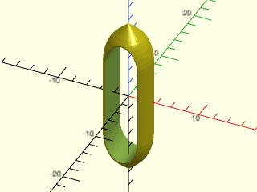

 

    include <BOSL2/std.scad>
    include <BOSL2/joiners.scad>
    snap_pin("standard", anchor=CENTER, orient=UP, thickness = 1, $fn=40);

**Example 2:** Pins oriented for printing

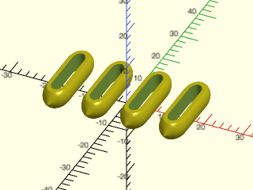

    include <BOSL2/std.scad>
    include <BOSL2/joiners.scad>
    xcopies(spacing=10, n=4) snap_pin("standard", $fn=40);

  

---

### Module: snap\_pin\_socket()

**Synopsis:** Creates a snap-pin socket for a [`snap_pin()`](#module-snap\_pin) to slot into. [<abbr>Geom</abbr>]

**Topics:** [Joiners](Topics#joiners), [Parts](Topics#parts)

**See Also:** [snap\_pin()](#module-snap_pin), [joiner()](#module-joiner), [dovetail()](#module-dovetail), [snap\_pin()](#module-snap_pin), [rabbit\_clip()](#module-rabbit_clip)

**Usage:** 

- snap_pin_socket(size, [fixed=], [fins=], [pointed=], [anchor=], [spin=], [orient=]) [ATTACHMENTS];
- snap_pin_socket(r=|radius=|d=|diameter=, l=|length=, nub_depth=, snap=, [fixed=], [pointed=], [fins=]) [ATTACHMENTS];

**Description:** 

Constructs a socket suitable for a snap_pin with the same parameters.   If `fixed` is true then the socket has flat walls and the
pin will not rotate in the socket.  If `fixed` is false then the socket is round and the pin will rotate, particularly well
if you add a lubricant.  If `pointed` is true the socket is pointed to receive a pointed pin, otherwise it has a rounded and and
will be shorter.  If `fins` is set to true then two fins are included inside the socket to act as supports (which may help when printing tip up,
especially when `pointed=false`).  The default orientation is DOWN with anchor BOTTOM so that you can difference() the socket away from an object.
The socket extends 0.02 extra below its bottom anchor point so that differences will work correctly.  (You must have $overlap smaller than 0.02 in
attach or the socket will be beneath the surface of the parent object.)

See the preset table in [`snap_pin()`](#module-snap_pin) for all size parameters.  Sockets use length, diameter, snap, and nub_depth.

**Arguments:** 

<abbr title="These args can be used by position or by name.">By&nbsp;Position</abbr> | What it does
-------------------- | ------------
`size`               | text string to select from a list of predefined sizes, one of "standard" (alias "large"), "medium", "small", or "tiny".

<abbr title="These args must be used by name, ie: name=value">By&nbsp;Name</abbr> | What it does
-------------------- | ------------
`pointed`            | set to true to get a pointed pin, false to get one with a rounded end.  Default: true
`r`                  / `radius`             | radius of the pin
`d`                  / `diameter`           | diameter of the pin
`l`                  / `length`             | length of the pin
`nub_depth`          | the distance of the nub from the base of the pin
`snap`               | how much snap the pin provides (the nub projection)
`fixed`              | if true the pin cannot rotate, if false it can.  Default: true
`fins`               | if true supporting fins are included.  Default: false
`anchor`             | Translate so anchor point is at origin (0,0,0).  See [anchor](attachments.scad#subsection-anchor).  Default: `BOTTOM`
`spin`               | Rotate this many degrees around the Z axis after anchor.  See [spin](attachments.scad#subsection-spin).  Default: `0`
`orient`             | Vector to rotate top towards, after spin.  See [orient](attachments.scad#subsection-orient).  Default: `DOWN`

**Example 1:** The socket shape itself in native orientation.

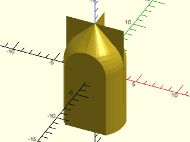

 

    include <BOSL2/std.scad>
    include <BOSL2/joiners.scad>
    snap_pin_socket("standard", anchor=CENTER, orient=UP, fins=true, $fn=40);

**Example 2:** A spinning socket with fins:

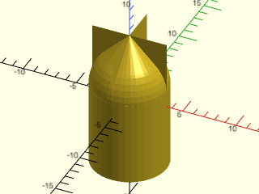

 

    include <BOSL2/std.scad>
    include <BOSL2/joiners.scad>
    snap_pin_socket("standard", anchor=CENTER, orient=UP, fins=true, fixed=false, $fn=40);

**Example 3:** A cube with a socket in the middle and one half-way off the front edge so you can see inside:

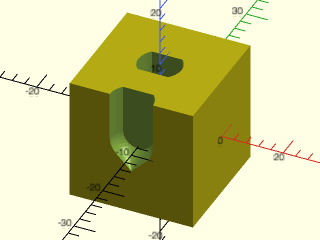

    include <BOSL2/std.scad>
    include <BOSL2/joiners.scad>
    $fn=40;
    diff("socket") cuboid([20,20,20])
      tag("socket"){
        attach(TOP) snap_pin_socket("standard");
        position(TOP+FRONT)snap_pin_socket("standard");
      }

  

---

### Module: rabbit\_clip()

**Synopsis:** Creates a rabbit-eared clip that can snap into a slot. [<abbr>Geom</abbr>]

**Topics:** [Joiners](Topics#joiners), [Parts](Topics#parts)

**See Also:** [snap\_pin()](#module-snap_pin), [joiner()](#module-joiner), [dovetail()](#module-dovetail), [snap\_pin()](#module-snap_pin)

**Usage:** 

- rabbit_clip(type, length, width, snap, thickness, depth, [compression=], [clearance=], [lock=], [lock_clearance=], [splinesteps=], [anchor=], [orient=], [spin=]) [ATTACHMENTS];

**Description:** 

Creates a clip with two flexible ears to snap into a mating socket, or create a mask to produce the appropriate
mating socket.  The clip can be made to insert and release easily, or to hold much better, or it can be
created with locking flanges that will make it very hard or impossible to remove.  Unlike the snap pin, this clip
is rectangular and can be made at any height, so a suitable clip could be very thin.  It's also possible to get a
solid connection with a short pin.

The type parameters specifies whether to make a clip, a socket mask, or a double clip.  The length is the
total nominal length of the (single) clip.  (The actual length will be very close, but not equal to this.)  The width
gives the nominal width of the clip, which is the actual width of the clip at its base.  The snap parameter
gives the depth of the clip sides, which controls how easy the clip is to insert and remove.  The clip "ears" are
made over-wide by the compression value.  A nonzero compression helps make the clip secure in its socket.
The socket's width and length are increased by the clearance value which creates some space and can compensate
for printing inaccuracy.  The socket will be slightly longer than the nominal width.  The thickness is the thickness
curved line that forms the clip.  The clip depth is the amount the basic clip shape is extruded.  Be sure that you
make the socket with a larger depth than the clip (try 0.4 mm) to allow ease of insertion of the clip.  The clearance
value does not apply to the depth.  The splinesteps parameter increases the sampling of the clip curves.

By default clips appear with orient=UP and sockets with orient=DOWN.  With double clips the default is orient=BACK, the
proper position for stand-alone printing.  The clips and sockets extend 0.02 units below
their base so that unions and differences will work without trouble, but be sure that the attach overlap is smaller
than 0.02.

When you set `lock=true` the clip has locking flanges that allow it to be easily inserted but block removal of the clip.
You you leave an access point in the socket wall this can allow a clip that locks in place but can be released by pressing
on the ears of the clip.  You can also set lock to a direction like LEFT or RIGHT to create just one locking clip.
When you make a double clip, setting `lock=LEFT` will create a locking flange on the left side of both clips, and
setting `lock=TOP` will create locking flanges at the top end (which points along the Y axis by default because of the
default BACK orientation).  You can also use corners like `TOP+LEFT` or give a list like `[TOP+LEFT,BOTTOM+RIGHT]`.
These directions refer to the native clip before applying `orient`.

The first figure shows the dimensions of the rabbit clip.  The second figure shows the clip in red overlayed on
its socket in yellow.  The left clip has a nonzero clearance, so its socket is bigger than the clip all around.
The right hand locking clip has no clearance, but it has a lock clearance, which provides some space behind
the lock to allow the clip to fit.  (Note that depending on your printer, this can be set to zero.)

**Figure 4.3.1:** 

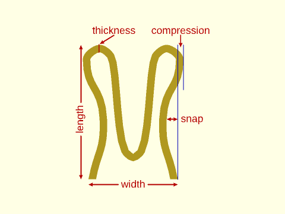

 

**Figure 4.3.2:** 

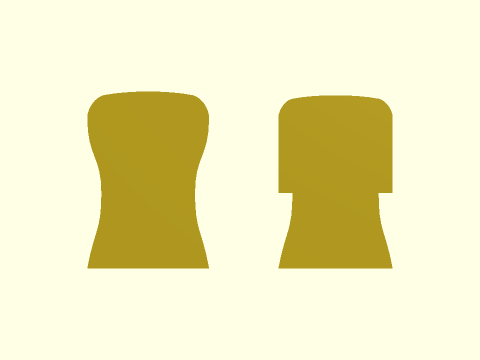

 

**Arguments:** 

<abbr title="These args can be used by position or by name.">By&nbsp;Position</abbr> | What it does
-------------------- | ------------
`type`               | One of "pin",  "socket", "male", "female" or "double" to specify what to make.
`length`             | nominal clip length
`width`              | nominal clip width
`snap`               | depth of hollow on the side of the clip
`thickness`          | thickness of the clip "line"
`depth`              | amount to extrude clip (give extra room for the socket, about 0.4mm)

<abbr title="These args must be used by name, ie: name=value">By&nbsp;Name</abbr> | What it does
-------------------- | ------------
`compression`        | excess width at the "ears" to lock more tightly.  Default: 0.1
`clearance`          | extra space in the socket for easier insertion.  Default: 0.1
`lock`               | set to true to make a locking clip that may be irreversible. LEFT or RIGHT may be specified for all types to add a locking latch to just that side. For "double" type, TOP or BOTTOM is valid as well as a single corner (e.g. TOP+LEFT) or an array of corners or sides (e.g. [TOP, BOTTOM+RIGHT]). Default: false
`lock_clearance`     | give clearance for the lock.  Default: 0
`splinesteps`        | number of samples in the curves of the clip.  Default: 8
`anchor`             | Anchor point for clip.  Default: BACK for double clips, BOTTOM otherwise
`orient`             | Clip orientation.  Default: UP for pins, DOWN for sockets, BACK for double clips
`spin`               | spin the clip.  Default: 0

**Example 1:** Here are several sizes that work printed in PLA on a Prusa MK3, with default clearance of 0.1 and a depth of 5

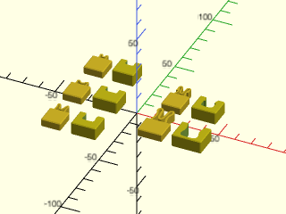

 

    include <BOSL2/std.scad>
    include <BOSL2/joiners.scad>
    module test_pair(length, width, snap, thickness, compression, lock=false)
    {
      depth = 5;
      extra_depth = 10;// Change this to 0.4 for closed sockets
      cuboid([max(width+5,12),12, depth], chamfer=.5, edges=[FRONT,"Y"], anchor=BOTTOM)
          attach(BACK)
            rabbit_clip(type="pin",length=length, width=width,snap=snap,thickness=thickness,depth=depth,
                        compression=compression,lock=lock);
      right(width+13)
      diff("remove")
          cuboid([width+8,max(12,length+2),depth+3], chamfer=.5, edges=[FRONT,"Y"], anchor=BOTTOM)
            tag("remove")
              attach(BACK)
                rabbit_clip(type="socket",length=length, width=width,snap=snap,thickness=thickness,
                            depth=depth+extra_depth, lock=lock,compression=0);
    }
    left(37)ydistribute(spacing=28){
      test_pair(length=6, width=7, snap=0.25, thickness=0.8, compression=0.1);
      test_pair(length=3.5, width=7, snap=0.1, thickness=0.8, compression=0.1);  // snap = 0.2 gives a firmer connection
      test_pair(length=3.5, width=5, snap=0.1, thickness=0.8, compression=0.1);  // hard to take apart
    }
    right(17)ydistribute(spacing=28){
      test_pair(length=12, width=10, snap=1, thickness=1.2, compression=0.2);
      test_pair(length=8, width=7, snap=0.75, thickness=0.8, compression=0.2, lock=true); // With lock, very firm and irreversible
    }

**Example 2:** Double clip to connect two sockets

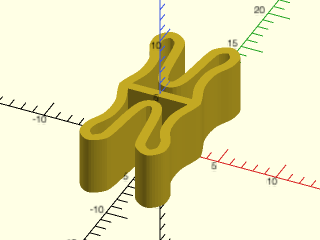

 

    include <BOSL2/std.scad>
    include <BOSL2/joiners.scad>
    rabbit_clip("double",length=8, width=7, snap=0.75, thickness=0.8, compression=0.2,depth=5);

**Example 3:** Double clip with locking top

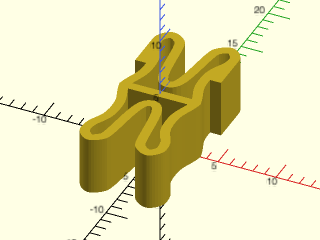

 

    include <BOSL2/std.scad>
    include <BOSL2/joiners.scad>
    rabbit_clip("double",length=8, width=7, snap=0.75, thickness=0.8, compression=0.2,depth=5,lock=TOP);

**Example 4:** A modified version of the clip that acts like a backpack strap clip, where it locks tightly but you can squeeze to release.

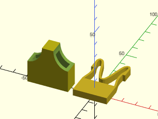

 

    include <BOSL2/std.scad>
    include <BOSL2/joiners.scad>
    cuboid([25,15,5],anchor=BOTTOM)
        attach(BACK)rabbit_clip("pin", length=25, width=25, thickness=1.5, snap=2, compression=0, lock=true, depth=5, lock_clearance=3);
    left(32)
    diff("remove")
    cuboid([30,30,11],orient=BACK,anchor=BACK){
        tag("remove")attach(BACK)rabbit_clip("socket", length=25, width=25, thickness=1.5, snap=2, compression=0, lock=true, depth=5.5, lock_clearance=3);
        xflip_copy()
          position(FRONT+LEFT)
          xscale(0.8)
          tag("remove")zcyl(l=20,r=13.5, $fn=64);
    }

**Example 5:** Clip that locks only on the right side

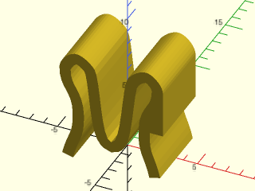

 

    include <BOSL2/std.scad>
    include <BOSL2/joiners.scad>
    rabbit_clip("pin",length=8, width=7, snap=0.75, thickness=0.8, compression=0.2,depth=5,lock=RIGHT);

---

## Section: Splines

### Module: hirth()

**Synopsis:** Creates a Hirth face spline that locks together two cylinders. [<abbr>Geom</abbr>]

**Usage:** 

- hirth(n, ir|id=, or|od=, tooth_angle, [cone_angle=], [chamfer=], [rounding=], [base=], [crop=], [anchor=], [spin=], [orient=]

**Description:** 

Create a Hirth face spline.  The Hirth face spline is a joint that locks together two cylinders using radially
positioned triangular teeth on the ends of the cylinders.  If the joint is held together (e.g. with a screw) then
the two parts will rotate (or not) together.  The two parts of the regular Hirth spline joint are identical.
Each tooth is a triangle that grows larger with radius.  You specify a nominal tooth angle; the actual tooth
angle will be slightly different.

You can also specify a cone_angle which raises or lowers the angle of the teeth.  When you do this you need to
mate splines with opposite angles such as -20 and +20.  The splines appear centered at the origin so that two
splines will mate if their centers coincide.  Therefore `attach(CENTER,CENTER)` will produce two mating splines
assuming that they are rotated correctly.  The bottom anchors will be at the bottom of the spline base.  The top
anchors are at an arbitrary location and are not useful.

By default the spline is created as a polygon with `2n` edges and the radius is the outer radius to the unchamfered corners.
For large choices of `n` this will produce result that is close to circular.  For small `n` the result will be obviously polygonal.
If you want a cylindrical result then set `crop=true`, which will intersect an oversized version of the joint with a suitable cylinder.
Note that cropping makes the most difference when the tooth count is low.

The teeth are chamfered proportionally based on the `chamfer` argument which specifies the fraction of the teeth tips
to remove.  The teeth valleys are chamfered by half the specified value to ensure that there is room for the parts
to mate.  If you use the rounding parameter then the roundings cut away the chamfer corners, so chamfered and rounded
joints are compatible with each other.  Note that rounding doesn't always produce a smooth transition to the roundover,
particularly with large cone angle.
The base is added based on the unchamfered dimensions of the joint, and the "teeth_bot" anchor is located
based on the unchamfered dimensions.

By default the teeth are symmetric, which is ideal for registration and for situations where loading may occur in either
direction.   The skew parameter will skew the teeth by the specified amount, where a skew of ±1 gives a tooth with a vertical
side either on the left or the right.  Intermediate values will produce partially skewed teeth.  Note that the skew
applies after the tooth profile is computed with the specified tooth_angle, which means that the skewed tooth will
have an altered tooth angle from the one specified.

The joint is constructed with a tooth peak aligned with the X+ axis.
For two hirth joints to mate they must have the same tooth count, opposite cone angles, and the chamfer/rounding values
must be equal.  (One can be chamfered and one rounded, but with the same value.)  The rotation required to mate the parts
depends on the skew and whether the tooth count is odd or even.  To apply this rotation automatically, set `rot=true`.

When you pick extreme parameters such as very large cone angle, or very small tooth count (e.g. 2 or 3), the joint may
develop a weird shape, and the shape may be unexpectedly sensitive to things like whether chamfering is enabled.  It is difficult
to identify the point where the shapes become odd, or even perhaps invalid.  For example, with 2 teeth a skew of 0.95 works fine, but
a skew of 0.97 produces a truncated shape and 0.99 produces a 2-part shape.  A skew of 1 produces a degenerate, invalid shape.
Since it's hard to determine which parameters, exactly, produce "bad" outcomes, we have chosen not to limit the production
of the extreme shapes, so take care if using extreme parameter values.

**Named Anchors:** 

Anchor Name | Position
----------- | --------
"teeth_bot" | center of the joint, aligned with the bottom of the (unchamfered/unrounded) teeth, pointing DOWN.

**Arguments:** 

<abbr title="These args can be used by position or by name.">By&nbsp;Position</abbr> | What it does
-------------------- | ------------
`n`                  | number of teeth
`ir`                 / `id`                 | inner radius or diameter
`or`                 / `od`                 | outer radius or diameter
`tooth_angle`        | nominal tooth angle.  Default: 60
`cone_angle`         | raise or lower the angle of the teeth in the radial direction.  Default: 0
`skew`               | skew the tooth shape.  Default: 0
`chamfer`            | chamfer teeth by this fraction at tips and half this fraction at valleys.  Default: 0
`rounding`           | round the teeth by this fraction at the tips, and half this fraction at valleys.  Default: 0
`rot`                | if true rotate so the part will mate (via attachment) with another identical part.  Default: false
`base`               | add base of this height to the bottom.  Default: 1
`crop`               | crop to a cylindrical shape.  Default: false
`anchor`             | Translate so anchor point is at origin (0,0,0).  See [anchor](attachments.scad#subsection-anchor).  Default: `CENTER`
`spin`               | Rotate this many degrees around the Z axis after anchor.  See [spin](attachments.scad#subsection-spin).  Default: `0`
`orient`             | Vector to rotate top towards, after spin.  See [orient](attachments.scad#subsection-orient).  Default: `UP`

**Example 1:** Basic uncropped hirth spline

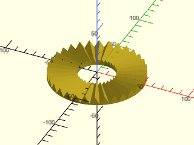

    include <BOSL2/std.scad>
    include <BOSL2/joiners.scad>
    hirth(32,20,50);

  

**Example 2:** Raise cone angle

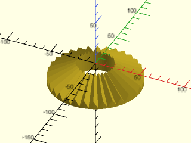

    include <BOSL2/std.scad>
    include <BOSL2/joiners.scad>
    hirth(32,20,50,cone_angle=30);

  

**Example 3:** Lower cone angle

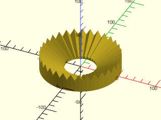

    include <BOSL2/std.scad>
    include <BOSL2/joiners.scad>
    hirth(32,20,50,cone_angle=-30);

  

**Example 4:** Adding a large base

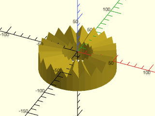

    include <BOSL2/std.scad>
    include <BOSL2/joiners.scad>
    hirth(20,20,50,base=20);

  

**Example 5:** Only 8 teeth, with chamfering

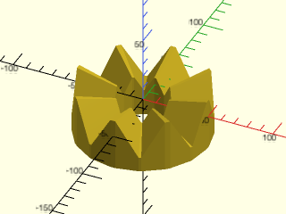

    include <BOSL2/std.scad>
    include <BOSL2/joiners.scad>
    hirth(8,20,50,tooth_angle=60,base=10,chamfer=.1);

  

**Example 6:** Only 8 teeth, cropped

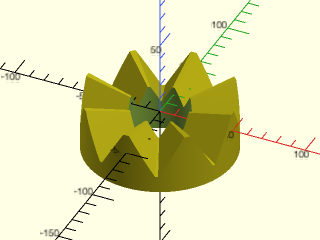

    include <BOSL2/std.scad>
    include <BOSL2/joiners.scad>
    hirth(8,20,50,tooth_angle=60,base=10,chamfer=.1, crop=true);

  

**Example 7:** Only 8 teeth, with rounding

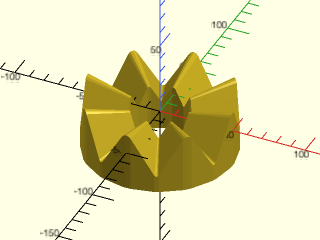

    include <BOSL2/std.scad>
    include <BOSL2/joiners.scad>
    hirth(8,20,50,tooth_angle=60,base=10,rounding=.1);

  

**Example 8:** Only 8 teeth, different tooth angle, cropping with $fn to crop cylinder aligned with teeth

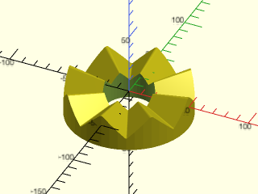

 

    include <BOSL2/std.scad>
    include <BOSL2/joiners.scad>
    hirth(8,20,50,tooth_angle=90,base=10,rounding=.05,crop=true,$fn=48);

**Example 9:** Two identical parts joined together (with 1 unit offset to reveal the joint line).  With odd tooth count and no skew the teeth line up correctly:

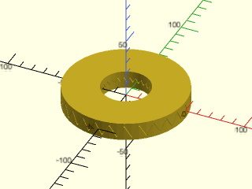

    include <BOSL2/std.scad>
    include <BOSL2/joiners.scad>
    hirth(27,20,50, tooth_angle=60,base=2,chamfer=.05)
      up(1) attach(CENTER,CENTER)
        hirth(27,20,50, tooth_angle=60,base=2,chamfer=.05);

  

**Example 10:** Two conical parts joined together, with opposite cone angles for a correct joint.  With an even tooth count one part needs to be rotated for the parts to align:

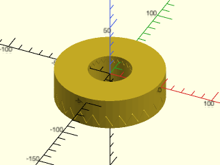

 

    include <BOSL2/std.scad>
    include <BOSL2/joiners.scad>
    hirth(26,20,50, tooth_angle=60,base=2,cone_angle=30,chamfer=.05)
      up(1) attach(CENTER,CENTER)
        hirth(26,20,50, tooth_angle=60,base=2,cone_angle=-30, chamfer=.05, rot=true);

**Example 11:** Using skew to create teeth with vertical faces

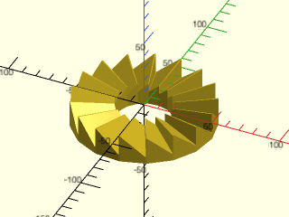

    include <BOSL2/std.scad>
    include <BOSL2/joiners.scad>
    hirth(17,20,50,skew=-1, base=5, chamfer=0.05);

  

**Example 12:** If you want to change how tall the teeth are you do that by changing the tooth angle.  Increasing the tooth angle makes the teeth shorter:

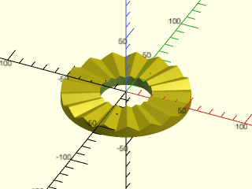

 

    include <BOSL2/std.scad>
    include <BOSL2/joiners.scad>
    hirth(17,20,50,tooth_angle=120,skew=0, base=5, rounding=0.05, crop=true);

---

