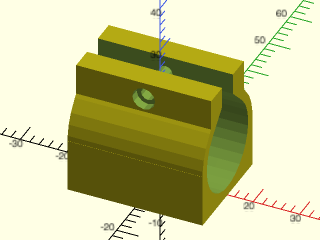
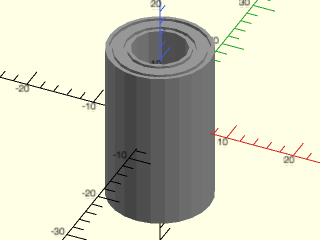
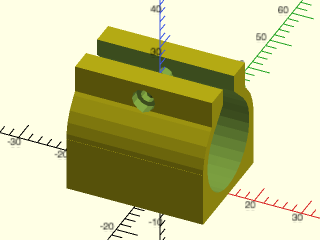
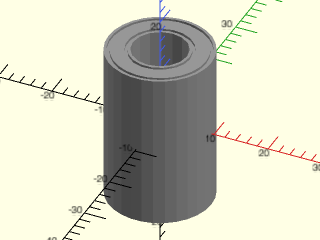

# LibFile: linear\_bearings.scad

Mounts and models for LMxUU style linear bearings.

To use, add the following lines to the beginning of your file:

    include <BOSL2/std.scad>
    include <BOSL2/linear_bearings.scad>

## File Contents

1. [Section: Generic Linear Bearings](#section-generic-linear-bearings)
    - [`linear_bearing_housing()`](#module-linear_bearing_housing) – Creates a generic linear bearing mount clamp. [<abbr>Geom</abbr>]
    - [`linear_bearing()`](#module-linear_bearing) – Creates a generic linear bearing cartridge. [<abbr>Geom</abbr>]

2. [Section: lmXuu Linear Bearings](#section-lmxuu-linear-bearings)
    - [`lmXuu_housing()`](#module-lmxuu_housing) – Creates a standardized LM*UU linear bearing mount clamp. [<abbr>Geom</abbr>]
    - [`lmXuu_bearing()`](#module-lmxuu_bearing) – Creates a standardized LM*UU linear bearing cartridge. [<abbr>Geom</abbr>]

3. [Section: lmXuu Linear Bearing Info](#section-lmxuu-linear-bearing-info)
    - [`lmXuu_info()`](#function-lmxuu_info) – Returns the sizes of a standard LM*UU linear bearing cartridge.

## Section: Generic Linear Bearings

### Module: linear\_bearing\_housing()

**Synopsis:** Creates a generic linear bearing mount clamp. [<abbr>Geom</abbr>]

**Topics:** [Parts](Topics#parts), [Bearings](Topics#bearings)

**See Also:** [linear\_bearing()](#module-linear_bearing), [lmXuu\_info()](#function-lmxuu_info), [ball\_bearing()](ball_bearings.scad#module-ball_bearing)

**Usage:** 

- linear_bearing_housing(d, l, tab, gap, wall, tabwall, screwsize) [ATTACHMENTS];

**Description:** 

Creates a model of a clamp to hold a generic linear bearing cartridge.

**Arguments:** 

<abbr title="These args can be used by position or by name.">By&nbsp;Position</abbr> | What it does
-------------------- | ------------
`d`                  | Diameter of linear bearing. (Default: 15)
`l`                  | Length of linear bearing. (Default: 24)
`tab`                | Clamp tab height. (Default: 8)
`tabwall`            | Clamp Tab thickness. (Default: 5)
`wall`               | Wall thickness of clamp housing. (Default: 3)
`gap`                | Gap in clamp. (Default: 5)
`screwsize`          | Size of screw to use to tighten clamp. (Default: 3)

<abbr title="These args must be used by name, ie: name=value">By&nbsp;Name</abbr> | What it does
-------------------- | ------------
`anchor`             | Translate so anchor point is at origin (0,0,0).  See [anchor](attachments.scad#subsection-anchor).  Default: `BOTTOM`
`spin`               | Rotate this many degrees around the Z axis after anchor.  See [spin](attachments.scad#subsection-spin).  Default: `0`
`orient`             | Vector to rotate top towards, after spin.  See [orient](attachments.scad#subsection-orient).  Default: `UP`

**Example 1:** 

 

    include <BOSL2/std.scad>
    include <BOSL2/linear_bearings.scad>
    linear_bearing_housing(d=19, l=29, wall=2, tab=8, screwsize=2.5);

---

### Module: linear\_bearing()

**Synopsis:** Creates a generic linear bearing cartridge. [<abbr>Geom</abbr>]

**Topics:** [Parts](Topics#parts), [Bearings](Topics#bearings)

**See Also:** [linear\_bearing\_housing()](#module-linear_bearing_housing), [lmXuu\_info()](#function-lmxuu_info), [ball\_bearing()](ball_bearings.scad#module-ball_bearing)

**Usage:** 

- linear_bearing(l, od, id, length) [ATTACHMENTS];

**Description:** 

Creates a rough model of a generic linear ball bearing cartridge.

**Arguments:** 

<abbr title="These args can be used by position or by name.">By&nbsp;Position</abbr> | What it does
-------------------- | ------------
`l`                  / `length`             | The length of the linear bearing cartridge.  Default: 24
`od`                 | The outer diameter of the linear bearing cartridge.  Default: 15
`id`                 | The inner diameter of the linear bearing cartridge.  Default: 8

<abbr title="These args must be used by name, ie: name=value">By&nbsp;Name</abbr> | What it does
-------------------- | ------------
`anchor`             | Translate so anchor point is at origin (0,0,0).  See [anchor](attachments.scad#subsection-anchor).  Default: `CENTER`
`spin`               | Rotate this many degrees around the Z axis after anchor.  See [spin](attachments.scad#subsection-spin).  Default: `0`
`orient`             | Vector to rotate top towards, after spin.  See [orient](attachments.scad#subsection-orient).  Default: `UP`

**Example 1:** 

    include <BOSL2/std.scad>
    include <BOSL2/linear_bearings.scad>
    linear_bearing(l=24, od=15, id=8);

  

---

## Section: lmXuu Linear Bearings

### Module: lmXuu\_housing()

**Synopsis:** Creates a standardized LM*UU linear bearing mount clamp. [<abbr>Geom</abbr>]

**Topics:** [Parts](Topics#parts), [Bearings](Topics#bearings)

**See Also:** [linear\_bearing()](#module-linear_bearing), [linear\_bearing\_housing()](#module-linear_bearing_housing), [lmXuu\_info()](#function-lmxuu_info), [lmXuu\_bearing()](#module-lmxuu_bearing), [ball\_bearing()](ball_bearings.scad#module-ball_bearing)

**Usage:** 

- lmXuu_housing(size, tab, gap, wall, tabwall, screwsize) [ATTACHMENTS];

**Description:** 

Creates a model of a clamp to hold a standard sized lmXuu linear bearing cartridge.

**Arguments:** 

<abbr title="These args can be used by position or by name.">By&nbsp;Position</abbr> | What it does
-------------------- | ------------
`size`               | Standard lmXuu inner size.  Default: 8
`tab`                | Clamp tab height.  Default: 7
`tabwall`            | Clamp Tab thickness.  Default: 5
`wall`               | Wall thickness of clamp housing.  Default: 3
`gap`                | Gap in clamp.  Default: 5
`screwsize`          | Size of screw to use to tighten clamp.  Default: 3

<abbr title="These args must be used by name, ie: name=value">By&nbsp;Name</abbr> | What it does
-------------------- | ------------
`anchor`             | Translate so anchor point is at origin (0,0,0).  See [anchor](attachments.scad#subsection-anchor).  Default: `BOTTOM`
`spin`               | Rotate this many degrees around the Z axis after anchor.  See [spin](attachments.scad#subsection-spin).  Default: `0`
`orient`             | Vector to rotate top towards, after spin.  See [orient](attachments.scad#subsection-orient).  Default: `UP`

**Example 1:** 

    include <BOSL2/std.scad>
    include <BOSL2/linear_bearings.scad>
    lmXuu_housing(size=10, wall=2, tab=6, screwsize=2.5);

  

---

### Module: lmXuu\_bearing()

**Synopsis:** Creates a standardized LM*UU linear bearing cartridge. [<abbr>Geom</abbr>]

**Topics:** [Parts](Topics#parts), [Bearings](Topics#bearings)

**See Also:** [linear\_bearing()](#module-linear_bearing), [linear\_bearing\_housing()](#module-linear_bearing_housing), [lmXuu\_info()](#function-lmxuu_info), [lmXuu\_housing()](#module-lmxuu_housing), [ball\_bearing()](ball_bearings.scad#module-ball_bearing)

**Usage:** 

- lmXuu_bearing(size) [ATTACHMENTS];

**Description:** 

Creates a model of an lmXuu linear ball bearing cartridge.

**Arguments:** 

<abbr title="These args can be used by position or by name.">By&nbsp;Position</abbr> | What it does
-------------------- | ------------
`size`               | Standard lmXuu inner size.  Default: 8

<abbr title="These args must be used by name, ie: name=value">By&nbsp;Name</abbr> | What it does
-------------------- | ------------
`anchor`             | Translate so anchor point is at origin (0,0,0).  See [anchor](attachments.scad#subsection-anchor).  Default: `CENTER`
`spin`               | Rotate this many degrees around the Z axis after anchor.  See [spin](attachments.scad#subsection-spin).  Default: `0`
`orient`             | Vector to rotate top towards, after spin.  See [orient](attachments.scad#subsection-orient).  Default: `UP`

**Example 1:** 

    include <BOSL2/std.scad>
    include <BOSL2/linear_bearings.scad>
    lmXuu_bearing(size=10);

  

---

## Section: lmXuu Linear Bearing Info

### Function: lmXuu\_info()

**Synopsis:** Returns the sizes of a standard LM*UU linear bearing cartridge.

**Topics:** [Parts](Topics#parts), [Bearings](Topics#bearings)

**See Also:** [linear\_bearing()](#module-linear_bearing), [linear\_bearing\_housing()](#module-linear_bearing_housing), [lmXuu\_bearing()](#module-lmxuu_bearing), [lmXuu\_housing()](#module-lmxuu_housing), [ball\_bearing()](ball_bearings.scad#module-ball_bearing)

**Usage:** 

- diam_len = lmXuu_info(size);

**Description:** 

Get dimensional info for a standard metric lmXuu linear bearing cartridge.
Returns `[DIAM, LENGTH]` for the cylindrical cartridge.

**Arguments:** 

<abbr title="These args can be used by position or by name.">By&nbsp;Position</abbr> | What it does
-------------------- | ------------
`size`               | Inner diameter of lmXuu bearing, in mm.

---

