# LibFile: masks.scad

This file provides 2D and 3D masks that you can use to add edge treatments to your models.
You can apply 2D masking shapes with [`edge_profile()`](#module-edge_profile) to mask edges of cubes,
prismoids or cylinders creating edge treatments like roundovers, chamfers, or more elaborate shapes like
like the cove and ogee found in furniture and architecture.  You can also create 3D masks
objects that you can apply to specific edges or corners.

To use, add the following lines to the beginning of your file:

    include <BOSL2/std.scad>

## File Contents

1. [Section: 2D Masking Shapes](#section-2d-masking-shapes)
    - [`mask2d_roundover()`](#functionmodule-mask2d_roundover) – Creates a circular mask shape for rounding edges or beading. [<abbr>Geom</abbr>] [<abbr>Path</abbr>]
    - [`mask2d_smooth()`](#functionmodule-mask2d_smooth) – Creates a continuous curvature mask for rounding edges. [<abbr>Geom</abbr>] [<abbr>Path</abbr>]
    - [`mask2d_teardrop()`](#functionmodule-mask2d_teardrop) – Creates a 2D teardrop shape with specified max angle from vertical. [<abbr>Geom</abbr>] [<abbr>Path</abbr>]
    - [`mask2d_cove()`](#functionmodule-mask2d_cove) – Creates a 2D cove (quarter-round) mask shape. [<abbr>Geom</abbr>] [<abbr>Path</abbr>]
    - [`mask2d_chamfer()`](#functionmodule-mask2d_chamfer) – Produces a 2D chamfer mask shape. [<abbr>Geom</abbr>] [<abbr>Path</abbr>]
    - [`mask2d_rabbet()`](#functionmodule-mask2d_rabbet) – Creates a rabbet mask shape. [<abbr>Geom</abbr>] [<abbr>Path</abbr>]
    - [`mask2d_dovetail()`](#functionmodule-mask2d_dovetail) – Creates a 2D dovetail mask shape. [<abbr>Geom</abbr>] [<abbr>Path</abbr>]
    - [`mask2d_ogee()`](#functionmodule-mask2d_ogee) – Creates a 2D ogee mask shape. [<abbr>Geom</abbr>] [<abbr>Path</abbr>]

2. [Section: Modules for Applying 2D Masks](#section-modules-for-applying-2d-masks)
    - [`face_profile()`](#module-face_profile) – Extrudes a 2D edge profile into a mask for all edges and corners of the given faces on the parent. [<abbr>Geom</abbr>]
    - [`edge_profile()`](#module-edge_profile) – Extrudes a 2d edge profile into a mask on edges of the parent cuboid, prismoid or cone. [<abbr>Geom</abbr>]
    - [`edge_profile_asym()`](#module-edge_profile_asym) – Extrudes an asymmetric 2D profile into a mask on edges and corners of the parent cuboid. [<abbr>Geom</abbr>]
    - [`corner_profile()`](#module-corner_profile) – Rotationally extrudes a 2d edge profile into corner mask on the given corners of the parent. [<abbr>Geom</abbr>]

3. [Section: 3D Edge Masks](#section-3d-edge-masks)
    - [`chamfer_edge_mask()`](#module-chamfer_edge_mask) – Creates a shape to chamfer a 90° edge. [<abbr>Geom</abbr>]
    - [`rounding_edge_mask()`](#module-rounding_edge_mask) – Creates a shape to round an arbitrary 3d edge. [<abbr>Geom</abbr>]
    - [`teardrop_edge_mask()`](#module-teardrop_edge_mask) – Creates a shape to round an edge while limiting the angle of overhang. [<abbr>Geom</abbr>]
    - [`polygon_edge_mask()`](#module-polygon_edge_mask) – Extrudes a 2d mask polygon to an edge mask with a correct corner anchor [<abbr>Geom</abbr>]

4. [Section: 3D Masks for 90° Corners](#section-3d-masks-for-90-corners)
    - [`chamfer_corner_mask()`](#module-chamfer_corner_mask) – Creates a shape to chamfer a 90° corner. [<abbr>Geom</abbr>]
    - [`rounding_corner_mask()`](#module-rounding_corner_mask) – Creates a shape to round 90° corners. [<abbr>Geom</abbr>]
    - [`teardrop_corner_mask()`](#module-teardrop_corner_mask) – Creates a shape to round a 90° corner but limit the angle of overhang. [<abbr>Geom</abbr>]

5. [Section: 3D Cylinder End Masks](#section-3d-cylinder-end-masks)
    - [`chamfer_cylinder_mask()`](#module-chamfer_cylinder_mask) – Creates a shape to chamfer the end of a cylinder. [<abbr>Geom</abbr>]
    - [`rounding_cylinder_mask()`](#module-rounding_cylinder_mask) – Creates a shape to round the end of a cylinder. [<abbr>Geom</abbr>]

6. [Section: 3D Cylindrical Hole Masks](#section-3d-cylindrical-hole-masks)
    - [`rounding_hole_mask()`](#module-rounding_hole_mask) – Creates a shape to round the edge of a round hole. [<abbr>Geom</abbr>]

7. [Section: Modules for Applying 3D Masks](#section-modules-for-applying-3d-masks)
    - [`face_mask()`](#module-face_mask) – Ataches a 3d mask shape to the given faces of the parent. [<abbr>Trans</abbr>]
    - [`edge_mask()`](#module-edge_mask) – Attaches a 3D mask shape to the given edges of the parent. [<abbr>Trans</abbr>]
    - [`corner_mask()`](#module-corner_mask) – Attaches a 3d mask shape to the given corners of the parent. [<abbr>Trans</abbr>]

## Section: 2D Masking Shapes

### Function/Module: mask2d\_roundover()

**Synopsis:** Creates a circular mask shape for rounding edges or beading. [<abbr>Geom</abbr>] [<abbr>Path</abbr>]

**Topics:** [Shapes (2D)](Topics#shapes-2d), [Paths (2D)](Topics#paths-2d), [Path Generators](Topics#path-generators), [Attachable](Topics#attachable), [Masks (2D)](Topics#masks-2d)

**See Also:** [corner\_profile()](#module-corner_profile), [edge\_profile()](#module-edge_profile), [face\_profile()](#module-face_profile), [fillet()](shapes3d.scad#module-fillet)

**Usage:** As module

- mask2d_roundover(r|d=|h=|height=|cut=|joint=, [inset], [mask_angle], [excess], [flat_top=], [quarter_round=], [clip_angle=]) [ATTACHMENTS];

**Usage:** As function

- path = mask2d_roundover(r|d=|h=|height=|cut=|joint=, [inset], [mask_angle], [excess], [flat_top=], [quarter_round=], [clip_angle=]);

**Description:** 

Creates a 2D roundover/bead mask shape that is useful for extruding into a 3D mask for an edge.
Conversely, you can use that same extruded shape to make an interior fillet between two walls.
As a 2D mask, this is designed to be differenced away from the edge of a shape that with its corner at the origin and one edge on the X+ axis and the other mask_angle degrees counterclockwise from the X+ axis.
If called as a function, returns a 2D path of the outline of the mask shape.

The roundover can be specified by radius, diameter, height, cut, or joint length.

If you need roundings to agree on edges of different mask_angle, e.g. to round the base of a prismoid, then you need all of the
masks used to have the same height.  (Note that it may appear that matching joint would also work, but it does not because the joint distances are measured
in different directions.)  You can get the same height by setting the `height` parameter, which is an alternate way to control the size of the rounding.
You can also set `quarter_round=true`, which creates a rounding that uses a quarter circle of the specified radius for all mask angles.  If you have set inset
you will need `flat_top=true` as well.  Note that this is the default if you use `quarter_round=true` but not otherwise.  Generally if you want a roundover
results are best using the `height` option but if you want a bead as you get using `inset` the results are often best using the `quarter_round=true` option.

If you set the `clip_angle` option then the bottom of the arc is clipped at the specified angle from vertical.  This
can be useful for creating bottom roundings for 3d printing.  If you specify the radius either directly or indirectly
using `cut` or `joint` and combine that with a height specification using `h` or `height`, then `clip_angle` is automatically
calculated and a clipped circle of the specified height and radius is produced.

**Arguments:** 

<abbr title="These args can be used by position or by name.">By&nbsp;Position</abbr> | What it does
-------------------- | ------------
`r`                  | Radius of the roundover.
`inset`              | Optional bead inset size, perpendicular to the two edges.  Scalar or 2-vector.  Default: 0
`mask_angle`         | Number of degrees in the corner angle to mask.  Default: $edge_angle if defined, otherwise 90
`excess`             | Extra amount of mask shape to creates on the X and quasi-Y sides of the shape.  Default: 0.01

<abbr title="These args must be used by name, ie: name=value">By&nbsp;Name</abbr> | What it does
-------------------- | ------------
`d`                  | Diameter of the roundover.
`h`                  / `height`             | Mask height excluding inset and excess.  Give instead of r / d, cut or joint when you want a consistent mask height, no matter what the mask angle.
`cut`                | Cut distance.  IE: How much of the corner to cut off.  See [Types of Roundovers](rounding.scad#section-types-of-roundovers).
`joint`              | Joint distance.  IE: How far from the edge the roundover should start.  See [Types of Roundovers](rounding.scad#section-types-of-roundovers).
`flat_top`           | If true, the top inset of the mask will be horizontal instead of angled by the mask_angle.  Default: true if quarter_round is set, false otherwise.
`quarter_round`      | If true, make a roundover independent of the mask_angle, defined based on a quarter circle of the specified size.  Creates mask with angle-independent height.  Default: false.
`clip_angle`         | Clip the bottom of the rounding where the circle is this angle from the vertical.  Must be between mask_angle-90 and 90 degrees.  Default: 90 (no clipping)
`anchor`             | Translate so anchor point is at origin (0,0,0).  See [anchor](attachments.scad#subsection-anchor).  Default: `CENTER`
`spin`               | Rotate this many degrees around the Z axis after anchor.  See [spin](attachments.scad#subsection-spin).  Default: `0`

**Example 1:** 2D Roundover Mask by Radius

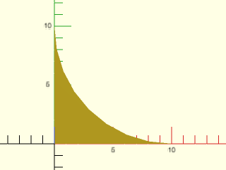

    include <BOSL2/std.scad>
    mask2d_roundover(r=10);

  

**Example 2:** 2D Bead Mask

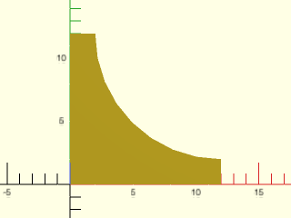

    include <BOSL2/std.scad>
    mask2d_roundover(r=10,inset=2);

  

**Example 3:** 2D Roundover Mask by Radius, acute angle

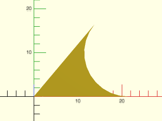

    include <BOSL2/std.scad>
    mask2d_roundover(r=10, mask_angle=50);

  

**Example 4:** 2D Bead Mask by Radius, acute angle

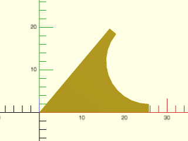

    include <BOSL2/std.scad>
    mask2d_roundover(r=10, inset=2, mask_angle=50);

  

**Example 5:** 2D Bead Mask for obtuse angle, by height

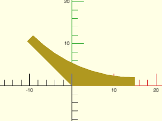

    include <BOSL2/std.scad>
    mask2d_roundover(h=10, inset=2, mask_angle=135, $fn=64);

  

**Example 6:** 2D Bead Mask for obtuse angle, by height with flat top

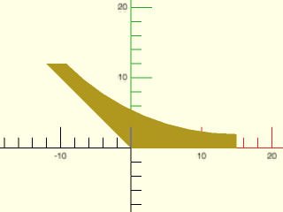

 

    include <BOSL2/std.scad>
    mask2d_roundover(h=10, inset=2, mask_angle=135, flat_top=true, $fn=64);

**Example 7:** 2D Angled Bead Mask by Joint Length.  Joint length does not include the inset.

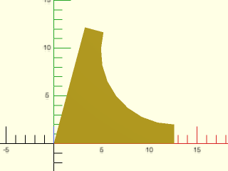

    include <BOSL2/std.scad>
    mask2d_roundover(joint=10, inset=2, mask_angle=75);

  

**Example 8:** Increasing the Excess

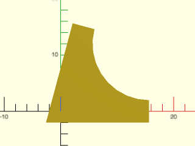

    include <BOSL2/std.scad>
    mask2d_roundover(r=10, inset=2, mask_angle=75, excess=2);

  

**Example 9:** quarter\_round bead on an acute angle

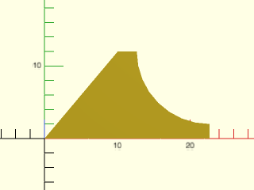

 

    include <BOSL2/std.scad>
    mask2d_roundover(r=10, inset=2, mask_angle=50, quarter_round=true);

**Example 10:** quarter\_round bead on an obtuse angle

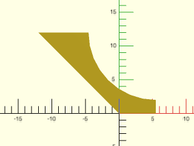

 

    include <BOSL2/std.scad>
    mask2d_roundover(r=10, inset=2, mask_angle=135, quarter_round=true);

**Example 11:** clipping a circle to a 50 deg angle

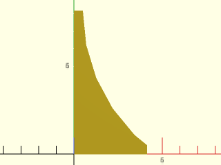

    include <BOSL2/std.scad>
    mask2d_roundover(r=10, inset=1/2, clip_angle=50);

  

**Example 12:** clipping a circle to a 50 deg angle.  The bottom of the arc is not tangent to the x axis.

    include <BOSL2/std.scad>
    mask2d_roundover(r=10, inset=1/2, clip_angle=50);

  

**Example 13:** clipping the arc by specifying `r` and `h`

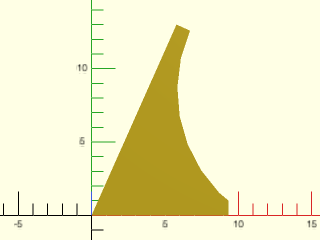

    include <BOSL2/std.scad>
    mask2d_roundover(mask_angle=66, r=10, h=12, inset=1);

  

**Example 14:** Masking by Edge Attachment

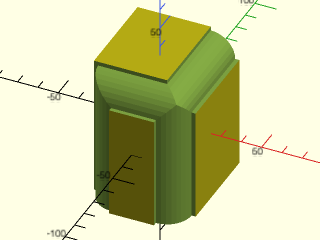

    include <BOSL2/std.scad>
    diff()
    cube([50,60,70],center=true)
        edge_profile([TOP,"Z"],except=[BACK,TOP+LEFT])
            mask2d_roundover(h=12, inset=2);

  

**Example 15:** Making an interior fillet

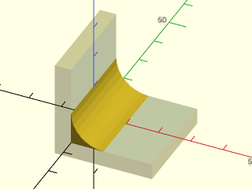

    include <BOSL2/std.scad>
    %render() difference() {
        move(-[5,0,5]) cube(30, anchor=BOT+LEFT);
        cube(310, anchor=BOT+LEFT);
    }
    xrot(90)
        linear_extrude(height=30, center=true)
            mask2d_roundover(r=10);

  

**Example 16:** Rounding over top of an extreme prismoid using height option

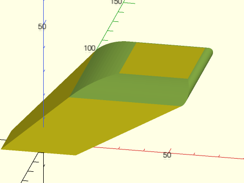

 

    include <BOSL2/std.scad>
    diff()
      prismoid([30,20], [50,60], h=20, shift=[40,50])
         edge_profile(TOP, excess=27)
            mask2d_roundover(height=5, mask_angle=$edge_angle, $fn=128);

**Example 17:** Using the quarter\_round option results in a lip on obtuse angles, so it may not be the best choice for pure roundings.

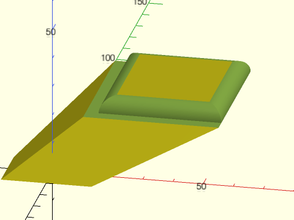

 

    include <BOSL2/std.scad>
    diff()
      prismoid([30,20], [50,60], h=20, shift=[40,50])
         edge_profile(TOP, excess=27)
            mask2d_roundover(r=5, mask_angle=$edge_angle, quarter_round=true, $fn=128);

**Example 18:** Creating a bead on the prismoid using the height option with flat\_top=true:

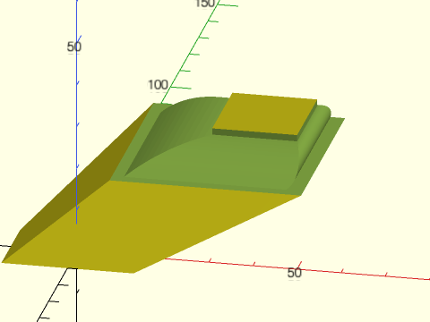

 

    include <BOSL2/std.scad>
    diff()
      prismoid([30,20], [50,60], h=20, shift=[40,50])
         edge_profile(TOP, excess=27)
            mask2d_roundover(height=5, mask_angle=$edge_angle, inset=1.5, flat_top=true, $fn=128);

**Example 19:** Bead may be more pleasing using the quarter\_round option, with curves terminating in a plane parallel to the prismoid top.  The size of the inset edge will be larger than requested when the angle is obtuse.

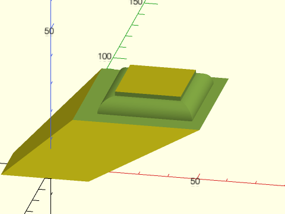

 

    include <BOSL2/std.scad>
    diff()
      prismoid([30,20], [50,60], h=20, shift=[40,50])
         edge_profile(TOP, excess=27)
            mask2d_roundover(r=5, mask_angle=$edge_angle, quarter_round=true, inset=1.5, $fn=128);

---

### Function/Module: mask2d\_smooth()

**Synopsis:** Creates a continuous curvature mask for rounding edges. [<abbr>Geom</abbr>] [<abbr>Path</abbr>]

**Topics:** [Shapes (2D)](Topics#shapes-2d), [Paths (2D)](Topics#paths-2d), [Path Generators](Topics#path-generators), [Attachable](Topics#attachable), [Masks (2D)](Topics#masks-2d)

**See Also:** [corner\_profile()](#module-corner_profile), [edge\_profile()](#module-edge_profile), [face\_profile()](#module-face_profile)

**Usage:** As module

- mask2d_smooth([mask_angle], [cut=], [joint=], [inset=], [excess=], [flat_top=], [anchor=], [spin=]) [ATTACHMENTS];

**Usage:** As function

- path = mask2d_smooth([mask_angle], [cut=], [joint=], [inset=], [excess=], [flat_top=], [anchor=], [spin=]);

**Description:** 

Creates a 2D continuous curvature rounding mask shape that is useful for extruding into a 3D mask for an edge.
Conversely, you can use that same extruded shape to make an interior fillet between two walls.
As a 2D mask, this is designed to be differenced away from the edge of a shape that with its corner at the
origin and one edge on the X+ axis and the other mask_angle degrees counterclockwise from the X+ axis.
If called as a function, returns a 2D path of the outline of the mask shape.

The roundover can be specified by joint length or cut distance.  (Radius is not meaningful for this type of mask.)  You must also specify the
continuous curvature smoothness parameter, `k`, which defaults to 0.5.  This diagram shows a roundover for the default k value.

With `k=0.75` the transition into the roundover is shorter and faster.  The cut length is bigger for the same joint length.

The diagrams above show symmetric roundovers, but you can also create asymmetric roundovers by giving a list of two values for `joint`.  In this
case the first one is the horizontal joint length and the second one is the joint length along the other side of the rounding.

If you need roundings to agree on edges of different mask_angle, e.g. to round the base of a prismoid, then you need all of the
masks used to have the same height.  (Note that it may appear that matching joint would also work, but it does not because the joint distances are measured
in different directions.)  You can get the same height by setting the joint parameter to a scalar to define the joint length in the horizontal direction and then setting
the `height` parameter, which determines the length of the other joint so that it has the desired height.

**Arguments:** 

<abbr title="These args can be used by position or by name.">By&nbsp;Position</abbr> | What it does
-------------------- | ------------
`mask_angle`         | Number of degrees in the corner angle to mask.  Default: $edge_angle if set, 90 otherwise

<abbr title="These args must be used by name, ie: name=value">By&nbsp;Name</abbr> | What it does
-------------------- | ------------
`inset`              | Optional bead inset size, perpendicular to the two edges.  Scalar or 2-vector.  Default: 0
`excess`             | Extra amount of mask shape to creates on the X and quasi-Y sides of the shape.  Default: 0.01
`cut`                | Cut distance.  IE: How much of the corner to cut off.  See [Types of Roundovers](rounding.scad#section-types-of-roundovers).
`joint`              | Joint distance.  IE: How far from the edge the roundover should start.  See [Types of Roundovers](rounding.scad#section-types-of-roundovers).
`h`                  / `height`             | Mask height excluding inset and excess.  This determines the height of the mask when you want a consistent mask height, no matter what the mask angle.  You must provide a scalar joint value to define the mask width, and you cannot give cut.
`flat_top`           | If true, the top inset of the mask will be horizontal instead of angled by the mask_angle.  Default: false
`splinesteps`        | Numbers of segments to create on the roundover.  Default: 16
`anchor`             | Translate so anchor point is at origin (0,0,0).  See [anchor](attachments.scad#subsection-anchor).  Default: `CENTER`
`spin`               | Rotate this many degrees around the Z axis after anchor.  See [spin](attachments.scad#subsection-spin).  Default: `0`

**Example 1:** Mask defined by cut

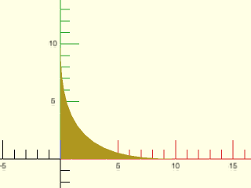

    include <BOSL2/std.scad>
    mask2d_smooth(cut=3);

  

**Example 2:** Mask defined by symmetric joint length with larger excess (which helps show the ends of the mask)

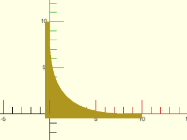

    include <BOSL2/std.scad>
    mask2d_smooth(joint=10,excess=0.5);

  

**Example 3:** Asymmetric mask by joint length with different lengths

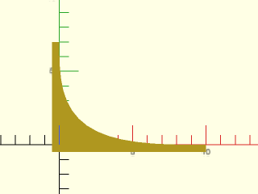

    include <BOSL2/std.scad>
    mask2d_smooth(joint=[10,7],excess=0.5);

  

**Example 4:** Acute angle mask by cut

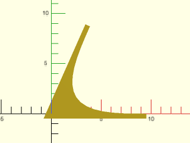

    include <BOSL2/std.scad>
    mask2d_smooth(mask_angle=66,cut=3,excess=0.5);

  

**Example 5:** Acute angle mask by cut, but large k value

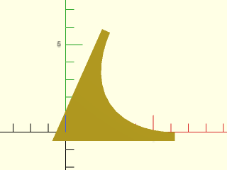

    include <BOSL2/std.scad>
    mask2d_smooth(mask_angle=66,cut=3,excess=0.5, k=.9);

  

**Example 6:** Acute angle mask by cut, but small k value

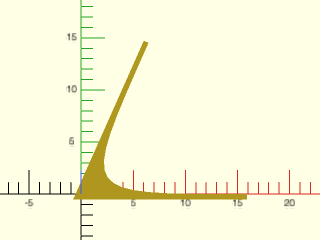

    include <BOSL2/std.scad>
    mask2d_smooth(mask_angle=66,cut=3,excess=0.5, k=.2);

  

**Example 7:** Obtuse angle mask

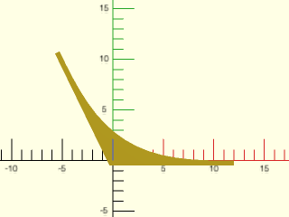

    include <BOSL2/std.scad>
    mask2d_smooth(mask_angle=116,joint=12,excess=0.5);

  

**Example 8:** Inset mask

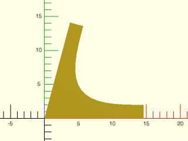

    include <BOSL2/std.scad>
    mask2d_smooth(mask_angle=75,joint=12,inset=2);

  

**Example 9:** Inset mask, flat top

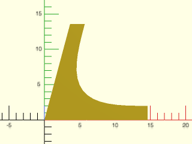

    include <BOSL2/std.scad>
    mask2d_smooth(mask_angle=75,joint=12,inset=2, flat_top=true);

  

**Example 10:** Masking by Edge Attachment

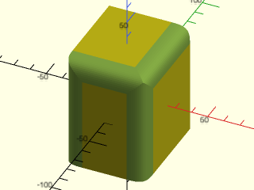

    include <BOSL2/std.scad>
    diff()
    cube([50,60,70],center=true)
        edge_profile([TOP,"Z"],except=[BACK,TOP+LEFT])
            mask2d_smooth(cut=3);

  

**Example 11:** Masking a cylinder by edge attachment

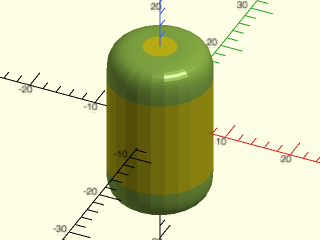

    include <BOSL2/std.scad>
    diff()
    cyl(h=25,d=15)
        edge_profile()
            mask2d_smooth(joint=5);

  

**Example 12:** Rounding over top of an extreme prismoid using height option

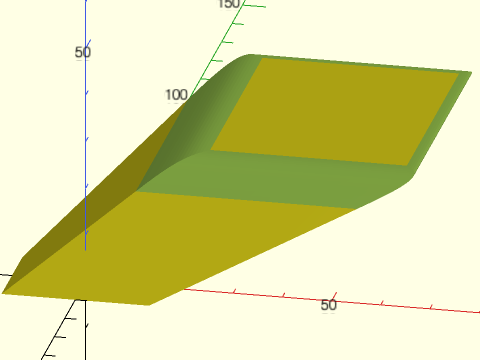

 

    include <BOSL2/std.scad>
    diff()
      prismoid([30,20], [50,60], h=20, shift=[40,50])
         edge_profile(TOP, excess=27)
            mask2d_smooth(height=5, joint=5);

---

### Function/Module: mask2d\_teardrop()

**Synopsis:** Creates a 2D teardrop shape with specified max angle from vertical. [<abbr>Geom</abbr>] [<abbr>Path</abbr>]

**Topics:** [Shapes (2D)](Topics#shapes-2d), [Paths (2D)](Topics#paths-2d), [Path Generators](Topics#path-generators), [Attachable](Topics#attachable), [Masks (2D)](Topics#masks-2d), [FDM Optimized](Topics#fdm-optimized)

**See Also:** [corner\_profile()](#module-corner_profile), [edge\_profile()](#module-edge_profile), [face\_profile()](#module-face_profile)

**Usage:** As Module

- mask2d_teardrop(r|d=, [angle], [inset] [mask_angle], [excess], [cut=], [joint=], [h=|height=]) [ATTACHMENTS];

**Usage:** As Function

- path = mask2d_teardrop(r|d=, [angle], [inset], [mask_angle], [excess], [cut=], [joint=], [h=|height=]);

**Description:** 

Creates a 2D teardrop mask shape that is useful for extruding into a 3D mask for an edge.
Conversely, you can use that same extruded shape to make an interior teardrop fillet between two walls.
As a 2D mask, this is designed to be differenced away from the edge of a shape that with its corner at the origin and one edge on the X+ axis and the other mask_angle degrees counterclockwise from the X+ axis.
If called as a function, returns a 2D path of the outline of the mask shape.
This is particularly useful to make partially rounded bottoms, that don't need support to print.
The roundover can be specified by radius, diameter, height, cut, or joint length.

**Arguments:** 

<abbr title="These args can be used by position or by name.">By&nbsp;Position</abbr> | What it does
-------------------- | ------------
`r`                  | Radius of the rounding.
`angle`              | The angle from vertical of the flat section.  Must be between mask_angle-90 and 90 degrees.  Default: 45.
`inset`              | Optional bead inset size perpendicular to edges.  Default: 0
`mask_angle`         | Number of degrees in the corner angle to mask.  Default: $edge_angle if defined, otherwise 90
`excess`             | Extra amount of mask shape to creates on the X- and Y- sides of the shape. Default: 0.01

<abbr title="These args must be used by name, ie: name=value">By&nbsp;Name</abbr> | What it does
-------------------- | ------------
`d`                  | Diameter of the rounding.
`h`                  / `height`             | Mask height excluding inset and excess.  Given instead of r or d when you want a consistent mask height, no matter what the mask angle.
`cut`                | Cut distance.  IE: How much of the corner to cut off.  See [Types of Roundovers](rounding.scad#section-types-of-roundovers).
`joint`              | Joint distance.  IE: How far from the edge the roundover should start.  See [Types of Roundovers](rounding.scad#section-types-of-roundovers).
`flat_top`           | If true, the top inset of the mask will be horizontal instead of angled by the mask_angle.  Default: true.
`anchor`             | Translate so anchor point is at origin (0,0,0).  See [anchor](attachments.scad#subsection-anchor).  Default: `CENTER`
`spin`               | Rotate this many degrees around the Z axis after anchor.  See [spin](attachments.scad#subsection-spin).  Default: `0`

**Example 1:** 2D Teardrop Mask

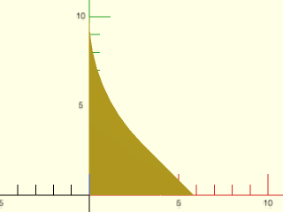

    include <BOSL2/std.scad>
    mask2d_teardrop(r=10,$fn=64);

  

**Example 2:** 2D Teardrop Mask for acute angle

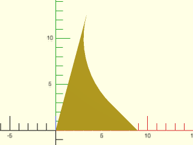

    include <BOSL2/std.scad>
    mask2d_teardrop(r=10, mask_angle=75,$fn=64);

  

**Example 3:** 2D Teardrop Mask for obtuse angle, specifying height

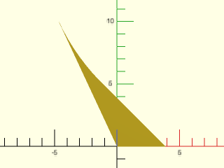

    include <BOSL2/std.scad>
    mask2d_teardrop(h=10, mask_angle=115,$fn=128);

  

**Example 4:** Increasing Excess

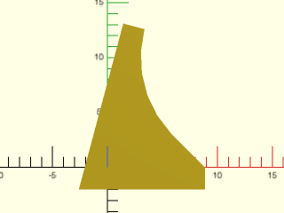

    include <BOSL2/std.scad>
    mask2d_teardrop(r=10, mask_angle=75, excess=2);

  

**Example 5:** Using a Custom Angle

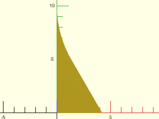

    include <BOSL2/std.scad>
    mask2d_teardrop(r=10,angle=30,$fn=128);

  

**Example 6:** With an acute mask\_angle you can choose an angle of zero:

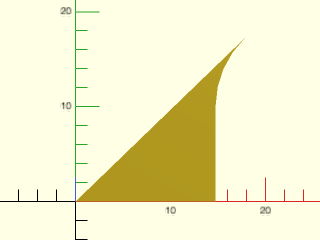

    include <BOSL2/std.scad>
    mask2d_teardrop(r=10,mask_angle=44,angle=0);

  

**Example 7:** With an acute mask\_angle you can even choose a negative angle

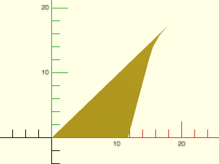

    include <BOSL2/std.scad>
    mask2d_teardrop(r=10,mask_angle=44,angle=-15);

  

**Example 8:** With an obtuse angle you need to choose a larger angle.  Here we add inset.

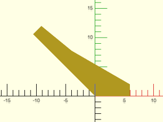

    include <BOSL2/std.scad>
    mask2d_teardrop(h=10, mask_angle=135,angle=60, inset=2);

  

**Example 9:** Same thing with `flat_top=true`.

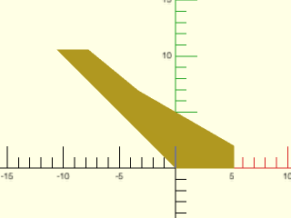

 

    include <BOSL2/std.scad>
    mask2d_teardrop(h=10, mask_angle=135,angle=60, inset=2, flat_top=true);

**Example 10:** Masking by Edge Attachment

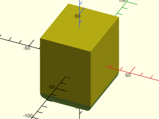

    include <BOSL2/std.scad>
    diff()
    cube([50,60,70],center=true)
        edge_profile(BOT)
            mask2d_teardrop(r=10, angle=40);

  

**Example 11:** Making an interior teardrop fillet

    include <BOSL2/std.scad>
    %render() difference() {
        move(-[5,0,5]) cube(30, anchor=BOT+LEFT);
        cube(310, anchor=BOT+LEFT);
    }
    xrot(90)
        linear_extrude(height=30, center=true)
            mask2d_teardrop(r=10);

  

---

### Function/Module: mask2d\_cove()

**Synopsis:** Creates a 2D cove (quarter-round) mask shape. [<abbr>Geom</abbr>] [<abbr>Path</abbr>]

**Topics:** [Shapes (2D)](Topics#shapes-2d), [Paths (2D)](Topics#paths-2d), [Path Generators](Topics#path-generators), [Attachable](Topics#attachable), [Masks (2D)](Topics#masks-2d)

**See Also:** [corner\_profile()](#module-corner_profile), [edge\_profile()](#module-edge_profile), [face\_profile()](#module-face_profile)

**Usage:** As module

- mask2d_cove(r|d=|h=|height=, [inset], [mask_angle], [excess], [bulge=], [flat_top=], [quarter_round=]) [ATTACHMENTS];

**Usage:** As function

- path = mask2d_cove(r|d=|h=, [inset], [mask_angle], [excess], [bulge=], [flat_top=]);

**Description:** 

Creates a 2D cove mask shape that is useful for extruding into a 3D mask for an edge.
Conversely, you can use that same extruded shape to make an interior rounded shelf decoration between two walls.
As a 2D mask, this is designed to be differenced away from the edge of a shape that with its corner at the origin and one edge on the X+ axis and the other mask_angle degrees counterclockwise from the X+ axis.
If called as a function, returns a 2D path of the outline of the mask shape.

If you need coves to agree on edges of different mask_angle, e.g. on the top of a prismoid, then you need all of the
masks used to have the same height.   You can get the same height by setting the `height` parameter.  For obtuse angles, however, the cove mask may not
have is maximum height at the edge, which means it won't mate with adjacent coves.  You can fix this using `flat_top=true` which extends the circle
with a line to maintain a flat top.  Another way to fix it is to set `bulge`.  You can also achieve constant height using the `quarter_round=` option,
which uses a quarter circle of the specified size for all mask_angle values.  This option often produces a nice result because coves all terminate in a
plane at 90 degrees.

**Arguments:** 

<abbr title="These args can be used by position or by name.">By&nbsp;Position</abbr> | What it does
-------------------- | ------------
`r`                  | Radius of the cove.
`inset`              | Optional amount to inset in the perpendicular direction from the edges.  Scalar or 2-vector.  Default: 0
`mask_angle`         | Number of degrees in the corner angle to mask.  Default: $edge_angle if defined, otherwise 90
`excess`             | Extra amount of mask shape to creates on the X and quasi-Y sides of the shape.  Default: 0.01

<abbr title="These args must be used by name, ie: name=value">By&nbsp;Name</abbr> | What it does
-------------------- | ------------
`d`                  | Diameter of the cove.
`h`                  / `height`             | Mask height, excluding inset and excess.  Given instead of r or d when you want a consistent mask height, no matter what the mask angle.
`bulge`              | specify arc as the distance away from a straight line chamfer.  The arc will not meet the sides at a 90 deg angle.
`quarter_round`      | If true, make cove independent of the mask_angle, defined based on a quarter circle, with angle-independent radius. The mask will have constant height.  Default: false.
`flat_top`           | If true, the top inset of the mask will be horizontal instead of angled by the mask_angle.  In the case of obtuse angles force the mask to have a flat section at its left side instead of a circular arc.  Default: true if quarter_round is set, false otherwise.
`anchor`             | Translate so anchor point is at origin (0,0,0).  See [anchor](attachments.scad#subsection-anchor).  Default: `CENTER`
`spin`               | Rotate this many degrees around the Z axis after anchor.  See [spin](attachments.scad#subsection-spin).  Default: `0`

**Example 1:** 2D Cove Mask by Radius

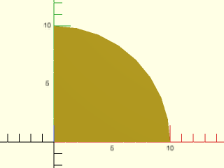

    include <BOSL2/std.scad>
    mask2d_cove(r=10);

  

**Example 2:** 2D Inset Cove Mask (not much different than a regular cove of larger radius)

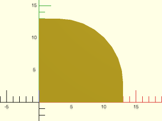

    include <BOSL2/std.scad>
    mask2d_cove(r=10,inset=3);

  

**Example 3:** 2D Cove Mask for acute angle, specified by height, with the bulge set to change the curve.  Note that the circular arc is not perpendicular to the sides.

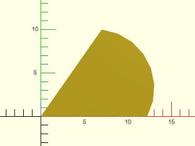

    include <BOSL2/std.scad>
    mask2d_cove(h=10,mask_angle=55, bulge=3);

  

**Example 4:** 2D Cove Mask for obtuse angle, specified by height.  This will produce an odd result if combined with other masks because the maximum height is in the middle.

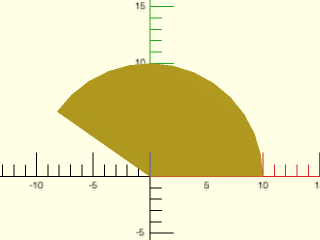

    include <BOSL2/std.scad>
    mask2d_cove(h=10,mask_angle=145);

  

**Example 5:** 2D Cove Mask for obtuse angle with flat top.  This is one solution to the problem of the previous example.  Max height is achieved at the left corner.

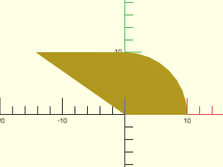

    include <BOSL2/std.scad>
    mask2d_cove(h=10,mask_angle=145,flat_top=true);

  

**Example 6:** 2D Cove Mask for obtuse angle, specified by height with bulge parameter.  Another way to fix the problem of the previous example: the max height is again achieved at the left corner.

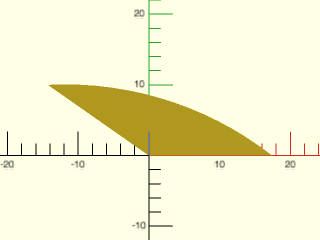

    include <BOSL2/std.scad>
    mask2d_cove(h=10,mask_angle=145, bulge=3, $fn=128);

  

**Example 7:** 2D Cove Mask for acute angle with quarter\_round enabled

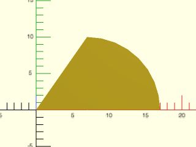

    include <BOSL2/std.scad>
    mask2d_cove(r=10,mask_angle=55,quarter_round=true);

  

**Example 8:** 2D Cove Mask for obtuse angle, specified by height.  Note that flat\_top is on by default in quarter\_round mode.

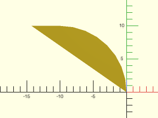

    include <BOSL2/std.scad>
    mask2d_cove(r=10,mask_angle=145,quarter_round=true);

  

**Example 9:** Increasing the Excess

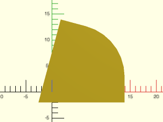

    include <BOSL2/std.scad>
    mask2d_cove(r=10,inset=3,mask_angle=75, excess=2);

  

**Example 10:** Masking by Edge Attachment

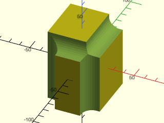

    include <BOSL2/std.scad>
    diff()
    cube([50,60,70],center=true)
        edge_profile([TOP,"Z"],except=[BACK,TOP+LEFT])
            mask2d_cove(h=10, inset=3);

  

**Example 11:** Making an interior rounded shelf

    include <BOSL2/std.scad>
    %render() difference() {
        move(-[5,0,5]) cube(30, anchor=BOT+LEFT);
        cube(310, anchor=BOT+LEFT);
    }
    xrot(90)
        linear_extrude(height=30, center=true)
            mask2d_cove(r=5, inset=5);

  

**Example 12:** A cove on top of an extreme prismoid top by setting height and using flat\_top mode.  This creates **long** flat tops sections at obtuse angles.

 

    include <BOSL2/std.scad>
    diff()
    prismoid([50,60], [20,30], h=20, shift=[25,16])
        edge_profile(TOP, excess=20)
            mask2d_cove(h=5, inset=0, mask_angle=$edge_angle, flat_top=true, $fn=128);

**Example 13:** Cove on an extreme prismoid top by setting height and bulge.  Obtuse angles have long **curved** sections.

 

    include <BOSL2/std.scad>
    diff()
    prismoid([50,60], [20,30], h=20, shift=[25,16])
        edge_profile(TOP, excess=20)
            mask2d_cove(h=5, inset=0, mask_angle=$edge_angle, bulge=1, $fn=128);

**Example 14:** Rounding an extreme prismoid top using quarter\_round.  Another way to handle this situation.

 

    include <BOSL2/std.scad>
    diff()
    prismoid([50,60], [20,30], h=20, shift=[25,16])
        edge_profile(TOP, excess=20)
            mask2d_cove(r=5, inset=0, mask_angle=$edge_angle, quarter_round=true, $fn=128);

---

### Function/Module: mask2d\_chamfer()

**Synopsis:** Produces a 2D chamfer mask shape. [<abbr>Geom</abbr>] [<abbr>Path</abbr>]

**Topics:** [Shapes (2D)](Topics#shapes-2d), [Paths (2D)](Topics#paths-2d), [Path Generators](Topics#path-generators), [Attachable](Topics#attachable), [Masks (2D)](Topics#masks-2d)

**See Also:** [corner\_profile()](#module-corner_profile), [edge\_profile()](#module-edge_profile), [face\_profile()](#module-face_profile)

**Usage:** As Module

- mask2d_chamfer(edge, [angle], [inset], [excess]) [ATTACHMENTS];
- mask2d_chamfer(y=, [angle=], [inset=], [excess=]) [ATTACHMENTS];
- mask2d_chamfer(x=, [angle=], [inset=], [excess=]) [ATTACHMENTS];

**Usage:** As Function

- path = mask2d_chamfer(edge, [angle], [inset], [excess]);
- path = mask2d_chamfer(y=, [angle=], [inset=], [excess=]);
- path = mask2d_chamfer(x=, [angle=], [inset=], [excess=]);

**Description:** 

Creates a 2D chamfer mask shape that is useful for extruding into a 3D mask for an edge.
Conversely, you can use that same extruded shape to make an interior chamfer between two walls.
As a 2D mask, this is designed to be differenced away from the edge of a shape that with its corner at the origin and one edge on the X+ axis and the other mask_angle degrees counterclockwise from the X+ axis.
If called as a function, returns a 2D path of the outline of the mask shape.
The edge parameter specifies the length of the chamfer's slanted edge.  The x parameter specifies the width.  The y parameter
specfies the length of the non-horizontal arm of the chamfer.  The height specifies the height of the chamfer independent
of angle.  You can specify any combination of parameters that determines a chamfer geometry.

**Arguments:** 

<abbr title="These args can be used by position or by name.">By&nbsp;Position</abbr> | What it does
-------------------- | ------------
`edge`               | The length of the edge of the chamfer.
`angle`              | The angle of the chamfer edge, away from vertical.  Default: mask_angle/2.
`inset`              | Optional amount to inset perpendicular to each edge.  Scalar or 2-vector.  Default: 0
`mask_angle`         | Number of degrees in the corner angle to mask.  Default: $edge_angle if defined, otherwise 90
`excess`             | Extra amount of mask shape to creates on the X- and Y- sides of the shape.  Default: 0.01

<abbr title="These args must be used by name, ie: name=value">By&nbsp;Name</abbr> | What it does
-------------------- | ------------
`x`                  | The width of the chamfer (joint distance in x direction)
`y`                  | The set-back (joint distance) in the non-x direction of the chamfer.
`h`                  / `height`             | The height of the chamfer (excluding inset and excess).
`w`                  / `width`              | The width of the chamfer (excluding inset and excess).
`quarter_round`      | If true, make a roundover independent of the mask_angle, defined based on a 90 deg angle, with a constant height.  Default: false.
`flat_top`           | If true, the top inset of the mask will be horizontal instead of angled by the mask_angle.  Default: true.
`anchor`             | Translate so anchor point is at origin (0,0,0).  See [anchor](attachments.scad#subsection-anchor).  Default: `CENTER`
`spin`               | Rotate this many degrees around the Z axis after anchor.  See [spin](attachments.scad#subsection-spin).  Default: `0`

**Example 1:** 2D Chamfer Mask, at 45 deg by default

    include <BOSL2/std.scad>
    mask2d_chamfer(x=10);

  

**Example 2:** 2D Chamfer Mask, at 30 deg (measured down from vertical)

    include <BOSL2/std.scad>
    mask2d_chamfer(x=10,angle=30);

  

**Example 3:** 2D Chamfer Mask on an acute angle.  The default chamfer angle is to produce a symmetric chamfer.

    include <BOSL2/std.scad>
    mask2d_chamfer(x=10,mask_angle=45);

  

**Example 4:** 2D Chamfer Mask on an acute angle.  Here we specify the angle of the chamfer

    include <BOSL2/std.scad>
    mask2d_chamfer(x=10,mask_angle=45,angle=45);

  

**Example 5:** 2D Chamfer Mask specified by x and y length

    include <BOSL2/std.scad>
    mask2d_chamfer(x=4,y=10);

  

**Example 6:** 2D Chamfer Mask specified by x and y length.  The y length is along the top side of the chamfer, not parallel to the Y axis.

    include <BOSL2/std.scad>
    mask2d_chamfer(x=4,y=5,mask_angle=44);

  

**Example 7:** 2D Chamfer Mask specified by width and height.

    include <BOSL2/std.scad>
    mask2d_chamfer(w=4,h=5,mask_angle=44);

  

**Example 8:** 2D Chamfer Mask on obtuse angle, specifying x.  The right tip is 10 units from the origin.

    include <BOSL2/std.scad>
    mask2d_chamfer(x=10,mask_angle=127);

  

**Example 9:** 2D Chamfer Mask on obtuse angle, specifying width.  The entire width is 10.

    include <BOSL2/std.scad>
    mask2d_chamfer(w=10,mask_angle=127);

  

**Example 10:** 2D Chamfer Mask by edge

    include <BOSL2/std.scad>
    mask2d_chamfer(edge=10);

  

**Example 11:** 2D Chamfer Mask by edge, acute case

    include <BOSL2/std.scad>
    mask2d_chamfer(edge=10, mask_angle=44);

  

**Example 12:** 2D Chamfer Mask by edge, obtuse case

    include <BOSL2/std.scad>
    mask2d_chamfer(edge=10, mask_angle=144);

  

**Example 13:** 2D Chamfer Mask by edge and angle

    include <BOSL2/std.scad>
    mask2d_chamfer(edge=10, angle=30);

  

**Example 14:** 2D Chamfer Mask by edge and x

    include <BOSL2/std.scad>
    mask2d_chamfer(edge=10, x=9);

  

**Example 15:** 2D Inset Chamfer Mask

    include <BOSL2/std.scad>
    mask2d_chamfer(x=10, inset=2);

  

**Example 16:** 2D Inset Chamfer Mask on acute angle

    include <BOSL2/std.scad>
    mask2d_chamfer(x=10, inset=2, mask_angle=77);

  

**Example 17:** 2D Inset Chamfer Mask on acute angle with flat top

    include <BOSL2/std.scad>
    mask2d_chamfer(x=10, inset=2, mask_angle=77, flat_top=true);

  

**Example 18:** Masking by Edge Attachment

    include <BOSL2/std.scad>
    diff()
    cube([50,60,70],center=true)
        edge_profile([TOP,"Z"],except=[BACK,TOP+LEFT])
            mask2d_chamfer(x=10, inset=2);

  

**Example 19:** Making an interior chamfer

    include <BOSL2/std.scad>
    %render() difference() {
        move(-[5,0,5]) cube(30, anchor=BOT+LEFT);
        cube(310, anchor=BOT+LEFT);
    }
    xrot(90)
        linear_extrude(height=30, center=true)
            mask2d_chamfer(edge=10);

  

**Example 20:** Chamfering an extreme prismoid by setting height

 

    include <BOSL2/std.scad>
    diff()
    prismoid([50,60], [20,30], h=20, shift=[25,16])
        edge_profile(TOP, excess=20)//let(f=$edge_angle)
            mask2d_chamfer(h=5,mask_angle=$edge_angle);

**Example 21:** Chamfering an extreme prismoid with a fixed chamfer angle.  Note that a very large chamfer angle is required because of the large obtuse angles.

 

    include <BOSL2/std.scad>
    diff()
    prismoid([50,60], [20,30], h=20, shift=[25,16])
        edge_profile(TOP, excess=20)//let(f=$edge_angle)
            mask2d_chamfer(h=5,mask_angle=$edge_angle,angle=64);

**Example 22:** Chamfering an extreme prismoid by setting height with inset and flat\_top=true.

 

    include <BOSL2/std.scad>
    diff()
    prismoid([50,60], [20,30], h=20, shift=[25,16])
        edge_profile(TOP, excess=20)//let(f=$edge_angle)
            mask2d_chamfer(h=4,inset=1,flat_top=true,mask_angle=$edge_angle);

---

### Function/Module: mask2d\_rabbet()

**Synopsis:** Creates a rabbet mask shape. [<abbr>Geom</abbr>] [<abbr>Path</abbr>]

**Topics:** [Shapes (2D)](Topics#shapes-2d), [Paths (2D)](Topics#paths-2d), [Path Generators](Topics#path-generators), [Attachable](Topics#attachable), [Masks (2D)](Topics#masks-2d)

**See Also:** [corner\_profile()](#module-corner_profile), [edge\_profile()](#module-edge_profile), [face\_profile()](#module-face_profile)

**Usage:** As Module

- mask2d_rabbet(size, [mask_angle], [excess]) [ATTACHMENTS];

**Usage:** As Function

- path = mask2d_rabbet(size, [mask_angle], [excess]);

**Description:** 

Creates a 2D rabbet mask shape.  When differenced away, this mask
creates at the corner a rectanguler space of the specified size.
This mask can be extruding into a 3D mask for an edge, or
you can use that same extruded shape to make an interior shelf decoration between two walls.
As a 2D mask, this is designed to be differenced away from the edge of a shape that with its corner at the origin and one edge on the X+ axis and the other mask_angle degrees counterclockwise from the X+ axis.
If called as a function, returns a 2D path of the outline of the mask shape.

**Arguments:** 

<abbr title="These args can be used by position or by name.">By&nbsp;Position</abbr> | What it does
-------------------- | ------------
`size`               | The size of the rabbet, either as a scalar or an [X,Y] list.
`mask_angle`         | Number of degrees in the corner angle to mask.  Default: $edge_angle if defined, otherwise 90
`excess`             | Extra amount of mask shape to creates on the X and quasi-Y sides of the shape. Default: 0.01

<abbr title="These args must be used by name, ie: name=value">By&nbsp;Name</abbr> | What it does
-------------------- | ------------
`anchor`             | Translate so anchor point is at origin (0,0,0).  See [anchor](attachments.scad#subsection-anchor).  Default: `CENTER`
`spin`               | Rotate this many degrees around the Z axis after anchor.  See [spin](attachments.scad#subsection-spin).  Default: `0`

**Example 1:** 2D Rabbet Mask

    include <BOSL2/std.scad>
    mask2d_rabbet(size=10);

  

**Example 2:** 2D Asymmetrical Rabbet Mask

    include <BOSL2/std.scad>
    mask2d_rabbet(size=[5,10]);

  

**Example 3:** 2D Mask for a acute angle edge

    include <BOSL2/std.scad>
    mask2d_rabbet(size=10, mask_angle=75);

  

**Example 4:** 2D Mask for obtuse angle edge.  If the obtuse angle is too large the rabbet will not fit.  If that happens, you will need to increase the rabbet width.

    include <BOSL2/std.scad>
    mask2d_rabbet(size=10, mask_angle=125);

  

**Example 5:** Masking by Edge Attachment

    include <BOSL2/std.scad>
    diff()
    cube([50,60,70],center=true)
        edge_profile([TOP,"Z"],except=[BACK,TOP+LEFT])
            mask2d_rabbet(size=10);

  

**Example 6:** Making an interior shelf

    include <BOSL2/std.scad>
    %render() difference() {
        move(-[5,0,5]) cube(30, anchor=BOT+LEFT);
        cube(310, anchor=BOT+LEFT);
    }
    xrot(90)
        linear_extrude(height=30, center=true)
            mask2d_rabbet(size=[5,10]);

  

---

### Function/Module: mask2d\_dovetail()

**Synopsis:** Creates a 2D dovetail mask shape. [<abbr>Geom</abbr>] [<abbr>Path</abbr>]

**Topics:** [Masks (2D)](Topics#masks-2d), [Shapes (2D)](Topics#shapes-2d), [Paths (2D)](Topics#paths-2d), [Path Generators](Topics#path-generators), [Attachable](Topics#attachable)

**See Also:** [corner\_profile()](#module-corner_profile), [edge\_profile()](#module-edge_profile), [face\_profile()](#module-face_profile)

**Usage:** As Module

- mask2d_dovetail(edge, angle, [inset], [shelf], [excess], ...) [ATTACHMENTS];
- mask2d_dovetail(width=, angle=, [inset=], [shelf=], [excess=], ...) [ATTACHMENTS];
- mask2d_dovetail(height=, angle=, [inset=], [shelf=], [excess=], ...) [ATTACHMENTS];
- mask2d_dovetail(width=, height=, [inset=], [shelf=], [excess=], ...) [ATTACHMENTS];

**Usage:** As Function

- path = mask2d_dovetail(edge, [angle], [inset], [shelf], [excess]);

**Description:** 

Creates a 2D dovetail mask shape that is useful for extruding into a 3D mask for a 90° edge.
Conversely, you can use that same extruded shape to make an interior dovetail between two walls at a 90º angle.
As a 2D mask, this is designed to be differenced away from the edge of a shape that with its corner at the origin and one edge on the X+ axis and the other mask_angle degrees counterclockwise from the X+ axis.
If called as a function, returns a 2D path of the outline of the mask shape.

**Arguments:** 

<abbr title="These args can be used by position or by name.">By&nbsp;Position</abbr> | What it does
-------------------- | ------------
`edge`               | The length of the edge of the dovetail.
`angle`              | The angle of the chamfer edge, away from vertical.
`shelf`              | The extra height to add to the inside corner of the dovetail.  Default: 0
`inset`              | Optional amount to inset in perpendicular direction from each edge.  Default: 0
`mask_angle`         | Number of degrees in the corner angle to mask.  Default: $edge_angle if defined, otherwise 90
`excess`             | Extra amount of mask shape to creates on the X and quasi-Y sides of the shape.  Default: 0.01

<abbr title="These args must be used by name, ie: name=value">By&nbsp;Name</abbr> | What it does
-------------------- | ------------
`width`              | The width of the dovetail (excluding any inset)
`height`             | The height of the dovetail (excluding any inset or shelf).
`flat_top`           | If true, the top inset of the mask will be horizontal instead of angled by the mask_angle.  Default: true.
`anchor`             | Translate so anchor point is at origin (0,0,0).  See [anchor](attachments.scad#subsection-anchor).  Default: `CENTER`
`spin`               | Rotate this many degrees around the Z axis after anchor.  See [spin](attachments.scad#subsection-spin).  Default: `0`

**Example 1:** 2D Dovetail Mask

    include <BOSL2/std.scad>
    mask2d_dovetail(width=10,angle=14);

  

**Example 2:** 2D Dovetail Mask by height and slope.  A slope of 1/6 is a common choice.

    include <BOSL2/std.scad>
    mask2d_dovetail(height=20, slope=1/6);

  

**Example 3:** 2D Inset Dovetail Mask to make the dovetail wider

    include <BOSL2/std.scad>
    mask2d_dovetail(width=5, angle=12, inset=[4,0]);

  

**Example 4:** 2D Inset Dovetail Mask on an obtuse angle

    include <BOSL2/std.scad>
    mask2d_dovetail(width=5, mask_angle=110, angle=12);

  

**Example 5:** 2D Inset Dovetail Mask on an acute angle will generally require an inset in order to fit.

 

    include <BOSL2/std.scad>
    mask2d_dovetail(width=5, mask_angle=70, angle=12, inset=[6,0]);

**Example 6:** 2D dovetail mask by edge length and angle

    include <BOSL2/std.scad>
    mask2d_dovetail(edge=10,width=4);

  

**Example 7:** 2D dovetail mask by width and height

    include <BOSL2/std.scad>
    mask2d_dovetail(width=5,height=25);

  

**Example 8:** Masking by Edge Attachment

    include <BOSL2/std.scad>
    diff()
    cube([50,60,70],center=true)
        edge_profile([TOP,"Z"],except=[BACK,TOP+LEFT])
            mask2d_dovetail(width=10, angle=30, inset=2);

  

**Example 9:** Making an interior dovetail

    include <BOSL2/std.scad>
    %render() difference() {
        move(-[5,0,5]) cube(30, anchor=BOT+LEFT);
        cube(310, anchor=BOT+LEFT);
    }
    xrot(90)
        linear_extrude(height=30, center=true)
            mask2d_dovetail(width=10,angle=30);

  

---

### Function/Module: mask2d\_ogee()

**Synopsis:** Creates a 2D ogee mask shape. [<abbr>Geom</abbr>] [<abbr>Path</abbr>]

**Topics:** [Shapes (2D)](Topics#shapes-2d), [Paths (2D)](Topics#paths-2d), [Path Generators](Topics#path-generators), [Attachable](Topics#attachable), [Masks (2D)](Topics#masks-2d)

**See Also:** [corner\_profile()](#module-corner_profile), [edge\_profile()](#module-edge_profile), [face\_profile()](#module-face_profile)

**Usage:** As Module

- mask2d_ogee(pattern, [excess], ...) [ATTACHMENTS];

**Usage:** As Function

- path = mask2d_ogee(pattern, [excess], ...);

**Description:** 

Creates a 2D Ogee mask shape that is useful for extruding into a 3D mask for a 90° edge.
Conversely, you can use that same extruded shape to make an interior ogee decoration between two walls at a 90º angle.
As a 2D mask, this is designed to be differenced away from the edge of a shape that with its corner at the origin and one edge on the X+ axis and the other mask_angle degrees counterclockwise from the X+ axis.
Since there are a number of shapes that fall under the name ogee, the shape of this mask is given as a pattern.
Patterns are given as TYPE, VALUE pairs.  ie: `["fillet",10, "xstep",2, "step",[5,5], ...]`.  See Patterns below.
If called as a function, returns a 2D path of the outline of the mask shape.

### Patterns

Type     | Argument  | Description
-------- | --------- | ----------------
"step"   | [x,y]     | Makes a line to a point `x` right and `y` down.
"xstep"  | dist      | Makes a `dist` length line towards X+.
"ystep"  | dist      | Makes a `dist` length line towards Y-.
"round"  | radius    | Makes an arc that will mask a roundover.
"fillet" | radius    | Makes an arc that will mask a fillet.

**Arguments:** 

<abbr title="These args can be used by position or by name.">By&nbsp;Position</abbr> | What it does
-------------------- | ------------
`pattern`            | A list of pattern pieces to describe the Ogee.
`excess`             | Extra amount of mask shape to creates on the X- and Y- sides of the shape. Default: 0.01

<abbr title="These args must be used by name, ie: name=value">By&nbsp;Name</abbr> | What it does
-------------------- | ------------
`anchor`             | Translate so anchor point is at origin (0,0,0).  See [anchor](attachments.scad#subsection-anchor).  Default: `CENTER`
`spin`               | Rotate this many degrees around the Z axis after anchor.  See [spin](attachments.scad#subsection-spin).  Default: `0`

**Example 1:** 2D Ogee Mask

    include <BOSL2/std.scad>
    mask2d_ogee([
        "xstep",1,  "ystep",1,  // Starting shoulder.
        "fillet",5, "round",5,  // S-curve.
        "ystep",1,  "xstep",1   // Ending shoulder.
    ]);

  

**Example 2:** Masking by Edge Attachment

    include <BOSL2/std.scad>
    diff()
    cube([50,60,70],center=true)
        edge_profile(TOP)
            mask2d_ogee([
                "xstep",1,  "ystep",1,  // Starting shoulder.
                "fillet",5, "round",5,  // S-curve.
                "ystep",1,  "xstep",1   // Ending shoulder.
            ]);

  

**Example 3:** Making an interior ogee

    include <BOSL2/std.scad>
    %render() difference() {
        move(-[5,0,5]) cube(30, anchor=BOT+LEFT);
        cube(310, anchor=BOT+LEFT);
    }
    xrot(90)
        linear_extrude(height=30, center=true)
            mask2d_ogee([
                "xstep", 1, "round",5,
                "ystep",1, "fillet",5,
                "xstep", 1, "ystep", 1,
            ]);

  

---

## Section: Modules for Applying 2D Masks

### Module: face\_profile()

**Synopsis:** Extrudes a 2D edge profile into a mask for all edges and corners of the given faces on the parent. [<abbr>Geom</abbr>]

**Topics:** [Attachments](Topics#attachments), [Masking](Topics#masking)

**See Also:** [attachable()](attachments.scad#module-attachable), [position()](attachments.scad#module-position), [attach()](attachments.scad#module-attach), [edge\_profile()](#module-edge_profile), [corner\_profile()](#module-corner_profile), [face\_mask()](#module-face_mask), [edge\_mask()](#module-edge_mask), [corner\_mask()](#module-corner_mask)

**Usage:** 

- PARENT() face_profile(faces, r|d=, [convexity=]) CHILDREN;

**Description:** 

Given a 2D edge profile, extrudes it into a mask for all edges and corners bounding each given face. If no tag is set
then `face_profile` sets the tag for children to "remove" so that it works with the default [`diff()`](attachments.scad#module-diff) tag.
See  [Specifying Faces](attachments.scad#subsection-specifying-faces) for information on specifying faces.
For a step-by-step explanation of masking attachments, see the [Attachments Tutorial](Tutorial-Attachment-Edge-Profiling).

**Arguments:** 

<abbr title="These args can be used by position or by name.">By&nbsp;Position</abbr> | What it does
-------------------- | ------------
`faces`              | Faces to mask edges and corners of.
`r`                  | Radius of corner mask.

<abbr title="These args must be used by name, ie: name=value">By&nbsp;Name</abbr> | What it does
-------------------- | ------------
`d`                  | Diameter of corner mask.
`excess`             | Excess length to extrude the profile to make edge masks.  Default: 0.01
`convexity`          | Max number of times a line could intersect the perimeter of the mask shape.  Default: 10

**Side Effects:** 

- Tags the children with "remove" (and hence sets `$tag`) if no tag is already set.
- `$idx` is set to the index number of each face.
- `$attach_anchor` is set for each edge or corner given, to the `[ANCHOR, POSITION, ORIENT, SPIN]` information for that anchor.
- `$profile_type` is set to `"edge"` or `"corner"`, depending on what is being masked.

**Example 1:** 

    include <BOSL2/std.scad>
    diff()
    cube([50,60,70],center=true)
        face_profile(TOP,r=10)
            mask2d_roundover(r=10);

  

---

### Module: edge\_profile()

**Synopsis:** Extrudes a 2d edge profile into a mask on edges of the parent cuboid, prismoid or cone. [<abbr>Geom</abbr>]

**Topics:** [Attachments](Topics#attachments), [Masking](Topics#masking)

**See Also:** [attachable()](attachments.scad#module-attachable), [position()](attachments.scad#module-position), [attach()](attachments.scad#module-attach), [face\_profile()](#module-face_profile), [edge\_profile\_asym()](#module-edge_profile_asym), [corner\_profile()](#module-corner_profile), [edge\_mask()](#module-edge_mask), [face\_mask()](#module-face_mask), [corner\_mask()](#module-corner_mask)

**Usage:** 

- PARENT() edge_profile([edges], [except], [convexity]) CHILDREN;

**Description:** 

Takes a 2D mask shape and attaches it to the selected edges of a cuboid, prismoid or cone, with the
appropriate orientation and
extruded length to be `diff()`ed away, to give the edge a matching profile.  If no tag is set
then `edge_profile` sets the tag for children to "remove" so that it works with the default [`diff()`](attachments.scad#module-diff) tag.
For details on specifying the edges to mask see [Specifying Edges](attachments.scad#subsection-specifying-edges).
For a step-by-step explanation of masking attachments, see the [Attachments Tutorial](Tutorial-Attachment-Edge-Profiling).

**Arguments:** 

<abbr title="These args can be used by position or by name.">By&nbsp;Position</abbr> | What it does
-------------------- | ------------
`edges`              | Edges to mask.  See [Specifying Edges](attachments.scad#subsection-specifying-edges).  Default: All edges.
`except`             | Edges to explicitly NOT mask.  See [Specifying Edges](attachments.scad#subsection-specifying-edges).  Default: No edges.
`excess`             | Excess length to extrude the profile to make edge masks.  Default: 0.01
`convexity`          | Max number of times a line could intersect the perimeter of the mask shape.  Default: 10

**Side Effects:** 

- Tags the children with "remove" (and hence sets `$tag`) if no tag is already set.
- `$idx` is set to the index number of each edge.
- `$attach_anchor` is set for each edge given, to the `[ANCHOR, POSITION, ORIENT, SPIN]` information for that anchor.
- `$profile_type` is set to `"edge"`.
- `$edge_angle` is set to the inner angle of the current edge.

**Example 1:** 

    include <BOSL2/std.scad>
    diff()
    cube([50,60,70],center=true)
        edge_profile([TOP,"Z"],except=[BACK,TOP+LEFT])
            mask2d_roundover(r=10, inset=2);

  

**Example 2:** Using $edge\_angle on a conoid

 

    include <BOSL2/std.scad>
    diff()
    cyl(d1=50, d2=30, l=40, anchor=BOT) {
        edge_profile([TOP,BOT], excess=10, convexity=6) {
            mask2d_roundover(r=8, inset=1, excess=1, mask_angle=$edge_angle);
        }
    }

**Example 3:** Using $edge\_angle on a prismoid

 

    include <BOSL2/std.scad>
    diff()
    prismoid([60,50],[30,20],h=40,shift=[-25,15]) {
        edge_profile(excess=10, convexity=20) {
            mask2d_roundover(r=5,inset=1,mask_angle=$edge_angle,$fn=32);
        }
    }

---

### Module: edge\_profile\_asym()

**Synopsis:** Extrudes an asymmetric 2D profile into a mask on edges and corners of the parent cuboid. [<abbr>Geom</abbr>]

**Topics:** [Attachments](Topics#attachments), [Masking](Topics#masking)

**See Also:** [attachable()](attachments.scad#module-attachable), [position()](attachments.scad#module-position), [attach()](attachments.scad#module-attach), [face\_profile()](#module-face_profile), [edge\_profile()](#module-edge_profile), [corner\_profile()](#module-corner_profile), [edge\_mask()](#module-edge_mask), [face\_mask()](#module-face_mask), [corner\_mask()](#module-corner_mask)

**Usage:** 

- PARENT() edge_profile([edges], [except], [convexity=], [flip=], [corner_type=]) CHILDREN;

**Description:** 

Takes an asymmetric 2D mask shape and attaches it to the selected edges and corners of a parent cuboid, with the appropriate
orientation and extruded length to be `diff()`ed away, to give the edges and corners a matching profile.
If no tag is set then `edge_profile_asym()` sets the tag for children to "remove" so that it works
with the default [`diff()`](attachments.scad#module-diff) tag.  For details on specifying the edges to mask see [Specifying Edges](attachments.scad#subsection-specifying-edges).
For a step-by-step explanation of masking attachments, see the [Attachments Tutorial](Tutorial-Attachment-Edge-Profiling).
The asymmetric profiles are joined consistently at the corners.  This is impossible if all three edges at a corner use the profile, hence
this situation is not permitted.  The profile orientation can be inverted using the `flip=true` parameter.

The standard profiles are located in the first quadrant and have positive X values.  If you provide a profile located in the second quadrant,
where the X values are negative, then it produces a fillet.  You can flip any of the standard profiles using [`xflip()`](transforms.scad#functionmodule-xflip).
Do **not** flip one of the standard first quadrant masks into the 4th quadrant $(y<0)$ using [`yflip()`](transforms.scad#functionmodule-yflip), as this will not work correctly.
Fillets are always asymmetric because at a given edge, they can blend in two different directions, so even for symmetric profiles,
the asymmetric logic is required.  You can set the `corner_type` parameter to select rounded, chamfered or sharp corners.
However, when the corners are inside (concave) corners, you must provide the size of the profile ([width,height]), because the
this information is required to produce the correct corner and cannot be obtain from the profile itself, which is a child object.

Because the profiles are asymmetric they can be placed on a given edge in two different orientations.  It is easiest to understand
the orientation by thinking about fillets and in which direction a filleted cube will make a smooth joint.  Given a string of connected
edges, we must identify the orientation of the fillet at just one edge; the orentation of the fillets on the remaining edges is forced
to maintain consistency across the string of edges.  The module uses a set of priority rules as follows:

  1. Bottom
  2. Top
  3. Front or Back

What this means is that if an edge string contains any edge on the bottom then the bottom edges will be oriented to join the bottom face
to something, and the rest of the string consistently oriented.  If the string contains no bottom edges but it has top edges then
the edge string will be oriented so that the object can join its top face to something.  If the string has no top or bottom edges then it
must be just a single edge and it will be is oriented so that either the front or back face of the cube can make a smooth joint.
If the edge orientation is reversed from what you need, set `flip=true`.  If these rules seem complicated, just create your model,
examine the edges, and flip them as required.  Note that creating fillets with [`yflip()`](transforms.scad#functionmodule-yflip) may seem similar to setting `flip=true` and
may partially work but is **not** the correct way to flip edge profile; it can produce incomplete results.

**Arguments:** 

<abbr title="These args can be used by position or by name.">By&nbsp;Position</abbr> | What it does
-------------------- | ------------
`edges`              | Edges to mask.  See [Specifying Edges](attachments.scad#subsection-specifying-edges).  Default: All edges.
`except`             | Edges to explicitly NOT mask.  See [Specifying Edges](attachments.scad#subsection-specifying-edges).  Default: No edges.

<abbr title="These args must be used by name, ie: name=value">By&nbsp;Name</abbr> | What it does
-------------------- | ------------
`excess`             | Excess length to extrude the profile to make edge masks.  Default: 0.01
`convexity`          | Max number of times a line could intersect the perimeter of the mask shape.  Default: 10
`flip`               | If true, reverses the orientation of any external profile parts at each edge.  Default false
`corner_type`        | Specifies how to form exterior corners, and if `size` is set, interior corners.  Must be one of `"none"`, `"chamfer"`, `"round"`, or `"sharp"`.  Default: `"none"`
`size`               | If given the width and height of the 2D profile, enable rounding and chamfering of internal corners when given a negative profile.

**Side Effects:** 

- Tags the children with "remove" (and hence sets `$tag`) if no tag is already set.
- `$idx` is set to the index number of each edge.
- `$attach_anchor` is set for each edge given, to the `[ANCHOR, POSITION, ORIENT, SPIN]` information for that anchor.
- `$profile_type` is set to `"edge"`.
- `$edge_angle` is set to the inner angle of the current edge.

**Example 1:** 

    include <BOSL2/std.scad>
    ogee = [
        "xstep",1,  "ystep",1,  // Starting shoulder.
        "fillet",5, "round",5,  // S-curve.
        "ystep",1,  "xstep",1   // Ending shoulder.
    ];
    diff()
    cuboid(50) {
        edge_profile_asym(FRONT)
           mask2d_ogee(ogee);
    }

  

**Example 2:** Flipped

    include <BOSL2/std.scad>
    ogee = [
        "xstep",1,  "ystep",1,  // Starting shoulder.
        "fillet",5, "round",5,  // S-curve.
        "ystep",1,  "xstep",1   // Ending shoulder.
    ];
    diff()
    cuboid(50) {
        edge_profile_asym(FRONT, flip=true)
           mask2d_ogee(ogee);
    }

  

**Example 3:** Negative Chamfering

    include <BOSL2/std.scad>
    cuboid(50) {
        edge_profile_asym(FWD, flip=false)
            xflip() mask2d_chamfer(10);
        edge_profile_asym(BACK, flip=true, corner_type="sharp")
            xflip() mask2d_chamfer(10);
    }

  

**Example 4:** Negative Roundings

    include <BOSL2/std.scad>
    cuboid(50) {
        edge_profile_asym(FWD, flip=false)
            xflip() mask2d_roundover(10);
        edge_profile_asym(BACK, flip=true, corner_type="round")
            xflip() mask2d_roundover(10);
    }

  

**Example 5:** Cornerless

    include <BOSL2/std.scad>
    cuboid(50) {
        edge_profile_asym(
            "ALL", except=[TOP+FWD+RIGHT, BOT+BACK+LEFT]
         ) xflip() mask2d_roundover(10);
    }

  

**Example 6:** More complicated edge sets

    include <BOSL2/std.scad>
    cuboid(50) {
        edge_profile_asym(
            [FWD,BACK,BOT+RIGHT], except=[FWD+RIGHT,BOT+BACK],
            corner_type="round"
         ) xflip() mask2d_roundover(10);
    }

  

**Example 7:** Mixing it up a bit.

 

    include <BOSL2/std.scad>
    diff()
    cuboid(60) {
        tag("keep") edge_profile_asym(LEFT, flip=true, corner_type="chamfer")
            xflip() mask2d_chamfer(10);
        edge_profile_asym(RIGHT)
            mask2d_roundover(10);
    }

**Example 8:** Chamfering internal corners.

    include <BOSL2/std.scad>
    cuboid(40) {
        edge_profile_asym(
            [FWD+DOWN,FWD+LEFT],
            corner_type="chamfer", size=[10,10]/sqrt(2)
         ) xflip() mask2d_chamfer(10);
    }

  

**Example 9:** Rounding internal corners.

    include <BOSL2/std.scad>
    cuboid(40) {
        edge_profile_asym(
            [FWD+DOWN,FWD+LEFT],
            corner_type="round", size=[10,10]
         ) xflip() mask2d_roundover(10);
    }

  

**Example 10:** This string of 3 edges rounds so that the cuboid joins smoothly to the bottom

 

    include <BOSL2/std.scad>
    color_this("lightblue")cuboid([70,70,10])
      attach(TOP,BOT,align=RIGHT+BACK)
        cuboid(50)
          edge_profile_asym([BOT+FRONT, RIGHT+FRONT, TOP+RIGHT],corner_type="round")
             xflip()mask2d_roundover(10);

**Example 11:** No top or bottom edges appear in the edge set, so the edges are oriented to joint smoothly to the FRONT and BACK

    include <BOSL2/std.scad>
    color_this("lightblue") cuboid([90,10,50])
      align(FWD) cuboid(50){
        edge_profile_asym("Z",corner_type="round")
          xflip() mask2d_roundover(10);
        align(FWD)
          color_this("lightblue") cuboid([90,10,50]);
      }

  

---

### Module: corner\_profile()

**Synopsis:** Rotationally extrudes a 2d edge profile into corner mask on the given corners of the parent. [<abbr>Geom</abbr>]

**Topics:** [Attachments](Topics#attachments), [Masking](Topics#masking)

**See Also:** [attachable()](attachments.scad#module-attachable), [position()](attachments.scad#module-position), [attach()](attachments.scad#module-attach), [face\_profile()](#module-face_profile), [edge\_profile()](#module-edge_profile), [corner\_mask()](#module-corner_mask), [face\_mask()](#module-face_mask), [edge\_mask()](#module-edge_mask)

**Usage:** 

- PARENT() corner_profile([corners], [except], [r=|d=], [convexity=]) CHILDREN;

**Description:** 

Takes a 2D mask shape, rotationally extrudes and converts it into a corner mask, and attaches it
to the selected corners with the appropriate orientation. If no tag is set then `corner_profile()`
sets the tag for children to "remove" so that it works with the default [`diff()`](attachments.scad#module-diff) tag.
See [Specifying Corners](attachments.scad#subsection-specifying-corners) for information on how to specify corner sets.
For a step-by-step explanation of masking attachments, see the [Attachments Tutorial](Tutorial-Attachment-Edge-Profiling).

**Arguments:** 

<abbr title="These args can be used by position or by name.">By&nbsp;Position</abbr> | What it does
-------------------- | ------------
`corners`            | Corners to mask.  See [Specifying Corners](attachments.scad#subsection-specifying-corners).  Default: All corners.
`except`             | Corners to explicitly NOT mask.  See [Specifying Corners](attachments.scad#subsection-specifying-corners).  Default: No corners.

<abbr title="These args must be used by name, ie: name=value">By&nbsp;Name</abbr> | What it does
-------------------- | ------------
`r`                  | Radius of corner mask.
`d`                  | Diameter of corner mask.
`axis`               | Can be set to "X", "Y", or "Z" to specify the axis that the corner mask will be rotated around.  Default: "Z"
`convexity`          | Max number of times a line could intersect the perimeter of the mask shape.  Default: 10

**Side Effects:** 

- Tags the children with "remove" (and hence sets `$tag`) if no tag is already set.
- `$idx` is set to the index number of each corner.
- `$attach_anchor` is set for each corner given, to the `[ANCHOR, POSITION, ORIENT, SPIN]` information for that anchor.
- `$profile_type` is set to `"corner"`.

**Example 1:** 

    include <BOSL2/std.scad>
    diff()
    cuboid([50,60,70],rounding=10,edges="Z",anchor=CENTER) {
        corner_profile(TOP,r=10)
            mask2d_teardrop(r=10, angle=40);
    }

  

**Example 2:** Rotate the mask around the X axis instead.

    include <BOSL2/std.scad>
    diff()
    cuboid([50,60,70],rounding=10,edges="Z",anchor=CENTER) {
        corner_profile(TOP,r=10,axis="X")
            mask2d_teardrop(r=10, angle=40);
    }

  

---

## Section: 3D Edge Masks

### Module: chamfer\_edge\_mask()

**Synopsis:** Creates a shape to chamfer a 90° edge. [<abbr>Geom</abbr>]

**Topics:** [Masking](Topics#masking), [Chamfers](Topics#chamfers), [Shapes (3D)](Topics#shapes-3d)

**See Also:** [chamfer\_corner\_mask()](#module-chamfer_corner_mask), [chamfer\_cylinder\_mask()](#module-chamfer_cylinder_mask), [default\_tag()](attachments.scad#module-default_tag), [diff()](attachments.scad#module-diff)

**Usage:** 

- chamfer_edge_mask(l|h=|length=|height=, chamfer, [excess]) [ATTACHMENTS];

**Description:** 

Creates a shape that can be used to chamfer a 90° edge.
Difference it from the object to be chamfered.  The center of
the mask object should align exactly with the edge to be chamfered.

**Arguments:** 

<abbr title="These args can be used by position or by name.">By&nbsp;Position</abbr> | What it does
-------------------- | ------------
`l`                  / `h`                  / `length`             / `height`             | Length of mask.  Default: $edge_length if defined
`chamfer`            | Size of chamfer.
`excess`             | The extra amount to add to the length of the mask so that it differences away from other shapes cleanly.  Default: `0.1`

<abbr title="These args must be used by name, ie: name=value">By&nbsp;Name</abbr> | What it does
-------------------- | ------------
`anchor`             | Translate so anchor point is at origin (0,0,0).  See [anchor](attachments.scad#subsection-anchor).  Default: `CENTER`
`spin`               | Rotate this many degrees around the Z axis after anchor.  See [spin](attachments.scad#subsection-spin).  Default: `0`
`orient`             | Vector to rotate top towards, after spin.  See [orient](attachments.scad#subsection-orient).  Default: `UP`

**Side Effects:** 

- Tags the children with "remove" (and hence sets `$tag`) if no tag is already set.

**Named Anchors:** 

Anchor Name | Position
----------- | --------
"corner" | The center point of the mask with the correct direiction to anchor to an edge

**Example 1:** 

    include <BOSL2/std.scad>
    chamfer_edge_mask(l=50, chamfer=10);

  

**Example 2:** 

    include <BOSL2/std.scad>
    difference() {
        cube(50, anchor=BOTTOM+FRONT);
        #chamfer_edge_mask(l=50, chamfer=10, orient=RIGHT);
    }

  

**Example 3:** Masking by Attachment

    include <BOSL2/std.scad>
    diff()
    cube(50, center=true) {
        edge_mask(TOP+RIGHT)
            #chamfer_edge_mask(l=50, chamfer=10);
    }

  

---

### Module: rounding\_edge\_mask()

**Synopsis:** Creates a shape to round an arbitrary 3d edge. [<abbr>Geom</abbr>]

**Topics:** [Masks](Topics#masks), [Rounding](Topics#rounding), [Shapes (3D)](Topics#shapes-3d)

**See Also:** [edge\_profile()](#module-edge_profile), [rounding\_corner\_mask()](#module-rounding_corner_mask), [default\_tag()](attachments.scad#module-default_tag), [diff()](attachments.scad#module-diff)

**Usage:** 

- rounding_edge_mask(l|h=|length=|height=, r|d=, [ang], [excess=], [rounding=|chamfer=], ) [ATTACHMENTS];
- rounding_edge_mask(l|h=|length=|height=, r1=|d1=, r2=|d2=, [ang=], [excess=], [rounding=|chamfer=]) [ATTACHMENTS];

**Description:** 

Creates a mask shape that can be used to round a straight edge at any angle, with
different rounding radii at each end.  The corner of the mask appears on the Z axis with one face on the XZ plane.
You must align the mask corner with the edge you want to round.  If your parent object is a cuboid, the easiest way to
do this is to use [`diff()`](attachments.scad#module-diff) and [`edge_mask()`](#module-edge_mask).  However, this method is somewhat inflexible regarding orientation of a tapered
mask, and it does not support other parent shapes.  You can attach the mask to a larger range of shapes using
[`attach()`](attachments.scad#module-attach) to anchor the `LEFT+FWD` anchor of the mask to a desired corner on the parent with `inside=true`.
Many shapes propagate `$edge_angle` and `$edge_length` which can aid in configuring the mask, and you can adjust the
mask as needed to align the taper as desired.  The default "remove" tag is set so [`diff()`](attachments.scad#module-diff) will automatically difference
away the mask.  You can of course also position the mask manually and use `difference()`.

For mating with other roundings or chamfers on cuboids or regular prisms, you can choose end roundings and end chamfers.  These affect
only the curved edge of the mask ends and will only work if the terminating face is perpendicular to the masked edge.  The `excess`
parameter will add extra length to the mask when you use these settings.

**Arguments:** 

<abbr title="These args can be used by position or by name.">By&nbsp;Position</abbr> | What it does
-------------------- | ------------
`l`                  / `h`                  / `length`             / `height`             | Length of mask.  Default: $edge_length if defined
`r`                  | Radius of the rounding.
`ang`                | Angle between faces for rounding.  Default: $edge_angle if defined, otherwise 90

<abbr title="These args must be used by name, ie: name=value">By&nbsp;Name</abbr> | What it does
-------------------- | ------------
`r1`                 | Bottom radius of rounding.
`r2`                 | Top radius of rounding.
`d`                  | Diameter of the rounding.
`d1`                 | Bottom diameter of rounding.
`d2`                 | Top diameter of rounding.
`excess`             | Extra size for the mask.  Defaults: 0.1
`rounding`           | Radius of roundong along ends.  Default: 0
`rounding1`          | Radius of rounding along bottom end
`rounding2`          | Radius of rounding along top end
`chamfer`            | Chamfer size of end chamfers.  Default: 0
`chamfer1`           | Chamfer size of chamfer at bottom end
`chamfer2`           | Chamfer size of chamfer at top end
`anchor`             | Translate so anchor point is at origin (0,0,0).  See [anchor](attachments.scad#subsection-anchor).  Default: `CENTER`
`spin`               | Rotate this many degrees around the Z axis after anchor.  See [spin](attachments.scad#subsection-spin).  Default: `0`
`orient`             | Vector to rotate top towards, after spin.  See [orient](attachments.scad#subsection-orient).  Default: `UP`

**Side Effects:** 

- Tags the children with "remove" (and hence sets `$tag`) if no tag is already set.

**Named Anchors:** 

Anchor Name | Position
----------- | --------
"corner" | Corner point of the mask with the correct direction to anchor to an edge

**Example 1:** 

    include <BOSL2/std.scad>
    rounding_edge_mask(l=50, r=15);

  

**Example 2:** With different radii at each end

    include <BOSL2/std.scad>
    rounding_edge_mask(l=50, r1=10, r2=25);

  

**Example 3:** Acute angle

    include <BOSL2/std.scad>
    rounding_edge_mask(l=50, r=10, ang=45);

  

**Example 4:** A large excess

    include <BOSL2/std.scad>
    rounding_edge_mask(l=50, r=15,excess=4);

  

**Example 5:** Subtracting from a cube

    include <BOSL2/std.scad>
    difference() {
        cube(size=100, center=false);
        #rounding_edge_mask(l=100, r=25, anchor=BOTTOM);
    }

  

**Example 6:** Varying Rounding Radius

 

    include <BOSL2/std.scad>
    difference() {
        cube(size=50, center=false);
        down(1)rounding_edge_mask(l=52, r1=25, r2=10, anchor=BOTTOM);
    }

**Example 7:** Angle not 90 degrees

    include <BOSL2/std.scad>
    difference() {
        pie_slice(ang=70, h=50, d=100, center=true);
        #rounding_edge_mask(h=51, r=20.0, ang=70, $fn=32);
    }

  

**Example 8:** Varying Rounding Radius

    include <BOSL2/std.scad>
    difference() {
        pie_slice(ang=70, h=50, d=100, center=true);
        #rounding_edge_mask(h=51, r1=10, r2=25, ang=70, $fn=32);
    }

  

**Example 9:** Rounding a non-right angled edge, with a zero radius at the bottom.

    include <BOSL2/std.scad>
    difference(){
      linear_extrude(height=50)xflip(x=25)right_triangle([50,50]);
      rounding_edge_mask(l=51, ang=45, r1=0, r2=15, anchor=BOT);
    }

  

**Example 10:** Masking by Attachment

    include <BOSL2/std.scad>
    diff()
    cube(100, center=true)
        edge_mask(FRONT+RIGHT)
            #rounding_edge_mask(l=$parent_size.z+0.01, r=25);

  

**Example 11:** Multiple Masking by Attachment

    include <BOSL2/std.scad>
    diff()
    cube([80,90,100], center=true) {
        let(p = $parent_size*1.01) {
            edge_mask(TOP)
                rounding_edge_mask(l=p.z, r=25);
        }
    }

  

**Example 12:** Mask shape with end rounding at the top, chamfer at the bottom, and a large excess value:

 

    include <BOSL2/std.scad>
    rounding_edge_mask(r=10,h=20, chamfer1=3, rounding2=3, excess=1);

**Example 13:** Attaching masks using [`attach()`](attachments.scad#module-attach) with automatic angle and length from the parent.  Note that sometimes the automatic length is too short because it is the length of the edge itself.

    include <BOSL2/std.scad>
    diff()
    prismoid([20,30],[12,19], h=10,shift=[4,7])
      attach([TOP+RIGHT,RIGHT+FRONT],LEFT+FWD,inside=true)
        rounding_edge_mask(r1=2,r2=4);

  

**Example 14:** The mask does not need to be the full length of the edge

    include <BOSL2/std.scad>
    diff()
    cuboid(20)
      attach(RIGHT+TOP,LEFT+FWD,inside=true,inset=-.1,align=FWD)
        rounding_edge_mask(r1=0,r2=10,length=10);

  

**Example 15:** Here we blend a tapered mask applied with `rounding_edge_mask()` with [`cuboid()`](shapes3d.scad#module-cuboid) rounding and a 2d mask applied with [`edge_profile()`](#module-edge\_profile).

    include <BOSL2/std.scad>
    $fa=5;$fs=0.5;
    diff()
    cuboid(25,rounding=2,edges=[TOP+RIGHT,TOP+FRONT]){
      attach(RIGHT+FRONT, LEFT+FWD, inside=true)
         rounding_edge_mask(r1=5, r2=9, rounding2=2, rounding1=3);
      edge_profile([BOT+RIGHT,BOT+FRONT]) mask2d_roundover(r=3);
    }

  

---

### Module: teardrop\_edge\_mask()

**Synopsis:** Creates a shape to round an edge while limiting the angle of overhang. [<abbr>Geom</abbr>]

**Topics:** [Masking](Topics#masking), [Rounding](Topics#rounding), [Shapes (3D)](Topics#shapes-3d), [FDM Optimized](Topics#fdm-optimized)

**See Also:** [teardrop\_corner\_mask()](#module-teardrop_corner_mask), [default\_tag()](attachments.scad#module-default_tag), [diff()](attachments.scad#module-diff)

**Usage:** 

- teardrop_edge_mask(l|h=|length=|height=, r|d=, [angle], [excess], [anchor], [spin], [orient]) [ATTACHMENTS];

**Description:** 

Makes an apropriate 3D edge rounding mask that keeps within `angle` degrees of vertical.  Don't confuse `angle`
with `ang`, the parameter which specifies the angle of the corner being rounded.  If the flat section ends up
on the wrong side you can fix this with `spin=180`.

**Arguments:** 

<abbr title="These args can be used by position or by name.">By&nbsp;Position</abbr> | What it does
-------------------- | ------------
`l`                  / `h`                  / `length`             / `height`             | length of mask
`r`                  | Radius of the mask rounding.
`angle`              | Maximum angle from vertical. Default: 45
`excess`             | Excess mask size.  Default: 0.1

<abbr title="These args must be used by name, ie: name=value">By&nbsp;Name</abbr> | What it does
-------------------- | ------------
`d`                  | Diameter of the mask rounding.
`ang`                | Angle between faces for rounding.  Default: $edge_angle if defined, otherwise 90
`anchor`             | Translate so anchor point is at origin (0,0,0).  See [anchor](attachments.scad#subsection-anchor).  Default: `CENTER`
`spin`               | Rotate this many degrees around the Z axis after anchor.  See [spin](attachments.scad#subsection-spin).  Default: `0`
`orient`             | Vector to rotate top towards, after spin.  See [orient](attachments.scad#subsection-orient).  Default: `UP`

**Side Effects:** 

- Tags the children with "remove" (and hence sets `$tag`) if no tag is already set.

**Named Anchors:** 

Anchor Name | Position
----------- | --------
"corner" | Corner point of the mask with the correct direction to anchor to an edge

**Example 1:** 

    include <BOSL2/std.scad>
    teardrop_edge_mask(l=20, r=10, angle=40);

  

**Example 2:** 

 

    include <BOSL2/std.scad>
    diff()
    cuboid([50,60,70],rounding=10,edges="Z",anchor=CENTER) {
        edge_mask(BOT)
            teardrop_edge_mask(l=max($parent_size)+1, r=10, angle=40);
        corner_mask(BOT)
            teardrop_corner_mask(r=10, angle=40);
    }

---

### Module: polygon\_edge\_mask()

**Synopsis:** Extrudes a 2d mask polygon to an edge mask with a correct corner anchor [<abbr>Geom</abbr>]

**Topics:** [Masks](Topics#masks), [Shapes (3D)](Topics#shapes-3d)

**See Also:** [edge\_profile()](#module-edge_profile), [edge\_profile\_asym()](#module-edge_profile_asym), [diff()](attachments.scad#module-diff)

**Usage:** 

- polygon_edge_mask(mask, l|h=|length=|height=, [scale=]) [ATTACHMENTS];

**Description:** 

Creates a 3d mask shape by extruding a polygon point list that specifies a 2d mask shape.  This is different than using [`edge_profile()`](#module-edge_profile) because it
creates the actual 3D shape and does not require a parent object.  You can attach it to any corner with a suitable anchor.
This is different from a simple [`linear_sweep()`](skin.scad#functionmodule-linear_sweep)
because it creates a "corner" named anchor that is correctly located to attach the mask.  Note that since the
2d masks have excess to ensure clean differences, the "corner" anchor is not at the actual corner of the mask
object but at the corner point that needs to align with the corner being masked.  If you use [`linear_sweep()`](skin.scad#functionmodule-linear_sweep)
you will need to adjust for the excess manually, because the FWD+LEFT anchor is at the actual corner of the geometry.

For correct definition of the "corner" anchor this module assumes that the bottom edge is parallel to the Y axis, the bottom and
left edges are at the same angle as the corner the mask applies to, and that the mask corner point aligns with the origin.

**Arguments:** 

<abbr title="These args can be used by position or by name.">By&nbsp;Position</abbr> | What it does
-------------------- | ------------
`mask`               | path describing the 2d mask
`l`                  / `h`                  / `length`             / `height`             | Length of mask.  Default: $edge_length if defined

<abbr title="These args must be used by name, ie: name=value">By&nbsp;Name</abbr> | What it does
-------------------- | ------------
`scale`              | Scaling multiplier for the top end of the mask object compared to the bottom.  Default: 1
`atype`              | Anchor type, either "hull" or "intersect".  Default: "intersect"

**Anchor Types:** 

Anchor Type | What it is
----------- | ----------
"hull" | Anchors to the virtual convex hull of the shape.
"intersect" | Anchors to the surface of the shape.

**Named Anchors:** 

Anchor Name | Position
----------- | --------
"corner" | Corner point of the mask with the correct direction to anchor to an edge

**Side Effects:** 

- Tags the children with "remove" (and hence sets `$tag`) if no tag is already set.

**Example 1:** Creating a roundover with a large excess

    include <BOSL2/std.scad>
    polygon_edge_mask(mask2d_roundover(r=5, excess=2), length=20);

  

**Example 2:** Scaled roundover (with the much smaller default excess)

    include <BOSL2/std.scad>
    polygon_edge_mask(mask2d_roundover(r=5), length=20, scale=2);

  

**Example 3:** Masking a prismoid edge with a scaled cove using attachment

 

    include <BOSL2/std.scad>
    diff()
      prismoid([30,40],[60,30],h=44)
        attach(RIGHT+FWD,"corner",inside=true)
          polygon_edge_mask(mask2d_cove(h=6,inset=2,mask_angle=$edge_angle,excess=2), $edge_length+10, scale=1/4);

---

## Section: 3D Masks for 90° Corners

### Module: chamfer\_corner\_mask()

**Synopsis:** Creates a shape to chamfer a 90° corner. [<abbr>Geom</abbr>]

**Topics:** [Masking](Topics#masking), [Chamfers](Topics#chamfers), [Shapes (3D)](Topics#shapes-3d)

**See Also:** [chamfer\_cylinder\_mask()](#module-chamfer_cylinder_mask), [chamfer\_edge\_mask()](#module-chamfer_edge_mask), [default\_tag()](attachments.scad#module-default_tag), [diff()](attachments.scad#module-diff)

**Usage:** 

- chamfer_corner_mask(chamfer) [ATTACHMENTS];

**Description:** 

Creates a shape that can be used to chamfer a 90° corner.
Difference it from the object to be chamfered.  The center of
the mask object should align exactly with the corner to be chamfered.

**Arguments:** 

<abbr title="These args can be used by position or by name.">By&nbsp;Position</abbr> | What it does
-------------------- | ------------
`chamfer`            | Size of chamfer.

<abbr title="These args must be used by name, ie: name=value">By&nbsp;Name</abbr> | What it does
-------------------- | ------------
`anchor`             | Translate so anchor point is at origin (0,0,0).  See [anchor](attachments.scad#subsection-anchor).  Default: `CENTER`
`spin`               | Rotate this many degrees around the Z axis after anchor.  See [spin](attachments.scad#subsection-spin).  Default: `0`
`orient`             | Vector to rotate top towards, after spin.  See [orient](attachments.scad#subsection-orient).  Default: `UP`

**Side Effects:** 

- Tags the children with "remove" (and hence sets `$tag`) if no tag is already set.

**Example 1:** 

    include <BOSL2/std.scad>
    chamfer_corner_mask(chamfer=10);

  

**Example 2:** 

    include <BOSL2/std.scad>
    difference() {
        cuboid(50, chamfer=10, trimcorners=false);
        move(25*[1,-1,1]) #chamfer_corner_mask(chamfer=10);
    }

  

**Example 3:** Masking by Attachment

    include <BOSL2/std.scad>
    diff()
    cuboid(100, chamfer=20, trimcorners=false) {
        corner_mask(TOP+FWD+RIGHT)
            chamfer_corner_mask(chamfer=20);
    }

  

**Example 4:** Anchors

    include <BOSL2/std.scad>
    chamfer_corner_mask(chamfer=20)
        show_anchors();

  

---

### Module: rounding\_corner\_mask()

**Synopsis:** Creates a shape to round 90° corners. [<abbr>Geom</abbr>]

**Topics:** [Masking](Topics#masking), [Rounding](Topics#rounding), [Shapes (3D)](Topics#shapes-3d)

**See Also:** [rounding\_edge\_mask()](#module-rounding_edge_mask), [default\_tag()](attachments.scad#module-default_tag), [diff()](attachments.scad#module-diff)

**Usage:** 

- rounding_corner_mask(r|d, [ang], [excess=], [style=]) [ATTACHMENTS];

**Description:** 

Creates a shape that you can use to round corners where the top and bottom faces are parallel and the two side
faces are perpendicular to the top and bottom, e.g. cubes or pie_slice corners.
Difference it from the object to be rounded.  The center of the mask
object should align exactly with the corner to be rounded.

**Arguments:** 

<abbr title="These args can be used by position or by name.">By&nbsp;Position</abbr> | What it does
-------------------- | ------------
`r`                  | Radius of corner rounding.
`ang`                | Angle of corner (measured around the z axis).  Default: 90

<abbr title="These args must be used by name, ie: name=value">By&nbsp;Name</abbr> | What it does
-------------------- | ------------
`d`                  | Diameter of corner rounding.
`excess`             | Extra size for the mask.  Defaults: 0.1
`style`              | The style of the sphere cutout's construction. One of "orig", "aligned", "stagger", "octa", or "icosa".  Default: "octa"
`anchor`             | Translate so anchor point is at origin (0,0,0).  See [anchor](attachments.scad#subsection-anchor).  Default: `CENTER`
`spin`               | Rotate this many degrees around the Z axis after anchor.  See [spin](attachments.scad#subsection-spin).  Default: `0`
`orient`             | Vector to rotate top towards, after spin.  See [orient](attachments.scad#subsection-orient).  Default: `UP`

**Side Effects:** 

- Tags the children with "remove" (and hence sets `$tag`) if no tag is already set.

**Example 1:** 

    include <BOSL2/std.scad>
    rounding_corner_mask(r=20);

  

**Example 2:** Adding a huge excess

    include <BOSL2/std.scad>
    rounding_corner_mask(r=20, excess=5);

  

**Example 3:** Position masks manually

    include <BOSL2/std.scad>
    difference() {
        cube(size=[50, 60, 70], center=true);
        translate([-25, -30, 35])
            #rounding_corner_mask(r=20, spin=90, orient=DOWN);
        translate([25, -30, 35])
            #rounding_corner_mask(r=20, orient=DOWN);
        translate([25, -30, -35])
            #rounding_corner_mask(r=20, spin=90);
    }

  

**Example 4:** Masking by Attachment

    include <BOSL2/std.scad>
    diff()
    cube(size=[50, 60, 70]) {
        corner_mask(TOP)
            #rounding_corner_mask(r=20);
    }

  

**Example 5:** Acute angle

    include <BOSL2/std.scad>
    ang=60;
    difference() {
        pie_slice(ang=ang, h=50, r=100);
        zflip_copy(z=25)
           #rounding_corner_mask(r=20, ang=ang);
    }

  

**Example 6:** Obtuse angle

    include <BOSL2/std.scad>
    ang=120;
    difference() {
        pie_slice(ang=ang, h=50, r=30);
        zflip_copy(z=25)
           #rounding_corner_mask(r=20, ang=ang);
    }

  

---

### Module: teardrop\_corner\_mask()

**Synopsis:** Creates a shape to round a 90° corner but limit the angle of overhang. [<abbr>Geom</abbr>]

**Topics:** [Masking](Topics#masking), [Rounding](Topics#rounding), [Shapes (3D)](Topics#shapes-3d), [FDM Optimized](Topics#fdm-optimized)

**See Also:** [teardrop\_edge\_mask()](#module-teardrop_edge_mask), [default\_tag()](attachments.scad#module-default_tag), [diff()](attachments.scad#module-diff)

**Usage:** 

- teardrop_corner_mask(r|d=, [angle], [excess], [anchor], [spin], [orient]) [ATTACHMENTS];

**Description:** 

Makes an apropriate 3D corner rounding mask that keeps within `angle` degrees of vertical.

**Arguments:** 

<abbr title="These args can be used by position or by name.">By&nbsp;Position</abbr> | What it does
-------------------- | ------------
`r`                  | Radius of the mask rounding.
`angle`              | Maximum angle from vertical. Default: 45
`excess`             | Excess mask size.  Default: 0.1

<abbr title="These args must be used by name, ie: name=value">By&nbsp;Name</abbr> | What it does
-------------------- | ------------
`d`                  | Diameter of the mask rounding.
`anchor`             | Translate so anchor point is at origin (0,0,0).  See [anchor](attachments.scad#subsection-anchor).  Default: `CENTER`
`spin`               | Rotate this many degrees around the Z axis after anchor.  See [spin](attachments.scad#subsection-spin).  Default: `0`
`orient`             | Vector to rotate top towards, after spin.  See [orient](attachments.scad#subsection-orient).  Default: `UP`

**Side Effects:** 

- Tags the children with "remove" (and hence sets `$tag`) if no tag is already set.

**Example 1:** 

    include <BOSL2/std.scad>
    teardrop_corner_mask(r=20, angle=40);

  

**Example 2:** 

    include <BOSL2/std.scad>
    diff()
    cuboid([50,60,70],rounding=10,edges="Z",anchor=CENTER) {
        edge_profile(BOT)
            mask2d_teardrop(r=10, angle=40);
        corner_mask(BOT)
            teardrop_corner_mask(r=10, angle=40);
    }

  

---

## Section: 3D Cylinder End Masks

### Module: chamfer\_cylinder\_mask()

**Synopsis:** Creates a shape to chamfer the end of a cylinder. [<abbr>Geom</abbr>]

**Topics:** [Masking](Topics#masking), [Chamfers](Topics#chamfers), [Cylinders](Topics#cylinders)

**See Also:** [chamfer\_corner\_mask()](#module-chamfer_corner_mask), [chamfer\_edge\_mask()](#module-chamfer_edge_mask), [default\_tag()](attachments.scad#module-default_tag), [diff()](attachments.scad#module-diff)

**Usage:** 

- chamfer_cylinder_mask(r|d=, chamfer, [ang], [from_end]) [ATTACHMENTS];

**Description:** 

Create a mask that can be used to bevel/chamfer the end of a cylindrical region.
Difference it from the end of the region to be chamfered.  The center of the mask
object should align exactly with the center of the end of the cylindrical region
to be chamfered.

**Arguments:** 

<abbr title="These args can be used by position or by name.">By&nbsp;Position</abbr> | What it does
-------------------- | ------------
`r`                  | Radius of cylinder to chamfer.
`chamfer`            | Size of the edge chamfered, inset from edge.

<abbr title="These args must be used by name, ie: name=value">By&nbsp;Name</abbr> | What it does
-------------------- | ------------
`d`                  | Diameter of cylinder to chamfer. Use instead of r.
`ang`                | Angle of chamfer in degrees from the horizontal.  (Default: 45)
`from_end`           | If true, chamfer size is measured from end of cylinder.  If false, chamfer is measured outset from the radius of the cylinder.  (Default: false)
`anchor`             | Translate so anchor point is at origin (0,0,0).  See [anchor](attachments.scad#subsection-anchor).  Default: `CENTER`
`spin`               | Rotate this many degrees around the Z axis after anchor.  See [spin](attachments.scad#subsection-spin).  Default: `0`
`orient`             | Vector to rotate top towards, after spin.  See [orient](attachments.scad#subsection-orient).  Default: `UP`

**Side Effects:** 

- Tags the children with "remove" (and hence sets `$tag`) if no tag is already set.

**Example 1:** 

    include <BOSL2/std.scad>
    difference() {
        cylinder(r=50, h=100, center=true);
        up(50) #chamfer_cylinder_mask(r=50, chamfer=10);
    }

  

**Example 2:** 

    include <BOSL2/std.scad>
    difference() {
        cylinder(r=50, h=100, center=true);
        up(50) chamfer_cylinder_mask(r=50, chamfer=10);
    }

  

**Example 3:** Changing the chamfer angle

    include <BOSL2/std.scad>
    difference() {
        cylinder(r=50, h=100, center=true);
        up(50) #chamfer_cylinder_mask(r=50, chamfer=10, ang=70);
    }

  

**Example 4:** 

    include <BOSL2/std.scad>
    difference() {
        cylinder(r=50, h=100, center=true);
        up(50) chamfer_cylinder_mask(r=50, chamfer=10, ang=70);
    }

  

**Example 5:** Masking by Attachment

    include <BOSL2/std.scad>
    diff()
    cyl(d=100,h=40)
       attach([TOP,BOT])
          tag("remove")chamfer_cylinder_mask(d=100, chamfer=10);

  

---

### Module: rounding\_cylinder\_mask()

**Synopsis:** Creates a shape to round the end of a cylinder. [<abbr>Geom</abbr>]

**Topics:** [Masking](Topics#masking), [Rounding](Topics#rounding), [Cylinders](Topics#cylinders)

**See Also:** [rounding\_hole\_mask()](#module-rounding_hole_mask), [rounding\_corner\_mask()](#module-rounding_corner_mask), [default\_tag()](attachments.scad#module-default_tag), [diff()](attachments.scad#module-diff)

**Usage:** 

- rounding_cylinder_mask(r|d=, rounding);

**Description:** 

Create a mask that can be used to round the end of a cylinder.
Difference it from the cylinder to be rounded.  The center of the
mask object should align exactly with the center of the end of the
cylinder to be rounded.

**Arguments:** 

<abbr title="These args can be used by position or by name.">By&nbsp;Position</abbr> | What it does
-------------------- | ------------
`r`                  | Radius of cylinder.
`rounding`           | Radius of the edge rounding.

<abbr title="These args must be used by name, ie: name=value">By&nbsp;Name</abbr> | What it does
-------------------- | ------------
`d`                  | Diameter of cylinder.
`anchor`             | Translate so anchor point is at origin (0,0,0).  See [anchor](attachments.scad#subsection-anchor).  Default: `CENTER`
`spin`               | Rotate this many degrees around the Z axis after anchor.  See [spin](attachments.scad#subsection-spin).  Default: `0`
`orient`             | Vector to rotate top towards, after spin.  See [orient](attachments.scad#subsection-orient).  Default: `UP`

**Side Effects:** 

- Tags the children with "remove" (and hence sets `$tag`) if no tag is already set.

**Example 1:** 

    include <BOSL2/std.scad>
    difference() {
      cylinder(r=50, h=50, center=false);
      up(50) #rounding_cylinder_mask(r=50, rounding=10);
    }

  

**Example 2:** 

    include <BOSL2/std.scad>
    difference() {
      cylinder(r=50, h=50, center=false);
      up(50) rounding_cylinder_mask(r=50, rounding=10);
    }

  

**Example 3:** Masking by Attachment

    include <BOSL2/std.scad>
    diff()
    cyl(h=30, d=30) {
        attach(TOP)
          #tag("remove")
            rounding_cylinder_mask(d=30, rounding=5);
    }

  

---

## Section: 3D Cylindrical Hole Masks

### Module: rounding\_hole\_mask()

**Synopsis:** Creates a shape to round the edge of a round hole. [<abbr>Geom</abbr>]

**Topics:** [Masking](Topics#masking), [Rounding](Topics#rounding)

**See Also:** [rounding\_cylinder\_mask()](#module-rounding_cylinder_mask), [rounding\_corner\_mask()](#module-rounding_corner_mask), [default\_tag()](attachments.scad#module-default_tag), [diff()](attachments.scad#module-diff)

**Usage:** 

- rounding_hole_mask(r|d, rounding, [excess]) [ATTACHMENTS];

**Description:** 

Create a mask that can be used to round the edge of a circular hole.
Difference it from the hole to be rounded.  The center of the
mask object should align exactly with the center of the end of the
hole to be rounded.

**Arguments:** 

<abbr title="These args can be used by position or by name.">By&nbsp;Position</abbr> | What it does
-------------------- | ------------
`r`                  | Radius of hole.
`rounding`           | Radius of the rounding.
`excess`             | The extra thickness of the mask.  Default: `0.1`.

<abbr title="These args must be used by name, ie: name=value">By&nbsp;Name</abbr> | What it does
-------------------- | ------------
`d`                  | Diameter of hole to rounding.
`anchor`             | Translate so anchor point is at origin (0,0,0).  See [anchor](attachments.scad#subsection-anchor).  Default: `CENTER`
`spin`               | Rotate this many degrees around the Z axis after anchor.  See [spin](attachments.scad#subsection-spin).  Default: `0`
`orient`             | Vector to rotate top towards, after spin.  See [orient](attachments.scad#subsection-orient).  Default: `UP`

**Side Effects:** 

- Tags the children with "remove" (and hence sets `$tag`) if no tag is already set.

**Example 1:** 

    include <BOSL2/std.scad>
    rounding_hole_mask(r=40, rounding=20, $fa=2, $fs=2);

  

**Example 2:** 

 

    include <BOSL2/std.scad>
    difference() {
      cube([150,150,100], center=true);
      cylinder(r=50, h=100.1, center=true);
      up(50) #rounding_hole_mask(r=50, rounding=10);
    }

**Example 3:** 

 

    include <BOSL2/std.scad>
    difference() {
      cube([150,150,100], center=true);
      cylinder(r=50, h=100.1, center=true);
      up(50) rounding_hole_mask(r=50, rounding=10);
    }

---

## Section: Modules for Applying 3D Masks

### Module: face\_mask()

**Synopsis:** Ataches a 3d mask shape to the given faces of the parent. [<abbr>Trans</abbr>]

**Topics:** [Attachments](Topics#attachments), [Masking](Topics#masking)

**See Also:** [attachable()](attachments.scad#module-attachable), [position()](attachments.scad#module-position), [attach()](attachments.scad#module-attach), [edge\_mask()](#module-edge_mask), [corner\_mask()](#module-corner_mask), [face\_profile()](#module-face_profile), [edge\_profile()](#module-edge_profile), [corner\_profile()](#module-corner_profile)

**Usage:** 

- PARENT() face_mask(faces) CHILDREN;

**Description:** 

Takes a 3D mask shape, and attaches it to the given faces, with the appropriate orientation to be
differenced away.  The mask shape should be vertically oriented (Z-aligned) with the bottom half
(Z-) shaped to be diffed away from the face of parent attachable shape.  If no tag is set then
`face_mask()` sets the tag for children to "remove" so that it works with the default [`diff()`](attachments.scad#module-diff) tag.
For details on specifying the faces to mask see [Specifying Faces](attachments.scad#subsection-specifying-faces).
For a step-by-step explanation of masking attachments, see the [Attachments Tutorial](Tutorial-Attachment-Edge-Profiling).

**Arguments:** 

<abbr title="These args can be used by position or by name.">By&nbsp;Position</abbr> | What it does
-------------------- | ------------
`edges`              | Faces to mask.  See  [Specifying Faces](attachments.scad#subsection-specifying-faces) for information on specifying faces.  Default: All faces

**Side Effects:** 

- Tags the children with "remove" (and hence sets `$tag`) if no tag is already set.
- `$idx` is set to the index number of each face in the list of faces given.
- `$attach_anchor` is set for each face given, to the `[ANCHOR, POSITION, ORIENT, SPIN]` information for that anchor.

**Example 1:** 

    include <BOSL2/std.scad>
    diff()
    cylinder(r=30, h=60)
        face_mask(TOP) {
            rounding_cylinder_mask(r=30,rounding=5);
            cuboid([5,61,10]);
        }

  

**Example 2:** Using `$idx`

    include <BOSL2/std.scad>
    diff()
    cylinder(r=30, h=60)
        face_mask([TOP, BOT])
            zrot(45*$idx) zrot_copies([0,90]) cuboid([5,61,10]);

  

---

### Module: edge\_mask()

**Synopsis:** Attaches a 3D mask shape to the given edges of the parent. [<abbr>Trans</abbr>]

**Topics:** [Attachments](Topics#attachments), [Masking](Topics#masking)

**See Also:** [attachable()](attachments.scad#module-attachable), [position()](attachments.scad#module-position), [attach()](attachments.scad#module-attach), [face\_mask()](#module-face_mask), [corner\_mask()](#module-corner_mask), [face\_profile()](#module-face_profile), [edge\_profile()](#module-edge_profile), [corner\_profile()](#module-corner_profile)

**Usage:** 

- PARENT() edge_mask([edges], [except]) CHILDREN;

**Description:** 

Takes a 3D mask shape, and attaches it to the given edges of a cuboid parent, with the appropriate orientation to be
differenced away.  The mask shape should be vertically oriented (Z-aligned) with the back-right
quadrant (X+Y+) shaped to be diffed away from the edge of parent attachable shape.  If no tag is set
then `edge_mask` sets the tag for children to "remove" so that it works with the default [`diff()`](attachments.scad#module-diff) tag.
For details on specifying the edges to mask see [Specifying Edges](attachments.scad#subsection-specifying-edges).
For a step-by-step explanation of masking attachments, see the [Attachments Tutorial](Tutorial-Attachment-Edge-Profiling).

**Figure 7.2.1:** A Typical Edge Rounding Mask

 

**Arguments:** 

<abbr title="These args can be used by position or by name.">By&nbsp;Position</abbr> | What it does
-------------------- | ------------
`edges`              | Edges to mask.  See [Specifying Edges](attachments.scad#subsection-specifying-edges).  Default: All edges.
`except`             | Edges to explicitly NOT mask.  See [Specifying Edges](attachments.scad#subsection-specifying-edges).  Default: No edges.

**Side Effects:** 

- Tags the children with "remove" (and hence sets `$tag`) if no tag is already set.
- `$idx` is set to the index number of each edge.
- `$attach_anchor` is set for each edge given, to the `[ANCHOR, POSITION, ORIENT, SPIN]` information for that anchor.
- `$parent_size` is set to the size of the parent object.

**Example 1:** 

    include <BOSL2/std.scad>
    diff()
    cube([50,60,70],center=true)
        edge_mask([TOP,"Z"],except=[BACK,TOP+LEFT])
            rounding_edge_mask(l=71,r=10);

  

---

### Module: corner\_mask()

**Synopsis:** Attaches a 3d mask shape to the given corners of the parent. [<abbr>Trans</abbr>]

**Topics:** [Attachments](Topics#attachments), [Masking](Topics#masking)

**See Also:** [attachable()](attachments.scad#module-attachable), [position()](attachments.scad#module-position), [attach()](attachments.scad#module-attach), [face\_mask()](#module-face_mask), [edge\_mask()](#module-edge_mask), [face\_profile()](#module-face_profile), [edge\_profile()](#module-edge_profile), [corner\_profile()](#module-corner_profile)

**Usage:** 

- PARENT() corner_mask([corners], [except]) CHILDREN;

**Description:** 

Takes a 3D corner mask shape, and attaches it to the specified corners, with the appropriate orientation to
be differenced away.  The 3D corner mask shape should be designed to mask away the X+Y+Z+ octant.  If no tag is set
then `corner_mask` sets the tag for children to "remove" so that it works with the default [`diff()`](attachments.scad#module-diff) tag.
See [Specifying Corners](attachments.scad#subsection-specifying-corners) for information on how to specify corner sets.
For a step-by-step explanation of masking attachments, see the [Attachments Tutorial](Tutorial-Attachment-Edge-Profiling).

**Arguments:** 

<abbr title="These args can be used by position or by name.">By&nbsp;Position</abbr> | What it does
-------------------- | ------------
`corners`            | Corners to mask.  See [Specifying Corners](attachments.scad#subsection-specifying-corners).  Default: All corners.
`except`             | Corners to explicitly NOT mask.  See [Specifying Corners](attachments.scad#subsection-specifying-corners).  Default: No corners.

**Side Effects:** 

- Tags the children with "remove" (and hence sets `$tag`) if no tag is already set.
- `$idx` is set to the index number of each corner.
- `$attach_anchor` is set for each corner given, to the `[ANCHOR, POSITION, ORIENT, SPIN]` information for that anchor.

**Example 1:** 

    include <BOSL2/std.scad>
    diff()
    cube(100, center=true)
        corner_mask([TOP,FRONT],LEFT+FRONT+TOP)
            difference() {
                translate(-0.01*[1,1,1]) cube(20);
                translate([20,20,20]) sphere(r=20);
            }

  

---

