# LibFile: masks2d.scad

This file provides 2D masking shapes that you can use with [`edge_profile()`](attachments.scad#module-edge_profile) to mask edges.
The shapes include the simple roundover and chamfer as well as more elaborate shapes
like the cove and ogee found in furniture and architecture.  You can make the masks
as geometry or as 2D paths.

To use, add the following lines to the beginning of your file:

    include <BOSL2/std.scad>

## File Contents

1. [Section: 2D Masking Shapes](#section-2d-masking-shapes)
    - [`mask2d_roundover()`](#functionmodule-mask2d_roundover) – Creates a circular mask shape for rounding edges or beading. [<abbr>Geom</abbr>] [<abbr>Path</abbr>]
    - [`mask2d_teardrop()`](#functionmodule-mask2d_teardrop) – Creates a 2D teardrop shape with specified max angle from vertical. [<abbr>Geom</abbr>] [<abbr>Path</abbr>]
    - [`mask2d_cove()`](#functionmodule-mask2d_cove) – Creates a 2D cove (quarter-round) mask shape. [<abbr>Geom</abbr>] [<abbr>Path</abbr>]
    - [`mask2d_chamfer()`](#functionmodule-mask2d_chamfer) – Produces a 2D chamfer mask shape. [<abbr>Geom</abbr>] [<abbr>Path</abbr>]
    - [`mask2d_rabbet()`](#functionmodule-mask2d_rabbet) – Creates a rabbet mask shape. [<abbr>Geom</abbr>] [<abbr>Path</abbr>]
    - [`mask2d_dovetail()`](#functionmodule-mask2d_dovetail) – Creates a 2D dovetail mask shape. [<abbr>Geom</abbr>] [<abbr>Path</abbr>]
    - [`mask2d_ogee()`](#functionmodule-mask2d_ogee) – Creates a 2D ogee mask shape. [<abbr>Geom</abbr>] [<abbr>Path</abbr>]

## Section: 2D Masking Shapes

### Function/Module: mask2d\_roundover()

**Synopsis:** Creates a circular mask shape for rounding edges or beading. [<abbr>Geom</abbr>] [<abbr>Path</abbr>]

**Topics:** [Shapes (2D)](Topics#shapes-2d), [Paths (2D)](Topics#paths-2d), [Path Generators](Topics#path-generators), [Attachable](Topics#attachable), [Masks (2D)](Topics#masks-2d)

**See Also:** [corner\_profile()](attachments.scad#module-corner_profile), [edge\_profile()](attachments.scad#module-edge_profile), [face\_profile()](attachments.scad#module-face_profile), [fillet()](shapes3d.scad#module-fillet)

**Usage:** As module

- mask2d_roundover(r|d=|h=|height=|cut=|joint=, [inset], [mask_angle], [excess], [flat_top=], [quarter_round=], [clip_angle=]) [ATTACHMENTS];

**Usage:** As function

- path = mask2d_roundover(r|d=|h=|height=|cut=|joint=, [inset], [mask_angle], [excess], [flat_top=], [quarter_round=], [clip_angle=]);

**Description:** 

Creates a 2D roundover/bead mask shape that is useful for extruding into a 3D mask for an edge.
Conversely, you can use that same extruded shape to make an interior fillet between two walls.
As a 2D mask, this is designed to be differenced away from the edge of a shape that with its corner at the origin and one edge on the X+ axis and the other mask_angle degrees counterclockwise from the X+ axis.
If called as a function, returns a 2D path of the outline of the mask shape.

The roundover can be specified by radius, diameter, height, cut, or joint length.

If you need roundings to agree on edges of different mask_angle, e.g. to round the base of a prismoid, then you need all of the
masks used to have the same height.  (Note that it may appear that matching joint would also work, but it does not because the joint distances are measured
in different directions.)  You can get the same height by setting the `height` parameter, which is an alternate way to control the size of the rounding.
You can also set `quarter_round=true`, which creates a rounding that uses a quarter circle of the specified radius for all mask angles.  If you have set inset
you will need `flat_top=true` as well.  Note that this is the default if you use `quarter_round=true` but not otherwise.  Generally if you want a roundover
results are best using the `height` option but if you want a bead as you get using `inset` the results are often best using the `quarter_round=true` option.

If you set the `clip_angle` option then the bottom of the arc is clipped at the specified angle from vertical.  This
can be useful for creating bottom roundings for 3d printing.  If you specify the radius either directly or indirectly
using `cut` or `joint` and combine that with a height specification using `h` or `height`, then `clip_angle` is automatically
calculated and a clipped circle of the specified height and radius is produced.

**Arguments:** 

<abbr title="These args can be used by position or by name.">By&nbsp;Position</abbr> | What it does
-------------------- | ------------
`r`                  | Radius of the roundover.
`inset`              | Optional bead inset size, perpendicular to the two edges.  Scalar or 2-vector.  Default: 0
`mask_angle`         | Number of degrees in the corner angle to mask.  Default: 90
`excess`             | Extra amount of mask shape to creates on the X and quasi-Y sides of the shape.  Default: 0.01

<abbr title="These args must be used by name, ie: name=value">By&nbsp;Name</abbr> | What it does
-------------------- | ------------
`d`                  | Diameter of the roundover.
`h`                  / `height`             | Mask height excluding inset and excess.  Give instead of r / d, cut or joint when you want a consistent mask height, no matter what the mask angle.
`cut`                | Cut distance.  IE: How much of the corner to cut off.  See [Types of Roundovers](rounding.scad#section-types-of-roundovers).
`joint`              | Joint distance.  IE: How far from the edge the roundover should start.  See [Types of Roundovers](rounding.scad#section-types-of-roundovers).
`flat_top`           | If true, the top inset of the mask will be horizontal instead of angled by the mask_angle.  Default: true if quarter_round is set, false otherwise.
`quarter_round`      | If true, make a roundover independent of the mask_angle, defined based on a quarter circle of the specified size.  Creates mask with angle-independent height.  Default: false.
`clip_angle`         | Clip the bottom of the rounding where the circle is this angle from the vertical.  Must be between mask_angle-90 and 90 degrees.  Default: 90 (no clipping)
`anchor`             | Translate so anchor point is at origin (0,0,0).  See [anchor](attachments.scad#subsection-anchor).  Default: `CENTER`
`spin`               | Rotate this many degrees around the Z axis after anchor.  See [spin](attachments.scad#subsection-spin).  Default: `0`

**Example 1:** 2D Roundover Mask by Radius

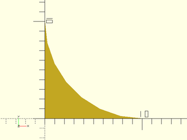

    include <BOSL2/std.scad>
    mask2d_roundover(r=10);

  

**Example 2:** 2D Bead Mask

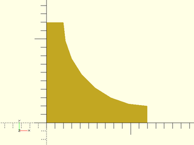

    include <BOSL2/std.scad>
    mask2d_roundover(r=10,inset=2);

  

**Example 3:** 2D Roundover Mask by Radius, acute angle

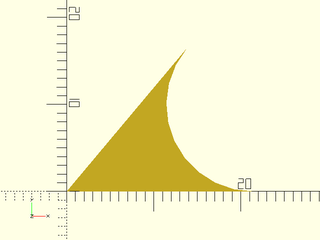

    include <BOSL2/std.scad>
    mask2d_roundover(r=10, mask_angle=50);

  

**Example 4:** 2D Bead Mask by Radius, acute angle

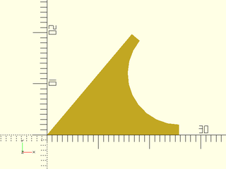

    include <BOSL2/std.scad>
    mask2d_roundover(r=10, inset=2, mask_angle=50);

  

**Example 5:** 2D Bead Mask for obtuse angle, by height

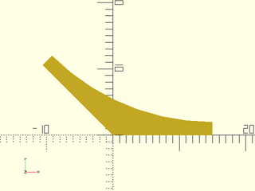

    include <BOSL2/std.scad>
    mask2d_roundover(h=10, inset=2, mask_angle=135, $fn=64);

  

**Example 6:** 2D Bead Mask for obtuse angle, by height with flat top

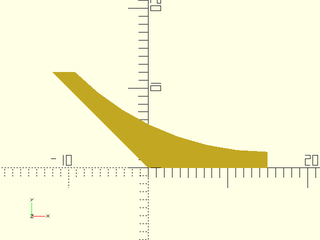

 

    include <BOSL2/std.scad>
    mask2d_roundover(h=10, inset=2, mask_angle=135, flat_top=true, $fn=64);

**Example 7:** 2D Angled Bead Mask by Joint Length.  Joint length does not include the inset.

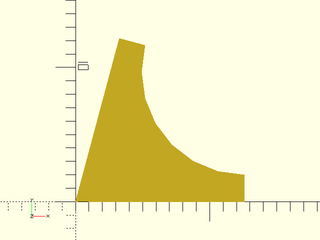

    include <BOSL2/std.scad>
    mask2d_roundover(joint=10, inset=2, mask_angle=75);

  

**Example 8:** Increasing the Excess

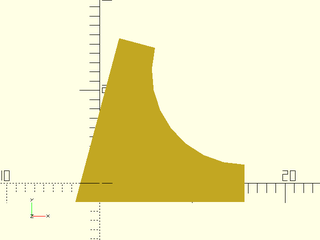

    include <BOSL2/std.scad>
    mask2d_roundover(r=10, inset=2, mask_angle=75, excess=2);

  

**Example 9:** quarter\_round bead on an acute angle

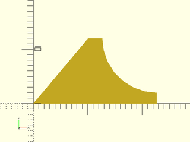

 

    include <BOSL2/std.scad>
    mask2d_roundover(r=10, inset=2, mask_angle=50, quarter_round=true);

**Example 10:** quarter\_round bead on an obtuse angle

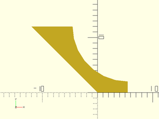

 

    include <BOSL2/std.scad>
    mask2d_roundover(r=10, inset=2, mask_angle=135, quarter_round=true);

**Example 11:** clipping a circle to a 50 deg angle

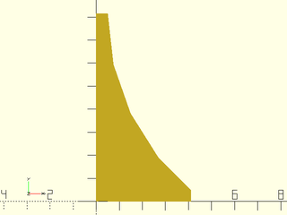

    include <BOSL2/std.scad>
    mask2d_roundover(r=10, inset=1/2, clip_angle=50);

  

**Example 12:** clipping a circle to a 50 deg angle.  The bottom of the arc is not tangent to the x axis.

    include <BOSL2/std.scad>
    mask2d_roundover(r=10, inset=1/2, clip_angle=50);

  

**Example 13:** clipping the arc by specifying `r` and `h`

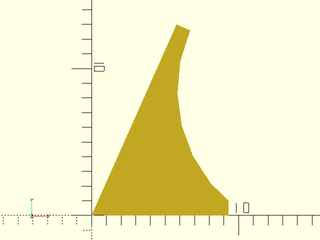

    include <BOSL2/std.scad>
    mask2d_roundover(mask_angle=66, r=10, h=12, inset=1);

  

**Example 14:** Masking by Edge Attachment

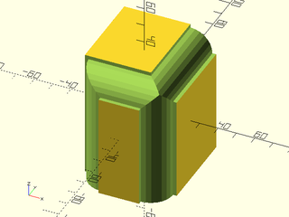

    include <BOSL2/std.scad>
    diff()
    cube([50,60,70],center=true)
        edge_profile([TOP,"Z"],except=[BACK,TOP+LEFT])
            mask2d_roundover(h=12, inset=2);

  

**Example 15:** Making an interior fillet

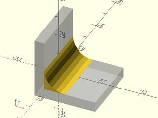

    include <BOSL2/std.scad>
    %render() difference() {
        move(-[5,0,5]) cube(30, anchor=BOT+LEFT);
        cube(310, anchor=BOT+LEFT);
    }
    xrot(90)
        linear_extrude(height=30, center=true)
            mask2d_roundover(r=10);

  

**Example 16:** Rounding over top of an extreme prismoid using height option

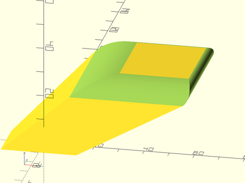

 

    include <BOSL2/std.scad>
    diff()
      prismoid([30,20], [50,60], h=20, shift=[40,50])
         edge_profile(TOP, excess=27)
            mask2d_roundover(height=5, mask_angle=$edge_angle, $fn=128);

**Example 17:** Using the quarter\_round option results in a lip on obtuse angles, so it may not be the best choice for pure roundings.

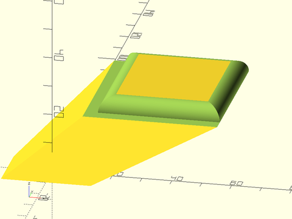

 

    include <BOSL2/std.scad>
    diff()
      prismoid([30,20], [50,60], h=20, shift=[40,50])
         edge_profile(TOP, excess=27)
            mask2d_roundover(r=5, mask_angle=$edge_angle, quarter_round=true, $fn=128);

**Example 18:** Creating a bead on the prismoid using the height option with flat\_top=true:

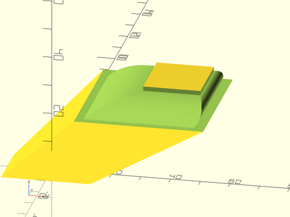

 

    include <BOSL2/std.scad>
    diff()
      prismoid([30,20], [50,60], h=20, shift=[40,50])
         edge_profile(TOP, excess=27)
            mask2d_roundover(height=5, mask_angle=$edge_angle, inset=1.5, flat_top=true, $fn=128);

**Example 19:** Bead may be more pleasing using the quarter\_round option, with curves terminating in a plane parallel to the prismoid top.  The size of the inset edge will be larger than requested when the angle is obtuse.

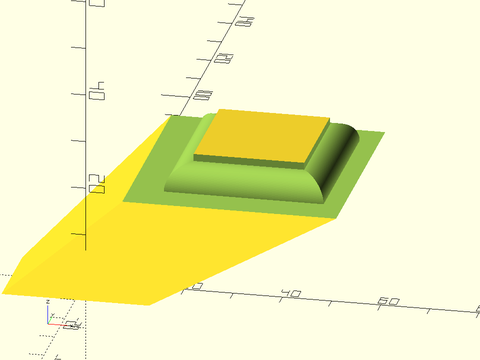

 

    include <BOSL2/std.scad>
    diff()
      prismoid([30,20], [50,60], h=20, shift=[40,50])
         edge_profile(TOP, excess=27)
            mask2d_roundover(r=5, mask_angle=$edge_angle, quarter_round=true, inset=1.5, $fn=128);

---

### Function/Module: mask2d\_teardrop()

**Synopsis:** Creates a 2D teardrop shape with specified max angle from vertical. [<abbr>Geom</abbr>] [<abbr>Path</abbr>]

**Topics:** [Shapes (2D)](Topics#shapes-2d), [Paths (2D)](Topics#paths-2d), [Path Generators](Topics#path-generators), [Attachable](Topics#attachable), [Masks (2D)](Topics#masks-2d), [FDM Optimized](Topics#fdm-optimized)

**See Also:** [corner\_profile()](attachments.scad#module-corner_profile), [edge\_profile()](attachments.scad#module-edge_profile), [face\_profile()](attachments.scad#module-face_profile)

**Usage:** As Module

- mask2d_teardrop(r|d=, [angle], [inset] [mask_angle], [excess], [cut=], [joint=], [h=|height=]) [ATTACHMENTS];

**Usage:** As Function

- path = mask2d_teardrop(r|d=, [angle], [inset], [mask_angle], [excess], [cut=], [joint=], [h=|height=]);

**Description:** 

Creates a 2D teardrop mask shape that is useful for extruding into a 3D mask for an edge.
Conversely, you can use that same extruded shape to make an interior teardrop fillet between two walls.
As a 2D mask, this is designed to be differenced away from the edge of a shape that with its corner at the origin and one edge on the X+ axis and the other mask_angle degrees counterclockwise from the X+ axis.
If called as a function, returns a 2D path of the outline of the mask shape.
This is particularly useful to make partially rounded bottoms, that don't need support to print.
The roundover can be specified by radius, diameter, height, cut, or joint length.

**Arguments:** 

<abbr title="These args can be used by position or by name.">By&nbsp;Position</abbr> | What it does
-------------------- | ------------
`r`                  | Radius of the rounding.
`angle`              | The angle from vertical of the flat section.  Must be between mask_angle-90 and 90 degrees.  Default: 45.
`inset`              | Optional bead inset size perpendicular to edges.  Default: 0
`mask_angle`         | Number of degrees in the corner angle to mask.  Default: 90
`excess`             | Extra amount of mask shape to creates on the X- and Y- sides of the shape. Default: 0.01

<abbr title="These args must be used by name, ie: name=value">By&nbsp;Name</abbr> | What it does
-------------------- | ------------
`d`                  | Diameter of the rounding.
`h`                  / `height`             | Mask height excluding inset and excess.  Given instead of r or d when you want a consistent mask height, no matter what the mask angle.
`cut`                | Cut distance.  IE: How much of the corner to cut off.  See [Types of Roundovers](rounding.scad#section-types-of-roundovers).
`joint`              | Joint distance.  IE: How far from the edge the roundover should start.  See [Types of Roundovers](rounding.scad#section-types-of-roundovers).
`flat_top`           | If true, the top inset of the mask will be horizontal instead of angled by the mask_angle.  Default: true.
`anchor`             | Translate so anchor point is at origin (0,0,0).  See [anchor](attachments.scad#subsection-anchor).  Default: `CENTER`
`spin`               | Rotate this many degrees around the Z axis after anchor.  See [spin](attachments.scad#subsection-spin).  Default: `0`

**Example 1:** 2D Teardrop Mask

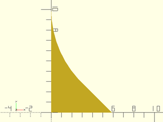

    include <BOSL2/std.scad>
    mask2d_teardrop(r=10,$fn=64);

  

**Example 2:** 2D Teardrop Mask for acute angle

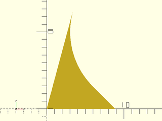

    include <BOSL2/std.scad>
    mask2d_teardrop(r=10, mask_angle=75,$fn=64);

  

**Example 3:** 2D Teardrop Mask for obtuse angle, specifying height

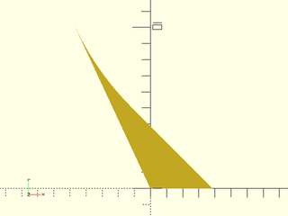

    include <BOSL2/std.scad>
    mask2d_teardrop(h=10, mask_angle=115,$fn=128);

  

**Example 4:** Increasing Excess

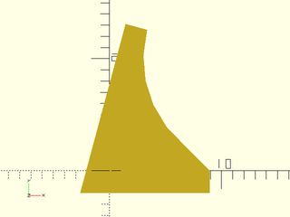

    include <BOSL2/std.scad>
    mask2d_teardrop(r=10, mask_angle=75, excess=2);

  

**Example 5:** Using a Custom Angle

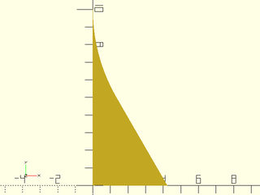

    include <BOSL2/std.scad>
    mask2d_teardrop(r=10,angle=30,$fn=128);

  

**Example 6:** With an acute mask\_angle you can choose an angle of zero:

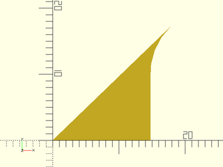

    include <BOSL2/std.scad>
    mask2d_teardrop(r=10,mask_angle=44,angle=0);

  

**Example 7:** With an acute mask\_angle you can even choose a negative angle

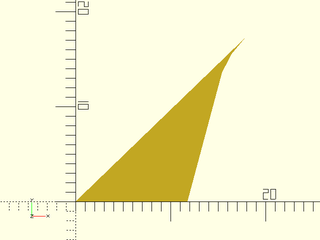

    include <BOSL2/std.scad>
    mask2d_teardrop(r=10,mask_angle=44,angle=-15);

  

**Example 8:** With an obtuse angle you need to choose a larger angle.  Here we add inset.

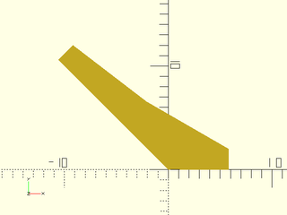

    include <BOSL2/std.scad>
    mask2d_teardrop(h=10, mask_angle=135,angle=60, inset=2);

  

**Example 9:** Same thing with `flat_top=true`.

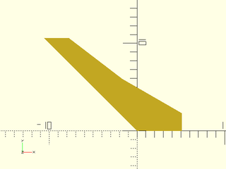

 

    include <BOSL2/std.scad>
    mask2d_teardrop(h=10, mask_angle=135,angle=60, inset=2, flat_top=true);

**Example 10:** Masking by Edge Attachment

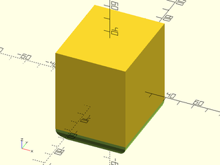

    include <BOSL2/std.scad>
    diff()
    cube([50,60,70],center=true)
        edge_profile(BOT)
            mask2d_teardrop(r=10, angle=40);

  

**Example 11:** Making an interior teardrop fillet

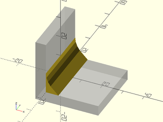

    include <BOSL2/std.scad>
    %render() difference() {
        move(-[5,0,5]) cube(30, anchor=BOT+LEFT);
        cube(310, anchor=BOT+LEFT);
    }
    xrot(90)
        linear_extrude(height=30, center=true)
            mask2d_teardrop(r=10);

  

---

### Function/Module: mask2d\_cove()

**Synopsis:** Creates a 2D cove (quarter-round) mask shape. [<abbr>Geom</abbr>] [<abbr>Path</abbr>]

**Topics:** [Shapes (2D)](Topics#shapes-2d), [Paths (2D)](Topics#paths-2d), [Path Generators](Topics#path-generators), [Attachable](Topics#attachable), [Masks (2D)](Topics#masks-2d)

**See Also:** [corner\_profile()](attachments.scad#module-corner_profile), [edge\_profile()](attachments.scad#module-edge_profile), [face\_profile()](attachments.scad#module-face_profile)

**Usage:** As module

- mask2d_cove(r|d=|h=|height=, [inset], [mask_angle], [excess], [bulge=], [flat_top=], [quarter_round=]) [ATTACHMENTS];

**Usage:** As function

- path = mask2d_cove(r|d=|h=, [inset], [mask_angle], [excess], [bulge=], [flat_top=]);

**Description:** 

Creates a 2D cove mask shape that is useful for extruding into a 3D mask for an edge.
Conversely, you can use that same extruded shape to make an interior rounded shelf decoration between two walls.
As a 2D mask, this is designed to be differenced away from the edge of a shape that with its corner at the origin and one edge on the X+ axis and the other mask_angle degrees counterclockwise from the X+ axis.
If called as a function, returns a 2D path of the outline of the mask shape.

If you need coves to agree on edges of different mask_angle, e.g. on the top of a prismoid, then you need all of the
masks used to have the same height.   You can get the same height by setting the `height` parameter.  For obtuse angles, however, the cove mask may not
have is maximum height at the edge, which means it won't mate with adjacent coves.  You can fix this using `flat_top=true` which extends the circle
with a line to maintain a flat top.  Another way to fix it is to set `bulge`.  You can also achieve constant height using the `quarter_round=` option,
which uses a quarter circle of the specified size for all mask_angle values.  This option often produces a nice result because coves all terminate in a
plane at 90 degrees.

**Arguments:** 

<abbr title="These args can be used by position or by name.">By&nbsp;Position</abbr> | What it does
-------------------- | ------------
`r`                  | Radius of the cove.
`inset`              | Optional amount to inset in the perpendicular direction from the edges.  Scalar or 2-vector.  Default: 0
`mask_angle`         | Number of degrees in the corner angle to mask.  Default: 90
`excess`             | Extra amount of mask shape to creates on the X and quasi-Y sides of the shape.  Default: 0.01

<abbr title="These args must be used by name, ie: name=value">By&nbsp;Name</abbr> | What it does
-------------------- | ------------
`d`                  | Diameter of the cove.
`h`                  / `height`             | Mask height, excluding inset and excess.  Given instead of r or d when you want a consistent mask height, no matter what the mask angle.
`bulge`              | specify arc as the distance away from a straight line chamfer.  The arc will not meet the sides at a 90 deg angle.
`quarter_round`      | If true, make cove independent of the mask_angle, defined based on a quarter circle, with angle-independent radius. The mask will have constant height.  Default: false.
`flat_top`           | If true, the top inset of the mask will be horizontal instead of angled by the mask_angle.  In the case of obtuse angles force the mask to have a flat section at its left side instead of a circular arc.  Default: true if quarter_round is set, false otherwise.
`anchor`             | Translate so anchor point is at origin (0,0,0).  See [anchor](attachments.scad#subsection-anchor).  Default: `CENTER`
`spin`               | Rotate this many degrees around the Z axis after anchor.  See [spin](attachments.scad#subsection-spin).  Default: `0`

**Example 1:** 2D Cove Mask by Radius

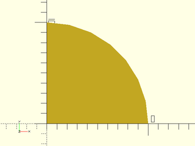

    include <BOSL2/std.scad>
    mask2d_cove(r=10);

  

**Example 2:** 2D Inset Cove Mask (not much different than a regular cove of larger radius)

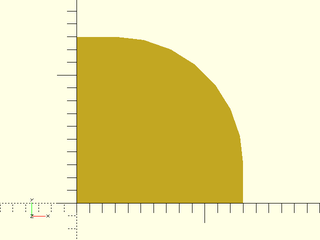

    include <BOSL2/std.scad>
    mask2d_cove(r=10,inset=3);

  

**Example 3:** 2D Cove Mask for acute angle, specified by height, with the bulge set to change the curve.  Note that the circular arc is not perpendicular to the sides.

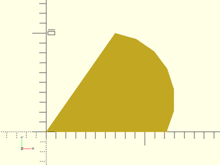

    include <BOSL2/std.scad>
    mask2d_cove(h=10,mask_angle=55, bulge=3);

  

**Example 4:** 2D Cove Mask for obtuse angle, specified by height.  This will produce an odd result if combined with other masks because the maximum height is in the middle.

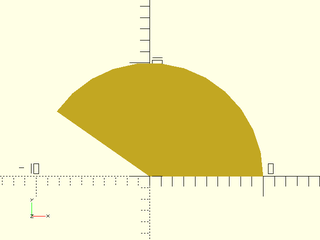

    include <BOSL2/std.scad>
    mask2d_cove(h=10,mask_angle=145);

  

**Example 5:** 2D Cove Mask for obtuse angle with flat top.  This is one solution to the problem of the previous example.  Max height is achieved at the left corner.

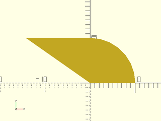

    include <BOSL2/std.scad>
    mask2d_cove(h=10,mask_angle=145,flat_top=true);

  

**Example 6:** 2D Cove Mask for obtuse angle, specified by height with bulge parameter.  Another way to fix the problem of the previous example: the max height is again achieved at the left corner.

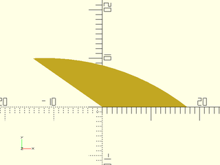

    include <BOSL2/std.scad>
    mask2d_cove(h=10,mask_angle=145, bulge=3, $fn=128);

  

**Example 7:** 2D Cove Mask for acute angle with quarter\_round enabled

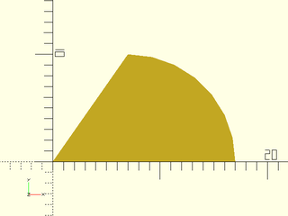

    include <BOSL2/std.scad>
    mask2d_cove(r=10,mask_angle=55,quarter_round=true);

  

**Example 8:** 2D Cove Mask for obtuse angle, specified by height.  Note that flat\_top is on by default in quarter\_round mode.

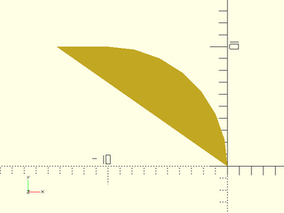

    include <BOSL2/std.scad>
    mask2d_cove(r=10,mask_angle=145,quarter_round=true);

  

**Example 9:** Increasing the Excess

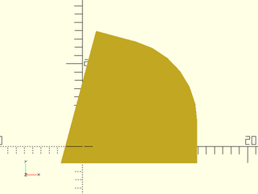

    include <BOSL2/std.scad>
    mask2d_cove(r=10,inset=3,mask_angle=75, excess=2);

  

**Example 10:** Masking by Edge Attachment

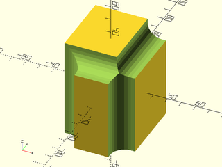

    include <BOSL2/std.scad>
    diff()
    cube([50,60,70],center=true)
        edge_profile([TOP,"Z"],except=[BACK,TOP+LEFT])
            mask2d_cove(h=10, inset=3);

  

**Example 11:** Making an interior rounded shelf

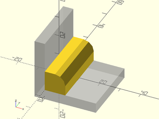

    include <BOSL2/std.scad>
    %render() difference() {
        move(-[5,0,5]) cube(30, anchor=BOT+LEFT);
        cube(310, anchor=BOT+LEFT);
    }
    xrot(90)
        linear_extrude(height=30, center=true)
            mask2d_cove(r=5, inset=5);

  

**Example 12:** A cove on top of an extreme prismoid top by setting height and using flat\_top mode.  This creates **long** flat tops sections at obtuse angles.

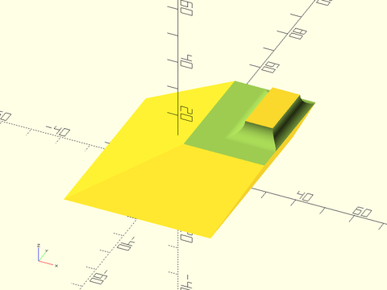

 

    include <BOSL2/std.scad>
    diff()
    prismoid([50,60], [20,30], h=20, shift=[25,16])
        edge_profile(TOP, excess=20)
            mask2d_cove(h=5, inset=0, mask_angle=$edge_angle, flat_top=true, $fn=128);

**Example 13:** Cove on an extreme prismoid top by setting height and bulge.  Obtuse angles have long **curved** sections.

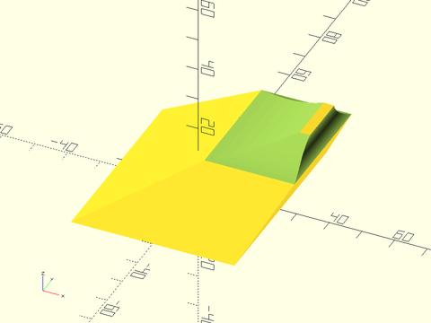

 

    include <BOSL2/std.scad>
    diff()
    prismoid([50,60], [20,30], h=20, shift=[25,16])
        edge_profile(TOP, excess=20)
            mask2d_cove(h=5, inset=0, mask_angle=$edge_angle, bulge=1, $fn=128);

**Example 14:** Rounding an extreme prismoid top using quarter\_round.  Another way to handle this situation.

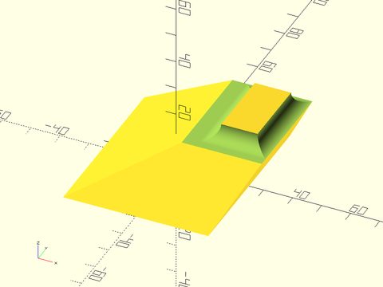

 

    include <BOSL2/std.scad>
    diff()
    prismoid([50,60], [20,30], h=20, shift=[25,16])
        edge_profile(TOP, excess=20)
            mask2d_cove(r=5, inset=0, mask_angle=$edge_angle, quarter_round=true, $fn=128);

---

### Function/Module: mask2d\_chamfer()

**Synopsis:** Produces a 2D chamfer mask shape. [<abbr>Geom</abbr>] [<abbr>Path</abbr>]

**Topics:** [Shapes (2D)](Topics#shapes-2d), [Paths (2D)](Topics#paths-2d), [Path Generators](Topics#path-generators), [Attachable](Topics#attachable), [Masks (2D)](Topics#masks-2d)

**See Also:** [corner\_profile()](attachments.scad#module-corner_profile), [edge\_profile()](attachments.scad#module-edge_profile), [face\_profile()](attachments.scad#module-face_profile)

**Usage:** As Module

- mask2d_chamfer(edge, [angle], [inset], [excess]) [ATTACHMENTS];
- mask2d_chamfer(y=, [angle=], [inset=], [excess=]) [ATTACHMENTS];
- mask2d_chamfer(x=, [angle=], [inset=], [excess=]) [ATTACHMENTS];

**Usage:** As Function

- path = mask2d_chamfer(edge, [angle], [inset], [excess]);
- path = mask2d_chamfer(y=, [angle=], [inset=], [excess=]);
- path = mask2d_chamfer(x=, [angle=], [inset=], [excess=]);

**Description:** 

Creates a 2D chamfer mask shape that is useful for extruding into a 3D mask for an edge.
Conversely, you can use that same extruded shape to make an interior chamfer between two walls.
As a 2D mask, this is designed to be differenced away from the edge of a shape that with its corner at the origin and one edge on the X+ axis and the other mask_angle degrees counterclockwise from the X+ axis.
If called as a function, returns a 2D path of the outline of the mask shape.
The edge parameter specifies the length of the chamfer's slanted edge.  The x parameter specifies the width.  The y parameter
specfies the length of the non-horizontal arm of the chamfer.  The height specifies the height of the chamfer independent
of angle.  You can specify any combination of parameters that determines a chamfer geometry.

**Arguments:** 

<abbr title="These args can be used by position or by name.">By&nbsp;Position</abbr> | What it does
-------------------- | ------------
`edge`               | The length of the edge of the chamfer.
`angle`              | The angle of the chamfer edge, away from vertical.  Default: mask_angle/2.
`inset`              | Optional amount to inset perpendicular to each edge.  Scalar or 2-vector.  Default: 0
`mask_angle`         | Number of degrees in the corner angle to mask.  Default: 90
`excess`             | Extra amount of mask shape to creates on the X- and Y- sides of the shape.  Default: 0.01

<abbr title="These args must be used by name, ie: name=value">By&nbsp;Name</abbr> | What it does
-------------------- | ------------
`x`                  | The width of the chamfer (joint distance in x direction)
`y`                  | The set-back (joint distance) in the non-x direction of the chamfer.
`h`                  / `height`             | The height of the chamfer (excluding inset and excess).
`w`                  / `width`              | The width of the chamfer (excluding inset and excess).
`quarter_round`      | If true, make a roundover independent of the mask_angle, defined based on a 90 deg angle, with a constant height.  Default: false.
`flat_top`           | If true, the top inset of the mask will be horizontal instead of angled by the mask_angle.  Default: true.
`anchor`             | Translate so anchor point is at origin (0,0,0).  See [anchor](attachments.scad#subsection-anchor).  Default: `CENTER`
`spin`               | Rotate this many degrees around the Z axis after anchor.  See [spin](attachments.scad#subsection-spin).  Default: `0`

**Example 1:** 2D Chamfer Mask, at 45 deg by default

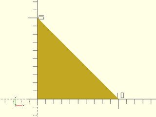

    include <BOSL2/std.scad>
    mask2d_chamfer(x=10);

  

**Example 2:** 2D Chamfer Mask, at 30 deg (measured down from vertical)

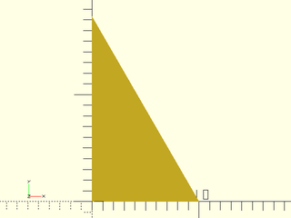

    include <BOSL2/std.scad>
    mask2d_chamfer(x=10,angle=30);

  

**Example 3:** 2D Chamfer Mask on an acute angle.  The default chamfer angle is to produce a symmetric chamfer.

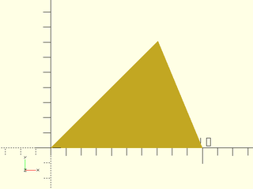

    include <BOSL2/std.scad>
    mask2d_chamfer(x=10,mask_angle=45);

  

**Example 4:** 2D Chamfer Mask on an acute angle.  Here we specify the angle of the chamfer

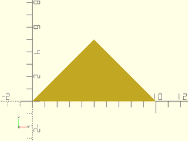

    include <BOSL2/std.scad>
    mask2d_chamfer(x=10,mask_angle=45,angle=45);

  

**Example 5:** 2D Chamfer Mask specified by x and y length

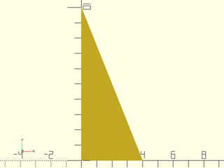

    include <BOSL2/std.scad>
    mask2d_chamfer(x=4,y=10);

  

**Example 6:** 2D Chamfer Mask specified by x and y length.  The y length is along the top side of the chamfer, not parallel to the Y axis.

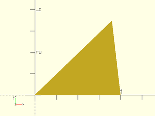

    include <BOSL2/std.scad>
    mask2d_chamfer(x=4,y=5,mask_angle=44);

  

**Example 7:** 2D Chamfer Mask specified by width and height.

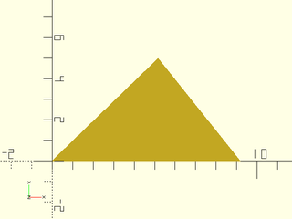

    include <BOSL2/std.scad>
    mask2d_chamfer(w=4,h=5,mask_angle=44);

  

**Example 8:** 2D Chamfer Mask on obtuse angle, specifying x.  The right tip is 10 units from the origin.

    include <BOSL2/std.scad>
    mask2d_chamfer(x=10,mask_angle=127);

  

**Example 9:** 2D Chamfer Mask on obtuse angle, specifying width.  The entire width is 10.

    include <BOSL2/std.scad>
    mask2d_chamfer(w=10,mask_angle=127);

  

**Example 10:** 2D Chamfer Mask by edge

    include <BOSL2/std.scad>
    mask2d_chamfer(edge=10);

  

**Example 11:** 2D Chamfer Mask by edge, acute case

    include <BOSL2/std.scad>
    mask2d_chamfer(edge=10, mask_angle=44);

  

**Example 12:** 2D Chamfer Mask by edge, obtuse case

    include <BOSL2/std.scad>
    mask2d_chamfer(edge=10, mask_angle=144);

  

**Example 13:** 2D Chamfer Mask by edge and angle

    include <BOSL2/std.scad>
    mask2d_chamfer(edge=10, angle=30);

  

**Example 14:** 2D Chamfer Mask by edge and x

    include <BOSL2/std.scad>
    mask2d_chamfer(edge=10, x=9);

  

**Example 15:** 2D Inset Chamfer Mask

    include <BOSL2/std.scad>
    mask2d_chamfer(x=10, inset=2);

  

**Example 16:** 2D Inset Chamfer Mask on acute angle

    include <BOSL2/std.scad>
    mask2d_chamfer(x=10, inset=2, mask_angle=77);

  

**Example 17:** 2D Inset Chamfer Mask on acute angle with flat top

    include <BOSL2/std.scad>
    mask2d_chamfer(x=10, inset=2, mask_angle=77, flat_top=true);

  

**Example 18:** Masking by Edge Attachment

    include <BOSL2/std.scad>
    diff()
    cube([50,60,70],center=true)
        edge_profile([TOP,"Z"],except=[BACK,TOP+LEFT])
            mask2d_chamfer(x=10, inset=2);

  

**Example 19:** Making an interior chamfer

    include <BOSL2/std.scad>
    %render() difference() {
        move(-[5,0,5]) cube(30, anchor=BOT+LEFT);
        cube(310, anchor=BOT+LEFT);
    }
    xrot(90)
        linear_extrude(height=30, center=true)
            mask2d_chamfer(edge=10);

  

**Example 20:** Chamfering an extreme prismoid by setting height

 

    include <BOSL2/std.scad>
    diff()
    prismoid([50,60], [20,30], h=20, shift=[25,16])
        edge_profile(TOP, excess=20)//let(f=$edge_angle)
            mask2d_chamfer(h=5,mask_angle=$edge_angle);

**Example 21:** Chamfering an extreme prismoid with a fixed chamfer angle.  Note that a very large chamfer angle is required because of the large obtuse angles.

 

    include <BOSL2/std.scad>
    diff()
    prismoid([50,60], [20,30], h=20, shift=[25,16])
        edge_profile(TOP, excess=20)//let(f=$edge_angle)
            mask2d_chamfer(h=5,mask_angle=$edge_angle,angle=64);

**Example 22:** Chamfering an extreme prismoid by setting height with inset and flat\_top=true.

 

    include <BOSL2/std.scad>
    diff()
    prismoid([50,60], [20,30], h=20, shift=[25,16])
        edge_profile(TOP, excess=20)//let(f=$edge_angle)
            mask2d_chamfer(h=4,inset=1,flat_top=true,mask_angle=$edge_angle);

---

### Function/Module: mask2d\_rabbet()

**Synopsis:** Creates a rabbet mask shape. [<abbr>Geom</abbr>] [<abbr>Path</abbr>]

**Topics:** [Shapes (2D)](Topics#shapes-2d), [Paths (2D)](Topics#paths-2d), [Path Generators](Topics#path-generators), [Attachable](Topics#attachable), [Masks (2D)](Topics#masks-2d)

**See Also:** [corner\_profile()](attachments.scad#module-corner_profile), [edge\_profile()](attachments.scad#module-edge_profile), [face\_profile()](attachments.scad#module-face_profile)

**Usage:** As Module

- mask2d_rabbet(size, [mask_angle], [excess]) [ATTACHMENTS];

**Usage:** As Function

- path = mask2d_rabbet(size, [mask_angle], [excess]);

**Description:** 

Creates a 2D rabbet mask shape.  When differenced away, this mask
creates at the corner a rectanguler space of the specified size.
This mask can be extruding into a 3D mask for an edge, or
you can use that same extruded shape to make an interior shelf decoration between two walls.
As a 2D mask, this is designed to be differenced away from the edge of a shape that with its corner at the origin and one edge on the X+ axis and the other mask_angle degrees counterclockwise from the X+ axis.
If called as a function, returns a 2D path of the outline of the mask shape.

**Arguments:** 

<abbr title="These args can be used by position or by name.">By&nbsp;Position</abbr> | What it does
-------------------- | ------------
`size`               | The size of the rabbet, either as a scalar or an [X,Y] list.
`mask_angle`         | Number of degrees in the corner angle to mask.  Default: 90
`excess`             | Extra amount of mask shape to creates on the X and quasi-Y sides of the shape. Default: 0.01

<abbr title="These args must be used by name, ie: name=value">By&nbsp;Name</abbr> | What it does
-------------------- | ------------
`anchor`             | Translate so anchor point is at origin (0,0,0).  See [anchor](attachments.scad#subsection-anchor).  Default: `CENTER`
`spin`               | Rotate this many degrees around the Z axis after anchor.  See [spin](attachments.scad#subsection-spin).  Default: `0`

**Example 1:** 2D Rabbet Mask

    include <BOSL2/std.scad>
    mask2d_rabbet(size=10);

  

**Example 2:** 2D Asymmetrical Rabbet Mask

    include <BOSL2/std.scad>
    mask2d_rabbet(size=[5,10]);

  

**Example 3:** 2D Mask for a acute angle edge

    include <BOSL2/std.scad>
    mask2d_rabbet(size=10, mask_angle=75);

  

**Example 4:** 2D Mask for obtuse angle edge.  If the obtuse angle is too large the rabbet will not fit.  If that happens, you will need to increase the rabbet width.

    include <BOSL2/std.scad>
    mask2d_rabbet(size=10, mask_angle=125);

  

**Example 5:** Masking by Edge Attachment

    include <BOSL2/std.scad>
    diff()
    cube([50,60,70],center=true)
        edge_profile([TOP,"Z"],except=[BACK,TOP+LEFT])
            mask2d_rabbet(size=10);

  

**Example 6:** Making an interior shelf

    include <BOSL2/std.scad>
    %render() difference() {
        move(-[5,0,5]) cube(30, anchor=BOT+LEFT);
        cube(310, anchor=BOT+LEFT);
    }
    xrot(90)
        linear_extrude(height=30, center=true)
            mask2d_rabbet(size=[5,10]);

  

---

### Function/Module: mask2d\_dovetail()

**Synopsis:** Creates a 2D dovetail mask shape. [<abbr>Geom</abbr>] [<abbr>Path</abbr>]

**Topics:** [Masks (2D)](Topics#masks-2d), [Shapes (2D)](Topics#shapes-2d), [Paths (2D)](Topics#paths-2d), [Path Generators](Topics#path-generators), [Attachable](Topics#attachable)

**See Also:** [corner\_profile()](attachments.scad#module-corner_profile), [edge\_profile()](attachments.scad#module-edge_profile), [face\_profile()](attachments.scad#module-face_profile)

**Usage:** As Module

- mask2d_dovetail(edge, angle, [inset], [shelf], [excess], ...) [ATTACHMENTS];
- mask2d_dovetail(width=, angle=, [inset=], [shelf=], [excess=], ...) [ATTACHMENTS];
- mask2d_dovetail(height=, angle=, [inset=], [shelf=], [excess=], ...) [ATTACHMENTS];
- mask2d_dovetail(width=, height=, [inset=], [shelf=], [excess=], ...) [ATTACHMENTS];

**Usage:** As Function

- path = mask2d_dovetail(edge, [angle], [inset], [shelf], [excess]);

**Description:** 

Creates a 2D dovetail mask shape that is useful for extruding into a 3D mask for a 90° edge.
Conversely, you can use that same extruded shape to make an interior dovetail between two walls at a 90º angle.
As a 2D mask, this is designed to be differenced away from the edge of a shape that with its corner at the origin and one edge on the X+ axis and the other mask_angle degrees counterclockwise from the X+ axis.
If called as a function, returns a 2D path of the outline of the mask shape.

**Arguments:** 

<abbr title="These args can be used by position or by name.">By&nbsp;Position</abbr> | What it does
-------------------- | ------------
`edge`               | The length of the edge of the dovetail.
`angle`              | The angle of the chamfer edge, away from vertical.
`shelf`              | The extra height to add to the inside corner of the dovetail.  Default: 0
`inset`              | Optional amount to inset in perpendicular direction from each edge.  Default: 0
`mask_angle`         | Number of degrees in the corner angle to mask.  Default: 90
`excess`             | Extra amount of mask shape to creates on the X and quasi-Y sides of the shape.  Default: 0.01

<abbr title="These args must be used by name, ie: name=value">By&nbsp;Name</abbr> | What it does
-------------------- | ------------
`width`              | The width of the dovetail (excluding any inset)
`height`             | The height of the dovetail (excluding any inset or shelf).
`flat_top`           | If true, the top inset of the mask will be horizontal instead of angled by the mask_angle.  Default: true.
`anchor`             | Translate so anchor point is at origin (0,0,0).  See [anchor](attachments.scad#subsection-anchor).  Default: `CENTER`
`spin`               | Rotate this many degrees around the Z axis after anchor.  See [spin](attachments.scad#subsection-spin).  Default: `0`

**Example 1:** 2D Dovetail Mask

    include <BOSL2/std.scad>
    mask2d_dovetail(width=10,angle=14);

  

**Example 2:** 2D Dovetail Mask by height and slope.  A slope of 1/6 is a common choice.

    include <BOSL2/std.scad>
    mask2d_dovetail(height=20, slope=1/6);

  

**Example 3:** 2D Inset Dovetail Mask to make the dovetail wider

    include <BOSL2/std.scad>
    mask2d_dovetail(width=5, angle=12, inset=[4,0]);

  

**Example 4:** 2D Inset Dovetail Mask on an obtuse angle

    include <BOSL2/std.scad>
    mask2d_dovetail(width=5, mask_angle=110, angle=12);

  

**Example 5:** 2D Inset Dovetail Mask on an acute angle will generally require an inset in order to fit.

 

    include <BOSL2/std.scad>
    mask2d_dovetail(width=5, mask_angle=70, angle=12, inset=[6,0]);

**Example 6:** 2D dovetail mask by edge length and angle

    include <BOSL2/std.scad>
    mask2d_dovetail(edge=10,width=4);

  

**Example 7:** 2D dovetail mask by width and height

    include <BOSL2/std.scad>
    mask2d_dovetail(width=5,height=25);

  

**Example 8:** Masking by Edge Attachment

    include <BOSL2/std.scad>
    diff()
    cube([50,60,70],center=true)
        edge_profile([TOP,"Z"],except=[BACK,TOP+LEFT])
            mask2d_dovetail(width=10, angle=30, inset=2);

  

**Example 9:** Making an interior dovetail

    include <BOSL2/std.scad>
    %render() difference() {
        move(-[5,0,5]) cube(30, anchor=BOT+LEFT);
        cube(310, anchor=BOT+LEFT);
    }
    xrot(90)
        linear_extrude(height=30, center=true)
            mask2d_dovetail(width=10,angle=30);

  

---

### Function/Module: mask2d\_ogee()

**Synopsis:** Creates a 2D ogee mask shape. [<abbr>Geom</abbr>] [<abbr>Path</abbr>]

**Topics:** [Shapes (2D)](Topics#shapes-2d), [Paths (2D)](Topics#paths-2d), [Path Generators](Topics#path-generators), [Attachable](Topics#attachable), [Masks (2D)](Topics#masks-2d)

**See Also:** [corner\_profile()](attachments.scad#module-corner_profile), [edge\_profile()](attachments.scad#module-edge_profile), [face\_profile()](attachments.scad#module-face_profile)

**Usage:** As Module

- mask2d_ogee(pattern, [excess], ...) [ATTACHMENTS];

**Usage:** As Function

- path = mask2d_ogee(pattern, [excess], ...);

**Description:** 

Creates a 2D Ogee mask shape that is useful for extruding into a 3D mask for a 90° edge.
Conversely, you can use that same extruded shape to make an interior ogee decoration between two walls at a 90º angle.
As a 2D mask, this is designed to be differenced away from the edge of a shape that with its corner at the origin and one edge on the X+ axis and the other mask_angle degrees counterclockwise from the X+ axis.
Since there are a number of shapes that fall under the name ogee, the shape of this mask is given as a pattern.
Patterns are given as TYPE, VALUE pairs.  ie: `["fillet",10, "xstep",2, "step",[5,5], ...]`.  See Patterns below.
If called as a function, returns a 2D path of the outline of the mask shape.

### Patterns

Type     | Argument  | Description
-------- | --------- | ----------------
"step"   | [x,y]     | Makes a line to a point `x` right and `y` down.
"xstep"  | dist      | Makes a `dist` length line towards X+.
"ystep"  | dist      | Makes a `dist` length line towards Y-.
"round"  | radius    | Makes an arc that will mask a roundover.
"fillet" | radius    | Makes an arc that will mask a fillet.

**Arguments:** 

<abbr title="These args can be used by position or by name.">By&nbsp;Position</abbr> | What it does
-------------------- | ------------
`pattern`            | A list of pattern pieces to describe the Ogee.
`excess`             | Extra amount of mask shape to creates on the X- and Y- sides of the shape. Default: 0.01

<abbr title="These args must be used by name, ie: name=value">By&nbsp;Name</abbr> | What it does
-------------------- | ------------
`anchor`             | Translate so anchor point is at origin (0,0,0).  See [anchor](attachments.scad#subsection-anchor).  Default: `CENTER`
`spin`               | Rotate this many degrees around the Z axis after anchor.  See [spin](attachments.scad#subsection-spin).  Default: `0`

**Example 1:** 2D Ogee Mask

    include <BOSL2/std.scad>
    mask2d_ogee([
        "xstep",1,  "ystep",1,  // Starting shoulder.
        "fillet",5, "round",5,  // S-curve.
        "ystep",1,  "xstep",1   // Ending shoulder.
    ]);

  

**Example 2:** Masking by Edge Attachment

    include <BOSL2/std.scad>
    diff()
    cube([50,60,70],center=true)
        edge_profile(TOP)
            mask2d_ogee([
                "xstep",1,  "ystep",1,  // Starting shoulder.
                "fillet",5, "round",5,  // S-curve.
                "ystep",1,  "xstep",1   // Ending shoulder.
            ]);

  

**Example 3:** Making an interior ogee

    include <BOSL2/std.scad>
    %render() difference() {
        move(-[5,0,5]) cube(30, anchor=BOT+LEFT);
        cube(310, anchor=BOT+LEFT);
    }
    xrot(90)
        linear_extrude(height=30, center=true)
            mask2d_ogee([
                "xstep", 1, "round",5,
                "ystep",1, "fillet",5,
                "xstep", 1, "ystep", 1,
            ]);

  

---

