# LibFile: masks3d.scad

This file defines 3D masks for applying chamfers, roundovers, and teardrop roundovers to straight edges and circular
edges in three dimensions.

To use, add the following lines to the beginning of your file:

    include <BOSL2/std.scad>

## File Contents

1. [Section: Chamfer Masks](#section-chamfer-masks)
    - [`chamfer_edge_mask()`](#module-chamfer_edge_mask) – Creates a shape to chamfer a 90° edge. [<abbr>Geom</abbr>]
    - [`chamfer_corner_mask()`](#module-chamfer_corner_mask) – Creates a shape to chamfer a 90° corner. [<abbr>Geom</abbr>]
    - [`chamfer_cylinder_mask()`](#module-chamfer_cylinder_mask) – Creates a shape to chamfer the end of a cylinder. [<abbr>Geom</abbr>]

2. [Section: Rounding Masks](#section-rounding-masks)
    - [`rounding_edge_mask()`](#module-rounding_edge_mask) – Creates a shape to round an arbitrary 3d edge. [<abbr>Geom</abbr>]
    - [`rounding_corner_mask()`](#module-rounding_corner_mask) – Creates a shape to round 90° corners. [<abbr>Geom</abbr>]
    - [`rounding_cylinder_mask()`](#module-rounding_cylinder_mask) – Creates a shape to round the end of a cylinder. [<abbr>Geom</abbr>]
    - [`rounding_hole_mask()`](#module-rounding_hole_mask) – Creates a shape to round the edge of a round hole. [<abbr>Geom</abbr>]

3. [Section: Teardrop Masking](#section-teardrop-masking)
    - [`teardrop_edge_mask()`](#module-teardrop_edge_mask) – Creates a shape to round a 90° edge but limit the angle of overhang. [<abbr>Geom</abbr>]
    - [`teardrop_corner_mask()`](#module-teardrop_corner_mask) – Creates a shape to round a 90° corner but limit the angle of overhang. [<abbr>Geom</abbr>]

## Section: Chamfer Masks

### Module: chamfer\_edge\_mask()

**Synopsis:** Creates a shape to chamfer a 90° edge. [<abbr>Geom</abbr>]

**Topics:** [Masking](Topics#masking), [Chamfers](Topics#chamfers), [Shapes (3D)](Topics#shapes-3d)

**See Also:** [chamfer\_corner\_mask()](#module-chamfer_corner_mask), [chamfer\_cylinder\_mask()](#module-chamfer_cylinder_mask), [default\_tag()](attachments.scad#module-default_tag), [diff()](attachments.scad#module-diff)

**Usage:** 

- chamfer_edge_mask(l|h=|length=|height=, chamfer, [excess]) [ATTACHMENTS];

**Description:** 

Creates a shape that can be used to chamfer a 90° edge.
Difference it from the object to be chamfered.  The center of
the mask object should align exactly with the edge to be chamfered.

**Arguments:** 

<abbr title="These args can be used by position or by name.">By&nbsp;Position</abbr> | What it does
-------------------- | ------------
`l`                  / `h`                  / `length`             / `height`             | Length of mask.  Default: $edge_length if defined
`chamfer`            | Size of chamfer.
`excess`             | The extra amount to add to the length of the mask so that it differences away from other shapes cleanly.  Default: `0.1`

<abbr title="These args must be used by name, ie: name=value">By&nbsp;Name</abbr> | What it does
-------------------- | ------------
`anchor`             | Translate so anchor point is at origin (0,0,0).  See [anchor](attachments.scad#subsection-anchor).  Default: `CENTER`
`spin`               | Rotate this many degrees around the Z axis after anchor.  See [spin](attachments.scad#subsection-spin).  Default: `0`
`orient`             | Vector to rotate top towards, after spin.  See [orient](attachments.scad#subsection-orient).  Default: `UP`

**Side Effects:** 

- Tags the children with "remove" (and hence sets `$tag`) if no tag is already set.

**Example 1:** 

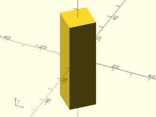

    include <BOSL2/std.scad>
    chamfer_edge_mask(l=50, chamfer=10);

  

**Example 2:** 

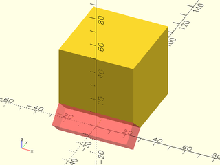

    include <BOSL2/std.scad>
    difference() {
        cube(50, anchor=BOTTOM+FRONT);
        #chamfer_edge_mask(l=50, chamfer=10, orient=RIGHT);
    }

  

**Example 3:** Masking by Attachment

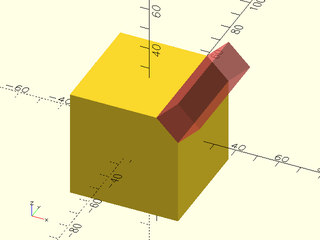

    include <BOSL2/std.scad>
    diff()
    cube(50, center=true) {
        edge_mask(TOP+RIGHT)
            #chamfer_edge_mask(l=50, chamfer=10);
    }

  

---

### Module: chamfer\_corner\_mask()

**Synopsis:** Creates a shape to chamfer a 90° corner. [<abbr>Geom</abbr>]

**Topics:** [Masking](Topics#masking), [Chamfers](Topics#chamfers), [Shapes (3D)](Topics#shapes-3d)

**See Also:** [chamfer\_cylinder\_mask()](#module-chamfer_cylinder_mask), [chamfer\_edge\_mask()](#module-chamfer_edge_mask), [default\_tag()](attachments.scad#module-default_tag), [diff()](attachments.scad#module-diff)

**Usage:** 

- chamfer_corner_mask(chamfer) [ATTACHMENTS];

**Description:** 

Creates a shape that can be used to chamfer a 90° corner.
Difference it from the object to be chamfered.  The center of
the mask object should align exactly with the corner to be chamfered.

**Arguments:** 

<abbr title="These args can be used by position or by name.">By&nbsp;Position</abbr> | What it does
-------------------- | ------------
`chamfer`            | Size of chamfer.

<abbr title="These args must be used by name, ie: name=value">By&nbsp;Name</abbr> | What it does
-------------------- | ------------
`anchor`             | Translate so anchor point is at origin (0,0,0).  See [anchor](attachments.scad#subsection-anchor).  Default: `CENTER`
`spin`               | Rotate this many degrees around the Z axis after anchor.  See [spin](attachments.scad#subsection-spin).  Default: `0`
`orient`             | Vector to rotate top towards, after spin.  See [orient](attachments.scad#subsection-orient).  Default: `UP`

**Side Effects:** 

- Tags the children with "remove" (and hence sets `$tag`) if no tag is already set.

**Example 1:** 

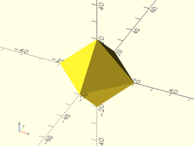

    include <BOSL2/std.scad>
    chamfer_corner_mask(chamfer=10);

  

**Example 2:** 

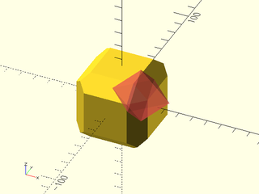

    include <BOSL2/std.scad>
    difference() {
        cuboid(50, chamfer=10, trimcorners=false);
        move(25*[1,-1,1]) #chamfer_corner_mask(chamfer=10);
    }

  

**Example 3:** Masking by Attachment

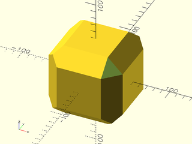

    include <BOSL2/std.scad>
    diff()
    cuboid(100, chamfer=20, trimcorners=false) {
        corner_mask(TOP+FWD+RIGHT)
            chamfer_corner_mask(chamfer=20);
    }

  

**Example 4:** Anchors

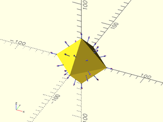

    include <BOSL2/std.scad>
    chamfer_corner_mask(chamfer=20)
        show_anchors();

  

---

### Module: chamfer\_cylinder\_mask()

**Synopsis:** Creates a shape to chamfer the end of a cylinder. [<abbr>Geom</abbr>]

**Topics:** [Masking](Topics#masking), [Chamfers](Topics#chamfers), [Cylinders](Topics#cylinders)

**See Also:** [chamfer\_corner\_mask()](#module-chamfer_corner_mask), [chamfer\_edge\_mask()](#module-chamfer_edge_mask), [default\_tag()](attachments.scad#module-default_tag), [diff()](attachments.scad#module-diff)

**Usage:** 

- chamfer_cylinder_mask(r|d=, chamfer, [ang], [from_end]) [ATTACHMENTS];

**Description:** 

Create a mask that can be used to bevel/chamfer the end of a cylindrical region.
Difference it from the end of the region to be chamfered.  The center of the mask
object should align exactly with the center of the end of the cylindrical region
to be chamfered.

**Arguments:** 

<abbr title="These args can be used by position or by name.">By&nbsp;Position</abbr> | What it does
-------------------- | ------------
`r`                  | Radius of cylinder to chamfer.
`chamfer`            | Size of the edge chamfered, inset from edge.

<abbr title="These args must be used by name, ie: name=value">By&nbsp;Name</abbr> | What it does
-------------------- | ------------
`d`                  | Diameter of cylinder to chamfer. Use instead of r.
`ang`                | Angle of chamfer in degrees from the horizontal.  (Default: 45)
`from_end`           | If true, chamfer size is measured from end of cylinder.  If false, chamfer is measured outset from the radius of the cylinder.  (Default: false)
`anchor`             | Translate so anchor point is at origin (0,0,0).  See [anchor](attachments.scad#subsection-anchor).  Default: `CENTER`
`spin`               | Rotate this many degrees around the Z axis after anchor.  See [spin](attachments.scad#subsection-spin).  Default: `0`
`orient`             | Vector to rotate top towards, after spin.  See [orient](attachments.scad#subsection-orient).  Default: `UP`

**Side Effects:** 

- Tags the children with "remove" (and hence sets `$tag`) if no tag is already set.

**Example 1:** 

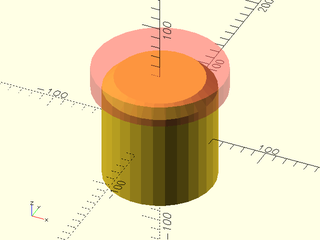

    include <BOSL2/std.scad>
    difference() {
        cylinder(r=50, h=100, center=true);
        up(50) #chamfer_cylinder_mask(r=50, chamfer=10);
    }

  

**Example 2:** 

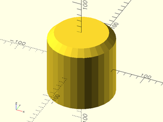

    include <BOSL2/std.scad>
    difference() {
        cylinder(r=50, h=100, center=true);
        up(50) chamfer_cylinder_mask(r=50, chamfer=10);
    }

  

**Example 3:** Changing the chamfer angle

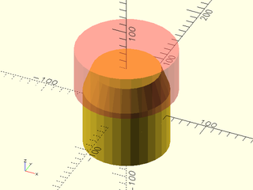

    include <BOSL2/std.scad>
    difference() {
        cylinder(r=50, h=100, center=true);
        up(50) #chamfer_cylinder_mask(r=50, chamfer=10, ang=70);
    }

  

**Example 4:** 

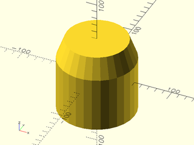

    include <BOSL2/std.scad>
    difference() {
        cylinder(r=50, h=100, center=true);
        up(50) chamfer_cylinder_mask(r=50, chamfer=10, ang=70);
    }

  

**Example 5:** Masking by Attachment

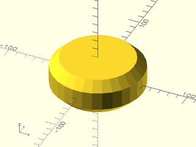

    include <BOSL2/std.scad>
    diff()
    cyl(d=100,h=40)
       attach([TOP,BOT])
          tag("remove")chamfer_cylinder_mask(d=100, chamfer=10);

  

---

## Section: Rounding Masks

### Module: rounding\_edge\_mask()

**Synopsis:** Creates a shape to round an arbitrary 3d edge. [<abbr>Geom</abbr>]

**Topics:** [Masks](Topics#masks), [Rounding](Topics#rounding), [Shapes (3D)](Topics#shapes-3d)

**See Also:** [edge\_profile()](attachments.scad#module-edge_profile), [rounding\_corner\_mask()](#module-rounding_corner_mask), [default\_tag()](attachments.scad#module-default_tag), [diff()](attachments.scad#module-diff)

**Usage:** 

- rounding_edge_mask(l|h=|length=|height=, r|d=, [ang], [excess=], [rounding=|chamfer=], ) [ATTACHMENTS];
- rounding_edge_mask(l|h=|length=|height=, r1=|d1=, r2=|d2=, [ang=], [excess=], [rounding=|chamfer=]) [ATTACHMENTS];

**Description:** 

Creates a mask shape that can be used to round a straight edge at any angle, with
different rounding radii at each end.  The corner of the mask appears on the Z axis with one face on the XZ plane.
You must align the mask corner with the edge you want to round.  If your parent object is a cuboid, the easiest way to
do this is to use [`diff()`](attachments.scad#module-diff) and [`edge_mask()`](attachments.scad#module-edge_mask).  However, this method is somewhat inflexible regarding orientation of a tapered
mask, and it does not support other parent shapes.  You can attach the mask to a larger range of shapes using
[`attach()`](attachments.scad#module-attach) to anchor the `LEFT+FWD` anchor of the mask to a desired corner on the parent with `inside=true`.
Many shapes propagate `$edge_angle` and `$edge_length` which can aid in configuring the mask, and you can adjust the
mask as needed to align the taper as desired.  The default "remove" tag is set so [`diff()`](attachments.scad#module-diff) will automatically difference
away the mask.  You can of course also position the mask manually and use `difference()`.

For mating with other roundings or chamfers on cuboids or regular prisms, you can choose end roundings and end chamfers.  These affect
only the curved edge of the mask ends and will only work if the terminating face is perpendicular to the masked edge.  The `excess`
parameter will add extra length to the mask when you use these settings.

**Arguments:** 

<abbr title="These args can be used by position or by name.">By&nbsp;Position</abbr> | What it does
-------------------- | ------------
`l`                  / `h`                  / `length`             / `height`             | Length of mask.  Default: $edge_length if defined
`r`                  | Radius of the rounding.
`ang`                | Angle between faces for rounding.  Default: $edge_angle if defined, otherwise 90

<abbr title="These args must be used by name, ie: name=value">By&nbsp;Name</abbr> | What it does
-------------------- | ------------
`r1`                 | Bottom radius of rounding.
`r2`                 | Top radius of rounding.
`d`                  | Diameter of the rounding.
`d1`                 | Bottom diameter of rounding.
`d2`                 | Top diameter of rounding.
`excess`             | Extra size for the mask.  Defaults: 0.1
`rounding`           | Radius of roundong along ends.  Default: 0
`rounding1`          | Radius of rounding along bottom end
`rounding2`          | Radius of rounding along top end
`chamfer`            | Chamfer size of end chamfers.  Default: 0
`chamfer1`           | Chamfer size of chamfer at bottom end
`chamfer2`           | Chamfer size of chamfer at top end
`anchor`             | Translate so anchor point is at origin (0,0,0).  See [anchor](attachments.scad#subsection-anchor).  Default: `CENTER`
`spin`               | Rotate this many degrees around the Z axis after anchor.  See [spin](attachments.scad#subsection-spin).  Default: `0`
`orient`             | Vector to rotate top towards, after spin.  See [orient](attachments.scad#subsection-orient).  Default: `UP`

**Side Effects:** 

- Tags the children with "remove" (and hence sets `$tag`) if no tag is already set.

**Example 1:** 

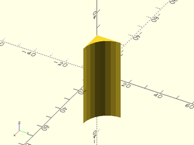

    include <BOSL2/std.scad>
    rounding_edge_mask(l=50, r=15);

  

**Example 2:** With different radii at each end

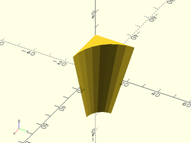

    include <BOSL2/std.scad>
    rounding_edge_mask(l=50, r1=10, r2=25);

  

**Example 3:** Acute angle

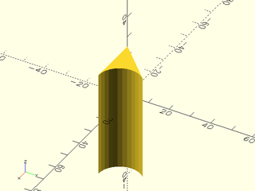

    include <BOSL2/std.scad>
    rounding_edge_mask(l=50, r=10, ang=45);

  

**Example 4:** A large excess

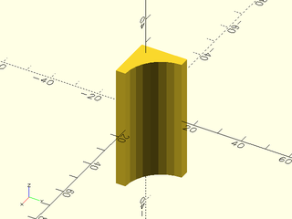

    include <BOSL2/std.scad>
    rounding_edge_mask(l=50, r=15,excess=4);

  

**Example 5:** Subtracting from a cube

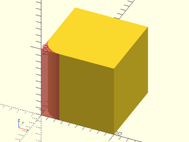

    include <BOSL2/std.scad>
    difference() {
        cube(size=100, center=false);
        #rounding_edge_mask(l=100, r=25, anchor=BOTTOM);
    }

  

**Example 6:** Varying Rounding Radius

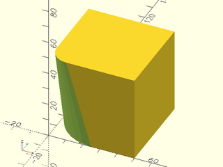

 

    include <BOSL2/std.scad>
    difference() {
        cube(size=50, center=false);
        down(1)rounding_edge_mask(l=52, r1=25, r2=10, anchor=BOTTOM);
    }

**Example 7:** Angle not 90 degrees

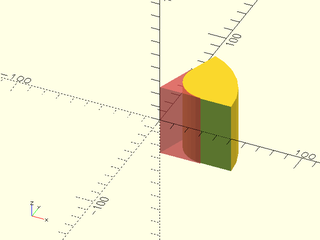

    include <BOSL2/std.scad>
    difference() {
        pie_slice(ang=70, h=50, d=100, center=true);
        #rounding_edge_mask(h=51, r=20.0, ang=70, $fn=32);
    }

  

**Example 8:** Varying Rounding Radius

    include <BOSL2/std.scad>
    difference() {
        pie_slice(ang=70, h=50, d=100, center=true);
        #rounding_edge_mask(h=51, r1=10, r2=25, ang=70, $fn=32);
    }

  

**Example 9:** Rounding a non-right angled edge, with a zero radius at the bottom.

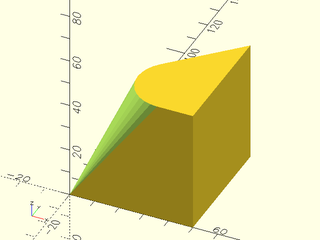

    include <BOSL2/std.scad>
    difference(){
      linear_extrude(height=50)xflip(x=25)right_triangle([50,50]);
      rounding_edge_mask(l=51, ang=45, r1=0, r2=15, anchor=BOT);
    }

  

**Example 10:** Masking by Attachment

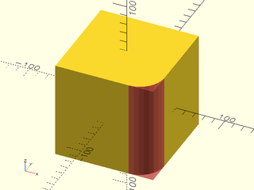

    include <BOSL2/std.scad>
    diff()
    cube(100, center=true)
        edge_mask(FRONT+RIGHT)
            #rounding_edge_mask(l=$parent_size.z+0.01, r=25);

  

**Example 11:** Multiple Masking by Attachment

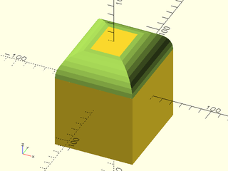

    include <BOSL2/std.scad>
    diff()
    cube([80,90,100], center=true) {
        let(p = $parent_size*1.01) {
            edge_mask(TOP)
                rounding_edge_mask(l=p.z, r=25);
        }
    }

  

**Example 12:** Mask shape with end rounding at the top, chamfer at the bottom, and a large excess value:

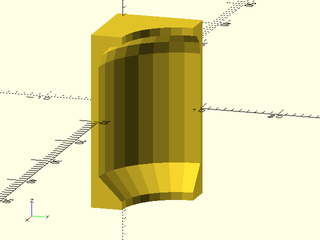

 

    include <BOSL2/std.scad>
    rounding_edge_mask(r=10,h=20, chamfer1=3, rounding2=3, excess=1);

**Example 13:** Attaching masks using [`attach()`](attachments.scad#module-attach) with automatic angle and length from the parent.  Note that sometimes the automatic length is too short because it is the length of the edge itself.

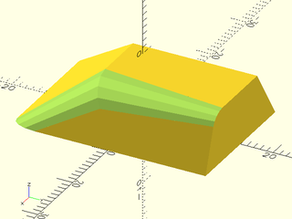

    include <BOSL2/std.scad>
    diff()
    prismoid([20,30],[12,19], h=10,shift=[4,7])
      attach([TOP+RIGHT,RIGHT+FRONT],LEFT+FWD,inside=true)
        rounding_edge_mask(r1=2,r2=4);

  

**Example 14:** The mask does not need to be the full length of the edge

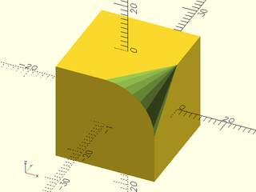

    include <BOSL2/std.scad>
    diff()
    cuboid(20)
      attach(RIGHT+TOP,LEFT+FWD,inside=true,inset=-.1,align=FWD)
        rounding_edge_mask(r1=0,r2=10,length=10);

  

---

### Module: rounding\_corner\_mask()

**Synopsis:** Creates a shape to round 90° corners. [<abbr>Geom</abbr>]

**Topics:** [Masking](Topics#masking), [Rounding](Topics#rounding), [Shapes (3D)](Topics#shapes-3d)

**See Also:** [rounding\_edge\_mask()](#module-rounding_edge_mask), [default\_tag()](attachments.scad#module-default_tag), [diff()](attachments.scad#module-diff)

**Usage:** 

- rounding_corner_mask(r|d, [ang], [excess=], [style=]) [ATTACHMENTS];

**Description:** 

Creates a shape that you can use to round corners where the top and bottom faces are parallel and the two side
faces are perpendicular to the top and bottom, e.g. cubes or pie_slice corners.
Difference it from the object to be rounded.  The center of the mask
object should align exactly with the corner to be rounded.

**Arguments:** 

<abbr title="These args can be used by position or by name.">By&nbsp;Position</abbr> | What it does
-------------------- | ------------
`r`                  | Radius of corner rounding.
`ang`                | Angle of corner (measured around the z axis).  Default: 90

<abbr title="These args must be used by name, ie: name=value">By&nbsp;Name</abbr> | What it does
-------------------- | ------------
`d`                  | Diameter of corner rounding.
`excess`             | Extra size for the mask.  Defaults: 0.1
`style`              | The style of the sphere cutout's construction. One of "orig", "aligned", "stagger", "octa", or "icosa".  Default: "octa"
`anchor`             | Translate so anchor point is at origin (0,0,0).  See [anchor](attachments.scad#subsection-anchor).  Default: `CENTER`
`spin`               | Rotate this many degrees around the Z axis after anchor.  See [spin](attachments.scad#subsection-spin).  Default: `0`
`orient`             | Vector to rotate top towards, after spin.  See [orient](attachments.scad#subsection-orient).  Default: `UP`

**Side Effects:** 

- Tags the children with "remove" (and hence sets `$tag`) if no tag is already set.

**Example 1:** 

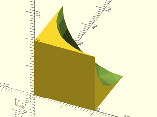

    include <BOSL2/std.scad>
    rounding_corner_mask(r=20);

  

**Example 2:** Adding a huge excess

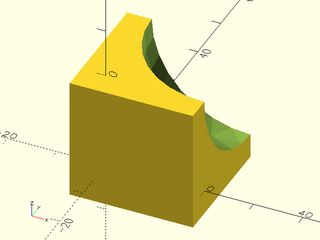

    include <BOSL2/std.scad>
    rounding_corner_mask(r=20, excess=5);

  

**Example 3:** Position masks manually

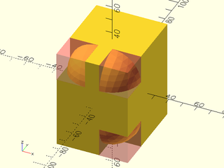

    include <BOSL2/std.scad>
    difference() {
        cube(size=[50, 60, 70], center=true);
        translate([-25, -30, 35])
            #rounding_corner_mask(r=20, spin=90, orient=DOWN);
        translate([25, -30, 35])
            #rounding_corner_mask(r=20, orient=DOWN);
        translate([25, -30, -35])
            #rounding_corner_mask(r=20, spin=90);
    }

  

**Example 4:** Masking by Attachment

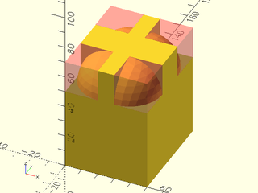

    include <BOSL2/std.scad>
    diff()
    cube(size=[50, 60, 70]) {
        corner_mask(TOP)
            #rounding_corner_mask(r=20);
    }

  

**Example 5:** Acute angle

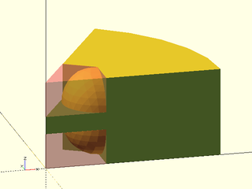

    include <BOSL2/std.scad>
    ang=60;
    difference() {
        pie_slice(ang=ang, h=50, r=100);
        zflip_copy(z=25)
           #rounding_corner_mask(r=20, ang=ang);
    }

  

**Example 6:** Obtuse angle

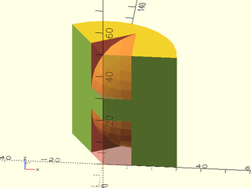

    include <BOSL2/std.scad>
    ang=120;
    difference() {
        pie_slice(ang=ang, h=50, r=30);
        zflip_copy(z=25)
           #rounding_corner_mask(r=20, ang=ang);
    }

  

---

### Module: rounding\_cylinder\_mask()

**Synopsis:** Creates a shape to round the end of a cylinder. [<abbr>Geom</abbr>]

**Topics:** [Masking](Topics#masking), [Rounding](Topics#rounding), [Cylinders](Topics#cylinders)

**See Also:** [rounding\_hole\_mask()](#module-rounding_hole_mask), [rounding\_corner\_mask()](#module-rounding_corner_mask), [default\_tag()](attachments.scad#module-default_tag), [diff()](attachments.scad#module-diff)

**Usage:** 

- rounding_cylinder_mask(r|d=, rounding);

**Description:** 

Create a mask that can be used to round the end of a cylinder.
Difference it from the cylinder to be rounded.  The center of the
mask object should align exactly with the center of the end of the
cylinder to be rounded.

**Arguments:** 

<abbr title="These args can be used by position or by name.">By&nbsp;Position</abbr> | What it does
-------------------- | ------------
`r`                  | Radius of cylinder.
`rounding`           | Radius of the edge rounding.

<abbr title="These args must be used by name, ie: name=value">By&nbsp;Name</abbr> | What it does
-------------------- | ------------
`d`                  | Diameter of cylinder.
`anchor`             | Translate so anchor point is at origin (0,0,0).  See [anchor](attachments.scad#subsection-anchor).  Default: `CENTER`
`spin`               | Rotate this many degrees around the Z axis after anchor.  See [spin](attachments.scad#subsection-spin).  Default: `0`
`orient`             | Vector to rotate top towards, after spin.  See [orient](attachments.scad#subsection-orient).  Default: `UP`

**Side Effects:** 

- Tags the children with "remove" (and hence sets `$tag`) if no tag is already set.

**Example 1:** 

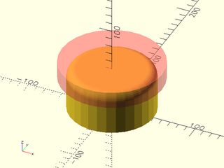

    include <BOSL2/std.scad>
    difference() {
      cylinder(r=50, h=50, center=false);
      up(50) #rounding_cylinder_mask(r=50, rounding=10);
    }

  

**Example 2:** 

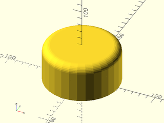

    include <BOSL2/std.scad>
    difference() {
      cylinder(r=50, h=50, center=false);
      up(50) rounding_cylinder_mask(r=50, rounding=10);
    }

  

**Example 3:** Masking by Attachment

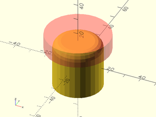

    include <BOSL2/std.scad>
    diff()
    cyl(h=30, d=30) {
        attach(TOP)
          #tag("remove")
            rounding_cylinder_mask(d=30, rounding=5);
    }

  

---

### Module: rounding\_hole\_mask()

**Synopsis:** Creates a shape to round the edge of a round hole. [<abbr>Geom</abbr>]

**Topics:** [Masking](Topics#masking), [Rounding](Topics#rounding)

**See Also:** [rounding\_cylinder\_mask()](#module-rounding_cylinder_mask), [rounding\_corner\_mask()](#module-rounding_corner_mask), [default\_tag()](attachments.scad#module-default_tag), [diff()](attachments.scad#module-diff)

**Usage:** 

- rounding_hole_mask(r|d, rounding, [excess]) [ATTACHMENTS];

**Description:** 

Create a mask that can be used to round the edge of a circular hole.
Difference it from the hole to be rounded.  The center of the
mask object should align exactly with the center of the end of the
hole to be rounded.

**Arguments:** 

<abbr title="These args can be used by position or by name.">By&nbsp;Position</abbr> | What it does
-------------------- | ------------
`r`                  | Radius of hole.
`rounding`           | Radius of the rounding.
`excess`             | The extra thickness of the mask.  Default: `0.1`.

<abbr title="These args must be used by name, ie: name=value">By&nbsp;Name</abbr> | What it does
-------------------- | ------------
`d`                  | Diameter of hole to rounding.
`anchor`             | Translate so anchor point is at origin (0,0,0).  See [anchor](attachments.scad#subsection-anchor).  Default: `CENTER`
`spin`               | Rotate this many degrees around the Z axis after anchor.  See [spin](attachments.scad#subsection-spin).  Default: `0`
`orient`             | Vector to rotate top towards, after spin.  See [orient](attachments.scad#subsection-orient).  Default: `UP`

**Side Effects:** 

- Tags the children with "remove" (and hence sets `$tag`) if no tag is already set.

**Example 1:** 

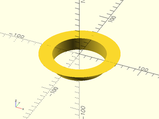

    include <BOSL2/std.scad>
    rounding_hole_mask(r=40, rounding=20, $fa=2, $fs=2);

  

**Example 2:** 

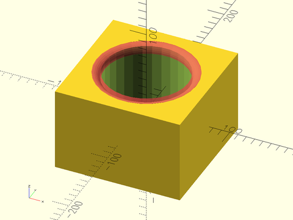

 

    include <BOSL2/std.scad>
    difference() {
      cube([150,150,100], center=true);
      cylinder(r=50, h=100.1, center=true);
      up(50) #rounding_hole_mask(r=50, rounding=10);
    }

**Example 3:** 

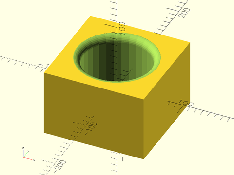

 

    include <BOSL2/std.scad>
    difference() {
      cube([150,150,100], center=true);
      cylinder(r=50, h=100.1, center=true);
      up(50) rounding_hole_mask(r=50, rounding=10);
    }

---

## Section: Teardrop Masking

### Module: teardrop\_edge\_mask()

**Synopsis:** Creates a shape to round a 90° edge but limit the angle of overhang. [<abbr>Geom</abbr>]

**Topics:** [Masking](Topics#masking), [Rounding](Topics#rounding), [Shapes (3D)](Topics#shapes-3d), [FDM Optimized](Topics#fdm-optimized)

**See Also:** [teardrop\_corner\_mask()](#module-teardrop_corner_mask), [default\_tag()](attachments.scad#module-default_tag), [diff()](attachments.scad#module-diff)

**Usage:** 

- teardrop_edge_mask(l|h=|length=|height=, r|d=, [angle], [excess], [anchor], [spin], [orient]) [ATTACHMENTS];

**Description:** 

Makes an apropriate 3D edge rounding mask that keeps within `angle` degrees of vertical.

**Arguments:** 

<abbr title="These args can be used by position or by name.">By&nbsp;Position</abbr> | What it does
-------------------- | ------------
`l`                  / `h`                  / `length`             / `height`             | length of mask
`r`                  | Radius of the mask rounding.
`angle`              | Maximum angle from vertical. Default: 45
`excess`             | Excess mask size.  Default: 0.1

<abbr title="These args must be used by name, ie: name=value">By&nbsp;Name</abbr> | What it does
-------------------- | ------------
`d`                  | Diameter of the mask rounding.
`anchor`             | Translate so anchor point is at origin (0,0,0).  See [anchor](attachments.scad#subsection-anchor).  Default: `CENTER`
`spin`               | Rotate this many degrees around the Z axis after anchor.  See [spin](attachments.scad#subsection-spin).  Default: `0`
`orient`             | Vector to rotate top towards, after spin.  See [orient](attachments.scad#subsection-orient).  Default: `UP`

**Side Effects:** 

- Tags the children with "remove" (and hence sets `$tag`) if no tag is already set.

**Example 1:** 

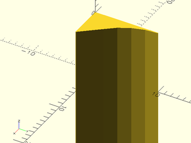

    include <BOSL2/std.scad>
    teardrop_edge_mask(l=20, r=10, angle=40);

  

**Example 2:** 

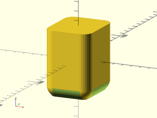

 

    include <BOSL2/std.scad>
    diff()
    cuboid([50,60,70],rounding=10,edges="Z",anchor=CENTER) {
        edge_mask(BOT)
            teardrop_edge_mask(l=max($parent_size)+1, r=10, angle=40);
        corner_mask(BOT)
            teardrop_corner_mask(r=10, angle=40);
    }

---

### Module: teardrop\_corner\_mask()

**Synopsis:** Creates a shape to round a 90° corner but limit the angle of overhang. [<abbr>Geom</abbr>]

**Topics:** [Masking](Topics#masking), [Rounding](Topics#rounding), [Shapes (3D)](Topics#shapes-3d), [FDM Optimized](Topics#fdm-optimized)

**See Also:** [teardrop\_edge\_mask()](#module-teardrop_edge_mask), [default\_tag()](attachments.scad#module-default_tag), [diff()](attachments.scad#module-diff)

**Usage:** 

- teardrop_corner_mask(r|d=, [angle], [excess], [anchor], [spin], [orient]) [ATTACHMENTS];

**Description:** 

Makes an apropriate 3D corner rounding mask that keeps within `angle` degrees of vertical.

**Arguments:** 

<abbr title="These args can be used by position or by name.">By&nbsp;Position</abbr> | What it does
-------------------- | ------------
`r`                  | Radius of the mask rounding.
`angle`              | Maximum angle from vertical. Default: 45
`excess`             | Excess mask size.  Default: 0.1

<abbr title="These args must be used by name, ie: name=value">By&nbsp;Name</abbr> | What it does
-------------------- | ------------
`d`                  | Diameter of the mask rounding.
`anchor`             | Translate so anchor point is at origin (0,0,0).  See [anchor](attachments.scad#subsection-anchor).  Default: `CENTER`
`spin`               | Rotate this many degrees around the Z axis after anchor.  See [spin](attachments.scad#subsection-spin).  Default: `0`
`orient`             | Vector to rotate top towards, after spin.  See [orient](attachments.scad#subsection-orient).  Default: `UP`

**Side Effects:** 

- Tags the children with "remove" (and hence sets `$tag`) if no tag is already set.

**Example 1:** 

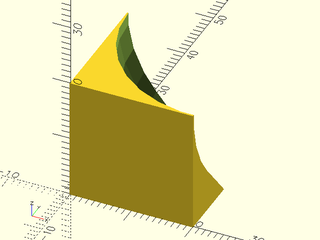

    include <BOSL2/std.scad>
    teardrop_corner_mask(r=20, angle=40);

  

**Example 2:** 

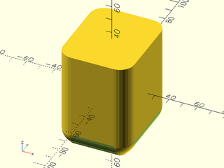

    include <BOSL2/std.scad>
    diff()
    cuboid([50,60,70],rounding=10,edges="Z",anchor=CENTER) {
        edge_profile(BOT)
            mask2d_teardrop(r=10, angle=40);
        corner_mask(BOT)
            teardrop_corner_mask(r=10, angle=40);
    }

  

---

