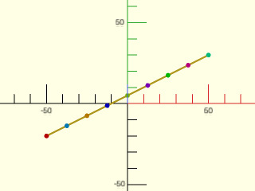
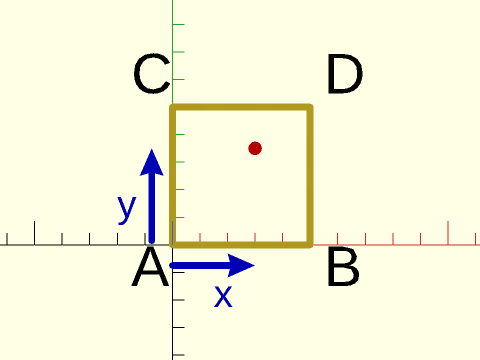
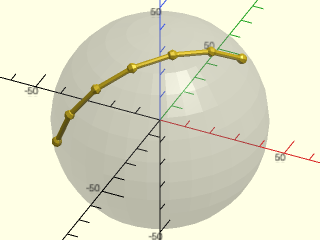
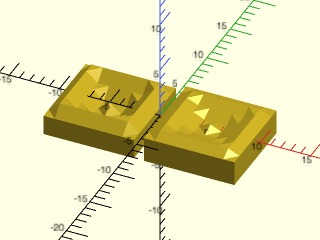
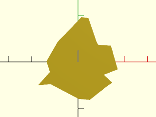
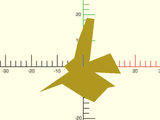
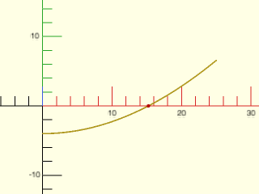

# LibFile: math.scad

Assorted math functions, including linear interpolation, list operations (sums, mean, products),
convolution, quantization, log2, hyperbolic trig functions, random numbers, derivatives,
polynomials, and root finding.

To use, add the following lines to the beginning of your file:

    include <BOSL2/std.scad>

## File Contents

1. [Section: Math Constants](#section-math-constants)
    - [`PHI`](#constant-phi) – The golden ratio φ (phi).  Approximately 1.6180339887
    - [`EPSILON`](#constant-epsilon) – A tiny value to compare floating point values.  1e-9
    - [`INF`](#constant-inf) – The floating point value for Infinite.
    - [`NAN`](#constant-nan) – The floating point value for Not a Number.

2. [Section: Interpolation and Counting](#section-interpolation-and-counting)
    - [`count()`](#function-count) – Creates a list of incrementing numbers.
    - [`lerp()`](#function-lerp) – Linearly interpolates between two values.
    - [`lerpn()`](#function-lerpn) – Returns exactly `n` values, linearly interpolated between `a` and `b`.
    - [`bilerp()`](#function-bilerp) – Bi-linear interpolation between four values
    - [`slerp()`](#function-slerp) – Spherical lerp(), great-circle interpolation on a unit sphere.
    - [`slerpn()`](#function-slerpn) – Spherical lerpn(), returns exactly `n` vectors interpolated on a great circle.

3. [Section: Miscellaneous Functions](#section-miscellaneous-functions)
    - [`sqr()`](#function-sqr) – Returns the square of the given value.
    - [`log2()`](#function-log2) – Returns the log base 2 of the given value.
    - [`hypot()`](#function-hypot) – Returns the hypotenuse length of a 2D or 3D triangle.
    - [`factorial()`](#function-factorial) – Returns the factorial of the given integer.
    - [`binomial()`](#function-binomial) – Returns the binomial coefficients of the integer `n`.
    - [`binomial_coefficient()`](#function-binomial_coefficient) – Returns the `k`-th binomial coefficient of the integer `n`.
    - [`gcd()`](#function-gcd) – Returns the Greatest Common Divisor/Factor of two integers.
    - [`lcm()`](#function-lcm) – Returns the Least Common Multiple of two or more integers.

4. [Section: Hyperbolic Trigonometry](#section-hyperbolic-trigonometry)
    - [`sinh()`](#function-sinh) – Returns the hyperbolic sine of the given value.
    - [`cosh()`](#function-cosh) – Returns the hyperbolic cosine of the given value.
    - [`tanh()`](#function-tanh) – Returns the hyperbolic tangent of the given value.
    - [`asinh()`](#function-asinh) – Returns the hyperbolic arc-sine of the given value.
    - [`acosh()`](#function-acosh) – Returns the hyperbolic arc-cosine of the given value.
    - [`atanh()`](#function-atanh) – Returns the hyperbolic arc-tangent of the given value.

5. [Section: Quantization](#section-quantization)
    - [`quant()`](#function-quant) – Returns `x` quantized to the nearest integer multiple of `y`.
    - [`quantdn()`](#function-quantdn) – Returns `x` quantized down to an integer multiple of `y`.
    - [`quantup()`](#function-quantup) – Returns `x` quantized uo to an integer multiple of `y`.

6. [Section: Constraints and Modulos](#section-constraints-and-modulos)
    - [`constrain()`](#function-constrain) – Limit (clamp) a number or array of numbers to a specified range of values.
    - [`posmod()`](#function-posmod) – Returns the positive modulo of a value.
    - [`modang()`](#function-modang) – Returns an angle normalized to between -180º and 180º.
    - [`mean_angle()`](#function-mean_angle) – Returns the mean angle of two angles
    - [`fit_to_range()`](#function-fit_to_range) – Scale the values in an array to span a range.

7. [Section: Operations on Lists (Sums, Mean, Products)](#section-operations-on-lists-sums-mean-products)
    - [`sum()`](#function-sum) – Returns the sum of a list of values.
    - [`mean()`](#function-mean) – Returns the mean value of a list of values.
    - [`median()`](#function-median) – Returns the median value of a list of values.
    - [`deltas()`](#function-deltas) – Returns the deltas between a list of values.
    - [`cumsum()`](#function-cumsum) – Returns the running cumulative sum of a list of values.
    - [`product()`](#function-product) – Returns the multiplicative product of a list of values.
    - [`cumprod()`](#function-cumprod) – Returns the running cumulative product of a list of values.
    - [`convolve()`](#function-convolve) – Returns the convolution of `p` and `q`.
    - [`sum_of_sines()`](#function-sum_of_sines) – Returns the sum of one or more sine waves at a given angle.

8. [Section: Random Number Generation](#section-random-number-generation)
    - [`rand_int()`](#function-rand_int) – Returns a random integer.
    - [`random_points()`](#function-random_points) – Returns a list of random points.
    - [`gaussian_rands()`](#function-gaussian_rands) – Returns a list of random numbers with a gaussian distribution.
    - [`exponential_rands()`](#function-exponential_rands) – Returns a list of random numbers with an exponential distribution.
    - [`spherical_random_points()`](#function-spherical_random_points) – Returns a list of random points on the surface of a sphere.
    - [`random_polygon()`](#function-random_polygon) – Returns the clockwise path of a simple random polygon.

9. [Section: Calculus](#section-calculus)
    - [`deriv()`](#function-deriv) – Returns the first derivative estimate of a list of data.
    - [`deriv2()`](#function-deriv2) – Returns the second derivative estimate of a list of data.
    - [`deriv3()`](#function-deriv3) – Returns the third derivative estimate of a list of data.

10. [Section: Complex Numbers](#section-complex-numbers)
    - [`complex()`](#function-complex) – Replaces scalars in a list or matrix with complex number 2-vectors.
    - [`c_mul()`](#function-c_mul) – Multiplies two complex numbers.
    - [`c_div()`](#function-c_div) – Divides two complex numbers.
    - [`c_conj()`](#function-c_conj) – Returns the complex conjugate of the input.
    - [`c_real()`](#function-c_real) – Returns the real part of a complex number, vector or matrix..
    - [`c_imag()`](#function-c_imag) – Returns the imaginary part of a complex number, vector or matrix..
    - [`c_ident()`](#function-c_ident) – Returns an n by n complex identity matrix.
    - [`c_norm()`](#function-c_norm) – Returns the norm of a complex number or vector.

11. [Section: Polynomials](#section-polynomials)
    - [`quadratic_roots()`](#function-quadratic_roots) – Computes roots for the quadratic equation.
    - [`polynomial()`](#function-polynomial) – Evaluate a polynomial at a real or complex value.
    - [`poly_mult()`](#function-poly_mult) – Compute product of two polynomials, returning a polynomial.
    - [`poly_div()`](#function-poly_div) – Returns the polynomial quotient and remainder results of dividing two polynomials.
    - [`poly_add()`](#function-poly_add) – Returns the polynomial sum of adding two polynomials.
    - [`poly_roots()`](#function-poly_roots) – Returns all complex valued roots of the given real polynomial.
    - [`real_roots()`](#function-real_roots) – Returns all real roots of the given real polynomial.

12. [Section: Operations on Functions](#section-operations-on-functions)
    - [`root_find()`](#function-root_find) – Finds a root of the given continuous function.

## Section: Math Constants

### Constant: PHI

**Synopsis:** The golden ratio φ (phi).  Approximately 1.6180339887

**Topics:** [Constants](Topics#constants), [Math](Topics#math)

**See Also:** [EPSILON](#constant-epsilon), [INF](#constant-inf), [NAN](#constant-nan)

**Description:** 

The golden ratio φ (phi).  Approximately 1.6180339887

---

### Constant: EPSILON

**Synopsis:** A tiny value to compare floating point values.  1e-9

**Topics:** [Constants](Topics#constants), [Math](Topics#math)

**See Also:** [PHI](#constant-phi), [INF](#constant-inf), [NAN](#constant-nan)

**Description:** 

A really small value useful in comparing floating point numbers.  ie: abs(a-b)<EPSILON.  This is set to 1e-9, which is larger than machine epsilon, but generally works well in geometric computations.

---

### Constant: INF

**Synopsis:** The floating point value for Infinite.

**Topics:** [Constants](Topics#constants), [Math](Topics#math)

**See Also:** [PHI](#constant-phi), [EPSILON](#constant-epsilon), [NAN](#constant-nan)

**Description:** 

The value `inf`, useful for comparisons.

---

### Constant: NAN

**Synopsis:** The floating point value for Not a Number.

**Topics:** [Constants](Topics#constants), [Math](Topics#math)

**See Also:** [PHI](#constant-phi), [EPSILON](#constant-epsilon), [INF](#constant-inf)

**Description:** 

The value `nan`, useful for comparisons.

---

## Section: Interpolation and Counting

### Function: count()

**Synopsis:** Creates a list of incrementing numbers.

**Topics:** [Math](Topics#math), [Indexing](Topics#indexing)

**See Also:** [idx()](lists.scad#function-idx)

**Usage:** 

- list = count(n, [s], [step], [reverse]);

**Description:** 

Creates a list of `n` numbers, starting at `s`, incrementing by `step` each time.
You can also pass a list for n and then the length of the input list is used.

**Arguments:** 

<abbr title="These args can be used by position or by name.">By&nbsp;Position</abbr> | What it does
-------------------- | ------------
`n`                  | The length of the list of numbers to create, or a list to match the length of.
`s`                  | The starting value of the list of numbers.
`step`               | The amount to increment successive numbers in the list.
`reverse`            | Reverse the list.  Default: false.

**Example 1:** 

    include <BOSL2/std.scad>
    nl1 = count(5);  // Returns: [0,1,2,3,4]
    nl2 = count(5,3);  // Returns: [3,4,5,6,7]
    nl3 = count(4,3,2);  // Returns: [3,5,7,9]
    nl4 = count(5,reverse=true);    // Returns: [4,3,2,1,0]
    nl5 = count(5,3,reverse=true);  // Returns: [7,6,5,4,3]

  

---

### Function: lerp()

**Synopsis:** Linearly interpolates between two values.

**Topics:** [Interpolation](Topics#interpolation), [Math](Topics#math)

**See Also:** [v\_lookup()](vectors.scad#function-v_lookup), [lerpn()](#function-lerpn)

**Usage:** 

- x = lerp(a, b, u);
- l = lerp(a, b, LIST);

**Description:** 

Interpolate between two values or vectors.
* If `u` is given as a number, returns the single interpolated value.
* If `u` is 0.0, then the value of `a` is returned.
* If `u` is 1.0, then the value of `b` is returned.
* If `u` is a range, or list of numbers, returns a list of interpolated values.

It is valid to use a `u` value outside the range 0 to 1 to extrapolate
along the slope formed by `a` and `b`.

**Arguments:** 

<abbr title="These args can be used by position or by name.">By&nbsp;Position</abbr> | What it does
-------------------- | ------------
`a`                  | First value or vector.
`b`                  | Second value or vector.
`u`                  | The proportion from `a` to `b` to calculate.  Standard range is 0.0 to 1.0, inclusive.  If given as a list or range of values, returns a list of results.

**Example 1:** 

    include <BOSL2/std.scad>
    x = lerp(0,20,0.3);  // Returns: 6
    x = lerp(0,20,0.8);  // Returns: 16
    x = lerp(0,20,-0.1); // Returns: -2
    x = lerp(0,20,1.1);  // Returns: 22
    p = lerp([0,0],[20,10],0.25);  // Returns [5,2.5]
    l = lerp(0,20,[0.4,0.6]);  // Returns: [8,12]
    l = lerp(0,20,[0.25:0.25:0.75]);  // Returns: [5,10,15]

  

**Example 2:** 

    include <BOSL2/std.scad>
    p1 = [-50,-20];  p2 = [50,30];
    stroke([p1,p2]);
    pts = lerp(p1, p2, [0:1/8:1]);
    // Points colored in ROYGBIV order.
    rainbow(pts) translate($item) circle(d=3,$fn=8);

  

---

### Function: lerpn()

**Synopsis:** Returns exactly `n` values, linearly interpolated between `a` and `b`.

**Topics:** [Interpolation](Topics#interpolation), [Math](Topics#math)

**See Also:** [v\_lookup()](vectors.scad#function-v_lookup), [lerp()](#function-lerp)

**Usage:** 

- x = lerpn(a, b, n);
- x = lerpn(a, b, n, [endpoint]);

**Description:** 

Returns exactly `n` values, linearly interpolated between `a` and `b`.
If `endpoint` is true, then the last value equals `b`.
If `endpoint` is false, then the last value is `a+(b-a)*(1-1/n)`.

**Arguments:** 

<abbr title="These args can be used by position or by name.">By&nbsp;Position</abbr> | What it does
-------------------- | ------------
`a`                  | First value or vector.
`b`                  | Second value or vector.
`n`                  | The number of values to return.
`endpoint`           | If true, the last value equals `b`.  If false, the last value is one step less. Default: true

**Example 1:** 

    include <BOSL2/std.scad>
    l = lerpn(-4,4,9);        // Returns: [-4,-3,-2,-1,0,1,2,3,4]
    l = lerpn(-4,4,8,false);  // Returns: [-4,-3,-2,-1,0,1,2,3]
    l = lerpn(0,1,6);         // Returns: [0, 0.2, 0.4, 0.6, 0.8, 1]
    l = lerpn(0,1,5,false);   // Returns: [0, 0.2, 0.4, 0.6, 0.8]

  

---

### Function: bilerp()

**Synopsis:** Bi-linear interpolation between four values

**Topics:** [Interpolation](Topics#interpolation), [Math](Topics#math)

**See Also:** [lerp()](#function-lerp)

**Usage:** 

- x = bilerp(pts, x, y);

**Description:** 

Compute bilinear interpolation between four values using two
coordinates that are meant to lie in [0,1].  (If they are outside
this range, the function extrapolates values.)  The `pts`
argument is a list of the four values at the for corners, `[A,B,C,D]`.
These values are arranged on the corners as shown below.  The `x` and
`y` parameters give the fraction of the distance from the left and bottom
respectively.

**Figure 2.4.1:** The layout of the points for the bilinear interpolation.

 

**Arguments:** 

<abbr title="These args can be used by position or by name.">By&nbsp;Position</abbr> | What it does
-------------------- | ------------
`points`             | Four point values at the corners
`x`                  | First proportional distance
`y`                  | Second proportional distance

---

### Function: slerp()

**Synopsis:** Spherical lerp(), great-circle interpolation on a unit sphere.

**Topics:** [Interpolation](Topics#interpolation), [Math](Topics#math)

**See Also:** [slerpn()](#function-slerpn), [lerp()](#function-lerp)

**Usage:** 

- interp_vector = slerp(v1, v2, u);

**Description:** 

Given two points on a sphere represented by 3-vectors from the sphere's center, return a vector that is interpolated along a great-circle arc between the original two points. The input vectors need not be unit size, but the output vectors correspond to a unit sphere, so you should scale the result back to your original radius.
* If `u` is given as a number, returns the single interpolated value.
* If `u` is 0.0, then the unit-size value of `v1` is returned.
* If `u` is 1.0, then the unit-size value of `v2` is returned.
* If `u` is a range, or list of numbers, returns a list of interpolated values.

**Arguments:** 

<abbr title="These args can be used by position or by name.">By&nbsp;Position</abbr> | What it does
-------------------- | ------------
`v1`                 | First 3D vector, needn't be unit size.
`v2`                 | Second 3D vector, needn't be unit size.
`u`                  | The proportion from `v1` to `v2` to calculate. Standard range is 0.0 to 1.0, inclusive. If given as a list or range of values, returns a list of results.

---

### Function: slerpn()

**Synopsis:** Spherical lerpn(), returns exactly `n` vectors interpolated on a great circle.

**Topics:** [Interpolation](Topics#interpolation), [Math](Topics#math)

**See Also:** [slerp()](#function-slerp), [lerpn()](#function-lerpn)

**Usage:** 

- vec_list = slerpn(v1, v2, n);
- vec_list = slerpn(v1, v2, n, [endpoint]);

**Description:** 

Returns exactly `n` values, interpolated along a great-circle arc on a unit sphere between 3D vectors `v1` and `v2`. The input vectors need not be unit size, although the result is always a list of unit vectors, which should be scaled by your original sphere radius.

**Arguments:** 

<abbr title="These args can be used by position or by name.">By&nbsp;Position</abbr> | What it does
-------------------- | ------------
`v1`                 | First 3D vector, needn't be unit size.
`v2`                 | Second 3D vector, needn't be unit size.
`n`                  | The number of values to return.
`endpoint`           | If true, the last value is `v2`. If false, the last value is one step less. Default: true

**Example 1:** Seven points interpolated along a great-circle arc.

    include <BOSL2/std.scad>
    radius = 40;
    interps = slerpn([-1,-1,0],[1,0.5,1], 7);
    stroke(interps*radius, dots=true, width=2);
    %sphere(radius);

  

---

## Section: Miscellaneous Functions

### Function: sqr()

**Synopsis:** Returns the square of the given value.

**Topics:** [Math](Topics#math)

**See Also:** [hypot()](#function-hypot), [log2()](#function-log2)

**Usage:** 

- x2 = sqr(x);

**Description:** 

If given a number, returns the square of that number,
If given a vector, returns the sum-of-squares/dot product of the vector elements.
If given a matrix, returns the matrix multiplication of the matrix with itself.

**Example 1:** 

    include <BOSL2/std.scad>
    sqr(3);     // Returns: 9
    sqr(-4);    // Returns: 16
    sqr([2,3,4]); // Returns: 29
    sqr([[1,2],[3,4]]);  // Returns [[7,10],[15,22]]

  

---

### Function: log2()

**Synopsis:** Returns the log base 2 of the given value.

**Topics:** [Math](Topics#math)

**See Also:** [hypot()](#function-hypot), [sqr()](#function-sqr)

**Usage:** 

- val = log2(x);

**Description:** 

Returns the logarithm base 2 of the value given.

**Example 1:** 

    include <BOSL2/std.scad>
    log2(0.125);  // Returns: -3
    log2(16);     // Returns: 4
    log2(256);    // Returns: 8

  

---

### Function: hypot()

**Synopsis:** Returns the hypotenuse length of a 2D or 3D triangle.

**Topics:** [Math](Topics#math)

**See Also:** [sqr()](#function-sqr), [log2()](#function-log2)

**Usage:** 

- l = hypot(x, y, [z]);

**Description:** 

Calculate hypotenuse length of a 2D or 3D triangle.

**Arguments:** 

<abbr title="These args can be used by position or by name.">By&nbsp;Position</abbr> | What it does
-------------------- | ------------
`x`                  | Length on the X axis.
`y`                  | Length on the Y axis.
`z`                  | Length on the Z axis.  Optional.

**Example 1:** 

    include <BOSL2/std.scad>
    l = hypot(3,4);  // Returns: 5
    l = hypot(3,4,5);  // Returns: ~7.0710678119

  

---

### Function: factorial()

**Synopsis:** Returns the factorial of the given integer.

**Topics:** [Math](Topics#math)

**See Also:** [hypot()](#function-hypot), [sqr()](#function-sqr), [log2()](#function-log2)

**Usage:** 

- x = factorial(n, [d]);

**Description:** 

Returns the factorial of the given integer value, or n!/d! if d is given.

**Arguments:** 

<abbr title="These args can be used by position or by name.">By&nbsp;Position</abbr> | What it does
-------------------- | ------------
`n`                  | The integer number to get the factorial of.  (n!)
`d`                  | If given, the returned value is (n! / d!)

**Example 1:** 

    include <BOSL2/std.scad>
    x = factorial(4);  // Returns: 24
    y = factorial(6);  // Returns: 720
    z = factorial(9);  // Returns: 362880

  

---

### Function: binomial()

**Synopsis:** Returns the binomial coefficients of the integer `n`.

**Topics:** [Math](Topics#math)

**See Also:** [hypot()](#function-hypot), [sqr()](#function-sqr), [log2()](#function-log2), [factorial()](#function-factorial)

**Usage:** 

- x = binomial(n);

**Description:** 

Returns the binomial coefficients of the integer `n`.

**Arguments:** 

<abbr title="These args can be used by position or by name.">By&nbsp;Position</abbr> | What it does
-------------------- | ------------
`n`                  | The integer to get the binomial coefficients of

**Example 1:** 

    include <BOSL2/std.scad>
    x = binomial(3);  // Returns: [1,3,3,1]
    y = binomial(4);  // Returns: [1,4,6,4,1]
    z = binomial(6);  // Returns: [1,6,15,20,15,6,1]

  

---

### Function: binomial\_coefficient()

**Synopsis:** Returns the `k`-th binomial coefficient of the integer `n`.

**Topics:** [Math](Topics#math)

**See Also:** [hypot()](#function-hypot), [sqr()](#function-sqr), [log2()](#function-log2), [factorial()](#function-factorial)

**Usage:** 

- x = binomial_coefficient(n, k);

**Description:** 

Returns the `k`-th binomial coefficient of the integer `n`.

**Arguments:** 

<abbr title="These args can be used by position or by name.">By&nbsp;Position</abbr> | What it does
-------------------- | ------------
`n`                  | The integer to get the binomial coefficient of
`k`                  | The binomial coefficient index

**Example 1:** 

    include <BOSL2/std.scad>
    x = binomial_coefficient(3,2);  // Returns: 3
    y = binomial_coefficient(10,6); // Returns: 210

  

---

### Function: gcd()

**Synopsis:** Returns the Greatest Common Divisor/Factor of two integers.

**Topics:** [Math](Topics#math)

**See Also:** [hypot()](#function-hypot), [sqr()](#function-sqr), [log2()](#function-log2), [factorial()](#function-factorial), [binomial()](#function-binomial), [lcm()](#function-lcm)

**Usage:** 

- x = gcd(a,b)

**Description:** 

Computes the Greatest Common Divisor/Factor of `a` and `b`.

---

### Function: lcm()

**Synopsis:** Returns the Least Common Multiple of two or more integers.

**Topics:** [Math](Topics#math)

**See Also:** [hypot()](#function-hypot), [sqr()](#function-sqr), [log2()](#function-log2), [factorial()](#function-factorial), [binomial()](#function-binomial), [gcd()](#function-gcd)

**Usage:** 

- div = lcm(a, b);
- divs = lcm(list);

**Description:** 

Computes the Least Common Multiple of the two arguments or a list of arguments.  Inputs should
be non-zero integers.  The output is always a positive integer.  It is an error to pass zero
as an argument.

---

## Section: Hyperbolic Trigonometry

### Function: sinh()

**Synopsis:** Returns the hyperbolic sine of the given value.

**Topics:** [Math](Topics#math), [Trigonometry](Topics#trigonometry)

**See Also:** [cosh()](#function-cosh), [tanh()](#function-tanh), [asinh()](#function-asinh), [acosh()](#function-acosh), [atanh()](#function-atanh)

**Usage:** 

- a = sinh(x);

**Description:** 

Takes a value `x`, and returns the hyperbolic sine of it.

---

### Function: cosh()

**Synopsis:** Returns the hyperbolic cosine of the given value.

**Topics:** [Math](Topics#math), [Trigonometry](Topics#trigonometry)

**See Also:** [sinh()](#function-sinh), [tanh()](#function-tanh), [asinh()](#function-asinh), [acosh()](#function-acosh), [atanh()](#function-atanh)

**Usage:** 

- a = cosh(x);

**Description:** 

Takes a value `x`, and returns the hyperbolic cosine of it.

---

### Function: tanh()

**Synopsis:** Returns the hyperbolic tangent of the given value.

**Topics:** [Math](Topics#math), [Trigonometry](Topics#trigonometry)

**See Also:** [sinh()](#function-sinh), [cosh()](#function-cosh), [asinh()](#function-asinh), [acosh()](#function-acosh), [atanh()](#function-atanh)

**Usage:** 

- a = tanh(x);

**Description:** 

Takes a value `x`, and returns the hyperbolic tangent of it.

---

### Function: asinh()

**Synopsis:** Returns the hyperbolic arc-sine of the given value.

**Topics:** [Math](Topics#math), [Trigonometry](Topics#trigonometry)

**See Also:** [sinh()](#function-sinh), [cosh()](#function-cosh), [tanh()](#function-tanh), [acosh()](#function-acosh), [atanh()](#function-atanh)

**Usage:** 

- a = asinh(x);

**Description:** 

Takes a value `x`, and returns the inverse hyperbolic sine of it.

---

### Function: acosh()

**Synopsis:** Returns the hyperbolic arc-cosine of the given value.

**Topics:** [Math](Topics#math), [Trigonometry](Topics#trigonometry)

**See Also:** [sinh()](#function-sinh), [cosh()](#function-cosh), [tanh()](#function-tanh), [asinh()](#function-asinh), [atanh()](#function-atanh)

**Usage:** 

- a = acosh(x);

**Description:** 

Takes a value `x`, and returns the inverse hyperbolic cosine of it.

---

### Function: atanh()

**Synopsis:** Returns the hyperbolic arc-tangent of the given value.

**Topics:** [Math](Topics#math), [Trigonometry](Topics#trigonometry)

**See Also:** [sinh()](#function-sinh), [cosh()](#function-cosh), [tanh()](#function-tanh), [asinh()](#function-asinh), [acosh()](#function-acosh)

**Usage:** 

- a = atanh(x);

**Description:** 

Takes a value `x`, and returns the inverse hyperbolic tangent of it.

---

## Section: Quantization

### Function: quant()

**Synopsis:** Returns `x` quantized to the nearest integer multiple of `y`.

**Topics:** [Math](Topics#math), [Quantization](Topics#quantization)

**See Also:** [quantdn()](#function-quantdn), [quantup()](#function-quantup)

**Usage:** 

- num = quant(x, y);

**Description:** 

Quantize a value `x` to an integer multiple of `y`, rounding to the nearest multiple.
The value of `y` does NOT have to be an integer.  If `x` is a list, then every item
in that list is recursively quantized.

**Arguments:** 

<abbr title="These args can be used by position or by name.">By&nbsp;Position</abbr> | What it does
-------------------- | ------------
`x`                  | The value or list to quantize.
`y`                  | Positive quantum to quantize to

**Example 1:** 

    include <BOSL2/std.scad>
    a = quant(12,4);    // Returns: 12
    b = quant(13,4);    // Returns: 12
    c = quant(13.1,4);  // Returns: 12
    d = quant(14,4);    // Returns: 16
    e = quant(14.1,4);  // Returns: 16
    f = quant(15,4);    // Returns: 16
    g = quant(16,4);    // Returns: 16
    h = quant(9,3);     // Returns: 9
    i = quant(10,3);    // Returns: 9
    j = quant(10.4,3);  // Returns: 9
    k = quant(10.5,3);  // Returns: 12
    l = quant(11,3);    // Returns: 12
    m = quant(12,3);    // Returns: 12
    n = quant(11,2.5);  // Returns: 10
    o = quant(12,2.5);  // Returns: 12.5
    p = quant([12,13,13.1,14,14.1,15,16],4);  // Returns: [12,12,12,16,16,16,16]
    q = quant([9,10,10.4,10.5,11,12],3);      // Returns: [9,9,9,12,12,12]
    r = quant([[9,10,10.4],[10.5,11,12]],3);  // Returns: [[9,9,9],[12,12,12]]

  

---

### Function: quantdn()

**Synopsis:** Returns `x` quantized down to an integer multiple of `y`.

**Topics:** [Math](Topics#math), [Quantization](Topics#quantization)

**See Also:** [quant()](#function-quant), [quantup()](#function-quantup)

**Usage:** 

- num = quantdn(x, y);

**Description:** 

Quantize a value `x` to an integer multiple of `y`, rounding down to the previous multiple.
The value of `y` does NOT have to be an integer.  If `x` is a list, then every item in that
list is recursively quantized down.

**Arguments:** 

<abbr title="These args can be used by position or by name.">By&nbsp;Position</abbr> | What it does
-------------------- | ------------
`x`                  | The value or list to quantize.
`y`                  | Postive quantum to quantize to.

**Example 1:** 

    include <BOSL2/std.scad>
    a = quantdn(12,4);    // Returns: 12
    b = quantdn(13,4);    // Returns: 12
    c = quantdn(13.1,4);  // Returns: 12
    d = quantdn(14,4);    // Returns: 12
    e = quantdn(14.1,4);  // Returns: 12
    f = quantdn(15,4);    // Returns: 12
    g = quantdn(16,4);    // Returns: 16
    h = quantdn(9,3);     // Returns: 9
    i = quantdn(10,3);    // Returns: 9
    j = quantdn(10.4,3);  // Returns: 9
    k = quantdn(10.5,3);  // Returns: 9
    l = quantdn(11,3);    // Returns: 9
    m = quantdn(12,3);    // Returns: 12
    n = quantdn(11,2.5);  // Returns: 10
    o = quantdn(12,2.5);  // Returns: 10
    p = quantdn([12,13,13.1,14,14.1,15,16],4);  // Returns: [12,12,12,12,12,12,16]
    q = quantdn([9,10,10.4,10.5,11,12],3);      // Returns: [9,9,9,9,9,12]
    r = quantdn([[9,10,10.4],[10.5,11,12]],3);  // Returns: [[9,9,9],[9,9,12]]

  

---

### Function: quantup()

**Synopsis:** Returns `x` quantized uo to an integer multiple of `y`.

**Topics:** [Math](Topics#math), [Quantization](Topics#quantization)

**See Also:** [quant()](#function-quant), [quantdn()](#function-quantdn)

**Usage:** 

- num = quantup(x, y);

**Description:** 

Quantize a value `x` to an integer multiple of `y`, rounding up to the next multiple.
The value of `y` does NOT have to be an integer.  If `x` is a list, then every item in
that list is recursively quantized up.

**Arguments:** 

<abbr title="These args can be used by position or by name.">By&nbsp;Position</abbr> | What it does
-------------------- | ------------
`x`                  | The value or list to quantize.
`y`                  | Positive quantum to quantize to.

**Example 1:** 

    include <BOSL2/std.scad>
    a = quantup(12,4);    // Returns: 12
    b = quantup(13,4);    // Returns: 16
    c = quantup(13.1,4);  // Returns: 16
    d = quantup(14,4);    // Returns: 16
    e = quantup(14.1,4);  // Returns: 16
    f = quantup(15,4);    // Returns: 16
    g = quantup(16,4);    // Returns: 16
    h = quantup(9,3);     // Returns: 9
    i = quantup(10,3);    // Returns: 12
    j = quantup(10.4,3);  // Returns: 12
    k = quantup(10.5,3);  // Returns: 12
    l = quantup(11,3);    // Returns: 12
    m = quantup(12,3);    // Returns: 12
    n = quantdn(11,2.5);  // Returns: 12.5
    o = quantdn(12,2.5);  // Returns: 12.5
    p = quantup([12,13,13.1,14,14.1,15,16],4);  // Returns: [12,16,16,16,16,16,16]
    q = quantup([9,10,10.4,10.5,11,12],3);      // Returns: [9,12,12,12,12,12]
    r = quantup([[9,10,10.4],[10.5,11,12]],3);  // Returns: [[9,12,12],[12,12,12]]

  

---

## Section: Constraints and Modulos

### Function: constrain()

**Synopsis:** Limit (clamp) a number or array of numbers to a specified range of values.

**Topics:** [Math](Topics#math)

**See Also:** [posmod()](#function-posmod), [modang()](#function-modang)

**Usage:** 

- vals = constrain(v, minval, maxval);

**Description:** 

Returns the value(s) in `v` limited to the range defined by `minval` and `maxval`.
This operation is also known as "clamping" in other computer languages.

**Arguments:** 

<abbr title="These args can be used by position or by name.">By&nbsp;Position</abbr> | What it does
-------------------- | ------------
`v`                  | Value(s) to constrain. Can be a numerical value, a 1D vector, a 2D rectangular matrix, or a list of different-length vectors.
`minval`             | Minimum value to return. Set to `-INF` to unrestrict the minimum.
`maxval`             | Maximum value to return. Set to `INF` to unrestrict the maximum.

**Example 1:** 

    include <BOSL2/std.scad>
    a = constrain(-5, -1, 1);   // Returns: -1
    b = constrain(5, -1, 1);    // Returns: 1
    c = constrain(0.3, -1, 1);  // Returns: 0.3
    d = constrain(9.1, 0, 9);   // Returns: 9
    e = constrain([1,2,3,4,5,6,7,8,9], 3, 7);          // Returns: [3,3,3,4,5,6,7,7,7]
    f = constrain([[1,2,3], [4,5,6], [7,8,9]], 3, 7);  // Returns: [[3,3,3], [4,5,6], [7,7,7]]
    g = constrain([[1,2,3,4], [5,6,7], [8,9]], 3, 7);  // Returns: [[3,3,3,4], [5,6,7], [7,7]]

  

---

### Function: posmod()

**Synopsis:** Returns the positive modulo of a value.

**Topics:** [Math](Topics#math)

**See Also:** [constrain()](#function-constrain), [modang()](#function-modang)

**Usage:** 

- mod = posmod(x, m)

**Description:** 

Returns the positive modulo `m` of `x`. The value returned satisfies `0 <= mod < m`.

**Arguments:** 

<abbr title="These args can be used by position or by name.">By&nbsp;Position</abbr> | What it does
-------------------- | ------------
`x`                  | The value to constrain.
`m`                  | Modulo value.

**Example 1:** 

    include <BOSL2/std.scad>
    a = posmod(-700,360);  // Returns: 340
    b = posmod(-270,360);  // Returns: 90
    c = posmod(-120,360);  // Returns: 240
    d = posmod(120,360);   // Returns: 120
    e = posmod(270,360);   // Returns: 270
    f = posmod(700,360);   // Returns: 340
    g = posmod(3,2.5);     // Returns: 0.5

  

---

### Function: modang()

**Synopsis:** Returns an angle normalized to between -180º and 180º.

**Topics:** [Math](Topics#math)

**See Also:** [constrain()](#function-constrain), [posmod()](#function-posmod)

**Usage:** 

- ang = modang(x);

**Description:** 

Takes an angle in degrees and normalizes it to an equivalent angle value between -180 and 180.

**Example 1:** 

    include <BOSL2/std.scad>
    a1 = modang(-700);  // Returns: 20
    a2 = modang(-270);  // Returns: 90
    a3 = modang(-120);  // Returns: -120
    a4 = modang(120);   // Returns: 120
    a5 = modang(270);   // Returns: -90
    a6 = modang(700);   // Returns: -20

  

---

### Function: mean\_angle()

**Synopsis:** Returns the mean angle of two angles

**Topics:** [Math](Topics#math)

**See Also:** [modang()](#function-modang)

**Usage:** 

- half_ang = mean_angle(angle1,angle2);

**Description:** 

Takes two angles (degrees) in any range and finds the angle halfway between
the given angles, where halfway is interpreted using the shorter direction.
In the case where the angles are exactly 180 degrees apart,
it returns `angle1+90`.  The returned angle is always in the interval [0,360).

**Arguments:** 

<abbr title="These args can be used by position or by name.">By&nbsp;Position</abbr> | What it does
-------------------- | ------------
`angle1`             | first angle
`angle2`             | second angle

---

### Function: fit\_to\_range()

**Synopsis:** Scale the values in an array to span a range.

**Topics:** [Math](Topics#math), [Bounds](Topics#bounds), [Scaling](Topics#scaling)

**See Also:** [fit\_to\_box()](vectors.scad#function-fit_to_box)

**Usage:** 

- a = fit_to_range(M, minval, maxval);

**Description:** 

Given a vector or list of vectors, scale the values so that they span the full range from `minval` to
`maxval`. If `minval>maxval`, then the output is a rescaled mirror image of the input.

**Arguments:** 

<abbr title="These args can be used by position or by name.">By&nbsp;Position</abbr> | What it does
-------------------- | ------------
`M`                  | vector or list of vectors to scale. A list of vectors needn't be a rectangular matrix; the vectors can have different lengths.
`minval`             | Minimum value of the rescaled data range.
`maxval`             | Maximum value of the rescaled data range.

**Example 1:** 

    include <BOSL2/std.scad>
    a =  [0.0066, 0.194, 0.598, 0.194, 0.0066];
    v = fit_to_range(a,5,10);
    // Returns: [5, 6.584, 10, 6.584, 5]
    
    b = [ [20,20,0], [40,80,20], [60,40,20] ];
    m = fit_to_range(b,-10,10);
    // Returns:  [[-5,-5,-10], [0,10,-5], [5,0,-5]]
    
    c = [2,3,4,5,6];
    inv = fit_to_range(c, 20, 8); // inverted range!
    // Returns:  [20, 17, 14, 11, 8]

  

**Example 2:** A texture tile that spans the range [-1,1] is rescaled to span [0,1], resulting in the edges of the texture (which were at z=0) to be raised due to raising the minimu from -1 to 0.

    include <BOSL2/std.scad>
    tex = [
        [0,0,0, 0, 0, 0,0,0,0],
        [0,1,1, 1, 1, 1,1,1,0],
        [0,1,0, 0, 0, 0,0,1,0],
        [0,1,0,-1,-1,-1,0,1,0],
        [0,1,0,-1, 0,-1,0,1,0],
        [0,1,0,-1,-1,-1,0,1,0],
        [0,1,0, 0, 0, 0,0,1,0],
        [0,1,1, 1, 1, 1,1,1,0],
        [0,0,0, 0, 0, 0,0,0,0]
    ];
    left(5) textured_tile(tex,
        [9,9,2],tex_reps=1, anchor=BOTTOM);
    right(5) textured_tile(fit_to_range(tex,0,1),
        [9,9,2],tex_reps=1, anchor=BOTTOM);

  

---

## Section: Operations on Lists (Sums, Mean, Products)

### Function: sum()

**Synopsis:** Returns the sum of a list of values.

**Topics:** [Math](Topics#math)

**See Also:** [mean()](#function-mean), [median()](#function-median), [product()](#function-product), [cumsum()](#function-cumsum)

**Usage:** 

- x = sum(v, [dflt]);

**Description:** 

Returns the sum of all entries in the given consistent list.
If passed an array of vectors, returns the sum the vectors.
If passed an array of matrices, returns the sum of the matrices.
If passed an empty list, the value of `dflt` is returned.

**Arguments:** 

<abbr title="These args can be used by position or by name.">By&nbsp;Position</abbr> | What it does
-------------------- | ------------
`v`                  | The list to get the sum of.
`dflt`               | The default value to return if `v` is an empty list.  Default: 0

**Example 1:** 

    include <BOSL2/std.scad>
    sum([1,2,3]);  // returns 6.
    sum([[1,2,3], [3,4,5], [5,6,7]]);  // returns [9, 12, 15]

  

---

### Function: mean()

**Synopsis:** Returns the mean value of a list of values.

**Topics:** [Math](Topics#math), [Statistics](Topics#statistics)

**See Also:** [sum()](#function-sum), [median()](#function-median), [product()](#function-product)

**Usage:** 

- x = mean(v);

**Description:** 

Returns the arithmetic mean/average of all entries in the given array.
If passed a list of vectors, returns a vector of the mean of each part.

**Arguments:** 

<abbr title="These args can be used by position or by name.">By&nbsp;Position</abbr> | What it does
-------------------- | ------------
`v`                  | The list of values to get the mean of.

**Example 1:** 

    include <BOSL2/std.scad>
    mean([2,3,4]);  // returns 3.
    mean([[1,2,3], [3,4,5], [5,6,7]]);  // returns [3, 4, 5]

  

---

### Function: median()

**Synopsis:** Returns the median value of a list of values.

**Topics:** [Math](Topics#math), [Statistics](Topics#statistics)

**See Also:** [sum()](#function-sum), [mean()](#function-mean), [product()](#function-product)

**Usage:** 

- middle = median(v)

**Description:** 

Returns the median of the given vector.

---

### Function: deltas()

**Synopsis:** Returns the deltas between a list of values.

**Topics:** [Math](Topics#math), [Statistics](Topics#statistics)

**See Also:** [sum()](#function-sum), [mean()](#function-mean), [median()](#function-median), [product()](#function-product)

**Usage:** 

- delts = deltas(v,[wrap]);

**Description:** 

Returns a list with the deltas of adjacent entries in the given list, optionally wrapping back to the front.
The list should be a consistent list of numeric components (numbers, vectors, matrix, etc).
Given [a,b,c,d], returns [b-a,c-b,d-c].

**Arguments:** 

<abbr title="These args can be used by position or by name.">By&nbsp;Position</abbr> | What it does
-------------------- | ------------
`v`                  | The list to get the deltas of.
`wrap`               | If true, wrap back to the start from the end.  ie: return the difference between the last and first items as the last delta.  Default: false

**Example 1:** 

    include <BOSL2/std.scad>
    deltas([2,5,9,17]);  // returns [3,4,8].
    deltas([[1,2,3], [3,6,8], [4,8,11]]);  // returns [[2,4,5], [1,2,3]]

  

---

### Function: cumsum()

**Synopsis:** Returns the running cumulative sum of a list of values.

**Topics:** [Math](Topics#math), [Statistics](Topics#statistics)

**See Also:** [sum()](#function-sum), [mean()](#function-mean), [median()](#function-median), [product()](#function-product)

**Usage:** 

- sums = cumsum(v);

**Description:** 

Returns a list where each item is the cumulative sum of all items up to and including the corresponding entry in the input list.
If passed an array of vectors, returns a list of cumulative vectors sums.

**Arguments:** 

<abbr title="These args can be used by position or by name.">By&nbsp;Position</abbr> | What it does
-------------------- | ------------
`v`                  | The list to get the sum of.

**Example 1:** 

    include <BOSL2/std.scad>
    cumsum([1,1,1]);  // returns [1,2,3]
    cumsum([2,2,2]);  // returns [2,4,6]
    cumsum([1,2,3]);  // returns [1,3,6]
    cumsum([[1,2,3], [3,4,5], [5,6,7]]);  // returns [[1,2,3], [4,6,8], [9,12,15]]

  

---

### Function: product()

**Synopsis:** Returns the multiplicative product of a list of values.

**Topics:** [Math](Topics#math), [Statistics](Topics#statistics)

**See Also:** [sum()](#function-sum), [mean()](#function-mean), [median()](#function-median), [cumsum()](#function-cumsum)

**Usage:** 

- x = product(v);

**Description:** 

Returns the product of all entries in the given list.
If passed a list of vectors of same length, returns a vector of the component-wise products of the input.
If passed a list of square matrices, returns the resulting product matrix.  Matrices are multiplied in the order they appear in the list.

**Arguments:** 

<abbr title="These args can be used by position or by name.">By&nbsp;Position</abbr> | What it does
-------------------- | ------------
`v`                  | The list to get the product of.

**Example 1:** 

    include <BOSL2/std.scad>
    product([2,3,4]);  // returns 24.
    product([[1,2,3], [3,4,5], [5,6,7]]);  // returns [15, 48, 105]

  

---

### Function: cumprod()

**Synopsis:** Returns the running cumulative product of a list of values.

**Topics:** [Math](Topics#math), [Statistics](Topics#statistics)

**See Also:** [sum()](#function-sum), [mean()](#function-mean), [median()](#function-median), [product()](#function-product), [cumsum()](#function-cumsum)

**Usage:** 

- prod_list = cumprod(list, [right]);

**Description:** 

Returns a list where each item is the cumulative product of all items up to and including the corresponding entry in the input list.
If passed an array of vectors, returns a list of elementwise vector products.  If passed a list of square matrices by default returns matrix
products multiplying on the left, so a list `[A,B,C]` produces the output `[A,BA,CBA]`.  If you set `right=true` then it returns
the product of multiplying on the right, so a list `[A,B,C]` produces the output `[A,AB,ABC]` in that case.

**Arguments:** 

<abbr title="These args can be used by position or by name.">By&nbsp;Position</abbr> | What it does
-------------------- | ------------
`list`               | The list to get the cumulative product of.
`right`              | if true multiply matrices on the right

**Example 1:** 

    include <BOSL2/std.scad>
    cumprod([1,3,5]);  // returns [1,3,15]
    cumprod([2,2,2]);  // returns [2,4,8]
    cumprod([[1,2,3], [3,4,5], [5,6,7]]));  // returns [[1, 2, 3], [3, 8, 15], [15, 48, 105]]

  

---

### Function: convolve()

**Synopsis:** Returns the convolution of `p` and `q`.

**Topics:** [Math](Topics#math), [Statistics](Topics#statistics)

**See Also:** [sum()](#function-sum), [mean()](#function-mean), [median()](#function-median), [product()](#function-product), [cumsum()](#function-cumsum)

**Usage:** 

- x = convolve(p,q);

**Description:** 

Given two vectors, or one vector and a path or
two paths of the same dimension, finds the convolution of them.
If both parameter are vectors, returns the vector convolution.
If one parameter is a vector and the other a path,
convolves using products by scalars and returns a path.
If both parameters are paths, convolve using scalar products
and returns a vector.
The returned vector or path has length len(p)+len(q)-1.

**Arguments:** 

<abbr title="These args can be used by position or by name.">By&nbsp;Position</abbr> | What it does
-------------------- | ------------
`p`                  | The first vector or path.
`q`                  | The second vector or path.

**Example 1:** 

    include <BOSL2/std.scad>
    a = convolve([1,1],[1,2,1]); // Returns: [1,3,3,1]
    b = convolve([1,2,3],[1,2,1])); // Returns: [1,4,8,8,3]
    c = convolve([[1,1],[2,2],[3,1]],[1,2,1])); // Returns: [[1,1],[4,4],[8,6],[8,4],[3,1]]
    d = convolve([[1,1],[2,2],[3,1]],[[1,2],[2,1]])); // Returns:  [3,9,11,7]

  

---

### Function: sum\_of\_sines()

**Synopsis:** Returns the sum of one or more sine waves at a given angle.

**Topics:** [Math](Topics#math), [Statistics](Topics#statistics)

**See Also:** [sum()](#function-sum), [mean()](#function-mean), [median()](#function-median), [product()](#function-product), [cumsum()](#function-cumsum)

**Usage:** 

- sum_of_sines(a,sines)

**Description:** 

Given a list of sine waves, returns the sum of the sines at the given angle.
Each sine wave is given as an `[AMPLITUDE, FREQUENCY, PHASE_ANGLE]` triplet.
- `AMPLITUDE` is the height of the sine wave above (and below) `0`.
- `FREQUENCY` is the number of times the sine wave repeats in 360º.
- `PHASE_ANGLE` is the offset in degrees of the sine wave.

**Arguments:** 

<abbr title="These args can be used by position or by name.">By&nbsp;Position</abbr> | What it does
-------------------- | ------------
`a`                  | Angle to get the value for.
`sines`              | List of [amplitude, frequency, phase_angle] items, where the frequency is the number of times the cycle repeats around the circle.

**Example 1:** 

    include <BOSL2/std.scad>
    v = sum_of_sines(30, [[10,3,0], [5,5.5,60]]);

  

---

## Section: Random Number Generation

### Function: rand\_int()

**Synopsis:** Returns a random integer.

**Topics:** [Random](Topics#random)

**See Also:** [random\_points()](#function-random_points), [gaussian\_rands()](#function-gaussian_rands), [random\_polygon()](#function-random_polygon), [spherical\_random\_points()](#function-spherical_random_points), [exponential\_rands()](#function-exponential_rands)

**Usage:** 

- rand_int(minval, maxval, n, [seed]);

**Description:** 

Return a list of random integers in the range of minval to maxval, inclusive.

**Arguments:** 

<abbr title="These args can be used by position or by name.">By&nbsp;Position</abbr> | What it does
-------------------- | ------------
`minval`             | Minimum integer value to return.
`maxval`             | Maximum integer value to return.
`N`                  | Number of random integers to return.
`seed`               | If given, sets the random number seed.

**Example 1:** 

    include <BOSL2/std.scad>
    ints = rand_int(0,100,3);
    int = rand_int(-10,10,1)[0];

  

---

### Function: random\_points()

**Synopsis:** Returns a list of random points.

**Topics:** [Random](Topics#random), [Points](Topics#points)

**See Also:** [rand\_int()](#function-rand_int), [random\_polygon()](#function-random_polygon), [spherical\_random\_points()](#function-spherical_random_points)

**Usage:** 

- points = random_points(n, dim, [scale], [seed]);

**Description:** 

Generate `n` uniform random points of dimension `dim` with data ranging from -scale to +scale.
The `scale` may be a number, in which case the random data lies in a cube,
or a vector with dimension `dim`, in which case each dimension has its own scale.

**Arguments:** 

<abbr title="These args can be used by position or by name.">By&nbsp;Position</abbr> | What it does
-------------------- | ------------
`n`                  | number of points to generate. Default: 1
`dim`                | dimension of the points. Default: 2
`scale`              | the scale of the point coordinates. Default: 1
`seed`               | an optional seed for the random generation.

---

### Function: gaussian\_rands()

**Synopsis:** Returns a list of random numbers with a gaussian distribution.

**Topics:** [Random](Topics#random), [Statistics](Topics#statistics)

**See Also:** [rand\_int()](#function-rand_int), [random\_points()](#function-random_points), [random\_polygon()](#function-random_polygon), [spherical\_random\_points()](#function-spherical_random_points), [exponential\_rands()](#function-exponential_rands)

**Usage:** 

- arr = gaussian_rands([n],[mean], [cov], [seed]);

**Description:** 

Returns a random number or vector with a Gaussian/normal distribution.

**Arguments:** 

<abbr title="These args can be used by position or by name.">By&nbsp;Position</abbr> | What it does
-------------------- | ------------
`n`                  | the number of points to return.  Default: 1
`mean`               | The average of the random value (a number or vector).  Default: 0
`cov`                | covariance matrix of the random numbers, or variance in the 1D case. Default: 1
`seed`               | If given, sets the random number seed.

---

### Function: exponential\_rands()

**Synopsis:** Returns a list of random numbers with an exponential distribution.

**Topics:** [Random](Topics#random), [Statistics](Topics#statistics)

**See Also:** [rand\_int()](#function-rand_int), [random\_points()](#function-random_points), [gaussian\_rands()](#function-gaussian_rands), [random\_polygon()](#function-random_polygon), [spherical\_random\_points()](#function-spherical_random_points)

**Usage:** 

- arr = exponential_rands([n], [lambda], [seed])

**Description:** 

Returns random numbers with an exponential distribution with parameter lambda, and hence mean 1/lambda.

**Arguments:** 

<abbr title="These args can be used by position or by name.">By&nbsp;Position</abbr> | What it does
-------------------- | ------------
`n`                  | number of points to return.  Default: 1
`lambda`             | distribution parameter.  The mean is 1/lambda.  Default: 1

---

### Function: spherical\_random\_points()

**Synopsis:** Returns a list of random points on the surface of a sphere.

**Topics:** [Random](Topics#random), [Points](Topics#points)

**See Also:** [rand\_int()](#function-rand_int), [random\_points()](#function-random_points), [gaussian\_rands()](#function-gaussian_rands), [random\_polygon()](#function-random_polygon)

**Usage:** 

- points = spherical_random_points([n], [radius], [seed]);

**Description:** 

Generate `n` 3D uniformly distributed random points lying on a sphere centered at the origin with radius equal to `radius`.

**Arguments:** 

<abbr title="These args can be used by position or by name.">By&nbsp;Position</abbr> | What it does
-------------------- | ------------
`n`                  | number of points to generate. Default: 1
`radius`             | the sphere radius. Default: 1
`seed`               | an optional seed for the random generation.

---

### Function: random\_polygon()

**Synopsis:** Returns the clockwise path of a simple random polygon.

**Topics:** [Random](Topics#random), [Polygon](Topics#polygon)

**See Also:** [random\_points()](#function-random_points), [spherical\_random\_points()](#function-spherical_random_points)

**Usage:** 

- points = random_polygon([n], [size], [angle_sep], [seed]);

**Description:** 

Generate the `n` vertices of a random clockwise star-shaped 2d polygon
inside a circle centered at the origin with radius `size`.
The polygons have the property that they always contain the origin and a line segment connecting
the origin to a vertex is always contained in the polygon.

If size is a vector, then
The polygon's vertices lie inside a ring with inner radius `size[0]` and outer radius `size[1]`.
The first vertex of the polygon will be the first vertex below the X+ axis.

The angular position of the vertices are randomly chosen.
The `angle_sep` parameter controls the separation in angle required between vertices.  If you set it
to zero, no separation is required.  If you set it to 1 then the angular separation is maximal,
which means the angles are spread uniformly without any randomness.

**Arguments:** 

<abbr title="These args can be used by position or by name.">By&nbsp;Position</abbr> | What it does
-------------------- | ------------
`n`                  | number of vertices of the polygon. Default: 3
`size`               | the [min,max] radius of a ring centered at the origin containing the polygon's vertices. If you give a single number `s` then that is equivalent to `[s/2,s]`.  Default: [0.5,1]

<abbr title="These args must be used by name, ie: name=value">By&nbsp;Name</abbr> | What it does
-------------------- | ------------
`angle_sep`          | values in [0,1] specifying minimum angular separation between adjacent points, where 0 means none and 1 is maximal (points are uniform in angle).  Default: 0.2
`seed`               | an optional seed for the random generation.

**Example 1:** A 17-sided polygon with vertices between radii 10 and 20.

    include <BOSL2/std.scad>
    polygon(random_polygon(17, [10,20], seed=888));

  

**Example 2:** A 17-sided polygon with vertices between radii 0.1 and 20.

    include <BOSL2/std.scad>
    polygon(random_polygon(17, [0.1,20], seed=888));

  

---

## Section: Calculus

### Function: deriv()

**Synopsis:** Returns the first derivative estimate of a list of data.

**Topics:** [Math](Topics#math), [Calculus](Topics#calculus)

**See Also:** [deriv2()](#function-deriv2), [deriv3()](#function-deriv3)

**Usage:** 

- x = deriv(data, [h], [closed])

**Description:** 

Computes a numerical derivative estimate of the data, which may be scalar or vector valued.
The `h` parameter gives the step size of your sampling so the derivative can be scaled correctly.
If the `closed` parameter is true the data is assumed to be defined on a loop with data[0] adjacent to
data[len(data)-1].  This function uses a symetric derivative approximation
for internal points, f'(t) = (f(t+h)-f(t-h))/2h.  For the endpoints (when closed=false) the algorithm
uses a two point method if sufficient points are available: f'(t) = (3*(f(t+h)-f(t)) - (f(t+2*h)-f(t+h)))/2h.

If `h` is a vector then it is assumed to be nonuniform, with h[i] giving the sampling distance
between data[i+1] and data[i], and the data values are linearly resampled at each corner
to produce a uniform spacing for the derivative estimate.  At the endpoints a single point method
is used: f'(t) = (f(t+h)-f(t))/h.

**Arguments:** 

<abbr title="These args can be used by position or by name.">By&nbsp;Position</abbr> | What it does
-------------------- | ------------
`data`               | the list of the elements to compute the derivative of.
`h`                  | the parametric sampling of the data.
`closed`             | boolean to indicate if the data set should be wrapped around from the end to the start.

---

### Function: deriv2()

**Synopsis:** Returns the second derivative estimate of a list of data.

**Topics:** [Math](Topics#math), [Calculus](Topics#calculus)

**See Also:** [deriv()](#function-deriv), [deriv3()](#function-deriv3)

**Usage:** 

- x = deriv2(data, [h], [closed])

**Description:** 

Computes a numerical estimate of the second derivative of the data, which may be scalar or vector valued.
The `h` parameter gives the step size of your sampling so the derivative can be scaled correctly.
If the `closed` parameter is true the data is assumed to be defined on a loop with data[0] adjacent to
data[len(data)-1].  For internal points this function uses the approximation
f''(t) = (f(t-h)-2*f(t)+f(t+h))/h^2.  For the endpoints (when closed=false),
when sufficient points are available, the method is either the four point expression
f''(t) = (2*f(t) - 5*f(t+h) + 4*f(t+2*h) - f(t+3*h))/h^2 or
f''(t) = (35*f(t) - 104*f(t+h) + 114*f(t+2*h) - 56*f(t+3*h) + 11*f(t+4*h)) / 12h^2
if five points are available.

**Arguments:** 

<abbr title="These args can be used by position or by name.">By&nbsp;Position</abbr> | What it does
-------------------- | ------------
`data`               | the list of the elements to compute the derivative of.
`h`                  | the constant parametric sampling of the data.
`closed`             | boolean to indicate if the data set should be wrapped around from the end to the start.

---

### Function: deriv3()

**Synopsis:** Returns the third derivative estimate of a list of data.

**Topics:** [Math](Topics#math), [Calculus](Topics#calculus)

**See Also:** [deriv()](#function-deriv), [deriv2()](#function-deriv2)

**Usage:** 

- x = deriv3(data, [h], [closed])

**Description:** 

Computes a numerical third derivative estimate of the data, which may be scalar or vector valued.
The `h` parameter gives the step size of your sampling so the derivative can be scaled correctly.
If the `closed` parameter is true the data is assumed to be defined on a loop with data[0] adjacent to
data[len(data)-1].  This function uses a five point derivative estimate, so the input data must include
at least five points:
f'''(t) = (-f(t-2*h)+2*f(t-h)-2*f(t+h)+f(t+2*h)) / 2h^3.  At the first and second points from the end
the estimates are f'''(t) = (-5*f(t)+18*f(t+h)-24*f(t+2*h)+14*f(t+3*h)-3*f(t+4*h)) / 2h^3 and
f'''(t) = (-3*f(t-h)+10*f(t)-12*f(t+h)+6*f(t+2*h)-f(t+3*h)) / 2h^3.

**Arguments:** 

<abbr title="These args can be used by position or by name.">By&nbsp;Position</abbr> | What it does
-------------------- | ------------
`data`               | the list of the elements to compute the derivative of.
`h`                  | the constant parametric sampling of the data.
`closed`             | boolean to indicate if the data set should be wrapped around from the end to the start.

---

## Section: Complex Numbers

### Function: complex()

**Synopsis:** Replaces scalars in a list or matrix with complex number 2-vectors.

**Topics:** [Math](Topics#math), [Complex Numbers](Topics#complex-numbers)

**See Also:** [c\_mul()](#function-c_mul), [c\_div()](#function-c_div), [c\_conj()](#function-c_conj), [c\_real()](#function-c_real), [c\_imag()](#function-c_imag), [c\_ident()](#function-c_ident), [c\_norm()](#function-c_norm)

**Usage:** 

- z = complex(list)

**Description:** 

Converts a real valued number, vector or matrix into its complex analog
by replacing all entries with a 2-vector that has zero imaginary part.

---

### Function: c\_mul()

**Synopsis:** Multiplies two complex numbers.

**Topics:** [Math](Topics#math), [Complex Numbers](Topics#complex-numbers)

**See Also:** [complex()](#function-complex), [c\_div()](#function-c_div), [c\_conj()](#function-c_conj), [c\_real()](#function-c_real), [c\_imag()](#function-c_imag), [c\_ident()](#function-c_ident), [c\_norm()](#function-c_norm)

**Usage:** 

- c = c_mul(z1,z2)

**Description:** 

Multiplies two complex numbers, vectors or matrices, where complex numbers
or entries are represented as vectors: [REAL, IMAGINARY].  All
entries in both arguments must be complex.

**Arguments:** 

<abbr title="These args can be used by position or by name.">By&nbsp;Position</abbr> | What it does
-------------------- | ------------
`z1`                 | First complex number, vector or matrix
`z2`                 | Second complex number, vector or matrix

---

### Function: c\_div()

**Synopsis:** Divides two complex numbers.

**Topics:** [Math](Topics#math), [Complex Numbers](Topics#complex-numbers)

**See Also:** [complex()](#function-complex), [c\_mul()](#function-c_mul), [c\_conj()](#function-c_conj), [c\_real()](#function-c_real), [c\_imag()](#function-c_imag), [c\_ident()](#function-c_ident), [c\_norm()](#function-c_norm)

**Usage:** 

- x = c_div(z1,z2)

**Description:** 

Divides two complex numbers represented by 2D vectors.
Returns a complex number as a 2D vector [REAL, IMAGINARY].

**Arguments:** 

<abbr title="These args can be used by position or by name.">By&nbsp;Position</abbr> | What it does
-------------------- | ------------
`z1`                 | First complex number, given as a 2D vector [REAL, IMAGINARY]
`z2`                 | Second complex number, given as a 2D vector [REAL, IMAGINARY]

---

### Function: c\_conj()

**Synopsis:** Returns the complex conjugate of the input.

**Topics:** [Math](Topics#math), [Complex Numbers](Topics#complex-numbers)

**See Also:** [complex()](#function-complex), [c\_mul()](#function-c_mul), [c\_div()](#function-c_div), [c\_real()](#function-c_real), [c\_imag()](#function-c_imag), [c\_ident()](#function-c_ident), [c\_norm()](#function-c_norm)

**Usage:** 

- w = c_conj(z)

**Description:** 

Computes the complex conjugate of the input, which can be a complex number,
complex vector or complex matrix.

---

### Function: c\_real()

**Synopsis:** Returns the real part of a complex number, vector or matrix..

**Topics:** [Math](Topics#math), [Complex Numbers](Topics#complex-numbers)

**See Also:** [complex()](#function-complex), [c\_mul()](#function-c_mul), [c\_div()](#function-c_div), [c\_conj()](#function-c_conj), [c\_imag()](#function-c_imag), [c\_ident()](#function-c_ident), [c\_norm()](#function-c_norm)

**Usage:** 

- x = c_real(z)

**Description:** 

Returns real part of a complex number, vector or matrix.

---

### Function: c\_imag()

**Synopsis:** Returns the imaginary part of a complex number, vector or matrix..

**Topics:** [Math](Topics#math), [Complex Numbers](Topics#complex-numbers)

**See Also:** [complex()](#function-complex), [c\_mul()](#function-c_mul), [c\_div()](#function-c_div), [c\_conj()](#function-c_conj), [c\_real()](#function-c_real), [c\_ident()](#function-c_ident), [c\_norm()](#function-c_norm)

**Usage:** 

- x = c_imag(z)

**Description:** 

Returns imaginary part of a complex number, vector or matrix.

---

### Function: c\_ident()

**Synopsis:** Returns an n by n complex identity matrix.

**Topics:** [Math](Topics#math), [Complex Numbers](Topics#complex-numbers)

**See Also:** [complex()](#function-complex), [c\_mul()](#function-c_mul), [c\_div()](#function-c_div), [c\_conj()](#function-c_conj), [c\_real()](#function-c_real), [c\_imag()](#function-c_imag), [c\_norm()](#function-c_norm)

**Usage:** 

- I = c_ident(n)

**Description:** 

Produce an n by n complex identity matrix

---

### Function: c\_norm()

**Synopsis:** Returns the norm of a complex number or vector.

**Topics:** [Math](Topics#math), [Complex Numbers](Topics#complex-numbers)

**See Also:** [complex()](#function-complex), [c\_mul()](#function-c_mul), [c\_div()](#function-c_div), [c\_conj()](#function-c_conj), [c\_real()](#function-c_real), [c\_imag()](#function-c_imag), [c\_ident()](#function-c_ident)

**Usage:** 

- n = c_norm(z)

**Description:** 

Compute the norm of a complex number or vector.

---

## Section: Polynomials

### Function: quadratic\_roots()

**Synopsis:** Computes roots for the quadratic equation.

**Topics:** [Math](Topics#math), [Geometry](Topics#geometry), [Complex Numbers](Topics#complex-numbers)

**See Also:** [polynomial()](#function-polynomial), [poly\_mult()](#function-poly_mult), [poly\_div()](#function-poly_div), [poly\_add()](#function-poly_add)

**Usage:** 

- roots = quadratic_roots(a, b, c, [real])

**Description:** 

Computes roots of the quadratic equation a*x^2+b*x+c==0, where the
coefficients are real numbers.  If real is true, then returns only the
real roots.  Otherwise returns a pair of complex values.  This method
may be more reliable than the general root finder at distinguishing
real roots from complex roots.  If the input is a linear equation the
function returns a single root, and it returns the empty list when no
appropriate roots exist (such as when all the roots are complex and real=true).

---

### Function: polynomial()

**Synopsis:** Evaluate a polynomial at a real or complex value.

**Topics:** [Math](Topics#math), [Complex Numbers](Topics#complex-numbers)

**See Also:** [quadratic\_roots()](#function-quadratic_roots), [poly\_mult()](#function-poly_mult), [poly\_div()](#function-poly_div), [poly\_add()](#function-poly_add), [poly\_roots()](#function-poly_roots)

**Usage:** 

- x = polynomial(p, z)

**Description:** 

Evaluates specified real polynomial, p, at the complex or real input value, z.
The polynomial is specified as p=[a_n, a_{n-1},...,a_1,a_0]
where a_n is the z^n coefficient.  Polynomial coefficients are real.
The result is a number if `z` is a number and a complex number otherwise.

---

### Function: poly\_mult()

**Synopsis:** Compute product of two polynomials, returning a polynomial.

**Topics:** [Math](Topics#math)

**See Also:** [quadratic\_roots()](#function-quadratic_roots), [polynomial()](#function-polynomial), [poly\_div()](#function-poly_div), [poly\_add()](#function-poly_add), [poly\_roots()](#function-poly_roots)

**Usage:** 

- x = poly_mult(p,q)
- x = poly_mult([p1,p2,p3,...])

**Description:** 

Given a list of polynomials represented as real algebraic coefficient lists, with the highest degree coefficient first,
computes the coefficient list of the product polynomial.

---

### Function: poly\_div()

**Synopsis:** Returns the polynomial quotient and remainder results of dividing two polynomials.

**Topics:** [Math](Topics#math)

**See Also:** [quadratic\_roots()](#function-quadratic_roots), [polynomial()](#function-polynomial), [poly\_mult()](#function-poly_mult), [poly\_add()](#function-poly_add), [poly\_roots()](#function-poly_roots)

**Usage:** 

- [quotient,remainder] = poly_div(n,d)

**Description:** 

Computes division of the numerator polynomial by the denominator polynomial and returns
a list of two polynomials, [quotient, remainder].  If the division has no remainder then
the zero polynomial [0] is returned for the remainder.  Similarly if the quotient is zero
the returned quotient is [0].

---

### Function: poly\_add()

**Synopsis:** Returns the polynomial sum of adding two polynomials.

**Topics:** [Math](Topics#math)

**See Also:** [quadratic\_roots()](#function-quadratic_roots), [polynomial()](#function-polynomial), [poly\_mult()](#function-poly_mult), [poly\_div()](#function-poly_div), [poly\_roots()](#function-poly_roots)

**Usage:** 

- sum = poly_add(p,q)

**Description:** 

Computes the sum of two polynomials.

---

### Function: poly\_roots()

**Synopsis:** Returns all complex valued roots of the given real polynomial.

**Topics:** [Math](Topics#math), [Complex Numbers](Topics#complex-numbers)

**See Also:** [quadratic\_roots()](#function-quadratic_roots), [polynomial()](#function-polynomial), [poly\_mult()](#function-poly_mult), [poly\_div()](#function-poly_div), [poly\_add()](#function-poly_add)

**Usage:** 

- roots = poly_roots(p, [tol]);

**Description:** 

Returns all complex roots of the specified real polynomial p.
The polynomial is specified as p=[a_n, a_{n-1},...,a_1,a_0]
where a_n is the z^n coefficient.  The tol parameter gives
the stopping tolerance for the iteration.  The polynomial
must have at least one non-zero coefficient.  Convergence is poor
if the polynomial has any repeated roots other than zero.

**Arguments:** 

<abbr title="These args can be used by position or by name.">By&nbsp;Position</abbr> | What it does
-------------------- | ------------
`p`                  | polynomial coefficients with higest power coefficient first
`tol`                | tolerance for iteration.  Default: 1e-14

---

### Function: real\_roots()

**Synopsis:** Returns all real roots of the given real polynomial.

**Topics:** [Math](Topics#math), [Complex Numbers](Topics#complex-numbers)

**See Also:** [quadratic\_roots()](#function-quadratic_roots), [polynomial()](#function-polynomial), [poly\_mult()](#function-poly_mult), [poly\_div()](#function-poly_div), [poly\_add()](#function-poly_add), [poly\_roots()](#function-poly_roots)

**Usage:** 

- roots = real_roots(p, [eps], [tol])

**Description:** 

Returns the real roots of the specified real polynomial p.
The polynomial is specified as p=[a_n, a_{n-1},...,a_1,a_0]
where a_n is the x^n coefficient.  This function works by
computing the complex roots and returning those roots where
the imaginary part is closed to zero.  By default it uses a computed
error bound from the polynomial solver to decide whether imaginary
parts are zero.  You can specify eps, in which case the test is
z.y/(1+norm(z)) < eps.  Because
of poor convergence and higher error for repeated roots, such roots may
be missed by the algorithm because error can make their imaginary parts
large enough to appear non-zero.

**Arguments:** 

<abbr title="These args can be used by position or by name.">By&nbsp;Position</abbr> | What it does
-------------------- | ------------
`p`                  | polynomial to solve as coefficient list, highest power term first
`eps`                | used to determine whether imaginary parts of roots are zero
`tol`                | tolerance for the complex polynomial root finder

---

## Section: Operations on Functions

### Function: root\_find()

**Synopsis:** Finds a root of the given continuous function.

**Topics:** [Math](Topics#math)

**See Also:** [quadratic\_roots()](#function-quadratic_roots), [polynomial()](#function-polynomial), [poly\_mult()](#function-poly_mult), [poly\_div()](#function-poly_div), [poly\_add()](#function-poly_add), [poly\_roots()](#function-poly_roots)

**Usage:** 

- x = root_find(f, x0, x1, [tol])

**Description:** 

Find a root of the continuous function f where the sign of f(x0) is different
from the sign of f(x1).  The function f is a function literal accepting one
argument.  You must have a version of OpenSCAD that supports function literals
(2021.01 or newer).  The tolerance (tol) specifies the accuracy of the solution:
abs(f(x)) < tol * yrange, where yrange is the range of observed function values.
This function can find only those roots that *cross* the x axis: it cannot find the
the root of x^2.

**Arguments:** 

<abbr title="These args can be used by position or by name.">By&nbsp;Position</abbr> | What it does
-------------------- | ------------
`f`                  | function literal for a scalar-valued single variable function
`x0`                 | endpoint of interval to search for root
`x1`                 | second endpoint of interval to search for root
`tol`                | tolerance for solution.  Default: 1e-15

**Example 1:** Solve x*sin(x)=4

    include <BOSL2/std.scad>
    f = function (x) x*sin(x)-4;
    root=root_find(f, 0,25); // root = 15.2284
        // Graphical verification
    stroke([for(x=[0:25]) [x,f(x)]],width=.2);
    color("red")move([root,f(root)])
        circle(r=.25,$fn=16);

  

---

