# LibFile: miscellaneous.scad

Miscellaneous modules that didn't fit in anywhere else, including
bounding box, chain hull, extrusions, and minkowski based
modules.

To use, add the following lines to the beginning of your file:

    include <BOSL2/std.scad>

## File Contents

1. [Section: Extrusion](#section-extrusion)
    - [`extrude_from_to()`](#module-extrude_from_to) – Extrudes 2D children between two points in 3D space. [<abbr>Geom</abbr>]
    - [`path_extrude2d()`](#module-path_extrude2d) – Extrudes 2D children along a 2D path. [<abbr>Geom</abbr>]
    - [`path_extrude()`](#module-path_extrude) – Extrudes 2D children along a 3D path. [<abbr>Geom</abbr>]
    - [`cylindrical_extrude()`](#module-cylindrical_extrude) – Extrudes 2D children outwards around a cylinder. [<abbr>Geom</abbr>]

2. [Section: Bounding Box](#section-bounding-box)
    - [`bounding_box()`](#module-bounding_box) – Creates the smallest bounding box that contains all the children. [<abbr>Geom</abbr>]

3. [Section: Hull Based Modules](#section-hull-based-modules)
    - [`chain_hull()`](#module-chain_hull) – Performs the union of hull operations between consecutive pairs of children. [<abbr>Geom</abbr>]

4. [Section: Minkowski and 3D Offset](#section-minkowski-and-3d-offset)
    - [`minkowski_difference()`](#module-minkowski_difference) – Removes diff shapes from base shape surface. [<abbr>Geom</abbr>]
    - [`offset3d()`](#module-offset3d) – Expands or contracts the surface of a 3D object. [<abbr>Geom</abbr>]
    - [`round3d()`](#module-round3d) – Rounds arbitrary 3d objects. [<abbr>Geom</abbr>]

## Section: Extrusion

### Module: extrude\_from\_to()

**Synopsis:** Extrudes 2D children between two points in 3D space. [<abbr>Geom</abbr>]

**Topics:** [Extrusion](Topics#extrusion), [Miscellaneous](Topics#miscellaneous)

**See Also:** [path\_sweep()](skin.scad#functionmodule-path_sweep), [path\_extrude2d()](#module-path_extrude2d)

**Usage:** 

- extrude_from_to(pt1, pt2, [convexity=], [twist=], [scale=], [slices=]) 2D-CHILDREN;

**Description:** 

Extrudes the 2D children linearly between the 3d points pt1 and pt2.  The origin of the 2D children are placed on
pt1 and pt2, and oriented perpendicular to the line between the points.

**Arguments:** 

<abbr title="These args can be used by position or by name.">By&nbsp;Position</abbr> | What it does
-------------------- | ------------
`pt1`                | starting point of extrusion.
`pt2`                | ending point of extrusion.

<abbr title="These args must be used by name, ie: name=value">By&nbsp;Name</abbr> | What it does
-------------------- | ------------
`convexity`          | max number of times a line could intersect a wall of the 2D shape being extruded.
`twist`              | number of degrees to twist the 2D shape over the entire extrusion length.
`scale`              | scale multiplier for end of extrusion compared the start.
`slices`             | Number of slices along the extrusion to break the extrusion into.  Useful for refining `twist` extrusions.

**Example 1:** 

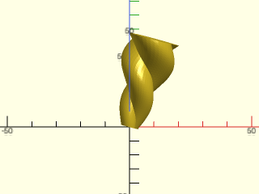

 

    include <BOSL2/std.scad>
    extrude_from_to([0,0,0], [10,20,30], convexity=4, twist=360, scale=3.0, slices=40) {
        xcopies(3) circle(3, $fn=32);
    }

---

### Module: path\_extrude2d()

**Synopsis:** Extrudes 2D children along a 2D path. [<abbr>Geom</abbr>]

**Topics:** [Miscellaneous](Topics#miscellaneous), [Extrusion](Topics#extrusion)

**See Also:** [path\_sweep()](skin.scad#functionmodule-path_sweep), [path\_extrude()](#module-path_extrude)

**Usage:** 

- path_extrude2d(path, [caps=], [closed=], [s=], [convexity=]) 2D-CHILDREN;

**Description:** 

Extrudes 2D children along the given 2D path, with optional rounded endcaps.
It works by constructing straight sections corresponding to each segment of the path and inserting rounded joints at each corner.
If the children are symmetric across the Y axis line then you can set caps=true to produce rounded caps on the ends of the profile.
If you set caps to true for asymmetric children then incorrect caps will be generated.

**Arguments:** 

<abbr title="These args can be used by position or by name.">By&nbsp;Position</abbr> | What it does
-------------------- | ------------
`path`               | The 2D path to extrude the geometry along.

<abbr title="These args must be used by name, ie: name=value">By&nbsp;Name</abbr> | What it does
-------------------- | ------------
`caps`               | If true, caps each end of the path with a rounded copy of the children.  Children must by symmetric across the Y axis, or results are wrong.  Default: false
`closed`             | If true, connect the starting point of the path to the ending point.  Default: false
`convexity`          | The max number of times a line could pass though a wall.  Default: 10
`s`                  | Mask size to use.  Use a number larger than twice your object's largest axis.  If you make this too large, it messes with centering your view. If it is too small you will see cracks in your extrusion.  Default: The length of the diagonal of the path's bounding box.

**Example 1:** 

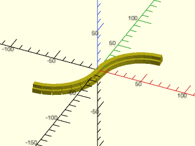

    include <BOSL2/std.scad>
    path = [
        each right(50, p=arc(d=100,angle=[90,180])),
        each left(50, p=arc(d=100,angle=[0,-90])),
    ];
    path_extrude2d(path,caps=false) {
        fwd(2.5) square([5,6],center=true);
        fwd(6) square([10,5],center=true);
    }

  

**Example 2:** 

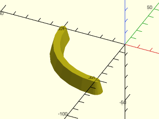

    include <BOSL2/std.scad>
    path_extrude2d(arc(d=100,angle=[180,270]),caps=true)
        trapezoid(w1=10, w2=5, h=10, anchor=BACK);

  

**Example 3:** 

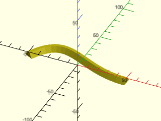

    include <BOSL2/std.scad>
    path = bezpath_curve([
        [-50,0], [-25,50], [0,0], [50,0]
    ]);
    path_extrude2d(path, caps=false)
        trapezoid(w1=10, w2=3, h=5, anchor=BACK);

  

**Example 4:** Un-Closed Path

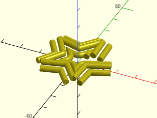

    include <BOSL2/std.scad>
    $fn=16;
    spath = star(id=15,od=35,n=5);
    path_extrude2d(spath, caps=false, closed=false)
        move_copies([[-3.5,1.5],[0.0,3.0],[3.5,1.5]])
            circle(r=1.5);

  

**Example 5:** Complex Endcaps

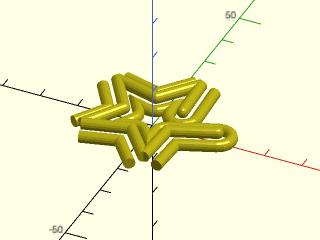

    include <BOSL2/std.scad>
    $fn=16;
    spath = star(id=15,od=35,n=5);
    path_extrude2d(spath, caps=true, closed=false)
        move_copies([[-3.5,1.5],[0.0,3.0],[3.5,1.5]])
            circle(r=1.5);

  

---

### Module: path\_extrude()

**Synopsis:** Extrudes 2D children along a 3D path. [<abbr>Geom</abbr>]

**Topics:** [Paths](Topics#paths), [Extrusion](Topics#extrusion), [Miscellaneous](Topics#miscellaneous)

**See Also:** [path\_sweep()](skin.scad#functionmodule-path_sweep), [path\_extrude2d()](#module-path_extrude2d)

**Usage:** 

- path_extrude(path, [convexity], [clipsize]) 2D-CHILDREN;

**Description:** 

Extrudes 2D children along a 3D path.  This may be slow and can have problems with twisting.

**Arguments:** 

<abbr title="These args can be used by position or by name.">By&nbsp;Position</abbr> | What it does
-------------------- | ------------
`path`               | Array of points for the bezier path to extrude along.
`convexity`          | Maximum number of walls a ray can pass through.
`clipsize`           | Increase if artifacts are left.  Default: 100

**Example 1:** 

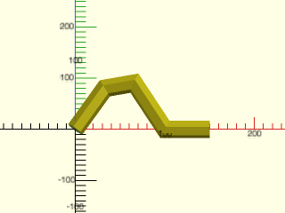

 

    include <BOSL2/std.scad>
    path = [ [0, 0, 0], [33, 33, 33], [66, 33, 40], [100, 0, 0], [150,0,0] ];
    path_extrude(path) circle(r=10, $fn=6);

---

### Module: cylindrical\_extrude()

**Synopsis:** Extrudes 2D children outwards around a cylinder. [<abbr>Geom</abbr>]

**Topics:** [Miscellaneous](Topics#miscellaneous), [Extrusion](Topics#extrusion), [Rotation](Topics#rotation)

**See Also:** [cyl()](shapes3d.scad#functionmodule-cyl), [plot\_revolution()](shapes3d.scad#functionmodule-plot_revolution)

**Usage:** 

- cylindrical_extrude(ir|id=, or|od=, [size=], [convexity=], [spin=], [orient=]) 2D-CHILDREN;

**Description:** 

Chops the 2D children into rectangles and extrudes each rectangle as a facet around an
approximate cylindrical shape.  Uses $fn/$fa/$fs to control the number of facets.
By default the calculation assumes that the children occupy in the X direction one revolution of the
cylinder of specified radius/diameter and are not more than 1000 units tall (in the Y direction).
If the children are in fact much smaller in width then this assumption is inefficient.  If the children
are wider then they will be truncated at one revolution.  To address either of these problems you can set
the `size` parameter.  Note that the specified height isn't very important: it just needs to be larger than
the actual height of the children, which is why it defaults to 1000. If you set `size` to a scalar then
that only changes the X value and the Y value remains at the default of 1000.

When performing the wrap, the X=0 line of the children maps to the Y- axis and the facets are centered on the Y- axis.
This is not consistent with how cylinder() creates its facets.  If `$fn` is a multiple of 4 then the facets will line
up with a cylinder.  Otherwise you must rotate a cylinder by 90 deg in the case of `$fn` even or `90-360/$fn/2` if `$fn` is odd.

**Arguments:** 

<abbr title="These args can be used by position or by name.">By&nbsp;Position</abbr> | What it does
-------------------- | ------------
`ir`                 | The inner radius to extrude from.
`or`                 | The outer radius to extrude to.

<abbr title="These args must be used by name, ie: name=value">By&nbsp;Name</abbr> | What it does
-------------------- | ------------
`od`                 | The outer diameter to extrude to.
`id`                 | The inner diameter to extrude from.
`size`               | If a scalar, the width of the 2D children.  If a vector, the [X,Y] size of the 2D children.  Default: [`2*PI*or`,1000]
`convexity`          | The max number of times a line could pass though a wall.  Default: 10
`spin`               | Amount in degrees to spin around cylindrical axis.  Default: 0
`orient`             | The orientation of the cylinder to wrap around, given as a vector.  Default: UP

**Example 1:** Basic example with defaults.  This will run faster with large facet counts if you set `size=100`

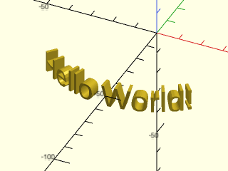

 

    include <BOSL2/std.scad>
    cylindrical_extrude(or=50, ir=45)
        text(text="Hello World!", size=10, halign="center", valign="center");

**Example 2:** Spin Around the Cylindrical Axis

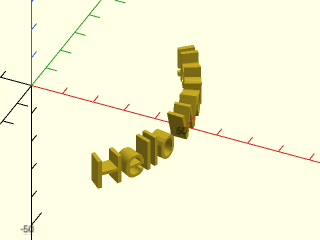

 

    include <BOSL2/std.scad>
    cylindrical_extrude(or=50, ir=45, spin=90)
        text(text="Hello World!", size=10, halign="center", valign="center");

**Example 3:** Orient to the Y Axis.

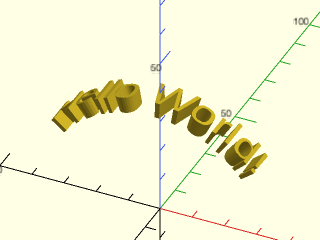

 

    include <BOSL2/std.scad>
    cylindrical_extrude(or=40, ir=35, orient=BACK)
        text(text="Hello World!", size=10, halign="center", valign="center");

**Example 4:** You must give a size argument for this example where the child wraps fully around the cylinder

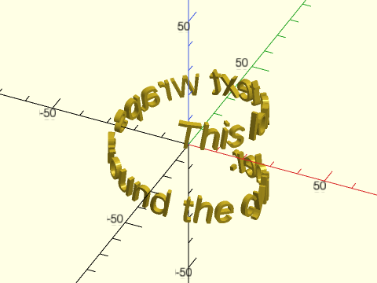

 

    include <BOSL2/std.scad>
    cylindrical_extrude(or=27, ir=25, size=300, spin=-85)
        zrot(-10)text(text="This long text wraps around the cylinder.", size=10, halign="center", valign="center");

---

## Section: Bounding Box

### Module: bounding\_box()

**Synopsis:** Creates the smallest bounding box that contains all the children. [<abbr>Geom</abbr>]

**Topics:** [Miscellaneous](Topics#miscellaneous), [Bounds](Topics#bounds), [Bounding Boxes](Topics#bounding-boxes)

**See Also:** [pointlist\_bounds()](vectors.scad#function-pointlist_bounds)

**Usage:** 

- bounding_box([excess],[planar]) CHILDREN;

**Description:** 

Returns the smallest axis-aligned square (or cube) shape that contains all the 2D (or 3D)
children given.  The module children() must 3d when planar=false and
2d when planar=true, or you will get a warning of mixing dimension
or scaling by 0.

**Arguments:** 

<abbr title="These args can be used by position or by name.">By&nbsp;Position</abbr> | What it does
-------------------- | ------------
`excess`             | The amount that the bounding box should be larger than needed to bound the children, in each axis.
`planar`             | If true, creates a 2D bounding rectangle.  Is false, creates a 3D bounding cube.  Default: false

**Example 1:** 

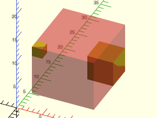

    include <BOSL2/std.scad>
    module shapes() {
        translate([10,8,4]) cube(5);
        translate([3,0,12]) cube(2);
    }
    #bounding_box() shapes();
    shapes();

  

**Example 2:** 

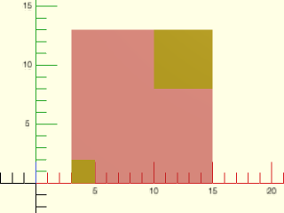

    include <BOSL2/std.scad>
    module shapes() {
        translate([10,8]) square(5);
        translate([3,0]) square(2);
    }
    #bounding_box(planar=true) shapes();
    shapes();

  

---

## Section: Hull Based Modules

### Module: chain\_hull()

**Synopsis:** Performs the union of hull operations between consecutive pairs of children. [<abbr>Geom</abbr>]

**Topics:** [Miscellaneous](Topics#miscellaneous)

**See Also:** [hull()](geometry.scad#function-hull)

**Usage:** 

- chain_hull() CHILDREN;

**Description:** 

Performs hull operations between consecutive pairs of children,
then unions all of the hull results.  This can be a very slow
operation, but it can provide results that are hard to get
otherwise.

**Side Effects:** 

- `$idx` is set to the index value of the first child of each hulling pair, and can be used to modify each child pair individually.
- `$primary` is set to true when the child is the first in a chain pair.

**Example 1:** 

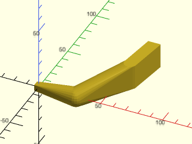

    include <BOSL2/std.scad>
    chain_hull() {
        cube(5, center=true);
        translate([30, 0, 0]) sphere(d=15);
        translate([60, 30, 0]) cylinder(d=10, h=20);
        translate([60, 60, 0]) cube([10,1,20], center=false);
    }

  

**Example 2:** Using `$idx` and `$primary`

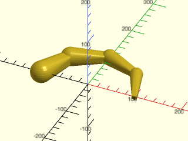

 

    include <BOSL2/std.scad>
    chain_hull() {
        zrot(  0) right(100) if ($primary) cube(5+3*$idx,center=true); else sphere(r=10+3*$idx);
        zrot( 45) right(100) if ($primary) cube(5+3*$idx,center=true); else sphere(r=10+3*$idx);
        zrot( 90) right(100) if ($primary) cube(5+3*$idx,center=true); else sphere(r=10+3*$idx);
        zrot(135) right(100) if ($primary) cube(5+3*$idx,center=true); else sphere(r=10+3*$idx);
        zrot(180) right(100) if ($primary) cube(5+3*$idx,center=true); else sphere(r=10+3*$idx);
    }

---

## Section: Minkowski and 3D Offset

### Module: minkowski\_difference()

**Synopsis:** Removes diff shapes from base shape surface. [<abbr>Geom</abbr>]

**Topics:** [Miscellaneous](Topics#miscellaneous)

**See Also:** [offset3d()](#module-offset3d), [round3d()](#module-round3d)

**Usage:** 

- minkowski_difference() { BASE; DIFF1; DIFF2; ... }

**Description:** 

Takes a 3D base shape and one or more 3D diff shapes, carves out the diff shapes from the
surface of the base shape, in a way complementary to how `minkowski()` unions shapes to the
surface of its base shape.

**Arguments:** 

<abbr title="These args can be used by position or by name.">By&nbsp;Position</abbr> | What it does
-------------------- | ------------
`planar`             | If true, performs minkowski difference in 2D.  Default: false (3D)

**Example 1:** 

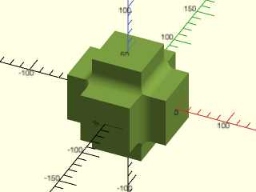

    include <BOSL2/std.scad>
    minkowski_difference() {
        union() {
            cube([120,70,70], center=true);
            cube([70,120,70], center=true);
            cube([70,70,120], center=true);
        }
        sphere(r=10);
    }

  

---

### Module: offset3d()

**Synopsis:** Expands or contracts the surface of a 3D object. [<abbr>Geom</abbr>]

**Topics:** [Miscellaneous](Topics#miscellaneous)

**See Also:** [minkowski\_difference()](#module-minkowski_difference), [round3d()](#module-round3d)

**Usage:** 

- offset3d(r, [size], [convexity]) CHILDREN;

**Description:** 

Expands or contracts the surface of a 3D object by a given amount.  The children must
fit in a centered cube of the specified size.  This is very, very slow.
No really, this is unbearably slow.  It uses `minkowski()`.  Use this as a last resort.
This is so slow that no example images will be rendered.

**Arguments:** 

<abbr title="These args can be used by position or by name.">By&nbsp;Position</abbr> | What it does
-------------------- | ------------
`r`                  | Radius to expand object by.  Negative numbers contract the object.
`size`               | Scalar size of a centered cube containing the children.  Default: 1000
`convexity`          | Max number of times a line could intersect the walls of the object.  Default: 10

---

### Module: round3d()

**Synopsis:** Rounds arbitrary 3d objects. [<abbr>Geom</abbr>]

**Topics:** [Rounding](Topics#rounding), [Miscellaneous](Topics#miscellaneous)

**See Also:** [offset3d()](#module-offset3d), [minkowski\_difference()](#module-minkowski_difference)

**Usage:** 

- round3d(r) CHILDREN;
- round3d(or) CHILDREN;
- round3d(ir) CHILDREN;
- round3d(or, ir) CHILDREN;

**Description:** 

Rounds arbitrary 3D objects.  Giving `r` rounds all concave and convex corners.  Giving just `ir`
rounds just concave corners.  Giving just `or` rounds convex corners.  Giving both `ir` and `or`
can let you round to different radii for concave and convex corners.  The 3D object must not have
any parts narrower than twice the `or` radius.  Such parts will disappear.   The children must fit
inside a cube of the specified size.  This is an *extremely*
slow operation.  I cannot emphasize enough just how slow it is.  It uses `minkowski()` multiple times.
Use this as a last resort.  This is so slow that no example images will be rendered.

**Arguments:** 

<abbr title="These args can be used by position or by name.">By&nbsp;Position</abbr> | What it does
-------------------- | ------------
`r`                  | Radius to round all concave and convex corners to.
`or`                 | Radius to round only outside (convex) corners to.  Use instead of `r`.
`ir`                 | Radius to round only inside (concave) corners to.  Use instead of `r`.
`size`               | size of centered cube that contains the children.  Default: 1000

---

