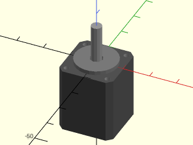
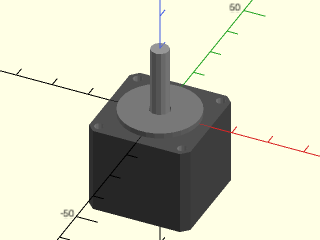
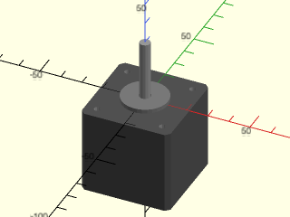
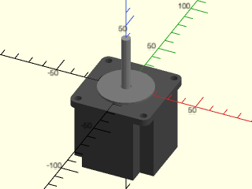
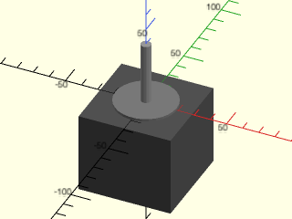
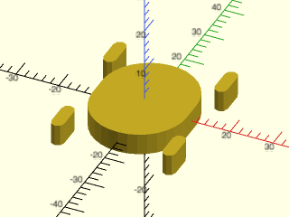
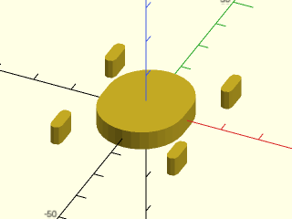
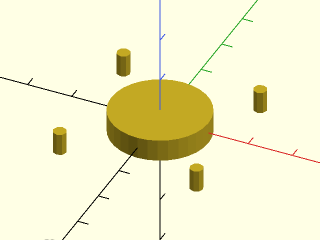

# LibFile: nema\_steppers.scad

Mounting holes for NEMA motors, and simple motor models.

To use, add the following lines to the beginning of your file:

    include <BOSL2/std.scad>
    include <BOSL2/nema_steppers.scad>

## File Contents

1. [Section: Motor Models](#section-motor-models)
    - [`nema_stepper_motor()`](#module-nema_stepper_motor) – Creates a NEMA standard stepper motor model. [<abbr>Geom</abbr>]

2. [Section: Masking Modules](#section-masking-modules)
    - [`nema_mount_mask()`](#module-nema_mount_mask) – Creates a standard NEMA mount holes mask. [<abbr>Geom</abbr>]

3. [Section: Functions](#section-functions)
    - [`nema_motor_info()`](#function-nema_motor_info) – Returns dimension info for a given NEMA motor size.

## Section: Motor Models

### Module: nema\_stepper\_motor()

**Synopsis:** Creates a NEMA standard stepper motor model. [<abbr>Geom</abbr>]

**Topics:** [Parts](Topics#parts), [Motors](Topics#motors)

**See Also:** [nema\_mount\_mask()](#module-nema_mount_mask)

**Usage:** 

- nema_stepper_motor(size, h, shaft_len, [$slop=], ...) [ATTACHMENTS];

**Description:** 

Creates a model of a NEMA standard stepper motor.

**Arguments:** 

<abbr title="These args can be used by position or by name.">By&nbsp;Position</abbr> | What it does
-------------------- | ------------
`size`               | The NEMA standard size of the stepper motor.  Default: 17
`h`                  | Length of motor body.  Default: 24mm
`shaft_len`          | Length of shaft protruding out the top of the stepper motor.  Default: 20mm

<abbr title="These args must be used by name, ie: name=value">By&nbsp;Name</abbr> | What it does
-------------------- | ------------
`details`            | If false, creates a very rough motor shape, suitable for using as a mask.  Default: true
`atype`              | The attachment set type to use when anchoring.  Default: `"body"`
`$slop`              | With details=false, add twice this amount to body width and plinth/shaft diameters, and this amount to body, plinth, and shaft lengths.
`anchor`             | Translate so anchor point is at origin (0,0,0).  See [anchor](attachments.scad#subsection-anchor).  Default: `TOP`
`spin`               | Rotate this many degrees around the Z axis after anchor.  See [spin](attachments.scad#subsection-spin).  Default: `0`
`orient`             | Vector to rotate top towards, after spin.  See [orient](attachments.scad#subsection-orient).  Default: `UP`

**Anchor Types:** 

Anchor Type | What it is
----------- | ----------
"shaft" | Anchor relative to the shaft.
"plinth" | Anchor relative to the plinth.
"body" | Anchor relative to the motor body.
"screws" | Anchor relative to the screw hole centers.  ie: TOP+RIGHT+FRONT is the center-top of the front-right screwhole.

**Example 1:** 

    include <BOSL2/std.scad>
    include <BOSL2/nema_steppers.scad>
    nema_stepper_motor(size=8, h=24, shaft_len=15);

  

**Example 2:** 

    include <BOSL2/std.scad>
    include <BOSL2/nema_steppers.scad>
    nema_stepper_motor(size=11, h=24, shaft_len=20);

  

**Example 3:** 

    include <BOSL2/std.scad>
    include <BOSL2/nema_steppers.scad>
    nema_stepper_motor(size=17, h=40, shaft_len=30);

  

**Example 4:** 

    include <BOSL2/std.scad>
    include <BOSL2/nema_steppers.scad>
    nema_stepper_motor(size=23, h=50, shaft_len=40);

  

**Example 5:** 

 

    include <BOSL2/std.scad>
    include <BOSL2/nema_steppers.scad>
    nema_stepper_motor(size=23, h=50, shaft_len=40, details=false);

---

## Section: Masking Modules

### Module: nema\_mount\_mask()

**Synopsis:** Creates a standard NEMA mount holes mask. [<abbr>Geom</abbr>]

**Topics:** [Parts](Topics#parts), [Motors](Topics#motors)

**See Also:** [nema\_stepper\_motor()](#module-nema_stepper_motor)

**Usage:** 

- nema_mount_mask(size, depth, l, [$slop], ...);

**Description:** 

Creates a mask to use when making standard NEMA stepper motor mounts.

**Arguments:** 

<abbr title="These args can be used by position or by name.">By&nbsp;Position</abbr> | What it does
-------------------- | ------------
`size`               | The standard NEMA motor size to make a mount for.
`depth`              | The thickness of the mounting hole mask.  Default: 5
`l`                  | The length of the slots, for making an adjustable motor mount.  Default: 5

<abbr title="These args must be used by name, ie: name=value">By&nbsp;Name</abbr> | What it does
-------------------- | ------------
`atype`              | Attachment set to use, "full" or "screws".  Default: "full"
`anchor`             | Translate so anchor point is at origin (0,0,0).  See [anchor](attachments.scad#subsection-anchor).  Default: `CENTER`
`spin`               | Rotate this many degrees around the Z axis after anchor.  See [spin](attachments.scad#subsection-spin).  Default: `0`
`orient`             | Vector to rotate top towards, after spin.  See [orient](attachments.scad#subsection-orient).  Default: `UP`
`$slop`              | Add this amount to the plinth and screw-hole diameters, giving half this amount of radial clearance.

**Anchor Types:** 

Anchor Type | What it is
----------- | ----------
"full" | Anchor relative the full mask.
"screws" | Anchor relative to the screw hole centers.  ie: TOP+RIGHT+FRONT is the center-top of the front-right screwhole.

**Example 1:** 

    include <BOSL2/std.scad>
    include <BOSL2/nema_steppers.scad>
    nema_mount_mask(size=14, depth=5, l=5);

  

**Example 2:** 

    include <BOSL2/std.scad>
    include <BOSL2/nema_steppers.scad>
    nema_mount_mask(size=17, depth=5, l=5);

  

**Example 3:** 

    include <BOSL2/std.scad>
    include <BOSL2/nema_steppers.scad>
    nema_mount_mask(size=17, depth=5, l=0);

  

---

## Section: Functions

### Function: nema\_motor\_info()

**Synopsis:** Returns dimension info for a given NEMA motor size.

**Topics:** [Parts](Topics#parts), [Motors](Topics#motors)

**See Also:** [nema\_stepper\_motor()](#module-nema_stepper_motor), [nema\_mount\_mask()](#module-nema_mount_mask)

**Usage:** 

- info = nema_motor_info(size);

**Description:** 

Gets various dimension info for a NEMA stepper motor of a specific size.
Returns a list of scalar values, containing, in order:
- MOTOR_WIDTH: The full width and length of the motor.
- PLINTH_HEIGHT: The height of the circular plinth on the face of the motor.
- PLINTH_DIAM: The diameter of the circular plinth on the face of the motor.
- SCREW_SPACING: The spacing between screwhole centers in both X and Y axes.
- SCREW_SIZE: The diameter of the screws.
- SCREW_DEPTH: The depth of the screwholes.
- SHAFT_DIAM: The diameter of the motor shaft.

**Arguments:** 

<abbr title="These args can be used by position or by name.">By&nbsp;Position</abbr> | What it does
-------------------- | ------------
`size`               | The standard NEMA motor size.

---

