# LibFile: nurbs.scad

B-Splines and Non-uniform Rational B-Splines (NURBS) are a way to represent smooth curves and smoothly curving
surfaces with a set of control points.  The curve or surface is defined by
the control points and a set of "knot" points.  The NURBS can be "clamped" in which case the curve passes through
the first and last point, or they can be "closed" in which case the first and last point are coincident.  Also possible
are "open" curves which do not necessarily pass through any of their control points.  Unlike Bezier curves, a NURBS
can have an unlimited number of control points and changes to the control points only affect the curve locally.

To use, add the following lines to the beginning of your file:

    include <BOSL2/std.scad>
    include <BOSL2/nurbs.scad>

## File Contents

1. [Section: NURBS Curves](#section-nurbs-curves)
    - [`nurbs_curve_breaks()`](#function-nurbs_curve_breaks) – Returns the parameter-space breakpoints of a NURBS curve.
    - [`nurbs_curve()`](#function-nurbs_curve) – Computes one or more points (or derivatives) on a NURBS curve. [<abbr>Path</abbr>]
    - [`debug_nurbs()`](#module-debug_nurbs) – Shows a NURBS curve and its control points, knots and weights [<abbr>Geom</abbr>]
    - [`nurbs_interp()`](#function-nurbs_interp) – Finds a NURBS curve passing through a point list with optional derivative constraints.
    - [`debug_nurbs_interp()`](#module-debug_nurbs_interp) – Interpolates a NURBS using [`nurbs_interp()`](#function-nurbs\_interp) and displays the curve with informative overlays.
    - [`nurbs_elevate_degree()`](#function-nurbs_elevate_degree) – Raises the degree of a clamped or open NURBS.
    - [`nurbs_length()`](#function-nurbs_length) – Approximates the arc length of a NURBS curve.
    - [`nurbs_cut()`](#function-nurbs_cut) – Finds the parameter value at a given arc length along a NURBS curve.

2. [Section: NURBS Surfaces](#section-nurbs-surfaces)
    - [`is_nurbs_patch()`](#function-is_nurbs_patch) – Returns true if the given item looks like a NURBS patch.
    - [`nurbs_patch_points()`](#function-nurbs_patch_points) – Computes specified point(s) on a NURBS surface patch
    - [`nurbs_normals()`](#function-nurbs_normals) – Computes unit normal(s) of a NURBS surface patch, tracking per-sector normals at creases.
    - [`nurbs_vnf()`](#functionmodule-nurbs_vnf) – Generates a (possibly non-manifold) VNF for a single NURBS surface patch. [<abbr>VNF</abbr>]
    - [`nurbs_sheet()`](#function-nurbs_sheet) – Creates a thin sheet from a NURBS patch by offsetting along the patch normals. [<abbr>VNF</abbr>]
    - [`nurbs_interp_surface()`](#functionmodule-nurbs_interp_surface) – Returns a NURBS surface that passes through a grid of 3D data points. [<abbr>Geom</abbr>]

## Section: NURBS Curves

### Function: nurbs\_curve\_breaks()

**Synopsis:** Returns the parameter-space breakpoints of a NURBS curve.

**Topics:** [NURBS Curves](Topics#nurbs-curves)

**See Also:** [nurbs\_curve()](#function-nurbs_curve), [nurbs\_length()](#function-nurbs_length)

**Usage:** 

- breaks = nurbs_curve_breaks(control, degree, [mult=], [type=], [knots=]);
- breaks = nurbs_curve_breaks(nurbs_param_list);

**Description:** 

Returns the breakpoints of the curve in the public `u` parameter space `[0,1]`.
These are the parameter values where knot spans meet.  For `type="closed"` both
`0` and `1` are returned; they represent the same geometric point at the seam.

**Arguments:** 

<abbr title="These args can be used by position or by name.">By&nbsp;Position</abbr> | What it does
-------------------- | ------------
`control`            | list of control points in any dimension or a NURBS parameter list
`degree`             | degree of NURBS

<abbr title="These args must be used by name, ie: name=value">By&nbsp;Name</abbr> | What it does
-------------------- | ------------
`mult`               | list of multiplicities of the knots.  Default: all 1
`type`               | One of "clamped", "closed" or "open" to define end point handling of the spline.  Default: "clamped"
`knots`              | List of knot values.  Default: uniform

**Example 1:** Show the breakpoints of a curve in parameter space

    include <BOSL2/std.scad>
    include <BOSL2/nurbs.scad>
    pts = [[13,43],[30,52],[49,22],[24,3]];
    echo(nurbs_curve_breaks(pts, 2));

  

---

### Function: nurbs\_curve()

**Synopsis:** Computes one or more points (or derivatives) on a NURBS curve. [<abbr>Path</abbr>]

**Topics:** [NURBS Curves](Topics#nurbs-curves)

**See Also:** [debug\_nurbs()](#module-debug_nurbs)

**Usage:** 

- pts = nurbs_curve(control, degree, splinesteps, [mult=], [weights=], [type=], [knots=], [close_loop=]);
- pts = nurbs_curve(control, degree, u=, [mult=], [weights=], [type=], [knots=], [close_loop=]);
- dpts = nurbs_curve(control, degree, splinesteps, deriv=d, [two_sided=], [close_loop=], ...);
- dpts = nurbs_curve(control, degree, u=, deriv=d, [two_sided=], [close_loop=], ...);
- list = nurbs_curve(control, degree, splinesteps, deriv=[d1,d2,...], [two_sided=], [close_loop=], ...);
- list = nurbs_curve(control, degree, u=, deriv=[d1,d2,...], [two_sided=], [close_loop=], ...);

**Description:** 

Compute the points specified by a NURBS curve.  You specify the NURBS by supplying the control points, knots and weights.
Only the control points are required.  The knots and weights default to uniform, in which case you get a uniform B-spline.
The length of `weights`, if given, must match the length of `control`.
You can specify endpoint behavior using the `type` parameter.  The default, "clamped", gives a curve which starts and
ends at the first and last control points and moves in the tangent direction to the first and last control point segments.
A "closed" curve is a one that starts where it ends.  An "open" spline is a generic curve that starts somewhere
in the middle of the control points. The "open" curve is less common; you only need this if you are managing the
knots and control points yourself to create your own clamped or closed curve, so avoid this type unless you know what you're doing.
Each of these types of curve require a different number of knots as described below.

The control points are the most important control over the shape
of the curve.  You must have at least degree+1 control points for clamped and open NURBS.  Don't confuse the degree of a
NURBS with its *order*:  the order of a NURBS, often called $p$, is degree+1.  Unlike a bezier, there is no maximum
number of control points.  A single NURBS is more like a bezier **path** than like a single bezier spline.

A NURBS or B-spline is a curve made from a moving average of several Bezier curves.  The knots specify when one Bezier fades
away to be replaced by the next one.  The knot list is a non-decreasing list of values that you specify using two parameters,
`knots` and `mult`.  In practice changing the knot values doesn't have a strong effect on the curve, so it usually suffices
to use a uniform knot vector, which is the default.  The major exception to this is repeated knot values.
At generic points in the NURBS, the curve is infinitely differentiable, but at a point that
corresponds to a knot, a NURBS with degree $d$ will have a $(d-1)\mathrm{th}$ derivative that is continuous.
However, if a value repeats in the knot vector that creates a knot with a multiplicity larger than 1, and each
repetition decreases the smoothness of the curve at the corresponding NURBS point by 1.  This means that
if the multiplicity equals the degree then the curve is not differentiable: it has a corner at the knot point.  Using the `mult` parameter
without giving `knots` allows you to give a vector of multiplicities, which produces a knot vector that is uniform
except it has some repeated knots.  A value of 1 in the `mult` vector means the knot is not repeated; a value of 2 means it is
repeated twice.  The multiplicity can be as large as the degree but no larger.  (A special exception is at the ends for open
NURBS, where multiplicity degree+1 is permitted.)  When you specify the multiplicity vector the total number of knots is the sum of that vector.  You can also list
the knots explicitly yourself.  The knots exist in the parameter space of the NURBS, but the knot values you give can cover any range;
they will be scaled to correspond properly to the NURBS parameter space: regardless of the knot values you give, the domain of evaluation
for u is always the interval [0,1], and it will be scaled to give the entire valid portion of the curve you have chosen.

For an open spline the number of knots must be `len(control)+degree+1`.  For a clamped spline the number of knots is `len(control)-degree+1`,
and for a closed spline you need `len(control)+1` knots.  If you are using the default uniform knots then the way to
ensure that you have the right number is to check that mult is not set or `sum(mult)` equals the correct value.

You can use this function to evaluate the NURBS at `u`, which can be a single point or a list of points.  You can also
use it to evaluate the NURBS over its entire domain by giving a splinesteps value.  This specifies the number of segments
to use between each knot and guarantees a point exactly at each knot.  This may be important if you set the knot multiplicity
to the degree somewhere in your curve, which creates a corner at the knot, because it guarantees a sharp corner regardless
of the number of points.  If you don't give `u` or `splinesteps` then `splinesteps=16` is used as the default evaluation.

Instead of providing separate parameters you can give a first parameter of the form of a NURBS parameter list: `[type, degree, control, knots, mult, weights]`.

**Derivatives:** The `deriv` parameter requests curve derivatives in addition to, or instead of, curve points.
- `deriv=0` (default) — returns the curve points, same as without the parameter.  The output is a flat list of points, backward-compatible with code that does not use `deriv`.
- `deriv=d` (positive integer) — returns a flat list of d-th derivative entries at each evaluation point, one entry per point.
- `deriv=[d1,d2,...]` (list of integers) — returns a list of lists.  Each element of the outer list corresponds to one entry of the `deriv` list, and contains the derivative entries of that order at every evaluation point.  The output order matches the order of the `deriv` list, so `deriv=[0,1,2]` gives `[curve_pts, first_derivs, second_derivs]`.

The derivative order must be non-negative and cannot exceed the curve degree.  When `u` is a single scalar and `deriv` is a list, the return value is a list of single entries (one per requested order) rather than a list of lists.

A NURBS curve need not be differentiable everywhere: at a knot of multiplicity m, derivatives
of order larger than degree−m generally do not exist because the left and right limits differ.
At a corner (m equal to the degree) already the first derivative jumps.  Because `splinesteps`
sampling places an evaluation point exactly at every knot, such points are hit routinely; in
particular `deriv=degree` does not exist at any interior knot unless the curve happens to be
smoother there than the multiplicity guarantees.  The `two_sided` parameter selects what is
returned at these points:
- `two_sided=false` (default) — every derivative entry is a single vector.  Where the requested
  derivative does not exist, the entry is `NAN`.  You can detect these entries with `is_nan()`.
  Note that NAN propagates silently through further arithmetic, so check for it before using
  derivative values from a curve that may have corners.
- `two_sided=true` — every derivative entry is a list: a singleton `[d]` containing the
  derivative vector at differentiable points, and a pair `[dleft, dright]` giving the one-sided
  left and right derivatives at non-differentiable points.  Test `len(entry)==2` to detect the
  non-differentiable points.

Whether a derivative exists is decided by comparing the two one-sided values, not from the knot
multiplicity alone, so a curve that is accidentally smoother than its knot multiplicity
guarantees is treated as differentiable.  At the domain endpoints of clamped and open curves
only one side of the curve exists, and the one-sided derivative is returned as the derivative
there (never NAN).  Closed curves are periodic, so both sides exist everywhere, including at
the seam.  A clamped or open curve whose first and last control points coincide is also treated
as periodic at its domain boundary — this is the case for a clamped curve built by gluing
segments end to end (as in the circle example below), and for the curve
[`nurbs_interp()`](#function-nurbs_interp)(`closed=true`, `corners=`) returns, whose corners force a "clamped" type
NURBS that nonetheless starts and ends at the same corner point.  The `two_sided` parameter
affects only derivative orders 1 and higher: order-0 entries (curve points) are always plain
points.

For unweighted B-splines the derivatives are computed exactly using the difference-control-point method (Piegl & Tiller, "The NURBS Book", Algorithm A3.3).  For rational NURBS (when `weights` is given) the geometric derivatives are obtained from the homogeneous B-spline derivatives via the quotient-rule formula (Piegl & Tiller, Eq. 4.8 / Algorithm A4.2).

**Closed curves and point repetition:** For `type="closed"` with `splinesteps`, the default behavior (`close_loop=false`) omits the final curve point because the curve is periodic: u=0 and u=1 map to the same point. This is consistent with BOSL2's general convention of not repeating closing points. Set `close_loop=true` to include the final point explicitly, making the output path suitable for direct use with `polygon()`. This parameter only affects the output when using `splinesteps`; it has no effect when specifying explicit `u` values. For derivatives with `two_sided=true`, the seam point uses wraparound logic to obtain two-sided derivatives, so no information is lost even though the final point is not repeated in the default output.

**Arguments:** 

<abbr title="These args can be used by position or by name.">By&nbsp;Position</abbr> | What it does
-------------------- | ------------
`control`            | list of control points in any dimension or a NURBS parameter list
`degree`             | degree of NURBS
`splinesteps`        | evaluate whole spline with this number of segments between each pair of knots.  Default: 16 if `u` is not given

<abbr title="These args must be used by name, ie: name=value">By&nbsp;Name</abbr> | What it does
-------------------- | ------------
`u`                  | list of values or range in the interval [0,1] where the NURBS should be evaluated
`mult`               | list of multiplicities of the knots.  Default: all 1
`weights`            | vector whose length is the same as control giving weights at each control point.  Default: all 1
`type`               | One of "clamped", "closed" or "open" to define end point handling of the spline.  Default: "clamped"
`knots`              | List of knot values.  Default: uniform
`deriv`              | Integer or list of integers selecting which derivative orders to return.  0 = curve points.  Default: 0
`two_sided`          | If true, return each derivative entry as a singleton `[d]` at differentiable points and as a pair `[dleft,dright]` of one-sided derivatives at non-differentiable points.  If false, return plain derivative vectors, with NAN where the derivative does not exist.  Default: false
`close_loop`         | For `type="closed"`, if true include the final curve point (which coincides with the first point, making the output path explicitly closed).  If false, omit the final point.  Default: false

**Example 1:** Compute some points and draw a curve and also some specific points:

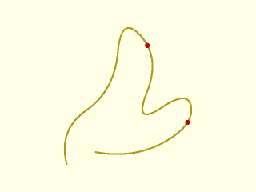

 

    include <BOSL2/std.scad>
    include <BOSL2/nurbs.scad>
    control = [[5,0],[0,20],[33,43],[37,88],[60,62],[44,22],[77,44],[79,22],[44,3],[22,7]];
    curve = nurbs_curve(control,2,splinesteps=16);
    pts = nurbs_curve(control,2,u=[0.4,0.8]);
    stroke(curve);
    color("red")move_copies(pts) circle(r=1.5,$fn=16);

**Example 2:** Compute NURBS points and make a polygon

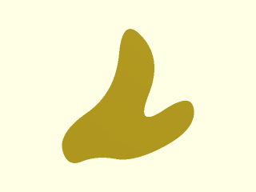

 

    include <BOSL2/std.scad>
    include <BOSL2/nurbs.scad>
    control = [[5,0],[0,20],[33,43],[37,88],[60,62],[44,22],[77,44],[79,22],[44,3],[22,7]];
    curve = nurbs_curve(control,2,splinesteps=16,type="closed");
    polygon(curve);

**Example 3:** Simple quadratic uniform clamped b-spline with some points computed using splinesteps.

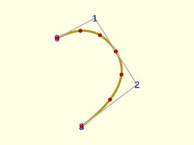

    include <BOSL2/std.scad>
    include <BOSL2/nurbs.scad>
    pts = [[13,43],[30,52],[49,22],[24,3]];
    debug_nurbs(pts,2);
    npts = nurbs_curve(pts, 2, splinesteps=3);
    color("red")move_copies(npts) circle(r=1);

  

**Example 4:** Simple quadratic uniform clamped b-spline with some points computed using the u parameter. Note that a uniform u parameter doesn't necessarily sample the curve uniformly.

    include <BOSL2/std.scad>
    include <BOSL2/nurbs.scad>
    pts = [[13,43],[30,52],[49,22],[24,3]];
    debug_nurbs(pts,2);
    npts = nurbs_curve(pts, 2, u=[0:.2:1]);
    color("red")move_copies(npts) circle(r=1);

  

**Example 5:** Same control points, but cubic

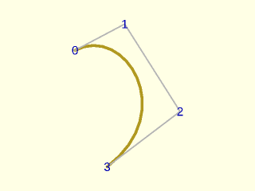

    include <BOSL2/std.scad>
    include <BOSL2/nurbs.scad>
    pts = [[13,43],[30,52],[49,22],[24,3]];
    debug_nurbs(pts,3);

  

**Example 6:** Same control points, quadratic and closed

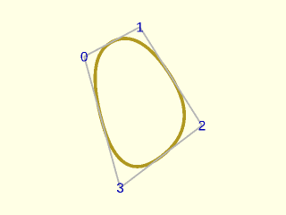

    include <BOSL2/std.scad>
    include <BOSL2/nurbs.scad>
    pts = [[13,43],[30,52],[49,22],[24,3]];
    debug_nurbs(pts,2,type="closed");

  

**Example 7:** Same control points, cubic and closed

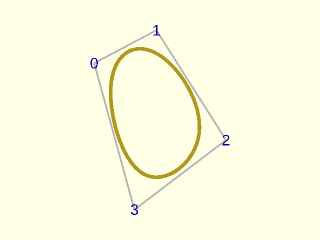

    include <BOSL2/std.scad>
    include <BOSL2/nurbs.scad>
    pts = [[13,43],[30,52],[49,22],[24,3]];
    debug_nurbs(pts,3,type="closed");

  

**Example 8:** Ten control points, quadratic, clamped

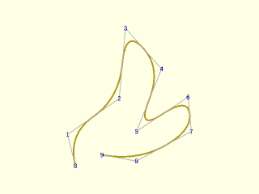

 

    include <BOSL2/std.scad>
    include <BOSL2/nurbs.scad>
    pts = [[5,0],[0,20],[33,43],[37,88],[60,62],[44,22],[77,44],[79,22],[44,3],[22,7]];
    debug_nurbs(pts,2);

**Example 9:** Same thing, degree 4

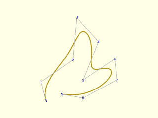

 

    include <BOSL2/std.scad>
    include <BOSL2/nurbs.scad>
    pts = [[5,0],[0,20],[33,43],[37,88],[60,62],[44,22],[77,44],[79,22],[44,3],[22,7]];
    debug_nurbs(pts,4);

**Example 10:** Same control points, degree 2, open.  Note it doesn't reach the ends

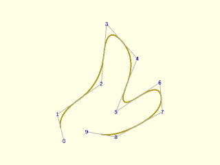

 

    include <BOSL2/std.scad>
    include <BOSL2/nurbs.scad>
    pts = [[5,0],[0,20],[33,43],[37,88],[60,62],[44,22],[77,44],[79,22],[44,3],[22,7]];
    debug_nurbs(pts,2, type="open");

**Example 11:** Same control points, degree 4, open.  Note it starts farther from the ends

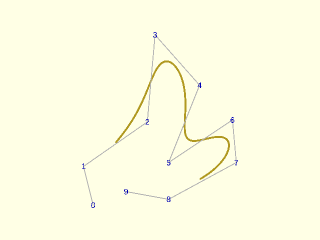

 

    include <BOSL2/std.scad>
    include <BOSL2/nurbs.scad>
    pts = [[5,0],[0,20],[33,43],[37,88],[60,62],[44,22],[77,44],[79,22],[44,3],[22,7]];
    debug_nurbs(pts,4,type="open");

**Example 12:** Same control points, degree 2, closed

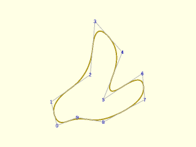

 

    include <BOSL2/std.scad>
    include <BOSL2/nurbs.scad>
    pts = [[5,0],[0,20],[33,43],[37,88],[60,62],[44,22],[77,44],[79,22],[44,3],[22,7]];
    debug_nurbs(pts,2,type="closed");

**Example 13:** Same control points, degree 4, closed

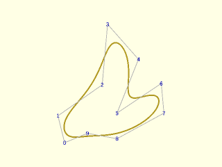

 

    include <BOSL2/std.scad>
    include <BOSL2/nurbs.scad>
    pts = [[5,0],[0,20],[33,43],[37,88],[60,62],[44,22],[77,44],[79,22],[44,3],[22,7]];
    debug_nurbs(pts,4,type="closed");

**Example 14:** Adding weights

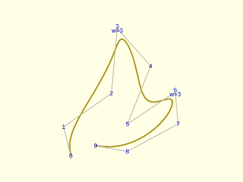

 

    include <BOSL2/std.scad>
    include <BOSL2/nurbs.scad>
    pts = [[5,0],[0,20],[33,43],[37,88],[60,62],[44,22],[77,44],[79,22],[44,3],[22,7]];
    weights = [1,1,1,3,1,1,3,1,1,1];
    debug_nurbs(pts,4,type="clamped",weights=weights);

**Example 15:** Using knot multiplicity with quadratic clamped case.  Knot count is len(control)-degree+1 = 9.  The multiplicity 2 knot creates a corner for a quadratic.

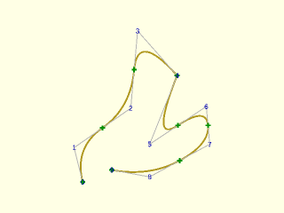

 

    include <BOSL2/std.scad>
    include <BOSL2/nurbs.scad>
    pts = [[5,0],[0,20],[33,43],[37,88],[60,62],[44,22],[77,44],[79,22],[44,3],[22,7]];
    mult = [1,1,1,2,1,1,1,1];
    debug_nurbs(pts,2,mult=mult,show_knots=true);

**Example 16:** Using knot multiplicity with quadratic clamped case.  Two knots of multiplicity 2 gives two corners

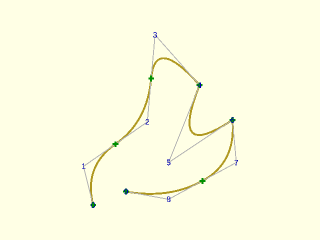

 

    include <BOSL2/std.scad>
    include <BOSL2/nurbs.scad>
    pts = [[5,0],[0,20],[33,43],[37,88],[60,62],[44,22],[77,44],[79,22],[44,3],[22,7]];
    mult = [1,1,1,2,2,1,1];
    debug_nurbs(pts,2,mult=mult,show_knots=true);

**Example 17:** Using knot multiplicity with cubic clamped case.  Knot count is now 8.  We need multiplicity equal to degree (3) to create a corner.

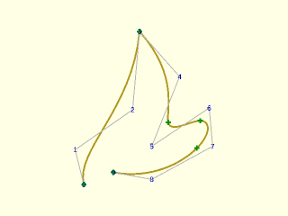

 

    include <BOSL2/std.scad>
    include <BOSL2/nurbs.scad>
    pts = [[5,0],[0,20],[33,43],[37,88],[60,62],[44,22],[77,44],[79,22],[44,3],[22,7]];
    mult = [1,3,1,1,1,1];
    debug_nurbs(pts,3,mult=mult,show_knots=true);

**Example 18:** Using knot multiplicity with cubic closed case.  Knot count is now len(control)+1=11.  Here are three corners.

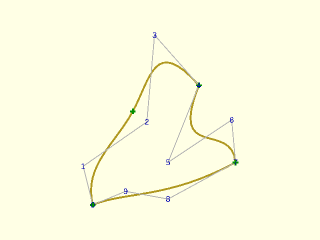

 

    include <BOSL2/std.scad>
    include <BOSL2/nurbs.scad>
    pts = [[5,0],[0,20],[33,43],[37,88],[60,62],[44,22],[77,44],[79,22],[44,3],[22,7]];
    mult = [1,3,1,3,3];
    debug_nurbs(pts,3,mult=mult,type="closed",show_knots=true);

**Example 19:** Explicitly specified knots only change the quadratic clamped curve slightly.  Knot count is len(control)-degree+1 = 9.

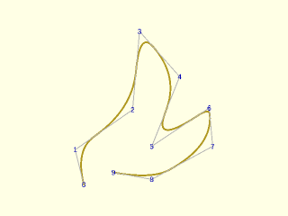

 

    include <BOSL2/std.scad>
    include <BOSL2/nurbs.scad>
    pts = [[5,0],[0,20],[33,43],[37,88],[60,62],[44,22],[77,44],[79,22],[44,3],[22,7]];
    knots = [0,1,3,5,9,13,14,19,21];
    debug_nurbs(pts,2,knots=knots);

**Example 20:** Combining explicit knots with mult for the quadratic curve to add a corner

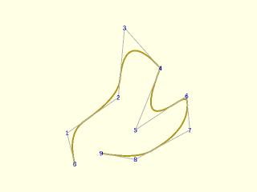

 

    include <BOSL2/std.scad>
    include <BOSL2/nurbs.scad>
    pts = [[5,0],[0,20],[33,43],[37,88],[60,62],[44,22],[77,44],[79,22],[44,3],[22,7]];
    knots = [0,1,3,9,13,14,19,21];
    mult = [1,1,1,2,1,1,1,1];
    debug_nurbs(pts,2,knots=knots,mult=mult);

**Example 21:** Directly repeating a knot in the knot list to create a corner for a cubic spline

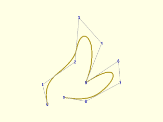

 

    include <BOSL2/std.scad>
    include <BOSL2/nurbs.scad>
    pts = [[5,0],[0,20],[33,43],[37,88],[60,62],[44,22],[77,44],[79,22],[44,3],[22,7]];
    knots = [0,1,3,13,13,13,19,21];
    debug_nurbs(pts,3,knots=knots);

**Example 22:** Open cubic spline with explicit knots

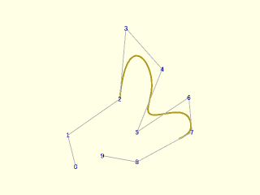

 

    include <BOSL2/std.scad>
    include <BOSL2/nurbs.scad>
    pts = [[5,0],[0,20],[33,43],[37,88],[60,62],[44,22],[77,44],[79,22],[44,3],[22,7]];
    knots = [0,1,3,13,13,13,19,21,27,28,29,40,42,44];
    debug_nurbs(pts,3,knots=knots,type="open");

**Example 23:** Closed quintic spline with explicit knots

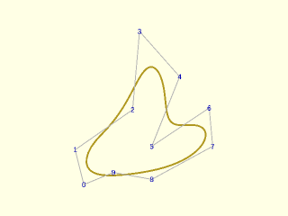

 

    include <BOSL2/std.scad>
    include <BOSL2/nurbs.scad>
    pts = [[5,0],[0,20],[33,43],[37,88],[60,62],[44,22],[77,44],[79,22],[44,3],[22,7]];
    knots = [0,1,3,13,13,13,19,21,27,28,33];
    debug_nurbs(pts,5,knots=knots,type="closed");

**Example 24:** Closed quintic spline with explicit knots and weights

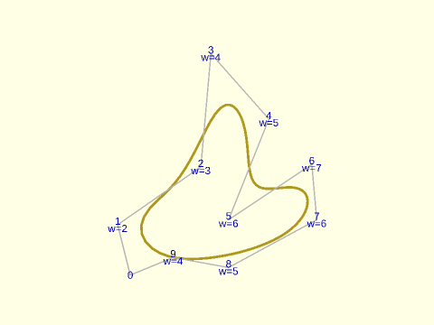

 

    include <BOSL2/std.scad>
    include <BOSL2/nurbs.scad>
    pts = [[5,0],[0,20],[33,43],[37,88],[60,62],[44,22],[77,44],[79,22],[44,3],[22,7]];
    weights = [1,2,3,4,5,6,7,6,5,4];
    knots = [0,1,3,13,13,13,19,21,27,28,33];
    debug_nurbs(pts,5,knots=knots,weights=weights,type="closed");

**Example 25:** Circular arcs are possible with NURBS.  This example gives a semi-circle

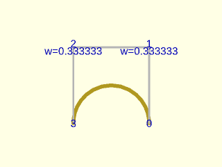

    include <BOSL2/std.scad>
    include <BOSL2/nurbs.scad>
    control = [[1,0],[1,2],[-1,2],[-1,0]];
    w = [1,1/3,1/3,1];
    debug_nurbs(control, 3, weights=w, width=0.1, size=.2);

  

**Example 26:** Gluing two semi-circles together gives a whole circle.  Note that this is a clamped not a closed NURBS.  The interface uses a knot of multiplicity 3 where the clamped ends of the semi-circles meet.

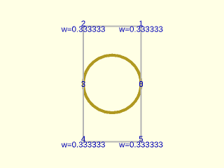

 

    include <BOSL2/std.scad>
    include <BOSL2/nurbs.scad>
    control = [[1,0],[1,2],[-1,2],[-1,0],[-1,-2],[1,-2],[1,0]];
    w = [1,1/3,1/3,1,1/3,1/3,1];
    debug_nurbs(control, 3, splinesteps=16,weights=w,mult=[1,3,1],width=.1,size=.2);

**Example 27:** Circle constructed with type="closed"

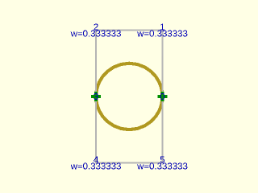

 

    include <BOSL2/std.scad>
    include <BOSL2/nurbs.scad>
    control = [[1,0],[1,2],[-1,2],[-1,0],[-1,-2],[1,-2]];
    w = [1,1/3,1/3,1,1/3,1/3];
    debug_nurbs(control, 3, splinesteps=16,weights=w,mult=[1,3,3],width=.1,size=.2,type="closed",show_knots=true);

**Example 28:** One-sided derivatives at a corner.  This quadratic has a corner at the multiplicity-2 knot (u=3/7).  The default `two_sided=false` returns NAN for the first derivative there; `two_sided=true` returns both one-sided tangents, drawn here as arrows into (red) and out of (blue) the corner.

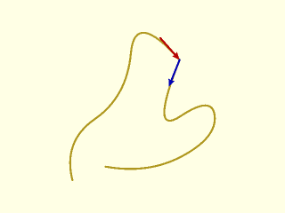

 

    include <BOSL2/std.scad>
    include <BOSL2/nurbs.scad>
    pts = [[5,0],[0,20],[33,43],[37,88],[60,62],[44,22],[77,44],[79,22],[44,3],[22,7]];
    mult = [1,1,1,2,1,1,1,1];
    stroke(nurbs_curve(pts,2,mult=mult,splinesteps=16));
    corner = nurbs_curve(pts,2,mult=mult,u=3/7);
    tang = nurbs_curve(pts,2,mult=mult,u=3/7,deriv=1,two_sided=true);
    color("red") stroke([corner-15*unit(tang[0]), corner], endcap2="arrow2", width=1);
    color("blue") stroke([corner, corner+15*unit(tang[1])], endcap2="arrow2", width=1);

---

### Module: debug\_nurbs()

**Synopsis:** Shows a NURBS curve and its control points, knots and weights [<abbr>Geom</abbr>]

**Topics:** [NURBS](Topics#nurbs), [Debugging](Topics#debugging)

**See Also:** [nurbs\_curve()](#function-nurbs_curve)

**Usage:** 

- debug_nurbs(control, degree, [width], [splinesteps=], [type=], [mult=], [knots=], [size=], [show_weights=], [show_knots=], [show_index=]);

**Description:** 

Displays a 2D or 3D NURBS and the associated control points to help debug NURBS curves.  You can display the
control point indices and weights, and can also display the knot points.
Instead of providing separate parameters you can give a first parameter of the form of a NURBS parameter list: `[type, degree, control, knots, mult, weights]`.

**Arguments:** 

<abbr title="These args can be used by position or by name.">By&nbsp;Position</abbr> | What it does
-------------------- | ------------
`control`            | list of control points in any dimension or a NURBS parameter list
`degree`             | degree of NURBS
`splinesteps`        | number of segments between each pair of knots.  Default: 16
`width`              | width of the line.  Default: 1
`size`               | size of text annotations.  Default: 3 times the width
`mult`               | multiplicity vector for NURBS
`weights`            | weight vector for NURBS
`type`               | NURBS type, one of "clamped", "open" or "closed".  Default: "clamped"
`show_index`         | if true then display index of each control point vertex.  Default: true
`show_weights`       | if true then display any non-unity weights.  Default: true if weights vector is supplied, false otherwise
`show_knots`         | If true then show the knots on the spline curve.  Default: false
`show_control`       | If true then show the control points and its polygon.  Default: true

**Example 1:** If you want to see the knots set `show_knots=true`:

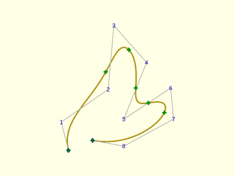

 

    include <BOSL2/std.scad>
    include <BOSL2/nurbs.scad>
    pts = [[5,0],[0,20],[33,43],[37,88],[60,62],[44,22],[77,44],[79,22],[44,3],[22,7]];
    debug_nurbs(pts,4,type="clamped",show_knots=true);

**Example 2:** Non-unity weights are displayed if you give a weight vector

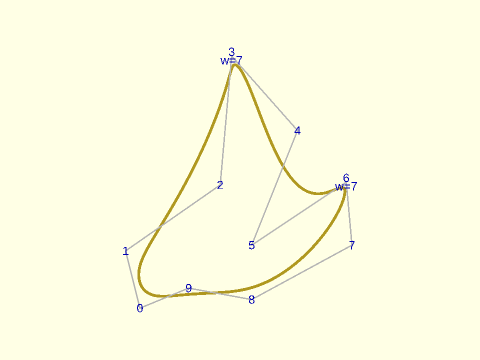

 

    include <BOSL2/std.scad>
    include <BOSL2/nurbs.scad>
    pts = [[5,0],[0,20],[33,43],[37,88],[60,62],[44,22],[77,44],[79,22],[44,3],[22,7]];
    weights = [1,1,1,7,1,1,7,1,1,1];
    debug_nurbs(pts,4,type="closed",weights=weights);

---

### Function: nurbs\_interp()

**Synopsis:** Finds a NURBS curve passing through a point list with optional derivative constraints.

**Topics:** [NURBS Curves](Topics#nurbs-curves), [Interpolation](Topics#interpolation)

**See Also:** [nurbs\_curve()](#function-nurbs_curve), [debug\_nurbs()](#module-debug_nurbs), [debug\_nurbs\_interp()](#module-debug_nurbs_interp)

**Usage:** 

- nurbs_param = nurbs_interp(points, degree, [method=], [closed=], [start_deriv=], [end_deriv=], [curvature=], [start_curvature=], [end_curvature=], [corners=], [deriv=], [extra_pts=], [smooth=]);

**Description:** 

Given a list of data points and a NURBS degree, computes a curve of the specified degree
that passes exactly through every data point.  The computed curve always has
uniform weights, but irregularly spaced knots, so it is actually a non-uniform B-spline.
Data points may 2D or any higher dimension.  Returns a NURBS parameter list of the form
`[type, degree, control_points, knots, undef, undef, u]` that can be
passed directly to [`nurbs_curve()`](#function-nurbs_curve) and other NURBS functions. The extra return value `u`,
described in detail below, enables you to locate your input points in the computed spline

When `closed=false` (the default) the output is a "clamped" NURBS.
When `closed=true`, the interpolation treats the data points as a loop and produces a
curve that is smooth at the closing point.  The output will be a "closed" NURBS (unless you
specify corners as described below).
If you instead duplicate the closing point and set `closed=false` then the
result will have a corner at the closing point.

Inserting a corner converts the output from a closed NURBS to to a clamped NURBS.  Adding
more than one corner converts the output to a piecewise sequence of clamped NURBS.

**Parameterization** (`method=`)

In order to solve the interpolation problem, the algorithm first chooses
the NURBS parameter value `u[k]` that will correspond to each `points[k]`.
This parametrization step significantly affects the shape of the output curve, particularly when the
data points are not evenly spaced.  The following methods are supported:

- `"length"` — Base parameters values on the chord length, which is distance between the consecutive data points.
  Best when data points are fairly evenly spaced.
- `"centripetal"` (default) — Base parameters values on the square root of the chord length. (Lee 1989).
- `"dynamic"` — like centripetal, but the exponent 0.5 is replaced
  by a per-chord value chosen based on local spacing variation.  Long chords
  get a smaller exponent and short chords a larger one, compressing the
  influence of outliers.  Chord lengths are normalized, which makes the method scale
  invariant and prevents misbehavior at extreme scales.  Scaling is not given in the original reference. (Balta et al. 2020).
- `"foley"` — centripetal base, augmented by corrections at each point that
  are proportional to the local turn angle.  Sharp bends pull parameter values
  closer together, which tends to reduce overshoot at corners (Foley & Neilson 1987).
- `"fang"` — centripetal base, augmented by a correction based on the radius
  of the osculating circle at each point.  Said to handles mixed straight-and-curved
  segments particularly well.  This method is NOT scale invariant, so results will
  change if you scale your input data. (Fang & Hung 2013).

The other required input to the interpolation is the location of the knots.
We place knots using a moving average of `degree` consecutive parameter values, which links
the knots to the local parameter spacing.  A consequence of this process for selection
of the parameters and knot locations is that even if your input data has symmetry it is
likely that the symmetry will be broken in the output.  For closed curves, another
consequence is that the resulting curve will depend on which point is chosen as the
starting point for the interpolation.  The algorithm chooses a starting point
that is expected to provide the best behaved interpolation curve.  Examining the
knot positions with [`debug_nurbs_interp()`](#module-debug_nurbs_interp) may help you understand unexpected behavior
you observe in the output.  If your curve does not
behave as desired you may be able to adjust it by imposing additional constraints or
by giving it more freedom using `extra_pts`.

**Derivative constraints** (`deriv=`, `start_deriv=`, `end_deriv=`)

`deriv[k]` specifies the tangent direction and speed the curve must have
as it passes through `points[k]`.  The length of `deriv[k]` gives the speed
as a multiple of `path_length(points)` which means a unit vector gives a natural
speed that is a good starting point.
The speed has a big effect on the shape of the curve, so if the local shape is
not as you desire you should try increasing it, which will make the curve around
the point flatter or decreasing it, which will make the curve more pointy.
Set `deriv[k] = undef` to leave point `k` unconstrained.
If you only want to set the derivative at the ends of a "clamped" curve you can use
`start_deriv=` and `end_deriv=`, which set
`deriv[0]` and `last(deriv)` without the need to provide a list of undefs for all the interior points.

**Curvature constraints** (`curvature=`, `start_curvature=`, `end_curvature=`)

The curvature at a point measures how tightly a curve bends.
When a point has curvature $\kappa$ then a circle with radius $1/\kappa$
locally matches the curve at that point so both its first and second derivatives agree.
This matched circle is called the osculating circle.  When you set `curvature[k]` this
constrains the curvature at `points[k]`.  Every curvature-constrained point **must** also have a derivative constraint
at the same index.  Curvature constraints require a degree of at least 2.

In general curvature constraints require the curvature **vector**, which
points in the direction of the osculating circle and has length equal to the curvature.
The curvature vector must be orthogonal to the tangent vector at the point;
when you specify a curvature vector any component parallel to the tangent is removed.
The magnitude of the curvature is taken as the magnitude of your original input vector,
even if subtracting the tangent component changes its length.
For 2D curves you can also provide curvature as a scalar, with the sign indicating direction.
(positive = left/CCW,  negative = right/CW).

You can specify the curvature at the ends of "clamped" curves using
`start_curvature=` and `end_curvature=`, which specify `curvature[0]`
and `last(curvature)` without the need to create undefs for all the interior points.

**Corners** (`corners=`)

`corners=` is a list of interior point indices where the curve has
a corner, a discontinuity in the derivative.  You can also specify a corner
at point `k` by setting `deriv[k]=NAN`.  When you request corners, the
algorithm chops up the input data into separate clamped splines that run from corner
to corner.  When `closed=true` this results in a "clamped" output spline, and the curve
will start at one of your corner points.
If you place corners close together, the effective degree of the short segment
in between the corners may be reduced.  These curve sections are assembled into a single
NURBS so this process is transparent to the user.  A limitation is that you cannot control
the derivatives of the two segments that meet at a corner.  If you need to do this you
must construct your own sequence of clamped interpolations.

**Extra control points** (`extra_pts=`, `smooth=`)

By default, the solver uses exactly as many control points as are needed to
satisfy the interpolation and constraint conditions, which gives a unique
solution.  This unique solution may be badly behaved, with undesirable oscillations.
You can improve the behavior by requesting extra points.
Specifying `extra_pts=N` inserts `N` additional control points and knots, making the
system underdetermined: infinitely many curves pass through the data points and satisfy
the constraints.  The solver picks the one that satisfies
a smoothness criterion specified by `smooth=`:

- `smooth=1` — minimises the sum of squared differences between consecutive
  control points.  This tends to keep the control polygon short and reduces
  large-scale variation in the curve.
- `smooth=2` — minimises the sum of squared second differences of the control
  points.  This penalises bending in the control polygon, generally producing
  a fairer, less wiggly curve than `smooth=1`.
- `smooth=3` (default) — minimises the integrated squared second derivative
  $\int \|\mathbf{C}''(t)\|^2 \, dt$, often called the *bending energy* of
  the curve.  Unlike `smooth=2`, which only looks at the control polygon,
  this criterion acts directly on the curve shape and is the most
  mathematically principled choice for smooth interpolation.  Requires
  `degree >= 2`.

The number of extra control points cannot exceed the number of knot spans.
If you request too many, the number is capped and a warning is displayed.
With `corners=`, the curve is split into independent clamped segments and
the extra points are distributed across eligible segments proportionally
to their control-point count, rounding up, so the total may
exceed the requested number but will never be less.  A segment is eligible when
its effective degree is 3 or higher, or when it is degree 2 with `smooth=1`.

**Locating points in the spline** — In order to locate your original data
points in the spline you need the `u` parameter value that you
can pass to [`nurbs_curve()`](#function-nurbs_curve).  The last return value `u` is a list
where `u[k]` is the NURBS parameter at which the curve passes through
`points[k]`.

**Smoothness** &mdash; The smoothness of B-splines is determined by the
degree.  If you request a degree $p$ spline then it will be $C^{p-1}$ at
knot points and $C^\infty$ everywhere else.  If you request corners then
these are points where the curve is not differentiable; corners may
also divide the curve into small segments that lack sufficient points
to support an interpolation at your requested degree: a degree $p$ interpolation
requires $p+1$ points.  In this case, the interpolation is performed at a lower
degree and elevated, which means it will be less smooth at knots.

**Arguments:** 

<abbr title="These args can be used by position or by name.">By&nbsp;Position</abbr> | What it does
-------------------- | ------------
`points`             | List of data points to interpolate (2D or any higher dimension).
`degree`             | Degree of the NURBS.  Degree 3 (cubic) is the most common choice.

<abbr title="These args must be used by name, ie: name=value">By&nbsp;Name</abbr> | What it does
-------------------- | ------------
`method`             | Parameterization method: `"length"`, `"centripetal"`, `"dynamic"`, `"foley"`, or `"fang"`. Default: `"centripetal"`
`closed`             | If true treat point list as a loop .  Default: `false`
`start_deriv`        | If `closed=false`, gives the tangent vector at the first point
`end_deriv`          | If `closed=false`, gives tangent vector at the last point.
`deriv`              | List of tangent vector constraints for every point, NAN at corners or undef at unconstrained points.  Cannot be combined with `start_deriv=`/`end_deriv=`.
`start_curvature`    | If `closed=false` gives curvature at first point.  (Requires matching derivative.)
`end_curvature`      | If `closed=false` gives curvature at last point.  (Requires matching derivative.)
`curvature`          | List of curvature constraints for every point, or undef at unconstrained points.  Each curvature constraint must be paired with a derivative constraint at the same point.  Cannot be combined with `start_curvature=`/`end_curvature=`.
`corners`            | List of interior point indices where corners are permitted.  Equivalent to setting entries of `deriv` to NAN.
`extra_pts`          | Number of extra control points to add to provide additional freedom to control undesirable oscillations.  Default: 0
`smooth`             | Smoothness criterion used with extra control points.  Set to 1 (minimize control-polygon length), 2 (minimize control-polygon bending) or 3 (minimize curve bending energy).   Default: 3

**Example 1:** A NURBS curve where closed = false. (default)

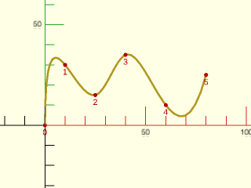

    include <BOSL2/std.scad>
    include <BOSL2/nurbs.scad>
    data = [[0,0], [10,30], [25,15], [40,35], [60,10], [80,25]];
    debug_nurbs_interp(data, 3);

  

**Example 2:** A NURBS curve where closed = true - Do NOT repeat the first point at the end.

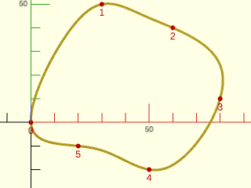

    include <BOSL2/std.scad>
    include <BOSL2/nurbs.scad>
    data = [[0,0], [30,50], [60,40], [80,10], [50,-20], [20,-10]];
    debug_nurbs_interp(data, 3, closed = true);

  

**Example 3:** Closed polygon - All data points lie exactly on the polygon boundary.

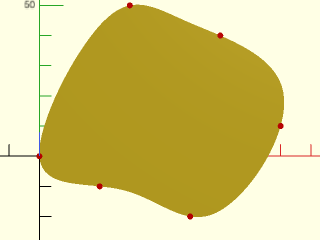

 

    include <BOSL2/std.scad>
    include <BOSL2/nurbs.scad>
    data = [[0,0], [30,50], [60,40], [80,10], [50,-20], [20,-10]];
    path = nurbs_curve(nurbs_interp(data, 3, closed=true), splinesteps=16);
    polygon(path);
    color("red") move_copies(data) circle(r=1, $fn=16);

**Example 4:** 3D closed curve

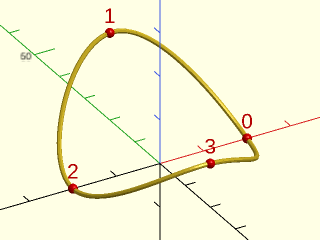

    include <BOSL2/std.scad>
    include <BOSL2/nurbs.scad>
    data3d = [[20,0,0],[0,20,20],[-20,0,0],[0,-20,10]];
    debug_nurbs_interp(data3d, 3, splinesteps=32, closed=true);

  

**Example 5:** Get just the path

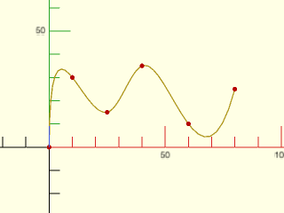

    include <BOSL2/std.scad>
    include <BOSL2/nurbs.scad>
    data = [[0,0], [10,30], [25,15], [40,35], [60,10], [80,25]];
    path = nurbs_curve(nurbs_interp(data, 3), splinesteps=16);
    stroke(path, width=0.5);
    color("red") move_copies(data) circle(r=1, $fn=16);

  

**Example 6:** Low-level NURBS parameter list — nurbs\_interp() returns a BOSL2 NURBS parameter list compatible with nurbs\_curve(), debug\_nurbs(), etc.

    include <BOSL2/std.scad>
    include <BOSL2/nurbs.scad>
    data = [[0,0], [10,30], [25,15], [40,35], [60,10], [80,25]];
    result = nurbs_interp(data, 3);
    curve = nurbs_curve(result, splinesteps=24);
    stroke(curve, width=0.5);
    color("red") move_copies(data) circle(r=1, $fn=16);

  

**Example 7:** Endpoint tangent control — Specify start and/or end tangent vectors.  Each vector is automatically scaled by the total chord length; a unit vector produces natural arc-length speed.  Magnitude &gt; 1 increases pull, &lt; 1 weakens it.

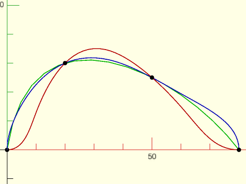

 

    include <BOSL2/std.scad>
    include <BOSL2/nurbs.scad>
    data = [[0,0], [20,30], [50,25], [80,0]];
    // No tangent control (natural):
    color("lime") stroke(nurbs_curve(nurbs_interp(data, 3)), width=0.3);
    // Start going straight up, end going straight down:
    color("blue") stroke(
      nurbs_curve(nurbs_interp(data, 3, start_deriv=[0,1], end_deriv=[0,-1])), width=0.3);
    // Start going right, end going right:
    color("red") stroke(
      nurbs_curve(nurbs_interp(data, 3, start_deriv=[1,0], end_deriv=[1,0])), width=0.3);
    color("black") move_copies(data) circle(r=0.75, $fn=16);

**Example 8:** An unconstrained NURBS curve.

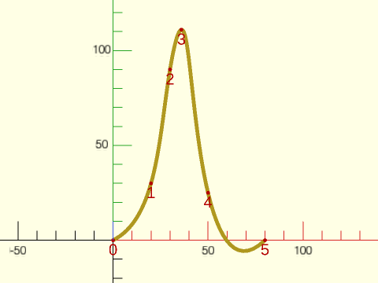

 

    include <BOSL2/std.scad>
    include <BOSL2/nurbs.scad>
    data = [[0,0], [20,30], [30,90], [36,111], [50,25], [80,0]];
       debug_nurbs_interp(data, degree=3, splinesteps=32, width=2, data_size=1);

**Example 9:** Controlling the start using derivatives. Note the effect of the starting derivative on the end of the curve.

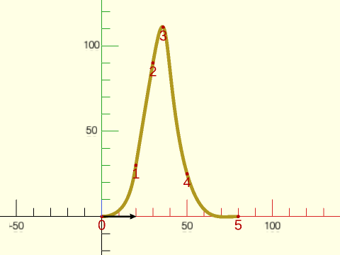

 

    include <BOSL2/std.scad>
    include <BOSL2/nurbs.scad>
    data = [[0,0], [20,30], [30,90], [36,111], [50,25], [80,0]];
    debug_nurbs_interp(data, degree=3, splinesteps=32, width=2, data_size=1,
       start_deriv=RIGHT);

**Example 10:** Increasing the start derivative and adding an end derivative.

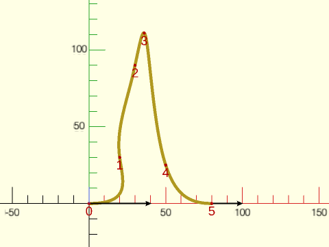

 

    include <BOSL2/std.scad>
    include <BOSL2/nurbs.scad>
    data = [[0,0], [20,30], [30,90], [36,111], [50,25], [80,0]];
    debug_nurbs_interp(data, degree=3, splinesteps=32, width=2, data_size=1,
       start_deriv=2*RIGHT,end_deriv=RIGHT);

**Example 11:** Adding an additional derivative at data point 1.

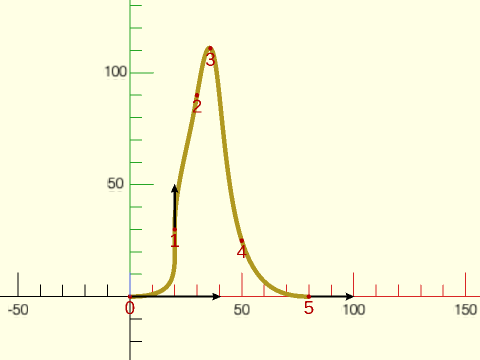

 

    include <BOSL2/std.scad>
    include <BOSL2/nurbs.scad>
    data = [[0,0], [20,30], [30,90], [36,111], [50,25], [80,0]];
    debug_nurbs_interp(data, degree=3, splinesteps=32, width=2, data_size=1,
       deriv=[2*RIGHT,[0,1],undef,undef,undef,RIGHT]);

**Example 12:** Unconstrained ends, but derivative control of the data points adjacent to the ends.

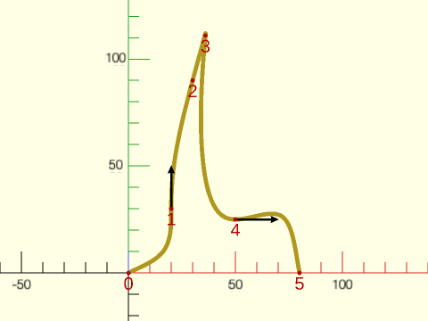

 

    include <BOSL2/std.scad>
    include <BOSL2/nurbs.scad>
    data = [[0,0], [20,30], [30,90], [36,111], [50,25], [80,0]];
    debug_nurbs_interp(data, degree=3, splinesteps=32, width=2, data_size=1,
       deriv=[undef,[0,1],undef,undef,RIGHT,undef]);

**Example 13:** Controlling shape with a derivative and a corner.

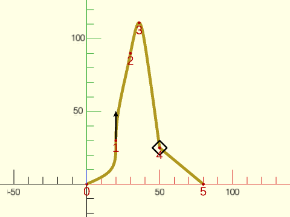

 

    include <BOSL2/std.scad>
    include <BOSL2/nurbs.scad>
    data = [[0,0], [20,30], [30,90], [36,111], [50,25], [80,0]];
    debug_nurbs_interp(data, degree=3, splinesteps=32, width=2, data_size=1,
       deriv=[undef,[0,1],undef,undef,NAN,undef]);

**Example 14:** Zero curvature at the start and end.

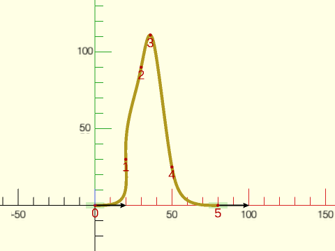

 

    include <BOSL2/std.scad>
    include <BOSL2/nurbs.scad>
    data = [[0,0], [20,30], [30,90], [36,111], [50,25], [80,0]];
    debug_nurbs_interp(data, degree=3, splinesteps=32, width=2, data_size=1,
       start_deriv=RIGHT,end_deriv=RIGHT, start_curvature=0,end_curvature=0);

**Example 15:** Adjusting the curvature at the end points to match the attached arcs.

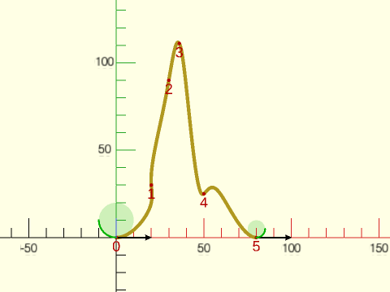

 

    include <BOSL2/std.scad>
    include <BOSL2/nurbs.scad>
    data = [[0,0], [20,30], [30,90], [36,111], [50,25], [80,0]];
    debug_nurbs_interp(data, degree=3, splinesteps=32, width=2, data_size=1,
       start_deriv=RIGHT,end_deriv=RIGHT, start_curvature=1/10*unit([1000,1]),end_curvature=1/5
       );
       color("lime") {
           stroke(arc(angle=[180,270], cp=[0,10],r=10));
           stroke(arc(angle=[270,360], cp=last(data)+[0,5], r=5,$fn=32));
       }

**Example 16:** Curvature control at point 1 with derivative control at point 1 and 3.

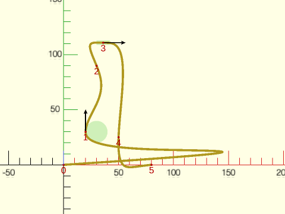

 

    include <BOSL2/std.scad>
    include <BOSL2/nurbs.scad>
    data = [[0,0], [20,30], [30,90], [36,111], [50,25], [80,0]];
    debug_nurbs_interp(data, degree=3, splinesteps=32, width=2, data_size=1,
       deriv=[undef,[0,1],undef,[1,0],undef,undef],
       curvature=[undef,-1/10,undef,0,undef,undef]);

**Example 17:** Taming the extremes by adding extra points.

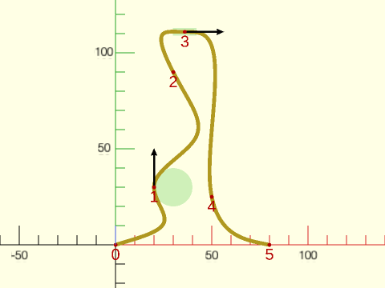

 

    include <BOSL2/std.scad>
    include <BOSL2/nurbs.scad>
    data = [[0,0], [20,30], [30,90], [36,111], [50,25], [80,0]];
    debug_nurbs_interp(data, degree=3, splinesteps=32, width=2, data_size=1,
       deriv=[undef,[0,1],undef,[1,0],undef,undef],
       curvature=[undef,-1/10,undef,0,undef,undef],
       extra_pts=2);

**Example 18:** The same data but for an unconstrained closed NURBS curve.

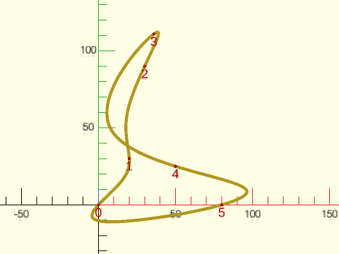

 

    include <BOSL2/std.scad>
    include <BOSL2/nurbs.scad>
    data = [[0,0], [20,30], [30,90], [36,111], [50,25], [80,0]];
    debug_nurbs_interp(data, degree=3, splinesteps=32, width=2, data_size=1, closed = true);

**Example 19:** Adding extra points gives a better behaved curve that doesn't cross itself.

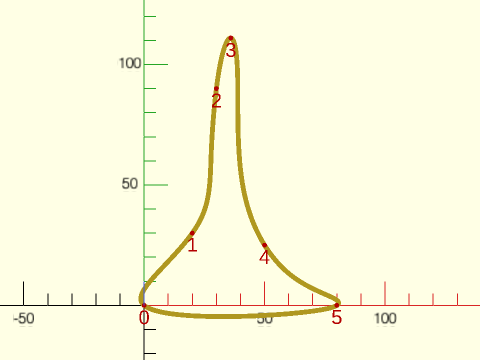

 

    include <BOSL2/std.scad>
    include <BOSL2/nurbs.scad>
    data = [[0,0], [20,30], [30,90], [36,111], [50,25], [80,0]];
    debug_nurbs_interp(data, degree=3, splinesteps=32, width=2, data_size=1, closed = true,
       extra_pts = 2);

**Example 20:** Small derivatives at the first and last data points also calm the curve.

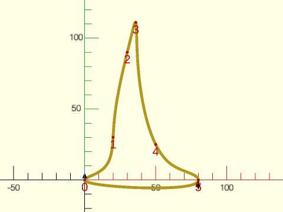

 

    include <BOSL2/std.scad>
    include <BOSL2/nurbs.scad>
    data = [[0,0], [20,30], [30,90], [36,111], [50,25], [80,0]];
    debug_nurbs_interp(data, degree=3, splinesteps=32, width=2, data_size=1, closed = true,
       deriv=[[0,1]/4, undef, undef, undef, undef, [0,-1]/3]);

**Example 21:** A NURBS curve with a derivative at pt 1, and a corner at pt 4. While closed=true, adding the corner converts the NURBS from closed to clamped.

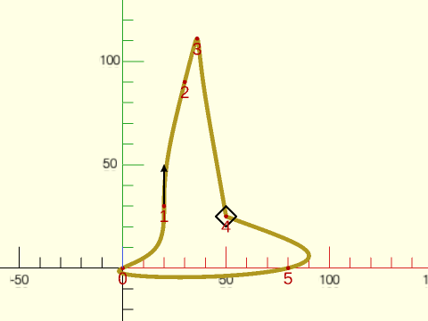

 

    include <BOSL2/std.scad>
    include <BOSL2/nurbs.scad>
    data = [[0,0], [20,30], [30,90], [36,111], [50,25], [80,0]];
    debug_nurbs_interp(data, degree=3, splinesteps=32, width=2, data_size=1, closed = true,
       deriv=[undef,[0,1],undef,undef,NAN,undef]);

**Example 22:** The same input data but with corners at points 1 and 4. This yields two connected clamped NURBS.

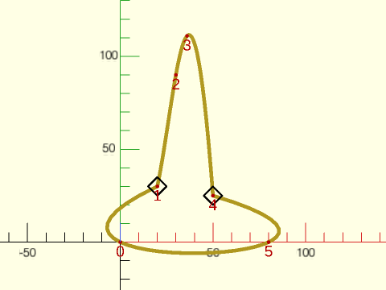

 

    include <BOSL2/std.scad>
    include <BOSL2/nurbs.scad>
    data = [[0,0], [20,30], [30,90], [36,111], [50,25], [80,0]];
    debug_nurbs_interp(data, degree=3, splinesteps=32, width=2, data_size=1, closed = true,
       deriv=[undef,NAN,undef,undef,NAN,undef]);

**Example 23:** Keyhole Shape: A NURBS curve where closed = false, and the first and last data point the same.  But simply interpolating a NURBS through the data points yields disappointing results.

 

    include <BOSL2/std.scad>
    include <BOSL2/nurbs.scad>
    data = [[0,0],[0,10],[-5,20],[5,30],[15,20],[10,10],[10,0],[0,0]];
    debug_nurbs_interp(data, degree=3, method="centripetal");

**Example 24:** Keyhole Shape: Adding derivative constraints causes unwanted oscillation.

 

    include <BOSL2/std.scad>
    include <BOSL2/nurbs.scad>
    data = [[0,0],[0,10],[-5,20],[5,30],[15,20],[10,10],[10,0],[0,0]];
       debug_nurbs_interp(data, degree=3, method="centripetal",
       deriv=[undef,NAN,UP,RIGHT*1.3,DOWN,NAN,NAN,undef]);

**Example 25:** Keyhole Shape: Adding extra points calms oscillations.

 

    include <BOSL2/std.scad>
    include <BOSL2/nurbs.scad>
    data = [[0,0],[0,10],[-5,20],[5,30],[15,20],[10,10],[10,0],[0,0]];
    debug_nurbs_interp(data, degree=3, method="centripetal",
       deriv=[undef,NAN,UP,RIGHT*1.3,DOWN,NAN,NAN,undef],
       extra_pts = 1, smooth = 3);

**Example 26:** Keyhole Shape: Constrained curvature at point 3 improves the shape.

 

    include <BOSL2/std.scad>
    include <BOSL2/nurbs.scad>
    data = [[0,0],[0,10],[-5,20],[5,30],[15,20],[10,10],[10,0],[0,0]];
    debug_nurbs_interp(data, degree=3, method="centripetal",
       deriv=[undef,NAN,UP,RIGHT*1.3,DOWN,NAN,NAN,undef],
       curvature=[undef,undef,undef,-.1,undef,undef,undef,undef],
       extra_pts = 1, smooth = 3);

**Example 27:** Unconstrained NURBS through the same data points vary depending on the parameterization method chosen

 

    include <BOSL2/std.scad>
    include <BOSL2/nurbs.scad>
    data = [[0,0], [20,30], [35,120], [50,30], [70,0]];
    method = ["length", "centripetal", "dynamic", "foley", "fang"];
    color = ["blue","lime","yellow","orange","red"];
    for (i = [0:4]) {
       color(color[i]) {
       debug_nurbs_interp(data, 3, closed = true, method = method[i], size = 5, data_size = 3);
       move([80,100-i*15]) text(method[i]);
     }
    }

**Example 28:** Adding extra points reduces the differences between the methods.

 

    include <BOSL2/std.scad>
    include <BOSL2/nurbs.scad>
    data = [[0,0], [20,30], [35,120], [50,30], [70,0]];
    method = ["length", "centripetal", "dynamic", "foley", "fang"];
    color = ["blue","lime","yellow","orange","red"];
    for (i = [0:4]) {
       color(color[i]) {
       debug_nurbs_interp(data, 3, closed = true, method = method[i], extra_pts = 3, size = 5, data_size = 3);
       move([80,100-i*15]) text(method[i]);
     }
    }

**Example 29:** Switching from the default to smooth = 1 improves things further.

 

    include <BOSL2/std.scad>
    include <BOSL2/nurbs.scad>
    data = [[0,0], [20,30], [35,120], [50,30], [70,0]];
    method = ["length", "centripetal", "dynamic", "foley", "fang"];
    color = ["blue","lime","yellow","orange","red"];
    for (i = [0:4]) {
       color(color[i]) {
       debug_nurbs_interp(data, 3, closed = true, method = method[i], extra_pts = 3, smooth = 1, size = 5, data_size = 3);
       move([80,100-i*15]) text(method[i]);
     }
    }

**Example 30:** We can generate a heart shape with a clamped NURBS where the first and last data points are co-incident, and we insert a corner at data point 4.

 

    include <BOSL2/std.scad>
    include <BOSL2/nurbs.scad>
    data = [[0,10], [25,20], [30,0], [20,-15], [0,-30], [-20,-15], [-30,0], [-25,20], [0,10]];
    debug_nurbs_interp(data, 3, closed = false, method = "centripetal", corners=[4]);
    path = nurbs_curve(nurbs_interp(data, 3, closed = false, method = "centripetal", corners=[4]));
    right(75) stroke(path, closed = true);

**Example 31:** We can get the same result by dropping the last data point and setting closed=true. A closed=true case with a single corner is exactly equivalent to a closed=false case where the single corner occurs at coincident endpoints.

 

    include <BOSL2/std.scad>
    include <BOSL2/nurbs.scad>
    data = [[0,10], [25,20], [30,0], [20,-15], [0,-30], [-20,-15], [-30,0], [-25,20]];
    debug_nurbs_interp(data, 3, closed = true, method = "centripetal", corners=[0,4]);
    path = nurbs_curve(nurbs_interp(data, 3, closed = true, method = "centripetal", corners = [0,4]));
    right(75) stroke(path, closed = true);

**Example 32:** For better shape control we can add derivative constraints and curvature control at data points 1 and 7

 

    include <BOSL2/std.scad>
    include <BOSL2/nurbs.scad>
    data = [[0,10], [25,20], [30,0], [20,-15], [0,-30], [-20,-15], [-30,0], [-25,20]];
    debug_nurbs_interp(data, 3, closed = true, method = "centripetal",
       deriv = [NAN,[1,-1]*0.8,undef,undef,NAN,undef,undef,[1,1]*0.8],
       curvature = [undef,-0.06,undef,undef,undef,undef,undef,-0.06]);
    path = nurbs_curve(nurbs_interp(data, 3, closed = true, method = "centripetal",
       deriv = [NAN,[1,-1]*0.8,undef,undef,NAN,undef,undef,[1,1]*0.8],
       curvature = [undef,-0.06,undef,undef,undef,undef,undef,-0.06]));
    right(75) stroke(path, closed = true);

**Example 33:** Finer control of derivative direction made easier by specifying the angle.

 

    include <BOSL2/std.scad>
    include <BOSL2/nurbs.scad>
    data = [[0,10], [25,20], [30,0], [20,-15], [0,-30], [-20,-15], [-30,0], [-25,20]];
    debug_nurbs_interp(data, 3, closed = true, method = "centripetal",
       deriv = [NAN,polar_to_xy(1.1,-40),undef,undef,NAN,undef,undef,polar_to_xy(1.1,40)],
       curvature = [undef,-0.06,undef,undef,undef,undef,undef,-0.06]);
    path3 = nurbs_curve(nurbs_interp(data, 3, closed = true, method = "centripetal",
       deriv = [NAN,polar_to_xy(1.1,-40),undef,undef,NAN,undef,undef,polar_to_xy(1.1,40)],
       curvature = [undef,-0.06,undef,undef,undef,undef,undef,-0.06]));
    right(75) stroke(path3, closed = true);

**Example 34:** Parameterization methods for sharp turns. For data with sudden direction changes or uneven chord spacing, "centripetal" and "dynamic" reduce unwanted oscillations.

 

    include <BOSL2/std.scad>
    include <BOSL2/nurbs.scad>
    // "length" (blue), "centripetal" (red), "dynamic" (green) compared.
    sharp = [[0,0], [5,40],[6,40], [10,0], [50,0], [55,40],[56,42], [60,0]];
    color("blue")   stroke(nurbs_curve(nurbs_interp(sharp, 3, method = "centripetal"), splinesteps=32), width=0.25);
    color("red")    stroke(nurbs_curve(nurbs_interp(sharp, 3, method="foley"),         splinesteps=32), width=0.25);
    color("lime") stroke(nurbs_curve(nurbs_interp(sharp, 3, method="dynamic"),       splinesteps=32), width=0.25);
    color("black") move_copies(sharp) circle(r=.6, $fn=16);

---

### Module: debug\_nurbs\_interp()

**Synopsis:** Interpolates a NURBS using [`nurbs_interp()`](#function-nurbs\_interp) and displays the curve with informative overlays.

**Topics:** [NURBS Curves](Topics#nurbs-curves), [Interpolation](Topics#interpolation), [Debugging](Topics#debugging)

**See Also:** [nurbs\_interp()](#function-nurbs_interp), [debug\_nurbs()](#module-debug_nurbs)

**Usage:** 

- debug_nurbs_interp(points, degree, [splinesteps=], [method=], [closed=], [deriv=], [start_deriv=], [end_deriv=], [curvature=], [start_curvature=], [end_curvature=], [corners=], [extra_pts=], [smooth=], [width=], [size=], [data_size=], [data_index=], [show_control=], [control_index=], [show_knots=], [show_deriv=], [show_curvature=]);

**Description:** 

Calls [`nurbs_interp()`](#function-nurbs_interp) with the supplied arguments and displays the
resulting curve together with a informative overlays.  All interpolation
arguments are passed through unchanged; see [`nurbs_interp()`](#function-nurbs_interp) for their
descriptions.  The overlays are:

- **Data points** — red circles (2D) or spheres (3D) at each input point.
  When `data_index=true` (the default), the point index is printed in red next
  to its marker.  Set `data_size=0` to suppress display of the data point dots.
- **Derivative constraints** — a black arrow at each derivative constrained data point.
  Arrow direction and length reflect the constraint vector, scaled to the average
  point spacing.  When the derivative is NAN or a point has a corner, this is shown
  using a black diamond.  Shown by default: set `show_deriv=false` to hide.
- **Curvature constraints** — a transparent green overlay at each curvature-constrained point.
  In 2D the overlay is the osculating circle.  In 3D the overlay is a cylinder created
  from the 3D osculating circle.  Zero curvature appears as a short green bar.
  Shown by default: Set `show_curvature=false` to hide.
- **Knots** — Green crosses mark each knot position.  Not shown by default.
  Enable with `show_knots=true`.
- **Control points and polygon** — If you set `show_control=true` then a gray control polygon
  Is displayed.  If you additionally set `control_index=true` then blue control-point
  index labels appear.

**Arguments:** 

<abbr title="These args can be used by position or by name.">By&nbsp;Position</abbr> | What it does
-------------------- | ------------
`points`             | List of 2-D or 3-D data points to interpolate through.
`degree`             | NURBS degree.
`splinesteps`        | Steps per knot span for curve rendering.  Default: `16`

<abbr title="These args must be used by name, ie: name=value">By&nbsp;Name</abbr> | What it does
-------------------- | ------------
`method`             | Parameterization method; see [`nurbs_interp()`](#function-nurbs_interp).  Default: `"centripetal"`
`closed`             | If true, interpolate as a closed loop; if false, interpolate as clamped.  Default: `false`
`deriv`              | Per-point derivative constraints; see [`nurbs_interp()`](#function-nurbs_interp).  Default: `undef`
`start_deriv`        | Derivative at first point.  Default: `undef`
`end_deriv`          | Derivative at last point.  Default: `undef`
`curvature`          | Per-point curvature constraints; see [`nurbs_interp()`](#function-nurbs_interp).  Default: `undef`
`start_curvature`    | Curvature at first point.  Default: `undef`
`end_curvature`      | Curvature at last point.  Default: `undef`
`corners`            | Corner indices; see [`nurbs_interp()`](#function-nurbs_interp).  Default: `undef`
`extra_pts`          | Extra control points; see [`nurbs_interp()`](#function-nurbs_interp).  Default: `0`
`smooth`             | Smoothness criterion for `extra_pts`; see [`nurbs_interp()`](#function-nurbs_interp).  Default: `3`
`width`              | Stroke width for the curve.  Arrows and other overlays scale with this.  Default: `1`
`size`               | Text size for labels on control points and data points.  Default: `3*width`
`data_size`          | Radius of the red data-point markers.  Set to `0` to hide data points and their labels.  Default: equal to `width`
`data_index`         | Show index labels next to each data point.  Only shown when `data_size > 0`.  Default: `true`
`show_control`       | Show the control polygon.  Default: `false`
`control_index`      | Show control-point index labels if `show_control=true`.  Default: `false`
`show_knots`         | Show knot position markers on the curve.  Default: `false`
`show_deriv`         | Show derivative-constraint arrows.  Default: `true`
`show_curvature`     | Show curvature-constraint circles / disks.  Default: `true`

---

### Function: nurbs\_elevate\_degree()

**Synopsis:** Raises the degree of a clamped or open NURBS.

**Topics:** [NURBS Curves](Topics#nurbs-curves)

**See Also:** [nurbs\_interp()](#function-nurbs_interp), [nurbs\_curve()](#function-nurbs_curve)

**Usage:** 

- result = nurbs_elevate_degree(control, degree, [knots=], [mult=], [type=], [times=], [weights=]);
- result = nurbs_elevate_degree(nurbs_param_list, [times=]);

**Description:** 

Raises the degree of a "clamped" or "open" NURBS by `times` steps, producing
a geometrically identical curve at the higher degree.  Returns a NURBS parameter list
of the form `[type, degree, control_points, knots, undef, weights]` that can be
passed directly to [`nurbs_curve()`](#function-nurbs_curve) and other NURBS functions.  The returned `mult`
parameter is always undef; the returned `weights` will be defined only if you provided
weights in your input.  If you give `times=0` your input parameters are returned unchanged.

An elevated curve has the same smoothness as the original at each knot.  A degree-2
curve that is $C^1$ at its knots will still be $C^1$ after elevation to degree 3,
not $C^2$ as a fresh cubic NURBS with simple knots would be.

Instead of providing separate parameters you can give a first parameter of the form of a
NURBS parameter list: `[type, degree, control, knots, mult, weights]`.

**Arguments:** 

<abbr title="These args can be used by position or by name.">By&nbsp;Position</abbr> | What it does
-------------------- | ------------
`control`            | Control points, or a NURBS parameter list `[type, degree, ctrl, knots, mult, weights]`
`degree`             | Degree of NURBS

<abbr title="These args must be used by name, ie: name=value">By&nbsp;Name</abbr> | What it does
-------------------- | ------------
`knots`              | Knot vector.  Default: uniform
`mult`               | List of multiplicities of the knots.  Default: all 1
`type`               | `"clamped"` or `"open"`.  Default: `"clamped"`
`times`              | Number of degree-elevation steps.  Default: `1`
`weights`            | Weight at each control point

---

### Function: nurbs\_length()

**Synopsis:** Approximates the arc length of a NURBS curve.

**Topics:** [NURBS Curves](Topics#nurbs-curves)

**See Also:** [nurbs\_curve()](#function-nurbs_curve), [nurbs\_curve\_breaks()](#function-nurbs_curve_breaks)

**Usage:** 

- len = nurbs_length(control, degree, [u=], [mult=], [weights=], [type=], [knots=], [tol=], [maxdepth=]);
- len = nurbs_length(nurbs_param_list, [u=], [tol=], [maxdepth=]);

**Description:** 

Approximates the length of the curve over the parameter interval `u=[u0,u1]`, using
adaptive Gauss-Legendre quadrature: each knot span in the interval is integrated with
both a 3-point and a 5-point rule, and only subdivided further where the two estimates
disagree beyond `tol`.  For closed curves, if `u1 < u0` the length wraps across the seam.
The approximation length is very accurate when your curve has no cusps between knots.
To improve accuracy for the general case increase `tol`.  If you want more accuracy
when cusps appear between knots and you cannot divide the curve at the cusp, you
will get improved accuracy by increasing `maxdepth`.

**Arguments:** 

<abbr title="These args can be used by position or by name.">By&nbsp;Position</abbr> | What it does
-------------------- | ------------
`control`            | list of control points in any dimension or a NURBS parameter list
`degree`             | degree of NURBS

<abbr title="These args must be used by name, ie: name=value">By&nbsp;Name</abbr> | What it does
-------------------- | ------------
`u`                  | [u0, u1] specifying the parameter interval.  Default: [0, 1]
`mult`               | list of multiplicities of the knots.  Default: all 1
`weights`            | vector whose length is the same as control giving weights at each control point.  Default: all 1
`type`               | One of "clamped", "closed" or "open" to define end point handling of the spline.  Default: "clamped"
`knots`              | List of knot values.  Default: uniform
`tol`                | requested numerical tolerance controlling adaptive refinement.  Smaller values usually improve accuracy but increase runtime.  This is not a strict bound on the final arc-length error.  Default: 1e-6
`maxdepth`           | maximum adaptive subdivision depth.  Default: 10

**Example 1:** Compute the length of a curve

 

    include <BOSL2/std.scad>
    include <BOSL2/nurbs.scad>
    control = [[5,0],[0,20],[33,43],[37,88],[60,62],[44,22],[77,44],[79,22],[44,3],[22,7]];
    echo(nurbs_length(control, 2));

**Example 2:** Partial length on a closed curve

    include <BOSL2/std.scad>
    include <BOSL2/nurbs.scad>
    pts = [[13,43],[30,52],[49,22],[24,3]];
    echo(nurbs_length(pts, 2, type="closed", u=[0.75,0.25]));

  

---

### Function: nurbs\_cut()

**Synopsis:** Finds the parameter value at a given arc length along a NURBS curve.

**Topics:** [NURBS Curves](Topics#nurbs-curves)

**See Also:** [nurbs\_length()](#function-nurbs_length), [nurbs\_curve()](#function-nurbs_curve), [nurbs\_curve\_breaks()](#function-nurbs_curve_breaks)

**Usage:** 

- u2 = nurbs_cut(dist, control, degree, [mult=], [weights=], [type=], [knots=], [u=], [tol=], [u_tol=], [maxdepth=], [maxiter=]);
- u2 = nurbs_cut(dist, nurbs_param_list, [u=], [tol=], [u_tol=], [maxdepth=], [maxiter=]);

**Description:** 

Finds the parameter value reached by traveling a signed distance `dist`
along the curve starting from `u`.  Positive distances move forward
in increasing curve parameter; negative distances move backward.  For
closed curves, the search wraps around the seam as needed in either
direction.  For clamped or open curves, an error is raised if the
requested distance exceeds the available curve length in the chosen direction.

**Arguments:** 

<abbr title="These args can be used by position or by name.">By&nbsp;Position</abbr> | What it does
-------------------- | ------------
`dist`               | signed distance to travel along the curve
`control`            | list of control points in any dimension or a NURBS parameter list
`degree`             | degree of NURBS

<abbr title="These args must be used by name, ie: name=value">By&nbsp;Name</abbr> | What it does
-------------------- | ------------
`mult`               | list of multiplicities of the knots.  Default: all 1
`weights`            | vector whose length is the same as control giving weights at each control point.  Default: all 1
`type`               | One of "clamped", "closed" or "open" to define end point handling of the spline.  Default: "clamped"
`knots`              | List of knot values.  Default: uniform
`u`                  | start of the search interval in [0,1].  Default: 0
`tol`                | requested numerical tolerance controlling the internal arc-length calculations.  Smaller values usually improve accuracy but increase runtime.  This is not a strict bound on the final error in the result.  Default: 1e-6
`u_tol`              | stopping tolerance in parameter space for the inverse search.  Default: 1e-8
`maxdepth`           | maximum adaptive subdivision depth used by the length calculations.  Default: 10
`maxiter`            | maximum number of bisection steps in the inverse search.  Default: 50

**Example 1:** Find the point 50 units forward along a curve

 

    include <BOSL2/std.scad>
    include <BOSL2/nurbs.scad>
    control = [[5,0],[0,20],[33,43],[37,88],[60,62],[44,22],[77,44],[79,22],[44,3],[22,7]];
    u2 = nurbs_cut(50, control, 2);
    pt = nurbs_curve(control, 2, u=u2);
    stroke(nurbs_curve(control, 2, splinesteps=16));
    color("red") move(pt) circle(r=1.5, $fn=16);

**Example 2:** Go backward from a starting point

    include <BOSL2/std.scad>
    include <BOSL2/nurbs.scad>
    pts = [[13,43],[30,52],[49,22],[24,3]];
    u2 = nurbs_cut(-20, pts, 2, u=0.6, type="closed");
    pt = nurbs_curve(pts, 2, u=u2, type="closed");
    stroke(nurbs_curve(pts, 2, splinesteps=16, type="closed"));
    color("red") move(pt) circle(r=1.5, $fn=16);

  

---

## Section: NURBS Surfaces

### Function: is\_nurbs\_patch()

**Synopsis:** Returns true if the given item looks like a NURBS patch.

**Topics:** [NURBS Patches](Topics#nurbs-patches), [Type Checking](Topics#type-checking)

**Usage:** 

- bool = is_nurbs_patch(x);

**Description:** 

Returns true if the given item looks like a NURBS patch. (a 2D array of 3D points.)

**Arguments:** 

<abbr title="These args can be used by position or by name.">By&nbsp;Position</abbr> | What it does
-------------------- | ------------
`x`                  | The value to check the type of.

---

### Function: nurbs\_patch\_points()

**Synopsis:** Computes specified point(s) on a NURBS surface patch

**Topics:** [NURBS Patches](Topics#nurbs-patches)

**See Also:** [nurbs\_vnf()](#functionmodule-nurbs_vnf), [nurbs\_normals()](#function-nurbs_normals), [nurbs\_curve()](#function-nurbs_curve)

**Usage:** 

- pointgrid = nurbs_patch_points(patch, degree, [splinesteps], [u=], [v=], [weights=], [type=], [mult=], [knots=]);

**Description:** 

Sample a NURBS patch on a point set.  If you give splinesteps then it will sampled uniformly in the spline
parameter between the knots, ensuring that a sample appears at every knot.  If you instead give u and v then
the values at those points in parameter space will be returned.  The various NURBS parameters can all be
single values, if the NURBS has the same parameters in both directions, or pairs listing the value for the
two directions.  If you want uniform knots in one direction and specified knots in the other you can
give `undef` as the knot vector, e.g., `[undef,vknots]` to have uniform knots in the first dimension and
specified knots in the second one.  You can do the same thing with the `mult` parameter.

**Arguments:** 

<abbr title="These args can be used by position or by name.">By&nbsp;Position</abbr> | What it does
-------------------- | ------------
`patch`              | rectangular list of control points in any dimension, or a NURBS parameter list
`degree`             | a scalar or 2-vector giving the degree of the NURBS in the two directions
`splinesteps`        | a scalar or 2-vector giving the number of segments between each knot in the two directions

<abbr title="These args must be used by name, ie: name=value">By&nbsp;Name</abbr> | What it does
-------------------- | ------------
`u`                  | evaluation points in the u direction of the patch
`v`                  | evaluation points in the v direction of the patch
`mult`               | a single list or pair of lists giving the knot multiplicity in the two directions. Default: all 1
`knots`              | a single list or pair of lists giving the knot vector in each of the two directions.  Default: uniform
`weights`            | a matrix whose size corresponds to `patch` giving the weight at each control point in the patch.  Default: all 1
`type`               | a single string or pair of strings giving the NURBS type, where each entry is one of "clamped", "open" or "closed".  Default: "clamped"

**Example 1:** Computing points on a patch using ranges

 

    include <BOSL2/std.scad>
    include <BOSL2/nurbs.scad>
    patch = [
        [[-50, 50,  0], [-16, 50,  20], [ 16, 50,  20], [50, 50,  0]],
        [[-50, 16, 20], [-16, 16,  40], [ 16, 16,  40], [50, 16, 20]],
        [[-50,-16, 20], [-16,-16,  40], [ 16,-16,  40], [50,-16, 20]],
        [[-50,-50,  0], [-16,-50,  20], [ 16,-50,  20], [50,-50,  0]],
    ];
    pts = nurbs_patch_points(patch, 3, u=[0:.1:1], v=[0:.3:1]);
    move_copies(flatten(pts)) sphere(r=2,$fn=16);

**Example 2:** Computing points using splinesteps

 

    include <BOSL2/std.scad>
    include <BOSL2/nurbs.scad>
    patch = [
        [[-50, 50,  0], [-16, 50,  20], [ 16, 50,  20], [50, 50,  0]],
        [[-50, 16, 20], [-16, 16,  40], [ 16, 16,  40], [50, 16, 20]],
        [[-50,-16, 20], [-16,-16,  40], [ 16,-16,  40], [50,-16, 20]],
        [[-50,-50,  0], [-16,-50,  20], [ 16,-50,  20], [50,-50,  0]],
    ];
    pts = nurbs_patch_points(patch, 3, splinesteps=5);
    move_copies(flatten(pts)) sphere(r=2,$fn=16);

---

### Function: nurbs\_normals()

**Synopsis:** Computes unit normal(s) of a NURBS surface patch, tracking per-sector normals at creases.

**Topics:** [NURBS Patches](Topics#nurbs-patches)

**See Also:** [nurbs\_patch\_points()](#function-nurbs_patch_points), [nurbs\_vnf()](#functionmodule-nurbs_vnf), [nurbs\_curve()](#function-nurbs_curve)

**Usage:** 

- normalgrid = nurbs_normals(patch, degree, [splinesteps], [u=], [v=], [weights=], [type=], [mult=], [knots=], [two_sided=]);

**Description:** 

Computes unit surface normals of a 3D NURBS patch at the same sample points that
[`nurbs_patch_points()`](#function-nurbs_patch_points) would produce: uniformly in the spline parameter with `splinesteps`, or at the
given `u` and `v` parameter values.  The output is a grid of normal entries indexed `[u_index][v_index]`
(a single entry when both `u` and `v` are scalars).  The normal is computed as the unit vector in the
direction of the cross product $\partial S/\partial u \times \partial S/\partial v$, so its orientation
follows the right-hand rule from the u direction to the v direction; negate the result if you need the
opposite orientation.

A NURBS surface need not be smooth everywhere.  A knot with multiplicity equal to the degree creates a
crease running across the surface, and `splinesteps` sampling places sample points exactly on every
knot, so crease points are hit routinely.  Crossing a crease in the u direction, the partial
$\partial S/\partial u$ jumps while $\partial S/\partial v$ stays continuous, and vice versa, so a
sample point can carry one normal (smooth), two normals (on one crease), or four normals (at the
crossing point of creases in both directions).  The `two_sided` parameter selects how these are
reported:
- `two_sided=false` (default) — every entry is a single unit vector.  Where the normal is not unique,
  or where the surface is degenerate (a zero tangent, e.g. on an edge collapsed to a point, or parallel
  tangents), the entry is `NAN`.  You can detect these entries with `is_nan()`.
- `two_sided=true` — every entry is a list.  At points with a unique normal it is a singleton `[n]`.
  Where the one-sided normals differ it is a 2×2 matrix of sector normals indexed
  `[u_side][v_side]` with side 0 the minus (lower parameter) side and side 1 the plus side:
  `[[n(u-,v-), n(u-,v+)], [n(u+,v-), n(u+,v+)]]`.
  On a crease in u only, the two rows differ and the entries within each row are equal, so the pair of
  normals `[n(u-), n(u+)]` is column 0 of the matrix; on a crease in v only, the columns differ and
  `[n(v-), n(v+)]` is row 0.  At a crossing all four sectors can differ.  Degenerate sectors are `NAN`
  inside the matrix.  Test `len(entry)==1` to detect unique normals.

Uniqueness is decided by comparing the sector normals themselves, not from knot multiplicity, so a
surface that is geometrically smooth across a parametric crease (for example, a surface built from
rational circle arcs, where the tangent speed jumps but its direction does not) reports a unique
normal there.  At clamped or open patch boundaries only one side of the surface exists and the
one-sided normal is reported as the normal; surfaces are periodic in the closed direction, so both sides
exist everywhere including the seam, and a clamped surface whose first and last control points
coincide row-by-row is likewise treated as periodic at its boundary (see [`nurbs_curve()`](#function-nurbs_curve)).

**Arguments:** 

<abbr title="These args can be used by position or by name.">By&nbsp;Position</abbr> | What it does
-------------------- | ------------
`patch`              | rectangular list of 3D control points, or a NURBS parameter list
`degree`             | a scalar or 2-vector giving the degree of the NURBS in the two directions
`splinesteps`        | a scalar or 2-vector giving the number of segments between each knot in the two directions.  Default: 16 if `u` and `v` are not given

<abbr title="These args must be used by name, ie: name=value">By&nbsp;Name</abbr> | What it does
-------------------- | ------------
`u`                  | evaluation points in the u direction of the patch
`v`                  | evaluation points in the v direction of the patch
`mult`               | a single list or pair of lists giving the knot multiplicity in the two directions.  Default: all 1
`knots`              | a single list or pair of lists giving the knot vector in each of the two directions.  Default: uniform
`weights`            | a matrix whose size corresponds to `patch` giving the weight at each control point in the patch.  Default: all 1
`type`               | a single string or pair of strings giving the NURBS type, where each entry is one of "clamped", "open" or "closed".  Default: "clamped"
`two_sided`          | If true, return each entry as a singleton `[n]` where the normal is unique and as a 2×2 matrix of sector normals where it is not.  If false, return plain unit vectors, with NAN where the normal is not unique.  Default: false

**Example 1:** Normals drawn along a smooth patch

 

    include <BOSL2/std.scad>
    include <BOSL2/nurbs.scad>
    patch = [
        [[-50, 50,  0], [-16, 50,  20], [ 16, 50,  20], [50, 50,  0]],
        [[-50, 16, 20], [-16, 16,  40], [ 16, 16,  40], [50, 16, 20]],
        [[-50,-16, 20], [-16,-16,  40], [ 16,-16,  40], [50,-16, 20]],
        [[-50,-50,  0], [-16,-50,  20], [ 16,-50,  20], [50,-50,  0]],
    ];
    pts = nurbs_patch_points(patch, 3, splinesteps=5);
    nrm = nurbs_normals(patch, 3, splinesteps=5);
    vnf_polyhedron(vnf_vertex_array(pts));
    for (a=idx(pts), b=idx(pts[0]))
        stroke([pts[a][b], pts[a][b]+12*nrm[a][b]], width=1, endcap2="arrow2");

**Example 2:** This patch has a crease (multiplicity-2 knot in a quadratic direction).  On the crease the normal is not unique: `two_sided=true` returns the sector normals, drawn here in red and blue for the two sides of the crease.

 

    include <BOSL2/std.scad>
    include <BOSL2/nurbs.scad>
    patch = [for (i=[0:4]) [for (j=[0:3]) [i*25, j*25, i==2 ? 40 : 0]]];
    pts = nurbs_patch_points(patch, [2,3], mult=[[1,2,1],undef], splinesteps=4);
    nrm = nurbs_normals(patch, [2,3], mult=[[1,2,1],undef], splinesteps=4, two_sided=true);
    vnf_polyhedron(vnf_vertex_array(pts));
    for (a=idx(pts), b=idx(pts[0]))
        if (len(nrm[a][b])==1)
            stroke([pts[a][b], pts[a][b]+12*nrm[a][b][0]], width=1, endcap2="arrow2");
        else {
            color("red")  stroke([pts[a][b], pts[a][b]+14*nrm[a][b][0][0]], width=1, endcap2="arrow2");
            color("blue") stroke([pts[a][b], pts[a][b]+14*nrm[a][b][1][0]], width=1, endcap2="arrow2");
        }

**Example 3:** An interpolated surface with creases in both directions ([`nurbs_interp_surface()`](#functionmodule-nurbs\_interp\_surface) with `row_edges=` and `col_edges=`).  The loop below draws every distinct sector normal, colored by its position in the sector matrix: red = (u-,v-), blue = (u-,v+), orange = (u+,v-), purple = (u+,v+).  A row crease shows red+orange pairs, a column crease shows red+blue pairs, and their crossing on the peak shows four distinct sector normals.  Note that whether two normals appear is decided by the geometry, not by the crease knots alone: the boundary data here folds along with the interior, so the pairs persist to the patch edge — if a boundary row is a straight line the crease flattens out there and the sector normals merge into a single normal.

 

    include <BOSL2/std.scad>
    include <BOSL2/nurbs.scad>
    surface = [
      [[-50, 50, 0], [-30, 50,  0], [ 0, 50, 0], [30, 50,  0], [50, 50, 0]],
      [[-50, 25, 0], [-30, 25, 10], [ 0, 25, 30], [30, 25, 10], [50, 25, 0]],
      [[-50,  0, 0], [-30,  0, 30], [ 0,  0, 50], [30,  0, 30], [50,  0, 0]],
      [[-50,-25, 0], [-30,-25, 10], [ 0,-25, 30], [30,-25, 10], [50,-25, 0]],
      [[-50,-50, 0], [-30,-50,  0], [ 0,-50, 0], [30,-50,  0], [50,-50, 0]],
    ];
    nurbs_interp_surface(surface, 3, row_edges=2, col_edges=2);
    S = nurbs_interp_surface(surface, 3, row_edges=2, col_edges=2);
    pts = nurbs_patch_points(S, splinesteps=5);
    nrm = nurbs_normals(S, splinesteps=5, two_sided=true);
    sector_color = [["red","blue"],["orange","purple"]];
    for (a=idx(pts), b=idx(pts[0])) {
        p = pts[a][b];
        n = nrm[a][b];
        if (len(n)==1)
            color("green") stroke([p, p+10*n[0]], width=0.6, endcap2="arrow2");
        else
            for (i=[0,1], j=[0,1]) {
                dup = [for (pi=[0,1], pj=[0,1])
                          if ((pi<i || (pi==i && pj<j)) && approx(n[pi][pj], n[i][j], 1e-6)) 1] != [];
                if (!dup)
                    color(sector_color[i][j])
                        stroke([p, p+12*n[i][j]], width=0.6, endcap2="arrow2");
            }
    }

---

### Function/Module: nurbs\_vnf()

**Synopsis:** Generates a (possibly non-manifold) VNF for a single NURBS surface patch. [<abbr>VNF</abbr>]

**Topics:** [NURBS Patches](Topics#nurbs-patches)

**See Also:** [nurbs\_patch\_points()](#function-nurbs_patch_points), [nurbs\_normals()](#function-nurbs_normals)

**Usage:** (as a function)

- vnf = nurbs_vnf(patch, degree, [splinesteps], [mult=], [knots=], [weights=], [type=], [style=], [reverse=], [triangulate=], [caps=], [cap1=], [cap2=]);

**Usage:** (as a module)

- nurbs_vnf(patch, degree, [splinesteps], [mult=], [knots=], [weights=], [type=], [style=], [reverse=], [triangulate=], [caps=], [cap1=], [cap2=], [convexity=], [cp=], [anchor=], [spin=], [orient=], [atype=], ...) CHILDREN;

**Description:** 

Compute a (possibly non-manifold) VNF for a NURBS.  The input patch must be an array of control points or a NURBS parameter list.  If weights is given it
must be an array of weights that matches the size of the control points.  The style parameter
gives the [`vnf_vertex_array()`](vnf.scad#functionmodule-vnf_vertex_array) style to use.  The other parameters may specify the NURBS parameters in the two directions
by giving a single value, which applies to both directions, or a list of two values to specify different values in each direction.
You can specify undef for for a direction to keep the default, such as `mult=[undef,v_multiplicity]`.

Instead of providing separate parameters you can give a first parameter as a NURBS parameter list: `[type, degree, control, knots, mult, weights]`.

**Arguments:** 

<abbr title="These args can be used by position or by name.">By&nbsp;Position</abbr> | What it does
-------------------- | ------------
`patch`              | rectangular list of control points in any dimension, or a NURBS parameter list
`degree`             | a scalar or 2-vector giving the degree of the NURBS in the two directions
`splinesteps`        | a scalar or 2-vector giving the number of segments between each knot in the two directions.  Default: 16

<abbr title="These args must be used by name, ie: name=value">By&nbsp;Name</abbr> | What it does
-------------------- | ------------
`mult`               | a single list or pair of lists giving the knot multiplicity in the two directions.  Default: all 1
`knots`              | a single list of pair of lists giving the knot vector in each of the two directions.  Default: uniform
`weights`            | a matrix, matching the dimensions of the patch array, giving the weight at each control point.  Default: all 1
`type`               | a single string or pair of strings giving the NURBS type, where each entry is one of "clamped", "open" or "closed".  Default: "clamped"
`caps`               | If true, add endcap faces to both ends.  The type must be ["clamped","closed"] or ["closed","clamped"] to enable caps.
`cap1`               | If true, add an endcap face to the first end.
`cap2`               | If true, add an endcap face to the second end.
`reverse`            | If true, reverse all face normals.
`style`              | {{vnf_vertex_array ()}} style to use for triangulating the surface.  Default: "default"
`triangulate`        | If true, triangulates endcaps to resolve possible CGAL issues.  This can be an expensive operation if the endcaps are complex.  Default: false
`cp`                 | (module) Centerpoint for determining intersection anchors or centering the shape.  Determines the base of the anchor vector.  Can be "centroid", "mean", "box" or a 3D point.  Default: "centroid"
`anchor`             | (module) Translate so anchor point is at origin (0,0,0).  See [anchor](attachments.scad#subsection-anchor).  Default: `"origin"`
`spin`               | (module) Rotate this many degrees around the Z axis after anchor.  See [spin](attachments.scad#subsection-spin).  Default: `0`
`orient`             | (module) Vector to rotate top toward, after spin. See [orient](attachments.scad#subsection-orient).  Default: `UP`
`atype`              | (module) Select "hull" or "intersect" anchor type.  Default: "hull"

**Example 1:** Quadratic B-spline surface

 

    include <BOSL2/std.scad>
    include <BOSL2/nurbs.scad>
    patch = [
        [[-50, 50,  0], [-16, 50,  20], [ 16, 50,  20], [50, 50,  0]],
        [[-50, 16, 20], [-16, 16,  40], [ 16, 16,  40], [50, 16, 20]],
        [[-50,-16, 20], [-16,-16,  40], [ 16,-16,  40], [50,-16, 20]],
        [[-50,-50,  0], [-16,-50,  20], [ 16,-50,  20], [50,-50,  0]],
    ];
    vnf = nurbs_vnf(patch, 2);
    vnf_polyhedron(vnf);

**Example 2:** Cubic B-spline surface

 

    include <BOSL2/std.scad>
    include <BOSL2/nurbs.scad>
    patch = [
        [[-50, 50,  0], [-16, 50,  20], [ 16, 50,  20], [50, 50,  0]],
        [[-50, 16, 20], [-16, 16,  40], [ 16, 16,  40], [50, 16, 20]],
        [[-50,-16, 20], [-16,-16,  40], [ 16,-16,  40], [50,-16, 20]],
        [[-50,-50,  0], [-16,-50,  20], [ 16,-50,  20], [50,-50,  0]],
    ];
    vnf = nurbs_vnf(patch, 3);
    vnf_polyhedron(vnf);

**Example 3:** Cubic B-spline surface, closed in one direction

 

    include <BOSL2/std.scad>
    include <BOSL2/nurbs.scad>
    patch = [
        [[-50, 50,  0], [-16, 50,  20], [ 16, 50,  20], [50, 50,  0]],
        [[-50, 16, 20], [-16, 16,  40], [ 16, 16,  40], [50, 16, 20]],
        [[-50,-16, 20], [-16,-16,  40], [ 16,-16,  40], [50,-16, 20]],
        [[-50,-50,  0], [-16,-50,  20], [ 16,-50,  20], [50,-50,  0]],
    ];
    vnf = nurbs_vnf(patch, 3, type=["closed","clamped"]);
    vnf_polyhedron(vnf);

**Example 4:** B-spline surface cubic in one direction, quadratic in the other

 

    include <BOSL2/std.scad>
    include <BOSL2/nurbs.scad>
    patch = [
        [[-50, 50,  0], [-16, 50,  20], [ 16, 50,  20], [50, 50,  0]],
        [[-50, 16, 20], [-16, 16,  40], [ 16, 16,  40], [50, 16, 20]],
        [[-50,-16, 20], [-16,-16,  40], [ 16,-16,  40], [50,-16, 20]],
        [[-50,-50,  0], [-16,-50,  20], [ 16,-50,  20], [50,-50,  0]],
    ];
    vnf = nurbs_vnf(patch, [3,2],type=["closed","clamped"]);
    vnf_polyhedron(vnf);

**Example 5:** The sphere can be represented using NURBS

 

    include <BOSL2/std.scad>
    include <BOSL2/nurbs.scad>
    patch = [
              [[0,0,1], [0,0,1], [0,0,1],  [0,0,1],  [0,0,1],    [0,0,1],  [0,0,1]],
              [[2,0,1], [2,4,1], [-2,4,1], [-2,0,1], [-2,-4,1],  [2,-4,1], [2,0,1]],
              [[2,0,-1],[2,4,-1],[-2,4,-1],[-2,0,-1],[-2,-4,-1], [2,-4,-1],[2,0,-1]],
              [[0,0,-1],[0,0,-1],[0,0,-1], [0,0,-1], [0,0,-1],   [0,0,-1], [0,0,-1]]
            ];
    weights = [
               [9,3,3,9,3,3,9],
               [3,1,1,3,1,1,3],
               [3,1,1,3,1,1,3],
               [9,3,3,9,3,3,9],
              ]/9;
    vknots = [0, 1/2, 1/2, 1/2, 1];
    vnf = nurbs_vnf(patch, 3,weights=weights, knots=[undef,vknots]);
    vnf_polyhedron(vnf);

---

### Function: nurbs\_sheet()

**Synopsis:** Creates a thin sheet from a NURBS patch by offsetting along the patch normals. [<abbr>VNF</abbr>]

**Topics:** [NURBS Patches](Topics#nurbs-patches)

**See Also:** [nurbs\_normals()](#function-nurbs_normals), [nurbs\_patch\_points()](#function-nurbs_patch_points), [nurbs\_vnf()](#functionmodule-nurbs_vnf), [vnf\_sheet()](vnf.scad#function-vnf_sheet)

**Usage:** 

- vnf = nurbs_sheet(delta, patch, degree, [splinesteps=], [edge=], [style=], [weights=], [type=], [mult=], [knots=]);

**Description:** 

Constructs a thin sheet from a NURBS patch by offsetting the patch along its normal vectors, similar
to bezier_sheet() for bezier patches.  The `delta` parameter is a 2-vector specifying the two offset
distances for the surfaces that form the final sheet.  Positive values offset the patch from its
"exterior" side, negative values from its "interior" side, so `delta=[0,-thickness]` leaves the
original surface unchanged on the outside of the result.  The offsets must be small enough that no
points cross each other when the offset is computed, because crossings result in invalid geometry
and rendering errors that may not appear until you add other objects to your model.
**It is your responsibility to avoid invalid geometry!**

Unlike bezier patches, NURBS surfaces can contain creases (knots with multiplicity equal to the
degree, including those produced by `row_edges=`/`col_edges=` in [`nurbs_interp_surface()`](#functionmodule-nurbs_interp_surface)), where
the surface normal is not unique and a plain normal offset would leave a gap (or an overlap) along
the crease.  The `edge` parameter selects how the offset surface is joined across creases:
- `edge="chamfer"` (default) — the two one-sided offset surfaces along a crease are connected with a flat
  strip, beveling the offset edge.  This is the simplest and most robust treatment.  Where two
  creases cross, the corner is closed with a single flat facet.
- `edge="sharp"` — the offset preserves the sharp crease, like `delta=` with sharp corners
  in [`offset()`](regions.scad#function-offset): each point on a crease is offset along the miter direction that keeps it at the
  correct offset distance from the surface on every side of the crease.  Where two creases cross,
  the corner point is placed at the best-fit (least-squares) miter of all sector normals.  Note that
  just as with sharp corners in offset(), the miter distance grows without bound as a crease
  approaches a fold-back, so very sharp creases produce long spikes.
- `edge="round"` — the gap along a crease is filled with a circular arc of radius equal to the
  offset distance, centered on the crease; the number of segments is determined by $fn (if set)
  or calculated from $fa (similar to how OpenSCAD generates circle segments); crease crossings are closed
  with a spherically blended corner patch.

Creases are detected from the computed sector normals of [`nurbs_normals()`](#function-nurbs_normals), not from the knot
vector alone, so a surface that is geometrically smooth across a repeated knot is treated as smooth,
and points where a crease flattens out (for example where it runs into a straight patch boundary)
join without extra geometry.  Chamfer and round treatments apply to the concave side of a crease as
well, where they produce a small inverted bevel; keep offsets small relative to the crease geometry
to avoid self-intersection there.

The patch may be given as a control-point grid with the usual NURBS parameters, or as a NURBS
parameter list such as the output of [`nurbs_interp_surface()`](#functionmodule-nurbs_interp_surface).  Closed surfaces are
supported: the sheet wraps around closed directions and flat edges are created only along
clamped or open edges.  Surfaces with degenerate points (zero tangents, e.g. an edge collapsed to a
point) cannot be offset and produce an error.

**Capping open ends:** [`nurbs_sheet()`](#function-nurbs_sheet) cannot offset surfaces with degenerate rows, which [`nurbs_interp_surface()`](#functionmodule-nurbs_interp_surface) uses
with its `caps` parameter to create automatic caps. To cap the open ends of a sheet, create the sheet without degenerate rows,
then manually add boundary caps by extracting the boundary points with [`nurbs_patch_points()`](#function-nurbs_patch_points) at `u=[0]` or `u=[1]`, forming
them into faces with [`vnf_vertex_array()`](vnf.scad#functionmodule-vnf_vertex_array), and joining them using [`vnf_join()`](vnf.scad#function-vnf_join). See the "Creating a capped sheet" example below.

**Arguments:** 

<abbr title="These args can be used by position or by name.">By&nbsp;Position</abbr> | What it does
-------------------- | ------------
`delta`              | a 2-vector specifying two different offsets from the patch, in any order.  Positive values offset toward the patch "exterior" side, negative values toward the "interior" side.
`patch`              | rectangular list of 3D control points, or a NURBS parameter list
`degree`             | a scalar or 2-vector giving the degree of the NURBS in the two directions

<abbr title="These args must be used by name, ie: name=value">By&nbsp;Name</abbr> | What it does
-------------------- | ------------
`splinesteps`        | a scalar or 2-vector giving the number of segments between each knot in the two directions.  Default: 16
`edge`               | crease treatment, one of "sharp", "chamfer" or "round".  Default: "chamfer"
`style`              | [`vnf_vertex_array()`](vnf.scad#functionmodule-vnf_vertex_array) style to use.  Default: "default"
`weights`            | a matrix whose size corresponds to `patch` giving the weight at each control point.  Default: all 1
`type`               | a single string or pair of strings giving the NURBS type, where each entry is one of "clamped", "open" or "closed".  Default: "clamped"
`mult`               | a single list or pair of lists giving the knot multiplicity in the two directions.  Default: all 1
`knots`              | a single list or pair of lists giving the knot vector in each of the two directions.  Default: uniform

**Example 1:** A sheet from a smooth patch.  With `delta=[0,-10]` the original surface is unchanged on top.

 

    include <BOSL2/std.scad>
    include <BOSL2/nurbs.scad>
    patch = [
        [[-50, 50,  0], [-16, 50,  20], [ 16, 50,  20], [50, 50,  0]],
        [[-50, 16, 20], [-16, 16,  40], [ 16, 16,  40], [50, 16, 20]],
        [[-50,-16, 20], [-16,-16,  40], [ 16,-16,  40], [50,-16, 20]],
        [[-50,-50,  0], [-16,-50,  20], [ 16,-50,  20], [50,-50,  0]],
    ];
    color("lime") nurbs_vnf(patch, 3);
    vnf_polyhedron(nurbs_sheet([0,-10], patch, 3));

**Example 2:** A sheet with chamfer crease treatment (the default).  The two one-sided offset surfaces along creases are connected with a flat strip, beveling the offset edge.

 

    include <BOSL2/std.scad>
    include <BOSL2/nurbs.scad>
    surface = [
      [[-50, 50, 0], [-30, 50,  0], [ 0, 50, 25], [30, 50,  0], [50, 50, 0]],
      [[-50, 25, 0], [-30, 25, 10], [ 0, 25, 30], [30, 25, 10], [50, 25, 0]],
      [[-50,  0,25], [-30,  0, 30], [ 0,  0, 50], [30,  0, 30], [50,  0,25]],
      [[-50,-25, 0], [-30,-25, 10], [ 0,-25, 30], [30,-25, 10], [50,-25, 0]],
      [[-50,-50, 0], [-30,-50,  0], [ 0,-50, 25], [30,-50,  0], [50,-50, 0]],
    ];
    S = nurbs_interp_surface(surface, 3, row_edges=2, col_edges=2);
    vnf_polyhedron(nurbs_sheet([-8,0], S, splinesteps=8, edge="chamfer"));

**Example 3:** A sheet with sharp crease treatment.  The surface has creases in both directions and the sheet is offset upward, toward the convex side of the ridges, so the sharp crease treatment is visible along the offset ridge lines.

 

    include <BOSL2/std.scad>
    include <BOSL2/nurbs.scad>
    surface = [
      [[-50, 50, 0], [-30, 50,  0], [ 0, 50, 25], [30, 50,  0], [50, 50, 0]],
      [[-50, 25, 0], [-30, 25, 10], [ 0, 25, 30], [30, 25, 10], [50, 25, 0]],
      [[-50,  0,25], [-30,  0, 30], [ 0,  0, 50], [30,  0, 30], [50,  0,25]],
      [[-50,-25, 0], [-30,-25, 10], [ 0,-25, 30], [30,-25, 10], [50,-25, 0]],
      [[-50,-50, 0], [-30,-50,  0], [ 0,-50, 25], [30,-50,  0], [50,-50, 0]],
    ];
    S = nurbs_interp_surface(surface, 3, row_edges=2, col_edges=2);
    vnf_polyhedron(nurbs_sheet([-8,0], S, splinesteps=8, edge="sharp"));

**Example 4:** A sheet with round crease treatment.  The gap along a crease is filled with a circular arc, creating smooth rounded ridges.

 

    include <BOSL2/std.scad>
    include <BOSL2/nurbs.scad>
    surface = [
      [[-50, 50, 0], [-30, 50,  0], [ 0, 50, 25], [30, 50,  0], [50, 50, 0]],
      [[-50, 25, 0], [-30, 25, 10], [ 0, 25, 30], [30, 25, 10], [50, 25, 0]],
      [[-50,  0,25], [-30,  0, 30], [ 0,  0, 50], [30,  0, 30], [50,  0,25]],
      [[-50,-25, 0], [-30,-25, 10], [ 0,-25, 30], [30,-25, 10], [50,-25, 0]],
      [[-50,-50, 0], [-30,-50,  0], [ 0,-50, 25], [30,-50,  0], [50,-50, 0]],
    ];
    S = nurbs_interp_surface(surface, 3, row_edges=2, col_edges=2);
    vnf_polyhedron(nurbs_sheet([-8,0], S, splinesteps=8, edge="round"));

**Example 5:** A cylindrical sheet closed in one direction (the u-direction).  The v-direction is clamped, so flat edges appear at the v ends.

 

    include <BOSL2/std.scad>
    include <BOSL2/nurbs.scad>
    patch = [
        [[30, 0, -25], [21, 21, -25], [0, 30, -25], [-21, 21, -25], [-30, 0, -25], [30, 0, -25]],
        [[30, 0, 0], [21, 21, 0], [0, 30, 0], [-21, 21, 0], [-30, 0, 0], [30, 0, 0]],
        [[30, 0, 25], [21, 21, 25], [0, 30, 25], [-21, 21, 25], [-30, 0, 25], [30, 0, 25]],
    ];
    vnf_polyhedron(nurbs_sheet([0, -3], patch, 2, type=["closed", "clamped"]));

**Example 6:** A nurbs\_sheet created from a rotated star cross-section surface closed in one direction, with the bottom capped. The cap is created by duplicating the [`nurbs_curve()`](#function-nurbs\_curve) used by [`nurbs_interp_surface()`](#functionmodule-nurbs\_interp\_surface) and sweeping it to the sheet thickness using [`linear_sweep()`](skin.scad#functionmodule-linear\_sweep). Note: [`nurbs_sheet()`](#function-nurbs\_sheet) uses the function form of [`nurbs_interp_surface()`](#functionmodule-nurbs\_interp\_surface) and therefore cannot offset surfaces with degenerate rows (where all control points are identical).

 

    include <BOSL2/std.scad>
    include <BOSL2/nurbs.scad>
    thickness = 3;
    star_pts = star(or=25, ir=21, n=7);
    surface = [ for(i=[0:4]) zrot(i*10,path3d(star_pts,i*5)), ];
    S = nurbs_interp_surface(surface, 3, col_wrap=true);
    sheet = nurbs_sheet([0, -thickness], S);
    star_region = [nurbs_curve(nurbs_interp(star_pts, 3, closed=true))];
    cap = linear_sweep(star_region, thickness, anchor=BOT);
    vnf_polyhedron(vnf_join([sheet, cap]));

---

### Function/Module: nurbs\_interp\_surface()

**Synopsis:** Returns a NURBS surface that passes through a grid of 3D data points. [<abbr>Geom</abbr>]

**Topics:** [NURBS Surfaces](Topics#nurbs-surfaces), [Interpolation](Topics#interpolation)

**See Also:** [nurbs\_vnf()](#functionmodule-nurbs_vnf), [nurbs\_interp()](#function-nurbs_interp)

**Usage:** As a function, returns a NURBS parameter list:

- nurbs_param = nurbs_interp_surface(points, degree, [method=], [row_wrap=], [col_wrap=], [normal1=], [normal2=], [flat_edges=], [flat_end1=], [flat_end2=], [row_edges=], [col_edges=], [extra_pts=], [smooth=], [first_row_deriv=], [last_row_deriv=], [first_col_deriv=], [last_col_deriv=]);

**Usage:** As a module, renders the surface directly:

- nurbs_interp_surface(points, degree, [splinesteps=], [row_wrap=], [col_wrap=], [method=], [extra_pts=], [smooth=], ...) CHILDREN;

**Description:** 

Finds the control points and knot vectors for a NURBS surface of the specified degree that passes
exactly through every data point in a grid of 3D points.  The result has
uniform weights but non-uniform knots so it is actually a non-uniform B-spline.
When called as a function, the return value is a NURBS parameter list
`[type, degree, ctrl_grid, knots, undef, undef, uv]` that can be passed
directly to `{{nurbs_vnf()}}`.  The extra return value `uv`,
described in detail below, enables you to locate your input points in the computed spline
When called as a module, renders the NURBS surface as geometry.

Several of the parameters that correspond to parameters for [`nurbs_interp()`](#function-nurbs_interp)
can be given as either a scalar or 2-vector.  When you give a 2-vector the
first value applies along the first index of your point data, i.e. from row
to row, or along columns.  The second value applies along the second index,
i.e. within rows.

Setting `row_wrap=true` smoothly connects the first and last rows in a loop,
and `col_wrap=true` smoothly joins the first and last columns.  Both false (the default) gives a
surface with four edges.  One true gives a tube; both true gives a torus.
A tube by itself is not a valid closed manifold in OpenSCAD; you can make it valid by adding caps or
you can close it into a ball by specifying degenerate edges where the entire edge collapses to
one identical point.

**Boundary constraints**

Flat boundary (`row_wrap=false, col_wrap=false`) — `flat_edges=`.  Applies when
all four surface edges are coplanar.  Set `flat_edges` to a 4-element list
`[first_row, last_row, first_col, last_col]`; each entry is a scalar or per-point list
giving the derivative scale for that edge (`undef` leaves the edge unconstrained).
`flat_edges=s` expands to `[s,s,s,s]`.  A positive value flares the surface
outward from the edge; negative turns it inward.

End normals (one of `row_wrap`/`col_wrap` true, the other false) — `normal1=` and
`normal2=`.  Apply when the specified boundary edge is degenerate (all points
identical, e.g. a cone tip).  The surface is constrained to be normal to the given
vector at that edge.  The vector magnitude controls how broadly the surface spreads.

Flat ends (one of `row_wrap`/`col_wrap` true, the other false) — `flat_end1=` and
`flat_end2=`.  Apply when the specified boundary edge is coplanar and non-degenerate.
Constrains the derivative to lie in the plane of the edge.  Positive points inward
(smooth cap attachment); negative flares outward.  Scalar or per-point list.

**Advanced boundary derivatives** — `first_row_deriv=`, `last_row_deriv=`,
`first_col_deriv=`, and `last_col_deriv=` enforce specific first partial derivatives
along the four boundary edges.  Each accepts a single vector (applied to every
point on the edge) or a list of vectors (one per point).  Vectors are scaled by
total chord length, so a unit vector matches the parameterization speed.  These
require `row_wrap=false` (for row derivs) or `col_wrap=false` (for col derivs).

Use with care: the solver enforces derivatives exactly at data points but the
surface may wander between them.  The basic constraints above apply in special cases where the geometry guarantees
well-defined behavior along an entire edge, including the points in between data points.
When both row and column boundary derivatives are
active, the cross-derivative $\partial^2 S/\partial u \partial v$ is assumed to be zero at corners.

**Edges** — `row_edges=` and `col_edges=` insert edges or creases across the surface.
Use `row_edges=` to specify the indices of rows that will be edges or creases,
and `col_edges=` to specify the indices of columns that will be edges or creases.
For a non-wrapped direction, indices must be interior (not first or last).
If you place edges close together, the effective degree of a narrow patch between
edges may be reduced.  These patches are assembled into a single NURBS so this
process is transparent to the user.

**Extra control points** (`extra_pts=`, `smooth=`) — By default the solver uses
exactly the number of control points needed to satisfy the constraints, which
gives a unique solution that may be badly behaved.  Specifying `extra points=`
and optionally `smooth=`, works the same way as in
for [`nurbs_interp()`](#function-nurbs_interp).  Both parameters can be scalars or 2-vectors to
provide different values along the two directions.

**Locating points in the spline** — In order to locate your original data
points in the spline you need the `u` and `v` nurbs parameter values that you
can pass to [`nurbs_patch_points()`](#function-nurbs_patch_points).  The last return value `uv` gives these:
`uv[0][j]` is the u parameter for row `j` and `uv[1][k]` is the v parameter
for column `k`, so the point `points[j][k]` lies at `(uv[0][j], uv[1][k])`
in NURBS parameter space.

**Smoothness** — The smoothness of B-splines is determined by the
degree.  If you request a degree p spline then it will be $C^{p-1}$ at
knot points and $C^\infty$ everywhere else.  If you request edges then
these are points where the surface is not differentiable; edges may
also divide the surface into smaller regions that lack sufficient points
to support an interpolation of your requested degree: a degree p interpolation
requires p+1 points.  In this case, the interpolation is performed at a lower
degree and elevated, which means it will be less smooth at knots.

**Arguments:** 

<abbr title="These args can be used by position or by name.">By&nbsp;Position</abbr> | What it does
-------------------- | ------------
`points`             | Rectangular grid of 3D data points
`degree`             | scalar or 2-vector giving the degree of the B-spline in the two directions.
`splinesteps`        | (module) Scalar or 2-vector giving the number of segments between each knot in the two directions.  Default: 16

<abbr title="These args must be used by name, ie: name=value">By&nbsp;Name</abbr> | What it does
-------------------- | ------------
`method`             | Parameterization method: `"length"`, `"centripetal"`, `"dynamic"`, `"foley"`, or `"fang"`.  Default: `"centripetal"`
`row_wrap`           | If true, smoothly connect the first row to the last row.  Default: false
`col_wrap`           | If true, smoothly connect the first column to the last column.  Default: false
`extra_pts`          | Scalar or 2-vector giving the number of extra points in the two directions.  Default: `0`
`smooth`             | Scalar or 2-vector giving the smoothness metric for extra points in the two directions: `1` (min polygon length), `2` (min bending), `3` (min bending energy).   Default: `3`
`flat_edges`         | Nonzero scalar `s` (expands to `[s,s,s,s]`) or 4-element list `[first_row, last_row, first_col, last_col]` of derivative scales at the four coplanar boundary edges.  Each entry is a nonzero scalar, a per-point list of nonzero scalars, or `undef` (leaves that edge unconstrained).  Zero is not permitted.  Requires `row_wrap=false, col_wrap=false`.
`normal1`            | Surface normal at the first degenerate boundary edge (mixed wrap surface only).
`normal2`            | Surface normal at the second degenerate boundary edge (mixed wrap surface only).
`flat_end1`          | Inward derivative scale at the first coplanar non-degenerate boundary edge (mixed wrap surface).  Scalar or per-point list.
`flat_end2`          | Inward derivative scale at the second coplanar non-degenerate boundary edge (mixed wrap surface).  Scalar or per-point list.
`row_edges`          | Row indices (or index) of rows that are treated as edges or creases.
`col_edges`          | Column indices (or index) of columns that are treated as edges or creases
`first_row_deriv`    | $\partial S/\partial u$ constraint along u=0 (first row).  Single vector or list of vectors (one per column).  Requires `row_wrap=false`.
`last_row_deriv`     | $\partial S/\partial u$ constraint along u=1 (last row).  Single vector or list of vectors (one per column).  Requires `row_wrap=false`.
`first_col_deriv`    | $\partial S/\partial v$ constraint along v=0 (first column).  Single vector or list of vectors (one per row).  Requires `col_wrap=false`.
`last_col_deriv`     | $\partial S/\partial v$ constraint along v=1 (last column).  Single vector or list of vectors (one per row).  Requires `col_wrap=false`.
`data_size`          | (module) Radius of data-point markers; 0 suppresses markers.  Default: 0
`data_color`         | (module) Color for data-point markers.  Default: `"red"`
`style`              | (module) Triangulation style passed to `vnf_vertex_array()`.  Default: `"default"`
`reverse`            | (module) If true, reverses face normals.  Default: false
`triangulate`        | (module) If true, triangulates all quads.  Default: false
`caps`               | (module) Cap both open boundary edges (mixed wrap only).  Default: false
`cap1`               | (module) Cap the first open boundary edge.
`cap2`               | (module) Cap the second open boundary edge.
`cp`                 | (module) Centerpoint for determining intersection anchors or centering the shape.  Determines the base of the anchor vector.  Can be "centroid", "mean", "box" or a 3D point.  Default: "centroid"
`anchor`             | (module) Translate so anchor point is at origin (0,0,0).  See [anchor](attachments.scad#subsection-anchor).  Default: `"origin"`
`spin`               | (module) Rotate this many degrees around the Z axis after anchor.  See [spin](attachments.scad#subsection-spin).  Default: `0`
`orient`             | (module) Vector to rotate top toward, after spin. See [orient](attachments.scad#subsection-orient).  Default: `UP`
`atype`              | (module) Select "hull" or "intersect" anchor type.  Default: "hull"

**Example 1:** Basic surface interpolation

 

    include <BOSL2/std.scad>
    include <BOSL2/nurbs.scad>
    // A 4x5 grid of 3D data points produces a smooth interpolating surface.
    data = [
        [[-50, 50,  0], [-16, 50,  20], [ 16, 50,  10], [50, 50,  0], [80, 50,  5]],
        [[-50, 16, 20], [-16, 16,  40], [ 16, 16,  30], [50, 16, 20], [80, 16, 10]],
        [[-50,-16, 20], [-16,-16,  35], [ 16,-16,  40], [50,-16, 15], [80,-16, 25]],
        [[-50,-50,  0], [-16,-50,  10], [ 16,-50,  20], [50,-50,  0], [80,-50,  5]],
    ];
    nurbs_interp_surface(data, 3, splinesteps=8);

**Example 2:** Different degrees per direction

    include <BOSL2/std.scad>
    include <BOSL2/nurbs.scad>
    // Quadratic in u (rows), cubic in v (columns).
    data = [
        for (u = [-40:20:40])
            [for (v = [-40:20:40])
                [v, u, 15*sin(u*3)*cos(v*3)]]
    ];
    nurbs_interp_surface(data, [2,3], splinesteps=8);

  

**Example 3:** Low-level surface access - nurbs\_interp\_surface() returns a BOSL2 NURBS parameter list compatible with nurbs\_vnf(), debug\_nurbs(), etc.

    include <BOSL2/std.scad>
    include <BOSL2/nurbs.scad>
    data = [
        [[-30,30,0], [0,30,20], [30,30,0]],
        [[-30, 0,10],[0, 0,30], [30, 0,10]],
        [[-30,-30,0],[0,-30,15],[30,-30,0]],
    ];
    result = nurbs_interp_surface(data, 2);
    vnf = nurbs_vnf(result, splinesteps=12);
    vnf_polyhedron(vnf);
    color("red")
        for (row = data) for (pt = row)
            translate(pt) sphere(r=1, $fn=16);

  

**Example 4:** Basic surface interpolation with flat edges.  flat\_edges creates derivatives in the plane defined by the four edges, which must be coplanar, and that this would make the shape mate to a plane.

 

    include <BOSL2/std.scad>
    include <BOSL2/nurbs.scad>
    surface = [
    [[-50, 50, 0], [-16, 50,  0], [ 16, 50,  0], [50, 50,  0], [80, 50, 0]],
    [[-50, 25, 0], [-16, 25, 40], [ 16, 25, 30], [50, 25, 20], [80, 25, 0]],
    [[-50,  0, 0], [-16,  0, 40], [ 16,  0, 30], [50,  0, 30], [80,  0, 0]],
    [[-50,-25, 0], [-16,-25, 35], [ 16,-25, 40], [50,-25, 15], [80,-25, 0]],
    [[-50,-50, 0], [-16,-50,  0], [ 16,-50,  0], [50,-50,  0], [80,-50, 0]],
    ];
    nurbs_interp_surface(surface,3, flat_edges = 1);

**Example 5:** Flat edges enables the NURBS surface to mate smoothly with the top surface of a cuboid.

 

    include <BOSL2/std.scad>
    include <BOSL2/nurbs.scad>
    surface = [
    [[-50, 50, 0], [-16, 50,  0], [ 16, 50,  0], [50, 50,  0], [80, 50, 0]],
    [[-50, 25, 0], [-16, 25, 40], [ 16, 25, 30], [50, 25, 20], [80, 25, 0]],
    [[-50,  0, 0], [-16,  0, 40], [ 16,  0, 30], [50,  0, 30], [80,  0, 0]],
    [[-50,-25, 0], [-16,-25, 35], [ 16,-25, 40], [50,-25, 15], [80,-25, 0]],
    [[-50,-50, 0], [-16,-50,  0], [ 16,-50,  0], [50,-50,  0], [80,-50, 0]],
    ];
    color_this("skyblue")cuboid([160,130,20])
       align(TOP) nurbs_interp_surface(surface,3, flat_edges = 1);

**Example 6:** Different derivatives for each edge.

 

    include <BOSL2/std.scad>
    include <BOSL2/nurbs.scad>
    // Edge specification is [first row, last row, first col, last col]
    surface = [
    [[-50, 50, 0], [-16, 50,  0], [ 16, 50,  0], [50, 50,  0], [80, 50, 0]],
    [[-50, 25, 0], [-16, 25, 40], [ 16, 25, 30], [50, 25, 20], [80, 25, 0]],
    [[-50,  0, 0], [-16,  0, 40], [ 16,  0, 30], [50,  0, 30], [80,  0, 0]],
    [[-50,-25, 0], [-16,-25, 35], [ 16,-25, 40], [50,-25, 15], [80,-25, 0]],
    [[-50,-50, 0], [-16,-50,  0], [ 16,-50,  0], [50,-50,  0], [80,-50, 0]],
    ];
    nurbs_interp_surface(surface,3, flat_edges = [1,0.5,2,1]);

**Example 7:** Setting a different derivative for each point along an edge.

 

    include <BOSL2/std.scad>
    include <BOSL2/nurbs.scad>
    // Edge specification is [first row, last row, first col, last col]
    surface = [
    [[-50, 50, 0], [-16, 50,  0], [ 16, 50,  0], [50, 50,  0], [80, 50, 0]],
    [[-50, 25, 0], [-16, 25, 40], [ 16, 25, 30], [50, 25, 20], [80, 25, 0]],
    [[-50,  0, 0], [-16,  0, 40], [ 16,  0, 30], [50,  0, 30], [80,  0, 0]],
    [[-50,-25, 0], [-16,-25, 35], [ 16,-25, 40], [50,-25, 15], [80,-25, 0]],
    [[-50,-50, 0], [-16,-50,  0], [ 16,-50,  0], [50,-50,  0], [80,-50, 0]],
    ];
    nurbs_interp_surface(surface,3, flat_edges = [1,[0.5,1,4,1,0.5],1,1]);

**Example 8:** Setting an edge to undef leaves it unconstrained.

 

    include <BOSL2/std.scad>
    include <BOSL2/nurbs.scad>
    surface = [
    [[-50, 50, 0], [-16, 50,  0], [ 16, 50,  0], [50, 50,  0], [80, 50, 0]],
    [[-50, 25, 0], [-16, 25, 40], [ 16, 25, 30], [50, 25, 20], [80, 25, 0]],
    [[-50,  0, 0], [-16,  0, 40], [ 16,  0, 30], [50,  0, 30], [80,  0, 0]],
    [[-50,-25, 0], [-16,-25, 35], [ 16,-25, 40], [50,-25, 15], [80,-25, 0]],
    [[-50,-50, 0], [-16,-50,  0], [ 16,-50,  0], [50,-50,  0], [80,-50, 0]],
    ];
    nurbs_interp_surface(surface,3, flat_edges = [undef,undef,1,1]);

**Example 9:** Individual constraints for each point on last row

 

    include <BOSL2/std.scad>
    include <BOSL2/nurbs.scad>
    surface = [
    [[-50, 50, 0], [-16, 50,  0], [ 16, 50,  0], [50, 50,  0], [80, 50, 0]],
    [[-50, 25, 0], [-16, 25, 40], [ 16, 25, 30], [50, 25, 20], [80, 25, 0]],
    [[-50,  0, 0], [-16,  0, 40], [ 16,  0, 30], [50,  0, 30], [80,  0, 0]],
    [[-50,-25, 0], [-16,-25, 35], [ 16,-25, 40], [50,-25, 15], [80,-25, 0]],
    [[-50,-50, 0], [-16,-50,  0], [ 16,-50,  0], [50,-50,  0], [80,-50, 0]],
    ];
    nurbs_interp_surface(surface,3, flat_edges = [undef,[3,2,4,2,3],undef,undef]);

**Example 10:** Corner seam in column 2

 

    include <BOSL2/std.scad>
    include <BOSL2/nurbs.scad>
    surface = [
    [[-50, 50, 0], [-16, 50,  0], [ 16, 50,  0], [50, 50,  0], [80, 50, 0]],
    [[-50, 25, 0], [-16, 25, 40], [ 16, 25, 30], [50, 25, 20], [80, 25, 0]],
    [[-50,  0, 0], [-16,  0, 40], [ 16,  0, 30], [50,  0, 30], [80,  0, 0]],
    [[-50,-25, 0], [-16,-25, 35], [ 16,-25, 40], [50,-25, 15], [80,-25, 0]],
    [[-50,-50, 0], [-16,-50,  0], [ 16,-50,  0], [50,-50,  0], [80,-50, 0]],
    ];
    nurbs_interp_surface(surface,3, col_edges = 2);

**Example 11:** Corner seam in row 2

 

    include <BOSL2/std.scad>
    include <BOSL2/nurbs.scad>
    surface = [
    [[-50, 50, 0], [-16, 50,  0], [ 16, 50,  0], [50, 50,  0], [80, 50, 0]],
    [[-50, 25, 0], [-16, 25, 40], [ 16, 25, 30], [50, 25, 20], [80, 25, 0]],
    [[-50,  0, 0], [-16,  0, 40], [ 16,  0, 30], [50,  0, 30], [80,  0, 0]],
    [[-50,-25, 0], [-16,-25, 35], [ 16,-25, 40], [50,-25, 15], [80,-25, 0]],
    [[-50,-50, 0], [-16,-50,  0], [ 16,-50,  0], [50,-50,  0], [80,-50, 0]],
    ];
    nurbs_interp_surface(surface,3, row_edges = 2);

**Example 12:** Rotated star cross section surface closed in one direction.

 

    include <BOSL2/std.scad>
    include <BOSL2/nurbs.scad>
    surface = [ for(i=[0:4]) zrot(i*15,path3d(star(or=15,ir=13, n=7),i*15)), ];
    nurbs_interp_surface(surface, 3, col_wrap = true);

**Example 13:** We can close the ends of mixed surfaces using caps.

 

    include <BOSL2/std.scad>
    include <BOSL2/nurbs.scad>
    surface = [ for(i=[0:4]) zrot(i*15,path3d(star(or=15,ir=13, n=7),i*15)), ];
    nurbs_interp_surface(surface, 3, col_wrap = true, caps = true);

**Example 14:** Instead of caps we can use degenerate end rows to close the shape.

 

    include <BOSL2/std.scad>
    include <BOSL2/nurbs.scad>
    surface = [ repeat([0,0,-15],14),
       for(i=[0:4]) zrot(i*15,path3d(star(or=15,ir=13, n=7),i*15)),
       repeat([0,0,5*15],14)
    ];
    nurbs_interp_surface(surface, 3, col_wrap = true);
    

**Example 15:** Controlling the end shape with normals.

 

    include <BOSL2/std.scad>
    include <BOSL2/nurbs.scad>
    surface = [ repeat([0,0,-15],14),
       for(i=[0:4]) zrot(i*15,path3d(star(or=15,ir=13, n=7),i*15)),
       repeat([0,0,5*15],14)
    ];
    nurbs_interp_surface(surface, 3, col_wrap = true, normal1 = DOWN*4, normal2 = UP*2);
    

**Example 16:** A more extreme example of controlling end shape with normals.

 

    include <BOSL2/std.scad>
    include <BOSL2/nurbs.scad>
    surface = [ repeat([0,0,-15],14),
       for(i=[0:4]) zrot(i*15,path3d(star(or=15,ir=13, n=7),i*15)),
       repeat([0,0,5*15],14)
    ];
    nurbs_interp_surface(surface, 3, col_wrap = true, normal1 = DOWN*4, normal2 = 5*UP+2*RIGHT);

**Example 17:** Setting both col\_wrap and row\_wrap to true, yields a torus.

 

    include <BOSL2/std.scad>
    include <BOSL2/nurbs.scad>
    surface = [
      for(i=[0:8]) zrot(i*15,path3d(star(or=25,ir=22, n=11),i*2)),
    ];
    nurbs_interp_surface(surface, degree=3, col_wrap=true, row_wrap=true);

**Example 18:** A Mushroom

 

    include <BOSL2/std.scad>
    include <BOSL2/nurbs.scad>
    shape = [ repeat([0,0,-1],8),
          for(i=[0:5]) path3d(regular_ngon(n = 8, side = 15),i*15),
            path3d(regular_ngon(n = 8, side = 50), 5 * 15),
            path3d(regular_ngon(n = 8, side = 55), 6.5 * 15),
            repeat([0,0,9*15],8)
            ];
    nurbs_interp_surface(shape, 3, normal1 = DOWN, normal2 = UP*0.8, col_wrap = true, row_edges = 7);

**Example 19:** Controlling mushroom crown shape with normal2.

 

    include <BOSL2/std.scad>
    include <BOSL2/nurbs.scad>
    shape = [ repeat([0,0,-1],8),
       for(i=[0:5]) path3d(regular_ngon(n = 8, side = 15),i*15),
         path3d(regular_ngon(n = 8, side = 50), 5 * 15),
         path3d(regular_ngon(n = 8, side = 55), 6.5 * 15),
         repeat([0,0,9*15],8)
         ];
    for (i = [0.4:0.2:0.8]) {
       right( i * 800 -480){
           nurbs_interp_surface(shape, 3, normal1 = DOWN, normal2 = UP*i, col_wrap = true, row_edges = 7);
           up(150) xrot(90) color("blue") text(str("UP * ",i), size = 14, anchor = CENTER);
       }
    }

**Example 20:** A 3d Heart Shape - Based on the 2d Shape from nurbs\_interp() example 14.

 

    include <BOSL2/std.scad>
    include <BOSL2/nurbs.scad>
    data = [[0,10], [25,20], [30,0], [20,-15], [0,-30], [-20,-15], [-30,0], [-25,20]];
    depth = function(x) 0.5 + sin(180 * x / 31) * 6;
    heart_shape_2d = nurbs_curve(nurbs_interp(data, 3, closed = true,
      deriv = [NAN,polar_to_xy(1.1,-40),undef,undef,NAN,undef,undef,polar_to_xy(1.1,40)],
      curvature = [undef,-0.06,undef,undef,undef,undef,undef,-0.06]));
    points = [
      for (i = [-31:2:31])
         flatten(polygon_line_intersection(heart_shape_2d,[[i,25],[i,-30]])),
    ];
    span = [
      for (i = [0:len(points)-1])
        abs(points[i][1].y-points[i][0].y),
    ];
    samples = 11;
    surface = [
      repeat([-31.1,7,0], samples),
      for (i = [0:len(points)-1])
         move(points[i][0]-[0,span[i]/2], yrot(90, path3d(resample_path(ellipse([depth(i),span[i]/2]),samples),0))),
      repeat([31.1,7,0], samples),
    ];
    xrot(90)
    nurbs_interp_surface(surface,3, method = "foley", col_wrap = true, splinesteps = 3, extra_pts = 5, smooth = 1, normal1 = RIGHT/2, normal2 = LEFT/2);

---

