# LibFile: partitions.scad

Cut objects with a plane, or partition them into interlocking pieces for easy printing of large objects.

To use, add the following lines to the beginning of your file:

    include <BOSL2/std.scad>

## File Contents

1. [Section: Planar Cutting](#section-planar-cutting)
    - [`half_of()`](#functionmodule-half_of) – Masks half of an object at a cut plane. [<abbr>Geom</abbr>] [<abbr>VNF</abbr>] [<abbr>Path</abbr>] [<abbr>Region</abbr>]
    - [`left_half()`](#functionmodule-left_half) – Masks the right half of an object along the Y-Z plane, leaving the left half. [<abbr>Geom</abbr>] [<abbr>VNF</abbr>] [<abbr>Path</abbr>] [<abbr>Region</abbr>]
    - [`right_half()`](#functionmodule-right_half) – Masks the left half of an object along the Y-Z plane, leaving the right half. [<abbr>Geom</abbr>] [<abbr>VNF</abbr>] [<abbr>Path</abbr>] [<abbr>Region</abbr>]
    - [`front_half()`](#functionmodule-front_half) – Masks the back half of an object along the X-Z plane, leaving the front half. [<abbr>Geom</abbr>] [<abbr>VNF</abbr>] [<abbr>Path</abbr>] [<abbr>Region</abbr>]
    - [`back_half()`](#functionmodule-back_half) – Masks the front half of an object along the X-Z plane, leaving the back half. [<abbr>Geom</abbr>] [<abbr>VNF</abbr>] [<abbr>Path</abbr>] [<abbr>Region</abbr>]
    - [`bottom_half()`](#functionmodule-bottom_half) – Masks the top half of an object along the X-Y plane, leaving the bottom half. [<abbr>Geom</abbr>] [<abbr>VNF</abbr>] [<abbr>Path</abbr>] [<abbr>Region</abbr>]
    - [`top_half()`](#functionmodule-top_half) – Masks the bottom half of an object along the X-Y plane, leaving the top half. [<abbr>Geom</abbr>] [<abbr>VNF</abbr>] [<abbr>Path</abbr>] [<abbr>Region</abbr>]

2. [Section: Partioning into Interlocking Pieces](#section-partioning-into-interlocking-pieces)
    - [`partition_mask()`](#module-partition_mask) – Creates a mask to remove half an object with the remaining half suitable for reassembly. [<abbr>Geom</abbr>]
    - [`partition_cut_mask()`](#module-partition_cut_mask) – Creates a mask to cut an object into two subparts that can be reassembled. [<abbr>Geom</abbr>]
    - [`partition()`](#module-partition) – Cuts an object in two with matched joining edges, then separates the parts. [<abbr>Geom</abbr>] [<abbr>VNF</abbr>] [<abbr>Path</abbr>] [<abbr>Region</abbr>]
    - [`partition_path()`](#module-partition_path) – Creates a partition path from a path description. [<abbr>Path</abbr>]

## Section: Planar Cutting

### Function/Module: half\_of()

**Synopsis:** Masks half of an object at a cut plane. [<abbr>Geom</abbr>] [<abbr>VNF</abbr>] [<abbr>Path</abbr>] [<abbr>Region</abbr>]

**Topics:** [Partitions](Topics#partitions), [Masking](Topics#masking)

**See Also:** [back\_half()](#functionmodule-back_half), [front\_half()](#functionmodule-front_half), [left\_half()](#functionmodule-left_half), [right\_half()](#functionmodule-right_half), [top\_half()](#functionmodule-top_half), [bottom\_half()](#functionmodule-bottom_half), [intersection()](regions.scad#functionmodule-intersection)

**Usage:** as module

- half_of(v, [cp], [s], [planar]) CHILDREN;

**Usage:** as function

- result = half_of(p,v,[cp]);

**Description:** 

Slices an object at a cut plane, and masks away everything that is on one side.  The v parameter
is either a plane specification or a normal vector.  The `s` parameter is needed for the module
version to control the size of the masking cube.  If `s` is too large then the preview display
will flip around and display the wrong half, but if it is too small it won't fully mask your
model.  When called as a function, you must supply a vnf, path or region in p.  If planar is set
to true for the module version the operation is performed in 2D and UP and DOWN are treated as
equivalent to BACK and FWD respectively.

**Arguments:** 

<abbr title="These args can be used by position or by name.">By&nbsp;Position</abbr> | What it does
-------------------- | ------------
`p`                  | path, region or VNF to slice.  (Function version)
`v`                  | Normal of plane to slice at.  Keeps everything on the side the normal points to.  Default: [0,0,1] (UP)
`cp`                 | If given as a scalar, moves the cut plane along the normal by the given amount.  If given as a point, specifies a point on the cut plane.  Default: [0,0,0]
`s`                  | Mask size to use.  Use a number larger than twice your object's largest axis.  If you make this too large, OpenSCAD's preview rendering may display the wrong half.  (Module version)  Default: 100
`planar`             | If true, perform a 2D operation.  When planar, a `v` of `UP` or `DOWN` becomes equivalent of `BACK` and `FWD` respectively.  (Module version).  Default: false.
`cut_path`           | If given a path, uses it to form the partition cut face.  Negative X values in the path will be interpreted as being to the left of the cut plane, when looking at it from the cut-away side, with Z+ up, (or back, if v is UP or DOWN).  Positive X values will be interpreted as being to the right side.  Path Y values equal to 0 are interpreted as being on the cut plane.  Positive Y values are interpreted as being in the direction of the cut plane normal (into the kept side).  Default: undef (cut using a flat plane)
`cut_angle`          | The angle in degrees to rotate the cut mask around the plane normal vector, before partitioning.  Only makes sense when using with cut_path= and planar=false. Module only. Default: 0
`offset`             | The amount to increase the size of the partitioning mask, using `offset()`.  Note: this might be imperfect in the functional form.  Default: 0
`show_frameref`      | If true, draws a frame reference arrow set in the center of the cut plane, to give you a clear idea on how the cut_path slice will be oriented.  Module only.  Default: false
`convexity`          | Max number of times a line could intersect a wall of the surface being formed. Module only.  Default: 10

**Example 1:** 

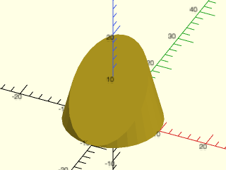

 

    include <BOSL2/std.scad>
    half_of(DOWN+BACK, cp=[0,-10,0]) cylinder(h=40, r1=10, r2=0, center=false);

**Example 2:** 

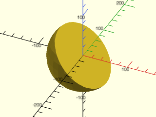

    include <BOSL2/std.scad>
    half_of(DOWN+LEFT, s=200) sphere(d=150);

  

**Example 3:** 

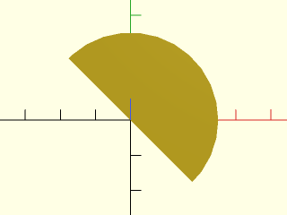

    include <BOSL2/std.scad>
    half_of([1,1], planar=true) circle(d=50);

  

**Example 4:** Using a cut path in 2D

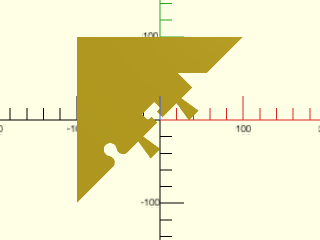

    include <BOSL2/std.scad>
    ppath = partition_path([
            40,
            "jigsaw",
            10,
            "dovetail yflip",
            5,
            "hammerhead 30x20",
            5,
            "dovetail yflip",
            10,
            "sawtooth",
            40,
        ],
        $fn=24
    );
    half_of(LEFT+BACK, cut_path=ppath, s=500, planar=true)
        square(200, center=true);

  

**Example 5:** Using a cut path in 3D

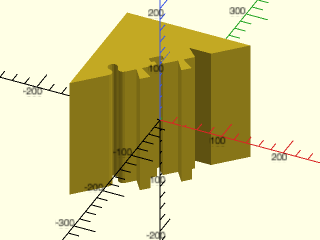

    include <BOSL2/std.scad>
    ppath = partition_path([
            40,
            "jigsaw",
            10,
            "dovetail yflip",
            5,
            "hammerhead 30x20",
            5,
            "dovetail yflip",
            10,
            "sawtooth",
            40,
        ],
        $fn=24
    );
    half_of(LEFT+BACK, cut_path=ppath, s=500)
        cube(200, center=true);

  

---

### Function/Module: left\_half()

**Synopsis:** Masks the right half of an object along the Y-Z plane, leaving the left half. [<abbr>Geom</abbr>] [<abbr>VNF</abbr>] [<abbr>Path</abbr>] [<abbr>Region</abbr>]

**Topics:** [Partitions](Topics#partitions), [Masking](Topics#masking)

**See Also:** [back\_half()](#functionmodule-back_half), [front\_half()](#functionmodule-front_half), [right\_half()](#functionmodule-right_half), [top\_half()](#functionmodule-top_half), [bottom\_half()](#functionmodule-bottom_half), [half\_of()](#functionmodule-half_of), [intersection()](regions.scad#functionmodule-intersection)

**Usage:** as module

- left_half([s], [x]) CHILDREN;
- left_half(planar=true, [s], [x]) CHILDREN;

**Usage:** as function

- result = left_half(p, [x]);

**Description:** 

Slices an object at a vertical Y-Z cut plane, and masks away everything that is right of it.
The `s` parameter is needed for the module version to control the size of the masking cube.
If `s` is too large then the preview display will flip around and display the wrong half,
but if it is too small it won't fully mask your model.

**Arguments:** 

<abbr title="These args can be used by position or by name.">By&nbsp;Position</abbr> | What it does
-------------------- | ------------
`p`                  | VNF, region or path to slice (function version)
`s`                  | Mask size to use.  Use a number larger than twice your object's largest axis.  If you make this too large, OpenSCAD's preview rendering may display the wrong half.  (Module version)  Default: 100
`x`                  | The X coordinate of the cut-plane.  Default: 0
`planar`             | If true, perform a 2D operation.  (Module version)  Default: false.
`cut_path`           | If given a path, uses it to form the partition cut face.  Negative X values in the path will be interpreted as being to the left of the cut plane, when looking at it from the cut-away side, with Z+ up, (or back, if v is UP or DOWN).  Positive X values will be interpreted as being to the right side.  Path Y values equal to 0 are interpreted as being on the cut plane.  Positive Y values are interpreted as being in the direction of the cut plane normal (into the kept side).  Default: undef (cut using a flat plane)
`cut_angle`          | The angle in degrees to rotate the cut mask around the plane normal vector, before partitioning.  Only makes sense when using with cut_path= and planar=false. Module only. Default: 0
`offset`             | The amount to increase the size of the partitioning mask, using `offset()`.  Note: this might be imperfect in the functional form.  Default: 0
`show_frameref`      | If true, draws a frame reference arrow set in the center of the cut plane, to give you a clear idea on how the cut_path slice will be oriented.  Module only.  Default: false
`convexity`          | Max number of times a line could intersect a wall of the surface being formed. Module only.  Default: 10

**Example 1:** 

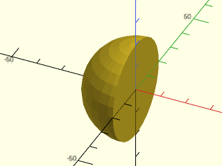

    include <BOSL2/std.scad>
    left_half() sphere(r=20);

  

**Example 2:** 

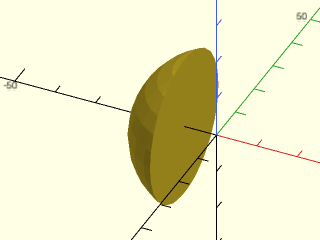

    include <BOSL2/std.scad>
    left_half(x=-8) sphere(r=20);

  

**Example 3:** 

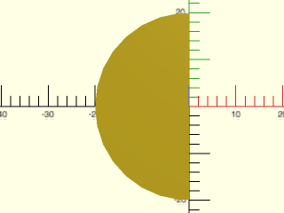

    include <BOSL2/std.scad>
    left_half(planar=true) circle(r=20);

  

**Example 4:** Using a cut path in 2D

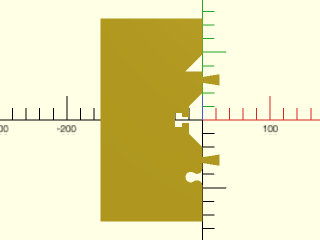

 

    include <BOSL2/std.scad>
    ppath = partition_path([
            40, "jigsaw", "dovetail yflip", 40,
            "hammerhead 30x20",
            40, "dovetail yflip", "sawtooth", 40,
        ],
        altpath=[[-200,0],[-40,0],[-20,20],[20,20],[40,0],[200,0]],
        $fn=24
    );
    left_half(cut_path=ppath, s=310, planar=true) square(300, center=true);

**Example 5:** Using a cut path in 3D

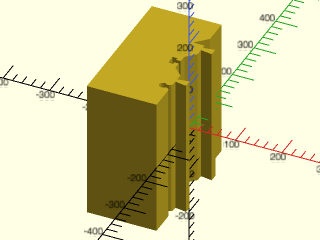

 

    include <BOSL2/std.scad>
    ppath = partition_path([
            40, "jigsaw", "dovetail yflip", 40,
            "hammerhead 30x20",
            40, "dovetail yflip", "sawtooth", 40,
        ],
        altpath=[[-200,0],[-40,0],[-20,20],[20,20],[40,0],[200,0]],
        $fn=24
    );
    left_half(cut_path=ppath, s=310)
        cube(300, center=true);

---

### Function/Module: right\_half()

**Synopsis:** Masks the left half of an object along the Y-Z plane, leaving the right half. [<abbr>Geom</abbr>] [<abbr>VNF</abbr>] [<abbr>Path</abbr>] [<abbr>Region</abbr>]

**Topics:** [Partitions](Topics#partitions), [Masking](Topics#masking)

**See Also:** [back\_half()](#functionmodule-back_half), [front\_half()](#functionmodule-front_half), [left\_half()](#functionmodule-left_half), [top\_half()](#functionmodule-top_half), [bottom\_half()](#functionmodule-bottom_half), [half\_of()](#functionmodule-half_of), [intersection()](regions.scad#functionmodule-intersection)

**Usage:** as module

- right_half([s=], [x=]) CHILDREN;
- right_half(planar=true, [s=], [x=]) CHILDREN;

**Usage:** as function

- result = right_half(p, [x=]);

**Description:** 

Slices an object at a vertical Y-Z cut plane, and masks away everything that is left of it.
The `s` parameter is needed for the module version to control the size of the masking cube.
If `s` is too large then the preview display will flip around and display the wrong half,
but if it is too small it won't fully mask your model.

**Arguments:** 

<abbr title="These args can be used by position or by name.">By&nbsp;Position</abbr> | What it does
-------------------- | ------------
`p`                  | VNF, region or path to slice (function version)
`s`                  | Mask size to use.  Use a number larger than twice your object's largest axis.  If you make this too large, OpenSCAD's preview rendering may display the wrong half.  (Module version)  Default: 100
`x`                  | The X coordinate of the cut-plane.  Default: 0
`planar`             | If true, perform a 2D operation.  (Module version)  Default: false.
`cut_path`           | If given a path, uses it to form the partition cut face.  Negative X values in the path will be interpreted as being to the left of the cut plane, when looking at it from the cut-away side, with Z+ up, (or back, if v is UP or DOWN).  Positive X values will be interpreted as being to the right side.  Path Y values equal to 0 are interpreted as being on the cut plane.  Positive Y values are interpreted as being in the direction of the cut plane normal (into the kept side).  Default: undef (cut using a flat plane)
`cut_angle`          | The angle in degrees to rotate the cut mask around the plane normal vector, before partitioning.  Only makes sense when using with cut_path= and planar=false. Module only. Default: 0
`offset`             | The amount to increase the size of the partitioning mask, using `offset()`.  Note: this might be imperfect in the functional form.  Default: 0
`show_frameref`      | If true, draws a frame reference arrow set in the center of the cut plane, to give you a clear idea on how the cut_path slice will be oriented.  Module only.  Default: false
`convexity`          | Max number of times a line could intersect a wall of the surface being formed. Module only.  Default: 10

**Example 1:** 

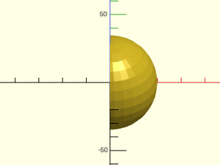

    include <BOSL2/std.scad>
    right_half() sphere(r=20);

  

**Example 2:** 

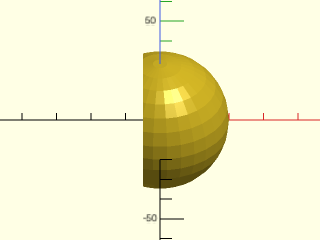

    include <BOSL2/std.scad>
    right_half(x=-5) sphere(r=20);

  

**Example 3:** 

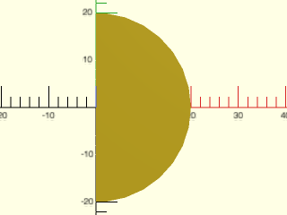

    include <BOSL2/std.scad>
    right_half(planar=true) circle(r=20);

  

**Example 4:** Using a cut path in 2D

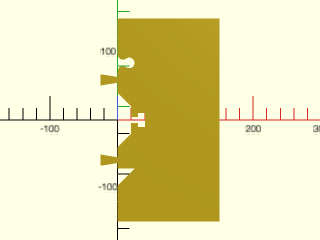

 

    include <BOSL2/std.scad>
    ppath = partition_path([
            40, "jigsaw", "dovetail yflip", 40,
            "hammerhead 30x20",
            40, "dovetail yflip", "sawtooth", 40,
        ],
        altpath=[[-200,0],[-40,0],[-20,20],[20,20],[40,0],[200,0]],
        $fn=24
    );
    right_half(cut_path=ppath, s=310, planar=true) square(300, center=true);

**Example 5:** Using a cut path in 3D

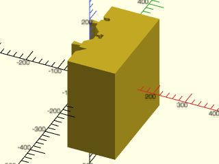

 

    include <BOSL2/std.scad>
    ppath = partition_path([
            40, "jigsaw", "dovetail yflip", 40,
            "hammerhead 30x20",
            40, "dovetail yflip", "sawtooth", 40,
        ],
        altpath=[[-200,0],[-40,0],[-20,20],[20,20],[40,0],[200,0]],
        $fn=24
    );
    right_half(cut_path=ppath, s=310)
        cube(300, center=true);

---

### Function/Module: front\_half()

**Synopsis:** Masks the back half of an object along the X-Z plane, leaving the front half. [<abbr>Geom</abbr>] [<abbr>VNF</abbr>] [<abbr>Path</abbr>] [<abbr>Region</abbr>]

**Topics:** [Partitions](Topics#partitions), [Masking](Topics#masking)

**See Also:** [back\_half()](#functionmodule-back_half), [left\_half()](#functionmodule-left_half), [right\_half()](#functionmodule-right_half), [top\_half()](#functionmodule-top_half), [bottom\_half()](#functionmodule-bottom_half), [half\_of()](#functionmodule-half_of), [intersection()](regions.scad#functionmodule-intersection)

**Usage:** 

- front_half([s], [y]) CHILDREN;
- front_half(planar=true, [s], [y]) CHILDREN;

**Usage:** as function

- result = front_half(p, [y]);

**Description:** 

Slices an object at a vertical X-Z cut plane, and masks away everything that is behind it.
The `s` parameter is needed for the module version to control the size of the masking cube.
If `s` is too large then the preview display will flip around and display the wrong half,
but if it is too small it won't fully mask your model.

**Arguments:** 

<abbr title="These args can be used by position or by name.">By&nbsp;Position</abbr> | What it does
-------------------- | ------------
`p`                  | VNF, region or path to slice (function version)
`s`                  | Mask size to use.  Use a number larger than twice your object's largest axis.  If you make this too large, OpenSCAD's preview rendering may display the wrong half.  (Module version)  Default: 100
`y`                  | The Y coordinate of the cut-plane.  Default: 0
`planar`             | If true, perform a 2D operation.  (Module version)  Default: false.
`cut_path`           | If given a path, uses it to form the partition cut face.  Negative X values in the path will be interpreted as being to the left of the cut plane, when looking at it from the cut-away side, with Z+ up, (or back, if v is UP or DOWN).  Positive X values will be interpreted as being to the right side.  Path Y values equal to 0 are interpreted as being on the cut plane.  Positive Y values are interpreted as being in the direction of the cut plane normal (into the kept side).  Default: undef (cut using a flat plane)
`cut_angle`          | The angle in degrees to rotate the cut mask around the plane normal vector, before partitioning.  Only makes sense when using with cut_path= and planar=false. Module only. Default: 0
`offset`             | The amount to increase the size of the partitioning mask, using `offset()`.  Note: this might be imperfect in the functional form.  Default: 0
`show_frameref`      | If true, draws a frame reference arrow set in the center of the cut plane, to give you a clear idea on how the cut_path slice will be oriented.  Module only.  Default: false
`convexity`          | Max number of times a line could intersect a wall of the surface being formed. Module only.  Default: 10

**Example 1:** 

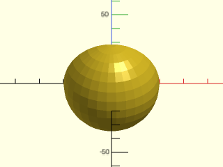

    include <BOSL2/std.scad>
    front_half() sphere(r=20);

  

**Example 2:** 

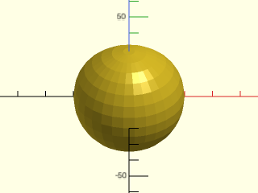

    include <BOSL2/std.scad>
    front_half(y=5) sphere(r=20);

  

**Example 3:** 

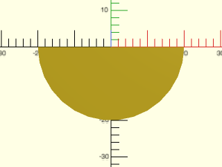

    include <BOSL2/std.scad>
    front_half(planar=true) circle(r=20);

  

**Example 4:** Using a cut path in 2D

 

    include <BOSL2/std.scad>
    ppath = partition_path([
            40, "jigsaw", "dovetail yflip", 40,
            "hammerhead 30x20",
            40, "dovetail yflip", "sawtooth", 40,
        ],
        altpath=[[-200,0],[-40,0],[-20,20],[20,20],[40,0],[200,0]],
        $fn=24
    );
    front_half(cut_path=ppath, s=310, planar=true) square(300, center=true);

**Example 5:** Using a cut path in 3D

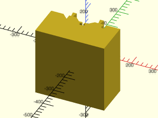

 

    include <BOSL2/std.scad>
    ppath = partition_path([
            40, "jigsaw", "dovetail yflip", 40,
            "hammerhead 30x20",
            40, "dovetail yflip", "sawtooth", 40,
        ],
        altpath=[[-200,0],[-40,0],[-20,20],[20,20],[40,0],[200,0]],
        $fn=24
    );
    front_half(cut_path=ppath, s=310)
        cube(300, center=true);

---

### Function/Module: back\_half()

**Synopsis:** Masks the front half of an object along the X-Z plane, leaving the back half. [<abbr>Geom</abbr>] [<abbr>VNF</abbr>] [<abbr>Path</abbr>] [<abbr>Region</abbr>]

**Topics:** [Partitions](Topics#partitions), [Masking](Topics#masking)

**See Also:** [front\_half()](#functionmodule-front_half), [left\_half()](#functionmodule-left_half), [right\_half()](#functionmodule-right_half), [top\_half()](#functionmodule-top_half), [bottom\_half()](#functionmodule-bottom_half), [half\_of()](#functionmodule-half_of), [intersection()](regions.scad#functionmodule-intersection)

**Usage:** 

- back_half([s], [y]) CHILDREN;
- back_half(planar=true, [s], [y]) CHILDREN;

**Usage:** as function

- result = back_half(p, [y]);

**Description:** 

Slices an object at a vertical X-Z cut plane, and masks away everything that is in front of it.
The `s` parameter is needed for the module version to control the size of the masking cube.
If `s` is too large then the preview display will flip around and display the wrong half,
but if it is too small it won't fully mask your model.

**Arguments:** 

<abbr title="These args can be used by position or by name.">By&nbsp;Position</abbr> | What it does
-------------------- | ------------
`p`                  | VNF, region or path to slice (function version)
`s`                  | Mask size to use.  Use a number larger than twice your object's largest axis.  If you make this too large, OpenSCAD's preview rendering may display the wrong half.  (Module version)  Default: 100
`y`                  | The Y coordinate of the cut-plane.  Default: 0
`planar`             | If true, perform a 2D operation.  (Module version)  Default: false.
`cut_path`           | If given a path, uses it to form the partition cut face.  Negative X values in the path will be interpreted as being to the left of the cut plane, when looking at it from the cut-away side, with Z+ up, (or back, if v is UP or DOWN).  Positive X values will be interpreted as being to the right side.  Path Y values equal to 0 are interpreted as being on the cut plane.  Positive Y values are interpreted as being in the direction of the cut plane normal (into the kept side).  Default: undef (cut using a flat plane)
`cut_angle`          | The angle in degrees to rotate the cut mask around the plane normal vector, before partitioning.  Only makes sense when using with cut_path= and planar=false. Module only. Default: 0
`offset`             | The amount to increase the size of the partitioning mask, using `offset()`.  Note: this might be imperfect in the functional form.  Default: 0
`show_frameref`      | If true, draws a frame reference arrow set in the center of the cut plane, to give you a clear idea on how the cut_path slice will be oriented.  Module only.  Default: false
`convexity`          | Max number of times a line could intersect a wall of the surface being formed. Module only.  Default: 10

**Example 1:** 

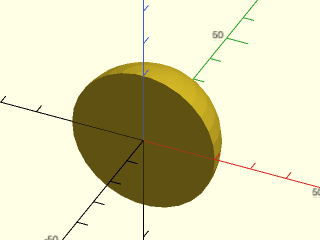

    include <BOSL2/std.scad>
    back_half() sphere(r=20);

  

**Example 2:** 

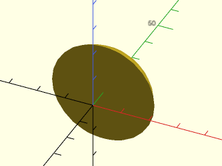

    include <BOSL2/std.scad>
    back_half(y=8) sphere(r=20);

  

**Example 3:** 

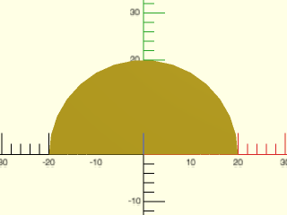

    include <BOSL2/std.scad>
    back_half(planar=true) circle(r=20);

  

**Example 4:** Using a cut path in 2D

 

    include <BOSL2/std.scad>
    ppath = partition_path([
            40, "jigsaw", "dovetail yflip", 40,
            "hammerhead 30x20",
            40, "dovetail yflip", "sawtooth", 40,
        ],
        altpath=[[-200,0],[-40,0],[-20,20],[20,20],[40,0],[200,0]],
        $fn=24
    );
    back_half(cut_path=ppath, s=310, planar=true) square(300, center=true);

**Example 5:** Using a cut path in 3D

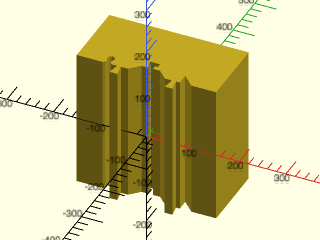

 

    include <BOSL2/std.scad>
    ppath = partition_path([
            40, "jigsaw", "dovetail yflip", 40,
            "hammerhead 30x20",
            40, "dovetail yflip", "sawtooth", 40,
        ],
        altpath=[[-200,0],[-40,0],[-20,20],[20,20],[40,0],[200,0]],
        $fn=24
    );
    back_half(cut_path=ppath, s=310)
        cube(300, center=true);

---

### Function/Module: bottom\_half()

**Synopsis:** Masks the top half of an object along the X-Y plane, leaving the bottom half. [<abbr>Geom</abbr>] [<abbr>VNF</abbr>] [<abbr>Path</abbr>] [<abbr>Region</abbr>]

**Topics:** [Partitions](Topics#partitions), [Masking](Topics#masking)

**See Also:** [back\_half()](#functionmodule-back_half), [front\_half()](#functionmodule-front_half), [left\_half()](#functionmodule-left_half), [right\_half()](#functionmodule-right_half), [top\_half()](#functionmodule-top_half), [half\_of()](#functionmodule-half_of), [intersection()](regions.scad#functionmodule-intersection)

**Usage:** 

- bottom_half([s], [z]) CHILDREN;

**Usage:** as function

- result = bottom_half(p, [z]);

**Description:** 

Slices an object at a horizontal X-Y cut plane, and masks away everything that is above it.
The `s` parameter is needed for the module version to control the size of the masking cube.
If `s` is too large then the preview display will flip around and display the wrong half,
but if it is too small it won't fully mask your model.

**Arguments:** 

<abbr title="These args can be used by position or by name.">By&nbsp;Position</abbr> | What it does
-------------------- | ------------
`p`                  | VNF, region or path to slice (function version)
`s`                  | Mask size to use.  Use a number larger than twice your object's largest axis.  If you make this too large, OpenSCAD's preview rendering may display the wrong half.  (Module version)  Default: 100
`z`                  | The Z coordinate of the cut-plane.  Default: 0
`planar`             | If true, perform a 2D operation.  When planar, becomes equivalent of `front_half()`.  (Module version).  Default: false.
`cut_path`           | If given a path, uses it to form the partition cut face.  Negative X values in the path will be interpreted as being to the left of the cut plane, when looking at it from the cut-away side, with Z+ up, (or back, if v is UP or DOWN).  Positive X values will be interpreted as being to the right side.  Path Y values equal to 0 are interpreted as being on the cut plane.  Positive Y values are interpreted as being in the direction of the cut plane normal (into the kept side).  Default: undef (cut using a flat plane)
`cut_angle`          | The angle in degrees to rotate the cut mask around the plane normal vector, before partitioning.  Only makes sense when using with cut_path= and planar=false. Module only. Default: 0
`offset`             | The amount to increase the size of the partitioning mask, using `offset()`.  Note: this might be imperfect in the functional form.  Default: 0
`show_frameref`      | If true, draws a frame reference arrow set in the center of the cut plane, to give you a clear idea on how the cut_path slice will be oriented.  Module only.  Default: false
`convexity`          | Max number of times a line could intersect a wall of the surface being formed. Module only.  Default: 10

**Example 1:** 

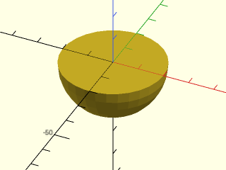

    include <BOSL2/std.scad>
    bottom_half() sphere(r=20);

  

**Example 2:** 

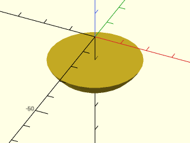

    include <BOSL2/std.scad>
    bottom_half(z=-10) sphere(r=20);

  

**Example 3:** Working in 2D

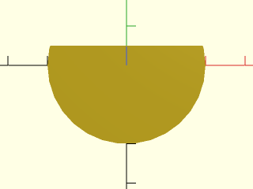

    include <BOSL2/std.scad>
    bottom_half(z=5,planar=true) circle(r=20);

  

**Example 4:** Using a cut path in 2D

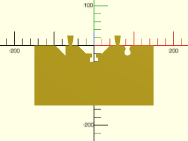

 

    include <BOSL2/std.scad>
    ppath = partition_path([
            40, "jigsaw", "dovetail yflip", 40,
            "hammerhead 30x20",
            40, "dovetail yflip", "sawtooth", 40,
        ],
        altpath=[[-200,0],[-40,0],[-20,20],[20,20],[40,0],[200,0]],
        $fn=24
    );
    bottom_half(cut_path=ppath, s=310, planar=true) square(300, center=true);

**Example 5:** Using a cut path in 3D

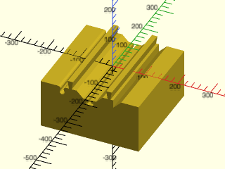

 

    include <BOSL2/std.scad>
    ppath = partition_path([
            40, "jigsaw", "dovetail yflip", 40,
            "hammerhead 30x20",
            40, "dovetail yflip", "sawtooth", 40,
        ],
        altpath=[[-200,0],[-40,0],[-20,20],[20,20],[40,0],[200,0]],
        $fn=24
    );
    bottom_half(cut_path=ppath, s=310)
        cube(300, center=true);

---

### Function/Module: top\_half()

**Synopsis:** Masks the bottom half of an object along the X-Y plane, leaving the top half. [<abbr>Geom</abbr>] [<abbr>VNF</abbr>] [<abbr>Path</abbr>] [<abbr>Region</abbr>]

**Topics:** [Partitions](Topics#partitions), [Masking](Topics#masking)

**See Also:** [back\_half()](#functionmodule-back_half), [front\_half()](#functionmodule-front_half), [left\_half()](#functionmodule-left_half), [right\_half()](#functionmodule-right_half), [bottom\_half()](#functionmodule-bottom_half), [half\_of()](#functionmodule-half_of), [intersection()](regions.scad#functionmodule-intersection)

**Usage:** as module

- top_half([s], [z]) CHILDREN;

**Usage:** as function

- result = top_half(p, [z]);

**Description:** 

Slices an object at a horizontal X-Y cut plane, and masks away everything that is below it.
The `s` parameter is needed for the module version to control the size of the masking cube.
If `s` is too large then the preview display will flip around and display the wrong half,
but if it is too small it won't fully mask your model.

**Arguments:** 

<abbr title="These args can be used by position or by name.">By&nbsp;Position</abbr> | What it does
-------------------- | ------------
`p`                  | VNF, region or path to slice (function version)
`s`                  | Mask size to use.  Use a number larger than twice your object's largest axis.  If you make this too large, OpenSCAD's preview rendering may display the wrong half.  (Module version)  Default: 100
`z`                  | The Z coordinate of the cut-plane.  Default: 0
`planar`             | If true, perform a 2D operation.  When planar, becomes equivalent of `back_half()`.  (Module version).  Default: false.
`cut_path`           | If given a path, uses it to form the partition cut face.  Negative X values in the path will be interpreted as being to the left of the cut plane, when looking at it from the cut-away side, with Z+ up, (or back, if v is UP or DOWN).  Positive X values will be interpreted as being to the right side.  Path Y values equal to 0 are interpreted as being on the cut plane.  Positive Y values are interpreted as being in the direction of the cut plane normal (into the kept side).  Default: undef (cut using a flat plane)
`cut_angle`          | The angle in degrees to rotate the cut mask around the plane normal vector, before partitioning.  Only makes sense when using with cut_path= and planar=false. Module only. Default: 0
`offset`             | The amount to increase the size of the partitioning mask, using `offset()`.  Note: this might be imperfect in the functional form.  Default: 0
`show_frameref`      | If true, draws a frame reference arrow set in the center of the cut plane, to give you a clear idea on how the cut_path slice will be oriented.  Module only.  Default: false
`convexity`          | Max number of times a line could intersect a wall of the surface being formed. Module only.  Default: 10

**Example 1:** 

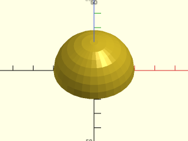

    include <BOSL2/std.scad>
    top_half() sphere(r=20);

  

**Example 2:** 

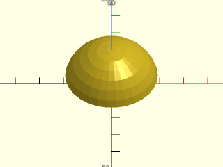

    include <BOSL2/std.scad>
    top_half(z=5) sphere(r=20);

  

**Example 3:** Working in 2D

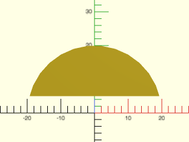

    include <BOSL2/std.scad>
    top_half(z=5,planar=true) circle(r=20);

  

**Example 4:** Using a cut path in 2D

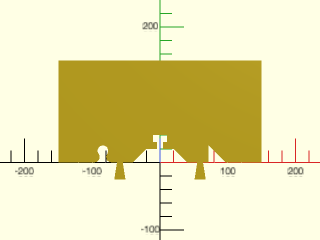

 

    include <BOSL2/std.scad>
    ppath = partition_path([
            40, "jigsaw", "dovetail yflip", 40,
            "hammerhead 30x20",
            40, "dovetail yflip", "sawtooth", 40,
        ],
        altpath=[[-200,0],[-40,0],[-20,20],[20,20],[40,0],[200,0]],
        $fn=24
    );
    top_half(cut_path=ppath, s=310, planar=true) square(300, center=true);

**Example 5:** Using a cut path in 3D

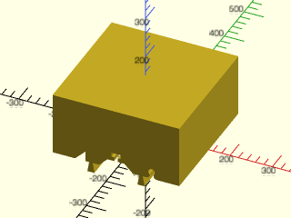

 

    include <BOSL2/std.scad>
    ppath = partition_path([
            40, "jigsaw", "dovetail yflip", 40,
            "hammerhead 30x20",
            40, "dovetail yflip", "sawtooth", 40,
        ],
        altpath=[[-200,0],[-40,0],[-20,20],[20,20],[40,0],[200,0]],
        $fn=24
    );
    top_half(cut_path=ppath, s=310)
        cube(300, center=true);

---

## Section: Partioning into Interlocking Pieces

### Module: partition\_mask()

**Synopsis:** Creates a mask to remove half an object with the remaining half suitable for reassembly. [<abbr>Geom</abbr>]

**Topics:** [Partitions](Topics#partitions), [Masking](Topics#masking), [Paths](Topics#paths)

**See Also:** [partition\_cut\_mask()](#module-partition_cut_mask), [partition()](#module-partition), [dovetail()](joiners.scad#module-dovetail)

**Usage:** 

- partition_mask(l, w, h, [cutsize], [cutpath], [gap], [inverse], [$slop=], [anchor=], [spin=], [orient=]) [ATTACHMENTS];

**Description:** 

Creates a mask that you can use to difference or intersect with an object to remove half of it,
leaving behind a side designed to allow assembly of the sub-parts.

**Arguments:** 

<abbr title="These args can be used by position or by name.">By&nbsp;Position</abbr> | What it does
-------------------- | ------------
`l`                  | The length of the cut axis.
`w`                  | The width of the part to be masked, back from the cut plane.
`h`                  | The height of the part to be masked.
`cutsize`            | The width of the cut pattern to be used.
`cutpath`            | The cutpath to use.  Standard named paths are "flat", "sawtooth", "sinewave", "comb", "finger", "dovetail", "hammerhead", and "jigsaw".  Alternatively, you can give a cutpath as a 2D path, where X is between 0 and 1, and Y is between -0.5 and 0.5.
`gap`                | Empty gaps between cutpath iterations.  Default: 0
`cutpath_centered`   | Ensures the cutpath is always centered.  Default: true
`inverse`            | If true, create a cutpath that is meant to mate to a non-inverted cutpath.
`convexity`          | Max number of times a line could intersect a wall of the surface being formed. Module only.  Default: 10
`spin`               | Rotate this many degrees around the Z axis.  See [spin](attachments.scad#subsection-spin).  Default: `0`
`orient`             | Vector to rotate top towards.  See [orient](attachments.scad#subsection-orient).  Default: `UP`
`$slop`              | The amount to shrink the mask by, to correct for printer-specific fitting.

**Example 1:** 

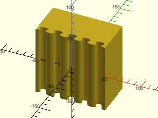

    include <BOSL2/std.scad>
    partition_mask(w=50, gap=0, cutpath="jigsaw", $fn=12);

  

**Example 2:** 

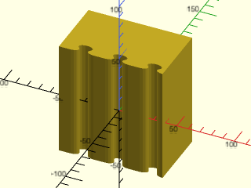

    include <BOSL2/std.scad>
    partition_mask(w=50, gap=10, cutpath="jigsaw", $fn=12);

  

**Example 3:** 

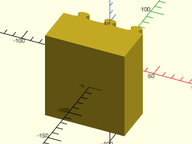

 

    include <BOSL2/std.scad>
    partition_mask(w=50, gap=10, cutpath="jigsaw", inverse=true, $fn=12);

**Example 4:** 

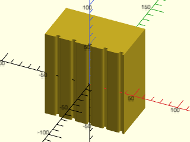

 

    include <BOSL2/std.scad>
    partition_mask(w=50, gap=10, cutsize=4, cutpath="jigsaw", $fn=12);

**Example 5:** 

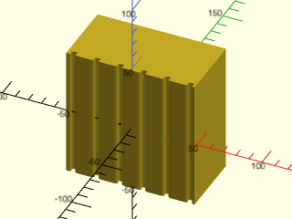

 

    include <BOSL2/std.scad>
    partition_mask(w=50, gap=10, cutsize=4, cutpath="jigsaw", cutpath_centered=false, $fn=12);

**Example 6:** 

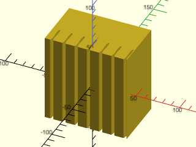

 

    include <BOSL2/std.scad>
    partition_mask(w=50, gap=10, cutsize=[4,20], cutpath="jigsaw", $fn=12);

**Example 7:** 

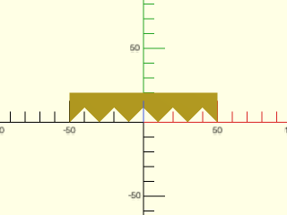

    include <BOSL2/std.scad>
    partition_mask(w=20, cutpath="sawtooth");

  

**Example 8:** 

    include <BOSL2/std.scad>
    partition_mask(w=20, cutpath="sinewave", $fn=12);

  

**Example 9:** 

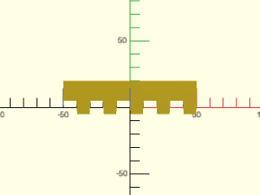

    include <BOSL2/std.scad>
    partition_mask(w=20, cutpath="comb");

  

**Example 10:** 

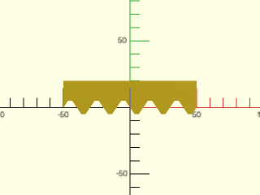

    include <BOSL2/std.scad>
    partition_mask(w=20, cutpath="finger");

  

**Example 11:** 

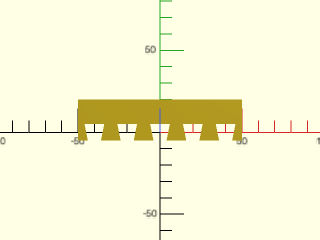

    include <BOSL2/std.scad>
    partition_mask(w=20, cutpath="dovetail");

  

**Example 12:** 

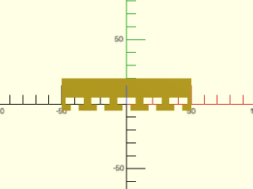

    include <BOSL2/std.scad>
    partition_mask(w=20, cutpath="hammerhead");

  

**Example 13:** 

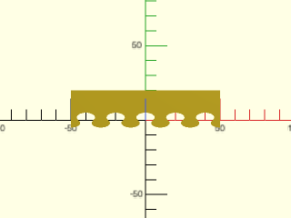

    include <BOSL2/std.scad>
    partition_mask(w=20, cutpath="jigsaw", $fn=12);

  

---

### Module: partition\_cut\_mask()

**Synopsis:** Creates a mask to cut an object into two subparts that can be reassembled. [<abbr>Geom</abbr>]

**Topics:** [Partitions](Topics#partitions), [Masking](Topics#masking), [Paths](Topics#paths)

**See Also:** [partition\_mask()](#module-partition_mask), [partition()](#module-partition), [dovetail()](joiners.scad#module-dovetail)

**Usage:** 

- partition_cut_mask(l, [cutsize], [cutpath], [gap], [inverse], [$slop=], [anchor=], [spin=], [orient=]) [ATTACHMENTS];

**Description:** 

Creates a mask that you can use to difference with an object to cut it into two sub-parts that can be assembled.
The `$slop` value is important to get the proper fit and should probably be smaller than 0.2.  The examples below
use larger values to make the mask easier to see.

**Arguments:** 

<abbr title="These args can be used by position or by name.">By&nbsp;Position</abbr> | What it does
-------------------- | ------------
`l`                  | The length of the cut axis.
`h`                  | The height of the part to be masked.
`cutsize`            | The width of the cut pattern to be used.  Default: 10
`cutpath`            | The cutpath to use.  Standard named paths are "flat", "sawtooth", "sinewave", "comb", "finger", "dovetail", "hammerhead", and "jigsaw".  Alternatively, you can give a cutpath as a 2D path, where X is between 0 and 1, and Y is between -0.5 and 0.5.  Default: "jigsaw"
`gap`                | Empty gaps between cutpath iterations.  Default: 0
`cutpath_centered`   | Ensures the cutpath is always centered.  Default: true
`spin`               | Rotate this many degrees around the Z axis.  See [spin](attachments.scad#subsection-spin).  Default: `0`
`orient`             | Vector to rotate top towards.  See [orient](attachments.scad#subsection-orient).  Default: `UP`
`convexity`          | Max number of times a line could intersect a wall of the surface being formed. Module only.  Default: 10
`$slop`              | The width of the cut mask, to correct for printer-specific fitting.

**Example 1:** 

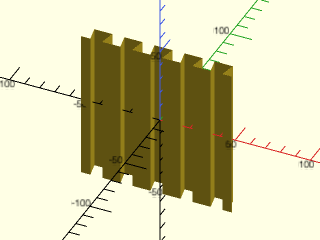

    include <BOSL2/std.scad>
    partition_cut_mask(gap=0, cutpath="dovetail");

  

**Example 2:** 

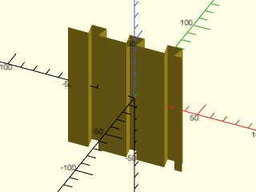

    include <BOSL2/std.scad>
    partition_cut_mask(gap=10, cutpath="dovetail");

  

**Example 3:** 

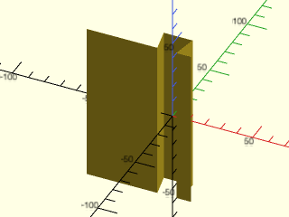

    include <BOSL2/std.scad>
    partition_cut_mask(gap=10, cutsize=15, cutpath="dovetail");

  

**Example 4:** 

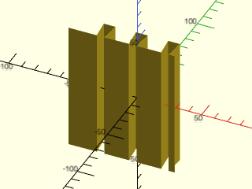

 

    include <BOSL2/std.scad>
    partition_cut_mask(gap=10, cutsize=[15,15], cutpath="dovetail");

**Example 5:** 

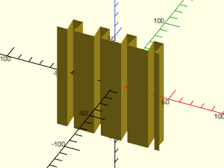

 

    include <BOSL2/std.scad>
    partition_cut_mask(gap=10, cutsize=[15,15], cutpath="dovetail", cutpath_centered=false);

**Example 6:** 

 

    include <BOSL2/std.scad>
    partition_cut_mask(cutpath="sawtooth",$slop=0.5);

**Example 7:** 

 

    include <BOSL2/std.scad>
    partition_cut_mask(cutpath="sinewave",$slop=0.5,$fn=12);

**Example 8:** 

 

    include <BOSL2/std.scad>
    partition_cut_mask(cutpath="comb",$slop=0.5);

**Example 9:** 

 

    include <BOSL2/std.scad>
    partition_cut_mask(cutpath="finger",$slop=0.5);

**Example 10:** 

 

    include <BOSL2/std.scad>
    partition_cut_mask(cutpath="dovetail",$slop=1);

**Example 11:** 

 

    include <BOSL2/std.scad>
    partition_cut_mask(cutpath="hammerhead",$slop=1);

**Example 12:** 

 

    include <BOSL2/std.scad>
    partition_cut_mask(cutpath="jigsaw",h=10,$slop=0.5,$fn=12);

---

### Module: partition()

**Synopsis:** Cuts an object in two with matched joining edges, then separates the parts. [<abbr>Geom</abbr>] [<abbr>VNF</abbr>] [<abbr>Path</abbr>] [<abbr>Region</abbr>]

**Topics:** [Partitions](Topics#partitions), [Masking](Topics#masking), [Paths](Topics#paths)

**See Also:** [partition\_cut\_mask()](#module-partition_cut_mask), [partition\_mask()](#module-partition_mask), [dovetail()](joiners.scad#module-dovetail)

**Usage:** 

- partition(size, [spread], [cutsize], [cutpath], [gap], [spin], [$slop=]) CHILDREN;

**Description:** 

Partitions an object into two parts, spread apart a small distance, with matched joining edges.
If you only need one side of the partition you can use `$idx` in the children.

**Arguments:** 

<abbr title="These args can be used by position or by name.">By&nbsp;Position</abbr> | What it does
-------------------- | ------------
`size`               | The [X,Y,Z] size of the object to partition.
`spread`             | The distance to spread the two parts by. Default: 10

<abbr title="These args must be used by name, ie: name=value">By&nbsp;Name</abbr> | What it does
-------------------- | ------------
`cutsize`            | The width of the cut pattern to be used.  Default: 10
`cutpath`            | The cutpath to use.  Standard named paths are "flat", "sawtooth", "sinewave", "comb", "finger", "dovetail", "hammerhead", and "jigsaw".  Alternatively, you can give a cutpath as a 2D path, where X is between 0 and 1, and Y is between -0.5 and 0.5.  Default: "jigsaw"
`gap`                | Empty gaps between cutpath iterations.  Default: 0
`cutpath_centered`   | Ensures the cutpath is always centered.  Default: true
`spin`               | Rotate this many degrees around the Z axis.  See [spin](attachments.scad#subsection-spin).  Default: `0`
`convexity`          | Max number of times a line could intersect a wall of the surface being formed. Module only.  Default: 10
`$slop`              | Extra gap to leave to correct for printer-specific fitting.

**Side Effects:** 

- `$idx` is set to 0 on the back part and 1 on the front part.

**Example 1:** 

 

    include <BOSL2/std.scad>
    partition(spread=12, cutpath="dovetail") cylinder(h=50, d=80, center=false);

**Example 2:** 

 

    include <BOSL2/std.scad>
    partition(spread=12, gap=10, cutpath="dovetail") cylinder(h=50, d=80, center=false);

**Example 3:** 

 

    include <BOSL2/std.scad>
    partition(spread=12, gap=10, cutpath="dovetail", cutpath_centered=false) cylinder(h=50, d=80, center=false);

**Example 4:** 

 

    include <BOSL2/std.scad>
    partition(spread=20, gap=10, cutsize=15, cutpath="dovetail") cylinder(h=50, d=80, center=false);

**Example 5:** 

 

    include <BOSL2/std.scad>
    partition(spread=25, gap=10, cutsize=[20,20], cutpath="dovetail") cylinder(h=50, d=80, center=false);

**Example 6:** 

 

    include <BOSL2/std.scad>
    partition(cutpath="sawtooth") cylinder(h=50, d=80, center=false);

**Example 7:** 

 

    include <BOSL2/std.scad>
    partition(cutpath="sinewave") cylinder(h=50, d=80, center=false);

**Example 8:** 

 

    include <BOSL2/std.scad>
    partition(cutpath="comb") cylinder(h=50, d=80, center=false);

**Example 9:** 

 

    include <BOSL2/std.scad>
    partition(cutpath="finger") cylinder(h=50, d=80, center=false);

**Example 10:** 

 

    include <BOSL2/std.scad>
    partition(spread=12, cutpath="dovetail") cylinder(h=50, d=80, center=false);

**Example 11:** 

 

    include <BOSL2/std.scad>
    partition(spread=12, cutpath="hammerhead") cylinder(h=50, d=80, center=false);

**Example 12:** 

 

    include <BOSL2/std.scad>
    partition(cutpath="jigsaw", $fn=12) cylinder(h=50, d=80, center=false);

**Example 13:** Using `$idx` to display only the back piece of the partition

 

    include <BOSL2/std.scad>
    partition(cutpath="jigsaw", $fn=12)
      if ($idx==0) cylinder(h=50, d=80, center=false);

---

### Module: partition\_path()

**Synopsis:** Creates a partition path from a path description. [<abbr>Path</abbr>]

**Topics:** [Partitions](Topics#partitions), [Masking](Topics#masking), [Paths](Topics#paths)

**See Also:** [partition\_cut\_mask()](#module-partition_cut_mask), [partition()](#module-partition)

**Usage:** 

- path = partition_path(pathdesc, [repeat=], [y=], [altpath=], [seglen=], [segwidth=]);

**Description:** 

Creates a partition path from a list of segment descriptors.  Each item in `pathdesc` can be:
- A numeric scalar: a flat section of that length.
- A 2D path: used directly as a segment (no scaling is applied).
- A string: the name of a standard section pattern, optionally followed by space-separated modifiers.

Standard section pattern names are:
- `"flat"`: A flat section.
- `"sawtooth"`: A sawtooth halfwave, with the peak to the left.
- `"square"`: A square halfwave.
- `"triangle"`: A triangular halfwave, with the peak in the center.
- `"halfsine"`: Half of a sine-wave.
- `"semicircle"`: The top half of a circle.
- `"sinewave"`: A full sine wave.
- `"comb"`: A modified square halfwave, with walls at a 2° angle.
- `"finger"`: A modified square halfwave with walls at a 20° angle.
- `"dovetail"`: A modified square halfwave with walls dovetailed out by 9°.
- `"hammerhead"`: A shape useful for making T-slots.
- `"jigsaw"`: The classic interlocking jigsaw puzzle tab shape.

Section pattern names can be suffixed by one or more modifiers, separated by spaces.  Accepted modifier forms are:
- `"<SHAPE> 3x"`: repeats the shape 3 times.
- `"<SHAPE> 20x30"`: Resize the shape to be 20x30 in size.  By default a pattern will be 25 by 25 in size.
- `"<SHAPE> xflip"`: Mirrors the shape along the X axis.
- `"<SHAPE> yflip"`: Mirrors the shape along the Y axis.
- `"<SHAPE> addflip"`: Equivalent to a combination of "<SHAPE>" and "<SHAPE> xflip yflip".
- `"<SHAPE> wave"`: Same as "<SHAPE> addflip".
- `"<SHAPE> skew:15"`: Skews the shape by 15 degrees.
- `"<SHAPE> pinch:33"` or `"<SHAPE> pinch:33%"`: Pinches the top of the shape to 33% the width of the bottom.  Valid range is 0–200.  At 0 the top collapses to a point; at 100 the shape is unchanged; at 200 the top flares to double the width.
- `"<SHAPE> pinch:20deg"`: Pinches the top of the shape by angling each wall inward by 20°.  Negative angles flare the walls outward.  Errors if the angle would cause the walls to cross.
- `"flat 40"`: A flat section of explicit length 40 (equivalent to placing the scalar `40` in a `pathdesc` list).
Modifiers are processed left to right in order.

**Arguments:** 

<abbr title="These args can be used by position or by name.">By&nbsp;Position</abbr> | What it does
-------------------- | ------------
`pathdesc`           | A list of segment descriptors.  Each item is a numeric length (flat section), a 2D path (used as-is), or a string pattern name with optional space-separated modifiers (see Description).

<abbr title="These args must be used by name, ie: name=value">By&nbsp;Name</abbr> | What it does
-------------------- | ------------
`repeat`             | Number of times to repeat the full `pathdesc` sequence along the path.  Default: 1
`y`                  | If given, closes the generated path by connecting its ends at this Y coordinate, and orients the closed path based on the sign of `y`.
`altpath`            | Optional alternate base path which the generated partition pattern will be aligned to.  Default: `[[-9999,0], [+9999,0]]`
`seglen`             | Default length for named string segments that do not specify their own size.  Default: 25
`segwidth`           | Default width for named string segments that do not specify their own size.  Default: 25

**Example 1:** Standard section shapes.

    include <BOSL2/std.scad>
    stroke(partition_path(["flat"]), width=3);

  

**Example 2:** 

    include <BOSL2/std.scad>
    stroke(partition_path(["sawtooth"]), width=3);

  

**Example 3:** 

    include <BOSL2/std.scad>
    stroke(partition_path(["square"]), width=3);

  

**Example 4:** 

    include <BOSL2/std.scad>
    stroke(partition_path(["triangle"]), width=3);

  

**Example 5:** 

    include <BOSL2/std.scad>
    stroke(partition_path(["halfsine"], $fn=24), width=3);

  

**Example 6:** 

    include <BOSL2/std.scad>
    stroke(partition_path(["semicircle"], $fn=24), width=3);

  

**Example 7:** 

    include <BOSL2/std.scad>
    stroke(partition_path(["comb"]), width=3);

  

**Example 8:** 

    include <BOSL2/std.scad>
    stroke(partition_path(["finger"]), width=3);

  

**Example 9:** 

    include <BOSL2/std.scad>
    stroke(partition_path(["dovetail"]), width=3);

  

**Example 10:** 

    include <BOSL2/std.scad>
    stroke(partition_path(["hammerhead"]), width=3);

  

**Example 11:** 

    include <BOSL2/std.scad>
    stroke(partition_path(["jigsaw"], $fn=24), width=3);

  

**Example 12:** Sizing a shape with a `WxH` modifier.

    include <BOSL2/std.scad>
    stroke(partition_path(["jigsaw 40x20"], $fn=36), width=3);

  

**Example 13:** Flipping a shape front-to-back with `yflip`.

    include <BOSL2/std.scad>
    stroke(partition_path(["hammerhead yflip"]), width=3);

  

**Example 14:** Reversing a shape left-to-right with `xflip`.

    include <BOSL2/std.scad>
    stroke(partition_path(["sawtooth xflip"]), width=3);

  

**Example 15:** Building a full wave with `addflip`.

    include <BOSL2/std.scad>
    stroke(partition_path(["sawtooth addflip"]), width=3);

  

**Example 16:** Repeating a shape with `Nx`.

    include <BOSL2/std.scad>
    stroke(partition_path(["sawtooth 5x"]), width=3);

  

**Example 17:** Combining multiple modifiers.

 

    include <BOSL2/std.scad>
    stroke(partition_path(["halfsine addflip yflip 40x30 3x"]), width=3);

**Example 18:** A numeric entry is a flat section of that length.

    include <BOSL2/std.scad>
    stroke(partition_path([30]), width=3);

  

**Example 19:** `"flat N"` is equivalent and more readable in mixed lists.

    include <BOSL2/std.scad>
    stroke(partition_path(["flat 30"]), width=3);

  

**Example 20:** Skewing a shape.

    include <BOSL2/std.scad>
    stroke(partition_path(["square skew:15"]), width=3);

  

**Example 21:** Pinching a shape by percentage.

    include <BOSL2/std.scad>
    stroke(partition_path(["square pinch:30"]), width=3);

  

**Example 22:** Pinching a shape by wall angle — positive angles narrow the top.

    include <BOSL2/std.scad>
    stroke(partition_path(["square pinch:20deg"]), width=3);

  

**Example 23:** Negative `deg` angles flare the top wider.

    include <BOSL2/std.scad>
    stroke(partition_path(["square pinch:-9deg"]), width=3);

  

**Example 24:** You can pass a 2D path directly as a segment; it is used as-is (no scaling).

 

    include <BOSL2/std.scad>
    cust_path = scale([40,30], p=yscale(2, p=arc(n=15, r=0.5, cp=[0.5,0], start=180, angle=-180)));
    stroke(partition_path([cust_path]), width=3);

**Example 25:** You can [`stroke()`](drawing.scad#module-stroke) an unclosed partition path with a given width= to make a wall that you can use to divide a part into two pieces.

    include <BOSL2/std.scad>
    linear_extrude(height=100)
        stroke(
            partition_path([
                    40, "jigsaw", 10, "jigsaw yflip", 40,
                    "hammerhead 30x20",
                    40, "jigsaw yflip", 10, "jigsaw", 40,
                ],
                $fn=24
            ),
            width=3
        );

  

**Example 26:** Use repeat= to repeat a pattern.

    include <BOSL2/std.scad>
    linear_extrude(height=100)
        stroke(
            partition_path(
                ["jigsaw", "jigsaw yflip"],
                repeat=3, $fn=24
            ),
            width=3
        );

  

**Example 27:** To make a mask that you can intersect with or difference from a part, you can extrude a polygon made from a closed path, offset by a slop width.

    include <BOSL2/std.scad>
    $slop = 0.2;
    linear_extrude(height=100)
        offset(r=-$slop)
            polygon(
                partition_path([
                        40, "jigsaw", 10, "jigsaw yflip", 40,
                        "hammerhead 30x20",
                        40, "jigsaw yflip", 10, "jigsaw", 40,
                    ],
                    y=150,
                    $fn=24
                )
            );

  

**Example 28:** You can use list comprehensions in constructing partition path descriptions.

 

    include <BOSL2/std.scad>
    $slop = 0.2;
    linear_extrude(height=100)
        offset(r=-$slop)
            polygon(
                partition_path([
                        50,
                        "jigsaw",
                        30,
                        for (i=[1:4]) each ["sawtooth", "triangle"],
                        30,
                        "jigsaw yflip",
                        50,
                    ],
                    y=150,
                    $fn=24
                )
            );

---

