# LibFile: paths.scad

A `path` is a list of points of the same dimensions, usually 2D or 3D, that can
be connected together to form a sequence of line segments or a polygon.
A `region` is a list of paths that represent polygons, and the functions
in this file work on paths and also 1-regions, which are regions
that include exactly one path.  When you pass a 1-region to a function, the default
value for `closed` is always `true` because regions represent polygons.
Capabilities include computing length of paths, computing
path tangents and normals, resampling of paths, and cutting paths up into smaller paths.

To use, add the following lines to the beginning of your file:

    include <BOSL2/std.scad>

## File Contents

1. [Section: Utility Functions](#section-utility-functions)
    - [`is_path()`](#function-is_path) – Returns True if 'list' is a [path](Glossary#path).
    - [`is_1region()`](#function-is_1region) – Returns true if [path](Glossary#path) is a [region](Glossary#region) with one component.
    - [`force_path()`](#function-force_path) – Checks that path is a region with one component. [<abbr>Path</abbr>]
    - [`path_merge_collinear()`](#function-path_merge_collinear) – Removes unnecessary collinear points from a path. [<abbr>Path</abbr>]
    - [`path_merge_collinear_indexed()`](#function-path_merge_collinear_indexed) – Removes unnecessary collinear points from a path specified as an index list into a list [<abbr>Path</abbr>]

2. [Section: Path length calculation](#section-path-length-calculation)
    - [`path_length()`](#function-path_length) – Returns the path length.
    - [`path_segment_lengths()`](#function-path_segment_lengths) – Returns a list of the lengths of segments in a [path](Glossary#path).
    - [`path_length_fractions()`](#function-path_length_fractions) – Returns the fractional distance of each point along the length of a path.

3. [Section: Resampling - changing the number of points in a path](#section-resampling---changing-the-number-of-points-in-a-path)
    - [`subdivide_path()`](#function-subdivide_path) – Subdivides a path to produce a more finely sampled path. [<abbr>Path</abbr>]
    - [`resample_path()`](#function-resample_path) – Returns an equidistant set of points along a path. [<abbr>Path</abbr>]
    - [`simplify_path()`](#function-simplify_path) – Removes points from an irregular path, preserving dominant features. [<abbr>Path</abbr>]

4. [Section: Path Geometry](#section-path-geometry)
    - [`is_path_simple()`](#function-is_path_simple) – Returns true if a [path](Glossary#path) has no self intersections.
    - [`path_closest_point()`](#function-path_closest_point) – Returns the closest place on a [path](Glossary#path) to a given [point](Glossary#point).
    - [`path_tangents()`](#function-path_tangents) – Returns tangent vectors for each point along a path.
    - [`path_normals()`](#function-path_normals) – Returns normal vectors for each point along a path.
    - [`path_curvature()`](#function-path_curvature) – Returns the estimated numerical curvature of the [path](Glossary#path).
    - [`path_torsion()`](#function-path_torsion) – Returns the estimated numerical torsion of the [path](Glossary#path).
    - [`surface_normals()`](#function-surface_normals) – Estimates the normals to a surface defined by a [point](Glossary#point) array

5. [Section: Breaking paths up into subpaths](#section-breaking-paths-up-into-subpaths)
    - [`path_cut()`](#function-path_cut) – Cuts a [path](Glossary#path) into subpaths at various [points](Glossary#point). [<abbr>PathList</abbr>]
    - [`path_cut_points()`](#function-path_cut_points) – Returns a list of cut [points](Glossary#point) at a list of distances from the first point in a [path](Glossary#path).
    - [`split_path_at_self_crossings()`](#function-split_path_at_self_crossings) – Split a 2D [path](Glossary#path) wherever it crosses itself. [<abbr>PathList</abbr>]
    - [`polygon_parts()`](#function-polygon_parts) – Parses a self-intersecting polygon into a list of non-intersecting [polygons](Glossary#polygon). [<abbr>PathList</abbr>]

## Section: Utility Functions

**Definitions:** 

Point: A list of numbers, also called a vector.  Usually has length 2 or 3 to represent points in the place on points in space.

Pointlist: An unordered list of <a href="Glossary#point">points</a>.

Path: An ordered list of two or more <a href="Glossary#point">points</a> specifying a path through space.  Usually points are 2D.

Polygon: A <a href="Glossary#path">path</a>, usually 2D, that describes a polygon by asuming that the first and last point are connected.

### Function: is\_path()

**Synopsis:** Returns True if 'list' is a [path](Glossary#path).

**Topics:** [Paths](Topics#paths)

**See Also:** [is\_region()](regions.scad#function-is_region), [is\_vnf()](vnf.scad#function-is_vnf)

**Usage:** 

- is_path(list, [dim], [fast])

**Description:** 

Returns true if `list` is a [path](Glossary#path).  A path is a list of two or more numeric vectors (AKA [points](Glossary#point)).
All vectors must of the same size, and must contain numbers that are not inf or nan.
By default the vectors in a path must be 2D or 3D.  Set the `dim` parameter to specify a list
of allowed dimensions, or set it to `undef` to allow any dimension.  (This function
returns `false` on 1-regions.)

**Arguments:** 

<abbr title="These args can be used by position or by name.">By&nbsp;Position</abbr> | What it does
-------------------- | ------------
`list`               | list to check
`dim`                | list of allowed dimensions of the vectors in the path.  Default: [2,3]
`fast`               | set to true for fast check that looks at only the first entry.  Default: false

**Example 1:** 

    include <BOSL2/std.scad>
    bool1 = is_path([[3,4],[5,6]]);    // Returns true
    bool2 = is_path([[3,4]]);          // Returns false
    bool3 = is_path([[3,4],[4,5]],2);  // Returns true
    bool4 = is_path([[3,4,3],[5,4,5]],2);  // Returns false
    bool5 = is_path([[3,4,3],[5,4,5]],3);  // Returns true
    bool6 = is_path([[3,4,5],undef,[4,5,6]]);  // Returns false
    bool7 = is_path([[3,5],[undef,undef],[4,5]]);  // Returns false
    bool8 = is_path([[3,4],[5,6],[5,3]]);     // Returns true
    bool9 = is_path([3,4,5,6,7,8]);           // Returns false
    bool10 = is_path([[3,4],[5,6]], dim=[2,3]);// Returns true
    bool11 = is_path([[3,4],[5,6]], dim=[1,3]);// Returns false
    bool12 = is_path([[3,4],"hello"], fast=true); // Returns true
    bool13 = is_path([[3,4],[3,4,5]]);            // Returns false
    bool14 = is_path([[1,2,3,4],[2,3,4,5]]);      // Returns false
    bool15 = is_path([[1,2,3,4],[2,3,4,5]],undef);// Returns true

  

---

### Function: is\_1region()

**Synopsis:** Returns true if [path](Glossary#path) is a [region](Glossary#region) with one component.

**Topics:** [Paths](Topics#paths), [Regions](Topics#regions)

**See Also:** [force\_path()](#function-force_path)

**Usage:** 

- bool = is_1region(path, [name])

**Description:** 

If `path` is a [region](Glossary#region) with one component (a single-[path](Glossary#path) region, or 1-region) then returns true.  If path is a region with more components
then display an error message about the parameter `name` requiring a path or a single component region.  If the input
is not a region then return false.  This function helps path functions accept 1-regions.

**Arguments:** 

<abbr title="These args can be used by position or by name.">By&nbsp;Position</abbr> | What it does
-------------------- | ------------
`path`               | input to process
`name`               | name of parameter to use in error message.  Default: "path"

---

### Function: force\_path()

**Synopsis:** Checks that path is a region with one component. [<abbr>Path</abbr>]

**Topics:** [Paths](Topics#paths), [Regions](Topics#regions)

**See Also:** [is\_1region()](#function-is_1region)

**Usage:** 

- outpath = force_path(path, [name])

**Description:** 

If `path` is a [region](Glossary#region) with one component (a single-[path](Glossary#path) region, or 1-region) then returns that component as a path.
If `path` is a region with more components then displays an error message about the parameter
`name` requiring a path or a single component region.  If the input is not a region then
returns the input without any checks.  This function helps path functions accept 1-regions.

**Arguments:** 

<abbr title="These args can be used by position or by name.">By&nbsp;Position</abbr> | What it does
-------------------- | ------------
`path`               | input to process
`name`               | name of parameter to use in error message.  Default: "path"

---

### Function: path\_merge\_collinear()

**Synopsis:** Removes unnecessary collinear points from a path. [<abbr>Path</abbr>]

**Topics:** [Paths](Topics#paths), [Regions](Topics#regions)

**Usage:** 

- newpath = path_merge_collinear(path, [eps]);

**Description:** 

Takes a [path](Glossary#path) and removes unnecessary sequential collinear [points](Glossary#point).  When `closed=true` either of the path
endpoints may be removed.

**Arguments:** 

<abbr title="These args can be used by position or by name.">By&nbsp;Position</abbr> | What it does
-------------------- | ------------
`path`               | A path of any dimension or a 1-region
`closed`             | treat as closed polygon.  Default: false for paths, true for 1-regions
`eps`                | Largest positional variance allowed.  Default: 1e-9

---

### Function: path\_merge\_collinear\_indexed()

**Synopsis:** Removes unnecessary collinear points from a path specified as an index list into a list [<abbr>Path</abbr>]

**Topics:** [Paths](Topics#paths), [Regions](Topics#regions)

**Usage:** 

- ind = path_merge_collinear(path, [eps]);

**Description:** 

Given a [path](Glossary#path) and a list of indices, removes unnecessary sequential collinear points found in `path[indices]` and returns
the list of indices corresponding to the simplified path.  When `closed=true` either of the path
endpoints may be removed.  If you don't provide `indices` then the default is the consecutive index
list `[0,...,len(list)-1]`.  This is useful if you need to remove collinear points from list A and then
remove corresponding points from list B.

**Arguments:** 

<abbr title="These args can be used by position or by name.">By&nbsp;Position</abbr> | What it does
-------------------- | ------------
`path`               | A path of any dimension or a 1-region
`indices`            | Index list that indexes into `path`.  Default: `count(path)`
`closed`             | treat as closed polygon.  Default: false for paths, true for 1-regions
`eps`                | Largest positional variance allowed.  Default: 1e-9

---

## Section: Path length calculation

### Function: path\_length()

**Synopsis:** Returns the path length.

**Topics:** [Paths](Topics#paths)

**See Also:** [path\_segment\_lengths()](#function-path_segment_lengths), [path\_length\_fractions()](#function-path_length_fractions)

**Usage:** 

- path_length(path,[closed])

**Description:** 

Returns the length of the given [path](Glossary#path).

**Arguments:** 

<abbr title="These args can be used by position or by name.">By&nbsp;Position</abbr> | What it does
-------------------- | ------------
`path`               | Path of any dimension or 1-region.
`closed`             | true if the path is closed.  Default: false for paths, true for 1-regions

**Example 1:** 

    include <BOSL2/std.scad>
    path = rect(10);
    echo(path_length(path));              // Displays 30
    echo(path_length(path,closed=true));  // Displays 40

  

---

### Function: path\_segment\_lengths()

**Synopsis:** Returns a list of the lengths of segments in a [path](Glossary#path).

**Topics:** [Paths](Topics#paths)

**See Also:** [path\_length()](#function-path_length), [path\_length\_fractions()](#function-path_length_fractions)

**Usage:** 

- path_segment_lengths(path,[closed])

**Description:** 

Returns list of the length of each segment in a path

**Arguments:** 

<abbr title="These args can be used by position or by name.">By&nbsp;Position</abbr> | What it does
-------------------- | ------------
`path`               | path in any dimension or 1-region
`closed`             | true if the path is closed.  Default: false for paths, true for 1-regions

---

### Function: path\_length\_fractions()

**Synopsis:** Returns the fractional distance of each point along the length of a path.

**Topics:** [Paths](Topics#paths)

**See Also:** [path\_length()](#function-path_length), [path\_segment\_lengths()](#function-path_segment_lengths)

**Usage:** 

- fracs = path_length_fractions(path, [closed]);

**Description:** 

Returns the distance fraction of each point in the [path](Glossary#path) along the path, so the first
point is zero and the final point is 1.  If the path is closed, the length of the output
will have one extra point because of the final connecting segment that connects the last
point of the path to the first point.

**Arguments:** 

<abbr title="These args can be used by position or by name.">By&nbsp;Position</abbr> | What it does
-------------------- | ------------
`path`               | path in any dimension or a 1-region
`closed`             | set to true if path is closed.  Default: false for paths, true for 1-regions

---

## Section: Resampling - changing the number of points in a path

Unlike other path related functions, the resampling functions in this section
default to `closed=true`, which means they assume the input path represents
a polygon.

### Function: subdivide\_path()

**Synopsis:** Subdivides a path to produce a more finely sampled path. [<abbr>Path</abbr>]

**Topics:** [Paths](Topics#paths), [Path Subdivision](Topics#path-subdivision)

**See Also:** [subdivide\_and\_slice()](skin.scad#function-subdivide_and_slice), [resample\_path()](#function-resample_path), [jittered\_poly()](shapes2d.scad#module-jittered_poly)

**Usage:** 

- newpath = subdivide_path(path, n|refine=|maxlen=, [method=], [closed=], [exact=]);

**Description:** 

Takes a [path](Glossary#path) as input and subdivides the path to produce a more
finely sampled path.  By default the path is assumed to describe a closed polygon (`closed=true`).
You control the subdivision process by using the `maxlen` arg
to specify a maximum segment length, or by specifying `n` or `refine`, which request
a certain [point](Glossary#point) count in the output.

You can specify the point count using the `n` option, where
you give the number of points you want in the output, or you can use
the `refine` option, where you specify a resampling factor.  If `refine=3` then
the number of points would increase by a factor of three, so a four point square would
have 12 points after subdivision.  With point-count subdivision, the new points can be distributed
proportional to length (`method="length"`), which is the default, or they can be divided up evenly among all the path segments
(`method="segment"`).  If the extra points don't fit evenly on the path then the
algorithm attempts to distribute them as uniformly as possible, but the result may be uneven.
The `exact` option, which is true by default, requires that the final point count is
exactly as requested.  For example, if you subdivide a four point square and request `n=13` then one
edge will have an extra point compared to the others.
If you set `exact=false` then the
algorithm favors uniformity and the output path may have a different number of
points than you requested, but the sampling is still uniform.  In our example of the
square with `n=13`, you get only 12 points output, with the same number of points on each edge.

The points are always distributed uniformly on each segment.  The `method="length"` option
means that the number of points on a segment is based on its length, but the points are still
distributed uniformly on each segment, independent of the other segments.
With the `"segment"` method you can also give `n` as a vector of counts.  This
specifies the desired point count on each segment: with vector valued `n` the `subdivide_path`
function places `n[i]-1` points on segment `i`.  The reason for the -1 is to avoid
double counting the endpoints, which are shared by pairs of segments, so that for
a closed polygon the total number of points is sum(n).  With an open
path there is an extra point at the end, so the number of points is sum(n)+1.

If you use the `maxlen` option then you specify the maximum length segment allowed in the output.
Each segment is subdivided into the largest number of segments meeting your requirement.  As above,
the sampling is uniform on each segment, independent of the other segments.  With the `maxlen` option
you cannot specify `method` or `exact`.

**Arguments:** 

<abbr title="These args can be used by position or by name.">By&nbsp;Position</abbr> | What it does
-------------------- | ------------
`path`               | path in any dimension or a 1-region
`n`                  | scalar total number of points desired or with `method="segment"` can be a vector requesting `n[i]-1` new points added to segment i.

<abbr title="These args must be used by name, ie: name=value">By&nbsp;Name</abbr> | What it does
-------------------- | ------------
`refine`             | increase total number of points by this factor (specify only one of n, refine and maxlen)
`maxlen`             | maximum length segment in the output (specify only one of n, refine and maxlen)
`closed`             | set to false if the path is open.  Default: true
`exact`              | if true return exactly the requested number of points, possibly sacrificing uniformity.  If false, return uniform point sample that may not match the number of points requested.  (Not allowed with maxlen.) Default: true
`method`             | One of `"length"` or `"segment"`.  If `"length"`, adds vertices in proportion to segment length, so short segments get fewer points.  If `"segment"`, add points evenly among the segments, so all segments get the same number of points.  (Not allowed with maxlen.) Default: `"length"`

**Example 1:** 

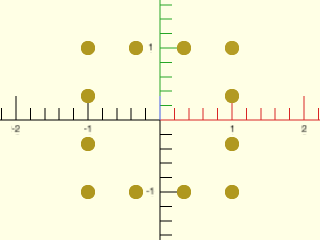

    include <BOSL2/std.scad>
    mypath = subdivide_path(square([2,2],center=true), 12);
    move_copies(mypath)circle(r=.1,$fn=32);

  

**Example 2:** 

    include <BOSL2/std.scad>
    mypath = subdivide_path(square([8,2],center=true), 12);
    move_copies(mypath)circle(r=.2,$fn=32);

  

**Example 3:** 

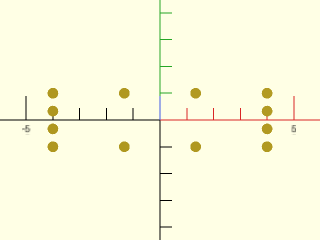

 

    include <BOSL2/std.scad>
    mypath = subdivide_path(square([8,2],center=true), 12, method="segment");
    move_copies(mypath)circle(r=.2,$fn=32);

**Example 4:** 

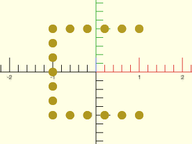

 

    include <BOSL2/std.scad>
    mypath = subdivide_path(square([2,2],center=true), 17, closed=false);
    move_copies(mypath)circle(r=.1,$fn=32);

**Example 5:** Specifying different numbers of points on each segment

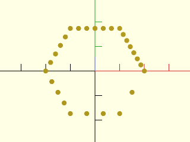

 

    include <BOSL2/std.scad>
    mypath = subdivide_path(hexagon(side=2), [2,3,4,5,6,7], method="segment");
    move_copies(mypath)circle(r=.1,$fn=32);

**Example 6:** Requested point total is 14 but 15 points output due to extra end point

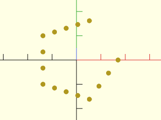

 

    include <BOSL2/std.scad>
    mypath = subdivide_path(pentagon(side=2), [3,4,3,4], method="segment", closed=false);
    move_copies(mypath)circle(r=.1,$fn=32);

**Example 7:** Since 17 is not divisible by 5, a completely uniform distribution is not possible.

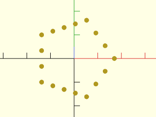

    include <BOSL2/std.scad>
    mypath = subdivide_path(pentagon(side=2), 17);
    move_copies(mypath)circle(r=.1,$fn=32);

  

**Example 8:** With `exact=false` a uniform distribution, but only 15 points

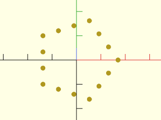

    include <BOSL2/std.scad>
    mypath = subdivide_path(pentagon(side=2), 17, exact=false);
    move_copies(mypath)circle(r=.1,$fn=32);

  

**Example 9:** With `exact=false` you can also get extra points, here 20 instead of requested 18

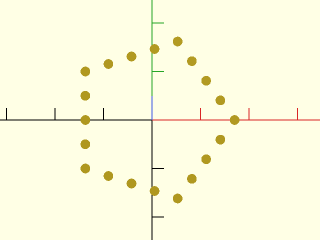

    include <BOSL2/std.scad>
    mypath = subdivide_path(pentagon(side=2), 18, exact=false);
    move_copies(mypath)circle(r=.1,$fn=32);

  

**Example 10:** Using refine in this example multiplies the point count by 3 by adding 2 points to each edge.

    include <BOSL2/std.scad>
    mypath = subdivide_path(pentagon(side=2), refine=3);
    move_copies(mypath)circle(r=.1,$fn=32);

  

**Example 11:** However, refine doesn't distribute evenly by segment unless you change the method.  With the default method set to `"length"`, the points are distributed with more on the long segments in this example using refine.

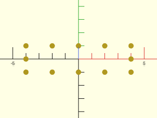

    include <BOSL2/std.scad>
    mypath = subdivide_path(square([8,2],center=true), refine=3);
    move_copies(mypath)circle(r=.2,$fn=32);

  

**Example 12:** In this example with maxlen, every side gets a different number of new points

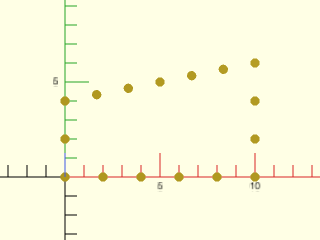

    include <BOSL2/std.scad>
    path = [[0,0],[0,4],[10,6],[10,0]];
    spath = subdivide_path(path, maxlen=2, closed=true);
    move_copies(spath) circle(r=.25,$fn=12);

  

**Example 13:** Three-dimensional paths also work

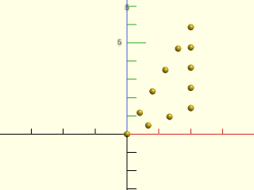

    include <BOSL2/std.scad>
    mypath = subdivide_path([[0,0,0],[2,0,1],[2,3,2]], 12);
    move_copies(mypath)sphere(r=.1,$fn=32);

  

---

### Function: resample\_path()

**Synopsis:** Returns an equidistant set of points along a path. [<abbr>Path</abbr>]

**Topics:** [Paths](Topics#paths)

**See Also:** [simplify\_path()](#function-simplify_path), [subdivide\_path()](#function-subdivide_path)

**Usage:** 

- newpath = resample_path(path, n|spacing=, [keep_corners=], [closed=]);

**Description:** 

Compute a uniform resampling of the input [path](Glossary#path).
By default the path is assumed to describe a closed polygon (`closed=true`).
If you specify `n` then the output path has `n`
[points](Glossary#point) spaced uniformly (by linear interpolation along the input path segments).  The only points of the
input path that are guaranteed to appear in the output path are the starting and ending points, and any
points that have an angular deflection of at least the number of degrees given in `keep_corners`.
If you specify `spacing` then the length you give is rounded to the nearest spacing that gives
a uniform sampling of the path and the resulting uniformly sampled path is returned.

Because this function operates on a discrete input path the quality of the output depends on
the sampling of the input.  If you want accurate output, use many points for the input.

**Arguments:** 

<abbr title="These args can be used by position or by name.">By&nbsp;Position</abbr> | What it does
-------------------- | ------------
`path`               | path in any dimension or a 1-region
`n`                  | Number of points in output

<abbr title="These args must be used by name, ie: name=value">By&nbsp;Name</abbr> | What it does
-------------------- | ------------
`spacing`            | Approximate spacing desired
`keep_corners`       | If given a scalar, path vertices with deflection angle greater than this are preserved in the output.
`closed`             | set to true if path is closed.  Default: true

**Example 1:** Subsampling lots of points from a smooth curve

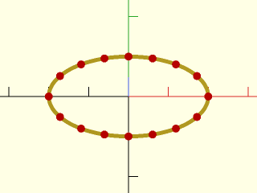

    include <BOSL2/std.scad>
    path = xscale(2,circle($fn=250, r=10));
    sampled = resample_path(path, 16);
    stroke(path);
    color("red")move_copies(sampled) circle($fn=16);

  

**Example 2:** Specified spacing is rounded to make a uniform sampling

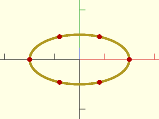

    include <BOSL2/std.scad>
    path = xscale(2,circle($fn=250, r=10));
    sampled = resample_path(path, spacing=17);
    stroke(path);
    color("red")move_copies(sampled) circle($fn=16);

  

**Example 3:** Notice that the corners are excluded.

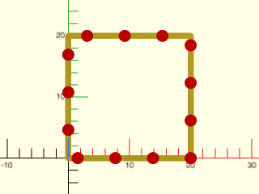

    include <BOSL2/std.scad>
    path = square(20);
    sampled = resample_path(path, spacing=6);
    stroke(path,closed=true);
    color("red")move_copies(sampled) circle($fn=16);

  

**Example 4:** Forcing preservation of corners.

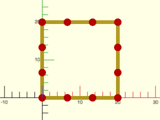

    include <BOSL2/std.scad>
    path = square(20);
    sampled = resample_path(path, spacing=6, keep_corners=90);
    stroke(path,closed=true);
    color("red")move_copies(sampled) circle($fn=16);

  

**Example 5:** Closed set to false

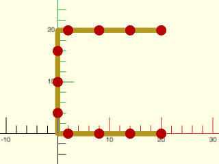

    include <BOSL2/std.scad>
    path = square(20);
    sampled = resample_path(path, spacing=6,closed=false);
    stroke(path);
    color("red")move_copies(sampled) circle($fn=16);

  

---

### Function: simplify\_path()

**Synopsis:** Removes points from an irregular path, preserving dominant features. [<abbr>Path</abbr>]

**Topics:** [Paths](Topics#paths)

**See Also:** [resample\_path()](#function-resample_path)

**Usage:** 

- newpath = simplify_path(path, maxerr, [closed=]);

**Description:** 

This is intended for irregular paths such as coastlines, or paths having fractal self-similarity.
By default the path is assumed to describe a closed polygon (`closed=true`).
The original path is simplified by removing points that fall within a specified margin of error,
leaving behind those points that contribute to dominant features of the path. This operation has the
effect of making the point spacing somewhat more uniform. For coastlines, up to 80% reduction in path
length is possible with small degradation of the original shape.

The `maxerr` parameter determines which points of the original path are kept. A point is kept if it
deviates beyond `maxerr` distance from a straight line between the last kept point and a point further
along the path. When a new deviation is found, that deviating point is kept and the process repeats from
that new kept point. The best value of `maxerr` depends on the geometry of the path and the amount of
reduction you want. A smaller value of `maxerr` returns more detail in the output, and a larger value
causes details to be lost. For paths such as coastlines, a `maxerr` value less than 1% of the maximum
bounding box dimension is a good starting value.

For unclosed paths (where `closed=false`) the endpoints of the path are preserved. When `closed=true`,
the path is treated as continuous and only dominant features that happen to be near the endpoints are
included in the output.

**Arguments:** 

<abbr title="These args can be used by position or by name.">By&nbsp;Position</abbr> | What it does
-------------------- | ------------
`path`               | Path in any dimension or 1-region
`maxerr`             | Maximum deviation from line connecting last kept point to a further point; points beyond this deviation are kept.

<abbr title="These args must be used by name, ie: name=value">By&nbsp;Name</abbr> | What it does
-------------------- | ------------
`closed`             | Set to true if path is closed.  Default: true

**Example 1:** A map of California, originally a 262-point polygon (yellow, on left), reduced to 39 points (green, on right).

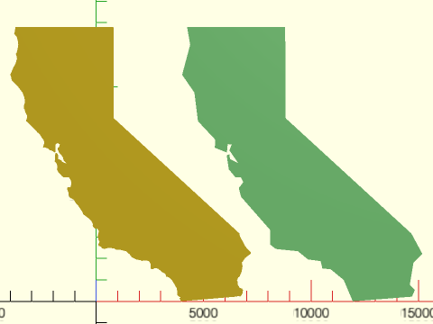

 

    include <BOSL2/std.scad>
    calif = [
    [225,12681], [199,12544], [180,12490], [221,12435], [300,12342], [310,12315], [320,12263], [350,12154],
    [374,11968], [350,11820], [328,11707], [291,11586], [259,11553], [275,11499], [304,11420], [312,11321],
    [273,11189], [233,11066], [200,10995], [160,10942], [104,10820], [0,10568], [25,10510], [50,10420],
    [65,10312], [271,10108], [368,10004], [438,9909], [517,9809], [569,9741], [600,9666], [615,9600],
    [630,9567], [649,9526], [679,9385], [670,9245], [650,9187], [635,9113], [644,8985], [673,8938], [694,8846],
    [740,8745], [770,8678], [780,8635], [771,8528], [745,8449], [738,8403], [807,8364], [872,8298], [894,8264],
    [1090,8076], [1270,7877], [1366,7798], [1440,7679], [1495,7596], [1543,7541], [1560,7487], [1575,7447],
    [1576,7350], [1536,7234], [1521,7168], [1587,7184], [1761,7129], [1838,7050], [1893,7050], [1995,6995],
    [2081,6940], [2109,7006], [2100,7045], [2100,7090], [2109,7155], [2115,7210], [2100,7269], [2124,7334],
    [2179,7365], [2209,7391], [2242,7362], [2308,7311], [2280,7215], [2220,7164], [2210,7150], [2200,7095],
    [2200,7040], [2234,7040], [2274,6932], [2415,6775], [2459,6691], [2483,6578], [2558,6497], [2610,6449],
    [2598,6430], [2490,6475], [2444,6500], [2410,6515], [2406,6530], [2375,6570], [2305,6610], [2224,6638],
    [2225,6806], [2211,6867], [2159,6913], [2109,6912], [2075,6810], [2074,6583], [2068,6521], [2104,6503],
    [2140,6454], [2153,6417], [2184,6336], [2187,6243], [2173,6158], [2213,6065], [2250,6005], [2283,5970],
    [2343,5928], [2370,5875], [2428,5822], [2485,5779], [2606,5782], [2728,5785], [2772,5725], [2850,5561],
    [2839,5472], [2820,5391], [2797,5322], [2734,5321], [2676,5330], [2640,5289], [2656,5236], [2661,5205],
    [2671,5144], [2712,5083], [2720,4973], [2738,4882], [2806,4819], [2891,4780], [2966,4737], [3004,4662],
    [3043,4604], [3080,4542], [3128,4491], [3170,4453], [3294,4262], [3370,4150], [3384,4090], [3402,4057],
    [3442,4029], [3602,3909], [3753,3777], [3855,3600], [3830,3521], [3900,3425], [3957,3394], [4000,3390],
    [4045,3393], [4109,3315], [4121,3235], [4089,3125], [4074,3085], [4081,3019], [4098,2923], [4116,2848],
    [4160,2774], [4135,2734], [4116,2697], [4100,2645], [4123,2585], [4208,2558], [4272,2478], [4367,2441],
    [4453,2461], [4533,2485], [4635,2488], [4795,2472], [4875,2450], [4896,2425], [4933,2402], [4988,2404],
    [5036,2409], [5124,2401], [5388,2338], [5479,2252], [5552,2199], [5610,2121], [5658,2051], [5802,1986],
    [5858,1955], [5994,1930], [6110,1905], [6122,1880], [6174,1895], [6309,1910], [6447,1875], [6510,1797],
    [6532,1730], [6525,1594], [6531,1521], [6615,1490], [6697,1525], [6729,1555], [6812,1543], [6901,1506],
    [7084,1351], [7193,1305], [7250,1205], [7255,1155], [7305,1152], [7420,1087], [7522,995], [7751,608],
    [7771,455], [7780,278], [7856,218], [7914,192], [7928,143], [7860,170], [7910,80], [7931,39], [7944,-2],
    [8009,4], [8490,46], [10165,189], [10542,220], [10575,240], [10654,239], [10701,218], [10735,242],
    [10776,308], [10811,372], [10834,527], [10781,598], [10685,625], [10595,763], [10588,913], [10553,965],
    [10572,995], [10585,1062], [10617,1120], [10672,1153], [10755,1340], [10781,1436], [10811,1637],
    [10791,1768], [10771,1807], [10824,1852], [10927,2015], [10995,2073], [11184,2212], [11204,2270],
    [11174,2312], [11045,2430], [10931,2585], [10881,2678], [10806,2818], [10739,2936], [10670,3102],
    [10670,3166], [4823,8540], [4804,12775], [4798,12800], [2515,12800], [232,12800]
    ];
    newpoly = simplify_path(calif, 120, closed=true);
    left(4000) polygon(calif);
    right(4000) color("lightgreen") polygon(newpoly);

---

## Section: Path Geometry

### Function: is\_path\_simple()

**Synopsis:** Returns true if a [path](Glossary#path) has no self intersections.

**Topics:** [Paths](Topics#paths)

**See Also:** [is\_path()](#function-is_path)

**Usage:** 

- bool = is_path_simple(path, [closed], [eps]);

**Description:** 

Returns true if the given 2D [path](Glossary#path) is simple, meaning that it has no self-intersections.
Repeated [points](Glossary#point) are not considered self-intersections: a path with such points can
still be simple.
If closed is set to true then treat the path as a polygon.

**Arguments:** 

<abbr title="These args can be used by position or by name.">By&nbsp;Position</abbr> | What it does
-------------------- | ------------
`path`               | 2D path or 1-region
`closed`             | set to true to treat path as a polygon.  Default: false for paths, true for 1-regions
`eps`                | Epsilon error value used for determine if points coincide.  Default: 1e-9

---

### Function: path\_closest\_point()

**Synopsis:** Returns the closest place on a [path](Glossary#path) to a given [point](Glossary#point).

**Topics:** [Paths](Topics#paths)

**See Also:** [point\_line\_distance()](geometry.scad#function-point_line_distance), [line\_closest\_point()](geometry.scad#function-line_closest_point)

**Usage:** 

- index_pt = path_closest_point(path, pt);

**Description:** 

Finds the closest [path](Glossary#path) segment, and [point](Glossary#point) on that segment to the given point.
Returns `[SEGNUM, POINT]`

**Arguments:** 

<abbr title="These args can be used by position or by name.">By&nbsp;Position</abbr> | What it does
-------------------- | ------------
`path`               | Path of any dimension or a 1-region.
`pt`                 | The point to find the closest point to.
`closed`             | If true, the path is considered closed.  Default: false for paths, true for 1-regions

**Example 1:** 

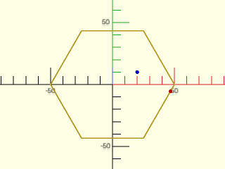

    include <BOSL2/std.scad>
    path = circle(d=100,$fn=6);
    pt = [20,10];
    closest = path_closest_point(path, pt);
    stroke(path, closed=true);
    color("blue") translate(pt) circle(d=3, $fn=12);
    color("red") translate(closest[1]) circle(d=3, $fn=12);

  

---

### Function: path\_tangents()

**Synopsis:** Returns tangent vectors for each point along a path.

**Topics:** [Paths](Topics#paths)

**See Also:** [path\_normals()](#function-path_normals)

**Usage:** 

- tangs = path_tangents(path, [closed], [uniform]);

**Description:** 

Compute the tangent vector to the input [path](Glossary#path).  The derivative approximation is described in deriv().
The returned vectors are normalized to length 1.  If any derivatives are zero then
the function fails with an error.  If you set `uniform` to false then the sampling is
assumed to be non-uniform and the derivative is computed with adjustments to produce corrected
values.

**Arguments:** 

<abbr title="These args can be used by position or by name.">By&nbsp;Position</abbr> | What it does
-------------------- | ------------
`path`               | path of any dimension or a 1-region
`closed`             | set to true of the path is closed.  Default: false for paths, true for 1-regions
`uniform`            | set to false to correct for non-uniform sampling.  Default: true

**Example 1:** A shape with non-uniform sampling gives distorted derivatives that may be undesirable.  Derivatives tilt toward the long edges of the rectangle.

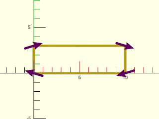

 

    include <BOSL2/std.scad>
    rect = square([10,3]);
    tangents = path_tangents(rect,closed=true);
    stroke(rect,closed=true, width=0.25);
    color("purple")
        for(i=[0:len(tangents)-1])
            stroke([rect[i]-tangents[i], rect[i]+tangents[i]],width=.25, endcap2="arrow2");

**Example 2:** Setting uniform to false corrects the distorted derivatives for this example:

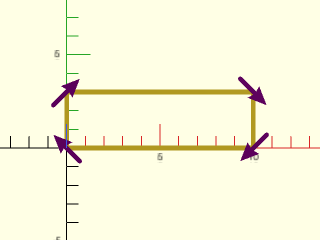

 

    include <BOSL2/std.scad>
    rect = square([10,3]);
    tangents = path_tangents(rect,closed=true,uniform=false);
    stroke(rect,closed=true, width=0.25);
    color("purple")
        for(i=[0:len(tangents)-1])
            stroke([rect[i]-tangents[i], rect[i]+tangents[i]],width=.25, endcap2="arrow2");

---

### Function: path\_normals()

**Synopsis:** Returns normal vectors for each point along a path.

**Topics:** [Paths](Topics#paths)

**See Also:** [path\_tangents()](#function-path_tangents)

**Usage:** 

- norms = path_normals(path, [tangents], [closed]);

**Description:** 

Compute the normal vector to the input [path](Glossary#path).  This vector is perpendicular to the
path tangent and lies in the plane of the curve.  For 3d paths we define the plane of the curve
at path [point](Glossary#point) i to be the plane defined by point i and its two neighbors.  At the endpoints of open paths
we use the three end points.  For 3d paths the computed normal is the one lying in this plane that points
toward the center of curvature at that path point.  For 2D paths, which lie in the xy plane, the normal
is the path pointing to the right of the direction the path is traveling.  If points are collinear then
a 3d path has no center of curvature, and hence the
normal is not uniquely defined.  In this case the function issues an error.
For 2D paths the plane is always defined so the normal fails to exist only
when the derivative is zero (in the case of repeated points).

**Arguments:** 

<abbr title="These args can be used by position or by name.">By&nbsp;Position</abbr> | What it does
-------------------- | ------------
`path`               | 2D or 3D path or a 1-region
`tangents`           | path tangents optionally supplied
`closed`             | if true path is treated as a polygon.  Default: false for paths, true for 1-regions

---

### Function: path\_curvature()

**Synopsis:** Returns the estimated numerical curvature of the [path](Glossary#path).

**Topics:** [Paths](Topics#paths)

**See Also:** [path\_tangents()](#function-path_tangents), [path\_normals()](#function-path_normals), [path\_torsion()](#function-path_torsion)

**Usage:** 

- curvs = path_curvature(path, [closed]);

**Description:** 

Numerically estimate the curvature of the [path](Glossary#path) (in any dimension).

**Arguments:** 

<abbr title="These args can be used by position or by name.">By&nbsp;Position</abbr> | What it does
-------------------- | ------------
`path`               | path in any dimension or a 1-region
`closed`             | if true then treat the path as a polygon.  Default: false for paths, true for 1-regions

---

### Function: path\_torsion()

**Synopsis:** Returns the estimated numerical torsion of the [path](Glossary#path).

**Topics:** [Paths](Topics#paths)

**See Also:** [path\_tangents()](#function-path_tangents), [path\_normals()](#function-path_normals), [path\_curvature()](#function-path_curvature)

**Usage:** 

- torsions = path_torsion(path, [closed]);

**Description:** 

Numerically estimate the torsion of a 3d [path](Glossary#path).

**Arguments:** 

<abbr title="These args can be used by position or by name.">By&nbsp;Position</abbr> | What it does
-------------------- | ------------
`path`               | 3D path
`closed`             | if true then treat path as a polygon.  Default: false

---

### Function: surface\_normals()

**Synopsis:** Estimates the normals to a surface defined by a [point](Glossary#point) array

**Topics:** [Math](Topics#math), [Geometry](Topics#geometry)

**See Also:** [path\_tangents()](#function-path_tangents), [path\_normals()](#function-path_normals)

**Usage:** 

- normals = surface_normals(surf, [col_wrap=], [row_wrap=]);

**Description:** 

Numerically estimate the normals to a surface defined by a 2D array of 3d [points](Glossary#point), which can
also be regarded as an array of [paths](Glossary#path) (all of the same length).

**Arguments:** 

<abbr title="These args can be used by position or by name.">By&nbsp;Position</abbr> | What it does
-------------------- | ------------
`surf`               | surface in 3d defined by a 2D array of points

<abbr title="These args must be used by name, ie: name=value">By&nbsp;Name</abbr> | What it does
-------------------- | ------------
`row_wrap`           | if true then wrap path in the row direction (first index)
`col_wrap`           | if true then wrap path in the column direction (second index)

---

## Section: Breaking paths up into subpaths

### Function: path\_cut()

**Synopsis:** Cuts a [path](Glossary#path) into subpaths at various [points](Glossary#point). [<abbr>PathList</abbr>]

**Topics:** [Paths](Topics#paths), [Path Subdivision](Topics#path-subdivision)

**See Also:** [split\_path\_at\_self\_crossings()](#function-split_path_at_self_crossings), [path\_cut\_points()](#function-path_cut_points)

**Usage:** 

- path_list = path_cut(path, cutdist, [closed]);

**Description:** 

Given a list of distances in `cutdist`, cut the [path](Glossary#path) into
subpaths at those lengths, returning a list of paths.
If the input path is closed then the final path includes the
original starting [point](Glossary#point).  The list of cut distances must be
in ascending order and should not include the endpoints: 0
or `len(path)`.  If you repeat a distance, you get an
empty list in that position in the output.  If you give an
empty cutdist array, you get the input path as output
(without the final vertex doubled in the case of a closed path).

**Arguments:** 

<abbr title="These args can be used by position or by name.">By&nbsp;Position</abbr> | What it does
-------------------- | ------------
`path`               | path of any dimension or a 1-region
`cutdist`            | Distance or list of distances where path is cut
`closed`             | If true, treat the path as a closed polygon.  Default: false for paths, true for 1-regions

**Example 1:** 

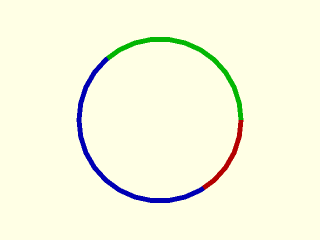

    include <BOSL2/std.scad>
    path = circle(d=100);
    segs = path_cut(path, [50, 200], closed=true);
    rainbow(segs) stroke($item, endcaps="butt", width=3);

  

---

### Function: path\_cut\_points()

**Synopsis:** Returns a list of cut [points](Glossary#point) at a list of distances from the first point in a [path](Glossary#path).

**Topics:** [Paths](Topics#paths), [Path Subdivision](Topics#path-subdivision)

**See Also:** [path\_cut()](#function-path_cut), [split\_path\_at\_self\_crossings()](#function-split_path_at_self_crossings)

**Usage:** 

- cuts = path_cut_points(path, cutdist, [closed=], [direction=]);

**Description:** 

Cuts a [path](Glossary#path) at a list of distances from the first [point](Glossary#point) in the path.  Returns a list of the cut
points and indices of the next point in the path after that point.  So for example, a return
value entry of [[2,3], 5] means that the cut point was [2,3] and the next point on the path after
this point is path[5].  If the path is too short then path_cut_points asserts an error.  If you set
`direction` to true then `path_cut_points` also returns the tangent vector to the path and a normal
vector to the path.  It tries to find a normal vector that is coplanar to the path near the cut
point.  If this fails, it returns a normal vector parallel to the xy plane.  The output with
direction vectors are in the form `[point, next_index, tangent, normal]`.

If you give the last point of the path as a cut point, then the returned index is
one larger than the last index (so it would not be a valid index).  If you use the closed
option then the returned index is equal to the path length for cuts along the closing
path segment, and if you give a point equal to the path length you get an
index of len(path)+1 for the index.

**Arguments:** 

<abbr title="These args can be used by position or by name.">By&nbsp;Position</abbr> | What it does
-------------------- | ------------
`path`               | path to cut
`cutdist`            | distances where the path should be cut (a list) or a scalar single distance

<abbr title="These args must be used by name, ie: name=value">By&nbsp;Name</abbr> | What it does
-------------------- | ------------
`closed`             | set to true if the curve is closed.  Default: false for paths, true for 1-regions
`direction`          | set to true to return direction vectors.  Default: false

**Example 1:** 

    include <BOSL2/std.scad>
    square=[[0,0],[1,0],[1,1],[0,1]];
    path_cut_points(square, [.5,1.5,2.5]);   // Returns [[[0.5, 0], 1], [[1, 0.5], 2], [[0.5, 1], 3]]
    path_cut_points(square, [0,1,2,3]);      // Returns [[[0, 0], 1], [[1, 0], 2], [[1, 1], 3], [[0, 1], 4]]
    path_cut_points(square, [0,0.8,1.6,2.4,3.2], closed=true);  // Returns [[[0, 0], 1], [[0.8, 0], 1], [[1, 0.6], 2], [[0.6, 1], 3], [[0, 0.8], 4]]
    path_cut_points(square, [0,0.8,1.6,2.4,3.2]);               // Returns [[[0, 0], 1], [[0.8, 0], 1], [[1, 0.6], 2], [[0.6, 1], 3], undef]

  

---

### Function: split\_path\_at\_self\_crossings()

**Synopsis:** Split a 2D [path](Glossary#path) wherever it crosses itself. [<abbr>PathList</abbr>]

**Topics:** [Paths](Topics#paths), [Path Subdivision](Topics#path-subdivision)

**See Also:** [path\_cut()](#function-path_cut), [path\_cut\_points()](#function-path_cut_points)

**Usage:** 

- paths = split_path_at_self_crossings(path, [closed], [eps]);

**Description:** 

Splits a 2D [path](Glossary#path) into sub-paths wherever the original path crosses itself.
By default the path is assumed to describe a closed polygon (`closed=true`).
Splits may occur mid-segment, so new vertices are created at the intersection points.
Returns a list of the resulting subpaths.

**Arguments:** 

<abbr title="These args can be used by position or by name.">By&nbsp;Position</abbr> | What it does
-------------------- | ------------
`path`               | A 2D path or a 1-region.
`closed`             | If true, treat path as a closed polygon.  Default: true
`eps`                | Acceptable variance.  Default: 1e-9

**Example 1:** 

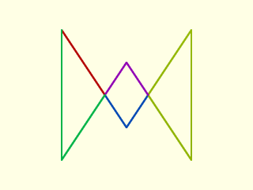

 

    include <BOSL2/std.scad>
    path = [ [-100,100], [0,-50], [100,100], [100,-100], [0,50], [-100,-100] ];
    paths = split_path_at_self_crossings(path);
    rainbow(paths) stroke($item, closed=false, width=3);

---

### Function: polygon\_parts()

**Synopsis:** Parses a self-intersecting polygon into a list of non-intersecting [polygons](Glossary#polygon). [<abbr>PathList</abbr>]

**Topics:** [Paths](Topics#paths), [Polygons](Topics#polygons)

**See Also:** [split\_path\_at\_self\_crossings()](#function-split_path_at_self_crossings), [path\_cut()](#function-path_cut), [path\_cut\_points()](#function-path_cut_points)

**Usage:** 

- splitpolys = polygon_parts(poly, [nonzero], [eps]);

**Description:** 

Given a possibly self-intersecting 2D [polygon](Glossary#polygon), constructs a representation of the original polygon as a list of
non-intersecting simple polygons.  If nonzero is set to true then it uses the nonzero method for defining polygon membership.
For simple cases, such as the pentagram, this produces the outer perimeter of a self-intersecting polygon.

**Arguments:** 

<abbr title="These args can be used by position or by name.">By&nbsp;Position</abbr> | What it does
-------------------- | ------------
`poly`               | a 2D polygon or 1-region
`nonzero`            | If true use the nonzero method for checking if a point is in a polygon.  Otherwise use the even-odd method.  Default: false
`eps`                | The epsilon error value to determine whether two points coincide.  Default: 1e-9

**Example 1:** This cross-crossing polygon breaks up into its 3 components (regardless of the value of nonzero).

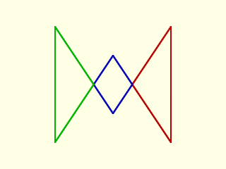

    include <BOSL2/std.scad>
    poly = [
        [-100,100], [0,-50], [100,100],
        [100,-100], [0,50], [-100,-100]
    ];
    splitpolys = polygon_parts(poly);
    rainbow(splitpolys) stroke($item, closed=true, width=3);

  

**Example 2:** With nonzero=false you get even-odd mode that matches OpenSCAD, so the pentagram breaks apart into its five points.

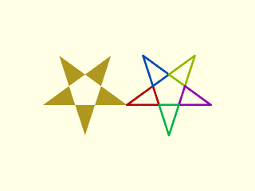

    include <BOSL2/std.scad>
    pentagram = turtle(["move",100,"left",144], repeat=4);
    left(100)polygon(pentagram);
    rainbow(polygon_parts(pentagram,nonzero=false))
      stroke($item,closed=true,width=2.5);

  

**Example 3:** With nonzero=true you get only the outer perimeter.  You can use this to create the polygon using the nonzero method, which is not supported by OpenSCAD.

    include <BOSL2/std.scad>
    pentagram = turtle(["move",100,"left",144], repeat=4);
    outside = polygon_parts(pentagram,nonzero=true);
    left(100)region(outside);
    rainbow(outside)
      stroke($item,closed=true,width=2.5);

  

**Example 4:** 

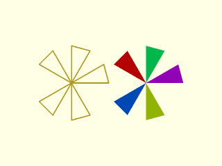

    include <BOSL2/std.scad>
    N=12;
    ang=360/N;
    sr=10;
    poly = turtle(["angle", 90+ang/2,
                   "move", sr, "left",
                   "move", 2*sr*sin(ang/2), "left",
                   "repeat", 4,
                      ["move", 2*sr, "left",
                       "move", 2*sr*sin(ang/2), "left"],
                   "move", sr]);
    stroke(poly, width=.3);
    right(20)rainbow(polygon_parts(poly)) polygon($item);

  

**Example 5:** overlapping poly segments disappear

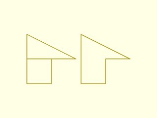

 

    include <BOSL2/std.scad>
    poly = [[0,0], [10,0], [10,10], [0,10],[0,20], [20,10],[10,10], [0,10],[0,0]];
    stroke(poly,width=0.3);
    right(22)stroke(polygon_parts(poly)[0], width=0.3, closed=true);

**Example 6:** Poly segments disappear outside as well

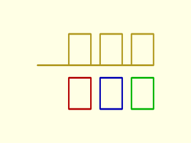

 

    include <BOSL2/std.scad>
    poly = turtle(["repeat", 3, ["move", 17, "left", "move", 10, "left", "move", 7, "left", "move", 10, "left"]]);
    back(2)stroke(poly,width=.5);
    fwd(12)rainbow(polygon_parts(poly)) stroke($item, closed=true, width=0.5);

**Example 7:** This shape has six components

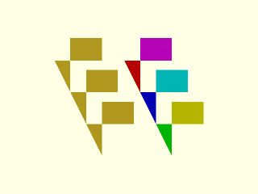

 

    include <BOSL2/std.scad>
    poly = turtle(["repeat", 3, ["move", 15, "left", "move", 7, "left", "move", 10, "left", "move", 17, "left"]]);
    polygon(poly);
    right(22)rainbow(polygon_parts(poly)) polygon($item);

**Example 8:** When the loops of the shape overlap then nonzero gives a different result than the even-odd method.

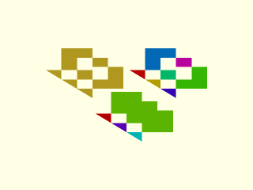

 

    include <BOSL2/std.scad>
    poly = turtle(["repeat", 3, ["move", 15, "left", "move", 7, "left", "move", 10, "left", "move", 10, "left"]]);
    polygon(poly);
    right(27)rainbow(polygon_parts(poly)) polygon($item);
    move([16,-14])rainbow(polygon_parts(poly,nonzero=true)) polygon($item);

---

