# LibFile: regions.scad

This file provides 2D Boolean set operations on polygons, where you can
compute, for example, the intersection or union of the shape defined by point lists, producing
a new point list.  Of course, such operations may produce shapes with multiple
components.  To handle that, we use "regions", which are lists of paths representing the polygons.
In addition to set operations, you can calculate offsets, determine whether a point is in a
region and you can decompose a region into parts.

To use, add the following lines to the beginning of your file:

    include <BOSL2/std.scad>

## File Contents

1. [Section: Regions](#section-regions)
    - [`is_region()`](#function-is_region) – Returns true if the input appears to be a [region](Glossary#region).
    - [`is_valid_region()`](#function-is_valid_region) – Returns true if the input is a valid [region](Glossary#region).
    - [`is_region_simple()`](#function-is_region_simple) – Returns true if the input is a region with no corner contact.
    - [`make_region()`](#function-make_region) – Converts lists of intersecting [polygons](Glossary#polygon) into valid [regions](Glossary#region). [<abbr>Region</abbr>]
    - [`force_region()`](#function-force_region) – Given a polygon returns a region. [<abbr>Region</abbr>]

2. [Section: Turning a region into geometry](#section-turning-a-region-into-geometry)
    - [`region()`](#module-region) – Creates the 2D [polygons](Glossary#polygon) described by the given [region](Glossary#region) or list of polygons. [<abbr>Geom</abbr>]
    - [`debug_region()`](#module-debug_region) – Draws an annotated [region](Glossary#region). [<abbr>Geom</abbr>]

3. [Section: Geometrical calculations with regions](#section-geometrical-calculations-with-regions)
    - [`point_in_region()`](#function-point_in_region) – Tests if a point is inside, outside, or on the border of a [region](Glossary#region).
    - [`region_area()`](#function-region_area) – Computes the area of the specified valid [region](Glossary#region).
    - [`are_regions_equal()`](#function-are_regions_equal) – Returns true if given regions are the same polygons.

4. [Section: Breaking up regions into subregions](#section-breaking-up-regions-into-subregions)
    - [`split_region_at_region_crossings()`](#function-split_region_at_region_crossings) – Splits [regions](Glossary#region) where [polygons](Glossary#polygon) touch and at intersections.
    - [`region_parts()`](#function-region_parts) – Splits a [region](Glossary#region) into a list of connected regions. [<abbr>RegList</abbr>]

5. [Section: Offset and 2D Boolean Set Operations](#section-offset-and-2d-boolean-set-operations)
    - [`offset()`](#function-offset) – Takes a 2D [path](Glossary#path), [polygon](Glossary#polygon) or [region](Glossary#region) and returns a path offset by an amount. [<abbr>Path</abbr>] [<abbr>Region</abbr>] [<abbr>Ext</abbr>]
    - [`union()`](#functionmodule-union) – Performs a Boolean union operation. [<abbr>Geom</abbr>] [<abbr>Region</abbr>]
    - [`difference()`](#functionmodule-difference) – Performs a Boolean difference operation. [<abbr>Geom</abbr>] [<abbr>Region</abbr>]
    - [`intersection()`](#functionmodule-intersection) – Performs a Boolean intersection operation. [<abbr>Geom</abbr>] [<abbr>Region</abbr>]
    - [`exclusive_or()`](#functionmodule-exclusive_or) – Performs a Boolean exclusive-or operation. [<abbr>Geom</abbr>] [<abbr>Region</abbr>]
    - [`hull_region()`](#functionmodule-hull_region) – Compute convex hull of [region](Glossary#region) or 2D [path](Glossary#path) [<abbr>Geom</abbr>] [<abbr>Path</abbr>]
    - [`fill()`](#function-fill) – Remove holes from a [region](Glossary#region) [<abbr>Geom</abbr>] [<abbr>Path</abbr>]

## Section: Regions

A [region](Glossary#region) is a list of polygons meeting these conditions:

- Every polygon on the list is simple, meaning it does not intersect itself
- Two polygons on the list do not cross each other
- A vertex of one polygon never meets the edge of another one except at a vertex

This means vertex-vertex touching between two polygons is acceptable
to define a region.  Note, however, that regions with vertex-vertex contact usually
cannot be rendered with CGAL.  See [`is_valid_region()`](#function-is_valid_region) for examples of valid regions and
lists of polygons that are not regions. Note that [`is_region_simple()`](#function-is_region_simple) identifies
regions with no polygon intersections at all, which should render successfully witih CGAL.

The actual geometry of the region is defined by XORing together
all of the polygons in the list.  This may sound obscure, but it simply means that nested
boundaries make rings in the obvious fashion, and non-nested shapes simply union together.
Checking that a list of polygons is a valid region, meaning that it satisfies all of the conditions
above, can be a time consuming test, so it is not done automatically.  It is your responsibility to ensure that your regions are
compliant.  You can construct regions by making a suitable list of polygons, or by using
set operation function such as [`union()`](#functionmodule-union) or [`difference()`](#functionmodule-difference), which all acccept polygons, as
well as regions, as their inputs. If you must, you can clean up an ill-formed region using
[`make_region()`](#function-make_region), which breaks up self-intersecting polygons and polygons that cross each other.

**Figure 1.1:** An Sample [region](Glossary#region)

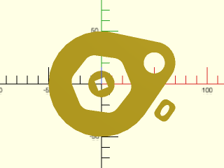

  

**Definitions:** 

Region: A list of one or more non-intersecting <a href="Glossary#polygon">polygons</a> representing a union of one or more disconnected polygons that may have internal holes.

### Function: is\_region()

**Synopsis:** Returns true if the input appears to be a [region](Glossary#region).

**Topics:** [Regions](Topics#regions), [Paths](Topics#paths), [Polygons](Topics#polygons), [List Handling](Topics#list-handling)

**See Also:** [is\_valid\_region()](#function-is_valid_region), [is\_1region()](paths.scad#function-is_1region), [is\_region\_simple()](#function-is_region_simple)

**Usage:** 

- bool = is_region(x);

**Description:** 

Returns true if the given item looks like a [region](Glossary#region).  A region is a list of non-crossing simple [polygons](Glossary#polygon).  This test just checks
that the argument is a list whose first entry is a path.

---

### Function: is\_valid\_region()

**Synopsis:** Returns true if the input is a valid [region](Glossary#region).

**Topics:** [Regions](Topics#regions), [Paths](Topics#paths), [Polygons](Topics#polygons), [List Handling](Topics#list-handling)

**See Also:** [is\_region()](#function-is_region), [is\_1region()](paths.scad#function-is_1region), [is\_region\_simple()](#function-is_region_simple)

**Usage:** 

- bool = is_valid_region(region, [eps]);

**Description:** 

Returns true if the input is a valid [region](Glossary#region), meaning that it is a list of simple [polygons](Glossary#polygon) whose segments do not cross each other.
This test can be time consuming with regions that contain many [points](Glossary#point).
It differs from `is_region()`, which simply checks that the object is a list whose first entry is a path
because it searches all the list polygons for any self-intersections or intersections with each other.
Also returns true if given a single simple polygon.  Use [`make_region()`](#function-make_region) to convert sets of self-intersecting polygons into
a region.

**Arguments:** 

<abbr title="These args can be used by position or by name.">By&nbsp;Position</abbr> | What it does
-------------------- | ------------
`region`             | region to check
`eps`                | tolerance for geometric comparisons.  Default: 1e-9

**Example 1:** In all of the examples each polygon in the region appears in a different color.  Two non-intersecting squares make a valid region.

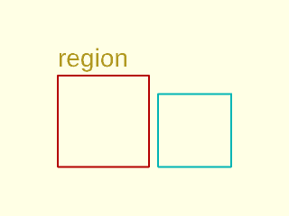

 

    include <BOSL2/std.scad>
    region = [square(10), right(11,square(8))];
    rainbow(region)stroke($item, width=.2,closed=true);
    back(11)text(is_valid_region(region) ? "region" : "non-region", size=2);

**Example 2:** Nested squares form a region

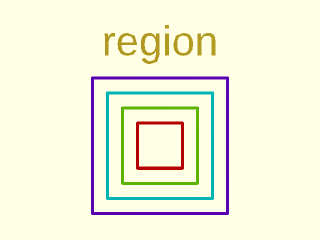

 

    include <BOSL2/std.scad>
    region = [for(i=[3:2:10]) square(i,center=true)];
    rainbow(region)stroke($item, width=.2,closed=true);
    back(6)text(is_valid_region(region) ? "region" : "non-region", size=2,halign="center");

**Example 3:** Also a region:

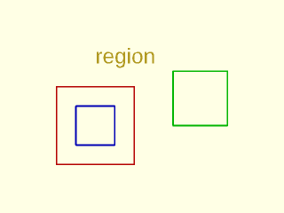

 

    include <BOSL2/std.scad>
    region= [square(10,center=true), square(5,center=true), right(10,square(7))];
    rainbow(region)stroke($item, width=.2,closed=true);
    back(8)text(is_valid_region(region) ? "region" : "non-region", size=2);

**Example 4:** The squares cross each other, so not a region

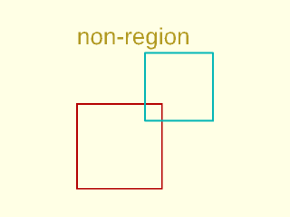

 

    include <BOSL2/std.scad>
    object = [square(10), move([8,8], square(8))];
    rainbow(object)stroke($item, width=.2,closed=true);
    back(17)text(is_valid_region(object) ? "region" : "non-region", size=2);

**Example 5:** A union is one way to fix the above example and get a region. Union is run here on two simple polygons, which are valid regions themselves and hence acceptable inputs to union.

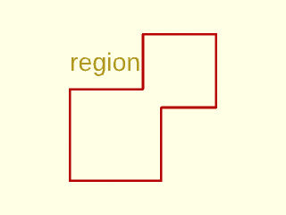

 

    include <BOSL2/std.scad>
    region = union([square(10), move([8,8], square(8))]);
    rainbow(region)stroke($item, width=.25,closed=true);
    back(12)text(is_valid_region(region) ? "region" : "non-region", size=2);

**Example 6:** Not a region due to a self-intersecting (non-simple) hourglass polygon

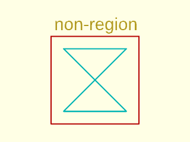

 

    include <BOSL2/std.scad>
    object = [move([-2,-2],square(14)), [[0,0],[10,0],[0,10],[10,10]]];
    rainbow(object)stroke($item, width=.2,closed=true);
    move([-1.5,13])text(is_valid_region(object) ? "region" : "non-region", size=2);

**Example 7:** Breaking hourglass in half fixes it.  Now it's a region:

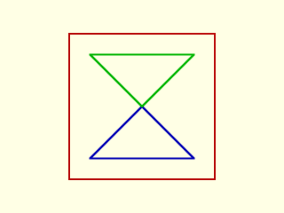

 

    include <BOSL2/std.scad>
    region = [move([-2,-2],square(14)), [[0,0],[10,0],[5,5]], [[5,5],[0,10],[10,10]]];
    rainbow(region)stroke($item, width=.2,closed=true);

**Example 8:** A single polygon corner touches an edge, so not a region:

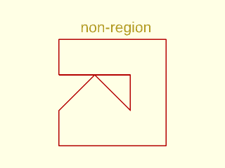

 

    include <BOSL2/std.scad>
    object = [[[-10,0], [-10,10], [20,10], [20,-20], [-10,-20],
               [-10,-10], [0,0], [10,-10], [10,0]]];
    rainbow(object)stroke($item, width=.3,closed=true);
    move([-4,12])text(is_valid_region(object) ? "region" : "non-region", size=3);

**Example 9:** Corners touch in the same polygon, so the polygon is not simple and the object is not a region.

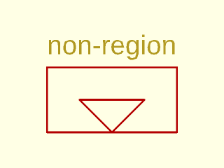

 

    include <BOSL2/std.scad>
    object = [[[0,0],[10,0],[10,10],[-10,10],[-10,0],[0,0],[-5,5],[5,5]]];
    rainbow(object)stroke($item, width=.3,closed=true);
    move([-10,12])text(is_valid_region(object) ? "region" : "non-region", size=3);

**Example 10:** The shape above as a valid region with two polygons:

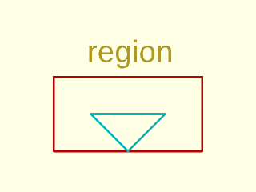

 

    include <BOSL2/std.scad>
    region = [  [[0,0],[10,0],[10,10],[-10,10],[-10,0]],
                [[0,0],[5,5],[-5,5]]  ];
    rainbow(region)stroke($item, width=.3,closed=true);
    move([-5.5,12])text(is_valid_region(region) ? "region" : "non-region", size=3);

**Example 11:** As with the "broken" hourglass, Touching at corners is OK.  This is a region.

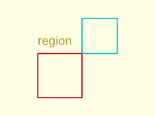

 

    include <BOSL2/std.scad>
    region = [square(10), move([10,10], square(8))];
    rainbow(region)stroke($item, width=.25,closed=true);
    back(12)text(is_valid_region(region) ? "region" : "non-region", size=2);

**Example 12:** These two squares share part of an edge, hence not a region

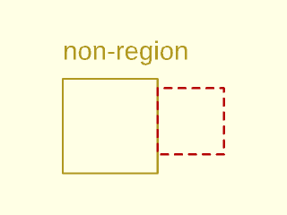

 

    include <BOSL2/std.scad>
    object = [square(10), move([10,2], square(7))];
    stroke(object[0], width=0.2,closed=true);
    color("red")dashed_stroke(object[1], width=0.25,closed=true);
    back(12)text(is_valid_region(object) ? "region" : "non-region", size=2);

**Example 13:** These two squares share a full edge, hence not a region

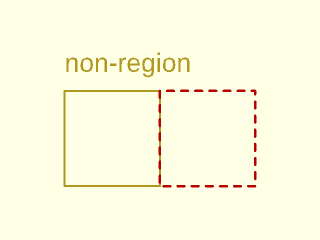

 

    include <BOSL2/std.scad>
    object = [square(10), right(10, square(10))];
    stroke(object[0], width=0.2,closed=true);
    color("red")dashed_stroke(object[1], width=0.25,closed=true);
    back(12)text(is_valid_region(object) ? "region" : "non-region", size=2);

**Example 14:** Sharing on edge on the inside, also not a regionn

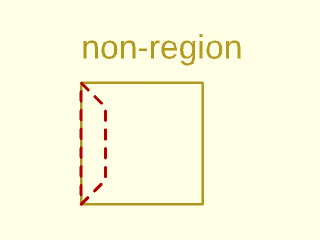

 

    include <BOSL2/std.scad>
    object = [square(10), [[0,0], [2,2],[2,8],[0,10]]];
    stroke(object[0], width=0.2,closed=true);
    color("red")dashed_stroke(object[1], width=0.25,closed=true);
    back(12)text(is_valid_region(object) ? "region" : "non-region", size=2);

**Example 15:** Crossing at vertices is also bad

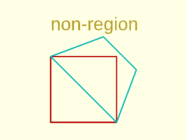

 

    include <BOSL2/std.scad>
    object = [square(10), [[10,0],[0,10],[8,13],[13,8]]];
    rainbow(object)stroke($item, width=.2,closed=true);
    back(14)text(is_valid_region(object) ? "region" : "non-region", size=2);

**Example 16:** One polygon touches another in the middle of an edge

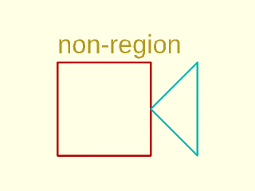

 

    include <BOSL2/std.scad>
    object = [square(10), [[10,5],[15,0],[15,10]]];
    rainbow(object)stroke($item, width=.2,closed=true);
    back(11)text(is_valid_region(object) ? "region" : "non-region", size=2);

**Example 17:** The polygon touches the side, but the side has a vertex at the contact point so this is a region

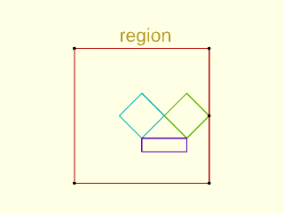

 

    include <BOSL2/std.scad>
    poly1 = [ each square(30,center=true), [15,0]];
    poly2 = right(10,circle(5,$fn=4));
    poly3 = left(0,circle(5,$fn=4));
    poly4 = move([0,-8],square([10,3]));
    region = [poly1,poly2,poly3,poly4];
    rainbow(region)stroke($item, width=.25,closed=true);
    move([-5,16.5])text(is_valid_region(region) ? "region" : "non-region", size=3);
    color("black")move_copies(region[0]) circle(r=.4);

**Example 18:** The polygon touches the side, but not at a vertex so this is not a region

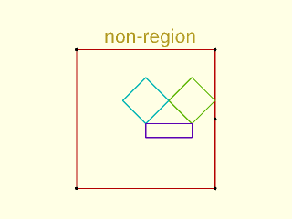

 

    include <BOSL2/std.scad>
    poly1 = fwd(4,[ each square(30,center=true), [15,0]]);
    poly2 = right(10,circle(5,$fn=4));
    poly3 = left(0,circle(5,$fn=4));
    poly4 = move([0,-8],square([10,3]));
    object = [poly1,poly2,poly3,poly4];
    rainbow(object)stroke($item, width=.25,closed=true);
    move([-9,12.5])text(is_valid_region(object) ? "region" : "non-region", size=3);
    color("black")move_copies(object[0]) circle(r=.4);

**Example 19:** The inner polygon touches the middle of the edges, so not a region

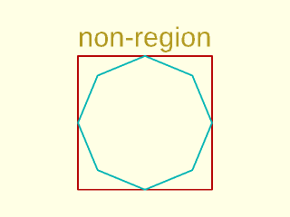

 

    include <BOSL2/std.scad>
    poly1 = square(20,center=true);
    poly2 = circle(10,$fn=8);
    object=[poly1,poly2];
    rainbow(object)stroke($item, width=.25,closed=true);
    move([-10,11.4])text(is_valid_region(object) ? "region" : "non-region", size=3);

**Example 20:** The above shape made into a region using [`difference()`](#functionmodule-difference) now has four components that touch at corners

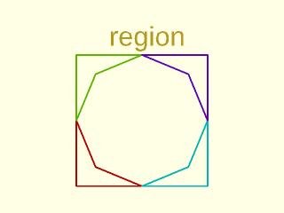

 

    include <BOSL2/std.scad>
    poly1 = square(20,center=true);
    poly2 = circle(10,$fn=8);
    region = difference(poly1,poly2);
    rainbow(region)stroke($item, width=.25,closed=true);
    move([-5,11.4])text(is_valid_region(region) ? "region" : "non-region", size=3);

---

### Function: is\_region\_simple()

**Synopsis:** Returns true if the input is a region with no corner contact.

**Topics:** [Regions](Topics#regions), [Paths](Topics#paths), [Polygons](Topics#polygons), [List Handling](Topics#list-handling)

**See Also:** [is\_region()](#function-is_region), [is\_valid\_region()](#function-is_valid_region), [is\_1region()](paths.scad#function-is_1region)

**Usage:** 

- bool = is_region_simple(region, [eps]);

**Description:** 

We extend the notion of the simple [path](Glossary#path) to [regions](Glossary#region): a simple region is entirely
non-self-intersecting, meaning that it is formed from a list of simple polygons that
don't intersect each other at all&mdash;not even with corner contact points.
Regions with corner contact are valid but may fail CGAL.  Simple regions
should not create problems with CGAL.

**Arguments:** 

<abbr title="These args can be used by position or by name.">By&nbsp;Position</abbr> | What it does
-------------------- | ------------
`region`             | region to check
`eps`                | tolerance for geometric comparisons.  Default: 1e-9

**Example 1:** Corner contact means it's not simple

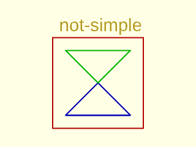

 

    include <BOSL2/std.scad>
    region = [move([-2,-2],square(14)), [[0,0],[10,0],[5,5]], [[5,5],[0,10],[10,10]]];
    rainbow(region)stroke($item, width=.2,closed=true);
    move([-1,13])text(is_region_simple(region) ? "simple" : "not-simple", size=2);

**Example 2:** Moving apart the triangles makes it simple:

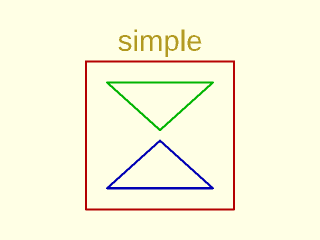

 

    include <BOSL2/std.scad>
    region = [move([-2,-2],square(14)), [[0,0],[10,0],[5,4.5]], [[5,5.5],[0,10],[10,10]]];
    rainbow(region)stroke($item, width=.2,closed=true);
    move([1,13])text(is_region_simple(region) ? "simple" : "not-simple", size=2);

---

### Function: make\_region()

**Synopsis:** Converts lists of intersecting [polygons](Glossary#polygon) into valid [regions](Glossary#region). [<abbr>Region</abbr>]

**Topics:** [Regions](Topics#regions), [Paths](Topics#paths), [Polygons](Topics#polygons), [List Handling](Topics#list-handling)

**See Also:** [force\_region()](#function-force_region), [region()](#module-region)

**Usage:** 

- region = make_region(polys, [nonzero], [eps]);

**Description:** 

Takes a list of [polygons](Glossary#polygon) that may intersect themselves or cross each other
and converts it into a properly defined [region](Glossary#region) without these defects.

**Arguments:** 

<abbr title="These args can be used by position or by name.">By&nbsp;Position</abbr> | What it does
-------------------- | ------------
`polys`              | list of polygons to use
`nonzero`            | set to true to use nonzero rule for polygon membership.  Default: false
`eps`                | Epsilon for geometric comparisons.  Default: 1e-9

**Example 1:** The pentagram is self-intersecting, so it is not a region.  Here it becomes five triangles:

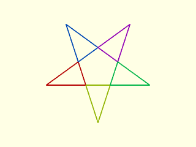

    include <BOSL2/std.scad>
    pentagram = turtle(["move",100,"left",144], repeat=4);
    region = make_region(pentagram);
    rainbow(region)stroke($item, width=1,closed=true);

  

**Example 2:** Alternatively with the nonzero option you can get the perimeter:

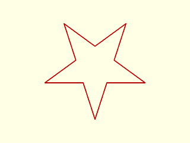

    include <BOSL2/std.scad>
    pentagram = turtle(["move",100,"left",144], repeat=4);
    region = make_region(pentagram,nonzero=true);
    rainbow(region)stroke($item, width=1,closed=true);

  

**Example 3:** Two crossing squares become two L-shaped components

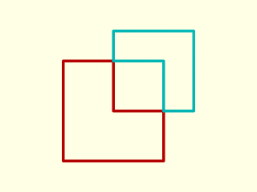

    include <BOSL2/std.scad>
    region = make_region([square(10), move([5,5],square(8))]);
    rainbow(region)stroke($item, width=.3,closed=true);

  

---

### Function: force\_region()

**Synopsis:** Given a polygon returns a region. [<abbr>Region</abbr>]

**Topics:** [Regions](Topics#regions), [Paths](Topics#paths), [Polygons](Topics#polygons), [List Handling](Topics#list-handling)

**See Also:** [make\_region()](#function-make_region), [region()](#module-region)

**Usage:** 

- region = force_region(poly)

**Description:** 

If the input is a polygon then return it as a region.  Otherwise return it unaltered.

**Arguments:** 

<abbr title="These args can be used by position or by name.">By&nbsp;Position</abbr> | What it does
-------------------- | ------------
`poly`               | polygon to turn into a region

---

## Section: Turning a region into geometry

### Module: region()

**Synopsis:** Creates the 2D [polygons](Glossary#polygon) described by the given [region](Glossary#region) or list of polygons. [<abbr>Geom</abbr>]

**Topics:** [Regions](Topics#regions), [Paths](Topics#paths), [Polygons](Topics#polygons), [List Handling](Topics#list-handling)

**See Also:** [make\_region()](#function-make_region), [debug\_region()](#module-debug_region)

**Usage:** 

- region(r, [anchor], [spin=], [cp=], [atype=]) [ATTACHMENTS];

**Description:** 

Creates the 2D [polygons](Glossary#polygon) described by the given [region](Glossary#region) or list of polygons.  This module works on
arbitrary lists of polygons that cross each other and hence do not define a valid region.  The
displayed result is the exclusive-or of the polygons listed in the input.

**Arguments:** 

<abbr title="These args can be used by position or by name.">By&nbsp;Position</abbr> | What it does
-------------------- | ------------
`r`                  | region to create as geometry
`anchor`             | Translate so anchor point is at origin (0,0,0).  See [anchor](attachments.scad#subsection-anchor).  Default: `"origin"`

<abbr title="These args must be used by name, ie: name=value">By&nbsp;Name</abbr> | What it does
-------------------- | ------------
`spin`               | Rotate this many degrees after anchor.  See [spin](attachments.scad#subsection-spin).  Default: `0`
`cp`                 | Centerpoint for determining intersection anchors or centering the shape.  Determintes the base of the anchor vector.  Can be "centroid", "mean", "box" or a 2D point.  Default: "centroid"
`atype`              | Set to "hull" or "intersect" to select anchor type.  Default: "hull"

**Named Anchors:** 

Anchor Name | Position
----------- | --------
"origin" | The native position of the region.

**Anchor Types:** 

Anchor Type | What it is
----------- | ----------
"hull" | Anchors to the virtual convex hull of the region.
"intersect" | Anchors to the outer edge of the region.

**Example 1:** Displaying a region

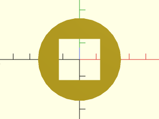

    include <BOSL2/std.scad>
    region([circle(d=50), square(25,center=true)]);

  

**Example 2:** Displaying a list of polygons that intersect each other, which is not a region.

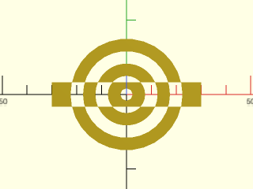

    include <BOSL2/std.scad>
    rgn = concat(
        [for (d=[50:-10:10]) circle(d=d-5)],
        [square([60,10], center=true)]
    );
    region(rgn);

  

---

### Module: debug\_region()

**Synopsis:** Draws an annotated [region](Glossary#region). [<abbr>Geom</abbr>]

**Topics:** [Shapes (2D)](Topics#shapes-2d), [Debugging](Topics#debugging)

**See Also:** [region()](#module-region), [debug\_polygon()](drawing.scad#module-debug_polygon), [debug\_vnf()](vnf.scad#module-debug_vnf), [debug\_bezier()](beziers.scad#module-debug_bezier)

**Usage:** 

- debug_region(region, [vertices=], [edges=], [convexity=], [size=]);

**Description:** 

A replacement for [`region()`](#module-region) that displays the [region](Glossary#region) and labels the vertices and
edges.  The region vertices and edges are labeled with letters to identify the path
component in the region, starting with A.
The start of each path is marked with a blue circle and the end with a pink diamond.
You can suppress the display of vertex or edge labeling using the `vertices` and `edges` arguments.

**Arguments:** 

<abbr title="These args can be used by position or by name.">By&nbsp;Position</abbr> | What it does
-------------------- | ------------
`region`             | region to display

<abbr title="These args must be used by name, ie: name=value">By&nbsp;Name</abbr> | What it does
-------------------- | ------------
`vertices`           | if true display vertex labels and start/end markers.  Default: true
`edges`              | if true display edge labels.  Default: true
`convexity`          | The max number of walls a ray can pass through the given polygon paths.
`size`               | The base size of the line and labels.

**Example 1:** 

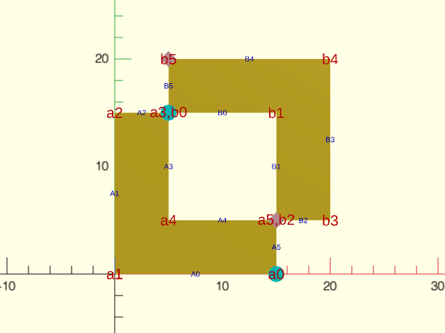

 

    include <BOSL2/std.scad>
    region = make_region([square(15), move([5,5],square(15))]);
    debug_region(region,size=1);

---

## Section: Geometrical calculations with regions

### Function: point\_in\_region()

**Synopsis:** Tests if a point is inside, outside, or on the border of a [region](Glossary#region).

**Topics:** [Regions](Topics#regions), [Points](Topics#points), [Comparison](Topics#comparison)

**See Also:** [region\_area()](#function-region_area), [are\_regions\_equal()](#function-are_regions_equal)

**Usage:** 

- check = point_in_region(point, region, [eps]);

**Description:** 

Tests if a point is inside, outside, or on the border of a [region](Glossary#region).
Returns -1 if the point is outside the region.
Returns 0 if the point is on the boundary.
Returns 1 if the point lies inside the region.

**Arguments:** 

<abbr title="These args can be used by position or by name.">By&nbsp;Position</abbr> | What it does
-------------------- | ------------
`point`              | The point to test.
`region`             | The region to test against, as a list of polygon paths.
`eps`                | Acceptable variance.  Default: 1e-9

**Example 1:** Red points are in the region.

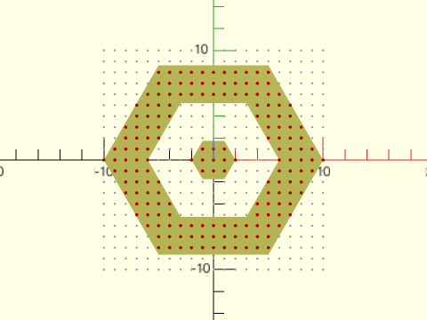

 

    include <BOSL2/std.scad>
    region = [for(i=[2:4:10]) hexagon(r=i)];
    color("#ff7") region(region);
    for(x=[-10:10], y=[-10:10])
      if (point_in_region([x,y], region)>=0)
        move([x,y]) color("red") circle(0.15, $fn=12);
      else
        move([x,y]) color("#ddf") circle(0.1, $fn=12);

---

### Function: region\_area()

**Synopsis:** Computes the area of the specified valid [region](Glossary#region).

**Topics:** [Regions](Topics#regions), [Area](Topics#area)

**Usage:** 

- area = region_area(region);

**Description:** 

Computes the area of the specified valid [region](Glossary#region). (If the region is invalid and has self intersections
the result is meaningless.)

**Arguments:** 

<abbr title="These args can be used by position or by name.">By&nbsp;Position</abbr> | What it does
-------------------- | ------------
`region`             | region whose area to compute

**Example 1:** 

    include <BOSL2/std.scad>
    area = region_area([square(10), right(20,square(8))]);  // Returns 164

  

---

### Function: are\_regions\_equal()

**Synopsis:** Returns true if given regions are the same polygons.

**Topics:** [Regions](Topics#regions), [Polygons](Topics#polygons), [Comparison](Topics#comparison)

**Usage:** 

- b = are_regions_equal(region1, region2, [either_winding])

**Description:** 

Returns true if the components of region1 and region2 are the same polygons (in any order).

**Arguments:** 

<abbr title="These args can be used by position or by name.">By&nbsp;Position</abbr> | What it does
-------------------- | ------------
`region1`            | first region
`region2`            | second region
`either_winding`     | if true then two shapes test equal if they wind in opposite directions.  Default: false

---

## Section: Breaking up regions into subregions

### Function: split\_region\_at\_region\_crossings()

**Synopsis:** Splits [regions](Glossary#region) where [polygons](Glossary#polygon) touch and at intersections.

**Topics:** [Regions](Topics#regions), [Polygons](Topics#polygons), [List Handling](Topics#list-handling)

**See Also:** [region\_parts()](#function-region_parts)

**Usage:** 

- split_region = split_region_at_region_crossings(region1, region2, [closed1], [closed2], [eps])

**Description:** 

Splits the {{region} `region1` at the places where its [polygons](Glossary#polygon) touches each other at corners and at locations
where `region1` intersects `region2`.  Split `region2` similarly with respect to `region1`.
The return is a pair of results of the form [split1, split2] where split1=[frags1,frags2,...]
and frags1 is a list of paths that when placed end to end (in the given order), give the first polygon of region1.
Each path in the list is either entirely inside or entirely outside region2.
Then frags2 is the decomposition of the second polygon into path pieces, and so on.  Finally split2 is
the same list, but for the polygons in region2.
You can pass a single polygon in for either region, but the output will be a singleton list, as if
you passed in a singleton region.  If you set the closed parameters to false then the region components
are treated as open paths instead of polygons.

**Arguments:** 

<abbr title="These args can be used by position or by name.">By&nbsp;Position</abbr> | What it does
-------------------- | ------------
`region1`            | first region
`region2`            | second region
`closed1`            | if false then treat region1 as list of open paths.  Default: true
`closed2`            | if false then treat region2 as list of open paths.  Default: true
`eps`                | Acceptable variance.  Default: 1e-9

**Example 1:** 

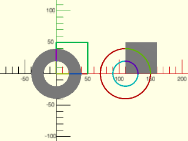

    include <BOSL2/std.scad>
    path = square(50,center=false);
    region = [circle(d=80), circle(d=40)];
    paths = split_region_at_region_crossings(path, region);
    color("#aaa") region(region);
    rainbow(paths[0][0]) stroke($item, width=2);
    right(110){
      color("#aaa") region([path]);
      rainbow(flatten(paths[1])) stroke($item, width=2);
    }

  

---

### Function: region\_parts()

**Synopsis:** Splits a [region](Glossary#region) into a list of connected regions. [<abbr>RegList</abbr>]

**Topics:** [Regions](Topics#regions), [List Handling](Topics#list-handling)

**See Also:** [split\_region\_at\_region\_crossings()](#function-split_region_at_region_crossings)

**Usage:** 

- rgns = region_parts(region);

**Description:** 

Divides a [region](Glossary#region) into a list of connected regions.  Each connected region has exactly one clockwise outside boundary
and zero or more counter-clockwise outlines defining internal holes. Behavior is undefined on invalid regions whose
components cross each other.

**Example 1:** 

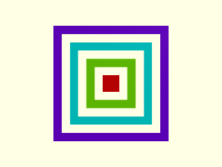

    include <BOSL2/std.scad>
    R = [for(i=[1:7]) square(i,center=true)];
    region_list = region_parts(R);
    rainbow(region_list) region($item);

  

**Example 2:** 

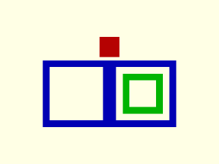

    include <BOSL2/std.scad>
    R = [back(7,square(3,center=true)),
         square([20,10],center=true),
         left(5,square(8,center=true)),
         for(i=[4:2:8])
           right(5,square(i,center=true))];
    region_list = region_parts(R);
    rainbow(region_list) region($item);

  

---

## Section: Offset and 2D Boolean Set Operations

### Function: offset()

**Synopsis:** Takes a 2D [path](Glossary#path), [polygon](Glossary#polygon) or [region](Glossary#region) and returns a path offset by an amount. [<abbr>Path</abbr>] [<abbr>Region</abbr>] [<abbr>Ext</abbr>]

**Topics:** [Paths](Topics#paths), [Polygons](Topics#polygons), [Regions](Topics#regions)

**Usage:** 

- offsetpath = offset(path, [r=|delta=], [chamfer=], [closed=], [check_valid=], [quality=], [error=], [same_length=])
- path_faces = offset(path, return_faces=true, [r=|delta=], [chamfer=], [closed=], [check_valid=], [quality=], [error=], [firstface_index=], [flip_faces=])

**Description:** 

This is documentation for the BOSL2 function form of `offset()`.  [Click Here for documentation for the builtin module.](https://github.com/BelfrySCAD/BelfrySCAD/wiki/Language-Transformations#offset)

Takes a 2D input [path](Glossary#path), [polygon](Glossary#polygon) or [region](Glossary#region) and returns a path offset by the specified amount.  As with the built-in
offset() module, you can use `r` to specify rounded offset and `delta` to specify offset with
corners.  If you used `delta` you can set `chamfer` to true to get chamfers.
When `closed=true` (the default), the input is treated as a polygon.  If the input is a region it is treated as a collection
of polygons.  In this case, positive offset values make the shape larger.  If you set `closed=false` then the input is treated as a path
with distinct start and end points.  For paths, positive offsets shifts the path to the left, relative to the direction of the path.
Note that a path that happens to end at its starting point is not the same as a polygon, and the offset result may differ at the ends.

If you use `delta` without chamfers, the path must not include any 180 degree turns, where the path
reverses direction.  Such reversals result in an offset with two parallel segments, so they cannot be
extended to an intersection point.  If you select chamfering, the reversals are permitted and result
in a single segment connecting the parallel segments. With rounding, a semi-circle connects the two offset segments.
Note also that repeated points are always illegal in the input; remove them first with [`deduplicate()`](comparisons.scad#function-deduplicate).

When offsets shrink the path, segments cross and become invalid.  By default `offset()` checks
for this situation.  To test validity the code checks that segments have distance larger than (r
or delta) from the input path.  This check takes O(N^2) time and may mistakenly eliminate
segments you wanted included in various situations, so you can disable it if you wish by setting
check_valid=false.  When segments are mistakenly removed, you may get the wrong offset output, or you may
get an error, depending on the effect of removing the segment.
The erroneous removal of segments is more common when your input
contains very small segments and in this case can result in an invalid situation where the remaining
valid segments are parallel and cannot be connected to form an offset curve.  If this happens, you
get an error message to this effect.  The only solutions are either to remove small segments with [`resample_path()`](paths.scad#function-resample_path) or
generate your data with fewer points (e.g. by using a smaller `$fn` or larger `$fa` and `$fs` when constructing your input).
Be aware that chamfer and rounding increase the length of the path, so iterated offsets can lead to exponential
growth in the path length.

Another situation that can arise with validity testing is that the test is not sufficiently thorough and some
segments persist that should be eliminated.  In this case, increase `quality` from its default of 1 to a value of 2 or 3.
This increases the number of samples on the segment that are checked, so it also increase run time.  In
some situations you may be able to decrease run time by setting quality to 0, which causes only
segment ends to be checked.

When invalid segments are eliminated, the path length decreases, and multiple points on the input path map to the same point
on the offset path.  If you use chamfering or rounding, then
the chamfers and roundings increase the length of the output path.  Hence points in the output may be
difficult to associate with the input.  If you want to maintain alignment between the points you
can use the `same_length` option.  This option requires that you use `delta=` with `chamfer=false` to ensure
that no points are added.  with `same_length`, when points collapse to a single point in the offset, the output includes
that point repeated to preserve the correct length.  Generally, repeated points do not appear in the offset output
unless you set `same_length=true`, but in some rare circumstances involving short segments, it is possible for the
repeated points to occur in the output, even when `same_length=false`.

Another way to obtain alignment information is to use the return_faces option, which can
provide alignment information for all offset parameters: it returns a face list that lists faces between
the original path and the offset path where the vertices are ordered with the original path
first, starting at `firstface_index` and the offset path vertices appearing afterwords.  The
direction of the faces can be flipped using `flip_faces`.  When you request faces the return
value is a list: [offset_path, face_list].

**Arguments:** 

<abbr title="These args can be used by position or by name.">By&nbsp;Position</abbr> | What it does
-------------------- | ------------
`path`               | the path to process.  A list of 2d points.

<abbr title="These args must be used by name, ie: name=value">By&nbsp;Name</abbr> | What it does
-------------------- | ------------
`r`                  | offset radius.  Distance to offset, rounds over corners.
`delta`              | Distance to offset with pointed corners.
`chamfer`            | Chamfer corners when you specify `delta`.  Default: false
`closed`             | If true, path is treated as a polygon. Default: true
`check_valid`        | Perform segment validity check.  Default: true
`quality`            | Validity check quality parameter, a small integer.  Default: 1
`error`              | If true, assert an error if offset path is degenerate. If false, return an empty list `[]` for a degenerate path. You must check the result yourself before passing it into another function. Default: true
`same_length`        | Return a path with the same length as the input.  Only compatible with `delta=`.  Default: false
`return_faces`       | Return face list.  Default: false
`firstface_index`    | Starting index for face list.  Default: 0
`flip_faces`         | Flip face direction.  Default: false

**Example 1:** Offset the red star out by 10 units.

    include <BOSL2/std.scad>
    star = star(5, r=100, ir=30);
    stroke(closed=true, star, width=3, color="red");
    stroke(closed=true, width=3,
        offset(star, delta=10, closed=true));

  

**Example 2:** Offset the star with chamfering

    include <BOSL2/std.scad>
    star = star(5, r=100, ir=30);
    stroke(closed=true, star, width=3, color="red");
    stroke(closed=true, width=3,
           offset(star, delta=10, chamfer=true, closed=true));

  

**Example 3:** Offset the star with rounding

    include <BOSL2/std.scad>
    star = star(5, r=100, ir=30);
    stroke(closed=true, star, width=3, color="red");
    stroke(closed=true, width=3,
           offset(star, r=10, closed=true));

  

**Example 4:** Offset inward

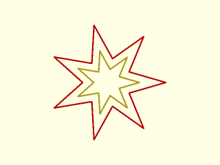

    include <BOSL2/std.scad>
    star = star(7, r=120, ir=50);
    stroke(closed=true, width=3, star, color="red");
    stroke(closed=true, width=3,
           offset(star, delta=-15, closed=true));

  

**Example 5:** Inward offset with chamfers

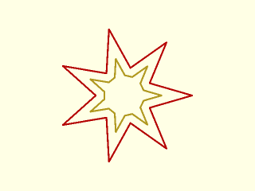

    include <BOSL2/std.scad>
    star = star(7, r=120, ir=50);
    stroke(closed=true, width=3, star, color="red");
    stroke(closed=true, width=3,
           offset(star, delta=-15, chamfer=true, closed=true));

  

**Example 6:** Inward offset with rounding

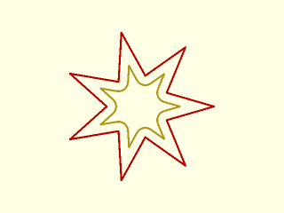

    include <BOSL2/std.scad>
    star = star(7, r=120, ir=50);
    stroke(closed=true, width=3, star, color="red");
    stroke(closed=true, width=3,
           offset(star, r=-15, closed=true, $fn=20));

  

**Example 7:** Open path.  The red path moves from left to right as shown by the arrow and the positive offset shifts to the left of the initial red path.

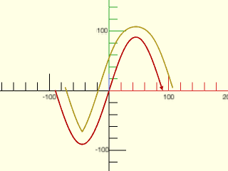

    include <BOSL2/std.scad>
    sinpath = 2*[for(theta=[-180:5:180]) [theta/4,45*sin(theta)]];
    stroke(sinpath, width=2, color="red", endcap2="arrow2");
    stroke(offset(sinpath, r=17.5,closed=false),width=2);

  

**Example 8:** An open path in red with with its positive offset in yellow and its negative offset in blue.

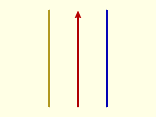

    include <BOSL2/std.scad>
    seg = [[0,0],[0,50]];
    stroke(seg,color="red",endcap2="arrow2");
    stroke(offset(seg,r=15,closed=false));
    stroke(offset(seg,r=-15,closed=false),color="blue");

  

**Example 9:** Offsetting the same line segment closed=true.  On the left, we use delta with chamfer=false, in the middle, chamfer=true, and on the right, rounding with r=.  A "closed" path here means that the path backtracks over itself.  When this happens, a flat end occurs in the first case, an end with chamfered corners if chamfering is on, or a semicircular rounding in the rounded case.

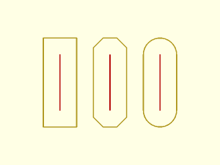

    include <BOSL2/std.scad>
    seg = [[0,0],[0,50]];
    stroke(seg,color="red");
    stroke([offset(seg,delta=15,closed=true)]);
    right(45){
      stroke(seg,color="red");
      stroke([offset(seg,delta=15,chamfer=true,closed=true)]);
    }
    right(90){
      stroke(seg,color="red");
      stroke([offset(seg,r=15,closed=true)]);
    }

  

**Example 10:** Cutting a notch out of a square with a path reversal

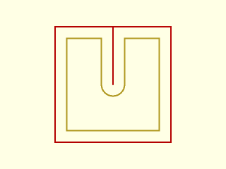

 

    include <BOSL2/std.scad>
    path = [[-10,-10],[-10,10],[0,10],[0,0],[0,10],[10,10],[10,-10]];
    stroke([path],width=.25,color="red");
    stroke([offset(path, r=-2,$fn=32,closed=true)],width=.25);

**Example 11:** A more complex example where the path turns back on itself several times.

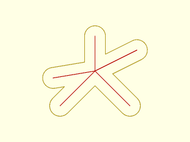

    include <BOSL2/std.scad>
    $fn=32;
    path = [
            [0,0], [5,5],
            [10,0],[5,5],
            [11,8],[5,5],
            [5,10],[5,5],
            [-1,4],[5,5]
            ];
    op=offset(path, r=1.5,closed=true);
    stroke([path],width=.1,color="red");
    stroke([op],width=.1);

  

**Example 12:** With the default quality value, this case produces the wrong answer.  This happens because the offset edge corresponding to the long left edge (shown in green) is erroneously flagged as invalid.  If you use `r=` instead of `delta=` then this fails with an error.

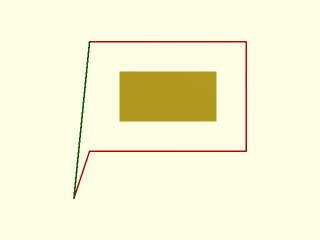

    include <BOSL2/std.scad>
    test = [[0,0],[10,0],[10,7],[0,7], [-1,-3]];
    polygon(offset(test,delta=-1.9, closed=true));
    stroke([test],width=.1,color="red");
    stroke(select(test,-2,-1), width=.1, color="green");

  

**Example 13:** Using `quality=2` produces the correct result

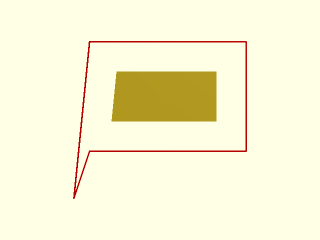

    include <BOSL2/std.scad>
    test = [[0,0],[10,0],[10,7],[0,7], [-1,-3]];
    polygon(offset(test,r=-1.9, closed=true, quality=2));
    stroke([test],width=.1,color="red");

  

**Example 14:** This case fails if `check_valid=true` when delta is large enough because segments are too close to the opposite side of the curve so they all get flagged as invalid and deleted from the output.

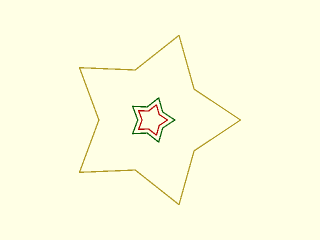

 

    include <BOSL2/std.scad>
    star = star(5, r=22, ir=13);
    stroke(star,width=.3,closed=true);
    color("green")
      stroke(offset(star, delta=-9, closed=true),width=.3,closed=true); // Works with check_valid=true (the default)
    color("red")
      stroke(offset(star, delta=-10, closed=true, check_valid=false),   // Fails if check_valid=true
             width=.3,closed=true);

**Example 15:** But if you use rounding with offset then you need `check_valid=true` when `r` is big enough.  It works without the validity check as long as the offset shape retains a some of the straight edges at the star tip, but once the shape shrinks smaller than that, it fails.  There is no simple way to get a correct result for the case with `r=10`, because as in the previous example, it fails if you turn on validity checks.

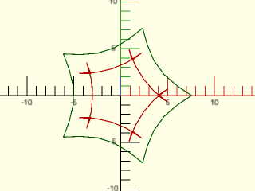

 

    include <BOSL2/std.scad>
    star = star(5, r=22, ir=13);
    color("green")
      stroke(offset(star, r=-8, closed=true,check_valid=false), width=.1, closed=true);
    color("red")
      stroke(offset(star, r=-10, closed=true,check_valid=false), width=.1, closed=true);

**Example 16:** The extra triangles in this example show that the validity check cannot be skipped

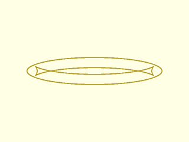

    include <BOSL2/std.scad>
    ellipse = scale([20,4], p=circle(r=1,$fn=64));
    stroke(ellipse, closed=true, width=0.3);
    stroke(offset(ellipse, r=-3, check_valid=false, closed=true),
           width=0.3, closed=true);

  

**Example 17:** The triangles are removed by the validity check

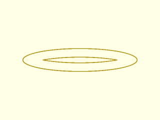

    include <BOSL2/std.scad>
    ellipse = scale([20,4], p=circle(r=1,$fn=64));
    stroke(ellipse, closed=true, width=0.3);
    stroke(offset(ellipse, r=-3, check_valid=true, closed=true),
           width=0.3, closed=true);

  

**Example 18:** The region shown in red has the yellow offset region.

    include <BOSL2/std.scad>
    rgn = difference(circle(d=100),
                     union(square([20,40], center=true),
                           square([40,20], center=true)));
    stroke(rgn, width=1, color="red");
    region(offset(rgn, r=-5));

  

**Example 19:** Using `same_length=true` to align the original curve to the offset. Many points map to the corner at the top.

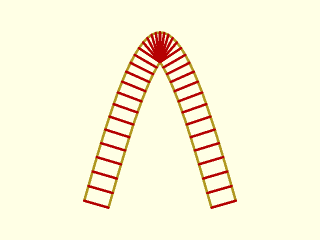

    include <BOSL2/std.scad>
    closed=false;
    path = [for(angle=[0:5:180]) 10*[angle/100,2*sin(angle)]];
    opath = offset(path,delta=-3,same_length=true,closed=closed);
    stroke(path,closed=closed,width=.3);
    stroke(opath,closed=closed,width=.3);
    for(i=idx(path))
        stroke([path[i],opath[i]],width=.3,color="red");

  

---

### Function/Module: union()

**Synopsis:** Performs a Boolean union operation. [<abbr>Geom</abbr>] [<abbr>Region</abbr>]

**Topics:** [Boolean Operations](Topics#boolean-operations), [Regions](Topics#regions), [Polygons](Topics#polygons), [Shapes2D](Topics#shapes2d), [Shapes3D](Topics#shapes3d)

**See Also:** [difference()](#functionmodule-difference), [intersection()](#functionmodule-intersection), [diff()](attachments.scad#module-diff), [intersect()](attachments.scad#module-intersect), [exclusive\_or()](#functionmodule-exclusive_or)

**Usage:** 

- union() CHILDREN;
- region = union(regions);
- region = union(REGION1,REGION2);
- region = union(REGION1,REGION2,REGION3);

**Description:** 

When called as a function and given a list of [regions](Glossary#region) or 2D [polygons](Glossary#polygon),
returns the union of all given regions and polygons.  Result is a single region.
When called as the built-in module, makes the union of the given children.
This function is **much** slower than the native union module acting on geometry,
so you should only use it when you need a point list for further processing.

**Arguments:** 

<abbr title="These args can be used by position or by name.">By&nbsp;Position</abbr> | What it does
-------------------- | ------------
`regions`            | List of regions to union.

**Example 1:** 

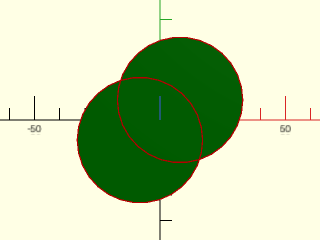

    include <BOSL2/std.scad>
    shape1 = move([-8,-8,0], p=circle(d=50));
    shape2 = move([ 8, 8,0], p=circle(d=50));
    color("green") region(union(shape1,shape2));
    for (shape = [shape1,shape2])
        stroke(shape, width=0.5, closed=true, color="red");

  

---

### Function/Module: difference()

**Synopsis:** Performs a Boolean difference operation. [<abbr>Geom</abbr>] [<abbr>Region</abbr>]

**Topics:** [Boolean Operations](Topics#boolean-operations), [Regions](Topics#regions), [Polygons](Topics#polygons), [Shapes2D](Topics#shapes2d), [Shapes3D](Topics#shapes3d)

**See Also:** [union()](#functionmodule-union), [intersection()](#functionmodule-intersection), [diff()](attachments.scad#module-diff), [intersect()](attachments.scad#module-intersect), [exclusive\_or()](#functionmodule-exclusive_or)

**Usage:** 

- difference() CHILDREN;
- region = difference(regions);
- region = difference(REGION1,REGION2);
- region = difference(REGION1,REGION2,REGION3);

**Description:** 

When called as a function, and given a list of [regions](Glossary#region) or 2D [polygons](Glossary#polygon),
takes the first region or polygon and differences away all other regions/polygons from it.  The resulting
region is returned.
When called as the built-in module, makes the set difference of the given children.
This function is **much** slower than the native difference module acting on geometry,
so you should only use it when you need a point list for further processing.

**Arguments:** 

<abbr title="These args can be used by position or by name.">By&nbsp;Position</abbr> | What it does
-------------------- | ------------
`regions`            | List of regions or polygons to difference.

**Example 1:** 

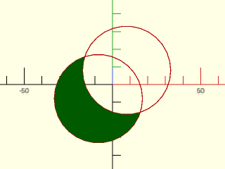

    include <BOSL2/std.scad>
    shape1 = move([-8,-8,0], p=circle(d=50));
    shape2 = move([ 8, 8,0], p=circle(d=50));
    for (shape = [shape1,shape2])
        stroke(shape, width=0.5, color="red", closed=true);
    color("green") region(difference(shape1,shape2));

  

---

### Function/Module: intersection()

**Synopsis:** Performs a Boolean intersection operation. [<abbr>Geom</abbr>] [<abbr>Region</abbr>]

**Topics:** [Boolean Operations](Topics#boolean-operations), [Regions](Topics#regions), [Polygons](Topics#polygons), [Shapes2D](Topics#shapes2d), [Shapes3D](Topics#shapes3d)

**See Also:** [difference()](#functionmodule-difference), [union()](#functionmodule-union), [diff()](attachments.scad#module-diff), [intersect()](attachments.scad#module-intersect), [exclusive\_or()](#functionmodule-exclusive_or)

**Usage:** 

- intersection() CHILDREN;
- region = intersection(regions);
- region = intersection(REGION1,REGION2);
- region = intersection(REGION1,REGION2,REGION3);

**Description:** 

When called as a function, and given a list of [regions](Glossary#region) or [polygons](Glossary#polygon) returns the
intersection of all given regions.  Result is a single region.
When called as the built-in module, makes the intersection of all the given children.

**Arguments:** 

<abbr title="These args can be used by position or by name.">By&nbsp;Position</abbr> | What it does
-------------------- | ------------
`regions`            | List of regions to intersect.

**Example 1:** 

    include <BOSL2/std.scad>
    shape1 = move([-8,-8,0], p=circle(d=50));
    shape2 = move([ 8, 8,0], p=circle(d=50));
    for (shape = [shape1,shape2])
        stroke(shape,width=0.5, color="red", closed=true);
    color("green") region(intersection(shape1,shape2));

  

---

### Function/Module: exclusive\_or()

**Synopsis:** Performs a Boolean exclusive-or operation. [<abbr>Geom</abbr>] [<abbr>Region</abbr>]

**Topics:** [Boolean Operations](Topics#boolean-operations), [Regions](Topics#regions), [Polygons](Topics#polygons), [Shapes2D](Topics#shapes2d), [Shapes3D](Topics#shapes3d)

**See Also:** [union()](#functionmodule-union), [difference()](#functionmodule-difference), [intersection()](#functionmodule-intersection), [diff()](attachments.scad#module-diff), [intersect()](attachments.scad#module-intersect)

**Usage:** 

- exclusive_or() CHILDREN;
- region = exclusive_or(regions);
- region = exclusive_or(REGION1,REGION2);
- region = exclusive_or(REGION1,REGION2,REGION3);

**Description:** 

When called as a function and given a list of [regions](Glossary#region) or 2D [polygons](Glossary#polygon),
returns the exclusive_or of all given regions.  Result is a single region.
When called as a module, performs a Boolean exclusive-or of up to 10 children. Note that when
the input regions cross each other, the exclusive-or operator produces shapes that
meet at corners (non-simple regions), which do not render in CGAL.
This function is **much** slower than the native intersection module acting on geometry,
so you should only use it when you need a point list for further processing.

**Arguments:** 

<abbr title="These args can be used by position or by name.">By&nbsp;Position</abbr> | What it does
-------------------- | ------------
`regions`            | List of regions or polygons to exclusive_or

**Example 1:** As Function.  A linear\_sweep of this shape fails to render in CGAL.

    include <BOSL2/std.scad>
    shape1 = move([-8,-8,0], p=circle(d=50));
    shape2 = move([ 8, 8,0], p=circle(d=50));
    for (shape = [shape1,shape2])
        color("red") stroke(shape, width=0.5, closed=true);
    color("green") region(exclusive_or(shape1,shape2));

  

**Example 2:** As Module.  A linear\_extrude() of the resulting geometry fails to render in CGAL.

    include <BOSL2/std.scad>
    exclusive_or() {
        square(40,center=false);
        circle(d=40);
    }

  

---

### Function/Module: hull\_region()

**Synopsis:** Compute convex hull of [region](Glossary#region) or 2D [path](Glossary#path) [<abbr>Geom</abbr>] [<abbr>Path</abbr>]

**Topics:** [Regions](Topics#regions), [Polygons](Topics#polygons), [Shapes2D](Topics#shapes2d)

**Usage:** 

- path = hull_region(region);
- hull_region(region);

**Description:** 

Given a [path](Glossary#path), or a [region](Glossary#region), compute the convex hull
and return it as a path.  This differs from [`hull()`](geometry.scad#function-hull) and [`hull2d_path()`](geometry.scad#function-hull2d_path), which
return an index list into the point list.  As a module invokes the native hull() on
the specified region.

**Arguments:** 

<abbr title="These args can be used by position or by name.">By&nbsp;Position</abbr> | What it does
-------------------- | ------------
`region`             | region or path listing points to compute the hull from.

**Example 1:** 

    include <BOSL2/std.scad>
    data = [star(id=10,od=20,n=9),
            right(30, star(id=12,od=25, n=7))];
    stroke(data);
    stroke([hull_region(data)],color="red");

  

---

### Function: fill()

**Synopsis:** Remove holes from a [region](Glossary#region) [<abbr>Geom</abbr>] [<abbr>Path</abbr>]

**Topics:** [Regions](Topics#regions), [Polygons](Topics#polygons), [Shapes2D](Topics#shapes2d)

**Usage:** 

- filled = fill(region);

**Description:** 

This is documentation for the BOSL2 function form of `fill()`.  [Click Here for documentation for the builtin module.](https://github.com/BelfrySCAD/BelfrySCAD/wiki/Language-Other-Modules#fill)

Given a [region](Glossary#region), fill in any internal holes in the components of the region.  This returns the outside border of each region component, and
is equivalent to [`hull()`](geometry.scad#function-hull) for region components whose outside boundary is convex.

**Arguments:** 

<abbr title="These args can be used by position or by name.">By&nbsp;Position</abbr> | What it does
-------------------- | ------------
`region`             | region to fill

**Example 1:** The original region in green has internal holes and subparts that are all filled in on the yellow filled region.

    include <BOSL2/std.scad>
    $fs=.5;$fa=1;
    reg=[circle(r=10),right(5.5,circle(r=1)),
         circle(r=8), circle(r=3),
         right(5.5,rect([3,4]))];
    color("green")region(reg);
    right(25)region(fill(reg));

  

**Example 2:** Here the input region in green has two components:

    include <BOSL2/std.scad>
    reg = [circle(8), circle(6)];
    reg2 = union([reg, fwd(18,reg)]);
    color("green")region(reg2);
    right(18) region(fill(reg2));

  

---

