# LibFile: rounding.scad

Routines to create rounded corners, with either circular rounding,
or continuous curvature rounding with no sudden curvature transitions.
Provides rounding of corners or rounding that preserves corner points and curves the edges.
Also provides some 3D rounding functions, and a powerful function for joining
two prisms together with a rounded fillet at the joint.

To use, add the following lines to the beginning of your file:

    include <BOSL2/std.scad>

## File Contents

1. [Section: Types of Roundovers](#section-types-of-roundovers)

2. [Section: Rounding Paths](#section-rounding-paths)
    - [`round_corners()`](#function-round_corners) – Round or chamfer the corners of a path (clipping them off). [<abbr>Path</abbr>]
    - [`smooth_path()`](#function-smooth_path) – Create a smoothed path passing through all the points of a given path, or passing through all the segment midpoint tangents. [<abbr>Path</abbr>]
    - [`path_join()`](#function-path_join) – Join paths end to end with optional rounding. [<abbr>Path</abbr>]
    - [`offset_stroke()`](#functionmodule-offset_stroke) – Draws a line along a path with options to specify angles and roundings at the ends. [<abbr>Path</abbr>] [<abbr>Region</abbr>]

3. [Section: Three-Dimensional Rounding](#section-three-dimensional-rounding)
    - [`offset_sweep()`](#functionmodule-offset_sweep) – Make a solid from a polygon with offset that changes along its length. [<abbr>Geom</abbr>] [<abbr>VNF</abbr>]
    - [`convex_offset_extrude()`](#module-convex_offset_extrude) – Make a solid from geometry where offset changes along the object's length. [<abbr>Geom</abbr>]
    - [`rounded_prism()`](#functionmodule-rounded_prism) – Make a rounded 3d object by connecting two polygons with the same vertex count. [<abbr>Geom</abbr>] [<abbr>VNF</abbr>]
    - [`bent_cutout_mask()`](#module-bent_cutout_mask) – Create a mask for making a round-edged cutout in a cylindrical shell. [<abbr>Geom</abbr>]
    - [`join_prism()`](#functionmodule-join_prism) – Join an arbitrary prism to a plane, sphere, cylinder or another arbitrary prism with a fillet. [<abbr>Geom</abbr>] [<abbr>VNF</abbr>]
    - [`prism_connector()`](#module-prism_connector) – Construct a filleted prism that connects objects [<abbr>Geom</abbr>]
    - [`attach_prism()`](#module-attach_prism) – Attach a filleted prism with optional rounded end [<abbr>Geom</abbr>]

## Section: Types of Roundovers

The functions and modules in this file support two different types of roundovers and some different mechanisms for specifying
the size of the roundover.  The usual circular roundover can produce a tactile "bump" where the curvature changes from flat to
circular.  See https://hackernoon.com/apples-icons-have-that-shape-for-a-very-good-reason-720d4e7c8a14 for details.
We compute continuous curvature rounding using 4th order Bezier curves.  This type of rounding, which we call "smooth" rounding,
does not have a "radius" so we need different ways to specify the size of the roundover.  We introduce the `cut` and `joint`
parameters for this purpose.  They can specify dimensions of circular roundovers, continuous curvature "smooth" roundovers, and even chamfers.

The `cut` parameter specifies the distance from the unrounded corner to the rounded tip, so how
much of the corner to "cut" off.  This can be easier to understand than setting a circular radius, which can be
unexpectedly extreme when the corner is sharp.  It also allows a systematic specification of
corner treatments that are the same size for all corner treatments.

The `joint` parameter specifies the distance
away from the corner along the path where the roundover or chamfer should start.  This parameter is good for ensuring that
your roundover fits on the polygon or polyhedron, because you can easily tell whether you have enough space, and whether
adjacent corner treatments interfere.

For circular rounding you can use the `radius` or `r` parameter to set the rounding radius.

For chamfers you can use `width` to set the width of the chamfer.

The "smooth" rounding method also has a parameter that specifies how smooth the curvature match is.  This parameter, `k`,
ranges from 0 to 1, with a default of 0.5.  Larger values gives a more
abrupt transition and smaller ones a more gradual transition.  If you set the value much higher
than 0.8 the curvature changes abruptly enough that though it is theoretically continuous, it may
not be continuous in practice.  If you set it small then the transition is so gradual that
the length of the roundover may be extremely long, and the actual rounded part of the curve may be small.

**Figure 1.1:** Parameters of a "circle" roundover

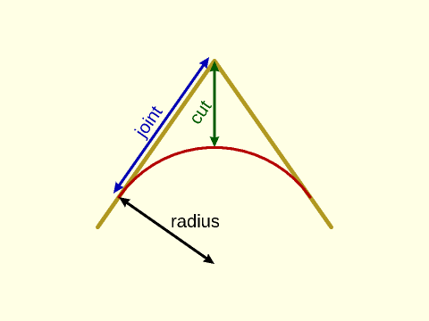

 

**Figure 1.2:** Parameters of a "smooth" roundover with the default of `k=0.5`.  Note the long, slow transition from flat to round.

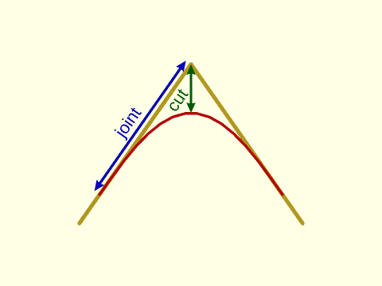

 

**Figure 1.3:** Parameters of a "smooth" roundover, with `k=0.75`.  The transition into the roundover is shorter, and faster.  The cut length is bigger for the same joint length.

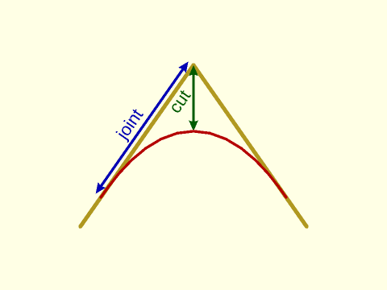

 

**Figure 1.4:** Parameters of a "smooth" roundover, with `k=0.15`.  The transition is so gradual that it appears that the roundover is much smaller than specified.  The cut length is much smaller for the same joint length.

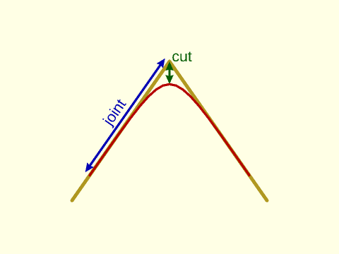

 

**Figure 1.5:** Parameters of a symmetric "chamfer".

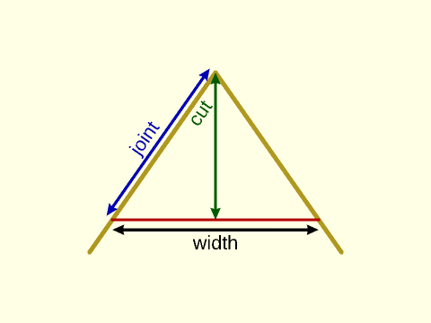

 

## Section: Rounding Paths

### Function: round\_corners()

**Synopsis:** Round or chamfer the corners of a path (clipping them off). [<abbr>Path</abbr>]

**Topics:** [Rounding](Topics#rounding), [Paths](Topics#paths)

**See Also:** [smooth\_path()](#function-smooth_path), [path\_join()](#function-path_join), [offset\_stroke()](#functionmodule-offset_stroke)

**Usage:** 

- rounded_path = round_corners(path, [method], [radius=], [cut=], [joint=], [closed=], [verbose=]);

**Description:** 

Takes a 2D or 3D path as input and rounds each corner
by a specified amount.  The rounding at each point can be different and some points can have zero
rounding.  The `round_corners()` function supports three types of corner treatment: chamfers, circular rounding,
and continuous curvature rounding using 4th order bezier curves.  See
[Types of Roundover](rounding.scad#subsection-types-of-roundover) for details on rounding types.

You select the type of rounding using the `method` parameter, which should be `"smooth"` to
get continuous curvature rounding, `"circle"` to get circular rounding, or `"chamfer"` to get chamfers.  The default is circle
rounding.  Each method accepts multiple options to specify the amount of rounding.  See
[Types of Roundover](rounding.scad#subsection-types-of-roundover) for example diagrams.

* The `cut` parameter specifies the distance from the unrounded corner to the rounded tip, so how
much of the corner to "cut" off.
* The `joint` parameter specifies the distance
away from the corner along the path where the roundover or chamfer should start.  This makes it easy to ensure your roundover fits,
so use it if you want the largest possible roundover.
* For circular rounding you can use the `radius` or `r` parameter to set the rounding radius.
* For chamfers you can use the `width` parameter, which sets the width of the chamfer edge.

As explained in [Types of Roundover](rounding.scad#subsection-types-of-roundover), the continuous curvature "smooth"
type of rounding also accepts the `k` parameter, between 0 and 1, which specifies how fast the curvature changes at
the joint.  The default is `k=0.5`.

If you select curves that are too large to fit, the function fails with an error.  You can set `verbose=true` to
get a message showing a list of scale factors you can apply to your rounding parameters so that the
roundovers fit on the curve.  If the scale factors are larger than one
then they indicate how much you can increase the curve sizes before collisions occur.

The parameters `radius`, `cut`, `joint` and `k` can be numbers, which round every corner using the same parameters, or you
can specify a list to round each corner with different parameters.  If the curve is not closed then the first and last points
of the curve are not rounded.  In this case you can specify a full list of points anyway, and the endpoint values are ignored,
or you can specify a list that has length len(path)-2, omitting the two dummy values.

If your input path includes collinear points you must use a cut or radius value of zero for those "corners".  You can
choose a nonzero joint parameter when the collinear points form a 180 degree angle.  This causes extra points to be inserted.
If the collinear points form a spike (0 degree angle), then `round_corners()` fails.

Examples:
* `method="circle", radius=2`:
    Rounds every point with circular, radius 2 roundover
* `method="smooth", cut=2`:
    Rounds every point with continuous curvature rounding with a cut of 2, and a default 0.5 smoothing parameter
* `method="smooth", cut=2, k=0.3`:
    Rounds every point with continuous curvature rounding with a cut of 2, and a gentle 0.3 smoothness setting

The number of segments used for roundovers is determined by `$fa`, `$fs` and `$fn` as usual for
circular roundovers.  For continuous curvature roundovers `$fs` and `$fn` are used and `$fa` is
ignored.  Note that $fn is interpreted as the number of points on the roundover curve, which is
not equivalent to its meaning for rounding circles because roundovers are usually small fractions
of a circular arc.  As usual, $fn overrides $fs.  When doing continuous curvature rounding, be sure to use lots of segments or the effect
would be hidden by the discretization.  Note that if you use $fn with "smooth" then $fn points are added at each corner.
This guarantees a specific output length.  It also means that if
you set `joint` nonzero on a flat "corner", with collinear points, you get `$fn` points at that "corner."
If you have two roundovers that fully consume a segment, then they share a point where they meet in the segment, which means the output
point count decreases by one.

**Arguments:** 

<abbr title="These args can be used by position or by name.">By&nbsp;Position</abbr> | What it does
-------------------- | ------------
`path`               | list of 2d or 3d points defining the path to be rounded.
`method`             | rounding method to use.  Set to "chamfer" for chamfers, "circle" for circular rounding and "smooth" for continuous curvature 4th order bezier rounding.  Default: "circle"

<abbr title="These args must be used by name, ie: name=value">By&nbsp;Name</abbr> | What it does
-------------------- | ------------
`radius`             / `r`                  | rounding radius, only compatible with `method="circle"`. Can be a number or vector.
`cut`                | rounding cut distance, compatible with all methods.  Can be a number or vector.
`joint`              | rounding joint distance, compatible with `method="chamfer"` and `method="smooth"`.  Can be a number or vector.
`width`              | width of the flat edge created by chamfering, compatible with `method="chamfer"`.  Can be a number or vector.
`k`                  | continuous curvature smoothness parameter for `method="smooth"`.  Can be a number or vector.  Default: 0.5
`closed`             | if true treat the path as a closed polygon, otherwise treat it as open.  Default: true.
`verbose`            | if true display rounding scale factors that show how close roundovers are to overlapping.  Default: false

**Example 1:** Standard circular roundover with radius the same at every point. Compare results at the different corners.

 

    include <BOSL2/std.scad>
    $fn=36;
    shape = [[0,0], [10,0], [15,12], [6,6], [6, 12], [-3,7]];
    polygon(round_corners(shape, radius=1));
    color("red") down(.1) polygon(shape);

**Example 2:** Circular roundover using the "cut" specification, the same at every corner.

 

    include <BOSL2/std.scad>
    $fn=36;
    shape = [[0,0], [10,0], [15,12], [6,6], [6, 12], [-3,7]];
    polygon(round_corners(shape, cut=1));
    color("red") down(.1) polygon(shape);

**Example 3:** Continous curvature roundover using "cut", still the same at every corner.  The default smoothness parameter of 0.5 was too gradual for these roundovers to fit, but 0.7 works.

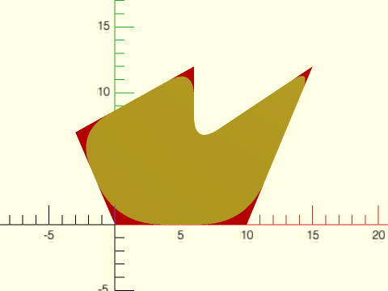

 

    include <BOSL2/std.scad>
    $fn=36;
    shape = [[0,0], [10,0], [15,12], [6,6], [6, 12], [-3,7]];
    polygon(round_corners(shape, method="smooth", cut=1, k=0.7));
    color("red") down(.1) polygon(shape);

**Example 4:** Continuous curvature roundover using "joint", for the last time the same at every corner.  Notice how small the roundovers are.

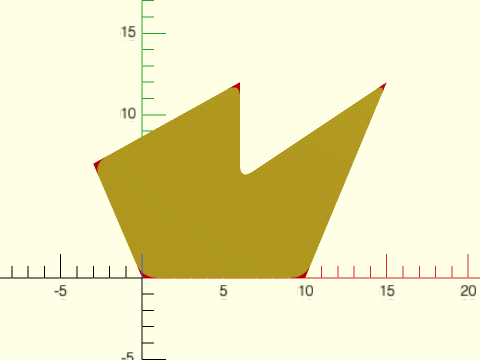

 

    include <BOSL2/std.scad>
    $fn=36;
    shape = [[0,0], [10,0], [15,12], [6,6], [6, 12], [-3,7]];
    polygon(round_corners(shape, method="smooth", joint=1, k=0.7));
    color("red") down(.1) polygon(shape);

**Example 5:** Circular rounding, different at every corner, some corners left unrounded

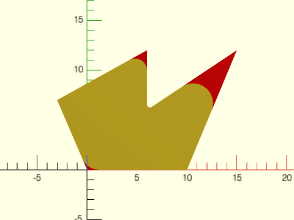

 

    include <BOSL2/std.scad>
    shape = [[0,0], [10,0], [15,12], [6,6], [6, 12], [-3,7]];
    radii = [1.8, 0, 2, 0.3, 1.2, 0];
    polygon(round_corners(shape, radius = radii,$fn=64));
    color("red") down(.1) polygon(shape);

**Example 6:** Continuous curvature rounding, different at every corner, with varying smoothness parameters as well, and `$fs` set small.  Note that `$fa` is ignored here with method set to "smooth".

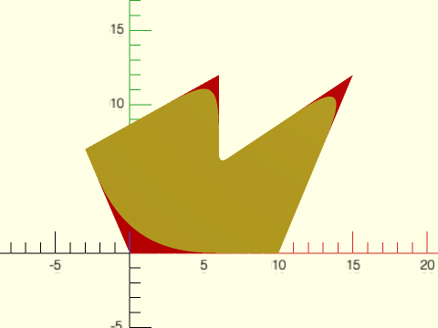

 

    include <BOSL2/std.scad>
    shape = [[0,0], [10,0], [15,12], [6,6], [6, 12], [-3,7]];
    cuts = [1.5,0,2,0.3, 1.2, 0];
    k = [0.6, 0.5, 0.5, 0.7, 0.3, 0.5];
    polygon(round_corners(shape, method="smooth", cut=cuts, k=k, $fs=0.1));
    color("red") down(.1) polygon(shape);

**Example 7:** Chamfers

 

    include <BOSL2/std.scad>
    $fn=36;
    shape = [[0,0], [10,0], [15,12], [6,6], [6, 12], [-3,7]];
    polygon(round_corners(shape, method="chamfer", cut=1));
    color("red") down(.1) polygon(shape);

**Example 8:** 3D printing test pieces to display different curvature shapes.  You can see the discontinuity in the curvature on the "C" piece in the rendered image.

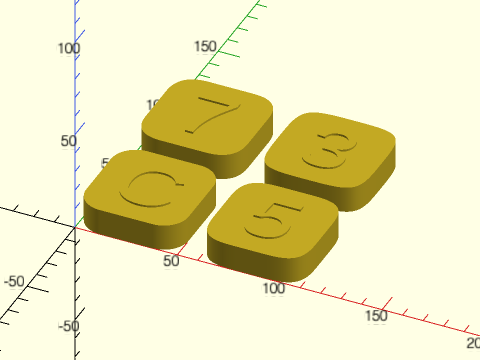

 

    include <BOSL2/std.scad>
    ten = square(50);
    cut = 5;
    linear_extrude(height=14) {
      translate([25,25,0])text("C",size=30, valign="center", halign="center");
      translate([85,25,0])text("5",size=30, valign="center", halign="center");
      translate([85,85,0])text("3",size=30, valign="center", halign="center");
      translate([25,85,0])text("7",size=30, valign="center", halign="center");
    }
    linear_extrude(height=13) {
      polygon(round_corners(ten, cut=cut, $fn=96*4));
      translate([60,0,0])polygon(round_corners(ten,  method="smooth", cut=cut, $fn=96));
      translate([60,60,0])polygon(round_corners(ten, method="smooth", cut=cut, k=0.32, $fn=96));
      translate([0,60,0])polygon(round_corners(ten, method="smooth", cut=cut, k=0.7, $fn=96));
    }

**Example 9:** Rounding a path that is not closed in a three different ways.

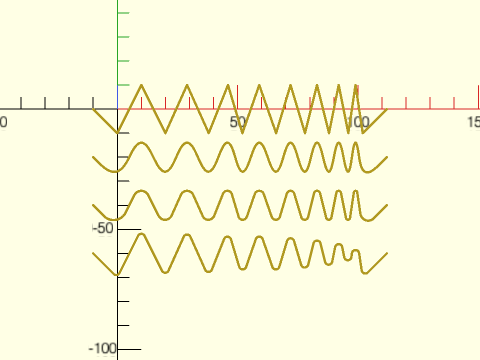

 

    include <BOSL2/std.scad>
    $fs=.1;
    $fa=1;
    zigzagx = [-10, 0, 10, 20, 29, 38, 46, 52, 59, 66, 72, 78, 83, 88, 92, 96, 99, 102, 112];
    zigzagy = concat([0], flatten(repeat([-10,10],8)), [-10,0]);
    zig = hstack(zigzagx,zigzagy);
    stroke(zig,width=1);   // Original shape
    fwd(20)            // Smooth size corners with a cut of 4 and curvature parameter 0.6
      stroke(round_corners(zig,cut=4, k=0.6, method="smooth", closed=false),width=1);
    fwd(40)            // Smooth size corners with circular arcs and a cut of 4
      stroke(round_corners(zig,cut=4,closed=false, method="circle"),width=1);
                       // Smooth size corners with a circular arc and radius 1.5 (close to maximum possible)
    fwd(60)            // Note how the different points are cut back by different amounts
      stroke(round_corners(zig,radius=1.5,closed=false),width=1);

**Example 10:** Rounding some random 3D paths

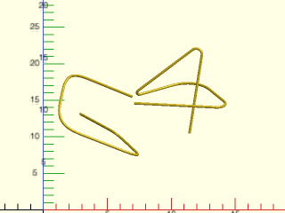

 

    include <BOSL2/std.scad>
    $fn=36;
    list1= [
      [2.887360, 4.03497, 6.372090],
      [5.682210, 9.37103, 0.783548],
      [7.808460, 4.39414, 1.843770],
      [0.941085, 5.30548, 4.467530],
      [1.860540, 9.81574, 6.497530],
      [6.938180, 7.21163, 5.794530]
    ];
    list2= [
      [1.079070, 4.74091, 6.900390],
      [8.775850, 4.42248, 6.651850],
      [5.947140, 9.17137, 6.156420],
      [0.662660, 6.95630, 5.884230],
      [6.564540, 8.86334, 9.953110],
      [5.420150, 4.91874, 3.866960]
    ];
    path_sweep(regular_ngon(n=36,or=.1),round_corners(list1,closed=false, method="smooth", cut = 0.65));
    right(6)
      path_sweep(regular_ngon(n=36,or=.1),round_corners(list2,closed=false, method="circle", cut = 0.75));

**Example 11:** Rounding a spiral with increased rounding along the length

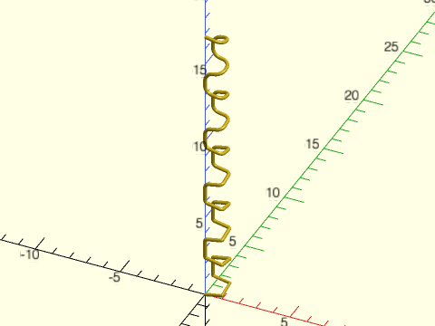

 

    include <BOSL2/std.scad>
    // Construct a square spiral path in 3D
    $fn=36;
    square = [[0,0],[1,0],[1,1],[0,1]];
    spiral = flatten(repeat(concat(square,reverse(square)),5));  // Squares repeat 10x, forward and backward
    squareind = [for(i=[0:9]) each [i,i,i,i]];                   // Index of the square for each point
    z = count(40)*.2+squareind;
    path3d = hstack(spiral,z);                                   // 3D spiral
    rounding = squareind/20;
        // Setting k=1 means curvature is not continuous, but curves are as round as possible
        // Try changing the value to see the effect.
    rpath = round_corners(path3d, joint=rounding, k=1, method="smooth", closed=false);
    path_sweep( regular_ngon(n=36, or=.1), rpath);

**Example 12:** The rounding invocation that is commented out gives an error because the rounding parameters interfere with each other.  The error message gives a list of factors that can help you fix this: [0.852094, 0.852094, 1.85457, 10.1529]

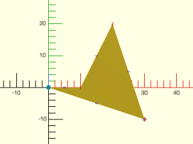

    include <BOSL2/std.scad>
    $fn=64;
    path = [[0, 0],[10, 0],[20, 20],[30, -10]];
    debug_polygon(path);
    //polygon(round_corners(path,cut = [1,3,1,1],
    //        method="circle"));

  

**Example 13:** The list of factors shows that the problem is in the first two rounding values, because the factors are smaller than one.  If we multiply the first two parameters by 0.85 then the roundings fit.  The verbose option gives us the same fit factors.

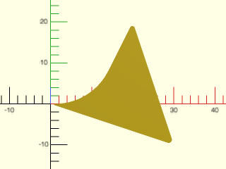

    include <BOSL2/std.scad>
    $fn=64;
    path = [[0, 0],[10, 0],[20, 20],[30, -10]];
    polygon(round_corners(path,cut = [0.85,3*0.85,1,1],
                          method="circle", verbose=true));

  

**Example 14:** From the fit factors we can see that rounding at vertices 2 and 3 could be increased a lot.  Applying those factors we get this more rounded shape.  The new fit factors show that we can still further increase the rounding parameters if we wish.

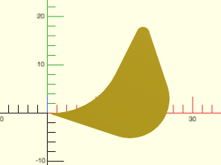

    include <BOSL2/std.scad>
    $fn=64;
    path = [[0, 0],[10, 0],[20, 20],[30, -10]];
    polygon(round_corners(path,cut = [0.85,3*0.85,2.13, 10.15],
                          method="circle",verbose=true));

  

**Example 15:** Using the `joint` parameter, it's easier to understand whether your roundvers can fit.  We can guarantee a fairly large roundover on any path by picking each one to use up half the segment distance along the shorter of its two segments:

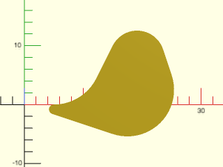

    include <BOSL2/std.scad>
    $fn=64;
    path = [[0, 0],[10, 0],[20, 20],[30, -10]];
    path_len = path_segment_lengths(path,closed=true);
    halflen = [for(i=idx(path)) min(select(path_len,i-1,i))/2];
    polygon(round_corners(path,joint = halflen,
                          method="circle",verbose=true));

  

**Example 16:** Chamfering, specifying the chamfer width

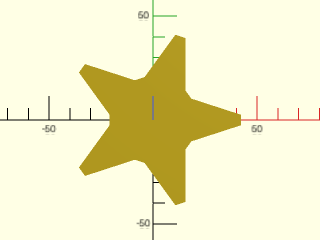

    include <BOSL2/std.scad>
    path = star(5, step=2, d=100);
    path2 = round_corners(path, method="chamfer", width=5);
    polygon(path2);

  

**Example 17:** Chamfering, specifying the cut

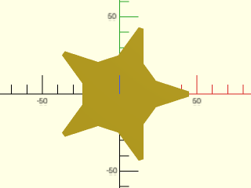

    include <BOSL2/std.scad>
    path = star(5, step=2, d=100);
    path2 = round_corners(path, method="chamfer", cut=5);
    polygon(path2);

  

**Example 18:** Chamfering, specifying joint length

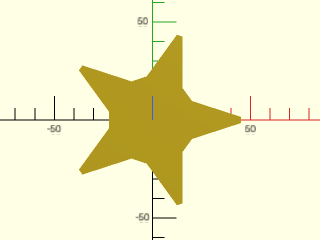

    include <BOSL2/std.scad>
    path = star(5, step=2, d=100);
    path2 = round_corners(path, method="chamfer", joint=5);
    polygon(path2);

  

**Example 19:** Two passes to apply chamfers first, and then round the unchamfered corners.  Chamfers always add one point, so it's not hard to keep track of the vertices

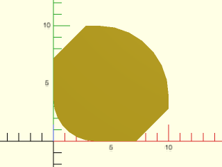

    include <BOSL2/std.scad>
    $fn=32;
    shape = square(10);
    chamfered = round_corners(shape, method="chamfer",
                              cut=[2,0,2,0]);
    rounded = round_corners(chamfered,
               cut = [0, 0,  // 1st original vertex, chamfered
                      1.5,   // 2nd original vertex
                      0, 0,  // 3rd original vertex, chamfered
                      2.5]); // 4th original vertex
    polygon(rounded);

  

**Example 20:** Another example of mixing chamfers and roundings with two passes

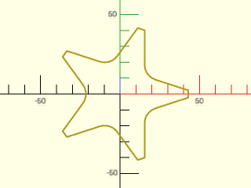

    include <BOSL2/std.scad>
    path = star(5, step=2, d=100);
    chamfcut = [for (i=[0:4]) each [7,0]];
    radii = [for (i=[0:4]) each [0,0,10]];
    path2=round_corners(
            round_corners(path,
                          method="chamfer",
                          cut=chamfcut),
            radius=radii);
    stroke(path2, closed=true);

  

**Example 21:** Specifying by corner index.  Use [`list_set()`](lists.scad#function-list\_set) to construct the full chamfer cut list.

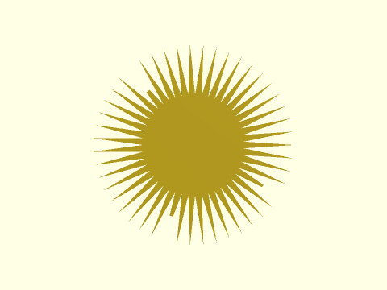

 

    include <BOSL2/std.scad>
    path = star(47, ir=25, or=50);  // long path, lots of corners
    chamfind = [8, 28, 60];         // But only want 3 chamfers
    chamfcut = list_set([],chamfind,[10,13,15],minlen=len(path));
    rpath = round_corners(path, cut=chamfcut, method="chamfer");
    polygon(rpath);

**Example 22:** Two-pass to chamfer and round by index.  Use [`repeat_entries()`](lists.scad#function-repeat\_entries) to correct for first pass chamfers.

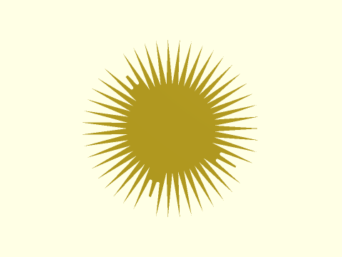

 

    include <BOSL2/std.scad>
    $fn=32;
    path = star(47, ir=32, or=65);  // long path, lots of corners
    chamfind = [8, 28, 60];         // But only want 3 chamfers
    roundind = [7,9,27,29,59,61];   // And 6 roundovers
    chamfcut = list_set([],chamfind,[10,13,15],minlen=len(path));
    roundcut = list_set([],roundind,repeat(8,6),minlen=len(path));
    dups = list_set([], chamfind, repeat(2,len(chamfind)), dflt=1, minlen=len(path));
    rpath1 = round_corners(path, cut=chamfcut, method="chamfer");
    rpath2 = round_corners(rpath1, cut=repeat_entries(roundcut,dups));
    polygon(rpath2);

---

### Function: smooth\_path()

**Synopsis:** Create a smoothed path passing through all the points of a given path, or passing through all the segment midpoint tangents. [<abbr>Path</abbr>]

**Topics:** [Rounding](Topics#rounding), [Paths](Topics#paths)

**See Also:** [round\_corners()](#function-round_corners), [path\_join()](#function-path_join), [offset\_stroke()](#functionmodule-offset_stroke), [squircle()](shapes2d.scad#functionmodule-squircle)

**Usage:** "edges" method

- smoothed = smooth_path(path, [tangents], [size=|relsize=], [method="edges"], [splinesteps=], [closed=], [uniform=]);

**Usage:** "corners" method

- smoothed = smooth_path(path, [size=|relsize=], method="corners", [splinesteps=], [closed=]);

**Description:** 

Smooths the input path, creating a continuous curve using a cubic spline, using one of two methods.

For `method="edges"` (default), every segment (edge) of the path is replaced by a cubic curve with `splinesteps`
points, and the cubic interpolation passes through every input point on the path, matching the tangents at every
point. If you do not specify `tangents`, they are computed using [`path_tangents()`](paths.scad#function-path_tangents) with `uniform=false` by
default. Only the direction of a tangent vector matters, not the vector length.
Setting `uniform=true` with non-uniform sampling may be desirable in some cases but tends to
produces curves that overshoot the point on the path.

For `method="corners"`, every corner of the path is replaced by two cubic curves, each with
`splinesteps` points. The two curves are joined at the corner bisector, and the cubic interpolations
are tangent to the midpoint of every segment. The `tangents` and `uniform` parameters don't apply to the
"corners" method. Using either one with "corners" causes an error.

If the input is collinear, including the case of a 2 point path, then the output is the same as the input
for the "corners" method and for the "edges" method the output is also the same as the input unless you specify
tangents that are not aligned with the input path.

The `size` and `relsize` parameters apply to both methods. They determine how far the curve can deviate
from the input path.  With the "edges" method each segment is replaced by a bezier.  Three things can happen.
The bezier may bulge to one side or the other of the input segemnt.  In this case `size` specifies the exact (maximum) distance
between the path segment and the output curve.  Another possibility is that the spline makes an S-curve.
In this case, `size` specifies the sum of the deviations at the two peaks of the curve.  In 3-space the bezier
curve may have three extrema: two maxima and one minimum.  In this case `size` specifies the sum of the maxima minus the minimum.
If you give `relsize` instead then `size` is set for each segment of the path relative to the length of that segment,
so if a segment has length 10 then `relsize=0.05` would choose `size=0.5` for that segment.

For the "corners" method, `size` specifies the maximum distance from the corner of the original path to the bezier that replaces the corner,
and `relsize` determines where the curve intersects the corner bisector, relative to the maximum deviation
possible (which corresponds to a circle rounding from the shortest leg of the corner). For example,
`relsize=1` is the maximum deviation from the corner (a circle arc from the shortest leg), and `relsize=0.5`
causes the curve to intersect the corner bisector halfway between that maximum and the tip of the corner.

At a given segment or corner (depending on the method) there is a maximum size: a size value that is too
large is rounded down. See also path_to_bezpath().

**Arguments:** 

<abbr title="These args can be used by position or by name.">By&nbsp;Position</abbr> | What it does
-------------------- | ------------
`path`               | path to smooth
`tangents`           | tangents constraining curve direction vectors (vector length doesn't matter) at each point for `method="edges"`. Default: computed automatically

<abbr title="These args must be used by name, ie: name=value">By&nbsp;Name</abbr> | What it does
-------------------- | ------------
`relsize`            | relative maximum devation between the curve and edge (for method="edges") or corner (for method="corners"), a number or vector, expressed as proportion of edge length or proportion of max distance from corner (typically between 0 and 1). Default: 0.1 for `method="edges"` or 0.5 for `method="corners"`
`size`               | absolute deviation between the curve and edge (for method="edges") or corner (for method="corners"), a number or vector.
`method`             | type of curve; "edges" makes a curve that intersects all the path vertices but deviates from the path edges, and "corners" makes a curve that is tangent to all segment midpoints but deviates from the corners. Default: "edges"
`splinesteps`        | Number of steps for each bezier curve section. Default: 10
`uniform`            | set to true to compute tangents with uniform=true. Applies only to "edges" method. Default: false
`closed`             | true if the curve is closed.  Default: false.

**Example 1:** Original path in green, smoothed "edges" path in yellow, "corners" path in red:

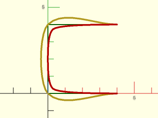

    include <BOSL2/std.scad>
    color("green")stroke(square(4), width=0.06);
    stroke(smooth_path(square(4),size=0.4), width=0.1);
    stroke(smooth_path(square(4),method="corners",size=0.4),
           color="red", width=0.1);

  

**Example 2:** Closing the path changes the end tangents. Original path in green, "edges" path in yellow, "corners" in red. For a shape like this, you may find it simpler to use [`squircle()`](shapes2d.scad#functionmodule-squircle) instead.

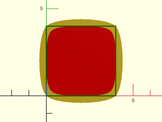

 

    include <BOSL2/std.scad>
    polygon(smooth_path(square(4),method="edges",size=0.4,closed=true));
    color("red")
      polygon(smooth_path(square(4),method="corners",size=0.4,closed=true));
    stroke(square(4), color="green", closed=true, width=0.06);

**Example 3:** Here's the square again with less smoothing. The "edges" curve is closer to the edge of the square, and the "corners" curve is closer to the square's corners.

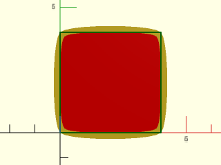

    include <BOSL2/std.scad>
    polygon(smooth_path(square(4), size=.25,closed=true));
    color("red") polygon(smooth_path(square(4),
         method="corners",size=.25,closed=true));
    stroke(square(4), closed=true, color="green", width=0.05);

  

**Example 4:** Turning on uniform tangent calculation also changes the end derivatives for the "edges" curve:

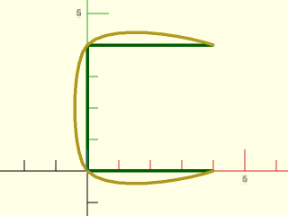

    include <BOSL2/std.scad>
    color("green")stroke(square(4), width=0.1);
    stroke(smooth_path(square(4),size=0.4,uniform=true),
           width=0.1);

  

**Example 5:** Here's a wide rectangle. With `method="edges"` (yellow), using `size` means all edges bulge the same amount, regardless of their length. With `method="corners"` (red), the curve is `size` distance from the corners (up to a maximum theoretical circular arc).

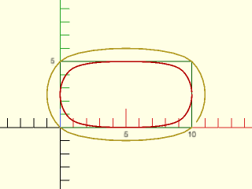

    include <BOSL2/std.scad>
    color("green")
      stroke(square([10,5]), closed=true, width=0.06);
    stroke(smooth_path(square([10,5]), method="edges",
      size=1, closed=true), width=0.1);
    stroke(smooth_path(square([10,5]), method="corners",
      size=1, closed=true), width=0.1, color="red");

  

**Example 6:** For the "edges" curve, with relsize the bulge is proportional to the side length.

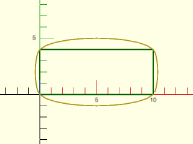

    include <BOSL2/std.scad>
    color("green")stroke(square([10,4]), closed=true, width=0.1);
    stroke(smooth_path(square([10,4]),relsize=0.1,closed=true),
           width=0.1);

  

**Example 7:** For the "corners" curve, with relsize the distance from the corner is proportional to the maximum distance corresponding to a circular arc (shown in red) from the shorter leg of the corner. As `relsize` approaches zero, the curve approaches the corner.

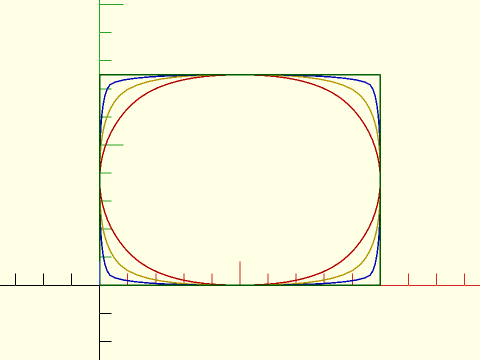

 

    include <BOSL2/std.scad>
    stroke(smooth_path(square([20,15]), method="corners", relsize=1, closed=true),
           color="red", closed=true, width=0.1);
    stroke(smooth_path(square([20,15]), method="corners", relsize=0.66, closed=true),
           color="gold", closed=true, width=0.1);
    stroke(smooth_path(square([20,15]), method="corners", relsize=0.33, closed=true),
           color="blue", closed=true, width=0.1);
    stroke(smooth_path(square([20,15]), method="corners", relsize=0.001, closed=true),
           color="green", closed=true, width=0.1);

**Example 8:** Settting uniform to true biases the tangents to align more with the line sides (applicable only to "edges" method).

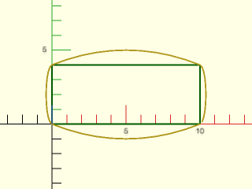

    include <BOSL2/std.scad>
    color("green")
      stroke(square([10,4]), closed=true, width=0.1);
    stroke(smooth_path(square([10,4]),uniform=true,
                       relsize=0.1,closed=true),
           width=0.1);

  

**Example 9:** A more interesting shape, comparing the "edges" method (yellow) with "corners" method (red).

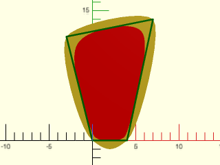

 

    include <BOSL2/std.scad>
    path = [[0,0], [4,0], [7,14], [-3,12]];
    polygon(smooth_path(path,size=1,closed=true));
    color("red") polygon(smooth_path(path,method="corners",relsize=0.7,closed=true));
    stroke(path, color="green", width=0.2, closed=true);

**Example 10:** Here's the square with a size that's too big to achieve, giving the the maximum possible curve with `method="edges"` (yellow). For `method="corners"` (red), the maximum possible distance from the corners is a circle.

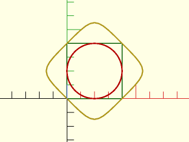

 

    include <BOSL2/std.scad>
    color("green")stroke(square(4), width=0.06,closed=true);
    stroke(smooth_path(square(4), method="edges", size=4, closed=true),
           closed=true, width=0.1);
    stroke(smooth_path(square(4), method="corners", size=4, closed=true),
           color="red", closed=true, width=0.1);

**Example 11:** For `method="edges"`, you can alter the shape of the curve by specifying your own arbitrary tangent values. Only the vector direction matters, not the vector length.

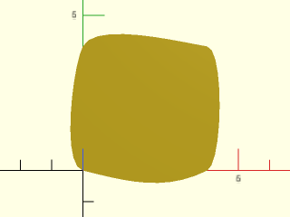

    include <BOSL2/std.scad>
    polygon(smooth_path(square(4),
            tangents=[[-2,-1], [-4,1], [1,2], [6,-1]],
            size=0.4,closed=true));

  

**Example 12:** You can give a different size for each segment ("edges" method in yellow) or corner ("corners" method in red). The first vertex of the square (green) is the lower right corner, and the first edge is the bottom segment.

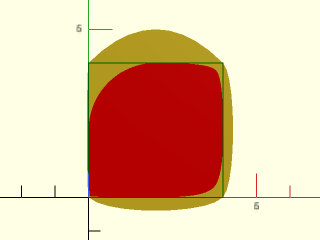

    include <BOSL2/std.scad>
    polygon(smooth_path(square(4),size = [.4, .05, 1, .3],
                        method="edges", closed=true));
    color("red")
      polygon(smooth_path(square(4), size = [.4, .05, 1, .3],
                          method="corners", closed=true));
    stroke(square(4), color="green", width=0.03,closed=true);

  

**Example 13:** Works on 3d paths also.

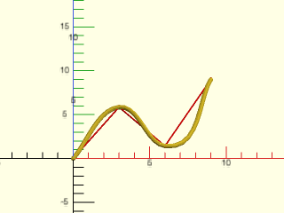

    include <BOSL2/std.scad>
    path = [[0,0,0],[3,3,2],[6,0,1],[9,9,0]];
    stroke(smooth_path(path,relsize=.1),width=.3);
    color("red") for(p=path) translate(p) sphere(d=0.3);
    stroke(path, width=0.1, color="red");

  

**Example 14:** Comparison of "edges" and "corners" 3D path resembling a [trefoil knot](https://en.wikipedia.org/wiki/Trefoil\_knot).

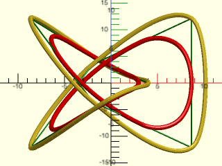

 

    include <BOSL2/std.scad>
    shape = [[8.66, -5, -5], [8.66, 5, 5], [-2, 3.46, 0],
        [-8.66, -5, -5], [0, -10, 5], [4, 0, 0],
        [0, 10, -5], [-8.66, 5, 5], [-2, -3.46, 0]];
    stroke(smooth_path(shape, method="corners", relsize=1, closed=true), color="red", closed=true, width=0.5);
    stroke(smooth_path(shape, method="edges", size=1.5, closed=true, splinesteps=20), closed=true, width=0.5);
    stroke(shape, color="green", width=0.15, closed=true);

**Example 15:** For the default "edges" method, this shows the type of overshoot that can occur with `uniform=true`.  You can produce overshoots like this if you supply a tangent that is difficult to connect to the adjacent points

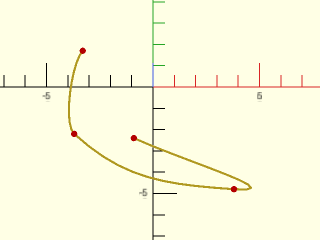

    include <BOSL2/std.scad>
    pts = [[-3.3, 1.7], [-3.7, -2.2], [3.8, -4.8], [-0.9, -2.4]];
    stroke(smooth_path(pts, uniform=true, relsize=0.1),width=.1);
    color("red")move_copies(pts)circle(r=.15,$fn=12);

  

**Example 16:** With the default of `uniform=false` no overshoot occurs.  Note that the shape of the curve is quite different.

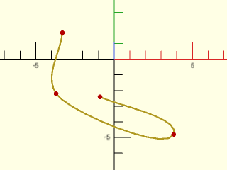

    include <BOSL2/std.scad>
    pts = [[-3.3, 1.7], [-3.7, -2.2], [3.8, -4.8], [-0.9, -2.4]];
    stroke(smooth_path(pts, uniform=false, relsize=0.1),width=.1);
    color("red")move_copies(pts)circle(r=.15,$fn=12);

  

---

### Function: path\_join()

**Synopsis:** Join paths end to end with optional rounding. [<abbr>Path</abbr>]

**Topics:** [Rounding](Topics#rounding), [Paths](Topics#paths)

**See Also:** [round\_corners()](#function-round_corners), [smooth\_path()](#function-smooth_path), [offset\_stroke()](#functionmodule-offset_stroke)

**Usage:** 

- joined_path = path_join(paths, [joint], [k=], [relocate=], [closed=]);

**Description:** 

Connect a sequence of paths together into a single path with optional continuous curvature rounding
applied at the joints.  By default the first path is taken as specified and subsequent paths are
translated into position so that each path starts where the previous path ended.
If you set relocate to false then this relocation is skipped.
You specify rounding using the `joint` parameter, which specifies the distance away from the corner
where the roundover should start.  The path_join function may remove many path points to cut the path
back by the joint length.  Rounding is using continous curvature 4th order bezier splines and
the parameter `k` specifies how smooth the curvature match is.  This parameter ranges from 0 to 1 with
a default of 0.5.  Use a larger k value to get a curve that is bigger for the same joint value.  When
k=0.9 the curve may be similar to a circle if your curves are symmetric.  As the path is built up, the joint
parameter applies to the growing path, so if you pick a large joint parameter it may interact with the
previous path sections.  See [Types of Roundover](rounding.scad#subsection-types-of-roundover) for more details
on continuous curvature rounding.

The rounding is created by extending the two clipped paths to define a corner point.  If the extensions of
the paths do not intersect they will be capped by a curve resembling a semi-circle if this is possible.  But sometimes
the connecting path will need to be S-shaped, which is not supported.  If this situation arises, the function issues an error.
When closed=true the final path should actually close
the shape, repeating the starting point of the shape.  If it does not, then the rounding fills the gap.

The number of segments in the roundovers is set based on $fn and $fs.  If you use $fn it specifies the number of
segments in the roundover, regardless of its angular extent.

**Arguments:** 

<abbr title="These args can be used by position or by name.">By&nbsp;Position</abbr> | What it does
-------------------- | ------------
`paths`              | list of paths to join
`joint`              | joint distance, either a number, a pair (giving the previous and next joint distance) or a list of numbers and pairs.  Default: 0

<abbr title="These args must be used by name, ie: name=value">By&nbsp;Name</abbr> | What it does
-------------------- | ------------
`k`                  | curvature parameter, either a number or vector.  Default: 0.5
`relocate`           | set to false to prevent paths from being arranged tail to head.  Default: true
`closed`             | set to true to round the junction between the last and first paths.  Default: false

**Example 1:** Connection of 3 simple paths.

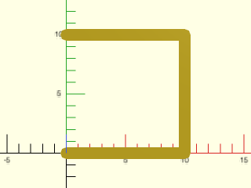

    include <BOSL2/std.scad>
    horiz = [[0,0],[10,0]];
    vert = [[0,0],[0,10]];
    stroke(path_join([horiz, vert, -horiz]));

  

**Example 2:** Adding curvature with joint of 3

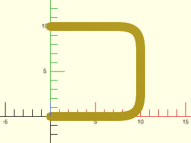

    include <BOSL2/std.scad>
    horiz = [[0,0],[10,0]];
    vert = [[0,0],[0,10]];
    stroke(path_join([horiz, vert, -horiz],joint=3,$fn=16));

  

**Example 3:** Setting k=1 increases the amount of curvature

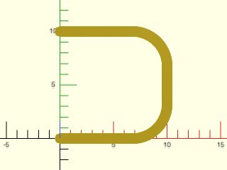

    include <BOSL2/std.scad>
    horiz = [[0,0],[10,0]];
    vert = [[0,0],[0,10]];
    stroke(path_join([horiz, vert, -horiz],joint=3,k=1,$fn=16));

  

**Example 4:** Specifying pairs of joint values at a path joint creates an asymmetric curve

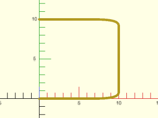

    include <BOSL2/std.scad>
    horiz = [[0,0],[10,0]];
    vert = [[0,0],[0,10]];
    stroke(path_join([horiz, vert, -horiz],
                     joint=[[4,1],[1,4]],$fn=16),width=.3);

  

**Example 5:** A closed square

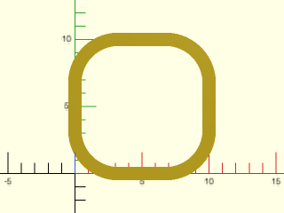

    include <BOSL2/std.scad>
    horiz = [[0,0],[10,0]];
    vert = [[0,0],[0,10]];
    stroke(path_join([horiz, vert, -horiz, -vert],
                     joint=3,k=1,closed=true,$fn=16),closed=true);

  

**Example 6:** Different curve at each corner by changing the joint size

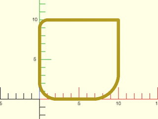

    include <BOSL2/std.scad>
    horiz = [[0,0],[10,0]];
    vert = [[0,0],[0,10]];
    stroke(path_join([horiz, vert, -horiz, -vert],
                     joint=[3,0,1,2],k=1,closed=true,$fn=16),
           closed=true,width=0.4);

  

**Example 7:** Different curve at each corner by changing the curvature parameter.  Note that k=0 still gives a small curve, unlike joint=0 which gives a sharp corner.

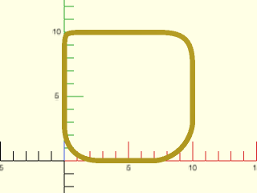

    include <BOSL2/std.scad>
    horiz = [[0,0],[10,0]];
    vert = [[0,0],[0,10]];
    stroke(path_join([horiz, vert, -horiz, -vert],joint=3,
                     k=[1,.5,0,.7],closed=true,$fn=16),
           closed=true,width=0.4);

  

**Example 8:** Joint value of 7 is larger than half the square so curves interfere with each other, which breaks symmetry because they are computed sequentially

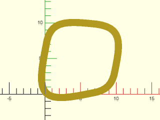

    include <BOSL2/std.scad>
    horiz = [[0,0],[10,0]];
    vert = [[0,0],[0,10]];
    stroke(path_join([horiz, vert, -horiz, -vert],joint=7,
                      k=.4,closed=true,$fn=16),
           closed=true);

  

**Example 9:** Unlike round\_corners, we can add curves onto curves.

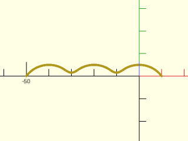

    include <BOSL2/std.scad>
    $fn=64;
    myarc = arc(width=20, thickness=5 );
    stroke(path_join(repeat(myarc,3), joint=4));

  

**Example 10:** Here we make a closed shape from two arcs and round the sharp tips

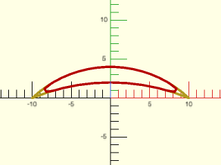

    include <BOSL2/std.scad>
    arc1 = arc(width=20, thickness=4,$fn=75);
    arc2 = reverse(arc(width=20, thickness=2,$fn=75));
    // Without rounding
    stroke(path_join([arc1,arc2]),width=.3);
    // With rounding
    color("red")stroke(path_join([arc1,arc2], 3,k=1,closed=true),
                       width=.3,closed=true,$fn=12);

  

**Example 11:** Combining arcs with segments

    include <BOSL2/std.scad>
    arc1 = arc(width=20, thickness=4,$fn=75);
    arc2 = reverse(arc(width=20, thickness=2,$fn=75));
    vpath = [[0,0],[0,-5]];
    stroke(path_join([arc1,vpath,arc2,reverse(vpath)]),width=.2);
    color("red")stroke(path_join([arc1,vpath,arc2,reverse(vpath)],
                                 [1,2,2,1],k=1,closed=true),
                       width=.2,closed=true,$fn=12);

  

**Example 12:** Here relocation is off.  We have three segments (in yellow) and add the curves to the segments.  Notice that joint zero still produces a curve because it refers to the endpoints of the supplied paths.

    include <BOSL2/std.scad>
    p1 = [[0,0],[2,0]];
    p2 = [[3,1],[1,3]];
    p3 = [[0,3],[-1,1]];
    color("red")stroke(
      path_join([p1,p2,p3], joint=0, relocate=false,
                closed=true),
      width=.3,$fn=48);
    for(x=[p1,p2,p3]) stroke(x,width=.3);

  

**Example 13:** If you specify closed=true when the last path doesn't meet the first one then it is similar to using relocate=false: the function tries to close the path using a curve.  In the example below, this results in a long curve to the left, when given the unclosed three segments as input.  Note that if the segments are parallel the function fails with an error.  The extension of the curves must intersect in a corner for the rounding to be well-defined.  To get a normal rounding of the closed shape, you must include a fourth path, the last segment that closes the shape.

    include <BOSL2/std.scad>
    horiz = [[0,0],[10,0]];
    vert = [[0,0],[0,10]];
    h2 = [[0,-3],[10,0]];
    color("red")stroke(
      path_join([horiz, vert, -h2],closed=true,
                joint=3,$fn=25),
      closed=true,width=.5);
    stroke(path_join([horiz, vert, -h2]),width=.3);

  

**Example 14:** With a single path with closed=true the start and end junction is rounded.

    include <BOSL2/std.scad>
    tri = regular_ngon(n=3, r=7);
    stroke(path_join([tri], joint=3,closed=true,$fn=12),
           closed=true,width=.5);

  

**Example 15:** Here lines are joined that do not intersect when they are extended, so the joint is sort of like a semi-circle.  We show the effect of the `k` parameter at its default value of 0.5 or at 0.92 which is close to a circle.

    include <BOSL2/std.scad>
    p=path_join([
                 [[1,3],[15,8]],
                 [[17,0],[0,0]],
                 [[0,-8],[15,-3]]
                ],
                k=[.5,.9],
                relocate=false);
    stroke(p);

  

---

### Function/Module: offset\_stroke()

**Synopsis:** Draws a line along a path with options to specify angles and roundings at the ends. [<abbr>Path</abbr>] [<abbr>Region</abbr>]

**Topics:** [Rounding](Topics#rounding), [Paths](Topics#paths)

**See Also:** [round\_corners()](#function-round_corners), [smooth\_path()](#function-smooth_path), [path\_join()](#function-path_join)

**Usage:** as module

- offset_stroke(path, [width], [rounded=], [chamfer=], [start=], [end=], [check_valid=], [quality=], [closed=],...) [ATTACHMENTS];

**Usage:** as function

- path = offset_stroke(path, [width], closed=false, [rounded=], [chamfer=], [start=], [end=], [check_valid=], [quality=],...);
- region = offset_stroke(path, [width], closed=true, [rounded=], [chamfer=], [start=], [end=], [check_valid=], [quality=],...);

**Description:** 

Uses `offset()` to compute a stroke for the input path.  Unlike `stroke`, the result does not need to be
centered on the input path.  The corners can be rounded, pointed, or chamfered, and you can make the ends
rounded, flat or pointed with the `start` and `end` parameters.

The `check_valid` and `quality`  parameters are passed through to `offset()`

If `width` is a scalar then the output is a centered stroke of the specified width.  If width
is a list of two values then those two values define the stroke side positions relative to the center line, where
as with offset(), the shift is to the left for open paths and outward for closed paths.  For example,
setting `width` to `[0,1]` creates a stroke of width 1 that extends entirely to the left of the input, and and [-4,-6]
creates a stroke of width 2 offset 4 units to the right of the input path.

If closed==false then the function form returns a path.  If closed==true then it returns a region. The `start` and
`end` parameters are forbidden for closed paths.

Three simple end treatments are supported, "flat" (the default), "round" and "pointed".  The "flat" treatment
cuts off the ends perpendicular to the path and the "round" treatment applies a semicircle to the end.  The
"pointed" end treatment caps the stroke with a centered triangle that has 45 degree angles on each side.

More complex end treatments are available through parameter lists with helper functions to ease parameter passing.  The parameter list
keywords are
   - "for" : must appear first in the list and have the value "offset_stroke"
   - "type": the type of end treatment, one of "shifted_point", "roundover", or "flat"
   - "angle": relative angle (relative to the path)
   - "abs_angle": absolute angle (angle relative to x-axis)
   - "cut": cut distance for roundovers, a single value to round both corners identically or a list of two values for the two corners.  Negative values round outward.
   - "k": curvature smoothness parameter for roundovers, default 0.75

Function helpers for defining ends, prefixed by "os" for offset_stroke, are:
   - os_flat(angle|absangle): specify a flat end either relative to the path or relative to the x-axis
   - os_pointed(dist, [loc]): specify a pointed tip where the point is distance `loc` from the centerline (positive is the left direction as for offset), and `dist` is the distance from the path end to the point tip.  The default value for `loc` is zero (the center).  You must specify `dist` when using this option.
   - os_round(cut, [angle|absangle], [k]).  Rounded ends with the specified cut distance, based on the specified angle or absolute angle.  The `k` parameter is the smoothness parameter for continuous curvature rounding.  See [Types of Roundover](rounding.scad#subsection-types-of-roundover) for more details on
     continuous curvature rounding.

Note that `offset_stroke()` attempts to apply roundovers and angles at the ends even when it means deleting segments of the stroke, unlike `round_corners()`, which works only on a segment adjacent to a corner.  If you specify an overly extreme angle, it fails to find an intersection with the stroke and display an error.  When you specify an angle, the end segment is rotated around the center of the stroke and the last segment of the stroke one one side is extended to the corner.

The `$fn` and `$fs` variables are used in the usual way to determine the number of segments for roundings produced by the offset
invocations and roundings produced by the semi-circular "round" end treatment.  The os_round() end treatment
uses a bezier curve, and produces segments of approximate length `$fs` or it produces `$fn` segments.
This means that even a quarter circle has `$fn` segments, unlike the usual case where it would have `$fn/4` segments.

**Arguments:** 

<abbr title="These args can be used by position or by name.">By&nbsp;Position</abbr> | What it does
-------------------- | ------------
`path`               | 2d path that defines the stroke
`width`              | width of the stroke, a scalar or a vector of 2 values giving the offset from the path.  Default: 1

<abbr title="These args must be used by name, ie: name=value">By&nbsp;Name</abbr> | What it does
-------------------- | ------------
`rounded`            | set to true to use rounded offsets, false to use sharp (delta) offsets.  Default: true
`chamfer`            | set to true to use chamfers when `rounded=false`.  Default: false
`start`              | end treatment for the start of the stroke when closed=false.  See above for details.  Default: "flat"
`end`                | end treatment for the end of the stroke when closed=false.  See above for details.  Default: "flat"
`check_valid`        | passed to offset().  Default: true
`quality`            | passed to offset().  Default: 1
`closed`             | true if the curve is closed, false otherwise.  Default: false
`anchor`             | Translate so anchor point is at origin (0,0,0).  See [anchor](attachments.scad#subsection-anchor).  Default: `"origin"`
`spin`               | Rotate this many degrees after anchor.  See [spin](attachments.scad#subsection-spin).  Default: `0`
`cp`                 | Centerpoint for determining intersection anchors or centering the shape.  Determintes the base of the anchor vector.  Can be "centroid", "mean", "box" or a 2D point.  Default: "centroid"
`atype`              | Set to "hull" or "intersect" to select anchor type.  Default: "hull"

**Named Anchors:** 

Anchor Name | Position
----------- | --------
"origin" | The native position of the region.

**Anchor Types:** 

Anchor Type | What it is
----------- | ----------
"hull" | Anchors to the virtual convex hull of the region.
"intersect" | Anchors to the outer edge of the region.

**Example 1:** Basic examples illustrating flat, round, and pointed ends, on a finely sampled arc and a path made from 3 segments.

 

    include <BOSL2/std.scad>
    arc = arc(points=[[1,1],[3,4],[6,3]],n=50);
    path = [[0,0],[6,2],[9,7],[8,10]];
    xdistribute(spacing=10){
      offset_stroke(path, width = 2);
      offset_stroke(path, start="round", end="round", width = 2, $fn=32);
      offset_stroke(path, start="pointed", end="pointed", width = 2);
    }
    fwd(10) xdistribute(spacing=10){
      offset_stroke(arc, width = 2);
      offset_stroke(arc, start="round", end="round", width = 2, $fn=32);
      offset_stroke(arc, start="pointed", end="pointed", width = 2);
    }

**Example 2:** The effect of the `rounded` and `chamfer` options is most evident at sharp corners.  This only affects the middle of the path, not the ends.

    include <BOSL2/std.scad>
    sharppath = [[0,0], [1.5,5], [3,0]];
    xdistribute(spacing=5){
      offset_stroke(sharppath, $fn=16);
      offset_stroke(sharppath, rounded=false);
      offset_stroke(sharppath, rounded=false, chamfer=true);
    }

  

**Example 3:** When closed is enabled all the corners are affected by those options.

    include <BOSL2/std.scad>
    sharppath = [[0,0], [1.5,5], [3,0]];
    xdistribute(spacing=5){
      offset_stroke(sharppath,closed=true, $fn=16);
      offset_stroke(sharppath, rounded=false, closed=true);
      offset_stroke(sharppath, rounded=false, chamfer=true,
                    closed=true);
    }

  

**Example 4:** The left stroke uses flat ends with a relative angle of zero.  The right hand one uses flat ends with an absolute angle of zero, so the ends are parallel to the x-axis.

 

    include <BOSL2/std.scad>
    path = [[0,0],[6,2],[9,7],[8,10]];
    offset_stroke(path, start=os_flat(angle=0), end=os_flat(angle=0));
    right(5)
      offset_stroke(path, start=os_flat(abs_angle=0), end=os_flat(abs_angle=0));

**Example 5:** With continuous sampling the end treatment can remove segments or extend the last segment linearly, as shown here.  Again the left side uses relative angle flat ends and the right hand example uses absolute angle.

 

    include <BOSL2/std.scad>
    arc = arc(points=[[4,0],[3,4],[6,3]],n=50);
    offset_stroke(arc, start=os_flat(angle=45), end=os_flat(angle=45));
    right(5)
      offset_stroke(arc, start=os_flat(abs_angle=45), end=os_flat(abs_angle=45));

**Example 6:** The os\_pointed() end treatment allows adjustment of the point tip, as shown here.  The width is 2 so a location of 1 is at the edge.

 

    include <BOSL2/std.scad>
    arc = arc(points=[[1,1],[3,4],[6,3]],n=50);
    offset_stroke(arc, width=2, start=os_pointed(loc=1,dist=3),end=os_pointed(loc=1,dist=3));
    right(10)
      offset_stroke(arc, width=2, start=os_pointed(dist=4),end=os_pointed(dist=-1));
    fwd(7)
      offset_stroke(arc, width=2, start=os_pointed(loc=2,dist=2),end=os_pointed(loc=.5,dist=-1));

**Example 7:** The os\_round() end treatment adds roundovers to the end corners by specifying the `cut` parameter.  In the first example, the cut parameter is the same at each corner.  The bezier smoothness parameter `k` is given to allow a larger cut.  In the second example, each corner is given a different roundover, including zero for no rounding at all.  The red shows the same strokes without the roundover.

 

    include <BOSL2/std.scad>
    $fn=36;
    arc = arc(points=[[1,1],[3,4],[6,3]],n=50);
    path = [[0,0],[6,2],[9,7],[8,10]];
    offset_stroke(path, width=2, rounded=false,start=os_round(angle=-20, cut=0.4,k=.9),
                                               end=os_round(angle=-35, cut=0.4,k=.9));
    color("red")down(.1)offset_stroke(path, width=2, rounded=false,start=os_flat(-20),
                                                                   end=os_flat(-35));
    right(9){
      offset_stroke(arc, width=2, rounded=false, start=os_round(cut=[.3,.6],angle=-45),
                                                 end=os_round(angle=20,cut=[.6,0]));
      color("red")down(.1)offset_stroke(arc, width=2, rounded=false, start=os_flat(-45),
                                                                     end=os_flat(20));
    }

**Example 8:** Negative cut values produce a flaring end.  Note how the absolute angle aligns the ends of the first example withi the axes.  In the second example positive and negative cut values are combined.  Also, different cuts are needed at the start end to produce a similar-looking flare.

 

    include <BOSL2/std.scad>
    arc = arc(points=[[1,1],[3,4],[6,3]],n=50);
    path = [[0,0],[6,2],[9,7],[8,10]];
    offset_stroke(path, width=2, rounded=false,start=os_round(cut=-1, abs_angle=90),
                                               end=os_round(cut=-0.5, abs_angle=0),$fn=36);
    right(10)
       offset_stroke(arc, width=2, rounded=false, start=os_round(cut=[-.75,-.2], angle=-45),
                                                  end=os_round(cut=[-.2,.2], angle=20),$fn=36);

**Example 9:** Setting the width to a vector allows you to offset the stroke.  Here with successive increasing offsets we create a set of parallel strokes

    include <BOSL2/std.scad>
    path = [[0,0],[4,4],[8,4],[2,9],[10,10]];
    for(i=[0:.25:2])
      offset_stroke(path, rounded=false,width = [i,i+.08]);

  

**Example 10:** Setting rounded=true in the above example makes a big difference in the result.

    include <BOSL2/std.scad>
    path = [[0,0],[4,4],[8,4],[2,9],[10,10]];
    for(i=[0:.25:2])
      offset_stroke(path, rounded=true,width = [i,i+.08], $fn=36);

  

**Example 11:** In this example a spurious triangle appears.  This results from overly enthusiastic validity checking.  Turning validity checking off fixes it in this case.

    include <BOSL2/std.scad>
    path = [[0,0],[4,4],[8,4],[2,9],[10,10]];
    offset_stroke(path, check_valid=true,rounded=false,
                  width = [1.4, 1.5]);
    right(2)
      offset_stroke(path, check_valid=false,rounded=false,
                    width = [1.4, 1.5]);

  

**Example 12:** But in this case, disabling the validity check produces an invalid result.

    include <BOSL2/std.scad>
    path = [[0,0],[4,4],[8,4],[2,9],[10,10]];
    offset_stroke(path, check_valid=true,rounded=false,
                  width = [1.9, 2]);
    translate([1,-0.25])
      offset_stroke(path, check_valid=false,rounded=false,
                    width = [1.9, 2]);

  

**Example 13:** Self-intersecting paths are handled differently than with the `stroke()` module.

    include <BOSL2/std.scad>
    $fn=16;
    path = turtle(["move",10,"left",144], repeat=4);
    stroke(path, closed=true);
    right(12)
      offset_stroke(path, width=1, closed=true);

  

---

## Section: Three-Dimensional Rounding

### Function/Module: offset\_sweep()

**Synopsis:** Make a solid from a polygon with offset that changes along its length. [<abbr>Geom</abbr>] [<abbr>VNF</abbr>]

**Topics:** [Rounding](Topics#rounding), [Offsets](Topics#offsets)

**See Also:** [convex\_offset\_extrude()](#module-convex_offset_extrude), [rounded\_prism()](#functionmodule-rounded_prism), [bent\_cutout\_mask()](#module-bent_cutout_mask), [join\_prism()](#functionmodule-join_prism), [linear\_sweep()](skin.scad#functionmodule-linear_sweep)

**Usage:** most common module arguments.  See Arguments list below for more.

- offset_sweep(path, [height|length=|h=|l=], [bottom], [top], [offset=], [convexity=],...) [ATTACHMENTS];

**Usage:** most common function arguments.  See Arguments list below for more.

- vnf = offset_sweep(path, [height|length=|h=|l=], [bottom], [top], [offset=], ...);

**Description:** 

Takes a 2d path as input and extrudes it upward and/or downward.  Each layer in the extrusion is produced using `offset()` to expand or shrink the previous layer.  When invoked as a function returns a VNF; when invoked as a module produces geometry.
Using the `top` and/or `bottom` arguments you can specify a sequence of offsets values, or you can use several built-in offset profiles that
provide end treatments such as roundovers.
The height of the resulting object can be specified using the `height` argument, in which case `height` must be larger than the combined height
of the end treatments.  If you omit `height`, then the object height is the height of just the top and bottom end treatments.

The path is shifted by `offset()` multiple times in sequence
to produce the final shape (not multiple shifts from one parent), so coarse definition of the input path degrades
from the successive shifts.  If the result seems rough or strange try increasing the number of points you use for
your input.  If you get unexpected corners in your result you may have forgotten to set `$fn` or `$fa` and `$fs`.
Be aware that large numbers of points (especially when check_valid is true) can lead to lengthy run times.  If your
shape doesn't develop new corners from the offsetting you may be able to save a lot of time by setting `check_valid=false`.  Be aware that
disabling the validity check when it is needed can generate invalid polyhedra that produce CGAL errors upon
rendering.  Such validity errors also occur if you specify a self-intersecting shape.
The offset profile is quantized to 1/1024 steps to avoid failures in offset() that can occur with tiny offsets.

The build-in profiles are: circular rounding, teardrop rounding, continuous curvature rounding, and chamfer.
Also, when a rounding radius is negative, the rounding flares outward.  The easiest way to specify
the profile is by using the profile helper functions.  These functions take profile parameters, as well as some
general settings and translate them into a profile specification, with error checking on your input.  The description below
describes the helper functions and the parameters specific to each function.  Below that is a description of the generic
settings that you can optionally use with all of the helper functions.  For more details on the "cut" and "joint" rounding parameters, and
on continuous curvature rounding, see [Types of Roundover](rounding.scad#subsection-types-of-roundover).

- profile: os_profile(points)
  Define the offset profile with a list of points.  The first point must be [0,0] and the roundover should rise in the positive y direction, with positive x values for inward motion (standard roundover) and negative x values for flaring outward.  If the y value ever decreases then you might create a self-intersecting polyhedron, which is invalid.  Such invalid polyhedra create cryptic assertion errors when you render your model and it is your responsibility to avoid creating them.  Note that the starting point of the profile is the center of the extrusion.  If you use a profile as the top, it rises upward.  If you use it as the bottom, it is inverted and goes downward.
- circle: os_circle(r|cut=,height=|h=,[clip_angle=],).  Define circular rounding or clipped circle rounding.  You specify a full circle rounding by giving the radius, cut distance or height (which is equivalent to radius in this case).  For a clipped circle rounding you can use two methods.  You can specify the clip angle and then give a radius, cut, or height.  (The cut distance in this case is the usual cut for a full circular arc.)  Alternatively you can give a height and radius (or cut) and the appropriate clip angle is chosen for you.  The clip angle is the angle away from vertical, so 90 deg would produce a complete circle.
- smooth: os_smooth(cut|joint, [k]).  Define continuous curvature rounding, with `cut` and `joint` as for round_corners. The k parameter controls how fast the curvature changes and should be between 0 and 1.
- teardrop: os_teardrop(r|cut).  Rounding using a 1/8 circle that then changes to a 45 degree chamfer.  The chamfer is at the end, and enables the object to be 3d printed without support.  The radius gives the radius of the circular part.
- chamfer: os_chamfer([height], [width], [cut], [angle]).  Chamfer the edge at desired angle or with desired height and width.  You can specify height and width together and the angle is ignored, or specify just one of height and width and the angle is used to determine the shape.  Alternatively, specify "cut" along with angle to specify the cut back distance of the chamfer.
- mask: os_mask(mask, [out]).  Create a profile from one of the [2d masking shapes](masks2d.scad#section-2d-masking-shapes).  The `out` parameter specifies that the mask should flare outward (like crown molding or baseboard).  This is set false by default.

The general settings that you can use with all of the helper functions are mostly used to control how offset_sweep() calls the offset() function.
- extra: Add an extra vertical step of the specified height, to be used for intersections or differences.  This extra step extends the resulting object beyond the height you specify.  It is ignored by anchoring.  Default: 0
- check_valid: passed to offset().  Default: true
- quality: passed to offset().  Default: 1
- steps: Number of vertical steps to use for the profile.  (Not used by os_profile).  Default: 16
- offset: Select "round" (r=) or "delta" (delta=) offset types for offset. You can also choose "chamfer" but this leads to exponential growth in the number of vertices with the steps parameter.  Default: "round"

Many of the arguments are described as setting "default" values because they establish settings which may be overridden by
the top and bottom profile specifications.

You should use the above helper functions to generate the profiles.
The profile specification is a list of pairs of keywords and values, e.g. ["for","offset_sweep","r",12, type, "circle"]. The keywords are
- "for" - must appear first in the list and have the value "offset_sweep"
- "type" - type of rounding to apply, one of "circle", "teardrop", "chamfer", "smooth", or "profile" (Default: "circle")
- "r" - the radius of the roundover, which may be zero for no roundover, or negative to round or flare outward.  Default: 0
- "cut" - the cut distance for the roundover or chamfer, which may be negative for flares
- "chamfer_width" - the width of a chamfer
- "chamfer_height" - the height of a chamfer
- "angle" - the chamfer angle, measured from the vertical (so zero is vertical, 90 is horizontal).  Default: 45
- "joint" - the joint distance for a "smooth" roundover
- "k" - the curvature smoothness parameter for "smooth" roundovers, a value in [0,1].  Default: 0.75
- "points" - point list for use with the "profile" type
- "extra" - extra height added for unions/differences.  This makes the shape taller than the requested height.  (Default: 0)
- "check_valid" - passed to offset.  Default: true.
- "quality" - passed to offset.  Default: 1.
- "steps" - number of vertical steps to use for the roundover.  Default: 16.
- "offset" - select "round" (r=), "delta" (delta=), or "chamfer" offset type for offset.  Default: "round"

Note that if you set the "offset" parameter to "chamfer" then every exterior corner turns from one vertex into two vertices with
each offset operation.  Since the offsets are done one after another, each on the output of the previous one, this leads to
exponential growth in the number of vertices.  This can lead to long run times or yield models that
run out of recursion depth and give a cryptic error.  Furthermore, the generated vertices are distributed non-uniformly.  Generally you
get a similar or better looking model with fewer vertices using "round" instead of
"chamfer".  Use the "chamfer" style offset only in cases where the number of steps is small or just one (such as when using
the `os_chamfer` profile type).

The module form only can support a region as input.  You can provide different profiles for the cutouts in a region using the `bottom_hole`, `top_hole`
or `ends_hole` parameters.

This module offers four anchor types.  The default is "hull" in which VNF anchors are placed on the VNF of the **unrounded** object.  You
can also use "intersect" to get the intersection anchors to the unrounded object. If you prefer anchors that respect the rounding
then use "surf_hull" or "intersect_hull".

**Arguments:** 

<abbr title="These args can be used by position or by name.">By&nbsp;Position</abbr> | What it does
-------------------- | ------------
`path`               | 2d path (list of points) to extrude or a region for the module form
`height`             / `length`             / `l`                  / `h`                  | total height (including rounded portions, but not extra sections) of the output.  Default: combined height of top and bottom end treatments.
`bottom`             / `bot`                | rounding spec for the bottom end
`top`                | rounding spec for the top end.

<abbr title="These args must be used by name, ie: name=value">By&nbsp;Name</abbr> | What it does
-------------------- | ------------
`ends`               | give a rounding spec that applies to both the top and bottom
`offset`             | default offset, `"round"` or `"delta"`.  Default: `"round"`
`steps`              | default step count.  Default: 16
`quality`            | default quality.  Default: 1
`check_valid`        | default check_valid.  Default: true.
`extra`              | default extra height.  Default: 0
`caps`               | if false do not create end faces.  Can be a boolean vector to control ends independent.  (function only) Default: true.
`cut`                | default cut value.
`chamfer_width`      | default width value for chamfers.
`chamfer_height`     | default height value for chamfers.
`angle`              | default angle for chamfers.  Default: 45
`joint`              | default joint value for smooth roundover.
`k`                  | default curvature parameter value for "smooth" roundover
`ends_hole`          | (module only) rounding spec that applies to top and bottom of holes in a region
`bot_hole`           / `bottom_hole`        | (module only) rounding spec for bottom end of holes in a region
`top_hole`           | (module only) rounding spec for top end of holes in a region
`convexity`          | convexity setting for use with polyhedron.  (module only) Default: 10
`anchor`             | Translate so anchor point is at the origin.  Default: "base"
`spin`               | Rotate this many degrees around Z axis after anchor.  Default: 0
`orient`             | Vector to rotate top toward after spin
`atype`              | Select "hull", "intersect", "surf_hull" or "surf_intersect" anchor types.  Default: "hull"
`cp`                 | Centerpoint for determining "intersect" anchors or centering the shape.  Determintes the base of the anchor vector.  Can be "centroid", "mean", "box" or a 3D point.  Default: "centroid"

**Anchor Types:** 

Anchor Type | What it is
----------- | ----------
"hull" | Anchors to the convex hull of the linear sweep of the path, ignoring any end roundings.  (default)
"intersect" | Anchors to the surface of the linear sweep of the path, ignoring any end roundings.
"surf_hull" | Anchors to the convex hull of the offset_sweep shape, including end treatments.
"surf_intersect" | Anchors to the surface of the offset_sweep shape, including any end treatments.

**Named Anchors:** 

Anchor Name | Position
----------- | --------
"base" | Anchor to the base of the shape in its native position, ignoring any "extra"
"top" | Anchor to the top of the shape in its native position, ignoring any "extra"
"zcenter" | Center shape in the Z direction in the native XY position, ignoring any "extra"

**Example 1:** Rounding a star shaped prism with postive radius values

 

    include <BOSL2/std.scad>
    star = star(5, r=22, ir=13);
    rounded_star = round_corners(star, cut=flatten(repeat([.5,0],5)), $fn=24);
    offset_sweep(rounded_star, height=20, bottom=os_circle(r=4), top=os_circle(r=1), steps=15);

**Example 2:** Rounding a star shaped prism with negative radius values.  The starting shape has no corners, so the value of `$fn` does not matter.

 

    include <BOSL2/std.scad>
    star = star(5, r=22, ir=13);
    rounded_star = round_corners(star, cut=flatten(repeat([.5,0],5)), $fn=36);
    offset_sweep(rounded_star, height=20, bottom=os_circle(r=-4), top=os_circle(r=-1), steps=15);

**Example 3:** If the shape has sharp corners, make sure to set `$fn/$fs/$fa`.  The corners of this triangle are not round, even though `offset="round"` (the default) because the number of segments is small.

 

    include <BOSL2/std.scad>
    triangle = [[0,0],[10,0],[5,10]];
    offset_sweep(triangle, height=6, bottom = os_circle(r=-2),steps=4);

**Example 4:** Can improve the result by increasing `$fn`

 

    include <BOSL2/std.scad>
    $fn=12;
    triangle = [[0,0],[10,0],[5,10]];
    offset_sweep(triangle, height=6, bottom = os_circle(r=-2),steps=4);

**Example 5:** Using `$fa` and `$fs` works too; it produces a different looking triangulation of the rounded corner

 

    include <BOSL2/std.scad>
    $fa=1;$fs=0.3;
    triangle = [[0,0],[10,0],[5,10]];
    offset_sweep(triangle, height=6, bottom = os_circle(r=-2),steps=4);

**Example 6:** Here is the star chamfered at the top with a teardrop rounding at the bottom. Check out the rounded corners on the chamfer.  The large `$fn` value ensures a smooth curve on the concave corners of the chamfer.  It has no effect anywhere else on the model.  Observe how the rounded star points vanish at the bottom in the teardrop: the number of vertices does not remain constant from layer to layer.

 

    include <BOSL2/std.scad>
    star = star(5, r=22, ir=13);
    rounded_star = round_corners(star, cut=flatten(repeat([.5,0],5)), $fn=24);
    offset_sweep(rounded_star, height=20, bottom=os_teardrop(r=4), top=os_chamfer(width=4),$fn=64);

**Example 7:** Clipped circle rounding on the bottom (for 3d printability and regular circular rounding on the top, both with the same radius.  The clipped circle rounding takes up less vertical space.

 

    include <BOSL2/std.scad>
    $fn=64;
    offset_sweep(rect(50,rounding=6), h=30,bot=os_circle(r=6, clip_angle=50), top=os_circle(r=6));

**Example 8:** The same as the previous example but with roundings specified by height.  This means that they have different radii, but the height maches.

 

    include <BOSL2/std.scad>
    $fn=64;
    offset_sweep(rect(50,rounding=6), h=30,bot=os_circle(h=6, clip_angle=50), top=os_circle(h=6));

**Example 9:** We round a cube using the continous curvature rounding profile.  But note that the corners are not smooth because the curved square collapses into a square with corners.    When a collapse like this occurs, we cannot turn `check_valid` off.  For a better result use [`rounded_prism()`](#functionmodule-rounded\_prism) instead.

 

    include <BOSL2/std.scad>
    square = square(1);
    rsquare = round_corners(square, method="smooth", cut=0.1, k=0.7, $fn=36);
    end_spec = os_smooth(cut=0.1, k=0.7, steps=22);
    offset_sweep(rsquare, height=1, bottom=end_spec, top=end_spec);

**Example 10:** A nice rounded box, with a teardrop base and circular rounded interior and top

 

    include <BOSL2/std.scad>
    box = square([255,50]);
    rbox = round_corners(box, method="smooth", cut=4, $fn=12);
    thickness = 2;
    difference(){
      offset_sweep(rbox, height=50, check_valid=false, steps=22,
                   bottom=os_teardrop(r=2), top=os_circle(r=1));
      up(thickness)
        offset_sweep(offset(rbox, r=-thickness, closed=true,check_valid=false),
                     height=48, steps=22, check_valid=false,
                     bottom=os_circle(r=4), top=os_circle(r=-1,extra=1));
    }

**Example 11:** This box is much thicker, and cut in half to show the profiles.  Note also that we can turn `check_valid` off for the outside and for the top inside, but not for the bottom inside.  This example shows use of the direct keyword syntax without the helper functions.

 

    include <BOSL2/std.scad>
    smallbox = square([75,50]);
    roundbox = round_corners(smallbox, method="smooth", cut=4, $fn=12);
    thickness=4;
    height=50;
    back_half(y=25, s=200)
      difference(){
        offset_sweep(roundbox, height=height, bottom=["for","offset_sweep","r",10,"type","teardrop"],
                                              top=["for","offset_sweep","r",2], steps = 22, check_valid=false);
        up(thickness)
          offset_sweep(offset(roundbox, r=-thickness, closed=true),
                        height=height-thickness, steps=22,
                        bottom=["for","offset_sweep","r",6],
                        top=["for","offset_sweep","type","chamfer","angle",30,
                             "chamfer_height",-3,"extra",1,"check_valid",false]);
    }

**Example 12:** A box with multiple sections and rounded dividers

 

    include <BOSL2/std.scad>
    thickness = 2;
    box = square([255,50]);
    cutpoints = [0, 125, 190, 255];
    rbox = round_corners(box, method="smooth", cut=4, $fn=12);
    back_half(y=25, s=700)
      difference(){
        offset_sweep(rbox, height=50, check_valid=false, steps=22,
                     bottom=os_teardrop(r=2), top=os_circle(r=1));
        up(thickness)
          for(i=[0:2]){
            ofs = i==1 ? 2 : 0;
            hole = round_corners([[cutpoints[i]-ofs,0], [cutpoints[i]-ofs,50],
                                  [cutpoints[i+1]+ofs, 50], [cutpoints[i+1]+ofs,0]],
                                 method="smooth", cut=4, $fn=36);
            offset_sweep(offset(hole, r=-thickness, closed=true,check_valid=false),
                          height=48, steps=22, check_valid=false,
                          bottom=os_circle(r=4), top=os_circle(r=-1,extra=1));
          }
      }

**Example 13:** Star shaped box

 

    include <BOSL2/std.scad>
    star = star(5, r=22, ir=13);
    rounded_star = round_corners(star, cut=flatten(repeat([.5,0],5)), $fn=24);
    thickness = 2;
    ht=20;
    difference(){
      offset_sweep(rounded_star, height=ht, bottom=["for","offset_sweep","r",4],
                                            top=["for","offset_sweep","r",1], steps=15);
      up(thickness)
          offset_sweep(offset(rounded_star,r=-thickness,closed=true),
                        height=ht-thickness, check_valid=false,
                        bottom=os_circle(r=7), top=os_circle(r=-1, extra=1),$fn=40);
      }

**Example 14:** A profile defined by an arbitrary sequence of points.

 

    include <BOSL2/std.scad>
    star = star(5, r=22, ir=13);
    rounded_star = round_corners(star, cut=flatten(repeat([.5,0],5)), $fn=24);
    profile = os_profile(points=[[0,0],[.3,.1],[.6,.3],[.9,.9], [1.2, 2.7],[.8,2.7],[.8,3]]);
    offset_sweep(reverse(rounded_star), height=20, top=profile, bottom=profile, $fn=32);

**Example 15:** Parabolic rounding

 

    include <BOSL2/std.scad>
    star = star(5, r=22, ir=13);
    rounded_star = round_corners(star, cut=flatten(repeat([.5,0],5)), $fn=24);
    offset_sweep(rounded_star, height=20, top=os_profile(points=[for(r=[0:.1:2])[sqr(r),r]]),
                                           bottom=os_profile(points=[for(r=[0:.2:5])[-sqrt(r),r]]),$fn=32);

**Example 16:** This example uses a sine wave offset profile.  Note that we give no specification for the bottom, so it is straight.

 

    include <BOSL2/std.scad>
    sq = [[0,0],[20,0],[20,20],[0,20]];
    sinwave = os_profile(points=[for(theta=[0:5:720]) [4*sin(theta), theta/700*15]]);
    offset_sweep(sq, height=20, top=sinwave, $fn=32);

**Example 17:** The same as the previous example but `offset="delta"`

 

    include <BOSL2/std.scad>
    sq = [[0,0],[20,0],[20,20],[0,20]];
    sinwave = os_profile(points=[for(theta=[0:5:720]) [4*sin(theta), theta/700*15]]);
    offset_sweep(sq, height=20, top=sinwave, offset="delta");

**Example 18:** a box with a flared top.  A nice roundover on the top requires a profile edge, but we can use "extra" to create a small chamfer.

 

    include <BOSL2/std.scad>
    rhex = round_corners(hexagon(side=10), method="smooth", joint=2, $fs=0.2);
    back_half()
      difference(){
        offset_sweep(rhex, height=10, bottom=os_teardrop(r=2), top=os_teardrop(r=-4, extra=0.2));
        up(1)
          offset_sweep(offset(rhex,r=-1), height=9.5, bottom=os_circle(r=2), top=os_teardrop(r=-4));
      }

**Example 19:** Using os\_mask to create ogee profiles:

 

    include <BOSL2/std.scad>
    ogee = mask2d_ogee([
        "xstep",3,  "ystep",3,  // Starting shoulder.
        "fillet",15, "round",15,  // S-curve.
        "ystep",3,              // Ending shoulder.
    ]);
    star = star(5, r=220, ir=130);
    rounded_star = round_corners(star, cut=flatten(repeat([5,0],5)), $fn=24);
    offset_sweep(rounded_star, height=150, top=os_mask(ogee), bottom=os_mask(ogee,out=true));

**Example 20:** Applying to a region, with different profiles for the outside in inside curves.

 

    include <BOSL2/std.scad>
    $fn = 32;
    rgn = difference(
        [
            rect(50, rounding=5),
            move([15,15], circle(d=10)),
            move([-15,-15], circle(d=10)),
            move([0,25], rect([10,7],anchor=BACK,
                              rounding=[-2,-2,2,2])),
            zrot(55, square([4, 100], center=true)),
            ellipse([12,4])
        ]
    );
    offset_sweep(rgn, height=12, steps=6, ends_hole=os_chamfer(width=2),
                                          ends=os_circle(r=1.7));

---

### Module: convex\_offset\_extrude()

**Synopsis:** Make a solid from geometry where offset changes along the object's length. [<abbr>Geom</abbr>]

**Topics:** [Rounding](Topics#rounding), [Offsets](Topics#offsets)

**See Also:** [offset\_sweep()](#functionmodule-offset_sweep), [rounded\_prism()](#functionmodule-rounded_prism), [bent\_cutout\_mask()](#module-bent_cutout_mask), [join\_prism()](#functionmodule-join_prism), [linear\_sweep()](skin.scad#functionmodule-linear_sweep)

**Usage:** Basic usage.  See below for full options

- convex_offset_extrude(height, [bottom], [top], ...) 2D-CHILDREN;

**Description:** 

Extrudes 2d children with layers formed from the convex hull of the offset of each child according to a sequence of offset values.
Like `offset_sweep` this module can use built-in offset profiles to provide treatments such as roundovers or chamfers but unlike `offset_sweep()` it
operates on 2d children rather than a point list.  Each offset is computed using
the native `offset()` module from the input geometry.
If your shape has corners that you want rounded by offset be sure to set `$fn` or `$fs` appropriately.
If your geometry has internal holes or is too small for the specified offset then you may get
unexpected results.

The build-in profiles are: circular rounding, teardrop rounding, continuous curvature rounding, and chamfer.
Also, when a rounding radius is negative, the rounding flares outward.  The easiest way to specify
the profile is by using the profile helper functions.  These functions take profile parameters, as well as some
general settings and translate them into a profile specification, with error checking on your input.  The description below
describes the helper functions and the parameters specific to each function.  Below that is a description of the generic
settings that you can optionally use with all of the helper functions.
For more details on the "cut" and "joint" rounding parameters, and
on continuous curvature rounding, see [Types of Roundover](rounding.scad#subsection-types-of-roundover).

The final shape is created by combining convex hulls of small extrusions.  The thickness of these small extrusions may result
your model being slightly too long (if the curvature at the end is flaring outward), so if the exact length is important,
you may need to intersect with a bounding cube.  (Note that extra length can also be intentionally added with the `extra` argument.)

- profile: os_profile(points)
  Define the offset profile with a list of points.  The first point must be [0,0] and the roundover should rise in the positive y direction, with positive x values for inward motion (standard roundover) and negative x values for flaring outward.  If the y value ever decreases then you might create a self-intersecting polyhedron, which is invalid.  Such invalid polyhedra create cryptic assertion errors when you render your model and it is your responsibility to avoid creating them.  Note that the starting point of the profile is the center of the extrusion.  If you use a profile as the top, it rises upward. If you use it as the bottom, it is inverted and goes downward.
- circle: os_circle(r|cut=,height=|h=,[clip_angle=],).  Define circular rounding or clipped circle rounding.  You specify a full circle rounding by giving the radius, cut distance or height (which is equivalent to radius in this case).  For a clipped circle rounding you can use two methods.  You can specify the clip angle and then give a radius, cut, or height.  (The cut distance in this case is the usual cut for a full circular arc.)  Alternatively you can give a height and radius (or cut) and the appropriate clip angle is chosen for you.
- smooth: os_smooth(cut|joint, [k]).  Define continuous curvature rounding, with `cut` and `joint` as for round_corners.  The k parameter controls how fast the curvature changes and should be between 0 and 1.
- teardrop: os_teardrop(r|cut).  Rounding using a 1/8 circle that then changes to a 45 degree chamfer.  The chamfer is at the end, and enables the object to be 3d printed without support.  The radius gives the radius of the circular part.
- chamfer: os_chamfer([height], [width], [cut], [angle]).  Chamfer the edge at desired angle or with desired height and width.  You can specify height and width together and the angle is ignored, or specify just one of height and width and the angle is used to determine the shape.  Alternatively, specify "cut" along with angle to specify the cut back distance of the chamfer.

The general settings that you can use with all of the helper functions are mostly used to control how offset_sweep() calls the offset() function.
- extra: Add an extra vertical step of the specified height, to be used for intersections or differences.  This extra step extends the resulting object beyond the height you specify.  Default: 0
- steps: Number of vertical steps to use for the profile.  (Not used by os_profile).  Default: 16
- offset: Select "round" (r=), "delta" (delta=), or "chamfer" offset types for offset.  Default: "round"

Many of the arguments are described as setting "default" values because they establish settings which may be overridden by
the top and bottom profile specifications.

You should use the above helper functions to generate the profiles.
The profile specification is a list of pairs of keywords and values, e.g. ["r",12, type, "circle"]. The keywords are
- "type" - type of rounding to apply, one of "circle", "teardrop", "chamfer", "smooth", or "profile" (Default: "circle")
- "r" - the radius of the roundover, which may be zero for no roundover, or negative to round or flare outward.  Default: 0
- "cut" - the cut distance for the roundover or chamfer, which may be negative for flares
- "chamfer_width" - the width of a chamfer
- "chamfer_height" - the height of a chamfer
- "angle" - the chamfer angle, measured from the vertical (so zero is vertical, 90 is horizontal).  Default: 45
- "joint" - the joint distance for a "smooth" roundover
- "k" - the curvature smoothness parameter for "smooth" roundovers, a value in [0,1].  Default: 0.75
- "points" - point list for use with the "profile" type
- "extra" - extra height added for unions/differences.  This makes the shape taller than the requested height.  (Default: 0)
- "steps" - number of vertical steps to use for the roundover.  Default: 16.
- "offset" - select "round" (r=) or "delta" (delta=) offset type for offset.  Default: "round"

Note that unlike `offset_sweep`, because the offset operation is always performed from the base shape, using chamfered offsets does not increase the
number of vertices or lead to any special complications.

**Arguments:** 

<abbr title="These args can be used by position or by name.">By&nbsp;Position</abbr> | What it does
-------------------- | ------------
`height`             / `length`             / `l`                  / `h`                  | total height (including rounded portions, but not extra sections) of the output.  Default: combined height of top and bottom end treatments.
`bottom`             | rounding spec for the bottom end
`top`                | rounding spec for the top end.

<abbr title="These args must be used by name, ie: name=value">By&nbsp;Name</abbr> | What it does
-------------------- | ------------
`offset`             | default offset, `"round"`, `"delta"`, or `"chamfer"`.  Default: `"round"`
`steps`              | default step count.  Default: 16
`extra`              | default extra height.  Default: 0
`cut`                | default cut value.
`chamfer_width`      | default width value for chamfers.
`chamfer_height`     | default height value for chamfers.
`angle`              | default angle for chamfers.  Default: 45
`joint`              | default joint value for smooth roundover.
`k`                  | default curvature parameter value for "smooth" roundover
`convexity`          | convexity setting for use with polyhedron.  Default: 10

**Example 1:** Chamfered elliptical prism.  If you stretch a chamfered cylinder, the chamfer becomes uneven.

    include <BOSL2/std.scad>
    convex_offset_extrude(bottom = os_chamfer(height=-2),
                          top=os_chamfer(height=1), height=7)
      xscale(4)circle(r=6,$fn=64);

  

**Example 2:** Elliptical prism with circular roundovers.

    include <BOSL2/std.scad>
    convex_offset_extrude(bottom=os_circle(r=-2),
                          top=os_circle(r=1), height=7,steps=10)
      xscale(4)circle(r=6,$fn=64);

  

**Example 3:** If you give a non-convex input you get a convex hull output

 

    include <BOSL2/std.scad>
    right(50) linear_extrude(height=7) star(5,r=22,ir=13);
    convex_offset_extrude(bottom = os_chamfer(height=-2),
                          top=os_chamfer(height=1), height=7, $fn=32)
      star(5,r=22,ir=13);

---

### Function/Module: rounded\_prism()

**Synopsis:** Make a rounded 3d object by connecting two polygons with the same vertex count. [<abbr>Geom</abbr>] [<abbr>VNF</abbr>]

**Topics:** [Rounding](Topics#rounding), [Offsets](Topics#offsets)

**See Also:** [offset\_sweep()](#functionmodule-offset_sweep), [convex\_offset\_extrude()](#module-convex_offset_extrude), [bent\_cutout\_mask()](#module-bent_cutout_mask), [join\_prism()](#functionmodule-join_prism)

**Usage:** as a module

- rounded_prism(bottom, [top], [height=|h=|length=|l=], [joint_top=], [joint_bot=], [joint_sides=], [k=], [k_top=], [k_bot=], [k_sides=], [splinesteps=], [debug=], [convexity=],...) [ATTACHMENTS];

**Usage:** as a function

- vnf = rounded_prism(bottom, [top], [height=|h=|length=|l=], [joint_top=], [joint_bot=], [joint_sides=], [k=], [k_top=], [k_bot=], [k_sides=], [splinesteps=], [debug=]);

**Description:** 

Construct a generalized prism with continuous curvature rounding.  You supply the polygons for the top and bottom of the prism.  The only
limitation is that joining the edges must produce a valid polyhedron with coplanar side faces.  The vertices of the top and bottom
are joined in the order listed.  The top should have the standard vertex order for a polyhedron: clockwise as seen when viewing the prism
from the outside.

You specify the rounding by giving
the joint distance away from the corner for the rounding curve.  The k parameter ranges from 0 to 1 with a default of 0.5.  Larger
values give a more abrupt transition and smaller ones a more gradual transition.  If you set the value much higher
than 0.8 the curvature changes abruptly enough that though it is theoretically continuous, it may
not be continuous in practice.  A value of 0.92 is a good approximation to a circle.  If you set it small then the transition
is so gradual that the roundover may be small.  If you want a smooth roundover, set the joint parameter as large as possible and
then adjust the k value down as low as gives a sufficiently large roundover.  See
[Types of Roundover](rounding.scad#subsection-types-of-roundover) for more information on continuous curvature rounding.

You can specify the bottom and top polygons by giving two compatible 3d paths.  You can also give 2d paths and a height/length and the
two shapes are offset in the z direction from each other.  The final option is to specify just the bottom along with a height/length;
in this case the top is a copy of the bottom, offset in the z direction by the specified height.

You define rounding for all of the top edges, all of the bottom edges, and independently for each of the connecting side edges.
You specify rounding the rounding by giving the joint distance for where the curved section should start.  If the joint distance is 1 then
it means the curved section begins 1 unit away from the edge (in the perpendicular direction).  Typically each joint distance is a scalar
value and the rounding is symmetric around each edge.  However, you can specify a 2-vector for the joint distance to produce asymmetric
rounding which is different on the two sides of the edge.  This may be useful when one one edge in your polygon is much larger than another.
For the top and bottom you can specify negative joint distances.  If you give a scalar negative value, then the roundover flares
outward.  If you give a vector value then if `joint_top[0]` is negative the shape flares outward, but if
`joint_top[1]` is negative, the shape flares upward.  At least one value must be non-negative.  The same rules apply for joint_bot.
The joint_sides parameter must be entirely nonnegative.

If the roundings at two adjacent side edges exceed the width of the face then the polyhedron becomes invalid due to self-intersecting faces.
Similarly, if the roundings on the top or bottom edges cross the top face and intersect with each other, the resulting polyhedron is invalid:
the top face after the roundings are applied must be a valid, non-degenerate polyhedron.  There are two exceptions:  it is permissible to
construct a top that is a single point or two points.  This means you can completely round a cube by setting the joint to half of
the cube's width.
If you set `debug` to true, the module version displays the polyhedron even when it is invalid and it shows the bezier patches at the corners.
This can help troubleshoot problems with your parameters.  With the function form setting debug to true causes run even on invalid cases and to return [patches,vnf] where
patches is a list of the bezier control points for the corner patches.

This module offers five anchor types.  The default is "hull" in which VNF anchors are placed on the VNF of the **unrounded** object.  You
can also use "intersect" to get the intersection anchors to the unrounded object. If you prefer anchors that respect the rounding
then use "surf_hull" or "intersect_hull".  Lastly, in the special case of a prism with four sides, you can use "prismoid" anchoring
which attempts to assign standard prismoid anchors to the shape by assigning as RIGHT the face that is closest to the RIGHT direction,
and defining the other anchors around the shape based on that choice.

Note that rounded_prism() is not well suited to rounding shapes that have already been rounded, or that have many points.
It works best when the top and bottom are polygons with well-defined corners.  When the polygons have been rounded already,
further rounding generates tiny bezier patches patches that can more easily
interfere, giving rise to an invalid polyhedron.  It's also slow because you get bezier patches for every corner in the model.

**Named Anchors:** 

Anchor Name | Position
----------- | --------
"origin" | The native position of the prism.
"top" | Top face, with spin BACK if face is parallel to the XY plane, or with positive Z otherwise
"bot" | Bottom face, with spin BACK if face is parallel to the XY plane, or with positive Z otherwise
"edge0", "edge1", etc. | Center of each side edge, spin pointing up along the edge
"face0", "face1", etc. | Center of each side face, spin pointing up
"top_edge0", "top_edge1", etc | Center of each top edge, spin pointing clockwise (from top)
"bot_edge0", "bot_edge1", etc | Center of each bottom edge, spin pointing clockwise (from bottom)
"top_corner0", "top_corner1", etc | Top corner, pointing in direction of associated edge anchor, spin up along associated edge
"bot_corner0", "bot_2corner1", etc | Bottom corner, pointing in direction of associated edge anchor, spin up along associated edge

**Arguments:** 

<abbr title="These args can be used by position or by name.">By&nbsp;Position</abbr> | What it does
-------------------- | ------------
`bottom`             | 2d or 3d path describing bottom polygon
`top`                | 2d or 3d path describing top polygon (must be the same dimension as bottom)

<abbr title="These args must be used by name, ie: name=value">By&nbsp;Name</abbr> | What it does
-------------------- | ------------
`height`             / `length`             / `h`                  / `l`                  | height of the shape when you give 2d bottom
`joint_top`          | joint distance or [joint,k] pair for top roundover (number or 2-vector).  Default: 0
`joint_bot`          | joint distance or [joint,k] for bottom roundover (number or 2-vector).  Default: 0
`joint_sides`        | joint distance or [joint,k] for rounding of side edges, a number/2-vector or list of them.  Default: 0
`k`                  | continuous curvature rounding parameter for all edges.  Default: 0.5
`k_top`              | continuous curvature rounding parameter for top
`k_bot`              | continuous curvature rounding parameter for bottom
`k_sides`            | continuous curvature rounding parameter side edges, a number or vector.
`splinesteps`        | number of segments to use for curved patches.  Default: 16
`debug`              | turn on debug mode which displays illegal polyhedra and shows the bezier corner patches for troubleshooting purposes.  Default: False
`convexity`          | convexity parameter for polyhedron(), only for module version.  Default: 10
`anchor`             | Translate so anchor point is at the origin.  (module only) Default: "origin"
`spin`               | Rotate this many degrees around Z axis after anchor.  (module only) Default: 0
`orient`             | Vector to rotate top toward after spin  (module only)
`atype`              | Select "prismoid", "hull", "intersect", "surf_hull" or "surf_intersect" anchor types. (module only) Default: "hull"
`cp`                 | Centerpoint for determining "intersect" anchors or centering the shape.  Determintes the base of the anchor vector.  Can be "centroid", "mean", "box" or a 3D point.  (module only) Default: "centroid"

**Named Anchors:** 

Anchor Name | Position
----------- | --------
"top" | center of top face pointing normal to that face
"bot" | center of bottom face pointing normal to that face
"edge0", "edge1", etc. | Center of each side edge, spin pointing up along the edge.  Can access with EDGE(i)
"face0", "face1", etc. | Center of each side face, spin pointing up.  Can access with FACE(i)
"top_edge0", "top_edge1", etc | Center of each top edge, spin pointing clockwise (from top). Can access with EDGE(TOP,i)
"bot_edge0", "bot_edge1", etc | Center of each bottom edge, spin pointing clockwise (from bottom).  Can access with EDGE(BOT,i)
"top_corner0", "top_corner1", etc | Top corner, pointing in direction of associated edge anchor, spin up along associated edge
"bot_corner0", "bot_corner1", etc | Bottom corner, pointing in direction of associated edge anchor, spin up along associated edge

**Anchor Types:** 

Anchor Type | What it is
----------- | ----------
"hull" | Anchors to the VNF of the **unrounded** prism using VNF hull anchors (default)
"intersect" | Anchors to the VNF of the **unrounded** prism using VNF intersection anchors
"surf_hull" | Use VNF hull anchors to the rounded VNF
"surf_intersect" | USe VFN intersection anchors to the rounded VNF
"prismoid" | For four sided prisms only, defined standard prismsoid anchors, with RIGHT set to the face closest to the RIGHT direction.

**Example 1:** Uniformly rounded pentagonal prism

    include <BOSL2/std.scad>
    rounded_prism(pentagon(3), height=3,
                  joint_top=0.5, joint_bot=0.5, joint_sides=0.5);

  

**Example 2:** Maximum possible rounding.

    include <BOSL2/std.scad>
    rounded_prism(pentagon(3), height=3,
                  joint_top=1.5, joint_bot=1.5, joint_sides=1.5);

  

**Example 3:** Decreasing k from the default of 0.5 to 0.3 gives a smoother round over which takes up more space, so it appears less rounded.

 

    include <BOSL2/std.scad>
    rounded_prism(pentagon(3), height=3, joint_top=1.5, joint_bot=1.5,
                  joint_sides=1.5, k=0.3, splinesteps=32);

**Example 4:** Increasing k from the default of 0.5 to 0.92 approximates a circular roundover, which does not have continuous curvature.  Notice the visible "edges" at the boundary of the corner and edge patches.

    include <BOSL2/std.scad>
    rounded_prism(pentagon(3), height=3, joint_top=0.5,
                  joint_bot=0.5, joint_sides=0.5, k=0.92);

  

**Example 5:** rounding just one edge

 

    include <BOSL2/std.scad>
    rounded_prism(pentagon(side=3), height=3, joint_top=0.5, joint_bot=0.5,
                  joint_sides=[0,0,0.5,0,0], splinesteps=16);

**Example 6:** rounding all the edges differently

 

    include <BOSL2/std.scad>
    rounded_prism(pentagon(side=3), height=3, joint_top=0.25, joint_bot=0.5,
                  joint_sides=[1.7,.5,.7,1.2,.4], splinesteps=32);

**Example 7:** different k values for top, bottom and sides

 

    include <BOSL2/std.scad>
    rounded_prism(pentagon(side=3.0), height=3.0, joint_top=1.4, joint_bot=1.4,
                  joint_sides=0.7, k_top=0.7, k_bot=0.3, k_sides=0.5, splinesteps=48);

**Example 8:** flared bottom

    include <BOSL2/std.scad>
    rounded_prism(pentagon(3), height=3, joint_top=1.0,
                  joint_bot=-0.5, joint_sides=0.5);

  

**Example 9:** truncated pyramid

 

    include <BOSL2/std.scad>
    rounded_prism(pentagon(3), apply(scale(.7),pentagon(3)),
                  height=3, joint_top=0.5, joint_bot=0.5, joint_sides=0.5);

**Example 10:** top translated

 

    include <BOSL2/std.scad>
    rounded_prism(pentagon(3), apply(right(2),pentagon(3)),
                  height=3, joint_top=0.5, joint_bot=0.5, joint_sides=0.5);

**Example 11:** top rotated: fails due to non-coplanar side faces

    include <BOSL2/std.scad>
    rounded_prism(pentagon(3), apply(rot(45),pentagon(3)), height=3,
                  joint_top=0.5, joint_bot=0.5, joint_sides=0.5);

  

**Example 12:** skew top

 

    include <BOSL2/std.scad>
    rounded_prism(path3d(pentagon(3)), apply(skew(azy=-20),path3d(pentagon(3),3)),
                  joint_top=0.5, joint_bot=0.5, joint_sides=0.5);

**Example 13:** this rotation gives coplanar sides

 

    include <BOSL2/std.scad>
    rounded_prism(path3d(square(4)), apply(yrot(-100)*right(2),path3d(square(4),3)),
                  joint_top=0.5, joint_bot=0.5, joint_sides=0.5);

**Example 14:** a shape with concave corners

 

    include <BOSL2/std.scad>
    M = path3d(turtle(["left", 180, "length",3,"move", "left", "move", 3, "right",
                       "move", "right", "move", 4, "right", "move", 3, "right", "move", 2]));
    rounded_prism(M, apply(up(3),M), joint_top=0.75, joint_bot=0.2,
                  joint_sides=[.2,2.5,2,0.5,1.5,.5,2.5], splinesteps=32);

**Example 15:** using debug mode to see the corner patch sizes, which may help figure out problems with interfering corners or invalid polyhedra.  The corner patches must not intersect each other.

 

    include <BOSL2/std.scad>
    M = path3d(turtle(["left", 180, "length",3,"move", "left", "move", 3, "right",
                       "move", "right", "move", 4, "right", "move", 3, "right", "move", 2]));
    rounded_prism(M, apply(up(3),M), joint_top=0.75, joint_bot=0.2,
                  joint_sides=[.2,2.5,2,0.5,1.5,.5,2.5], splinesteps=16,debug=true);

**Example 16:** applying transformation to the previous example

 

    include <BOSL2/std.scad>
    M = path3d(turtle(["left", 180, "length",3,"move", "left", "move", 3, "right",
                       "move", "right", "move", 4, "right", "move", 3, "right", "move", 2]));
    rounded_prism(M, apply(right(1)*scale(.75)*up(3),M), joint_top=0.5, joint_bot=0.2,
                  joint_sides=[.2,1,1,0.5,1.5,.5,2], splinesteps=32);

**Example 17:** this example shows most of the different types of patches that rounded\_prism creates.  Note that some of the patches are close to interfering with each other across the top of the polyhedron, which would create an invalid result.

 

    include <BOSL2/std.scad>
    N = apply(rot(180)*yscale(.8),turtle(["length",3,"left", "move", 2, "right", 135,"move", sqrt(2),
                                          "left", "move", sqrt(2), "right", 135, "move", 2]));
    rounded_prism(N, height=3, joint_bot=0.5, joint_top=1.25, joint_sides=[[1,1.75],0,.5,.5,2], debug=true);

**Example 18:** This object has different scales on its different axies.  Here is the largest symmetric rounding that fits.  Note that the rounding is slightly smaller than the object dimensions because of roundoff error.

 

    include <BOSL2/std.scad>
    rounded_prism(square([100.1,30.1]), height=8.1, joint_top=4, joint_bot=4,
                  joint_sides=15, k_sides=0.3, splinesteps=32);

**Example 19:** Using asymetric rounding enables a much more rounded form:

 

    include <BOSL2/std.scad>
    rounded_prism(square([100.1,30.1]), height=8.1, joint_top=[15,4], joint_bot=[15,4],
                  joint_sides=[[15,50],[50,15],[15,50],[50,15]], k_sides=0.3, splinesteps=32);

**Example 20:** Flaring the top upward instead of outward.  The bottom has an asymmetric rounding with a small flare but a large rounding up the side.

    include <BOSL2/std.scad>
    rounded_prism(pentagon(3), height=3, joint_top=[1,-1],
                  joint_bot=[-0.5,2], joint_sides=0.5);

  

**Example 21:** Sideways polygons:

 

    include <BOSL2/std.scad>
    rounded_prism(apply(yrot(95),path3d(hexagon(3))), apply(yrot(95), path3d(hexagon(3),3)),
                  joint_top=2, joint_bot=1, joint_sides=1);

**Example 22:** Chamfer a polyhedron by setting splinesteps to 1

 

    include <BOSL2/std.scad>
    N = apply(rot(180)*yscale(.8),turtle(["length",3,"left", "move", 2, "right", 135,"move", sqrt(2),
                                          "left", "move", sqrt(2), "right", 135, "move", 2]));
    rounded_prism(N, height=3, joint_bot=-0.3, joint_top=.4, joint_sides=[.75,0,.2,.2,.7], splinesteps=1);

---

### Module: bent\_cutout\_mask()

**Synopsis:** Create a mask for making a round-edged cutout in a cylindrical shell. [<abbr>Geom</abbr>]

**Topics:** [Rounding](Topics#rounding), [Offsets](Topics#offsets)

**See Also:** [offset\_sweep()](#functionmodule-offset_sweep), [convex\_offset\_extrude()](#module-convex_offset_extrude), [rounded\_prism()](#functionmodule-rounded_prism), [join\_prism()](#functionmodule-join_prism)

**Usage:** 

- bent_cutout_mask(r|radius, thickness, path);

**Description:** 

Creates a mask for cutting a round-edged hole out of a vertical cylindrical shell.  The specified radius
is the center radius of the cylindrical shell.  The path needs to be sampled finely enough
so that it can follow the curve of the cylinder.  The thickness may need to be slighly oversized to
handle the faceting of the cylinder.  The path is wrapped around a cylinder, keeping the
same dimensions that is has on the plane, with y axis mapping to the z axis and the x axis bending
around the curve of the cylinder.  The angular span of the path on the cylinder must be somewhat
less than 180 degrees, and the path shouldn't have closely spaced points at concave points of high curvature because
this causes self-intersection in the mask polyhedron, resulting in CGAL failures.  The path also cannot include
sharp corners: construction of the mask requires the use of [`offset()`](regions.scad#function-offset), which expands sharp corners into long single
segments leading to incorrect results.

**Arguments:** 

<abbr title="These args can be used by position or by name.">By&nbsp;Position</abbr> | What it does
-------------------- | ------------
`r`                  / `radius`             | center radius of the cylindrical shell to cut a hole in
`thickness`          | thickness of cylindrical shell (may need to be slighly oversized)
`path`               | 2d path that defines the hole to cut

**Example 1:** The mask as long pointed ends because this was the most efficient way to close off those ends.

    include <BOSL2/std.scad>
    bent_cutout_mask(10, 1, apply(xscale(3),circle(r=3)),$fn=64);

  

**Example 2:** An elliptical hole.  Note the thickness is slightly increased to 1.05 compared to the actual thickness of 1.

    include <BOSL2/std.scad>
    rot(-90) {
      $fn=128;
      difference(){
        cyl(r=10.5, h=10);
        cyl(r=9.5, h=11);
        bent_cutout_mask(10, 1.05, apply(xscale(3),circle(r=3)),
                         $fn=64);
      }
    }

  

**Example 3:** An elliptical hole in a thick cylinder

    include <BOSL2/std.scad>
    rot(-90) {
      $fn=128;
      difference(){
        cyl(r=14.5, h=15);
        cyl(r=9.5, h=16);
        bent_cutout_mask(12, 5.1, apply(xscale(3),circle(r=3)));
      }
    }

  

**Example 4:** Complex shape example

    include <BOSL2/std.scad>
    rot(-90) {
      $fn=128;
      difference(){
        cyl(r=10.5, h=10, $fn=128);
        cyl(r=9.5, h=11, $fn=128);
        bent_cutout_mask(10, 1.05,
          apply(scale(3),
            supershape(step=2,m1=5, n1=0.3,n2=1.7)),$fn=32);
      }
    }

  

**Example 5:** this shape is invalid due to self-intersections at the inner corners

    include <BOSL2/std.scad>
    rot(-90) {
      $fn=128;
      difference(){
        cylinder(r=10.5, h=10,center=true);
        cylinder(r=9.5, h=11,center=true);
        bent_cutout_mask(10, 1.05,
          apply(scale(3),
            supershape(step=2,m1=5, n1=0.1,n2=1.7)),$fn=32);
      }
    }

  

**Example 6:** increasing the step gives a valid shape, but the shape looks terrible with so few points.

    include <BOSL2/std.scad>
    rot(-90) {
      $fn=128;
      difference(){
        cylinder(r=10.5, h=10,center=true);
        cylinder(r=9.5, h=11,center=true);
        bent_cutout_mask(10, 1.05,
          apply(scale(3),
            supershape(step=12,m1=5, n1=0.1,n2=1.7)),$fn=32);
      }
    }

  

**Example 7:** uniform resampling produces a somewhat better result, but room remains for improvement.  The lesson is that concave corners in your cutout cause trouble.  To get a good result we need to non-uniformly sample the supershape with more points at the star tips and few points at the inner corners.

    include <BOSL2/std.scad>
    rot(-90) {
      $fn=128;
      difference(){
        cylinder(r=10.5, h=10,center=true);
        cylinder(r=9.5, h=11,center=true);
        bent_cutout_mask(10, 1.05,
          apply(scale(3), resample_path(
               supershape(step=1,m1=5, n1=0.10,n2=1.7),
               60,closed=true)),
          $fn=32);
      }
    }

  

**Example 8:** The cutout spans 177 degrees.  If you decrease the tube radius to 2.5 the cutout spans over 180 degrees and the model fails.

    include <BOSL2/std.scad>
    r=2.6;     // Don't make this much smaller or it fails
    rot(-90) {
      $fn=128;
      difference(){
        tube(or=r, wall=1, h=10, anchor=CENTER);
        bent_cutout_mask(r-0.5, 1.05,
          apply(scale(3),
            supershape(step=1,m1=5, n1=0.15,n2=1.7)),$fn=32);
      }
    }

  

**Example 9:** A square hole is not as simple as it seems.  The model valid, but wrong, because the square didn't have enough samples to follow the curvature of the cylinder.

    include <BOSL2/std.scad>
    r=25;
    rot(-90) {
      $fn=128;
      difference(){
        tube(or=r, wall=2, h=35, anchor=BOT);
        bent_cutout_mask(r-1, 2.1, back(5,p=square([18,18])));
      }
    }

  

**Example 10:** Adding additional points fixed this problem

 

    include <BOSL2/std.scad>
    r=25;
    rot(-90) {
      $fn=128;
      difference(){
        tube(or=r, wall=2, h=35, anchor=BOT);
        bent_cutout_mask(r-1, 2.1,
          subdivide_path(back(5,p=square([18,18])),64,closed=true));
      }
    }

**Example 11:** Rounding just the exterior corners of this star avoids the problems we had above with concave corners of the supershape, as long as we don't oversample the star.

 

    include <BOSL2/std.scad>
    r=25;
    rot(-90) {
      $fn=128;
      difference(){
        tube(or=r, wall=2, h=35, anchor=BOT);
        bent_cutout_mask(r-1, 2.1,
          apply(back(15),
            subdivide_path(
              round_corners(star(n=7,ir=5,or=10),
                            cut=flatten(repeat([0.5,0],7)),$fn=32),
              14*15,closed=true)));
      }
    }

**Example 12:** Cutting a slot in a cylinder is tricky if you want rounded corners at the top.  This slot profile has slightly angled top edges to blend into the top edge of the cylinder.

 

    include <BOSL2/std.scad>
    function slot(slotwidth, slotheight, slotradius) = let(
        angle = 85,
        slot = round_corners(
            turtle([
                "right",
                "move", slotwidth,
                "left", angle,
                "move", 2*slotwidth,
                "right", angle,
                "move", slotheight,
                "left",
                "move", slotwidth,
                "left",
                "move", slotheight,
                "right", angle,
                "move", 2*slotwidth,
                "left", angle,
                "move", slotwidth
            ]),
            radius = [0,0,each repeat(slotradius,4),0,0], closed=false
        )
    ) apply(left(max(column(slot,0))/2)*fwd(min(column(slot,1))), slot);
    stroke(slot(15,29,7));

**Example 13:** A cylindrical container with rounded edges and a rounded finger slot.

 

    include <BOSL2/std.scad>
    function slot(slotwidth, slotheight, slotradius) = let(
        angle = 85,
        slot = round_corners(
            turtle([
                "right",
                "move", slotwidth,
                "left", angle,
                "move", 2*slotwidth,
                "right", angle,
                "move", slotheight,
                "left",
                "move", slotwidth,
                "left",
                "move", slotheight,
                "right", angle,
                "move", 2*slotwidth,
                "left", angle,
                "move", slotwidth
            ]),
            radius = [0,0,each repeat(slotradius,4),0,0], closed=false
        )
    ) apply(left(max(column(slot,0))/2)*fwd(min(column(slot,1))), slot);
    diam = 80;
    wall = 4;
    height = 40;
    rot(-90) {
        $fn=128;
        difference(){
            cyl(d=diam, rounding=wall/2, h=height, anchor=BOTTOM);
            up(wall)cyl(d=diam-2*wall, rounding1=wall, rounding2=-wall/2, h=height-wall+.01, anchor=BOTTOM);
            bent_cutout_mask(diam/2-wall/2, wall+.1, subdivide_path(apply(back(10),slot(15, 29, 7)),250));
        }
    }

---

### Function/Module: join\_prism()

**Synopsis:** Join an arbitrary prism to a plane, sphere, cylinder or another arbitrary prism with a fillet. [<abbr>Geom</abbr>] [<abbr>VNF</abbr>]

**Topics:** [Rounding](Topics#rounding), [Offsets](Topics#offsets)

**See Also:** [offset\_sweep()](#functionmodule-offset_sweep), [convex\_offset\_extrude()](#module-convex_offset_extrude), [rounded\_prism()](#functionmodule-rounded_prism), [bent\_cutout\_mask()](#module-bent_cutout_mask), [prism\_connector()](#module-prism_connector)

**Usage:** The two main forms with most common options

- join_prism(polygon, base, length=|height=|l=|h=, fillet=, [base_T=], [scale=], [prism_end_T=], [short=], ...) [ATTACHMENTS];
- join_prism(polygon, base, aux=, fillet=, [base_T=], [aux_T=], [scale=], [prism_end_T=], [short=], ...) [ATTACHMENTS];

**Usage:** As function

- vnf = join_prism( ... );

**Description:** 

This function creates a smooth fillet between one or both ends of an arbitrary prism and various other shapes: a plane, a sphere, a cylinder,
or another arbitrary prism.  The fillet is a continuous curvature rounding with a specified width/height.  This module is general
and therefore has a complex interface.  The examples below form a tutorial on how to use `join_prism` that steps
through the various options and how they affect the results.  Be sure to check the examples for help understanding how the various options work.
The [`prism_connector()`](#module-prism_connector) module provides an alternative interface to `join_prism()` which is a little less flexible but
**much** easier to use.

When joining between planes this function produces similar results to [`rounded_prism()`](#functionmodule-rounded_prism).  This function works best when the prism
cross section is a continuous shape with a high sampling rate and without sharp corners.  If you have sharp corners you should consider
giving them a small rounding first.  When the prism cross section has concavities the fillet size is limited by the curvature of those concavities.
In contrast, [`rounded_prism()`](#functionmodule-rounded_prism) works best on a prism that has fewer points and does well with sharp corners, but may encounter problems
with a high sampling rate.

You specify the prism by giving its cross section as a 2D path.  The cross section is always the orthogonal cross
section of the prism.  Depending on end conditions, the ends may not be perpendicular to the
axis of the prism, but the cross section you give *is* always perpendicular to that cross section.

**Figure 3.5.1:** The layout and terminology used by `join_prism`.  The "base object" is centered on the origin.  The "auxiliary object" (if present) is some distance away so there is room for the "joiner prism" to connect the two objects.  The blue line is the axis of the jointer prism.  It is at the origin of the shape you supply for defining that prism.  The "root" point of the joiner prism is the point where the prism axis intersects the base.  The prism end point is where the prism axis intersects the auxiliary object.  If you don't give an auxiliary object then the prism end point is distance `length` along the axis from the root.

 

You must include a base ("plane", "sphere", "cylinder", "cyl"), or a polygon describing the cross section of a base prism.  If you specify a
sphere or cylinder you must give `base_r` or `base_d` to specify the radius or diameter of the base object.  If you choose a cylinder or a polygonal
prism then the base object appears aligned with the X axis.  In the case of the planar base, the
joining prism has one end of its axis at the origin.  As shown above, the point where the joining prism attaches to its base is the "root" of the prism.
If you use some other base shape, the root is adjusted so that it is on the boundary of your shape.  This happens by finding the intersection
of the joiner prisms's axis and using that as the root.  By default the prism axis is parallel to the Z axis.

You may give `base_T`, a rotation operator that is applied to the base.  This is
useful to tilt a planar or cylindrical base.  The `base_T` operator must be an origin-centered rotation like yrot(25).

You may optionally specify an auxiliary shape.  When you do this, the joining prism connects the base to the auxiliary shape,
which must be one of "none", "plane", "sphere", "cyl", or "cylinder".  You can also set it to a polygon to create an arbitrary
prism for the auxiliary shape.  As is the case for the base, auxiliary cylinders and prisms appear oriented along the X axis.
For a cylinder or sphere you must use `aux_r` or `aux_d` to specify the radius or diameter.
The auxiliary shape appears centered on the origin and is likely to be an invalid end location unless you translate it to a position
away from the base object.  The `aux_T` operator operates on the auxiliary object, and unlike `base_T` can be a rotation that includes translation
operations (or is a non-centered rotation).

When you specify an auxiliary object, the joiner prism axis is initially the line connecting the origin (the base center point) to the auxiliary
object center point.  The joiner prism end point is determined analogously to how the root is determined, by intersecting the joiner
prism axis with the auxiliary object.  Note that this means that if `aux_T` is a rotation it changes the joiner prism root, because
the rotated prism axis intersects the base in a different location.  If you do not give an auxiliary object then you must give
the length/height parameter to specify the prism length.  This gives the length of the prism measured from the root to the end point.
Note that the joint with a curved base may significantly extend the length of the joiner prism: its total length is often larger than
the length you request.

For the cylinder and spherical objects you may wish to joint a prism to the concave surface.  You can do this by setting a negative
radius for the base or auxiliary object.  When `base_r` is negative, and the joiner prism axis is vertical, the prism root is **below** the
XY plane.  In this case it is actually possible to use the same object for base and aux and you can get a joiner prism that crosses a cylindrical
or spherical hole.  You can also attach to the inside of a prism object by setting the corresponding radius to a negative value.  Only the sign
matters in this case.

When placing prisms inside a hole, an ambiguity can arise about how to identify the root and end of the joiner prism.  The prism axis has
two intersections with a cylinder and both are potentially valid roots.  When the auxiliary object is entirely inside the hole, or the auxiliary
object is a sphere or cylinder with negative radius that intersections the base, both prism directions produce a valid
joiner prism that meets the hole's concave surface, so two valid interpretations exist.  By default, the longer prism is returned.
You can select the shorter prism by setting `short=true`.  If you specify `short=true` when the base has a negative radius, but only one valid
prism exists, you get an error that doesn't clearly identify that a bogus `short=true` was the real cause.

You can also alter your prism by using the `prism_end_T` operator which applies to the end point of the prism.  It does not effect
the root  of the prism.  The `prism_end_T` operator is applied in a coordinate system where the root of the
prism is the origin, so if you set it to a rotation, the prism base remains rooted at the same location and the prism rotates
in the specified fashion.  Applying `prism_end_T` likely results in the prism axis being different and the new end point not being on the auxiliary object, or the length of the prism may change.  Therefore, the end point is recalculated
to achieve the specified length (if aux is "none") or to contact the auxiliary object, if you have specified one.  This means, for example,
that setting `prism_end_T` to a scale operation doesn't change the result because it doesn't alter the prism axis.

A different way to specify the prism position is using the `start` and `end` parameters, which specify the axis of the prism's centerline.
You cannot combine `prism_end_T` with either `start` or `end`.  if you give only `start` then the prism's anchor point on the base
will be shifted but its direction will remain the same.  If you give only `end` then the prism's anchor point on the base remains
fixed (as computed based on the center-to-center line) and only the point on the auxiliary object moves.

The size of the fillets is determined by the fillet, `fillet_base`, and `fillet_aux` parameters.  The fillet parameter controls both
ends of the prism, or you can set the ends independently.  The fillets must be nonnegative except when the prism joints a plane.
In this case a negative fillet gives a roundover.  In the case of no auxiliary object you can use `round_end` to round over the planar
far end of the joiner prism.  By default, the fillet is constructed using a method that produces a fillet with a uniform height along
the joiner prism.  This can be limiting when connectijng to objects with high curvature, so you can turn it off using the `uniform` option.
See the figures below for an explanation of the uniform and non-uniform filleting methods.

The overlap is a potentially tricky parameter.  It specifies how much extra material to
create underneath the filleted prism so it overlaps the object that it joins to, ensuring valid unions.
For joins to convex objects you can choose a small value, but when joining to a concave object the overlap may need to be
large to ensure that the base of the joiner prism is well-behaved.  In such cases you may need to use an intersection
remove excess base.

When connecting to a base or auxiliary object that is a prism, the `smooth_normals` parameter controls how normals on that prism are
computed.  If `smooth_normals=true` (the default) then the normals are interpolated across the faces to create a more continuously varying normal.
This generally produces good results if the prism is a continous shape that is uniformly and finely sampled.  But if the shape has
large faces it can produce inferior or even incorrect results.  For example, [`prism_connector()`](#module-prism_connector) makes connections to edges of objects
and must set `smooth_normals=false` to get correct results in this situation, or the constructed prism ends up hidden inside the object in
joins to.  If you create a prism that appears to suffer from this problem an informational (nonfatal) message will be displayed.
Note that the messages appears once for every problematic point in your joining profile.

**Figure 3.5.2:** Uniform fillet method.  This image shows how we construct a uniform fillet.  The pictures shows the cross section that is perpendicular to the prism.  The blue curve represents the base object surface.  The vertical line is the side of the prism.  To construct a fillet we travel along the surface of the base, following the curve, until we have moved the fillet length, `a`.  This defines the point `u`.  We then construct a tangent line to the base and find its intersection, `v`, with the prism.  Note that if the base is steeply curved, this tangent may fail to intersect, and the algorithm fails with an error because `v` does not exist.  Finally we locate `w` to be distance `a` above the point where the prism intersects the base object.  The fillet is defined by the `[u,v,w]` triple and is shown in red.  Note that with this method, the fillet is always height `a` above the base, so it makes a uniform curve parallel to the base object.  However, when the base curvature is more extreme, point `v` may end up above point `w`, resulting in an invalid configuration.  It also happens that point `v`, while below `w`, is close to `w`, so the resulting fillet has an abrupt angle near `w` instead of a smooth transition.

 

**Figure 3.5.3:** Non-Uniform fillet method.  This method differs because point `w` is found by moving the fillet distance `a` starting at the intersection point `v` instead of at the base surface.  This means that the `[u,v,w]` triple is always in the correct order to produce a valid fillet.  However, the height of the fillet above the surface varies.  When the base concave, point `v` is below the surface of the base, which in more extreme cases can produce a fillet that goes below the base surface.  The uniform method is less likely to produce this kind of result.  When the base surface is a plane, the uniform and non-uniform methods are identical.

 

**Arguments:** 

<abbr title="These args can be used by position or by name.">By&nbsp;Position</abbr> | What it does
-------------------- | ------------
`polygon`            | polygon giving prism cross section
`base`               | string specifying base object to join to ("plane","cyl","cylinder", "sphere") or a point list to use an arbitrary prism as the base.

<abbr title="These args must be used by name, ie: name=value">By&nbsp;Name</abbr> | What it does
-------------------- | ------------
`length`             / `height`             / `l`                  / `h`                  | length/height of prism if aux=="none"
`scale`              | scale factor for prism far end.  Default: 1
`prism_end_T`        | root-centered arbitrary transform to apply to the prism's far point.  Default: IDENT
`short`              | flip prism direction for concave sphere or cylinder base, when there are two valid prisms.  Default: false
`base_T`             | origin-centered rotation operator to apply to the base
`base_r`             / `base_d`             | base radius or diameter if you picked sphere or cylinder
`aux`                | string specifying auxilary object to connect to ("none", "plane", "cyl", "cylinder", or "sphere") or a point list to use an arbitrary prism.  Default: "none"
`aux_T`              | rotation operator that may include translation when aux is not "none" to apply to aux
`aux_r`              / `aux_d`              | radius or diameter of auxiliary object if you picked sphere or cylinder
`start`              | starting endpoint for the axis of the prism center
`end`                | ending endpoint for the axis of the prism center
`n`                  | number of segments in the fillet at both ends.  Default: 15
`base_n`             | number of segments to use in fillet at the base
`aux_n`              | number of segments to use in fillet at the aux object
`end_n`              | number of segments to use in roundover at the end of prism with no aux object
`fillet`             | fillet for both ends of the prism (if applicable)  Must be nonnegative except for joiner prisms with planar ends
`base_fillet`        | fillet for base end of prism
`aux_fillet`         | fillet for joint with aux object
`end_round`          | roundover of end of prism with no aux object
`overlap`            | amount of overlap of prism fillet into objects at both ends.  Default: 1 for normal fillets, 0 for negative fillets and roundovers
`base_overlap`       | amount of overlap of prism fillet into the base object
`aux_overlap`        | amount of overlap of the prism fillet into aux object
`k`                  | fillet curvature parameter for both ends of prism
`base_k`             | fillet curvature parameter for base end of prism
`end_k`              / `aux_k`              | fillet curvature parameter for end of prism where the aux object is
`uniform`            | set to false to get non-uniform filleting at both ends (see Figures 2-3).  Default: true
`base_uniform`       | set to false to get non-uniform filleting at the base
`aux_uniform`        | set to false to get non-uniform filleting at the auxiliary object
`smooth_normals`     | if true then smooth normals to the base and auxiliary objects when those objects are prisms.  If false do not smooth the normals. No effect for objects that are not prisms.  Default: true
`base_smooth_normals` | set to true or false to control smoothing of normals on the base prism object only
`aux_smooth_normals` | set to true or false to control smoothing of normals on the auxiliary prism object only
`debug`              | set to true to allow return of various cases where self-intersection was detected
`anchor`             | Translate so anchor point is at the origin.  (module only) Default: "origin"
`spin`               | Rotate this many degrees around Z axis after anchor.  (module only) Default: 0
`orient`             | Vector to rotate top toward after spin  (module only)
`atype`              | Select "hull" or "intersect" anchor types.  (module only) Default: "hull"
`cp`                 | Centerpoint for determining "intersect" anchors or centering the shape.  Determintes the base of the anchor vector.  Can be "centroid", "mean", "box" or a 3D point.  (module only) Default: "centroid"

**Named Anchors:** 

Anchor Name | Position
----------- | --------
"root" | Root point of the joiner prism, pointing out in the direction of the prism axis
"end" | End point of the joiner prism, pointing out in the direction of the prism axis

**Example 1:** Here is the simplest case, a circular prism with a specified length standing vertically on a plane.

    include <BOSL2/std.scad>
    join_prism(circle(r=15,$fn=60),base="plane",
               length=18, fillet=3, n=12);
    cube([50,50,5],anchor=TOP);

  

**Example 2:** Here we substitute an abitrary prism.

    include <BOSL2/std.scad>
    flower = [for(theta=lerpn(0,360,180,endpoint=false))
              (15+1.3*sin(6*theta))*[cos(theta),sin(theta)]];
    join_prism(flower,base="plane",length=18, fillet=3, n=12);
    cube([50,50,5],anchor=TOP);

  

**Example 3:** Here we apply a rotation of the prism, using prism\_end\_T, which rotates around the prism root.  Note that aux\_T rotates around the origin, which is the same when the prism is joined to a plane.

    include <BOSL2/std.scad>
    flower = [for(theta=lerpn(0,360,180,endpoint=false))
              (15+1.3*sin(6*theta))*[cos(theta),sin(theta)]];
    join_prism(flower,base="plane",length=18, fillet=3,
               n=12, prism_end_T=yrot(25));
    cube([50,50,5],anchor=TOP);

  

**Example 4:** We can use `end_round` to get a roundover

    include <BOSL2/std.scad>
    flower = [for(theta=lerpn(0,360,180,endpoint=false))
              (15+1.3*sin(6*theta))*[cos(theta),sin(theta)]];
    join_prism(flower,base="plane",length=18, fillet=3,
               n=12, prism_end_T=yrot(25), end_round=4);
    cube([50,50,5],anchor=TOP);

  

**Example 5:** We can tilt the base plane by applying a base rotation.  Note that because we did not tilt the prism, it still points upward.

    include <BOSL2/std.scad>
    flower = [for(theta=lerpn(0,360,180,endpoint=false))
              (15+1.3*sin(6*theta))*[cos(theta),sin(theta)]];
    join_prism(flower,base="plane",length=18, fillet=3,
               n=12, base_T=yrot(25));
    yrot(25)cube([50,50,5],anchor=TOP);

  

**Example 6:** Next consider attaching the prism to a sphere.  You must use a circumscribed sphere to avoid a lip or gap between the sphere and prism.  Note that the prism is attached to the sphere's boundary above the origin and projects by the specified length away from the attachment point.

    include <BOSL2/std.scad>
    flower = [for(theta=lerpn(0,360,180,endpoint=false))
              (15+1.3*sin(6*theta))*[cos(theta),sin(theta)]];
    join_prism(flower,base="sphere",base_r=30, length=18,
               fillet=3, n=12);
    spheroid(r=30,circum=true,$fn=64);

  

**Example 7:** Rotating using the prism\_end\_T option rotates around the attachment point.  Note that if you rotate too far, some points of the prism miss the sphere, which is an error.

    include <BOSL2/std.scad>
    flower = [for(theta=lerpn(0,360,180,endpoint=false))
              (15+1.3*sin(6*theta))*[cos(theta),sin(theta)]];
    join_prism(flower,base="sphere",base_r=30, length=18,
               fillet=3, n=12, prism_end_T=yrot(-15));
    spheroid(r=30,circum=true,$fn=64);

  

**Example 8:** Rotating using the aux\_T option rotates around the origin.  You could get the same result in this case by rotating the whole model.

    include <BOSL2/std.scad>
    flower = [for(theta=lerpn(0,360,180,endpoint=false))
              (15+1.3*sin(6*theta))*[cos(theta),sin(theta)]];
    join_prism(flower,base="sphere",base_r=30, length=18,
               fillet=3, n=12, aux_T=yrot(-45));
    spheroid(r=30,circum=true,$fn=64);

  

**Example 9:** The origin in the prism cross section always aligns with the origin of the object you attach to.  If you want to attach off center, then shift your prism cross section.  If you shift too far so that parts of the prism miss the base object then you get an error.

    include <BOSL2/std.scad>
    flower = [for(theta=lerpn(0,360,180,endpoint=false))
              (15+1.3*sin(6*theta))*[cos(theta),sin(theta)]];
    join_prism(right(10,flower),base="sphere",base_r=30,
               length=18, fillet=3, n=12);
    spheroid(r=30,circum=true,$fn=64);

  

**Example 10:** The third available base shape is the cylinder.

    include <BOSL2/std.scad>
    flower = [for(theta=lerpn(0,360,180,endpoint=false))
              (15+1.3*sin(6*theta))*[cos(theta),sin(theta)]];
    join_prism(flower,base="cylinder",base_r=30,
               length=18, fillet=4, n=12);
    xcyl(r=30,l=75,circum=true,$fn=64);

  

**Example 11:** You can rotate the cylinder the same way we rotated the plane.

    include <BOSL2/std.scad>
    flower = [for(theta=lerpn(0,360,180,endpoint=false))
              (15+1.3*sin(6*theta))*[cos(theta),sin(theta)]];
    join_prism(flower,base="cylinder",base_r=30, length=18,
               fillet=4, n=12, base_T=zrot(33));
    zrot(33)xcyl(r=30,l=75,circum=true,$fn=64);

  

**Example 12:** And you can rotate the prism around its attachment point with prism\_end\_T

    include <BOSL2/std.scad>
    flower = [for(theta=lerpn(0,360,180,endpoint=false))
              (15+1.3*sin(6*theta))*[cos(theta),sin(theta)]];
    join_prism(flower,base="cylinder",base_r=30, length=18,
               fillet=4, n=12, prism_end_T=yrot(22));
    xcyl(r=30,l=75,circum=true,$fn=64);

  

**Example 13:** Or you can rotate the prism around the origin with aux\_T

    include <BOSL2/std.scad>
    flower = [for(theta=lerpn(0,360,180,endpoint=false))
              (15+1.3*sin(6*theta))*[cos(theta),sin(theta)]];
    join_prism(flower,base="cylinder",base_r=30, length=18,
               fillet=4, n=12, aux_T=xrot(22));
    xcyl(r=30,l=75,circum=true,$fn=64);

  

**Example 14:** Here's a prism where the scale changes

    include <BOSL2/std.scad>
    flower = [for(theta=lerpn(0,360,180,endpoint=false))
              (15+1.3*sin(6*theta))*[cos(theta),sin(theta)]];
    join_prism(flower,base="cylinder",base_r=30, length=18,
               fillet=4, n=12,scale=.5);
    xcyl(r=30,l=75,circum=true,$fn=64);

  

**Example 15:** Giving a negative radius attaches to the inside of a sphere or cylinder.  Note you want the inscribed cylinder for the inner wall.

    include <BOSL2/std.scad>
    flower = [for(theta=lerpn(0,360,180,endpoint=false))
              (15+1.3*sin(6*theta))*[cos(theta),sin(theta)]];
    join_prism(flower,base="cylinder",base_r=-30, length=18,
               fillet=4, n=12);
    bottom_half(z=-10)
      tube(ir=30,wall=3,l=74,$fn=64,orient=RIGHT,anchor=CENTER);

  

**Example 16:** A hidden problem lurks with concave attachments.  The bottom of the prism does not follow the curvature of the base.  Here you can see a gap.  In some cases you can create a self-intersection in the prism.

    include <BOSL2/std.scad>
    flower = [for(theta=lerpn(0,360,180,endpoint=false))
              (15+1.3*sin(6*theta))*[cos(theta),sin(theta)]];
    left_half(){
      join_prism(flower,base="cylinder",base_r=-30, length=18,
                 fillet=4, n=12);
      bottom_half(z=-10)
        tube(ir=30,wall=3,l=74,$fn=64,orient=RIGHT,anchor=CENTER);
    }

  

**Example 17:** The solution to both problems is to increase the overlap parameter, but you may then have excess base that must be differenced or intersected away.  In this case, an overlap of 2 is sufficient to eliminate the hole.

    include <BOSL2/std.scad>
    flower = [for(theta=lerpn(0,360,180,endpoint=false))
              (15+1.3*sin(6*theta))*[cos(theta),sin(theta)]];
    left_half(){
      join_prism(flower,base="cylinder",base_r=-30, length=18,
                 fillet=4, n=12, overlap=2);
      bottom_half(z=-10)
        tube(ir=30,wall=3,l=74,$fn=64,orient=RIGHT,anchor=CENTER);
    }

  

**Example 18:** Here is an example with a spherical base.  This overlap is near the minimum required to eliminate the gap, but it creates a large excess structure around the base of the prism.

    include <BOSL2/std.scad>
    flower = [for(theta=lerpn(0,360,180,endpoint=false))
              (15+1.3*sin(6*theta))*[cos(theta),sin(theta)]];
    left_half(){
      join_prism(flower,base="sphere",base_r=-30, length=18,
                 fillet=4, n=12, overlap=7);
      bottom_half(z=-10) difference(){
        sphere(r=33,$fn=16);
        sphere(r=30,$fn=64);
      }
    }

  

**Example 19:** Here is the previous example with the excess structure differenced away.

    include <BOSL2/std.scad>
    flower = [for(theta=lerpn(0,360,180,endpoint=false))
              (15+1.3*sin(6*theta))*[cos(theta),sin(theta)]];
    intersection(){
      union(){
        join_prism(flower,base="sphere",base_r=-30, length=18,
                   fillet=4, n=12, overlap=7);
        difference(){
          down(18)cuboid([68,68,30],anchor=TOP);
          sphere(r=30,$fn=64);
        }
      }
      sphere(r=33,$fn=16);
    }

  

**Example 20:** As before, rotating with aux\_T rotates around the origin.

    include <BOSL2/std.scad>
    flower = [for(theta=lerpn(0,360,180,endpoint=false))
              (15+1.3*sin(6*theta))*[cos(theta),sin(theta)]];
    intersection(){
      union(){
        join_prism(flower,base="sphere",base_r=-30, length=18,
                   fillet=4, n=12, overlap=7, aux_T=yrot(13));
        difference(){
          down(18)cuboid([68,68,30],anchor=TOP);
          sphere(r=30,$fn=64);
        }
      }
      sphere(r=33,$fn=16);
    }

  

**Example 21:** Rotating with prism\_end\_T rotates around the attachment point.  We shrank the prism to allow a significant rotation.

    include <BOSL2/std.scad>
    flower = [for(theta=lerpn(0,360,180,endpoint=false))
              (15+1.3*sin(6*theta))*[cos(theta),sin(theta)]];
    intersection(){
      union(){
        join_prism(scale(.5,flower),base="sphere",base_r=-30,
                   length=18, fillet=2, n=12, overlap=7,
                   prism_end_T=yrot(25));
        difference(){
          down(23)cuboid([68,68,30],anchor=TOP);
          sphere(r=30,$fn=64);
        }
      }
      sphere(r=33,$fn=16);
    }

  

**Example 22:** You can create a prism that crosses the inside of a cylinder or sphere by giving the same negative radius twice and leaving both objects with the same center, as shown here.

    include <BOSL2/std.scad>
    left_half(x=7){
      join_prism(circle(r=15),base="cylinder",base_r=-30, n=12,
                 aux="cylinder", aux_r=-30, fillet=8, overlap=3);
      tube(ir=30,wall=5,l=74,$fn=64,orient=RIGHT,anchor=CENTER);
    }

  

**Example 23:** Here's a similar example with a plane for the auxiliary object.  Note that we observe the 1 unit overlap on the top surface.

    include <BOSL2/std.scad>
    left_half(x=7){
      join_prism(circle(r=15),base="cylinder",base_r=-30,
                 aux="plane", fillet=8, n=12, overlap=3);
      tube(ir=30,wall=5,l=74,$fn=64,orient=RIGHT,anchor=CENTER);
    }

  

**Example 24:** We have tweaked the previous example just slightly by lowering the height of the plane.  The result is a bit of a surprise:  the prism flips upside down!  This happens because there is an ambiguity in creating a prism between a plane and the inside of the cylinder.  By default, this ambiguity is resolved by choosing the longer prism.

    include <BOSL2/std.scad>
    left_half(x=7){
      join_prism(circle(r=15),base="cylinder",base_r=-30, n=12,
                 aux="plane", aux_T=down(5), fillet=8, overlap=3);
      tube(ir=30,wall=5,l=74,$fn=64,orient=RIGHT,anchor=CENTER);
    }

  

**Example 25:** Adding `short=true` resolves the ambiguity of which prism to construct in the other way, by choosing the shorter option.

    include <BOSL2/std.scad>
    left_half(x=7){
      join_prism(circle(r=15),base="cylinder",base_r=-30,
                 aux="plane", aux_T=down(5), fillet=8,
                 n=12, overlap=3, short=true);
      tube(ir=30,wall=5,l=74,$fn=64,orient=RIGHT,anchor=CENTER);
    }

  

**Example 26:** The problem does not arise in this case because the auxiliary object only allows one possible way to make the connection.

    include <BOSL2/std.scad>
    left_half(x=7){
      join_prism(circle(r=15),base="cylinder",base_r=-30,
                 aux="cylinder", aux_r=30, aux_T=up(20),
                 fillet=8, n=12, overlap=3);
      tube(ir=30,wall=5,l=74,$fn=64,orient=RIGHT,anchor=CENTER);
      up(20)xcyl(r=30,l=74,$fn=64);
    }

  

**Example 27:** When the aux cylinder is inside the base cylinder we can select the two options, shown here as red for the default and blue for the `short=true` case.

    include <BOSL2/std.scad>
    color("red")
      join_prism(circle(r=5),base="cylinder",base_r=-30,
                 aux="cyl",aux_r=10, aux_T=up(12), fillet=4,
                  n=12, overlap=3, short=false);
    color("blue")
      join_prism(circle(r=5),base="cylinder",base_r=-30,
                 aux="cyl",aux_r=10, aux_T=up(12), fillet=4,
                 n=12, overlap=3, short=true);
    tube(ir=30,wall=5,$fn=64,l=18,orient=RIGHT,anchor=CENTER);
    up(12)xcyl(r=10, circum=true, l=18);

  

**Example 28:** The same thing is true when you use a negative radius for the aux cylinder. This is the default long case.

    include <BOSL2/std.scad>
    join_prism(circle(r=5,$fn=64),base="cylinder",base_r=-30,
               aux="cyl",aux_r=-10, aux_T=up(12), fillet=4,
               n=12, overlap=3, short=false);
    tube(ir=30,wall=5,l=24,$fn=64,orient=RIGHT,anchor=CENTER);
    up(12) top_half()
       tube(ir=10,wall=4,l=24,$fn=64,orient=RIGHT,anchor=CENTER);

  

**Example 29:** And here is the short case:

    include <BOSL2/std.scad>
    join_prism(circle(r=5,$fn=64),base="cylinder",base_r=-30,
               aux="cyl",aux_r=-10, aux_T=up(12), fillet=4,
               n=12, overlap=3, short=true);
    tube(ir=30,l=24,wall=5,$fn=64,orient=RIGHT,anchor=CENTER);
    up(12) bottom_half()
      tube(ir=10,wall=4,l=24,$fn=64,orient=RIGHT,anchor=CENTER);

  

**Example 30:** Another example where the cylinders overlap, with the long case here:

    include <BOSL2/std.scad>
    auxT=up(40);
    join_prism(circle(r=5,$fn=64),base="cylinder",base_r=-30,
               aux="cyl",aux_r=-40, aux_T=auxT, fillet=4,
               n=12, overlap=3, short=false);
    tube(ir=30,wall=4,l=24,$fn=64,orient=RIGHT,anchor=CENTER);
    multmatrix(auxT)
      tube(ir=40,wall=4,l=24,$fn=64,orient=RIGHT,anchor=CENTER);

  

**Example 31:** And the short case:

    include <BOSL2/std.scad>
    auxT=up(40);
    join_prism(circle(r=5,$fn=64),base="cylinder",base_r=-30,
               aux="cyl",aux_r=-40, aux_T=auxT, fillet=4,
               n=12, overlap=3, short=true);
    tube(ir=30,wall=4,l=24,$fn=64,orient=RIGHT,anchor=CENTER);
    multmatrix(auxT)
      tube(ir=40,wall=4,l=24,$fn=64,orient=RIGHT,anchor=CENTER);

  

**Example 32:** Many of the preceeding examples feature a prism with a concave shape cross section.  Concave regions can limit the amount of rounding that is possible.  This occurs because the algorithm is not able to handle a fillet that intersects itself.  Fillets on a convex prism always grow larger as they move away from the prism, so they cannot self intersect.  This means that you can make the fillet as big as can fit on the base shape.  The fillet fails to fit if the tangent plane to the base at the fillet distance from the prism fails to intersect the prism.  Here is an extreme example, almost the largest possible fillet to the convex elliptical convex prism.

    include <BOSL2/std.scad>
    ellipse = ellipse([17,10],$fn=164);
    join_prism(ellipse,base="sphere",base_r=30, length=18,
               fillet=18, n=25, overlap=1);
    spheroid(r=30,circum=true, $fn=96);

  

**Example 33:** This example shows a failed rounding attempt where the result is self-intersecting.  Using the `debug=true` option makes it possible to view the result to understand what went wrong.  Note that the concave corners have a crease where the fillet crosses itself.  The error message advises you to decrease the size of the fillet.  You can also fix the problem by making your concave curves shallower.

    include <BOSL2/std.scad>
    flower = [for(theta=lerpn(0,360,180,endpoint=false))
              (15+2.5*sin(6*theta))*[cos(theta),sin(theta)]];
    join_prism(flower,base="cylinder",base_r=30, length=18,
               fillet=6, n=12, debug=true);

  

**Example 34:** Your prism needs to be finely sampled enough to follow the contour of the base you are attaching it to.  If it is not, you get a result like this.  The fillet joints the prism smoothly, but makes a poor transition to the sphere.

    include <BOSL2/std.scad>
    sq = rect(15);
    join_prism(sq, base="sphere", base_r=25,
               length=18, fillet=4, n=12);
    spheroid(r=25, circum=true, $fn=96);

  

**Example 35:** To fix the problem, you must subdivide the polygon that defines the prism.  But note that the join\_prism method works poorly at sharp corners.

    include <BOSL2/std.scad>
    sq = subdivide_path(rect(15),n=64);
    join_prism(sq, base="sphere", base_r=25,
               length=18, fillet=4, n=12);
    spheroid(r=25, circum=true,$fn=96);

  

**Example 36:** In the previous example, a small rounding of the prism corners produces a nicer result.

    include <BOSL2/std.scad>
    sq = subdivide_path(
           round_corners(rect(15),cut=.5,$fn=32),
           n=128);
    join_prism(sq, base="sphere", base_r=25,
               length=18, fillet=4, n=12);
    spheroid(r=25, circum=true,$fn=96);

  

**Example 37:** The final option for specifying the base is to use an arbitrary prism, specified by a polygon.  Note that the base prism is oriented to the RIGHT, so the attached prism remains Z oriented.

    include <BOSL2/std.scad>
    ellipse = ellipse([17,10],$fn=164);
    join_prism(zrot(90,ellipse), base=2*ellipse, length=19,
               fillet=4, n=12);
    linear_sweep(2*ellipse,height=60, center=true, orient=RIGHT);

  

**Example 38:** As usual, you can rotate around the attachment point using prism\_end\_T.

    include <BOSL2/std.scad>
    ellipse = ellipse([17,10],$fn=164);
    join_prism(zrot(90,ellipse), base=2*ellipse, length=19,
               fillet=4, n=12, prism_end_T=yrot(22));
    linear_sweep(2*ellipse,height=60, center=true, orient=RIGHT);

  

**Example 39:** And you can rotate around the origin with aux\_T.

    include <BOSL2/std.scad>
    ellipse = ellipse([17,10],$fn=164);
    join_prism(zrot(90,ellipse), base=2*ellipse, length=19,
               fillet=4, n=12, aux_T=yrot(22));
    linear_sweep(2*ellipse,height=60, center=true, orient=RIGHT);

  

**Example 40:** The base prism can be a more complicated shape.

    include <BOSL2/std.scad>
    flower = [for(theta=lerpn(0,360,180,endpoint=false))
              (15+1.3*sin(6*theta))*[cos(theta),sin(theta)]];
    join_prism(flower,base=1.4*flower, fillet=3,
               n=15, length=20);
    linear_sweep(1.4*flower,height=60,center=true,
                 convexity=10,orient=RIGHT);

  

**Example 41:** Here's an example with both prism\_end\_T and aux\_T

    include <BOSL2/std.scad>
    flower = [for(theta=lerpn(0,360,180,endpoint=false))
              (15+1.3*sin(6*theta))*[cos(theta),sin(theta)]];
    join_prism(flower,base=1.4*flower, length=20,
               prism_end_T=yrot(20),aux_T=xrot(10),
               fillet=3, n=25);
    linear_sweep(1.4*flower,height=60,center=true,
                 convexity=10,orient=RIGHT);

  

**Example 42:** The same example as above with `smooth_normals=false` produces a banding pattern in the fillet.

    include <BOSL2/std.scad>
    flower = [for(theta=lerpn(0,360,180,endpoint=false))
              (15+1.3*sin(6*theta))*[cos(theta),sin(theta)]];
    join_prism(flower,base=1.4*flower, length=20,
               prism_end_T=yrot(20),aux_T=xrot(10),
               fillet=3, n=25,smooth_normals=false);
    linear_sweep(1.4*flower,height=60,center=true,
                 convexity=10,orient=RIGHT);

  

**Example 43:** Instead of terminating your prism in a flat face perpendicular to its axis you can attach it to a second object.  The simplest case is to connect to planar attachments.  When connecting to a second object you must position and orient the second object using aux\_T, which is now allowed to be a rotation and translation operator.  The `length` parameter is no longer allowed.

    include <BOSL2/std.scad>
    flower = [for(theta=lerpn(0,360,180,endpoint=false))
              (15+1.3*sin(6*theta))*[cos(theta),sin(theta)]];
    join_prism(flower,base="plane", fillet=4, n=12,
               aux="plane", aux_T=up(12));
    %up(12)cuboid([40,40,4],anchor=BOT);
    cuboid([40,40,4],anchor=TOP);

  

**Example 44:** Here's an example where the second object is rotated.  The prism goes from the origin to the origin point of the object.  In this case because the rotation is applied first, the prism is vertical.

    include <BOSL2/std.scad>
    flower = [for(theta=lerpn(0,360,180,endpoint=false))
              (15+1.3*sin(6*theta))*[cos(theta),sin(theta)]];
    aux_T = up(12)*xrot(-22);
    join_prism(flower,base="plane",fillet=2.75, n=12,
               aux="plane", aux_T=aux_T);
    multmatrix(aux_T)cuboid([42,42,4],anchor=BOT);
    cuboid([40,40,4],anchor=TOP);

  

**Example 45:** In this example, the aux\_T transform moves the centerpoint (origin) of the aux object, and the resulting prism connects centerpoints, so it is no longer vertical.

    include <BOSL2/std.scad>
    flower = [for(theta=lerpn(0,360,180,endpoint=false))
              (15+1.3*sin(6*theta))*[cos(theta),sin(theta)]];
    aux_T = xrot(-22)*up(12);
    join_prism(flower,base="plane",fillet=2.75, n=12,
               aux="plane", aux_T=aux_T);
    multmatrix(aux_T)cuboid([42,42,4],anchor=BOT);
    cuboid([43,43,4],anchor=TOP);

  

**Example 46:** You can combine with base\_T

    include <BOSL2/std.scad>
    flower = [for(theta=lerpn(0,360,180,endpoint=false))
              (15+1.3*sin(6*theta))*[cos(theta),sin(theta)]];
    aux_T = xrot(-22)*up(22);
    base_T = xrot(5)*yrot(-12);
    join_prism(flower,base="plane",base_T=base_T,
               aux="plane",aux_T=aux_T, fillet=4, n=12);
    multmatrix(aux_T)cuboid([42,42,4],anchor=BOT);
    multmatrix(base_T)cuboid([45,45,4],anchor=TOP);

  

**Example 47:** Using prism\_end\_T shifts the prism's end without tilting the plane, so the prism ends are not perpendicular to the prism axis.

    include <BOSL2/std.scad>
    flower = [for(theta=lerpn(0,360,180,endpoint=false))
              (15+1.3*sin(6*theta))*[cos(theta),sin(theta)]];
    join_prism(flower,base="plane", prism_end_T=right(14),
               aux="plane",aux_T=up(24), fillet=4, n=12);
    right(7){
      %up(24)cuboid([65,42,4],anchor=BOT);
      cuboid([65,42,4],anchor=TOP);
    }

  

**Example 48:** Negative fillets give roundovers and are pemitted only for joints to planes.  Note that overlap defaults to zero for negative fillets.

    include <BOSL2/std.scad>
    flower = [for(theta=lerpn(0,360,180,endpoint=false))
              (15+1.3*sin(6*theta))*[cos(theta),sin(theta)]];
    aux_T = xrot(-22)*up(22);
    base_T = xrot(5)*yrot(-12);
    join_prism(flower,base="plane",base_T=base_T,
               aux="plane", aux_T=aux_T, fillet=-4,n=12);

  

**Example 49:** It works the same way with the other shapes, but make sure you move the shapes far enough apart that there is room for a prism.

    include <BOSL2/std.scad>
    flower = [for(theta=lerpn(0,360,180,endpoint=false))
              (15+1.3*sin(6*theta))*[cos(theta),sin(theta)]];
    aux_T = up(85);
    base_T = xrot(5)*yrot(-12);
    join_prism(flower,base="cylinder",base_r=25, fillet=4, n=12,
               aux="sphere",aux_r=35,base_T=base_T, aux_T=aux_T);
    multmatrix(aux_T)spheroid(35,circum=true);
    multmatrix(base_T)xcyl(l=75,r=25,circum=true);

  

**Example 50:** Here we translate the sphere to the right and the prism goes with it

    include <BOSL2/std.scad>
    flower = [for(theta=lerpn(0,360,180,endpoint=false))
              (15+1.3*sin(6*theta))*[cos(theta),sin(theta)]];
    aux_T = right(40)*up(85);
    join_prism(flower,base="cylinder",base_r=25, n=12,
               aux="sphere",aux_r=35, aux_T=aux_T, fillet=4);
    multmatrix(aux_T)spheroid(35,circum=true);
    xcyl(l=75,r=25,circum=true);

  

**Example 51:** This is the previous example with the prism\_end\_T transformation used to shift the far end of the prism away from the sphere center.  Note that prism\_end\_T can be any transformation, but it just acts on the location of the prism endpoint to shift the direction the prism points.

    include <BOSL2/std.scad>
    flower = [for(theta=lerpn(0,360,180,endpoint=false))
              (15+1.3*sin(6*theta))*[cos(theta),sin(theta)]];
    aux_T = right(40)*up(85);
    join_prism(flower,base="cylinder",base_r=25,
               prism_end_T=left(4), fillet=3, n=12,
               aux="sphere",aux_r=35, aux_T=aux_T);
    multmatrix(aux_T)spheroid(35,circum=true);
    xcyl(l=75,r=25,circum=true);

  

**Example 52:** Here the base is a cylinder but the auxilary object is a generic prism, and the joiner prism has a scale factor.

    include <BOSL2/std.scad>
    flower = [for(theta=lerpn(0,360,180,endpoint=false))
              (15+1.3*sin(6*theta))*[cos(theta),sin(theta)]];
    aux_T = up(85)*zrot(-75);
    ellipse = ellipse([17,10],$fn=164);
    join_prism(flower,base="cylinder",base_r=25,
               fillet=4, n=12,
               aux=ellipse, aux_T=aux_T,scale=.5);
    multmatrix(aux_T)
      linear_sweep(ellipse,orient=RIGHT,height=75,center=true);
    xcyl(l=75,r=25,circum=true,$fn=100);

  

**Example 53:** Base and aux are both a general prism in this case.

    include <BOSL2/std.scad>
    ellipse = ellipse([10,17]/2,$fn=96);
    flower = [for(theta=lerpn(0,360,180,endpoint=false))
              (15+1.3*sin(6*theta))*[cos(theta),sin(theta)]];
    aux_T=up(50);
    join_prism(ellipse,base=flower,aux_T=aux_T,aux=flower,
               fillet=3, n=12, prism_end_T=right(9));
    multmatrix(aux_T)
      linear_sweep(flower,height=60,center=true,orient=RIGHT);
    linear_sweep(flower,height=60,center=true,orient=RIGHT);

  

**Example 54:** Shifting the joiner prism forward brings it close to a steeply curved edge of the auxiliary prism at the top.  Note that a funny looking bump with a sharp corner has appeared in the fillet.  This bump/corner is a result of the uniform filleting method running out of space.  If we move the joiner prism farther forward, the algorithm fails completely.

    include <BOSL2/std.scad>
    ellipse = ellipse([10,17]/2,$fn=96);
    flower = [for(theta=lerpn(0,360,180,endpoint=false))
              (15+1.3*sin(6*theta))*[cos(theta),sin(theta)]];
    aux_T=up(50);
    join_prism(ellipse,base=flower,aux_T=aux_T,aux=flower,
               fillet=3, n=12, prism_end_T=fwd(1.6));
    multmatrix(aux_T)
      linear_sweep(flower,height=60,center=true,orient=RIGHT);
    linear_sweep(flower,height=60,center=true,orient=RIGHT);

  

**Example 55:** This is the same example as above but with uniform turned off.  Note how the line the fillet makes on the joiner prism is not uniform, but the overall curved shape is more pleasing than the previous result, and we can bring the joiner prism a little farther forward and still construct a model.

    include <BOSL2/std.scad>
    ellipse = ellipse([10,17]/2,$fn=96);
    flower = [for(theta=lerpn(0,360,180,endpoint=false))
              (15+1.3*sin(6*theta))*[cos(theta),sin(theta)]];
    aux_T=up(50);
    join_prism(ellipse,base=flower,aux_T=aux_T,aux=flower,
               fillet=3, n=12, prism_end_T=fwd(1.7),
               uniform=false);
    multmatrix(aux_T)
      linear_sweep(flower,height=60,center=true,orient=RIGHT);
    linear_sweep(flower,height=60,center=true,orient=RIGHT);

  

**Example 56:** By setting the base and auxiliary to the same thing you can create a hole cutting mask with rounded ends.

    include <BOSL2/std.scad>
    difference(){
      spheroid(r=30,circum=true);
      join_prism(circle(r=15),base="sphere",base_r=-30, n=15,
                 aux="sphere",aux_r=-30,fillet=8, overlap=17);
    }

  

**Example 57:** Here we have rotated the auxiliary sphere, resulting in a hole that is off-center through the sphere.  Because we rotate the auxiliary object, both ends of the prism have moved.  Note that setting k to a large value better matches the bezier curve to the curvature of the sphere, resulting in a better result.

 

    include <BOSL2/std.scad>
    difference(){
      spheroid(r=30,circum=true);
      join_prism(circle(r=15),base="sphere",base_r=-30, n=15,
                 aux="sphere",aux_T=xrot(30), aux_r=-30,fillet=8, overlap=17, k=0.9);
    }

**Example 58:** Here we adjust just the auxiliary end, which is at the bottom.  We rotate it by 45 deg, but this rotation would normally be relative to the other prism end, so we add a centerpoint based on the radius so that the rotation is relative to the sphere center instead.

 

    include <BOSL2/std.scad>
    difference(){
      spheroid(r=30,circum=true);
      join_prism(circle(r=15),base="sphere",base_r=-30, n=15,
                 aux="sphere",prism_end_T=xrot(45,cp=[0,0,-30]), aux_r=-30,fillet=8, overlap=17, k=0.9);
    }

**Example 59:** A diagonal hole through a cylinder with rounded ends, created by shifting the auxiliary prism end along the prism length.

 

    include <BOSL2/std.scad>
    back_half(200)
      difference(){
        right(15)xcyl(r=30,l=100,circum=true);
        join_prism(circle(r=15),base="cyl",base_r=-30, n=15,
                   aux="cyl",prism_end_T=right(35),aux_r=-30,fillet=7, overlap=17);
      }

**Example 60:** A hole created by shifting along prism width.

 

    include <BOSL2/std.scad>
    left_half()
      difference(){
        xcyl(r=30,l=100,circum=true);
        join_prism(circle(r=15),base="cyl",base_r=-30, n=15,
                   aux="cyl",prism_end_T=fwd(9),aux_r=-30,fillet=7, overlap=17);
      }

**Example 61:** Shifting the auxiliary cylinder changes both ends of the prism

 

    include <BOSL2/std.scad>
    back_half(200)
       difference(){
          xcyl(r=30,l=100,circum=true);
          join_prism(circle(r=15),base="cyl",base_r=-30, n=15,
                     aux="cyl",aux_T=right(20),aux_r=-30,fillet=7, overlap=17);
       }

**Example 62:** Positioning a joiner prism as an attachment

    include <BOSL2/std.scad>
    cuboid([20,30,40])
      attach(RIGHT,"root")
        join_prism(circle(r=8,$fn=32),
                   l=10, base="plane", fillet=4);

  

**Example 63:** Two join\_prism objects are placed on the parent cylinder using anchors, and then their descriptions are used to contruct a curved handle with a bezier.

 

    include <BOSL2/std.scad>
    $fs=.5; $fa=4;
    vspace=25;
    bezlen=40;
    cylr=20;
    straightlen=10;
    circ = circle(r=6);
    cyl(r=cylr,h=50, rounding=3)
      let(cyl=parent())
        down(vspace/2)
        attach(RIGHT+FWD, "root", spin=90)
          join_prism(circ, base="cyl", base_r=20, height=straightlen, fillet=4)
          let(base1=parent())
      restore(cyl)
        up(vspace/2)
        attach(LEFT+FWD, "root", spin=90)
          join_prism(circ, base="cyl", base_r=20, height=straightlen, fillet=4)
            let(base2=parent())
      let(
          avg_dir = desc_dir(base1,anchor=TOP)+desc_dir(base2,anchor=TOP),
          bez=[
            desc_point(base1,anchor=TOP),
            desc_point(base1,anchor=TOP)+bezlen*desc_dir(base1,anchor=TOP),
            (cylr+straightlen+bezlen)*avg_dir,
            desc_point(base2,anchor=TOP)+bezlen*desc_dir(base2,anchor=TOP),
            desc_point(base2,anchor=TOP)]
        )
        path_sweep(circ,bezier_curve(bez,40));

---

### Module: prism\_connector()

**Synopsis:** Construct a filleted prism that connects objects [<abbr>Geom</abbr>]

**Topics:** [Rounding](Topics#rounding), [Extrusion](Topics#extrusion), [Sweep](Topics#sweep), [Descriptions](Topics#descriptions)

**See Also:** [parent()](attachments.scad#function-parent), [join\_prism()](#functionmodule-join_prism), [linear\_sweep()](skin.scad#functionmodule-linear_sweep)

**Usage:** 

- prism_connector(profile, desc1, anchor1, desc2, anchor2, [fillet=], [fillet1=], [fillet2=], [spin_align=], [scale=], [shift1=], [shift2]=, [shift=], [n=], [n1=], [n2=], [k=], [k1=], [k2=], [uniform=], [uniform1=], [uniform2=], [overlap=], [overlap1=], [overlap2=], [smooth_normals=], [smooth_normals=], [smooth_normals1]=, [smooth_normals2=], [debug=], [debug_pos=]);

**Description:** 

Given descriptions and anchors for two objects, construct a filleted prism that connects the
anchor points on those objects, with a filleted joint at each end.  This is an alternative interface
to [`join_prism()`](#functionmodule-join_prism), and the arguments which describe the prism are the same.  You obtain the
object descriptions using [`parent()`](attachments.scad#function-parent), which can enable prisms to be constructed between objects
at different levels in the object tree.  You can also connect an object with itself, for example to
create a hole through an object, or to create an interior connection through a hole.
If you specify a CENTER anchor for an object then the prism will be aimed at the object's CENTER anchor
and joined at a shifted anchor located on the object's surface.

The `profile` parameter gives the cross section of the prism that the module constructs.
This function works best when the prism cross section is a continuous shape with a high sampling rate and without sharp corners.
If you have sharp corners you should consider giving them a small rounding first.  Make sure that any rectangle is resampled to have
enough points to follow the parent shape.  When the prism cross section has concavities the fillet size is limited by the curvature of those concavities.

The prism will connect anchor points described by the two descriptions you supply.  The supported object
types are prismoids, VNFs, cylinders, spheres, and linear sweeps.  For prismoids and VNFs you can use any anchor on a face
or edge anchors that include edge geometry.  For spheres you can use any anchor.  In the case of cylinders and linear sweeps you can
attach to the flat top or bottom, or to named face anchors in any case.  When you do this, the attachment is treated as an infinite plane.
You can attach to the side of the extrusion and follow the shape of the extrusion using the standard anchors only, but the
shape must not have scaling (so it cannot
be conical) and it must not have any shift.  Only right angle cylinders and extrusions are supported.
Anchors on the top and bottom edges are also not supported.  When connecting to an extrusion the selected anchor
point must lie on the surface of the shape.  This may requires setting `atype="intersect"` when creating the extrusion.
Because of how [`join_prism()`](#functionmodule-join_prism) works, the prism will always make a joint to the shape, but it may be in the wrong location
when the anchor point is not on the surface, something that may be particularly puzzling with CENTER anchors.

If you want to shift the prism away from the anchor point you can do that using the `shift1` and `shift2` parameters.
For anchoring to a flat face, the shift is a 2-vector where the y direction corresponds to the direction of the anchor's spin.
For a cylinder or extrusion the shift must be a scalar and shifts along the axis.  For spheres, shift is not permitted.

You can rotate the prism by applying [`zrot()`](transforms.scad#functionmodule-zrot) to your profile, but the `spin_align` option will enable you to rotate it
relative to the spin directions of the two descriptions you supply.  If you set `spin_align=1` then the Y direction of the
profile will align with the spin direction on object 1.  If you set `spin_align=2` then it will align with the spin direction on object 2.
You can also set `spin_align` to either 12 or 21 to get an average value between the spins of the two shapes.  The 12 and 21 options
produce the same result except when the spins are exactly 180 degrees apart.  The default is to align the spin with object 1.

When you connect to a flat surface, the prism may extend beyond the edge of the surface if it doesn't fit, and the same thing happens if
a connector runs off either end of a cylinder.  But if you connect to a sphere the prism must fully intersect it and if you connect to the curved side
of a cylinder or extrusion the prism must fully intersect the infinite extension of that object.  If the prism doesn't intersect
the curved surface in that required fashion, it will not be displayed and you will get an error.  You can debug errors
like this by setting `debug_pos=true` which debugs the prism position by displaying an unfilleted prism to help you understand why
your prism did not work.  Children are not rendered when `debug_pos=true`.

Another failure can occur if your fillet is too large to accomodate the requested fillet size.  The fillet is constructed by offsetting every point
in the profile separately and for a large enough fillet size, concave profiles will cross each other, resulting in an invalid self-intersecting fillet.
Normally [`join_prism()`](#functionmodule-join_prism) will issue an error in this situation.  The `debug` parameter is passed through to [`join_prism()`](#functionmodule-join_prism) and
tells that module to display invalid self-intersecting geometry to help you understand the problem.

When connecting to an unrounded edge, artifacts may occur at the corners where the prism doesn't meet the object in the ideal fashion.
Adjsting the points on your prism profile so that a point falls close to the corner will achieve the best result, and make sure
that `smooth_normals` is disabled (the default for edges) because it results in a completely incorrect fillet in this case.
If you connect to an extrusion object, the default value for `smooth_normals` is true, which generally works better when
for a uniformly sampled smooth object, but if your object has corners you may get better results by setting `smooth_normals=false`.

When connecting to a rounded edge, the edge geometry must be circular or a smooth bezier rounding.  In the circular case
provide the `edge_r` parameter to specify the radius of the circular rounding.  In the case of smooth bezier roundings you
must give `edge_joint` to specify the size of the rounding, and you may optionally provide `edge_k` as required.  The default
of `edge_k=0.5` matches the default for [`rounded_prism()`](#functionmodule-rounded_prism).  These parameters are ignored for objects that are not edges.
If you need to connect two differently rounded edges, you can used edge_r1, edge_joint2, etc.

You can use two named anchors, "end1" and "end2", that provide anchors at the connecting points on the end faces of the connector prism.  These anchors
point **along the prism axis**, which means they are not necessarily perpendicular to the end face of the prism.  If you need
an anchor perpendicular to the end face of the prism you can use the anchor from the description at that end that you used
to construct the prism by using [`restore()`](attachments.scad#module-restore). If you have shifted the connector point you will need to apply a similar transformation
to the anchor point based on the description.

**Arguments:** 

<abbr title="These args can be used by position or by name.">By&nbsp;Position</abbr> | What it does
-------------------- | ------------
`profile`            | path giving cross section to extrude to create the connecting prism
`desc1`              | description of first object to connect
`anchor1`            | connection on point first object
`desc2`              | description of second object to connect
`anchor2`            | connection point on second object

<abbr title="These args must be used by name, ie: name=value">By&nbsp;Name</abbr> | What it does
-------------------- | ------------
`shift1`             | shift connection point on object1, a scalar for cylinders, extrusions, or edges, a 2-vector for faces, not permitted for spheres
`shift2`             | shift connection point on object2, a scalar for cylinders, extrusions, or edges, a 2-vector for faces, not permitted for spheres
`shift`              | shift connection point on both objects; the shift must be valid for both object types
`spin_align`         | align the spin of the connecting prism to specified object (1 or 2) or if you give 12 or 21, the average of the two spins.  Default: 1
`scale`              | scale the profile by this factor at anchor2.  Default: 1
`n`                  | number of facets to use for the fillets.  Default: 15
`n1`                 | number of facets at object1
`n2`                 | number of facets at object2
`fillet`             | fillet for both ends of the prism.  Default: 0
`fillet1`            | fillet for the joint at object1
`fillet2`            | fillet for the joint at object2
`k`                  | fillet curvature parameter for both ends.   Default: 0.7
`k1`                 | fillet curvature parameter at object1
`k2`                 | fillet curvature parameter at object2
`uniform`            | set to false to get non-uniform filleting at both ends.  Default: true
`uniform1`           | set to false for non-uniform filleting at object1
`uniform2`           | set to false for non-uniform filleting at object2
`overlap`            | amount of overlap of the prism fillet into both objects.  Default: 1
`overlap1`           | amount of overlap of the prism fillet into object1
`overlap2`           | amount of overlap of the prism fillet into object2
`edge_r`             | when attaching to an edge, assume it has a circular rounding with this radius
`edge_joint`         | when attaching to an edge, assume it has a smooth bezier rounding with this joint length
`edge_k`             | when attaching to an edge with a bezier rounding, use this k parameter value.  Default: 0.5 (matches rounded_prism)
`edge_r1`            | when attaching to an edge on object1, assume it has a circular rounding with this radius
`edge_joint1`        | when attaching to an edge on object1, assume it has a smooth bezier rounding with this joint length
`edge_k`             | when attaching to an edge on object1 with a bezier rounding, use this k parameter value.  Default: 0.5 (matches rounded_prism)
`edge_r2`            | when attaching to an edge, on object2 assume it has a circular rounding with this radius
`edge_joint2`        | when attaching to an edge on object2, assume it has a smooth bezier rounding with this joint length
`edge_k2`            | when attaching to an edge on object2 with a bezier rounding, use this k parameter value.  Default: 0.5 (matches rounded_prism)
`smooth_normals`     | controls whether normals are smoothed when the object is a prism or edge; no effect otherwise.  Default: false if object is an unrounded edge, true otherwise
`smooth_normals1`    | controls whether normals are smoothed when the object1 is a prism or edge; no effect otherwise.
`smooth_normals2`    | controls whether normals are smoothed when the object2 is a prism or edge; no effect otherwise.
`debug`              | pass-through to the [`join_prism()`](#functionmodule-join_prism) debug parameter.  If true then various cases where the fillet self intersects will be displayed instead of creating an error.  Default: false
`debug_pos`          | if set to true display an unfilleted prism instead of invoking [`join_prism()`](#functionmodule-join_prism) so that you can diagnose errors about the prism not intersecting the object.  Default: false

**Side Effects:** 

- if inside is true then set default tag to "remove"

**Named Anchors:** 

Anchor Name | Position
----------- | --------
"end1" | Root point of the connector prism at the desc1 end, pointing out in the direction of the prism axis (not necessarily perpendicular to the end of the prism connector!)
"end2" | Root point of the connector prism at the desc2 end, pointing out in the direction of the prism axis (not necessarily perpendicular to the end of the prism connector!)

**Example 1:** A circular prism connects a prismoid to a sphere.  Note different fillet sizes at each length.

 

    include <BOSL2/std.scad>
    circ = circle(r=3, $fn=48);
    prismoid(20,13,shift=[-2,1],h=15) let(prism=parent())
      right(30) zrot(20)spheroid(r=10,circum=true,$fn=48) let(ball=parent())
        prism_connector(circ,prism,RIGHT,ball,LEFT,fillet1=4,fillet2=1);

**Example 2:** Here we attach a rounded rectangular prism to a prismoid on the left and a regular prism (vnf geometry type) on the right.  Note that the long direction of the rectangle which was is the Y axis in the profile specification is aligned with the spin direction of the first object, the prismoid.  This is the default alignment for the prism and is equivalent to `spin_align=1`.  Note also that we can get away with having long rectangle sides that are not subdivided because the mating surfaces are flat.

 

    include <BOSL2/std.scad>
    bar = rect([1,12],rounding=.4, $fn=32);
    prismoid(20,15,h=19) let(p1=parent())
      back(15)right(33)zrot(62)xrot(37)zrot(0) regular_prism(n=5, h=30, side=13) let(p2=parent())
        prism_connector(bar, p1, RIGHT, p2, FACE(2), fillet=1);

**Example 3:** Here is the same example with `spin_align=2` which aligns the connecting prism on the second object.  Note how it is now aligned parallel to the sides of the face where it attaches on the second object.

 

    include <BOSL2/std.scad>
    bar = rect([1,12],rounding=.4, $fn=32);
    prismoid(20,15,h=19) let(p1=parent())
      back(15)right(33)zrot(62)xrot(37)zrot(0) regular_prism(n=5, h=30, side=13) let(p2=parent())
        prism_connector(bar, p1, RIGHT, p2, FACE(2), fillet=1, spin_align=2);

**Example 4:** Here the connector prism is aligned midway between the spins on the two described objects using `spin_align=12`.

 

    include <BOSL2/std.scad>
    bar = rect([1,12],rounding=.4, $fn=32);
    prismoid(20,15,h=19) let(p1=parent())
      back(15)right(33)zrot(62)xrot(37)zrot(0) regular_prism(n=5, h=30, side=13) let(p2=parent())
        prism_connector(bar, p1, RIGHT, p2, FACE(2), fillet=3, spin_align=12);

**Example 5:** Here we apply a shift on object 1. Since this object has a planar connection surface the shift is a 2-vector.  Note that the prism has shifted a little too far and is poking out of the cube it connects to.  When connecting to a planar surface there is no constraint on the extent of the connecting prism.  It may be much larger than the object it connects to.  Note also that the connection on the sphere has shifted to accomodate the change in direction of the prism. If you shift it just a little bit farther forward (perhaps to fit onto a larger cube) the connection to the sphere will fail because the prism doesn't fully intersect the sphere.

 

    include <BOSL2/std.scad>
    circ = circle(r=3, $fn=64);
    cuboid(21) let(cube=parent())
      right(40) spheroid(r=15, circum=true,$fn=32) let(ball=parent()){
        prism_connector(circ,cube,RIGHT, ball, [-1,0,.4], fillet=2);
        %prism_connector(circ,cube,RIGHT, ball, [-1,0,.4], fillet=2,shift1=[-6,0]);
      }

**Example 6:** In this case because of how the connecting prism is shifted, it does not fully intersect the sphere and you will get an error message stating this.  To understand what is happening you can enable the `debug_pos` option which displays an unfilleted prism. You can inspect the result and see that the edge of the prism will not intersect the sphere, especially after a fillet is added.

 

    include <BOSL2/std.scad>
    circ = circle(r=3, $fn=64);
    cuboid(25) let(cube=parent())
      right(40) spheroid(r=15, circum=true,$fn=32) let(ball=parent())
        prism_connector(circ,cube,RIGHT, ball, [-1,0,.4], fillet=4, shift1=[0,-6],debug_pos=true);

**Example 7:** Here two cylinders are connected using a prism shift a shift at each end.  Note that the shift is always along the axis of the cylinder.  Note that the prisms are a little above the faceted cylinders, exposing a small edge that is visible as a kind of dotted line where the fillet meets the cylinder.  Using the circum option to enlarge the cylinders will hide this edge inside the cylinders.

 

    include <BOSL2/std.scad>
    circ = circle(r=3, $fn=64);
    zrot(-20)
    ycyl(l=40,d=20) let(x=parent())
      right(40) back(9) cyl(l=40,d=20) let(z=parent()){
        prism_connector(circ, x, RIGHT, z, LEFT+FWD, fillet=2);
        %prism_connector(circ, x, RIGHT, z, LEFT+FWD, fillet=2, shift1=-9, shift2=8);
    }

**Example 8:** Here the model has an error and attachment point on the cylinder is on the wrong side so the prism passes through the cylinder.  The shape you see on the front is the base of the prism connector that would usually be buried inside an object.  Later we will see that this can be used for making holes.

 

    include <BOSL2/std.scad>
    circ = circle(r=3, $fn=64);
    prismoid(20,13,shift=[-2,1],h=15) let(a=parent())
      right(30) fwd(9) rot([20,15,17]) cyl(r=10,h=30)
        prism_connector(circ,parent(),FWD,a,RIGHT,fillet=2);

**Example 9:** Using the CENTER anchor lets you create a connection, especially for spheres and cylinders, that puts the connecting prism in the best spot, without the need to figure out what the right anchor is.

    include <BOSL2/std.scad>
    circ = circle(r=3, $fn=64);
    cuboid([18,10,20],anchor=LEFT) let(cube=parent())
      move([11,-23,14])
        sphere(d=10) let(ball=parent())
          prism_connector(circ,cube,CTR,ball,CTR,fillet=2);

  

**Example 10:** You can still apply shifts with CENTER anchors.  In this case we shift the two connectors outward so that their fillets don't interfere on the cube.  Note that we give shift as a scalar, which is interpreted as shift in just the x direction.

 

    include <BOSL2/std.scad>
    circ = circle(r=3, $fn=64);
    cuboid([30,10,20]) let(cube=parent())
      fwd(22)
        xcopies(n=2,spacing=45)
          cyl(d=10,h=10,circum=true,$fn=64) let(cyl=parent())
            prism_connector(circ,cube,CTR,cyl,CTR,fillet1=3,fillet2=2,shift1=2*(2*$idx-1));

**Example 11:** Here is a center anchor connection using an extrusion

 

    include <BOSL2/std.scad>
    flower = [for(theta=lerpn(0,360,180,endpoint=false))
              (15+1.3*sin(6*theta))*[cos(theta),sin(theta)]];
    linear_sweep(flower, height=29,scale=1,atype="intersect")
    let(sweep=parent())
      move([24,-22,20]) sphere(d=10)
        prism_connector(circle(r=2.2,$fn=32), sweep, CTR, parent(),CTR, fillet=2);

**Example 12:** The [`rounded_prism()`](#functionmodule-rounded\_prism) module supplies anchors for its faces and edges that you can use with this module.  It also has an `atype="prismoid"` anchor type, which provides a prismoid geometry object.  This prismoid geometry is sometimes not accurate enough to find center anchors of rounded prism objects.  It will work properly only if your object could be constructed (without rounding) by the [`prismoid()`](shapes3d.scad#functionmodule-prismoid) module.  Here is an example where it works correctly.  Note that the top and bottom are rectangular and parallel to the XY plane.  If you instead use `atype="intersect"` with [`rounded_prism()`](#functionmodule-rounded\_prism) then the CENTER anchor will be more robust, but the model below doesn't work in that case because the resulting object has VNF geometry, which [`attach()`](attachments.scad#module-attach) may not properly align.

 

    include <BOSL2/std.scad>
    ellipse = ellipse([2,1.5],$fn=64);
    cuboid([40,40,5]) let(cubeframe=parent())
      align(TOP,LEFT)
        rounded_prism(top=rect([10,15]), bottom=rect([14,21]), height=13,
                      joint_sides=3, joint_top=3, atype="prismoid",anchor=BOT)
        let(first=parent())
        restore(cubeframe)
        align(TOP,RIGHT+BACK)
          rounded_prism(top=rect([10,15]), bottom=rect([14,21]), height=17,
                        joint_sides=3, joint_top=3, atype="prismoid",anchor=BOT)
          let(second=parent())
            prism_connector(ellipse, first, CTR, parent(), CTR, fillet=2);

**Example 13:** Here arbitrary rounded prisms are connected using CENTER anchors with `atype="intersect"`.

 

    include <BOSL2/std.scad>
    shape1 = [[0,0],[22,-5],[41,27], [-3,21]];
    shape2 = scale(1.5,[[-12,0],[14,0],[6,8],[0,30]]);
    flower = [for(theta=lerpn(0,360,180,endpoint=false))
              (15+1.3*sin(6*theta))*[cos(theta),sin(theta)]]/2;
    rounded_prism(bottom=shape1,top=move([5,7],shape1), h=40, joint_top=5, joint_bot=5, joint_sides=7, atype="intersect")
    let(first=parent())
      move([70,15,12])
      zrot(-72)
      rounded_prism(bottom=shape2,top=move([9,11],shape2), h=37, joint_top=5, joint_bot=5, joint_sides=3, atype="intersect")
      let(second=parent())
        prism_connector(flower, first, CTR, second, CTR, fillet=2);

**Example 14:** Connecting to edges is possible but problems may arise.  In this example the skinny rectangular connector prism connects to edge anchors on the two cubes.  By default as usual it aligns its direction with the spin of the first object, so the prism lines up with the edge on the left hand cube.  Since the edges are not parallel, the prism does **not** align with the second edge.  When aligning a skinny object like this with an edge, artifacts are likely to occur if the connector doesn't align neatly with the edge, as happens on the second object.

 

    include <BOSL2/std.scad>
    bar = subdivide_path(rect([2,12],rounding=.5, $fn=32),maxlen=.5,closed=true);
    cuboid(30) let(big=parent())
      move([35,-30,0]) rot(a=35,v=[-1,1,0]) cuboid(20)  let(small=parent())
        prism_connector(bar, big, RIGHT+FWD, small, BACK+LEFT, fillet=1);

**Example 15:** Here with `spin_align=2` the prism now aligns neatly with the edge on the right hand cube.  In this case the artifacts that arise have lead to problems that prevent the shape from rendering in CGAL, but this can be worked around by decreasing `overlap` from its default of 1 to 0.5.  When the edges are not parallel, it is impossible to line the prism up with both at the same time: that would require the connecting prism to twist.  Setting `spin_align=12` will simply result in the prism aligning with **neither** edge.

 

    include <BOSL2/std.scad>
    bar = subdivide_path(rect([2,12],rounding=.5, $fn=32),maxlen=.5,closed=true);
    cuboid(30) let(big=parent())
      move([35,-30,0]) rot(a=35,v=[-1,1,0]) cuboid(20)  let(small=parent())
        prism_connector(bar, big, RIGHT+FWD, small, BACK+LEFT, fillet=1, spin_align=2, overlap=0.5);

**Example 16:** As noted above, attaching to edges doesn't always produce a good looking result, and sometimes you may get unexpected errors about the fit of the fillet, or failure to render.  These things happen because the implementation assumes an approximately smooth shape, which is a bad assumption for edges.  You can even get artifacts when shapes appear neatly aligned with the edges.  For example, if you connect a circular prism to an edge you definitely want an even number of points so the top and bottom can line up with the edge.  But you may find that artifacts appear when you increase the point count like in this example below where the prism's joint to the edge has a little groove:

 

    include <BOSL2/std.scad>
    circ = circle(r=3, $fn=64);
    cuboid(20) let(edge=parent())
      move([30,-30,-8]) zrot(-45) cuboid(20) let(extra=parent())
        prism_connector(circ, edge, RIGHT+FWD, extra, LEFT, fillet=2);

**Example 17:** The artifact shown above occurs because of normals to the prism that cross the edge at a small angle.  You can remove it by either decreasing the number of points (32 works in this case) or as shown below, by stretching out the circle so that the top is flatter, which makes the normals parallel to the edge so they don't cross it.  Generally results will be best if you can get a point on the edge and if the top surface is perpendicular to the edge, or at least angled such that the a normal to the prism does not cross the edge when extended by the fillet distance.

 

    include <BOSL2/std.scad>
    circ = xscale(1.2,circle(r=3, $fn=64));
    cuboid(20) let(edge=parent())
      move([30,-30,-8]) zrot(-45) cuboid(20) let(extra=parent())
        prism_connector(circ, edge, RIGHT+FWD, extra, LEFT, fillet=2);

**Example 18:** When no point falls on the edge you can get an artifact like this, where the connector prism is underneath the corner.

 

    include <BOSL2/std.scad>
    circ = xscale(1.2,circle(r=3, $fn=31));
    cuboid(20) let(edge=parent())
      move([30,-30,-8]) zrot(-45) cuboid(20) let(extra=parent())
        #prism_connector(circ, edge, RIGHT+FWD, extra, LEFT, fillet=2);

**Example 19:** If you specify the rounding parameters you can attach to rounded edges, which eliminates many of the difficulties listed above

    include <BOSL2/std.scad>
    cuboid(10,rounding=4,edges=RIGHT+FWD)
      let(cube=parent())
      move([20,-15]) sphere(r=5)
      prism_connector(circle(r=3,$fn=64),
                      cube, RIGHT+FWD,
                      parent(), CENTER,
                      fillet=1.5, edge_r=4);

  

**Example 20:** We can attach to the top surface of a shifted cone, but when attaching to the curved surface, only a right angle cylinder is supported.

 

    include <BOSL2/std.scad>
    $fn=32;
    flower = scale(.6,[for(theta=lerpn(0,360,90,endpoint=false)) (15+1.3*sin(6*theta))*[cos(theta),sin(theta)]]);
    cyl(d1=40, d2=30,h=30, shift=[4,9]) let(cone=parent())
      up(40) back(30)xcyl(d=30,l=30,$fn=64,circum=true)
        prism_connector(flower, cone, TOP, parent(), FWD+BOT, fillet=2.5);

**Example 21:** This example scales the end of the prism, has different fillets at each end, and uses shifting to adjust its position.

 

    include <BOSL2/std.scad>
    cyl(d=30,h=8) let(bot=parent())
      up(20)right(8)xrot(-20)yrot(11)cyl(d=18,h=8) let(top=parent())
        prism_connector(circle(d=20,$fn=64), bot, TOP, top, BOT, scale=0.4,
                        fillet1=2.5, shift1=3,fillet2=2, shift2=[-2,-2.2]);

**Example 22:** Here we connect a prism to a linear sweep.  (Note that you must use [`linear_sweep()`](skin.scad#functionmodule-linear\_sweep), not linear\_extrude().)

 

    include <BOSL2/std.scad>
    circ = circle(r=3, $fn=64);
    flower = scale(.4,[for(theta=lerpn(0,360,180,endpoint=false)) (15+1.3*sin(6*theta))*[cos(theta),sin(theta)]]);
    zrot(-90)
    linear_sweep(flower, h=22) let(sweep=parent())
      zrot(90)right(40)zrot(15)yrot(12) cuboid(12) let(cube=parent())
        prism_connector(circ,sweep,BACK,cube,LEFT,fillet=2);

**Example 23:** You can use the same object for `desc1` and `desc2` with different anchors to create a filleted hole.  Note that if you don't enlarge overlap from its default value of 1 then parts of the cylinder don't get removed by the difference.

 

    include <BOSL2/std.scad>
    circ = circle(r=8, $fn=64);
    back_half()
    diff()
      cyl(d=40,h=50,$fn=32)
         tag("remove") prism_connector(circ,parent(),LEFT,parent(),RIGHT,
                                       shift1=-8,shift2=7,fillet=6,overlap=3);

**Example 24:** Using interior connectors to bridge across holes. You can apply operations like rotation to the connector.

 

    include <BOSL2/std.scad>
    circ = circle(r=3, $fn=64);
    diff()
      highlight_this() cyl(d=85,h=39)
        tag("remove") cyl(d=75,h=40,$fn=128)
        tag("keep") zrot_copies(n=4)
          prism_connector(circ,parent(),[-1,.2],parent(),[1,.4],shift1=12,shift2=-12,fillet=2);

**Example 25:** A connection between the "inside" part of a tube and the outside of a tube

    include <BOSL2/std.scad>
    diff()
    tube(or=10,wall=2,h=10,rounding=1,$fn=40)
      let(outside=parent())
      attach_part("inside")
      let(inside=parent())
      for(angle = [0:120:359])
        let(where = zrot(angle,RIGHT))
        tag("remove")
           prism_connector(circle(3,$fn=32),
                           outside, where,
                           inside, where,
                           fillet=0.5);

  

**Example 26:** Here we use the [`zrot_copies()`](distributors.scad#functionmodule-zrot\_copies) distributor to create copies of objects and create a connector to a non-symmetrically placed object.  All all the connectors are different because we change the anchor point that goes with the second description.

 

    include <BOSL2/std.scad>
    circ = circle(r=3, $fn=64);
    right(4)up(25)xrot(15) cyl(r=20,h=30,circum=true,$fn=64) let(cyl=parent())
      restore()
      zrot_copies(n=5) right(40)zrot(45)cuboid(18)
        prism_connector(circ, parent(), TOP, cyl, [cos(360/5*$idx), sin(360/5*$idx), 0], fillet1=3,fillet2=7);

**Example 27:** In the previous example we used a distributor to create copies of an object and build connectors from those copies to a different object.  What if you want to create connectors between copies created by a distributor?  One powerful way to do this is to create an array of descriptions and use that array to make the connectors.  It's convenient to put your object into a module so you don't have to repeat it, but make sure that your module takes children, or the connectors won't run!  Here we create the objects first, and then we separately create the connectors as a child of a single hidden instance of the object.  That second construction is needed so we can get the description of the object, but we don't want it to show up in the model.

 

    include <BOSL2/std.scad>
    circ = circle(r=3, $fn=64);
    module object() cuboid(18)children();
    T_list = arc_copies(rx=80,ry=60,n=5,sa=0,ea=180);
    for(T=T_list) multmatrix(T) object();
    hide_this()object()
      let(desc = transform_desc(T_list,parent()))
      for(d=pair(desc))
        prism_connector(circ, d[0], BACK, d[1], FWD, fillet=5);

**Example 28:** We can change the object in the above example to vary between cube and cylinder.

 

    include <BOSL2/std.scad>
    circ = circle(r=3, $fn=64);
    T_list = arc_copies(rx=80,ry=60,n=5,sa=0,ea=180);
    module object(ind)
        if (ind%2==0) cuboid(18)children();
        else cyl(d=30,h=18,circum=true) children();
    for(i=idx(T_list)) multmatrix(T_list[i]) object(i);
    hide_this() object(0) let(even=parent())
      hide_this() object(1) let(obj=[even,parent()], p=pair(T_list))
        for(i=[0:len(T_list)-2])
          prism_connector(circ, transform_desc(T_list[i],select(obj,i)),BACK,
                                transform_desc(T_list[i+1],select(obj,i+1)), FWD,
                          fillet=4);

**Example 29:** Another way to establish connections between objects is with [`desc_copies()`](attachments.scad#module-desc\_copies) which provides functions to access the descriptions of the other objects in the set.  Note that in OpenSCAD 2021.01 you cannot call `$prev()` and `$next()` directly.  In development versions you can call them directly and hence the example could be slightly simplified.

 

    include <BOSL2/std.scad>
    circ = circle(r=3, $fn=64);
    desc_copies(arc_copies(rx=80,ry=60,n=7,sa=0,ea=360))
      spheroid(11,circum=true) let(next=$next,prev=$prev)
         prism_connector(circ, prev(),BACK+LEFT, next(), FWD+LEFT, fillet=5, debug_pos=false);

**Example 30:** Using CENTER anchors can make a construction like this much easier.  In this example the anchors need to shift around from the pointy end to the flat end of the ellipse, which would be annoying to calculate by hand.

 

    include <BOSL2/std.scad>
    desc_copies(arc_copies(rx=85,ry=45,n=12)) let(next=$next)
      cyl(d=15,h=27,circum=true,rounding=5,$fn=64)
        prism_connector(circle(r=3,$fn=32), parent(), CTR, next(), CTR, fillet=4);

**Example 31:** When using [`desc_copies()`](attachments.scad#module-desc\_copies) with a varying shape you have to conditionally show only the correct shape for each index, but still specify all the shapes so you can collect their descriptions.

 

    include <BOSL2/std.scad>
    circ = circle(r=3, $fn=64);
    desc_copies(arc_copies(rx=60,ry=80,n=5,sa=-20,ea=200))
       hide($idx%2==0?"cyl":"cube")
       tag_this("cyl")cyl(d=30,h=30) let(cyl=parent())
       tag_this("cube")cuboid([22,22,30])
          let(
               obj=[parent(),cyl],
               next=$next,
               shift=$idx%2==0?[0,6]:-6
          )
          if($idx<$count-2)
            prism_connector(scale(.8,circ),
                            select(obj,$idx),BACK,
                            next(2,select(obj,$idx+2)), FWD, fillet=4,shift1=shift,debug_pos=false);

**Example 32:** Here we create a connected pipe configuration by making the outside assembly of connected cylinders first, and then subtracting the interior assembly.  Note that a correction is needed to the shift in order to create uniform pipe walls because the length of the connector changes, so different shifts are needed to keep everything parallel.

 

    include <BOSL2/std.scad>
    bigpipe_d=15;
    smallpipe_d=9;
    wall=1;
    h=30;
    fillet=3;
    sep=30;
    shift=5;
    shift_fix=wall/(sep-bigpipe_d)*shift;
    $fn=128;
    back_half()
      difference(){
        // Pipe exterior
        cyl(d=bigpipe_d,h=h,circum=true) let(leftpipe=parent())
        right(sep)
          cyl(d=bigpipe_d,h=h,circum=true) let(rightpipe=parent())
            prism_connector(circle(d=smallpipe_d,$fn=48),
                            leftpipe, RIGHT, rightpipe, LEFT, fillet=fillet, shift2=shift);
        // Interior that will be removed
        cyl(d=bigpipe_d-2*wall,h=h+1,circum=true) let(leftpipe=parent())
        right(sep)
          cyl(d=bigpipe_d-2*wall,h=h+1,circum=true) let(rightpipe=parent())
            prism_connector(circle(d=smallpipe_d-2*wall,$fn=48),
                            leftpipe, RIGHT, rightpipe, LEFT, fillet=fillet,
                            shift1=-shift_fix,shift2=shift+shift_fix);
      }

---

### Module: attach\_prism()

**Synopsis:** Attach a filleted prism with optional rounded end [<abbr>Geom</abbr>]

**Topics:** [Rounding](Topics#rounding), [Extrusion](Topics#extrusion), [Sweep](Topics#sweep)

**See Also:** [join\_prism()](#functionmodule-join_prism), [prism\_connector()](#module-prism_connector)

**Usage:** 

- PARENT() attach_prism(profile, anchor, [fillet], [rounding], [l=/h=/length=/height=], [endpoint=], [T=], [shift=], [scale=], [inside=], [n=], [n_base=], [n_end=], [k=], [k_base=], [k_end=], [overlap=], [uniform=], [smooth_normals=], [edge_r=], [edge_joint=], [edge_k=], [debug=] ) CHILDREN;

**Description:** 

Constructs a filleted prism that attaches to the specified anchor point of the parent object, with an optional rounded free end.
This is an alternative interface to [`join_prism()`](#functionmodule-join_prism).  The `profile` parameter gives the cross section of the prism the module constructions.
This function works best when the prism cross section is a continuous shape with a high sampling rate and without sharp corners.
If you have sharp corners you should consider giving them a small rounding first.  Make sure that any rectangle is resampled to have
enough points to follow the parent shape.  When the prism cross section has concavities the fillet size is limited by the curvature of those concavities.

The supported parent object types are prismoids, VNFs, cylinders, spheres, and linear sweeps.  For prismoids and VNFs you can use any anchor on a face
or edge anchors that include edge geometry.  For spheres you can use any anchor.  In the case of cylinders and linear sweeps you can
attach to the flat top or bottom, or to named face anchors in any case.  When you do this, the attachment is treated as an infinite plane.
You can attach to the side of the extrusion and follow the shape of the extrusion using the standard anchors only, but the
shape must not have scaling (so it cannot
be conical) and it must not have any shift.  Only right angle cylinders and extrusions are supported.
Anchors on the top and bottom edges are also not supported.  When connecting to an extrusion the selected anchor
point must lie on the surface of the shape.  This may requires setting `atype="intersect"` when creating the extrusion.
Because of how [`join_prism()`](#functionmodule-join_prism) works, the prism will always make a joint to the shape, but it may be in the wrong location
when the anchor point is not on the surface.

If you specify a length or height then he prism normally appears in the anchor direction, perpendicular to the parent object.  You can
adjust its angle by setting the transformation.  For example, `T=xrot(20)` will rotate the prism so it is a 20 deg angle.  It will shift
to the right as seen from above.  The transformation applies in the anchored coordinate system where Z is perpendicular to the parent
and Y points in the spin direction.  When `T` is a rotation the face of the prism will be perpendicular to the prism axis.
You can also specify the prism endpoint as a point in space, again in the anchored coordinate system.  In this case you cannot give
the length or `T` and the prism's end will be perpendicular to the anchor direction of the parent.

If you want to shift the prism away from the anchor point you can do that using the `shift` parameter.
For anchoring to a flat face, the shift is a 2-vector where the y direction corresponds to the direction of the anchor's spin.
For a cylinder or extrusion the shift must be a scalar and shifts along the axis.  For spheres, shift is not permitted.

If you set `inside=true` then the prism will be anchored on the inside of the parent object and a default "remove" tag
is set for use with [`diff()`](attachments.scad#module-diff) so that you can create rounded holes.

When you connect to a flat surface, the prism may extend beyond the edge of the surface if it doesn't fit, and the same thing happens if
a connector runs off either end of a cylinder.  But if you connect to a sphere the prism must fully intersect it and if you connect to the curved side
of a cylinder or extrusion the prism must fully intersect the infinite extension of that object.  If the prism doesn't intersect
the curved surface in that required fashion, it will not be displayed and you will get an error.
Another failure can occur if your fillet is too large to accomodate the requested fillet size.  The fillet is constructed by offsetting every point
in the profile separately and for a large enough fillet size, concave profiles will cross each other, resulting in an invalid self-intersecting fillet.
Normally [`join_prism()`](#functionmodule-join_prism) will issue an error in this situation.  The `debug` parameter is passed through to [`join_prism()`](#functionmodule-join_prism) and
tells that module to display invalid self-intersecting geometry to help you understand the problem.

The `overlap` parameter creates an extension of the prism into the parent object.  Unlike `overlap` for [`attach()`](attachments.scad#module-attach) it actually extends
the prism rather than shifting it by the overlap.  When connecting to curved parent objects, be sure the overlap is sufficient or you may
create a hole in between the prism and its parent.  When subtracting a prism to create a hole, insufficient overlap will leave parts of
the parent object behind, blocking the hole.

When connecting to an unrounded edge, artifacts may occur at the corners where the prism doesn't meet the object in the ideal fashion.
Adjsting the points on your prism profile so that a point falls close to the corner will achieve the best result, and make sure
that `smooth_normals` is disabled (the default for edges) because it results in a completely incorrect fillet in this case.
If you connect to an extrusion object, the default value for `smooth_normals` is true, which generally works better when
for a uniformly sampled smooth object, but if your object has corners you may get better results by setting `smooth_normals=false`.
For this reason, the default is false when connecting to an edge that is not rounded.

When connecting to a rounded edge, the edge geometry must be circular or a smooth bezier rounding.  In the circular case
provide the `edge_r` parameter to specify the radius of the circular rounding.  In the case of smooth bezier roundings you
must give `edge_joint` to specify the size of the rounding, and you may optionally provide `edge_k` as required.  The default
of `edge_k=0.5` matches the default for [`rounded_prism()`](#functionmodule-rounded_prism).

The "end" named anchor is located at the end face of the prism and (unlike [`join_prism()`](#functionmodule-join_prism)) provides a normal anchor
that is perpendicular to the end face of the prism.

**Arguments:** 

<abbr title="These args can be used by position or by name.">By&nbsp;Position</abbr> | What it does
-------------------- | ------------
`profile`            | path giving cross section to extrude to create the connecting prism
`anchor`             | parent anchor where prism will be attached or a list of anchors
`fillet`             | fillet size.  Default: 0
`rounding`           | end rounding of prism.  Default: 0

<abbr title="These args must be used by name, ie: name=value">By&nbsp;Name</abbr> | What it does
-------------------- | ------------
`l`                  / `length`             / `h`                  / `height`             | length/height of prism
`T`                  | transformation to apply to prism in the anchor coordinate system.  (Must specify length.)
`endpoint`           | endpoint of prism in the anchor coordinate system.  (Not compatible with length.)
`inside`             | if true attach the prism on the inside of the parent for diff() operations.  Default: false
`shift`              | shift anchor point, a scalar for cylinders, extrusions, or edges, a 2-vector for faces, not permitted for spheres
`scale`              | scale the profile by this factor at the end.  Default: 1
`spin`               | angle to rotate the prism around its axis before attaching it.  Default: 0
`edge_r`             | when attaching to an edge, assume it has a circular rounding with this radius
`edge_joint`         | when attaching to an edge, assume it has a smooth bezier rounding with this joint length
`edge_k`             | when attaching to an edge with a bezier rounding, use this k parameter value.  Default: 0.5 (matches rounded_prism)
`n`                  | number of facets to use for fillets and roundings
`n_base`             | number of facets to use for fillets at the base
`n_end`              | number of facets to use for roundings at the end
`k`                  | rounding curvature parameter for base and end.  Default: 0.7
`k_base`             | rounding curvature parameter for base.  Default: 0.7
`k_end`              | rounding curvature parameter for end.  Default: 0.7
`uniform`            | set to false to get non-uniform filleting.  Default: true
`overlap`            | the amount of overlap of the prism fillet into the parent object.  Default: 1
`smooth_normals`     | controls whether normals are smoothed when the parent is a prism or edge; no effect otherwise.  Default: false if object is an unrounded edge, true otherwise
`debug`              | pass-through to the [`join_prism()`](#functionmodule-join_prism) debug parameter.  If true then various cases where the fillet self intersects will be displayed instead of creating an error.  Default: false

**Named Anchors:** 

Anchor Name | Position
----------- | --------
"end" | End of the attached prism.  (A normal anchor that is perpendicular to the end face of the prism.)

**Side Effects:** 

- if inside is true then set default tag to "remove"

**Example 1:** Attaching to face of cube

 

    include <BOSL2/std.scad>
    cuboid(20)
      attach_prism(circle(r=4,$fn=32), TOP, fillet=2, rounding=1.5, l=7);

**Example 2:** Attaching to top of cylinder

 

    include <BOSL2/std.scad>
    cyl(d=20,h=8)
      attach_prism(circle(r=4,$fn=32), TOP, fillet=2, rounding=1.5, l=7);

**Example 3:** Attaching to side of cylinder

 

    include <BOSL2/std.scad>
    cyl(d=20,h=18)
      attach_prism(circle(r=4,$fn=32), RIGHT, fillet=2, rounding=1.5, l=7);

**Example 4:** Attaching to sphere with scaling of the prism

 

    include <BOSL2/std.scad>
    sphere(d=20)
      attach_prism(circle(r=4,$fn=64), RIGHT+TOP+FWD, fillet=2, rounding=1.5, l=7, scale=.5);

**Example 5:** Here we've attached a rectangular prism to a cylinder.  It makes a nice joint at the sides but the top doesn't look right.  This is because [`rect()`](shapes2d.scad#functionmodule-rect) only provides four points, which is not sufficient to match the curvature of the cylinder.  You need to resample with [`subdivide_path()`](paths.scad#function-subdivide\_path) or some other reampling method as shown in the next example.

 

    include <BOSL2/std.scad>
    cyl(d=10,h=8)
      attach_prism(rect(4), FWD+RIGHT, 1/2, rounding=1/2, l=4, edge_r=2);

**Example 6:** Attaching to an extrusion.  Here we used a rounded rectangle and resample it to ensure enough points to match the curve of the ellipse.

    include <BOSL2/std.scad>
    $fn=128;
    rr = subdivide_path(rect(7,rounding=2), maxlen=.5);
    linear_sweep(ellipse([15,7]),h=19)
      attach_prism(rr, [.5,-1], fillet=2, rounding=1.5, length=7);

  

**Example 7:** Attaching to face of cube with shift.  The gray attachment is the unshifted version.

 

    include <BOSL2/std.scad>
    cuboid(20){
      attach_prism(circle(r=2,$fn=32), TOP, fillet=1, rounding=1.5, l=7, shift=[6,0]);
      %attach_prism(circle(r=2,$fn=32), TOP, fillet=1, rounding=1.5, l=7);
    }

**Example 8:** For attachment to a cylinder shift is a scalar

 

    include <BOSL2/std.scad>
    cyl(d=20,h=22){
      attach_prism(circle(r=2,$fn=32), RIGHT+FWD, fillet=1, rounding=1.5, l=7, shift=6);
      %attach_prism(circle(r=2,$fn=32), RIGHT+FWD, fillet=1, rounding=1.5, l=7);
    }

**Example 9:** Specifying prism by endpoint.  The endpoint coordinates are in the coordinate system of the anchor, so the Y value of 7 applies in the coordinate system of the front face.  The end of the prism is perpendicular to the anchor direction.

 

    include <BOSL2/std.scad>
    cuboid(20)
      attach_prism(circle(r=4,$fn=32), FWD, fillet=1, rounding=1.5, endpoint=[0,7,12]);

**Example 10:** Adjusting prism angle with a transformation.  The prism end is perpendicular to the prism axis.

 

    include <BOSL2/std.scad>
    cuboid(20)
      attach_prism(circle(r=4,$fn=32), FWD, fillet=1, rounding=1.5, l=10, T=xrot(-20));

**Example 11:** Creating a hole.  The default overlap is too small to fully clear out the hole.

    include <BOSL2/std.scad>
    diff()
    cyl(d=20,h=22,$fn=128*2)
      attach_prism(circle(r=6,$fn=64), RIGHT+FWD, inside=true,
                   fillet=2, rounding=3, l=8, overlap=2);

  

**Example 12:** Attaching with multiple anchor points

 

    include <BOSL2/std.scad>
    cuboid(12)
      attach_prism(circle(r=3,$fn=32), [TOP, RIGHT+FWD],length=4,fillet=2);

**Example 13:** Attaching to a rounded cuboid edge (circular rounding)

 

    include <BOSL2/std.scad>
    cuboid([12,12,15],rounding=2, $fn=32)
      attach_prism(circle(r=3,$fn=128),RIGHT+FWD, length=4, fillet=2, edge_r=2);

**Example 14:** Attaching the the edge on a [`rounded_prism()`](#functionmodule-rounded\_prism).  The `$fn` value given to `attach_prism()` controls the number of facets used to model the curved edge that the prism mates to.

 

    include <BOSL2/std.scad>
    joint = 3;
    rounded_prism(rect(12), rect(8), h=15, joint_sides=joint,atype="prismoid")
      attach_prism(circle(r=3,$fn=128),RIGHT+FWD, length=4, fillet=2, edge_joint=joint, $fn=32);

**Example 15:** Complicated example where we use attach\_prism() to create attachments and then connect a bezier sweep to those attachments using descriptions.  The blue line segments show the bezier control points.  Note that we use [`bezier_sweep()`](beziers.scad#functionmodule-bezier\_sweep) rather than [`path_sweep()`](skin.scad#functionmodule-path\_sweep) to ensure that the ends of the sweep mate properly, and setting `last_normal` ensures that the points on the attached prisms line up with the sweep.

 

    include <BOSL2/std.scad>
    sq = subdivide_path(circle(r=3,$fn=7),maxlen=.5);
    vspace=20;
    bezlen=40;
    cylr=20;
    cylh=65;
    straightlen=5;
    smoothcurve=true;  // true for C2 joint
    k=0.6;
    cyl(r=cylr,h=cylh, rounding=2, circum=true, $fn=256)
      let(cylinder=parent())
         attach_prism(sq,FWD,length=straightlen,shift=-vspace,fillet=2,spin=90)
         let(front=parent())
      restore(cylinder)
         attach_prism(sq, RIGHT, length=straightlen, shift=vspace, fillet=2,spin=90)
         let(right=parent())
      restore(cylinder)
        let(avg_dir = desc_dir(front,anchor="end") + desc_dir(right,anchor="end"),
            path=[
              desc_point(front,anchor="end"),
              if (smoothcurve) desc_point(front,anchor="end")+bezlen*(1-k)*desc_dir(front,anchor="end"),
              desc_point(front,anchor="end")+bezlen*desc_dir(front,anchor="end"),
              down(vspace/2,desc_point(cylinder,CTR)+ (cylr+straightlen+bezlen)*avg_dir),
              desc_point(right,anchor="end")+bezlen*desc_dir(right,anchor="end"),
              if (smoothcurve) desc_point(right,anchor="end")+bezlen*(1-k)*desc_dir(right,anchor="end"),
              desc_point(right,anchor="end")]
        )
        {
          bezier_sweep(zrot(90,sq), path, 40, last_normal=UP);
          color("lightblue")stroke(path);
        }

---

