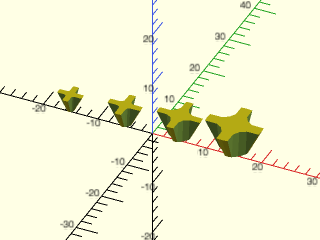
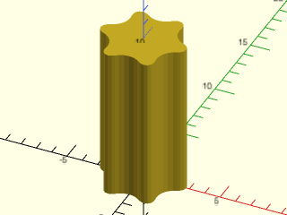
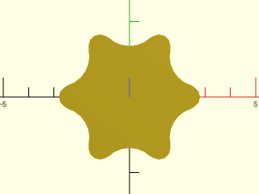
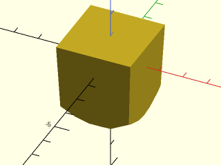
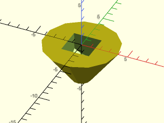

# LibFile: screw\_drive.scad

Masks for Phillips, Torx and square (Robertson) driver holes.

To use, add the following lines to the beginning of your file:

    include <BOSL2/std.scad>
    include <BOSL2/screw_drive.scad>

## File Contents

1. [Section: Phillips Drive](#section-phillips-drive)
    - [`phillips_mask()`](#module-phillips_mask) – Creates a mask for a Philips screw drive. [<abbr>Geom</abbr>]
    - [`phillips_depth()`](#function-phillips_depth) – Returns the depth a phillips recess needs to be for a given diameter.
    - [`phillips_diam()`](#function-phillips_diam) – Returns the diameter of a phillips recess of a given depth.

2. [Section: Hex drive](#section-hex-drive)
    - [`hex_drive_mask()`](#module-hex_drive_mask) – Creates a mask for a hex drive recess. [<abbr>Geom</abbr>]

3. [Section: Torx Drive](#section-torx-drive)
    - [`torx_mask()`](#module-torx_mask) – Creates a mask for a torx drive recess. [<abbr>Geom</abbr>]
    - [`torx_mask2d()`](#module-torx_mask2d) – Creates the 2D cross section for a torx drive recess. [<abbr>Geom</abbr>]
    - [`torx_info()`](#function-torx_info) – Returns the dimensions of a torx drive.
    - [`torx_diam()`](#function-torx_diam) – Returns the diameter of a torx drive.
    - [`torx_depth()`](#function-torx_depth) – Returns the typical depth of a torx drive recess.

4. [Section: Robertson/Square Drives](#section-robertsonsquare-drives)
    - [`robertson_mask()`](#module-robertson_mask) – Creates a mask for a Robertson/Square drive recess. [<abbr>Geom</abbr>]

## Section: Phillips Drive

### Module: phillips\_mask()

**Synopsis:** Creates a mask for a Philips screw drive. [<abbr>Geom</abbr>]

**Topics:** [Screws](Topics#screws), [Masks](Topics#masks)

**See Also:** [hex\_drive\_mask()](#module-hex_drive_mask), [phillips\_depth()](#function-phillips_depth), [phillips\_diam()](#function-phillips_diam), [torx\_mask()](#module-torx_mask), [robertson\_mask()](#module-robertson_mask)

**Usage:** 

- phillips_mask(size) [ATTACHMENTS];

**Description:** 

Creates a mask for creating a Phillips drive recess given the Phillips size.  Each mask can
be lowered to different depths to create different sizes of recess.

**Arguments:** 

<abbr title="These args can be used by position or by name.">By&nbsp;Position</abbr> | What it does
-------------------- | ------------
`size`               | The size of the bit as an integer or string.  "#0", "#1", "#2", "#3", or "#4".  Default: "#2"

<abbr title="These args must be used by name, ie: name=value">By&nbsp;Name</abbr> | What it does
-------------------- | ------------
`$fn`                | Facet count for the drive mask.  Default: 36
`anchor`             | Translate so anchor point is at origin (0,0,0).  See [anchor](attachments.scad#subsection-anchor).  Default: `BOTTOM`
`spin`               | Rotate this many degrees around the Z axis after anchor.  See [spin](attachments.scad#subsection-spin).  Default: `0`
`orient`             | Vector to rotate top towards, after spin.  See [orient](attachments.scad#subsection-orient).  Default: `UP`

**Example 1:** 

    include <BOSL2/std.scad>
    include <BOSL2/screw_drive.scad>
    xdistribute(10) {
       phillips_mask(size="#1");
       phillips_mask(size="#2");
       phillips_mask(size=3);
       phillips_mask(size=4);
    }

  

---

### Function: phillips\_depth()

**Synopsis:** Returns the depth a phillips recess needs to be for a given diameter.

**Topics:** [Screws](Topics#screws), [Masks](Topics#masks)

**See Also:** [phillips\_mask()](#module-phillips_mask), [hex\_drive\_mask()](#module-hex_drive_mask), [phillips\_diam()](#function-phillips_diam), [torx\_mask()](#module-torx_mask)

**Usage:** 

- depth = phillips_depth(size, d);

**Description:** 

Returns the depth of the Phillips recess required to produce the specified diameter, or
undef if not possible.

**Arguments:** 

<abbr title="These args can be used by position or by name.">By&nbsp;Position</abbr> | What it does
-------------------- | ------------
`size`               | size as a number or text string like "#2"
`d`                  | desired diameter

---

### Function: phillips\_diam()

**Synopsis:** Returns the diameter of a phillips recess of a given depth.

**Topics:** [Screws](Topics#screws), [Masks](Topics#masks)

**See Also:** [phillips\_mask()](#module-phillips_mask), [hex\_drive\_mask()](#module-hex_drive_mask), [phillips\_depth()](#function-phillips_depth), [torx\_mask()](#module-torx_mask)

**Usage:** 

- diam = phillips_diam(size, depth);

**Description:** 

Returns the diameter at the top of the Phillips recess when constructed at the specified depth,
or undef if that depth is not valid.

**Arguments:** 

<abbr title="These args can be used by position or by name.">By&nbsp;Position</abbr> | What it does
-------------------- | ------------
`size`               | size as number or text string like "#2"
`depth`              | depth of recess to find the diameter of

---

## Section: Hex drive

### Module: hex\_drive\_mask()

**Synopsis:** Creates a mask for a hex drive recess. [<abbr>Geom</abbr>]

**Topics:** [Screws](Topics#screws), [Masks](Topics#masks)

**See Also:** [phillips\_mask()](#module-phillips_mask), [torx\_mask()](#module-torx_mask), [phillips\_depth()](#function-phillips_depth), [phillips\_diam()](#function-phillips_diam), [robertson\_mask()](#module-robertson_mask)

**Usage:** 

- hex_drive_mask(size, length, [anchor=], [spin=], [orient=], [$slop=]) [ATTACHMENTS];

**Description:** 

Creates a mask for hex drive.  Note that the hex recess specs requires
a slightly oversized recess.  You can use $slop to increase the size by
`2 * $slop` if necessary.

**Arguments:** 

<abbr title="These args can be used by position or by name.">By&nbsp;Position</abbr> | What it does
-------------------- | ------------
`size`               | Nominal hex drive size across flats.
`length`             / `l`                  / `h`                  / `height`             | Mask length.  Specify exactly one.

<abbr title="These args must be used by name, ie: name=value">By&nbsp;Name</abbr> | What it does
-------------------- | ------------
`$slop`              | Add twice this amount to the recess width, in addition to the built-in allowance.
`anchor`             | Translate so anchor point is at origin (0,0,0).  See [anchor](attachments.scad#subsection-anchor).  Default: base center
`spin`               | Rotate this many degrees around the Z axis after anchor.  See [spin](attachments.scad#subsection-spin).  Default: `0`
`orient`             | Vector to rotate top towards, after spin.  See [orient](attachments.scad#subsection-orient).  Default: `UP`

---

## Section: Torx Drive

### Module: torx\_mask()

**Synopsis:** Creates a mask for a torx drive recess. [<abbr>Geom</abbr>]

**Topics:** [Screws](Topics#screws), [Masks](Topics#masks)

**See Also:** [phillips\_mask()](#module-phillips_mask), [hex\_drive\_mask()](#module-hex_drive_mask), [phillips\_depth()](#function-phillips_depth), [phillips\_diam()](#function-phillips_diam), [robertson\_mask()](#module-robertson_mask)

**Usage:** 

- torx_mask(size, l, [center]) [ATTACHMENTS];

**Description:** 

Creates a torx bit tip.  The anchors are located on the circumscribing cylinder.  See [`torx_info()`](#function-torx_info) for allowed sizes.

**Arguments:** 

<abbr title="These args can be used by position or by name.">By&nbsp;Position</abbr> | What it does
-------------------- | ------------
`size`               | Torx size.
`l`                  | Length of bit.  Default: 5
`center`             | If true, centers mask vertically.

<abbr title="These args must be used by name, ie: name=value">By&nbsp;Name</abbr> | What it does
-------------------- | ------------
`anchor`             | Translate so anchor point is at origin (0,0,0).  See [anchor](attachments.scad#subsection-anchor).  Default: `BOTTOM`
`spin`               | Rotate this many degrees around the Z axis after anchor.  See [spin](attachments.scad#subsection-spin).  Default: `0`
`orient`             | Vector to rotate top towards, after spin.  See [orient](attachments.scad#subsection-orient).  Default: `UP`

**Example 1:** 

    include <BOSL2/std.scad>
    include <BOSL2/screw_drive.scad>
    torx_mask(size=30, l=10, $fa=1, $fs=1);

  

---

### Module: torx\_mask2d()

**Synopsis:** Creates the 2D cross section for a torx drive recess. [<abbr>Geom</abbr>]

**Topics:** [Screws](Topics#screws), [Masks](Topics#masks)

**See Also:** [phillips\_mask()](#module-phillips_mask), [hex\_drive\_mask()](#module-hex_drive_mask), [torx\_mask()](#module-torx_mask), [phillips\_depth()](#function-phillips_depth), [phillips\_diam()](#function-phillips_diam), [torx\_info()](#function-torx_info), [robertson\_mask()](#module-robertson_mask)

**Usage:** 

- torx_mask2d(size);

**Description:** 

Creates a torx bit 2D profile.  The anchors are located on the circumscribing circle.   See [`torx_info()`](#function-torx_info) for allowed sizes.

**Arguments:** 

<abbr title="These args can be used by position or by name.">By&nbsp;Position</abbr> | What it does
-------------------- | ------------
`size`               | Torx size.

<abbr title="These args must be used by name, ie: name=value">By&nbsp;Name</abbr> | What it does
-------------------- | ------------
`anchor`             | Translate so anchor point is at origin (0,0,0).  See [anchor](attachments.scad#subsection-anchor).  Default: `CENTER`
`spin`               | Rotate this many degrees around the Z axis after anchor.  See [spin](attachments.scad#subsection-spin).  Default: `0`

**Example 1:** 

    include <BOSL2/std.scad>
    include <BOSL2/screw_drive.scad>
    torx_mask2d(size=30, $fa=1, $fs=1);

  

---

### Function: torx\_info()

**Synopsis:** Returns the dimensions of a torx drive.

**Topics:** [Screws](Topics#screws), [Masks](Topics#masks)

**See Also:** [phillips\_mask()](#module-phillips_mask), [hex\_drive\_mask()](#module-hex_drive_mask), [torx\_mask()](#module-torx_mask), [phillips\_depth()](#function-phillips_depth), [phillips\_diam()](#function-phillips_diam)

**Usage:** 

- info = torx_info(size);

**Description:** 

Get the typical dimensional info for a given Torx size.
Returns a list containing, in order:
- Outer Diameter
- Inner Diameter
- Drive Hole Depth
- External Tip Rounding Radius
- Inner Rounding Radius

**Arguments:** 

<abbr title="These args can be used by position or by name.">By&nbsp;Position</abbr> | What it does
-------------------- | ------------
`size`               | Torx size.

---

### Function: torx\_diam()

**Synopsis:** Returns the diameter of a torx drive.

**Topics:** [Screws](Topics#screws), [Masks](Topics#masks)

**See Also:** [phillips\_mask()](#module-phillips_mask), [hex\_drive\_mask()](#module-hex_drive_mask), [torx\_mask()](#module-torx_mask), [phillips\_depth()](#function-phillips_depth), [phillips\_diam()](#function-phillips_diam), [torx\_info()](#function-torx_info)

**Usage:** 

- diam = torx_diam(size);

**Description:** 

Get the typical outer diameter of Torx profile.

**Arguments:** 

<abbr title="These args can be used by position or by name.">By&nbsp;Position</abbr> | What it does
-------------------- | ------------
`size`               | Torx size.

---

### Function: torx\_depth()

**Synopsis:** Returns the typical depth of a torx drive recess.

**Topics:** [Screws](Topics#screws), [Masks](Topics#masks)

**See Also:** [phillips\_mask()](#module-phillips_mask), [hex\_drive\_mask()](#module-hex_drive_mask), [torx\_mask()](#module-torx_mask), [phillips\_depth()](#function-phillips_depth), [phillips\_diam()](#function-phillips_diam), [torx\_info()](#function-torx_info)

**Usage:** 

- depth = torx_depth(size);

**Description:** 

Gets typical drive hole depth.

**Arguments:** 

<abbr title="These args can be used by position or by name.">By&nbsp;Position</abbr> | What it does
-------------------- | ------------
`size`               | Torx size.

---

## Section: Robertson/Square Drives

### Module: robertson\_mask()

**Synopsis:** Creates a mask for a Robertson/Square drive recess. [<abbr>Geom</abbr>]

**Topics:** [Screws](Topics#screws), [Masks](Topics#masks)

**See Also:** [phillips\_mask()](#module-phillips_mask), [hex\_drive\_mask()](#module-hex_drive_mask), [torx\_mask()](#module-torx_mask), [phillips\_depth()](#function-phillips_depth), [phillips\_diam()](#function-phillips_diam), [torx\_info()](#function-torx_info)

**Usage:** 

- robertson_mask(size, [extra], [ang], [$slop=]);

**Description:** 

Creates a mask for creating a Robertson/Square drive recess given the drive size as an integer.
The width of the recess will be oversized by `2 * $slop`.  Note that this model is based
on an incomplete spec.   https://www.aspenfasteners.com/content/pdf/square_drive_specification.pdf
We determined the angle by doing print tests on a Prusa MK3S with $slop set to 0.05.

**Arguments:** 

<abbr title="These args can be used by position or by name.">By&nbsp;Position</abbr> | What it does
-------------------- | ------------
`size`               | The size of the square drive, as an integer from 0 to 4.
`extra`              | Extra length of drive mask to create.  Default: 1
`ang`                | taper angle of each face.  Default: 2.5

<abbr title="These args must be used by name, ie: name=value">By&nbsp;Name</abbr> | What it does
-------------------- | ------------
`$slop`              | enlarge recess by this twice amount.  Default: 0
`anchor`             | Translate so anchor point is at origin (0,0,0).  See [anchor](attachments.scad#subsection-anchor).  Default: TOP
`spin`               | Rotate this many degrees around the Z axis after anchor.  See [spin](attachments.scad#subsection-spin).  Default: `0`
`orient`             | Vector to rotate top towards, after spin.  See [orient](attachments.scad#subsection-orient).  Default: `UP`

**Side Effects:** 

- Sets tag to "remove" if no tag is set.

**Example 1:** 

    include <BOSL2/std.scad>
    include <BOSL2/screw_drive.scad>
    robertson_mask(size=2);

  

**Example 2:** 

    include <BOSL2/std.scad>
    include <BOSL2/screw_drive.scad>
    difference() {
        cyl(d1=2, d2=8, h=4, anchor=TOP);
        robertson_mask(size=2);
    }

  

---

