# LibFile: shapes2d.scad

This file includes redefinitions of the core modules to
work with attachment, and functional forms of those modules
that produce paths.  You can create regular polygons
with optional rounded corners and alignment features not
available with circle().  The file also provides teardrop2d,
which is useful for 3D printable holes.
Many of the commands have module forms that produce geometry and
function forms that produce a path.

To use, add the following lines to the beginning of your file:

    include <BOSL2/std.scad>

## File Contents

1. [Section: 2D Primitives](#section-2d-primitives)
    - [`square()`](#functionmodule-square) – Creates a 2D square or rectangle. [<abbr>Geom</abbr>] [<abbr>Path</abbr>] [<abbr>Ext</abbr>]
    - [`rect()`](#functionmodule-rect) – Creates a 2d rectangle with optional corner rounding. [<abbr>Geom</abbr>] [<abbr>Path</abbr>]
    - [`circle()`](#functionmodule-circle) – Creates the approximation of a circle. [<abbr>Geom</abbr>] [<abbr>Path</abbr>] [<abbr>Ext</abbr>]
    - [`ellipse()`](#functionmodule-ellipse) – Creates the approximation of an ellipse or a circle. [<abbr>Geom</abbr>] [<abbr>Path</abbr>]

2. [Section: Polygons](#section-polygons)
    - [`regular_ngon()`](#functionmodule-regular_ngon) – Creates a regular N-sided polygon. [<abbr>Geom</abbr>] [<abbr>Path</abbr>]
    - [`pentagon()`](#functionmodule-pentagon) – Creates a regular pentagon. [<abbr>Geom</abbr>] [<abbr>Path</abbr>]
    - [`hexagon()`](#functionmodule-hexagon) – Creates a regular hexagon. [<abbr>Geom</abbr>] [<abbr>Path</abbr>]
    - [`octagon()`](#functionmodule-octagon) – Creates a regular octagon. [<abbr>Geom</abbr>] [<abbr>Path</abbr>]
    - [`right_triangle()`](#functionmodule-right_triangle) – Creates a right triangle. [<abbr>Geom</abbr>] [<abbr>Path</abbr>]
    - [`trapezoid()`](#functionmodule-trapezoid) – Creates a trapezoid with parallel top and bottom sides. [<abbr>Geom</abbr>] [<abbr>Path</abbr>]
    - [`star()`](#functionmodule-star) – Creates a star-shaped polygon or returns a star-shaped region. [<abbr>Geom</abbr>] [<abbr>Path</abbr>]
    - [`jittered_poly()`](#module-jittered_poly) – Creates a polygon with extra points for smoother twisted extrusions. [<abbr>Geom</abbr>]

3. [Section: Curved 2D Shapes](#section-curved-2d-shapes)
    - [`teardrop2d()`](#functionmodule-teardrop2d) – Creates a 2D teardrop shape. [<abbr>Geom</abbr>] [<abbr>Path</abbr>]
    - [`egg()`](#functionmodule-egg) – Creates an egg-shaped 2d object. [<abbr>Geom</abbr>] [<abbr>Path</abbr>]
    - [`ring()`](#functionmodule-ring) – Draws a 2D ring or partial ring or returns a region or path [<abbr>Geom</abbr>] [<abbr>Region</abbr>] [<abbr>Path</abbr>]
    - [`glued_circles()`](#functionmodule-glued_circles) – Creates a shape of two circles joined by a curved waist. [<abbr>Geom</abbr>] [<abbr>Path</abbr>]
    - [`semicircle()`](#functionmodule-semicircle) – Creates a semicircle with optional roundings or chamfers [<abbr>Geom</abbr>] [<abbr>Path</abbr>]
    - [`squircle()`](#functionmodule-squircle) – Creates a shape between a circle and a square. [<abbr>Geom</abbr>] [<abbr>Path</abbr>]
    - [`keyhole()`](#functionmodule-keyhole) – Creates a 2D keyhole shape. [<abbr>Geom</abbr>] [<abbr>Path</abbr>]
    - [`reuleaux_polygon()`](#functionmodule-reuleaux_polygon) – Creates a constant-width shape that is not circular. [<abbr>Geom</abbr>] [<abbr>Path</abbr>]
    - [`supershape()`](#functionmodule-supershape) – Creates a 2D [Superformula](https://en.wikipedia.org/wiki/Superformula) shape. [<abbr>Geom</abbr>] [<abbr>Path</abbr>]

4. [Section: Text](#section-text)
    - [`text()`](#module-text) – Creates an attachable block of text. [<abbr>Geom</abbr>]

5. [Section: Rounding 2D shapes](#section-rounding-2d-shapes)
    - [`round2d()`](#module-round2d) – Rounds the corners of 2d objects. [<abbr>Geom</abbr>]
    - [`shell2d()`](#module-shell2d) – Creates a shell from 2D children. [<abbr>Geom</abbr>]

## Section: 2D Primitives

### Function/Module: square()

**Synopsis:** Creates a 2D square or rectangle. [<abbr>Geom</abbr>] [<abbr>Path</abbr>] [<abbr>Ext</abbr>]

**Topics:** [Shapes (2D)](Topics#shapes-2d), [Path Generators (2D)](Topics#path-generators-2d)

**See Also:** [rect()](#functionmodule-rect)

**Usage:** As a Module

- square(size, [center], ...);

**Usage:** With Attachments

- square(size, [center], ...) [ATTACHMENTS];

**Usage:** As a Function

- path = square(size, [center], ...);

**Description:** 

When called as the built-in module, creates a 2D square or rectangle of the given size.
When called as a function, returns a 2D path/list of points for a square/rectangle of the given size.

**Arguments:** 

<abbr title="These args can be used by position or by name.">By&nbsp;Position</abbr> | What it does
-------------------- | ------------
`size`               | The size of the square to create.  If given as a scalar, both X and Y will be the same size.
`center`             | If given and true, overrides `anchor` to be `CENTER`.  If given and false, overrides `anchor` to be `FRONT+LEFT`.

<abbr title="These args must be used by name, ie: name=value">By&nbsp;Name</abbr> | What it does
-------------------- | ------------
`anchor`             | Translate so anchor point is at origin (0,0,0).  See [anchor](attachments.scad#subsection-anchor).  Default: `CENTER`
`spin`               | Rotate this many degrees around the Z axis after anchor.  See [spin](attachments.scad#subsection-spin).  Default: `0`

**Example 1:** 

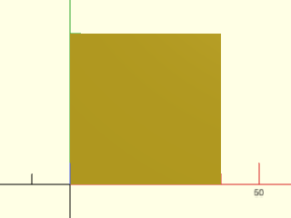

    include <BOSL2/std.scad>
    square(40);

  

**Example 2:** Centered

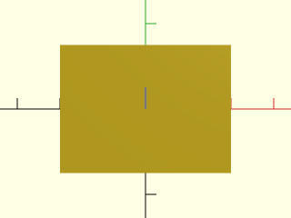

    include <BOSL2/std.scad>
    square([40,30], center=true);

  

**Example 3:** Called as Function

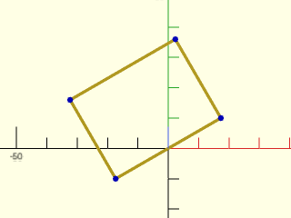

    include <BOSL2/std.scad>
    path = square([40,30], anchor=FRONT, spin=30);
    stroke(path, closed=true);
    move_copies(path) color("blue") circle(d=2,$fn=8);

  

---

### Function/Module: rect()

**Synopsis:** Creates a 2d rectangle with optional corner rounding. [<abbr>Geom</abbr>] [<abbr>Path</abbr>]

**Topics:** [Shapes (2D)](Topics#shapes-2d), [Paths (2D)](Topics#paths-2d), [Path Generators](Topics#path-generators), [Attachable](Topics#attachable)

**See Also:** [square()](#functionmodule-square)

**Usage:** As Module

- rect(size, [rounding], [chamfer], ...) [ATTACHMENTS];

**Usage:** As Function

- path = rect(size, [rounding], [chamfer], ...);

**Description:** 

When called as a module, creates a 2D rectangle of the given size, with optional rounding or chamfering.
When called as a function, returns a 2D path/list of points for a square/rectangle of the given size.

**Arguments:** 

<abbr title="These args can be used by position or by name.">By&nbsp;Position</abbr> | What it does
-------------------- | ------------
`size`               | The size of the rectangle to create.  If given as a scalar, both X and Y will be the same size.

<abbr title="These args must be used by name, ie: name=value">By&nbsp;Name</abbr> | What it does
-------------------- | ------------
`rounding`           | The rounding radius for the corners.  If negative, produces external roundover spikes on the X axis. If given as a list of four numbers, gives individual radii for each corner, in the order [X+Y+,X-Y+,X-Y-,X+Y-]. Default: 0 (no rounding)
`chamfer`            | The chamfer size for the corners.  If negative, produces external chamfer spikes on the X axis. If given as a list of four numbers, gives individual chamfers for each corner, in the order [X+Y+,X-Y+,X-Y-,X+Y-].  Default: 0 (no chamfer)
`corner_flip`        | Flips the direction of the rouding curve or roudover and chamfer spikes. If true it produces spikes on the Y axis. If false it produces spikes on the X axis. If given as a list of four booleans it flips the direction for each corner, in the order [X+Y+,X-Y+,X-Y-,X+Y-].  Default: false (no flip)
`atype`              | The type of anchoring to use with `anchor=`.  Valid opptions are "box" and "perim".  This lets you choose between putting anchors on the rounded or chamfered perimeter, or on the square bounding box of the shape. Default: "box"
`anchor`             | Translate so anchor point is at origin (0,0,0).  See [anchor](attachments.scad#subsection-anchor).  Default: `CENTER`
`spin`               | Rotate this many degrees around the Z axis after anchor.  See [spin](attachments.scad#subsection-spin).  Default: `0`

**Anchor Types:** 

Anchor Type | What it is
----------- | ----------
box | Anchor is with respect to the rectangular bounding box of the shape.
perim | Anchors are placed along the rounded or chamfered perimeter of the shape.

**Example 1:** 

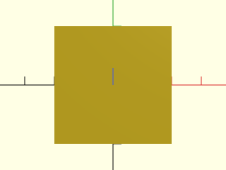

    include <BOSL2/std.scad>
    rect(40);

  

**Example 2:** Anchored

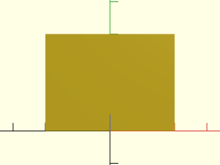

    include <BOSL2/std.scad>
    rect([40,30], anchor=FRONT);

  

**Example 3:** Spun

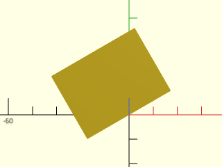

    include <BOSL2/std.scad>
    rect([40,30], anchor=FRONT, spin=30);

  

**Example 4:** Chamferred Rect

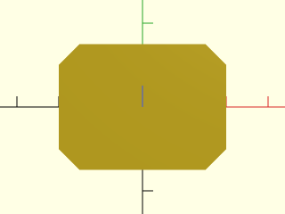

    include <BOSL2/std.scad>
    rect([40,30], chamfer=5);

  

**Example 5:** Rounded Rect

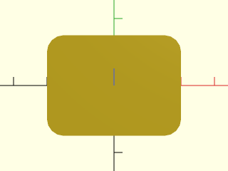

    include <BOSL2/std.scad>
    rect([40,30], rounding=5);

  

**Example 6:** Negative-Chamferred Rect

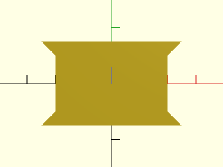

    include <BOSL2/std.scad>
    rect([40,30], chamfer=-5);

  

**Example 7:** Negative-Rounded Rect

    include <BOSL2/std.scad>
    rect([40,30], rounding=-5);

  

**Example 8:** Combined Rounded-Chamfered Rect with corner flips

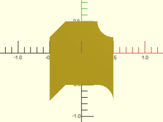

    include <BOSL2/std.scad>
    rect([1,1], chamfer = 0.25*[0,1,-1,0],
         rounding=.25*[1,0,0,-1], corner_flip = true, $fn=32);

  

**Example 9:** Default "box" Anchors

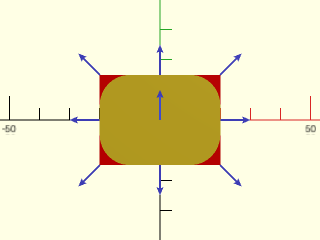

    include <BOSL2/std.scad>
    color("red") rect([40,30]);
    rect([40,30], rounding=10)
        show_anchors();

  

**Example 10:** "perim" Anchors

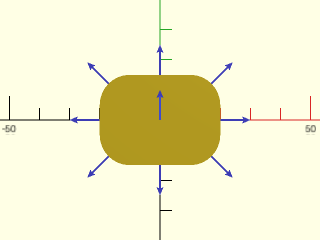

    include <BOSL2/std.scad>
    rect([40,30], rounding=10, atype="perim")
        show_anchors();

  

**Example 11:** "perim" Anchors

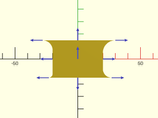

    include <BOSL2/std.scad>
    rect([40,30], rounding=[-10,-8,-3,-7], atype="perim")
        show_anchors();

  

**Example 12:** Mixed Chamferring and Rounding

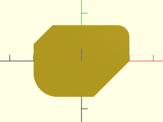

 

    include <BOSL2/std.scad>
    rect([40,30],rounding=[5,0,10,0],chamfer=[0,8,0,15],$fa=1,$fs=1);

**Example 13:** Called as Function

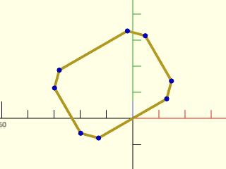

    include <BOSL2/std.scad>
    path = rect([40,30], chamfer=5, anchor=FRONT, spin=30);
    stroke(path, closed=true);
    move_copies(path) color("blue") circle(d=2,$fn=8);

  

---

### Function/Module: circle()

**Synopsis:** Creates the approximation of a circle. [<abbr>Geom</abbr>] [<abbr>Path</abbr>] [<abbr>Ext</abbr>]

**Topics:** [Shapes (2D)](Topics#shapes-2d), [Path Generators (2D)](Topics#path-generators-2d)

**See Also:** [ellipse()](#functionmodule-ellipse), [circle\_2tangents()](geometry.scad#function-circle_2tangents), [circle\_3points()](geometry.scad#function-circle_3points)

**Usage:** As a Module

- circle(r|d=, ...) [ATTACHMENTS];
- circle(points=) [ATTACHMENTS];
- circle(r|d=, corner=) [ATTACHMENTS];

**Usage:** As a Function

- path = circle(r|d=, ...);
- path = circle(points=);
- path = circle(r|d=, corner=);

**Description:** 

When called as the built-in module, creates a 2D polygon that approximates a circle of the given size.
When called as a function, returns a 2D list of points (path) for a polygon that approximates a circle of the given size.
If `corner=` is given three 2D points, centers the circle so that it will be tangent to both segments of the path, on the inside corner.
If `points=` is given three 2D points, centers and sizes the circle so that it passes through all three points.

**Arguments:** 

<abbr title="These args can be used by position or by name.">By&nbsp;Position</abbr> | What it does
-------------------- | ------------
`r`                  | The radius of the circle to create.
`d`                  | The diameter of the circle to create.

<abbr title="These args must be used by name, ie: name=value">By&nbsp;Name</abbr> | What it does
-------------------- | ------------
`anchor`             | Translate so anchor point is at origin (0,0,0).  See [anchor](attachments.scad#subsection-anchor).  Default: `CENTER`
`spin`               | Rotate this many degrees around the Z axis after anchor.  See [spin](attachments.scad#subsection-spin).  Default: `0`

**Example 1:** By Radius

    include <BOSL2/std.scad>
    circle(r=25);

  

**Example 2:** By Diameter

    include <BOSL2/std.scad>
    circle(d=50);

  

**Example 3:** Fit to Three Points

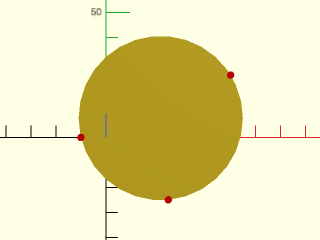

    include <BOSL2/std.scad>
    pts = [[50,25], [25,-25], [-10,0]];
    circle(points=pts);
    color("red") move_copies(pts) circle(r=1.5,$fn=12);

  

**Example 4:** Fit Tangent to Inside Corner of Two Segments

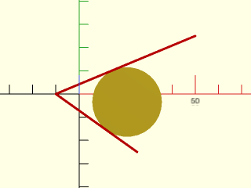

    include <BOSL2/std.scad>
    path = [[50,25], [-10,0], [25,-25]];
    circle(corner=path, r=15);
    color("red") stroke(path);

  

**Example 5:** Called as Function

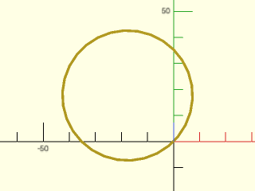

    include <BOSL2/std.scad>
    path = circle(d=50, anchor=FRONT, spin=45);
    stroke(path,closed=true);

  

---

### Function/Module: ellipse()

**Synopsis:** Creates the approximation of an ellipse or a circle. [<abbr>Geom</abbr>] [<abbr>Path</abbr>]

**Topics:** [Shapes (2D)](Topics#shapes-2d), [Paths (2D)](Topics#paths-2d), [Path Generators](Topics#path-generators), [Attachable](Topics#attachable)

**See Also:** [circle()](#functionmodule-circle), [circle\_2tangents()](geometry.scad#function-circle_2tangents), [circle\_3points()](geometry.scad#function-circle_3points)

**Usage:** As a Module

- ellipse(r|d=, [realign=], [circum=], [uniform=], ...) [ATTACHMENTS];

**Usage:** As a Function

- path = ellipse(r|d=, [realign=], [circum=], [uniform=], ...);

**Description:** 

When called as a module, creates a 2D polygon that approximates a circle or ellipse of the given size.
When called as a function, returns a 2D list of points (path) for a polygon that approximates a circle or ellipse of the given size.
By default the point list or shape is the same as the one you would get by scaling the output of [`circle()`](#functionmodule-circle), but with this module your
attachments to the ellipse will retain their dimensions, whereas scaling a circle with attachments will also scale the attachments.
If you set `uniform` to true then you will get a polygon with congruent sides whose vertices lie on the ellipse.  The `circum` option
requests a polygon that circumscribes the requested ellipse (so the specified ellipse will fit into the resulting polygon).  You cannot
combine `circum=true` and `uniform=true`.

When the `realign` parameter is false the shape appears with its first vertex on the X+ axis and points moving counterclockwise from there.
If `realign` is true then the midpoint of an edge is on the X+ axis and the first point of the polygon is below the X+ axis.  By default,
`realign` is false when `circum` is false and true if `circum` is true.  This means that when `$fn` is a multiple of four the ellipse always
has exactly correct dimensions on the X and Y axes regardless of the setting for circum, and it also means that circles match "octa"
style spheroids on any of the coordinate planes.  For circles, `realign` just rotates the circle.  But for noncircular ellipses with `uniform=true`
setting `realign=true` completely changes the shape compared to `realign=false`.

**Arguments:** 

<abbr title="These args can be used by position or by name.">By&nbsp;Position</abbr> | What it does
-------------------- | ------------
`r`                  | Radius of the circle or pair of semiaxes of ellipse

<abbr title="These args must be used by name, ie: name=value">By&nbsp;Name</abbr> | What it does
-------------------- | ------------
`d`                  | Diameter of the circle or a pair giving the width and height of the ellipse.
`realign`            | If false a vertex is on the X+ axis.  If true the midpoint of an edge is on the X+ axis.  Default: false if `circum=false` and true if `circum=true`
`uniform`            | If true, the polygon that approximates the ellipse will have segments of equal length.  Only supported when `circum=false`.  Default: false
`circum`             | If true, the polygon that approximates the ellipse will circumscribe the ideal ellipse.  If false, it inscribes the ideal ellipse.  If this is true then `uniform` must be false.  Default: false
`anchor`             | Translate so anchor point is at origin (0,0,0).  See [anchor](attachments.scad#subsection-anchor).  Default: `CENTER`
`spin`               | Rotate this many degrees around the Z axis after anchor.  See [spin](attachments.scad#subsection-spin).  Default: `0`

**Example 1:** By Radius

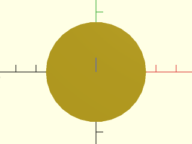

    include <BOSL2/std.scad>
    ellipse(r=25);

  

**Example 2:** By Diameter

    include <BOSL2/std.scad>
    ellipse(d=50);

  

**Example 3:** Anchoring

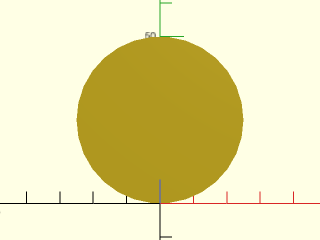

    include <BOSL2/std.scad>
    ellipse(d=50, anchor=FRONT);

  

**Example 4:** Spin

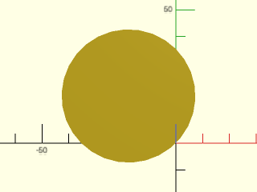

    include <BOSL2/std.scad>
    ellipse(d=50, anchor=FRONT, spin=45);

  

**Example 5:** Called as Function

    include <BOSL2/std.scad>
    path = ellipse(d=50, anchor=FRONT, spin=45);

  

**Example 6:** Uniformly sampled hexagon at the top, regular non-uniform one at the bottom

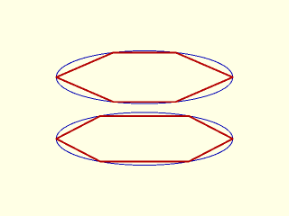

 

    include <BOSL2/std.scad>
    r=[10,3];
    ydistribute(7){
      union(){
        stroke([ellipse(r=r, $fn=100)],width=0.1,color="blue");
        stroke([ellipse(r=r, $fn=6)],width=0.2,color="red");
      }
      union(){
        stroke([ellipse(r=r, $fn=100)],width=0.1,color="blue");
        stroke([ellipse(r=r, $fn=6,uniform=true)],width=0.2,color="red");
      }
    }

**Example 7:** The realigned hexagons are even more different

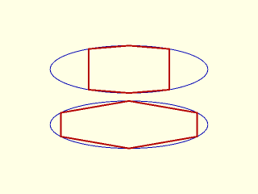

 

    include <BOSL2/std.scad>
    r=[10,3];
    ydistribute(7){
      union(){
        stroke([ellipse(r=r, $fn=100)],width=0.1,color="blue");
        stroke([ellipse(r=r, $fn=6,realign=true)],width=0.2,color="red");
      }
      union(){
        stroke([ellipse(r=r, $fn=100)],width=0.1,color="blue");
        stroke([ellipse(r=r, $fn=6,realign=true,uniform=true)],width=0.2,color="red");
      }
    }

**Example 8:** For odd $fn the result may not look very elliptical:

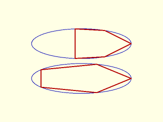

 

    include <BOSL2/std.scad>
    r=[10,3];
    ydistribute(7){
      union(){
        stroke([ellipse(r=r, $fn=100)],width=0.1,color="blue");
        stroke([ellipse(r=r, $fn=5,realign=false)],width=0.2,color="red");
      }
      union(){
        stroke([ellipse(r=r, $fn=100)],width=0.1,color="blue");
        stroke([ellipse(r=r, $fn=5,realign=false,uniform=true)],width=0.2,color="red");
      }
    }

**Example 9:** The same ellipse, turned 90 deg, gives a very different result:

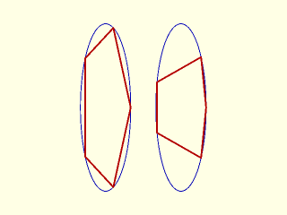

 

    include <BOSL2/std.scad>
    r=[3,10];
    xdistribute(9){
      union(){
        stroke([ellipse(r=r, $fn=100)],width=0.1,color="blue");
        stroke([ellipse(r=r, $fn=5,realign=false)],width=0.2,color="red");
      }
      union(){
        stroke([ellipse(r=r, $fn=100)],width=0.1,color="blue");
        stroke([ellipse(r=r, $fn=5,realign=false,uniform=true)],width=0.2,color="red");
      }
    }

---

## Section: Polygons

### Function/Module: regular\_ngon()

**Synopsis:** Creates a regular N-sided polygon. [<abbr>Geom</abbr>] [<abbr>Path</abbr>]

**Topics:** [Shapes (2D)](Topics#shapes-2d), [Paths (2D)](Topics#paths-2d), [Path Generators](Topics#path-generators), [Attachable](Topics#attachable)

**See Also:** [debug\_polygon()](drawing.scad#module-debug_polygon), [circle()](#functionmodule-circle), [pentagon()](#functionmodule-pentagon), [hexagon()](#functionmodule-hexagon), [octagon()](#functionmodule-octagon), [ellipse()](#functionmodule-ellipse), [star()](#functionmodule-star)

**Usage:** 

- regular_ngon(n, r|d=|or=|od=, [realign=]) [ATTACHMENTS];
- regular_ngon(n, ir=|id=, [realign=]) [ATTACHMENTS];
- regular_ngon(n, side=, [realign=]) [ATTACHMENTS];

**Description:** 

When called as a function, returns a 2D path for a regular N-sided polygon.
When called as a module, creates a 2D regular N-sided polygon.

**Arguments:** 

<abbr title="These args can be used by position or by name.">By&nbsp;Position</abbr> | What it does
-------------------- | ------------
`n`                  | The number of sides.
`r`                  / `or`                 | Outside radius, at points.

<abbr title="These args must be used by name, ie: name=value">By&nbsp;Name</abbr> | What it does
-------------------- | ------------
`d`                  / `od`                 | Outside diameter, at points.
`ir`                 | Inside radius, at center of sides.
`id`                 | Inside diameter, at center of sides.
`side`               | Length of each side.
`rounding`           | Radius of rounding for the tips of the polygon.  Default: 0 (no rounding)
`realign`            | If false, vertex 0 will lie on the X+ axis.  If true then the midpoint of the last edge will lie on the X+ axis, and vertex 0 will be below the X axis.    Default: false
`align_tip`          | If given as a 2D vector, rotates the whole shape so that the first vertex points in that direction.  This occurs before spin.
`align_side`         | If given as a 2D vector, rotates the whole shape so that the normal of side0 points in that direction.  This occurs before spin.
`anchor`             | Translate so anchor point is at origin (0,0,0).  See [anchor](attachments.scad#subsection-anchor).  Default: `CENTER`
`spin`               | Rotate this many degrees around the Z axis after anchor.  See [spin](attachments.scad#subsection-spin).  Default: `0`

**Named Anchors:** 

Anchor Name | Position
----------- | --------
"tip0", "tip1", etc. | Each tip has an anchor, pointing outwards.
"side0", "side1", etc. | The center of each side has an anchor, pointing outwards.

**Example 1:** by Outer Size

    include <BOSL2/std.scad>
    regular_ngon(n=5, or=30);
    regular_ngon(n=5, od=60);

  

**Example 2:** by Inner Size

    include <BOSL2/std.scad>
    regular_ngon(n=5, ir=30);
    regular_ngon(n=5, id=60);

  

**Example 3:** by Side Length

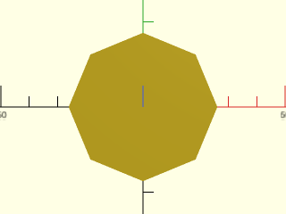

    include <BOSL2/std.scad>
    regular_ngon(n=8, side=20);

  

**Example 4:** Realigned

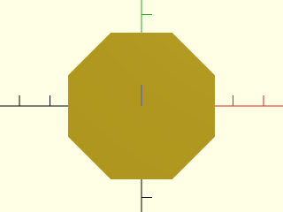

    include <BOSL2/std.scad>
    regular_ngon(n=8, side=20, realign=true);

  

**Example 5:** Alignment by Tip

    include <BOSL2/std.scad>
    regular_ngon(n=5, r=30, align_tip=BACK+RIGHT)
        attach("tip0", FWD) color("blue")
            stroke([[0,0],[0,7]], endcap2="arrow2");

  

**Example 6:** Alignment by Side

    include <BOSL2/std.scad>
    regular_ngon(n=5, r=30, align_side=BACK+RIGHT)
        attach("side0", FWD) color("blue")
            stroke([[0,0],[0,7]], endcap2="arrow2");

  

**Example 7:** Rounded

    include <BOSL2/std.scad>
    regular_ngon(n=5, od=100, rounding=20, $fn=20);

  

**Example 8:** Called as Function

    include <BOSL2/std.scad>
    stroke(closed=true, regular_ngon(n=6, or=30));

  

---

### Function/Module: pentagon()

**Synopsis:** Creates a regular pentagon. [<abbr>Geom</abbr>] [<abbr>Path</abbr>]

**Topics:** [Shapes (2D)](Topics#shapes-2d), [Paths (2D)](Topics#paths-2d), [Path Generators](Topics#path-generators), [Attachable](Topics#attachable)

**See Also:** [circle()](#functionmodule-circle), [regular\_ngon()](#functionmodule-regular_ngon), [hexagon()](#functionmodule-hexagon), [octagon()](#functionmodule-octagon), [ellipse()](#functionmodule-ellipse), [star()](#functionmodule-star)

**Usage:** 

- pentagon(or|od=, [realign=], [align_tip=|align_side=]) [ATTACHMENTS];
- pentagon(ir=|id=, [realign=], [align_tip=|align_side=]) [ATTACHMENTS];
- pentagon(side=, [realign=], [align_tip=|align_side=]) [ATTACHMENTS];

**Usage:** as function

- path = pentagon(...);

**Description:** 

When called as a function, returns a 2D path for a regular pentagon.
When called as a module, creates a 2D regular pentagon.

**Arguments:** 

<abbr title="These args can be used by position or by name.">By&nbsp;Position</abbr> | What it does
-------------------- | ------------
`r`                  / `or`                 | Outside radius, at points.

<abbr title="These args must be used by name, ie: name=value">By&nbsp;Name</abbr> | What it does
-------------------- | ------------
`d`                  / `od`                 | Outside diameter, at points.
`ir`                 | Inside radius, at center of sides.
`id`                 | Inside diameter, at center of sides.
`side`               | Length of each side.
`rounding`           | Radius of rounding for the tips of the polygon.  Default: 0 (no rounding)
`realign`            | If false, vertex 0 will lie on the X+ axis.  If true then the midpoint of the last edge will lie on the X+ axis, and vertex 0 will be below the X axis.    Default: false
`align_tip`          | If given as a 2D vector, rotates the whole shape so that the first vertex points in that direction.  This occurs before spin.
`align_side`         | If given as a 2D vector, rotates the whole shape so that the normal of side0 points in that direction.  This occurs before spin.
`anchor`             | Translate so anchor point is at origin (0,0,0).  See [anchor](attachments.scad#subsection-anchor).  Default: `CENTER`
`spin`               | Rotate this many degrees around the Z axis after anchor.  See [spin](attachments.scad#subsection-spin).  Default: `0`

**Named Anchors:** 

Anchor Name | Position
----------- | --------
"tip0" ... "tip4" | Each tip has an anchor, pointing outwards.
"side0" ... "side4" | The center of each side has an anchor, pointing outwards.

**Example 1:** by Outer Size

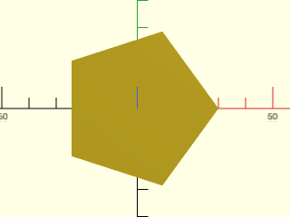

    include <BOSL2/std.scad>
    pentagon(or=30);
    pentagon(od=60);

  

**Example 2:** by Inner Size

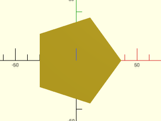

    include <BOSL2/std.scad>
    pentagon(ir=30);
    pentagon(id=60);

  

**Example 3:** by Side Length

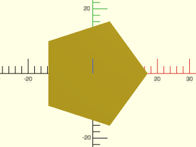

    include <BOSL2/std.scad>
    pentagon(side=20);

  

**Example 4:** Realigned

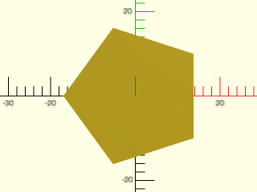

    include <BOSL2/std.scad>
    pentagon(side=20, realign=true);

  

**Example 5:** Alignment by Tip

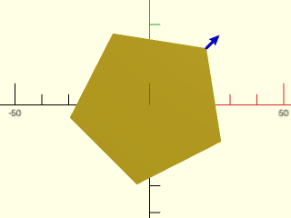

    include <BOSL2/std.scad>
    pentagon(r=30, align_tip=BACK+RIGHT)
        attach("tip0", FWD) color("blue")
            stroke([[0,0],[0,7]], endcap2="arrow2");

  

**Example 6:** Alignment by Side

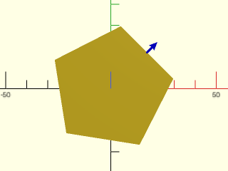

    include <BOSL2/std.scad>
    pentagon(r=30, align_side=BACK+RIGHT)
        attach("side0", FWD) color("blue")
            stroke([[0,0],[0,7]], endcap2="arrow2");

  

**Example 7:** Rounded

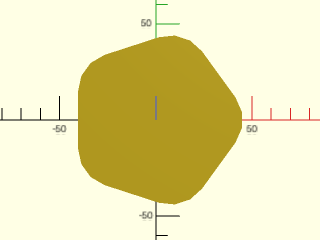

    include <BOSL2/std.scad>
    pentagon(od=100, rounding=20, $fn=20);

  

**Example 8:** Called as Function

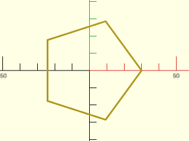

    include <BOSL2/std.scad>
    stroke(closed=true, pentagon(or=30));

  

---

### Function/Module: hexagon()

**Synopsis:** Creates a regular hexagon. [<abbr>Geom</abbr>] [<abbr>Path</abbr>]

**Topics:** [Shapes (2D)](Topics#shapes-2d), [Paths (2D)](Topics#paths-2d), [Path Generators](Topics#path-generators), [Attachable](Topics#attachable)

**See Also:** [circle()](#functionmodule-circle), [regular\_ngon()](#functionmodule-regular_ngon), [pentagon()](#functionmodule-pentagon), [octagon()](#functionmodule-octagon), [ellipse()](#functionmodule-ellipse), [star()](#functionmodule-star)

**Usage:** As Module

- hexagon(r/or, [realign=], <align_tip=|align_side=>, [rounding=], ...) [ATTACHMENTS];
- hexagon(d=/od=, ...) [ATTACHMENTS];
- hexagon(ir=/id=, ...) [ATTACHMENTS];
- hexagon(side=, ...) [ATTACHMENTS];

**Usage:** As Function

- path = hexagon(...);

**Description:** 

When called as a function, returns a 2D path for a regular hexagon.
When called as a module, creates a 2D regular hexagon.

**Arguments:** 

<abbr title="These args can be used by position or by name.">By&nbsp;Position</abbr> | What it does
-------------------- | ------------
`r`                  / `or`                 | Outside radius, at points.

<abbr title="These args must be used by name, ie: name=value">By&nbsp;Name</abbr> | What it does
-------------------- | ------------
`d`                  / `od`                 | Outside diameter, at points.
`ir`                 | Inside radius, at center of sides.
`id`                 | Inside diameter, at center of sides.
`side`               | Length of each side.
`rounding`           | Radius of rounding for the tips of the polygon.  Default: 0 (no rounding)
`realign`            | If false, vertex 0 will lie on the X+ axis.  If true then the midpoint of the last edge will lie on the X+ axis, and vertex 0 will be below the X axis.    Default: false
`align_tip`          | If given as a 2D vector, rotates the whole shape so that the first vertex points in that direction.  This occurs before spin.
`align_side`         | If given as a 2D vector, rotates the whole shape so that the normal of side0 points in that direction.  This occurs before spin.
`anchor`             | Translate so anchor point is at origin (0,0,0).  See [anchor](attachments.scad#subsection-anchor).  Default: `CENTER`
`spin`               | Rotate this many degrees around the Z axis after anchor.  See [spin](attachments.scad#subsection-spin).  Default: `0`

**Named Anchors:** 

Anchor Name | Position
----------- | --------
"tip0" ... "tip5" | Each tip has an anchor, pointing outwards.
"side0" ... "side5" | The center of each side has an anchor, pointing outwards.

**Example 1:** by Outer Size

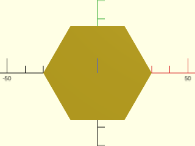

    include <BOSL2/std.scad>
    hexagon(or=30);
    hexagon(od=60);

  

**Example 2:** by Inner Size

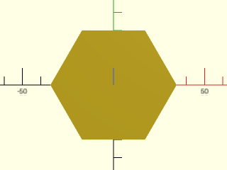

    include <BOSL2/std.scad>
    hexagon(ir=30);
    hexagon(id=60);

  

**Example 3:** by Side Length

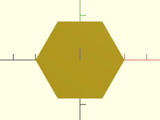

    include <BOSL2/std.scad>
    hexagon(side=20);

  

**Example 4:** Realigned

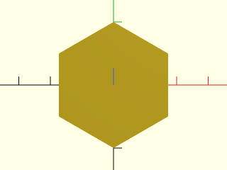

    include <BOSL2/std.scad>
    hexagon(side=20, realign=true);

  

**Example 5:** Alignment by Tip

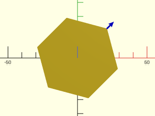

    include <BOSL2/std.scad>
    hexagon(r=30, align_tip=BACK+RIGHT)
        attach("tip0", FWD) color("blue")
            stroke([[0,0],[0,7]], endcap2="arrow2");

  

**Example 6:** Alignment by Side

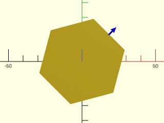

    include <BOSL2/std.scad>
    hexagon(r=30, align_side=BACK+RIGHT)
        attach("side0", FWD) color("blue")
            stroke([[0,0],[0,7]], endcap2="arrow2");

  

**Example 7:** Rounded

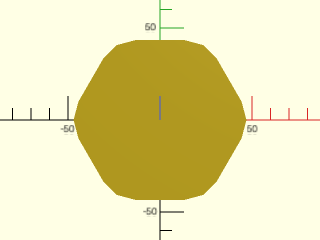

    include <BOSL2/std.scad>
    hexagon(od=100, rounding=20, $fn=20);

  

**Example 8:** Called as Function

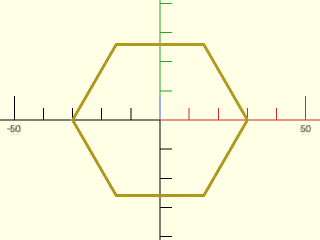

    include <BOSL2/std.scad>
    stroke(closed=true, hexagon(or=30));

  

---

### Function/Module: octagon()

**Synopsis:** Creates a regular octagon. [<abbr>Geom</abbr>] [<abbr>Path</abbr>]

**Topics:** [Shapes (2D)](Topics#shapes-2d), [Paths (2D)](Topics#paths-2d), [Path Generators](Topics#path-generators), [Attachable](Topics#attachable)

**See Also:** [circle()](#functionmodule-circle), [regular\_ngon()](#functionmodule-regular_ngon), [pentagon()](#functionmodule-pentagon), [hexagon()](#functionmodule-hexagon), [ellipse()](#functionmodule-ellipse), [star()](#functionmodule-star)

**Usage:** As Module

- octagon(r/or, [realign=], [align_tip=|align_side=], [rounding=], ...) [ATTACHMENTS];
- octagon(d=/od=, ...) [ATTACHMENTS];
- octagon(ir=/id=, ...) [ATTACHMENTS];
- octagon(side=, ...) [ATTACHMENTS];

**Usage:** As Function

- path = octagon(...);

**Description:** 

When called as a function, returns a 2D path for a regular octagon.
When called as a module, creates a 2D regular octagon.

**Arguments:** 

<abbr title="These args can be used by position or by name.">By&nbsp;Position</abbr> | What it does
-------------------- | ------------
`r`                  / `or`                 | Outside radius, at points.
`d`                  / `od`                 | Outside diameter, at points.
`ir`                 | Inside radius, at center of sides.
`id`                 | Inside diameter, at center of sides.
`side`               | Length of each side.
`rounding`           | Radius of rounding for the tips of the polygon.  Default: 0 (no rounding)
`realign`            | If false, vertex 0 will lie on the X+ axis.  If true then the midpoint of the last edge will lie on the X+ axis, and vertex 0 will be below the X axis.    Default: false
`align_tip`          | If given as a 2D vector, rotates the whole shape so that the first vertex points in that direction.  This occurs before spin.
`align_side`         | If given as a 2D vector, rotates the whole shape so that the normal of side0 points in that direction.  This occurs before spin.
`anchor`             | Translate so anchor point is at origin (0,0,0).  See [anchor](attachments.scad#subsection-anchor).  Default: `CENTER`
`spin`               | Rotate this many degrees around the Z axis after anchor.  See [spin](attachments.scad#subsection-spin).  Default: `0`

**Named Anchors:** 

Anchor Name | Position
----------- | --------
"tip0" ... "tip7" | Each tip has an anchor, pointing outwards.
"side0" ... "side7" | The center of each side has an anchor, pointing outwards.

**Example 1:** by Outer Size

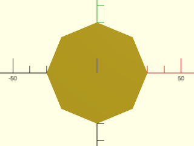

    include <BOSL2/std.scad>
    octagon(or=30);
    octagon(od=60);

  

**Example 2:** by Inner Size

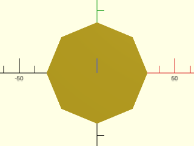

    include <BOSL2/std.scad>
    octagon(ir=30);
    octagon(id=60);

  

**Example 3:** by Side Length

    include <BOSL2/std.scad>
    octagon(side=20);

  

**Example 4:** Realigned

    include <BOSL2/std.scad>
    octagon(side=20, realign=true);

  

**Example 5:** Alignment by Tip

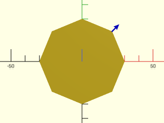

    include <BOSL2/std.scad>
    octagon(r=30, align_tip=BACK+RIGHT)
        attach("tip0", FWD) color("blue")
            stroke([[0,0],[0,7]], endcap2="arrow2");

  

**Example 6:** Alignment by Side

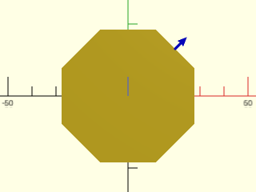

    include <BOSL2/std.scad>
    octagon(r=30, align_side=BACK+RIGHT)
        attach("side0", FWD) color("blue")
            stroke([[0,0],[0,7]], endcap2="arrow2");

  

**Example 7:** Rounded

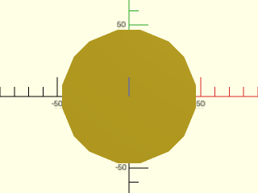

    include <BOSL2/std.scad>
    octagon(od=100, rounding=20, $fn=20);

  

**Example 8:** Called as Function

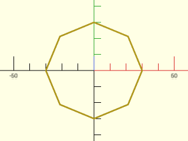

    include <BOSL2/std.scad>
    stroke(closed=true, octagon(or=30));

  

---

### Function/Module: right\_triangle()

**Synopsis:** Creates a right triangle. [<abbr>Geom</abbr>] [<abbr>Path</abbr>]

**Topics:** [Shapes (2D)](Topics#shapes-2d), [Paths (2D)](Topics#paths-2d), [Path Generators](Topics#path-generators), [Attachable](Topics#attachable)

**See Also:** [square()](#functionmodule-square), [rect()](#functionmodule-rect), [regular\_ngon()](#functionmodule-regular_ngon), [pentagon()](#functionmodule-pentagon), [hexagon()](#functionmodule-hexagon), [octagon()](#functionmodule-octagon), [star()](#functionmodule-star)

**Usage:** As Module

- right_triangle(size, [center], ...) [ATTACHMENTS];

**Usage:** As Function

- path = right_triangle(size, [center], ...);

**Description:** 

When called as a module, creates a right triangle with the Hypotenuse in the X+Y+ quadrant.
When called as a function, returns a 2D path for a right triangle with the Hypotenuse in the X+Y+ quadrant.

**Arguments:** 

<abbr title="These args can be used by position or by name.">By&nbsp;Position</abbr> | What it does
-------------------- | ------------
`size`               | The width and length of the right triangle, given as a scalar or an XY vector.
`center`             | If true, forces `anchor=CENTER`.  If false, forces `anchor=[-1,-1]`.  Default: undef (use `anchor=`)

<abbr title="These args must be used by name, ie: name=value">By&nbsp;Name</abbr> | What it does
-------------------- | ------------
`anchor`             | Translate so anchor point is at origin (0,0,0).  See [anchor](attachments.scad#subsection-anchor).  Default: `CENTER`
`spin`               | Rotate this many degrees around the Z axis after anchor.  See [spin](attachments.scad#subsection-spin).  Default: `0`

**Named Anchors:** 

Anchor Name | Position
----------- | --------
"hypot" | Center of angled side, perpendicular to that side.

**Example 1:** 

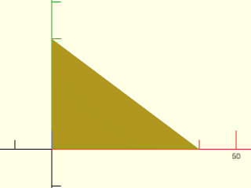

    include <BOSL2/std.scad>
    right_triangle([40,30]);

  

**Example 2:** With `center=true`

    include <BOSL2/std.scad>
    right_triangle([40,30], center=true);

  

**Example 3:** Standard Anchors

    include <BOSL2/std.scad>
    right_triangle([80,30], center=true)
        show_anchors(custom=false);
    color([0.5,0.5,0.5,0.1])
        square([80,30], center=true);

  

**Example 4:** Named Anchors

    include <BOSL2/std.scad>
    right_triangle([80,30], center=true)
        show_anchors(std=false);

  

---

### Function/Module: trapezoid()

**Synopsis:** Creates a trapezoid with parallel top and bottom sides. [<abbr>Geom</abbr>] [<abbr>Path</abbr>]

**Topics:** [Shapes (2D)](Topics#shapes-2d), [Paths (2D)](Topics#paths-2d), [Path Generators](Topics#path-generators), [Attachable](Topics#attachable)

**See Also:** [rect()](#functionmodule-rect), [square()](#functionmodule-square)

**Usage:** As Module

- trapezoid(h, w1, w2, [shift=], [rounding=], [chamfer=], [flip=], ...) [ATTACHMENTS];
- trapezoid(h, w1, ang=, [rounding=], [chamfer=], [flip=], ...) [ATTACHMENTS];
- trapezoid(h, w2=, ang=, [rounding=], [chamfer=], [flip=], ...) [ATTACHMENTS];
- trapezoid(w1=, w2=, ang=, [rounding=], [chamfer=], [flip=], ...) [ATTACHMENTS];

**Usage:** As Function

- path = trapezoid(...);

**Description:** 

When called as a function, returns a 2D path for a trapezoid with parallel front and back (top and bottom) sides.
When called as a module, creates a 2D trapezoid.  You can specify the trapezoid by giving its height and the lengths
of its two bases.  Alternatively, you can omit one of those parameters and specify the lower angle(s).
The shift parameter, which cannot be combined with ang, shifts the back (top) of the trapezoid to the right.

**Arguments:** 

<abbr title="These args can be used by position or by name.">By&nbsp;Position</abbr> | What it does
-------------------- | ------------
`h`                  | The Y axis height of the trapezoid.
`w1`                 | The X axis width of the front end of the trapezoid.
`w2`                 | The X axis width of the back end of the trapezoid.

<abbr title="These args must be used by name, ie: name=value">By&nbsp;Name</abbr> | What it does
-------------------- | ------------
`ang`                | Specify the bottom angle(s) of the trapezoid.  Can give a scalar for an isosceles trapezoid or a list of two angles, the left angle and right angle.  You must omit one of `h`, `w1`, or `w2` to allow the freedom to control the angles.
`shift`              | Scalar value to shift the back of the trapezoid along the X axis by.  Cannot be combined with ang.  Default: 0
`rounding`           | The rounding radius for the corners.  If given as a list of four numbers, gives individual radii for each corner, in the order [X+Y+,X-Y+,X-Y-,X+Y-]. Default: 0 (no rounding)
`chamfer`            | The Length of the chamfer faces at the corners.  If given as a list of four numbers, gives individual chamfers for each corner, in the order [X+Y+,X-Y+,X-Y-,X+Y-].  Default: 0 (no chamfer)
`flip`               | If true, negative roundings and chamfers will point forward and back instead of left and right.  Default: `false`.
`atype`              | The type of anchoring to use with `anchor=`.  Valid opptions are "box" and "perim".  This lets you choose between putting anchors on the rounded or chamfered perimeter, or on the square bounding box of the shape. Default: "box"
`anchor`             | Translate so anchor point is at origin (0,0,0).  See [anchor](attachments.scad#subsection-anchor).  Default: `CENTER`
`spin`               | Rotate this many degrees around the Z axis after anchor.  See [spin](attachments.scad#subsection-spin).  Default: `0`

**Anchor Types:** 

Anchor Type | What it is
----------- | ----------
box | Anchor is with respect to the rectangular bounding box of the shape.
perim | Anchors are placed along the rounded or chamfered perimeter of the shape.

**Example 1:** 

    include <BOSL2/std.scad>
    trapezoid(h=30, w1=40, w2=20);

  

**Example 2:** 

    include <BOSL2/std.scad>
    trapezoid(h=25, w1=20, w2=35);

  

**Example 3:** 

    include <BOSL2/std.scad>
    trapezoid(h=20, w1=40, w2=0);

  

**Example 4:** 

    include <BOSL2/std.scad>
    trapezoid(h=20, w1=30, ang=60);

  

**Example 5:** 

    include <BOSL2/std.scad>
    trapezoid(h=20, w1=20, ang=120);

  

**Example 6:** 

    include <BOSL2/std.scad>
    trapezoid(h=20, w2=10, ang=60);

  

**Example 7:** 

    include <BOSL2/std.scad>
    trapezoid(h=20, w1=50, ang=[40,60]);

  

**Example 8:** 

    include <BOSL2/std.scad>
    trapezoid(w1=30, w2=10, ang=[30,90]);

  

**Example 9:** Chamfered Trapezoid

    include <BOSL2/std.scad>
    trapezoid(h=30, w1=60, w2=40, chamfer=5);

  

**Example 10:** Negative Chamfered Trapezoid

    include <BOSL2/std.scad>
    trapezoid(h=30, w1=60, w2=40, chamfer=-5);

  

**Example 11:** Flipped Negative Chamfered Trapezoid

    include <BOSL2/std.scad>
    trapezoid(h=30, w1=60, w2=40, chamfer=-5, flip=true);

  

**Example 12:** Rounded Trapezoid

    include <BOSL2/std.scad>
    trapezoid(h=30, w1=60, w2=40, rounding=5);

  

**Example 13:** Negative Rounded Trapezoid

    include <BOSL2/std.scad>
    trapezoid(h=30, w1=60, w2=40, rounding=-5);

  

**Example 14:** Flipped Negative Rounded Trapezoid

    include <BOSL2/std.scad>
    trapezoid(h=30, w1=60, w2=40, rounding=-5, flip=true);

  

**Example 15:** Mixed Chamfering and Rounding

 

    include <BOSL2/std.scad>
    trapezoid(h=30, w1=60, w2=40, rounding=[5,0,-10,0],chamfer=[0,8,0,-15],$fa=1,$fs=1);

**Example 16:** default anchors for roundings

 

    include <BOSL2/std.scad>
    trapezoid(h=30, w1=100, ang=[66,44],rounding=5) show_anchors();

**Example 17:** default anchors for negative roundings are still at the trapezoid corners

 

    include <BOSL2/std.scad>
    trapezoid(h=30, w1=100, ang=[66,44],rounding=-5) show_anchors();

**Example 18:** "perim" anchors are at the tips of negative roundings

 

    include <BOSL2/std.scad>
    trapezoid(h=30, w1=100, ang=[66,44],rounding=-5, atype="perim") show_anchors();

**Example 19:** They point the other direction if you flip them

 

    include <BOSL2/std.scad>
    trapezoid(h=30, w1=100, ang=[66,44],rounding=-5, atype="perim",flip=true) show_anchors();

**Example 20:** Called as Function

    include <BOSL2/std.scad>
    stroke(closed=true, trapezoid(h=30, w1=40, w2=20));

  

---

### Function/Module: star()

**Synopsis:** Creates a star-shaped polygon or returns a star-shaped region. [<abbr>Geom</abbr>] [<abbr>Path</abbr>]

**Topics:** [Shapes (2D)](Topics#shapes-2d), [Paths (2D)](Topics#paths-2d), [Path Generators](Topics#path-generators), [Attachable](Topics#attachable)

**See Also:** [circle()](#functionmodule-circle), [ellipse()](#functionmodule-ellipse), [regular\_ngon()](#functionmodule-regular_ngon)

**Usage:** As Module

- star(n, r/or, ir, [realign=], [align_tip=], [align_pit=], ...) [ATTACHMENTS];
- star(n, r/or, step=, ...) [ATTACHMENTS];

**Usage:** As Function

- path = star(n, r/or, ir, [realign=], [align_tip=], [align_pit=], ...);
- path = star(n, r/or, step=, ...);

**Description:** 

When called as a function, returns the path needed to create a star polygon with N points.
When called as a module, creates a star polygon with N points.

**Arguments:** 

<abbr title="These args can be used by position or by name.">By&nbsp;Position</abbr> | What it does
-------------------- | ------------
`n`                  | The number of stellate tips on the star.
`r`                  / `or`                 | The radius to the tips of the star.
`ir`                 | The radius to the inner corners of the star.

<abbr title="These args must be used by name, ie: name=value">By&nbsp;Name</abbr> | What it does
-------------------- | ------------
`d`                  / `od`                 | The diameter to the tips of the star.
`id`                 | The diameter to the inner corners of the star.
`step`               | Calculates the radius of the inner star corners by virtually drawing a straight line `step` tips around the star.  2 <= step < n/2
`realign`            | If false, the shape starts with a star point on the X+ axis.  If true then a star pit (the last vertex) will be on the X+ axis and the first vertex will be a point below the X+ axis.  Default: false
`align_tip`          | If given as a 2D vector, rotates the whole shape so that the first star tip points in that direction.  This occurs before spin.  If realign is true this aligns a pit instead.
`align_pit`          | If given as a 2D vector, rotates the whole shape so that the first inner corner is pointed towards that direction.  This occurs before spin.  If realign is true this aligns a tip instead.
`anchor`             | Translate so anchor point is at origin (0,0,0).  See [anchor](attachments.scad#subsection-anchor).  Default: `CENTER`
`spin`               | Rotate this many degrees around the Z axis after anchor.  See [spin](attachments.scad#subsection-spin).  Default: `0`
`atype`              | Choose "hull" or "intersect" anchor methods.  Default: "hull"

**Named Anchors:** 

Anchor Name | Position
----------- | --------
"tip0" ... "tip4" | Each tip has an anchor, pointing outwards.
"pit0" ... "pit4" | The inside corner between each tip has an anchor, pointing outwards.
"midpt0" ... "midpt4" | The center-point between each pair of tips has an anchor, pointing outwards.

**Example 1:** 

    include <BOSL2/std.scad>
    star(n=5, r=50, ir=25);

  

**Example 2:** 

    include <BOSL2/std.scad>
    star(n=5, r=50, step=2);

  

**Example 3:** 

    include <BOSL2/std.scad>
    star(n=7, r=50, step=2);

  

**Example 4:** 

    include <BOSL2/std.scad>
    star(n=7, r=50, step=3);

  

**Example 5:** Realigned

    include <BOSL2/std.scad>
    star(n=7, r=50, step=3, realign=true);

  

**Example 6:** Alignment by Tip

    include <BOSL2/std.scad>
    star(n=5, ir=15, or=30, align_tip=BACK+RIGHT)
        attach("tip0", FWD) color("blue")
            stroke([[0,0],[0,7]], endcap2="arrow2");

  

**Example 7:** Alignment by Pit

    include <BOSL2/std.scad>
    star(n=5, ir=15, or=30, align_pit=BACK+RIGHT)
        attach("pit0", FWD) color("blue")
            stroke([[0,0],[0,7]], endcap2="arrow2");

  

**Example 8:** Called as Function

    include <BOSL2/std.scad>
    stroke(closed=true, star(n=5, r=50, ir=25));

  

---

### Module: jittered\_poly()

**Synopsis:** Creates a polygon with extra points for smoother twisted extrusions. [<abbr>Geom</abbr>]

**Topics:** [Extrusions](Topics#extrusions)

**See Also:** [subdivide\_path()](paths.scad#function-subdivide_path)

**Usage:** 

- jittered_poly(path, [dist]);

**Description:** 

Creates a 2D polygon shape from the given path in such a way that any extra
collinear points are not stripped out in the way that `polygon()` normally does.
This is useful for refining the mesh of a `linear_extrude()` with twist.

**Arguments:** 

<abbr title="These args can be used by position or by name.">By&nbsp;Position</abbr> | What it does
-------------------- | ------------
`path`               | The path to add jitter to.
`dist`               | The amount to jitter points by.  Default: 1/512 (0.00195)

**Example 1:** 

    include <BOSL2/std.scad>
    d = 100; h = 75; quadsize = 5;
    path = pentagon(d=d);
    spath = subdivide_path(path, maxlen=quadsize, closed=true);
    linear_extrude(height=h, twist=72, slices=h/quadsize)
       jittered_poly(spath);

  

---

## Section: Curved 2D Shapes

### Function/Module: teardrop2d()

**Synopsis:** Creates a 2D teardrop shape. [<abbr>Geom</abbr>] [<abbr>Path</abbr>]

**Topics:** [Shapes (2D)](Topics#shapes-2d), [Paths (2D)](Topics#paths-2d), [Path Generators](Topics#path-generators), [Attachable](Topics#attachable)

**See Also:** [teardrop()](shapes3d.scad#functionmodule-teardrop), [onion()](shapes3d.scad#functionmodule-onion), [keyhole()](#functionmodule-keyhole)

**Usage:** As Module

- teardrop2d(r/d=, [ang], [cap_h], [circum=], [realign=], [bot_corner=]) [ATTACHMENTS];

**Usage:** As Function

- path = teardrop2d(r|d=, [ang], [cap_h], [circum=], [realign=], [bot_corner=]);

**Description:** 

A teardrop shape is a circle that comes to a point at the top.  This shape is useful for extruding into 3d printable holes as it
limits the overhang angle.  A bottom point can also help ensure a 3d printable hole.  This module can make a teardrop shape
or produce the path for a teardrop with a point at the top or with the top truncated to create a flat cap.  It also provides the option to add a bottom point.

The default teardrop has a pointed top and round bottom.  The `ang` parameter specifies the angle away from vertical of the two flat segments at the
top of the shape.  The cap_h parameter truncates the top of the teardrop at the specified
distance from the center.  If `cap_h` is taller than the untruncated form then
the result will be the full, untruncated shape.  You can set `cap_h` smaller than the radius to produce a truncated circle.  The segments of the round section of the teardrop
are the same as a circle or cylinder with matching `$fn` when rotated 90 degrees.  The number of facets in the teardrop is only approximately
equal to `$fn`, and may also change if you set `realign=true`, which adjusts the facets so the bottom of the teardrop has a flat base.
If `$fn` is a multiple of four then the teardrop will always reach its extremes on all four axes.  The `circum` option
produces a teardrop that circumscribes the circle.  Unlike [`cyl()`](shapes3d.scad#functionmodule-cyl) and [`ellipse()`](#functionmodule-ellipse), the default for `realign` is always false for teardrops.  This is to
optimize for 3d printing, where it's best to have a corner at the bottom when `circum=true` to ensure space for the hole.  To be certain of sufficient
space you can add a bottom corner using the `bot_corner` parameter, which specifies the length that the corner protrudes from the ideal circle.

When `circum` and `realign` have the same values a teardrop and [`cyl()`](shapes3d.scad#functionmodule-cyl) or [`ellipse()`](#functionmodule-ellipse) will have edges that match each other.

**Arguments:** 

<abbr title="These args can be used by position or by name.">By&nbsp;Position</abbr> | What it does
-------------------- | ------------
`r`                  | radius of circular part of teardrop.  (Default: 1)
`ang`                | angle of hat walls from the Y axis (half the angle of the peak).  (Default: 45 degrees)
`cap_h`              | if given, height above center where the shape will be truncated.

<abbr title="These args must be used by name, ie: name=value">By&nbsp;Name</abbr> | What it does
-------------------- | ------------
`d`                  | diameter of circular portion of bottom. (Use instead of r)
`circum`             | if true, create a circumscribing teardrop.  Default: false
`bot_corner`         | create a bottom corner the specified distance below the given radius.  Default: 0
`realign`            | if true, bottom of teardrop is flat; if false, bottom of teardrop is a point.  Default: false
`anchor`             | Translate so anchor point is at origin (0,0,0).  See [anchor](attachments.scad#subsection-anchor).  Default: `CENTER`
`spin`               | Rotate this many degrees around the Z axis after anchor.  See [spin](attachments.scad#subsection-spin).  Default: `0`

**Example 1:** Typical Shape

    include <BOSL2/std.scad>
    teardrop2d(r=30, ang=30);

  

**Example 2:** Crop Cap

    include <BOSL2/std.scad>
    teardrop2d(r=30, ang=30, cap_h=40);

  

**Example 3:** Close Crop

    include <BOSL2/std.scad>
    teardrop2d(r=30, ang=30, cap_h=20);

  

**Example 4:** Add bottom corner.  Here the bottom corner is quite large.  Guidance for 3d printing suggests that `bot_corner` should equal the layer thickness.

    include <BOSL2/std.scad>
    teardrop2d(r=30, cap_h=35, bot_corner=5);

  

---

### Function/Module: egg()

**Synopsis:** Creates an egg-shaped 2d object. [<abbr>Geom</abbr>] [<abbr>Path</abbr>]

**Topics:** [Shapes (2D)](Topics#shapes-2d), [Paths (2D)](Topics#paths-2d), [Path Generators](Topics#path-generators), [Attachable](Topics#attachable)

**See Also:** [circle()](#functionmodule-circle), [ellipse()](#functionmodule-ellipse), [glued\_circles()](#functionmodule-glued_circles), [keyhole()](#functionmodule-keyhole)

**Usage:** As Module

- egg(length, r1|d1=, r2|d2=, R|D=) [ATTACHMENTS];

**Usage:** As Function

- path = egg(length, r1|d1=, r2|d2=, R|D=);

**Description:** 

When called as a module, constructs an egg-shaped object by connecting two circles with convex arcs that are tangent to the circles.
You specify the length of the egg, the radii of the two circles, and the desired arc radius.
Note that because the side radius, R, is often much larger than the end radii, you may get better
results using `$fs` and `$fa` to control the number of semgments rather than using `$fn`.
This shape may be useful for creating a cam.
When called as a function, returns a 2D path for an egg-shaped object.

**Arguments:** 

<abbr title="These args can be used by position or by name.">By&nbsp;Position</abbr> | What it does
-------------------- | ------------
`length`             | length of the egg
`r1`                 | radius of the left-hand circle
`r2`                 | radius of the right-hand circle
`R`                  | radius of the joining arcs

<abbr title="These args must be used by name, ie: name=value">By&nbsp;Name</abbr> | What it does
-------------------- | ------------
`d1`                 | diameter of the left-hand circle
`d2`                 | diameter of the right-hand circle
`D`                  | diameter of the joining arcs

**Named Anchors:** 

Anchor Name | Position
----------- | --------
"left" | center of the left circle
"right" | center of the right circle

**Example 1:** This first example shows how the egg is constructed from two circles and two joining arcs.

    include <BOSL2/std.scad>
    $fn=100;
    color("red") stroke(egg(78,25,12, 60),closed=true);
    stroke([left(14,circle(25)),
            right(27,circle(12))]);

  

**Example 2:** Varying length between circles

 

    include <BOSL2/std.scad>
    r1 = 25; r2 = 12; R = 65;
    length = floor(lookup($t, [[0,55], [0.5,90], [1,55]]));
    egg(length,r1,r2,R,$fn=180);
    color("black") text(str("length=",length), size=8, halign="center", valign="center");

**Example 3:** Varying tangent arc radius R

 

    include <BOSL2/std.scad>
    length = 78; r1 = 25; r2 = 12;
    R = floor(lookup($t, [[0,45], [0.5,150], [1,45]]));
    egg(length,r1,r2,R,$fn=180);
    color("black") text(str("R=",R), size=8, halign="center", valign="center");

**Example 4:** Varying circle radius r2

 

    include <BOSL2/std.scad>
    length = 78; r1 = 25; R = 65;
    r2 = floor(lookup($t, [[0,5], [0.5,30], [1,5]]));
    egg(length,r1,r2,R,$fn=180);
    color("black") text(str("r2=",r2), size=8, halign="center", valign="center");

---

### Function/Module: ring()

**Synopsis:** Draws a 2D ring or partial ring or returns a region or path [<abbr>Geom</abbr>] [<abbr>Region</abbr>] [<abbr>Path</abbr>]

**Topics:** [Shapes (2D)](Topics#shapes-2d), [Paths (2D)](Topics#paths-2d), [Path Generators](Topics#path-generators), [Regions](Topics#regions), [Attachable](Topics#attachable)

**See Also:** [arc()](drawing.scad#functionmodule-arc), [circle()](#functionmodule-circle)

**Usage:** ring or partial ring from radii/diameters

- region=ring(n, r1=|d1=, r2=|d2=, [full=], [angle=], [start=]);

**Usage:** ring or partial ring from radius and ring width

- region=ring(n, ring_width, r=|d=, [full=], [angle=], [start=]);

**Usage:** ring or partial ring passing through three points

- region=ring(n, [ring_width], [r=,d=], points=[P0,P1,P2], [full=]);

**Usage:** ring or partial ring from tangent point on segment `[P0,P1]` to the tangent point on segment `[P1,P2]`.

- region=ring(n, corner=[P0,P1,P2], r1=|d1=, r2=|d2=, [full=]);

**Usage:** ring or partial ring based on setting a width at the X axis and height above the X axis

- region=ring(n, [ring_width], [r=|d=], width=, thickness=, [full=]);

**Usage:** as a module

- ring(...) [ATTACHMENTS];

**Description:** 

If called as a function, returns a region or path for a ring or part of a ring.  If called as a module, creates the corresponding 2D ring or partial ring shape.
The geometry of the ring can be specified using any of the methods supported by [`arc()`](drawing.scad#functionmodule-arc).  If `full` is true (the default) the ring will be complete and the
returned value a region.  If `full` is false then the return is a path describing a partial ring.  The returned path is always clockwise with the larger radius arc first.

You can specify the ring dimensions in a variety of ways similar to how you can use [`arc()`](drawing.scad#functionmodule-arc).
* Provide two radii or diameters using `r1` or `d1` and `r2` or `d2`.
* Specify `r` or `d` and `ring_width`.  A positive `ring_width` value will grow the ring outward from your given radius/diameter; if you give a negative `ring_width` then the ring will grow inward from your given radius/diameter.
* Set `points` to a list of three points then an arc is chosen to pass through those points and the second arc of the ring is defined by either `ring_width`, `r` or `d`.
* Give `width`, `thickness`, and either `r`, `d` or `ring_width`.  The `width` and `thickness` define an arc whose endpoints lie on the X axis with the specified width between them, and whose height is `thickness`.  The ring is defined by that arc, combined with either `ring_width` or the given radius/diameter.

If you specify the ring using `points` or using `width` and `thickness` then that determine its location.  Otherwise the ring appears centered at the origin.
In that case, you can shift it to a different center point by setting `cp`.  Alternatively you can set `corner` to a list of three points defining a corner and the
ring will be placed tangent to that corner.

**Arguments:** 

<abbr title="These args can be used by position or by name.">By&nbsp;Position</abbr> | What it does
-------------------- | ------------
`n`                  | Number of vertices to use for the inner and outer portions of the ring
`ring_width`         | width of the ring.  Can be positive or negative

<abbr title="These args must be used by name, ie: name=value">By&nbsp;Name</abbr> | What it does
-------------------- | ------------
`r1`                 / `d1`                 | one of the radii or diameters of the ring.  Must combine with `r2/d2`.
`r2`                 / `d2`                 | one of the radii or diameters of the ring.  Must combine with `r1/d1`.
`r`                  / `d`                  | radius or diameter of the ring.  Must combine with `ring_width`, `points` or `center`
`full`               | if true create a full ring, if false create a partial ring.  Default: true unless `angle` is given
`cp`                 | Centerpoint of ring.
`points`             | Points on the ring boundary.  Combine with `r/d` or `ring_width`
`corner`             | A path of two segments to fit the ring tangent to.  Combine with `r1/d1` and `r2/d2` or with `r/d` and `ring_width`.
`long`               | if given with cp and points takes the long arc instead of the default short arc.  Default: false
`cw`                 | if given with cp and 2 points takes the arc in the clockwise direction.  Default: false
`ccw`                | if given with cp and 2 points takes the arc in the counter-clockwise direction.  Default: false
`width`              | If given with `thickness`, ring is defined based on an arc with ends on X axis.  Must combine with `thickness` and one of `ring_width`, `r` or `d`.
`thickness`          | If given with `width`, ring is defined based on an arc with ends on X axis, and this height above the X axis.   Must combine with `width` and one of`ring_width`, `r` or `d`.
`start`              | Start angle of ring.  Default: 0
`angle`              | If scalar, the end angle in degrees relative to start parameter.  If a vector specifies start and end angles of ring.
`anchor`             | Translate so anchor point is at origin (0,0,0).  See [anchor](attachments.scad#subsection-anchor).  (Module only) Default: `CENTER`
`spin`               | Rotate this many degrees around the Z axis after anchor.  See [spin](attachments.scad#subsection-spin).  (Module only) Default: `0`

**Example 1:** 

    include <BOSL2/std.scad>
    ring(r1=5,r2=7, n=32);

  

**Example 2:** 

    include <BOSL2/std.scad>
    ring(r=5,ring_width=-1, n=32);

  

**Example 3:** 

    include <BOSL2/std.scad>
    ring(r=7, n=5, ring_width=-4);

  

**Example 4:** 

    include <BOSL2/std.scad>
    ring(points=[[0,0],[3,3],[5,2]], ring_width=2, n=32);

  

**Example 5:** 

    include <BOSL2/std.scad>
    ring(points=[[0,0],[3,3],[5,2]], r=1, n=32);

  

**Example 6:** 

    include <BOSL2/std.scad>
    ring(cp=[3,3], points=[[4,4],[1,3]], ring_width=1);

  

**Example 7:** 

 

    include <BOSL2/std.scad>
    ring(corner=[[0,0],[4,4],[7,3]], r2=2, r1=1.5,n=22,full=false);

**Example 8:** 

    include <BOSL2/std.scad>
    ring(r1=5,r2=7, angle=[33,110], n=32);

  

**Example 9:** 

    include <BOSL2/std.scad>
    ring(r1=5,r2=7, angle=[0,360], n=32);  // full circle

  

**Example 10:** 

    include <BOSL2/std.scad>
    ring(r=5, points=[[0,0],[3,3],[5,2]], full=false, n=32);

  

**Example 11:** 

    include <BOSL2/std.scad>
    ring(32,-2, cp=[1,1], points=[[4,4],[-3,6]], full=false);

  

**Example 12:** Using corner, the outer radius is the one tangent to the corner

    include <BOSL2/std.scad>
    corner = [[0,0],[4,4],[7,3]];
    ring(corner=corner, r2=3, r1=2,n=22);
    stroke(corner, width=.1,color="red");

  

**Example 13:** For inner radius tangent to a corner, specify `r=` and `ring_width`.

    include <BOSL2/std.scad>
    corner = [[0,0],[4,4],[7,3]];
    ring(corner=corner, r=3, ring_width=1,n=22,full=false);
    stroke(corner, width=.1,color="red");

  

**Example 14:** Here the red dashed area shows the partial ring bounded by the specified width and thickness arc at the inside and then expanding by the ring width of 2.

 

    include <BOSL2/std.scad>
    $fn=128;
    region = ring(width=5,thickness=1.5,ring_width=2);
    path = ring(width=5,thickness=1.5,ring_width=2,full=false);
    stroke(region,width=.25);
    color("red") dashed_stroke(path,dashpat=[1.5,1.5],closed=true,width=.25);

---

### Function/Module: glued\_circles()

**Synopsis:** Creates a shape of two circles joined by a curved waist. [<abbr>Geom</abbr>] [<abbr>Path</abbr>]

**Topics:** [Shapes (2D)](Topics#shapes-2d), [Paths (2D)](Topics#paths-2d), [Path Generators](Topics#path-generators), [Attachable](Topics#attachable)

**See Also:** [circle()](#functionmodule-circle), [ellipse()](#functionmodule-ellipse), [egg()](#functionmodule-egg), [keyhole()](#functionmodule-keyhole)

**Usage:** As Module

- glued_circles(r/d=, [spread], [r1=/d1=], [r2=/d2=], [tangent=], [bulge=], [width=], [blendR=/blendD=], anchor=, spin=) [ATTACHMENTS];

**Usage:** As Function

- path = glued_circles(r/d=, [spread], [r1=/d1=], [r2=/d2=], [tangent=], [bulge=], [width=], [blendR=/blendD=], anchor=, spin=) [ATTACHMENTS];

**Description:** 

Computes a shape created by joining two circles with arcs.  The arcs can join the circles to create a convex, egg shape
or they can join the circles to create a concave shape.  The circles being joined are permitted to overlap each other.
When called a function returns the path describing shape with its first point on the X+ axis.  This module uses "hull" style anchoring.
When the circles are different sizes, the circle on the left has radius `r1` and the right hand circle has radius `r2`, and both
circles always have an exact point on the X axis.
This construction can join arcs of widely varying radius, so it is better to use `$fa` and `$fs` instead of $fn to specify the number of arc segments.

The joining arcs can be specified in four different ways.  You can simply specify the radius of the arc using `blendR=` or `blendD=`.
In this case a positive radius results in a convex shape and a negative radius results in a concave shape.  A forbidden radius range exists
where the requested configuration is impossible; the exact bounds of this range depend on the specific geometry.
When `abs(blendR)` is very large the connection will be nearly a straight line.

You can specify the angle of the tangent line at the point where the blending arc meets the left hand circle.  This angle is
measured between the tangent line and the X- axis, so an angle of zero gives a horizontal tangent, which will produces a straight
joining "arc" if the circles are the same size.  A positive angle will rotate the tangent point to the right around the circle
and a negative one will rotate it around the left.  When the tangent angle approaches -90 the shape approaches a circle that covers the
two circles being joined.  The degenerate case of `tangent=-90` is not permitted.  A maximum legal tangent angle exists that depends on
the geometry.

You can specify the `bulge=` parameter, which measures how the blending arc deviates from a straight line.  A positive value means
it deviates by the specified distance to create a convex, bulging shape.  A negative value means it deviates by the specified distance
to create a concave shape.  A value of zero produces a flat connection.

Finally you can give `width=`.  When `width` is smaller than either circle diameter it specifies the width of the waist of the shape (the
narrowest point).  In this case the shape is concave.  When `width` is larger than either circle diameter it specifies the maximum width of
shape.  In this case the shape is convex.  The width parameter cannot be in between the diameters of the two circles.

**Figure 3.4.1:** This figure shows width and bulge on a concave shape, when width is smaller than the smallest circle or bulge is negative.  The black line shows the flat connection between the two circles, which is the bulge=0 case.

 

**Figure 3.4.2:** This figure shows width and bulge on a convexe shape, when width is larger than the largest circle or bulge is positive.  The black line shows the flat connection between the two circles, which is the bulge=0 case.

 

**Arguments:** 

<abbr title="These args can be used by position or by name.">By&nbsp;Position</abbr> | What it does
-------------------- | ------------
`r`                  | The radius or diameter of the end circles.
`spread`             | The distance between the centers of the end circles.

<abbr title="These args must be used by name, ie: name=value">By&nbsp;Name</abbr> | What it does
-------------------- | ------------
`tangent`            | The angle in degrees of the tangent point for the joining arcs, measured away from the X- axis, a positive or negative value.  Default: 30
`bulge`              | Deviation of the blending arc from a straight line connection, positive for a convex shape or negative for a concave shape.
`blendR`             / `blendD`             | The radius or diameter of the blending arc, a positive for a convex shape, negative for a concave shape.
`width`              | width of the narrowest or widest point of the shape.  A positive value.
`d`                  | The diameter of the end circles.
`r1`                 / `d1`                 | Radius or diameter of left circle.
`r2`                 / `d2`                 | Radius or diameter of right circle.
`anchor`             | Translate so anchor point is at origin (0,0,0).  See [anchor](attachments.scad#subsection-anchor).  Default: `CENTER`
`spin`               | Rotate this many degrees around the Z axis after anchor.  See [spin](attachments.scad#subsection-spin).  Default: `0`

**Example 1:** 

    include <BOSL2/std.scad>
    glued_circles(r=15, spread=40, tangent=45);

  

**Example 2:** 

    include <BOSL2/std.scad>
    glued_circles(d=30, spread=30, tangent=30);

  

**Example 3:** 

    include <BOSL2/std.scad>
    glued_circles(d=30, spread=30, tangent=15);

  

**Example 4:** 

    include <BOSL2/std.scad>
    glued_circles(d=30, spread=30, tangent=-30);

  

**Example 5:** Called as Function

 

    include <BOSL2/std.scad>
    stroke(closed=true, glued_circles(r=15, spread=40, tangent=45));

**Example 6:** Circles with different sizes

    include <BOSL2/std.scad>
    glued_circles(r1=15, r2=25, spread=40, tangent=30);

  

**Example 7:** Setting negative bulge value

    include <BOSL2/std.scad>
    $fa=1;$fs=1;
    glued_circles(r1=15, r2=25, spread=40, bulge=-4);

  

**Example 8:** Setting positive bulge value

    include <BOSL2/std.scad>
    $fa=1;$fs=1;
    glued_circles(r1=15, r2=25, spread=40, bulge=4);

  

**Example 9:** Zero bulge gives a flat connection

    include <BOSL2/std.scad>
    glued_circles(r1=15, r2=25, spread=40, bulge=0);

  

**Example 10:** Specifying negative blending radius

    include <BOSL2/std.scad>
    $fa=1;$fs=1;
    glued_circles(r1=25, r2=10, spread=40, blendR=-15);

  

**Example 11:** Giving positive blending radius

    include <BOSL2/std.scad>
    $fa=1;$fs=1;
    glued_circles(r1=25, r2=10, spread=40, blendR=45);

  

**Example 12:** Overlapping circles

    include <BOSL2/std.scad>
    $fa=1;$fs=1;
    glued_circles(r1=25, r2=20, spread=30, blendR=-10);

  

**Example 13:** Overlapping circles with no blending arc

    include <BOSL2/std.scad>
    glued_circles(r1=25, r2=20, spread=30, blendR=0);

  

**Example 14:** Giving a width smaller than either circle diameter

    include <BOSL2/std.scad>
    glued_circles(r1=25, r2=10, spread=40, width=8);

  

**Example 15:** Giving a width larger than either circle diameter

    include <BOSL2/std.scad>
    $fs=1;$fa=1;
    glued_circles(r1=25, r2=10, spread=40, width=58);

  

**Example 16:** Largest possible concave width is the diameter of the smaller circle

    include <BOSL2/std.scad>
    glued_circles(r1=25, r2=10, spread=40, width=20);

  

**Example 17:** Smallest possible convex width is the diameter of the larger circle

    include <BOSL2/std.scad>
    glued_circles(r1=25, r2=10, spread=40, width=50);

  

---

### Function/Module: semicircle()

**Synopsis:** Creates a semicircle with optional roundings or chamfers [<abbr>Geom</abbr>] [<abbr>Path</abbr>]

**Topics:** [Shapes (2D)](Topics#shapes-2d), [Paths (2D)](Topics#paths-2d), [Path Generators](Topics#path-generators), [Attachable](Topics#attachable), [Rounding](Topics#rounding), [Chamfers](Topics#chamfers)

**See Also:** [circle()](#functionmodule-circle), [arc()](drawing.scad#functionmodule-arc), [hemicyl()](shapes3d.scad#module-hemicyl), [teardrop2d()](#functionmodule-teardrop2d)

**Usage:** As a Module

- semicircle(r, [anchor=], [spin=]) [ATTACHMENTS];
- semicircle(d=, ...) [ATTACHMENTS];

**Usage:** As a Function

- path = semicircle(r|d=, ...);

**Usage:** Other Circular Segments

- semicircle(r|d=, thickness=, ...);
- semicircle(r|d=, width=, [long=], ...);
- semicircle(r|d=, angle=, ...);
- semicircle(angle=, width=, ...);
- semicircle(angle=, thickness=, ...);
- semicircle(width=, thickness=, ...);

**Usage:** Rounded, Chamfered or Flared Corners

- semicircle(..., [rounding=], [chamfer=], [k=], [extra=]);

**Description:** 

Creates a semicircle or a circular segment.  The flat side is on the LEFT and the curved side extends toward RIGHT.
The module creates a filled shape; the function returns a clockwise polygon path without repeating the first point.
Giving a radius or diameter specifies a semicircle.  To get other fractions of the circle specify exactly
two of `r`/`d`, `angle`, `width`, and `thickness`.  The angle is the span of the circular arc.  The width is the
length of the flat side, and thickness is the distance from the flat side to the opposite side of the shape.
Combining radius and width gives two possible segments, one smaller than 180 degrees and one larger.
The default is the smaller segment; `long=true` chooses the larger.  At width equal to the diameter both
choices give a semicircle.  For a full circle use [`circle()`](#functionmodule-circle).

You can independently round or chamfer the two corners using `rounding=` or `chamfer=`, set to a scalar
to treat both equally or a list `[front,back]`.  Negative roundings and chamfers extend outward as usual.
You may mix signs, chamfers and roundings, but cannot give a nonzero chamfer and rounding for the same corner.

Rounding and chamfer sizes are joint lengths: the straight distance along the flat side and the matching
arc length along the curved side.  Positive joints share the available flat-side length;
joints of either sign share the available arc length.  A single joint may use more than half of either.
This can produce odd effects since it mean syou can clip off almost the entire semicircule using a chamfer,
leaving just a thin sliver.  Some exterior (negative) chamfer configurations
lead to chamfers that cross the circle.  When this happens you need to reduce the chamfer size

The roundings connecting to the circular surface are continuous curvature fourth degree beziers,
but unlike the continuous curvature roundings elsewhere in the library,
these roundings mate with a circle at onc end, which means they have nonzero curvature at that end of the joint.
This requires a different bezier definition, which means that the `k` parameter behaves somewhat differently, but
it is still between 0 and 1 and still controls the shape in the same general manner, with small `k` values giving pointier roundings
that hug the base curve, and large `k` giving blunter roundings.  The default is `k=0.75`.

Bezier sampling uses the segment count for a quarter circle whose radius equals the joint magnitude,
with a minimum of four segments.  Thus `$fn`, `$fa` and `$fs` control the count, not the actual angles or
lengths of the Bezier segments.  The circular arc uses these settings in the usual way.

The `extra` parameter extends the remaining flat side toward LEFT without moving any anchors.
It is useful when subtracting or unioning the shape to avoid coincident boundaries.

The output path is clockwise with `path[0]` set to the top-most point on the flat edge.

Anchors describe the nominal shape without roundings, chamfers or extra, so they need not lie on the
modified boundary.  CENTER is midway between the flat side and the bulge at the right; the named anchor
"center" is the center of the circle that generates the shape.  Both forms support `anchor` and `spin`.
Directions within the arc's span attach radially to the circle.  Other directions snap to the nearest of
LEFT, LEFT+FWD, LEFT+BACK, FWD and BACK that is also outside the span.  Ties snap toward LEFT, the middle
of the flat side.  Use "front_corner" and "back_corner" to reach the original corners at any angle.

**Arguments:** 

<abbr title="These args can be used by position or by name.">By&nbsp;Position</abbr> | What it does
-------------------- | ------------
`r`                  | radius that defines the semicircle

<abbr title="These args must be used by name, ie: name=value">By&nbsp;Name</abbr> | What it does
-------------------- | ------------
`d`                  | diameter that defines the semicircle
`thickness`          | Distance along X axis from the straight side to the farthest point of the arc.
`width`              | Length of the flat edge.  (Cannot exceed the diameter.)
`angle`              | Arc span in degrees, strictly between 0 and 360.  Default: 180 when only `r` or `d` is given.
`long`               | With radius/diameter and width, selects the larger segment.  Ignored for other size combinations.  Default: false
`rounding`           | Joint length at the corners, a scalar or `[front,back]`.  Positive rounds inward; negative flares outward.  Default: 0
`chamfer`            | Chamfer joint lengths at the corners, in the same form as rounding.  Default: 0
`extra`              | Nonnegative extension past the straight side toward LEFT.  Anchors ignore this extension.  Default: 0
`k`                  | Bezier bluntness from 0 (pointiest) to 1 (bluntest).  Does not affect chamfers.  Default: 0.75
`anchor`             | Translate so anchor point is at origin (0,0,0).  See [anchor](attachments.scad#subsection-anchor).  Default: `CENTER`
`spin`               | Rotate this many degrees around the Z axis after anchor.  See [spin](attachments.scad#subsection-spin).  Default: `0`

**Named Anchors:** 

Anchor Name | Position
----------- | --------
"center" | Center of the notional circle.  Points BACK.
"front_corner" | Original corner at the FWD end of the straight side.  Points along the corner bisector.
"back_corner" | Original corner at the BACK end of the straight side.  Points along the corner bisector.

**Example 1:** A semicircle, a smaller segment and a larger segment.

    include <BOSL2/std.scad>
    semicircle(10);
    right(15) semicircle(10, thickness=4);
    left(18) semicircle(10, thickness=16);

  

**Example 2:** Radius and width admit two segments.

    include <BOSL2/std.scad>
    left(8) semicircle(10, width=12);
    right(8) semicircle(10, width=12, long=true);

  

**Example 3:** A segment defined without a radius.

    include <BOSL2/std.scad>
    semicircle(width=20, thickness=6);

  

**Example 4:** Rounding the corners

    include <BOSL2/std.scad>
    $fs=.5;$fa=1;
    left(14) semicircle(r=10, rounding=2);

  

**Example 5:** Negative rounding

    include <BOSL2/std.scad>
    $fs=.5;$fa=1;
    left(14) semicircle(r=10, rounding=-2);

  

**Example 6:** Unequal positive rounding on the two corners.

    include <BOSL2/std.scad>
    $fs=.5;$fa=1;
    semicircle(12, rounding=[6,2]);

  

**Example 7:** Chamfers

    include <BOSL2/std.scad>
    left(17) semicircle(12, chamfer=[4,2]);

  

**Example 8:** Negative chamfers.

    include <BOSL2/std.scad>
    right(17) semicircle(12, chamfer=[-4,-2]);

  

**Example 9:** A rounded front corner and a chamfered back corner.

    include <BOSL2/std.scad>
    $fs=.5;$fa=1;
    semicircle(12, rounding=[4,0], chamfer=[0,2]);

  

**Example 10:** Extra material extends the straight edge

    include <BOSL2/std.scad>
    $fs=.5;$fa=1;
    semicircle(12, rounding=-3, extra=2, anchor=LEFT);

  

**Example 11:** Subtracting a flared recess, with extra material outside the rectangle.

    include <BOSL2/std.scad>
    $fs=.5;$fa=1;
    difference() {
        rect([24,36], anchor=LEFT);
        semicircle(10, rounding=-3, extra=1, anchor=LEFT);
    }

  

**Example 12:** Using attachments

    include <BOSL2/std.scad>
    $fs=.5;$fa=1;
    diff()
      pentagon(side=15) {
        attach("side3",LEFT)
          semicircle(d=9,rounding=-2);
        attach("side4",LEFT,inside=true)
          semicircle(d=9,rounding=-2);
      }

  

**Example 13:** Use as a function

    include <BOSL2/std.scad>
    path = semicircle(12, rounding=[4,0], chamfer=[0,2], $fn=64);
    stroke(path, closed=true, width=0.4);

  

**Example 14:** A one-sided rounding can pass the middle of the circular arc.

    include <BOSL2/std.scad>
    $fs=0.5;$fa=1;
    semicircle(10, rounding=[0,18]);

  

**Example 15:** The two positive roundings consume the entire flat side.

    include <BOSL2/std.scad>
    $fs=0.5;$fa=1;
    semicircle(10, rounding=[10,10]);

  

**Example 16:** The two flares consume the entire arc and meet at RIGHT.

    include <BOSL2/std.scad>
    $fs=0.5;$fa=1;
    semicircle(10, rounding=-5*PI);

  

**Example 17:** The largest size value is the full length of the flat side.  This cuts almost all of the semicircle away, so the chamfer is just a small sliver, and the rounding A one-sided chamfer uses the full flat-side length.  The original shape appears in yellow.

    include <BOSL2/std.scad>
    semicircle(r=10);
    color("lightblue")semicircle(r=10, rounding=[20,0]);
    color("green")semicircle(r=10, chamfer=[20,0]);

  

---

### Function/Module: squircle()

**Synopsis:** Creates a shape between a circle and a square. [<abbr>Geom</abbr>] [<abbr>Path</abbr>]

**Topics:** [Shapes (2D)](Topics#shapes-2d), [Paths (2D)](Topics#paths-2d), [Path Generators](Topics#path-generators), [Attachable](Topics#attachable)

**See Also:** [circle()](#functionmodule-circle), [square()](#functionmodule-square), [rect()](#functionmodule-rect), [ellipse()](#functionmodule-ellipse), [supershape()](#functionmodule-supershape)

**Usage:** As Module

- squircle(size, [squareness], [style=]) [ATTACHMENTS];

**Usage:** As Function

- path = squircle(size, [squareness], [style=]);

**Description:** 

When called as a module, creates a 2D squircle with the specified squareness.
When called as a function, returns a 2D path for a squircle.

---

### Function/Module: keyhole()

**Synopsis:** Creates a 2D keyhole shape. [<abbr>Geom</abbr>] [<abbr>Path</abbr>]

**Topics:** [Shapes (2D)](Topics#shapes-2d), [Paths (2D)](Topics#paths-2d), [Path Generators](Topics#path-generators), [Attachable](Topics#attachable)

**See Also:** [circle()](#functionmodule-circle), [ellipse()](#functionmodule-ellipse), [egg()](#functionmodule-egg), [glued\_circles()](#functionmodule-glued_circles)

**Usage:** As Module

- keyhole(l/length=, r1/d1=, r2/d2=, [shoulder_r=], ...) [ATTACHMENTS];

**Usage:** As Function

- path = keyhole(l/length=, r1/d1=, r2/d2=, [shoulder_r=], ...);

**Description:** 

When called as a function, returns a 2D path forming a shape of two differently sized circles joined by a straight slot, making what looks like a keyhole.
When called as a module, creates a 2D shape of two differently sized circles joined by a straight slot, making what looks like a keyhole.  Uses "hull" style anchoring.

**Arguments:** 

<abbr title="These args can be used by position or by name.">By&nbsp;Position</abbr> | What it does
-------------------- | ------------
`l`                  | The distance between the centers of the two circles.  Default: `15`
`r1`                 | The radius of the back circle, centered on `[0,0]`.  Default: `2.5`
`r2`                 | The radius of the forward circle, centered on `[0,-length]`.  Default: `5`

<abbr title="These args must be used by name, ie: name=value">By&nbsp;Name</abbr> | What it does
-------------------- | ------------
`shoulder_r`         | The radius of the rounding of the shoulder between the larger circle, and the slot that leads to the smaller circle.  Default: `0`
`d1`                 | The diameter of the back circle, centered on `[0,0]`.
`d2`                 | The diameter of the forward circle, centered on `[0,-l]`.
`length`             | An alternate name for the `l=` argument.
`anchor`             | Translate so anchor point is at origin (0,0).  See [anchor](attachments.scad#subsection-anchor).  Default: `CENTER`
`spin`               | Rotate this many degrees around the Z axis after anchor.  See [spin](attachments.scad#subsection-spin).  Default: `0`

**Example 1:** 

    include <BOSL2/std.scad>
    keyhole(40, 10, 30);

  

**Example 2:** 

    include <BOSL2/std.scad>
    keyhole(l=60, r1=20, r2=40);

  

**Example 3:** Making the forward circle larger than the back circle

    include <BOSL2/std.scad>
    keyhole(l=60, r1=40, r2=20);

  

**Example 4:** Centering on the larger hole:

    include <BOSL2/std.scad>
    keyhole(l=60, r1=40, r2=20, spin=180);

  

**Example 5:** Rounding the shoulders

    include <BOSL2/std.scad>
    keyhole(l=60, r1=20, r2=40, shoulder_r=20);

  

**Example 6:** Called as Function

    include <BOSL2/std.scad>
    stroke(closed=true, keyhole(l=60, r1=20, r2=40));

  

---

### Function/Module: reuleaux\_polygon()

**Synopsis:** Creates a constant-width shape that is not circular. [<abbr>Geom</abbr>] [<abbr>Path</abbr>]

**Topics:** [Shapes (2D)](Topics#shapes-2d), [Paths (2D)](Topics#paths-2d), [Path Generators](Topics#path-generators), [Attachable](Topics#attachable)

**See Also:** [regular\_ngon()](#functionmodule-regular_ngon), [pentagon()](#functionmodule-pentagon), [hexagon()](#functionmodule-hexagon), [octagon()](#functionmodule-octagon)

**Usage:** As Module

- reuleaux_polygon(n, r|d=, ...) [ATTACHMENTS];

**Usage:** As Function

- path = reuleaux_polygon(n, r|d=, ...);

**Description:** 

When called as a module, creates a 2D Reuleaux Polygon; a constant width shape that is not circular.  Uses "intersect" type anchoring.
When called as a function, returns a 2D path for a Reulaux Polygon.

**Arguments:** 

<abbr title="These args can be used by position or by name.">By&nbsp;Position</abbr> | What it does
-------------------- | ------------
`n`                  | Number of "sides" to the Reuleaux Polygon.  Must be an odd positive number.  Default: 3
`r`                  | Radius of the shape.  Scale shape to fit in a circle of radius r.

<abbr title="These args must be used by name, ie: name=value">By&nbsp;Name</abbr> | What it does
-------------------- | ------------
`d`                  | Diameter of the shape.  Scale shape to fit in a circle of diameter d.
`anchor`             | Translate so anchor point is at origin (0,0,0).  See [anchor](attachments.scad#subsection-anchor).  Default: `CENTER`
`spin`               | Rotate this many degrees around the Z axis after anchor.  See [spin](attachments.scad#subsection-spin).  Default: `0`

**Named Anchors:** 

Anchor Name | Position
----------- | --------
"tip0", "tip1", etc. | Each tip has an anchor, pointing outwards.

**Example 1:** 

    include <BOSL2/std.scad>
    reuleaux_polygon(n=3, r=50);

  

**Example 2:** 

    include <BOSL2/std.scad>
    reuleaux_polygon(n=5, d=100);

  

**Example 3:** Standard vector anchors are based on extents

    include <BOSL2/std.scad>
    reuleaux_polygon(n=3, d=50) show_anchors(custom=false);

  

**Example 4:** Named anchors exist for the tips

    include <BOSL2/std.scad>
    reuleaux_polygon(n=3, d=50) show_anchors(std=false);

  

---

### Function/Module: supershape()

**Synopsis:** Creates a 2D [Superformula](https://en.wikipedia.org/wiki/Superformula) shape. [<abbr>Geom</abbr>] [<abbr>Path</abbr>]

**Topics:** [Shapes (2D)](Topics#shapes-2d), [Paths (2D)](Topics#paths-2d), [Path Generators](Topics#path-generators), [Attachable](Topics#attachable)

**See Also:** [circle()](#functionmodule-circle), [ellipse()](#functionmodule-ellipse)

**Usage:** As Module

- supershape([step],[n=], [m1=], [m2=], [n1=], [n2=], [n3=], [a=], [b=], [r=/d=]) [ATTACHMENTS];

**Usage:** As Function

- path = supershape([step], [n=], [m1=], [m2=], [n1=], [n2=], [n3=], [a=], [b=], [r=/d=]);

**Description:** 

When called as a function, returns a 2D path for the outline of the [Superformula](https://en.wikipedia.org/wiki/Superformula) shape.
When called as a module, creates a 2D [Superformula](https://en.wikipedia.org/wiki/Superformula) shape.
Note that the "hull" type anchoring (the default) is more intuitive for concave star-like shapes, but the anchor points do not
necesarily lie on the line of the anchor vector, which can be confusing, especially for simpler, ellipse-like shapes.
Note that the default step angle of 0.5 is very fine and can be slow, but due to the complex curves of the supershape,
many points are often required to give a good result.

**Arguments:** 

<abbr title="These args can be used by position or by name.">By&nbsp;Position</abbr> | What it does
-------------------- | ------------
`step`               | The angle step size for sampling the superformula shape.  Smaller steps are slower but more accurate.  Default: 0.5

<abbr title="These args must be used by name, ie: name=value">By&nbsp;Name</abbr> | What it does
-------------------- | ------------
`n`                  | Produce n points as output.  Alternative to step.  Not to be confused with shape parameters n1 and n2.
`m1`                 | The m1 argument for the superformula. Default: 4.
`m2`                 | The m2 argument for the superformula. Default: m1.
`n1`                 | The n1 argument for the superformula. Default: 1.
`n2`                 | The n2 argument for the superformula. Default: n1.
`n3`                 | The n3 argument for the superformula. Default: n2.
`a`                  | The a argument for the superformula.  Default: 1.
`b`                  | The b argument for the superformula.  Default: a.
`r`                  | Radius of the shape.  Scale shape to fit in a circle of radius r.
`d`                  | Diameter of the shape.  Scale shape to fit in a circle of diameter d.
`anchor`             | Translate so anchor point is at origin (0,0,0).  See [anchor](attachments.scad#subsection-anchor).  Default: `CENTER`
`spin`               | Rotate this many degrees around the Z axis after anchor.  See [spin](attachments.scad#subsection-spin).  Default: `0`
`atype`              | Select "hull" or "intersect" style anchoring.  Default: "hull".

**Example 1:** 

    include <BOSL2/std.scad>
    supershape(step=0.5,m1=16,m2=16,n1=0.5,n2=0.5,n3=16,r=50);

  

**Example 2:** Called as Function

 

    include <BOSL2/std.scad>
    stroke(closed=true, supershape(step=0.5,m1=16,m2=16,n1=0.5,n2=0.5,n3=16,d=100));

**Example 3:** 

 

    include <BOSL2/std.scad>
    for(n=[2:5]) right(2.5*(n-2)) supershape(m1=4,m2=4,n1=n,a=1,b=2);  // Superellipses

**Example 4:** 

 

    include <BOSL2/std.scad>
    m=[2,3,5,7]; for(i=[0:3]) right(2.5*i) supershape(.5,m1=m[i],n1=1);

**Example 5:** 

 

    include <BOSL2/std.scad>
    m=[6,8,10,12]; for(i=[0:3]) right(2.7*i) supershape(.5,m1=m[i],n1=1,b=1.5);  // m should be even

**Example 6:** 

 

    include <BOSL2/std.scad>
    m=[1,2,3,5]; for(i=[0:3]) fwd(1.5*i) supershape(m1=m[i],n1=0.4);

**Example 7:** 

 

    include <BOSL2/std.scad>
    supershape(m1=5, n1=4, n2=1); right(2.5) supershape(m1=5, n1=40, n2=10);

**Example 8:** 

 

    include <BOSL2/std.scad>
    m=[2,3,5,7]; for(i=[0:3]) right(2.5*i) supershape(m1=m[i], n1=60, n2=55, n3=30);

**Example 9:** 

 

    include <BOSL2/std.scad>
    n=[0.5,0.2,0.1,0.02]; for(i=[0:3]) right(2.5*i) supershape(m1=5,n1=n[i], n2=1.7);

**Example 10:** 

    include <BOSL2/std.scad>
    supershape(m1=2, n1=1, n2=4, n3=8);

  

**Example 11:** 

    include <BOSL2/std.scad>
    supershape(m1=7, n1=2, n2=8, n3=4);

  

**Example 12:** 

    include <BOSL2/std.scad>
    supershape(m1=7, n1=3, n2=4, n3=17);

  

**Example 13:** 

    include <BOSL2/std.scad>
    supershape(m1=4, n1=1/2, n2=1/2, n3=4);

  

**Example 14:** 

 

    include <BOSL2/std.scad>
    supershape(m1=4, n1=4.0,n2=16, n3=1.5, a=0.9, b=9);

**Example 15:** 

 

    include <BOSL2/std.scad>
    for(i=[1:4]) right(3*i) supershape(m1=i, m2=3*i, n1=2);

**Example 16:** 

 

    include <BOSL2/std.scad>
    m=[4,6,10]; for(i=[0:2]) right(i*5) supershape(m1=m[i], n1=12, n2=8, n3=5, a=2.7);

**Example 17:** 

 

    include <BOSL2/std.scad>
    for(i=[-1.5:3:1.5]) right(i*1.5) supershape(m1=2,m2=10,n1=i,n2=1);

**Example 18:** 

 

    include <BOSL2/std.scad>
    for(i=[1:3],j=[-1,1]) translate([3.5*i,1.5*j])supershape(m1=4,m2=6,n1=i*j,n2=1);

**Example 19:** 

 

    include <BOSL2/std.scad>
    for(i=[1:3]) right(2.5*i)supershape(step=.5,m1=88, m2=64, n1=-i*i,n2=1,r=1);

**Example 20:** 

 

    include <BOSL2/std.scad>
    linear_extrude(height=0.3, scale=0) supershape(step=1, m1=6, n1=0.4, n2=0, n3=6);

**Example 21:** 

 

    include <BOSL2/std.scad>
    linear_extrude(height=5, scale=0) supershape(step=1, b=3, m1=6, n1=3.8, n2=16, n3=10);

---

## Section: Text

### Module: text()

**Synopsis:** Creates an attachable block of text. [<abbr>Geom</abbr>]

**Topics:** [Attachments](Topics#attachments), [Text](Topics#text)

**See Also:** [text3d()](shapes3d.scad#module-text3d), [attachable()](attachments.scad#module-attachable)

**Usage:** 

- text(text, [size], [font], ...);

**Description:** 

Creates a 3D text block that can be attached to other attachable objects.
You cannot attach children to text.

Historically fonts were specified by their "body size", the height of the metal body
on which the glyphs were cast.  This means the size was an upper bound on the size
of the font glyphs, not a direct measurement of their size.  In digital typesetting,
the metal body is replaced by an invisible box, the em square, whose side length is
defined to be the font's size.  The glyphs can be contained in that square, or they
can extend beyond it, depending on the choices made by the font designer.  As a
result, the meaning of font size varies between fonts: two fonts at the "same" size
can differ significantly in the actual size of their characters.  Typographers
customarily specify the size in the units of "points".  A point is 1/72 inch.  In
OpenSCAD, you specify the size in OpenSCAD units (often treated as millimeters for 3d
printing), so if you want points you will need to perform a suitable unit conversion.
In addition, the OpenSCAD font system has a bug: if you specify size=s you will
instead get a font whose size is s/0.72.  For many fonts this means the size of
capital letters will be approximately equal to s, because it is common for fonts to
use about 70% of their height for the ascenders in the font.  To get the customary
font size, you should multiply your desired size by 0.72.

To find the fonts that you have available in your OpenSCAD installation,
go to the Help menu and select "Font List".

**Arguments:** 

<abbr title="These args can be used by position or by name.">By&nbsp;Position</abbr> | What it does
-------------------- | ------------
`text`               | Text to create.
`size`               | The font will be created at this size divided by 0.72.   Default: 10
`font`               | Font to use.  Default: "Liberation Sans" (standard OpenSCAD default)

<abbr title="These args must be used by name, ie: name=value">By&nbsp;Name</abbr> | What it does
-------------------- | ------------
`halign`             | If given, specifies the horizontal alignment of the text.  `"left"`, `"center"`, or `"right"`.  Overrides `anchor=`.
`valign`             | If given, specifies the vertical alignment of the text.  `"top"`, `"center"`, `"baseline"` or `"bottom"`.  Overrides `anchor=`.
`spacing`            | The relative spacing multiplier between characters.  Default: `1.0`
`direction`          | The text direction.  `"ltr"` for left to right.  `"rtl"` for right to left. `"ttb"` for top to bottom. `"btt"` for bottom to top.  Default: `"ltr"`
`language`           | The language the text is in.  Default: `"en"`
`script`             | The script the text is in.  Default: `"latin"`
`em`                 | Set the standard font size (the em) to this value without scaling by 0.72
`anchor`             | Translate so anchor point is at origin (0,0,0).  See [anchor](attachments.scad#subsection-anchor).  Default: `"baseline"`
`spin`               | Rotate this many degrees around the Z axis.  See [spin](attachments.scad#subsection-spin).  Default: `0`

**Named Anchors:** 

Anchor Name | Position
----------- | --------
"baseline" | Anchors at the baseline of the text, at the start of the string.
str("baseline",VECTOR) | Anchors at the baseline of the text, modified by the X and Z components of the appended vector.

**Example 1:** 

    include <BOSL2/std.scad>
    text("Foobar", size=10);

  

**Example 2:** 

    include <BOSL2/std.scad>
    text("Foobar", size=12, font="Liberation Mono");

  

**Example 3:** 

    include <BOSL2/std.scad>
    text("Foobar", anchor=CENTER);

  

**Example 4:** 

    include <BOSL2/std.scad>
    text("Foobar", anchor=str("baseline",CENTER));

  

**Example 5:** Using line\_copies() distributor

    include <BOSL2/std.scad>
    txt = "This is the string.";
    line_copies(spacing=[10,-5],n=len(txt))
        text(txt[$idx], size=10, anchor=CENTER);

  

**Example 6:** Using arc\_copies() distributor

 

    include <BOSL2/std.scad>
    txt = "This is the string";
    arc_copies(r=50, n=len(txt), sa=0, ea=180)
        text(select(txt,-1-$idx), size=10, anchor=str("baseline",CENTER), spin=-90);

---

## Section: Rounding 2D shapes

### Module: round2d()

**Synopsis:** Rounds the corners of 2d objects. [<abbr>Geom</abbr>]

**Topics:** [Rounding](Topics#rounding)

**See Also:** [shell2d()](#module-shell2d), [round3d()](miscellaneous.scad#module-round3d), [minkowski\_difference()](miscellaneous.scad#module-minkowski_difference)

**Usage:** 

- round2d(r) [ATTACHMENTS];
- round2d(or=) [ATTACHMENTS];
- round2d(ir=) [ATTACHMENTS];
- round2d(or=, ir=) [ATTACHMENTS];

**Description:** 

Rounds arbitrary 2D objects.  Giving `r` rounds all concave and convex corners.  Giving just `ir`
rounds just concave corners.  Giving just `or` rounds convex corners.  Giving both `ir` and `or`
can let you round to different radii for concave and convex corners.  The 2D object must not have
any parts narrower than twice the `or` radius.  Such parts will disappear.

**Arguments:** 

<abbr title="These args can be used by position or by name.">By&nbsp;Position</abbr> | What it does
-------------------- | ------------
`r`                  | Radius to round all concave and convex corners to.

<abbr title="These args must be used by name, ie: name=value">By&nbsp;Name</abbr> | What it does
-------------------- | ------------
`or`                 | Radius to round only outside (convex) corners to.  Use instead of `r`.
`ir`                 | Radius to round only inside (concave) corners to.  Use instead of `r`.

**Example 1:** 

 

    include <BOSL2/std.scad>
    round2d(r=10) {square([40,100], center=true); square([100,40], center=true);}

**Example 2:** 

 

    include <BOSL2/std.scad>
    round2d(or=10) {square([40,100], center=true); square([100,40], center=true);}

**Example 3:** 

 

    include <BOSL2/std.scad>
    round2d(ir=10) {square([40,100], center=true); square([100,40], center=true);}

**Example 4:** 

 

    include <BOSL2/std.scad>
    round2d(or=16,ir=8) {square([40,100], center=true); square([100,40], center=true);}

---

### Module: shell2d()

**Synopsis:** Creates a shell from 2D children. [<abbr>Geom</abbr>]

**Topics:** [Shell](Topics#shell)

**See Also:** [round2d()](#module-round2d), [round3d()](miscellaneous.scad#module-round3d), [minkowski\_difference()](miscellaneous.scad#module-minkowski_difference)

**Usage:** 

- shell2d(thickness, [or], [ir])

**Description:** 

Creates a hollow shell from 2D children, with optional rounding.

**Arguments:** 

<abbr title="These args can be used by position or by name.">By&nbsp;Position</abbr> | What it does
-------------------- | ------------
`thickness`          | Thickness of the shell.  Positive to expand outward, negative to shrink inward, or a two-element list to do both.
`or`                 | Radius to round corners on the outside of the shell.  If given a list of 2 radii, [CONVEX,CONCAVE], specifies the radii for convex and concave corners separately.  Default: 0 (no outside rounding)
`ir`                 | Radius to round corners on the inside of the shell.  If given a list of 2 radii, [CONVEX,CONCAVE], specifies the radii for convex and concave corners separately.  Default: 0 (no inside rounding)

**Example 1:** 

 

    include <BOSL2/std.scad>
    shell2d(10) {square([40,100], center=true); square([100,40], center=true);}

**Example 2:** 

 

    include <BOSL2/std.scad>
    shell2d(-10) {square([40,100], center=true); square([100,40], center=true);}

**Example 3:** 

 

    include <BOSL2/std.scad>
    shell2d([-10,10]) {square([40,100], center=true); square([100,40], center=true);}

**Example 4:** 

 

    include <BOSL2/std.scad>
    shell2d(10,or=10) {square([40,100], center=true); square([100,40], center=true);}

**Example 5:** 

 

    include <BOSL2/std.scad>
    shell2d(10,ir=10) {square([40,100], center=true); square([100,40], center=true);}

**Example 6:** 

 

    include <BOSL2/std.scad>
    shell2d(10,or=[10,0]) {square([40,100], center=true); square([100,40], center=true);}

**Example 7:** 

 

    include <BOSL2/std.scad>
    shell2d(10,or=[0,10]) {square([40,100], center=true); square([100,40], center=true);}

**Example 8:** 

 

    include <BOSL2/std.scad>
    shell2d(10,ir=[10,0]) {square([40,100], center=true); square([100,40], center=true);}

**Example 9:** 

 

    include <BOSL2/std.scad>
    shell2d(10,ir=[0,10]) {square([40,100], center=true); square([100,40], center=true);}

**Example 10:** 

 

    include <BOSL2/std.scad>
    shell2d(8,or=[16,8],ir=[16,8]) {square([40,100], center=true); square([100,40], center=true);}

---

