# LibFile: shapes3d.scad

Some standard modules for making 3d shapes with attachment support, and function forms
that produce a VNF.  Also included are shortcuts cylinders in each orientation and extended versions of
the standard modules that provide roundovers and chamfers.  The spheroid() module provides
several different ways to make a sphere, and the text modules let you write text on a path
so you can place it on a curved object.  A ruler lets you measure objects.

To use, add the following lines to the beginning of your file:

    include <BOSL2/std.scad>

## File Contents

1. [Section: Cuboids, Prismoids and Pyramids](#section-cuboids-prismoids-and-pyramids)
    - [`cube()`](#functionmodule-cube) – Creates a cube with anchors for attaching children. [<abbr>Geom</abbr>] [<abbr>VNF</abbr>] [<abbr>Ext</abbr>]
    - [`cuboid()`](#module-cuboid) – Creates a cube with chamfering and roundovers. [<abbr>Geom</abbr>]
    - [`prismoid()`](#functionmodule-prismoid) – Creates a rectangular prismoid shape with optional roundovers and chamfering. [<abbr>Geom</abbr>] [<abbr>VNF</abbr>]
    - [`regular_prism()`](#functionmodule-regular_prism) – Creates a regular prism with roundovers and chamfering [<abbr>Geom</abbr>] [<abbr>VNF</abbr>]
    - [`textured_tile()`](#functionmodule-textured_tile) – Creates a cube or trapezoidal prism with a textured top face for attaching to objects. [<abbr>Geom</abbr>] [<abbr>VNF</abbr>]
    - [`rect_tube()`](#module-rect_tube) – Creates a rectangular tube. [<abbr>Geom</abbr>]
    - [`wedge()`](#functionmodule-wedge) – Creates a 3d triangular wedge. [<abbr>Geom</abbr>] [<abbr>VNF</abbr>]
    - [`octahedron()`](#functionmodule-octahedron) – Creates an octahedron with axis-aligned points. [<abbr>Geom</abbr>] [<abbr>VNF</abbr>]

2. [Section: Cylinders](#section-cylinders)
    - [`cylinder()`](#functionmodule-cylinder) – Creates an attachable cylinder. [<abbr>Geom</abbr>] [<abbr>VNF</abbr>] [<abbr>Ext</abbr>]
    - [`cyl()`](#functionmodule-cyl) – Creates an attachable cylinder with roundovers, chamfering or texturing. [<abbr>Geom</abbr>] [<abbr>VNF</abbr>]
    - [`xcyl()`](#functionmodule-xcyl) – Creates a cylinder oriented along the X axis. [<abbr>Geom</abbr>] [<abbr>VNF</abbr>]
    - [`ycyl()`](#functionmodule-ycyl) – Creates a cylinder oriented along the y axis. [<abbr>Geom</abbr>] [<abbr>VNF</abbr>]
    - [`zcyl()`](#module-zcyl) – Creates a cylinder oriented along the y axis. [<abbr>Geom</abbr>] [<abbr>VNF</abbr>]
    - [`hemicyl()`](#module-hemicyl) – Creates a half cylinder, with optional rounding or chamfers on the flat face.
    - [`tube()`](#module-tube) – Creates a cylindrical or conical tube. [<abbr>Geom</abbr>]
    - [`pie_slice()`](#functionmodule-pie_slice) – Creates a pie slice shape. [<abbr>Geom</abbr>] [<abbr>VNF</abbr>]

3. [Section: Other Round Objects](#section-other-round-objects)
    - [`sphere()`](#functionmodule-sphere) – Creates an attachable spherical object. [<abbr>Geom</abbr>] [<abbr>VNF</abbr>] [<abbr>Ext</abbr>]
    - [`spheroid()`](#functionmodule-spheroid) – Creates an attachable spherical object with controllable triangulation. [<abbr>Geom</abbr>] [<abbr>VNF</abbr>]
    - [`torus()`](#functionmodule-torus) – Creates an attachable torus. [<abbr>Geom</abbr>] [<abbr>VNF</abbr>]
    - [`teardrop()`](#functionmodule-teardrop) – Creates a teardrop shape. [<abbr>Geom</abbr>] [<abbr>VNF</abbr>]
    - [`onion()`](#functionmodule-onion) – Creates an attachable onion-like shape. [<abbr>Geom</abbr>] [<abbr>VNF</abbr>]

4. [Section: Text](#section-text)
    - [`text3d()`](#module-text3d) – Creates an attachable 3d text block. [<abbr>Geom</abbr>]
    - [`path_text()`](#module-path_text) – Creates 2d or 3d text placed along a path. [<abbr>Geom</abbr>]

5. [Section: Miscellaneous](#section-miscellaneous)
    - [`fillet()`](#module-fillet) – Creates a smooth fillet between two faces. [<abbr>Geom</abbr>] [<abbr>VNF</abbr>]
    - [`plot3d()`](#functionmodule-plot3d) – Generates a surface by evaluating a function on a 2D grid [<abbr>Geom</abbr>] [<abbr>VNF</abbr>]
    - [`plot_revolution()`](#functionmodule-plot_revolution) – Generates a surface by evaluating a of z and theta and putting the result on a surface of revolution [<abbr>Geom</abbr>] [<abbr>VNF</abbr>]
    - [`ruler()`](#module-ruler) – Creates a ruler. [<abbr>Geom</abbr>]

## Section: Cuboids, Prismoids and Pyramids

### Function/Module: cube()

**Synopsis:** Creates a cube with anchors for attaching children. [<abbr>Geom</abbr>] [<abbr>VNF</abbr>] [<abbr>Ext</abbr>]

**Topics:** [Shapes (3D)](Topics#shapes-3d), [Attachable](Topics#attachable), [VNF Generators](Topics#vnf-generators), [Textures](Topics#textures)

**See Also:** [cuboid()](#module-cuboid), [prismoid()](#functionmodule-prismoid)

**Usage:** As Module (as in native OpenSCAD)

- cube(size, [center]);

**Usage:** With BOSL2 Attachment extensions

- cube(size, [center|anchor=], [spin=], [orient=]) [ATTACHMENTS];

**Usage:** As Function (BOSL2 extension)

- vnf = cube(size, ...);

**Description:** 

Creates a 3D cubic object.
This module extends the built-in cube()` module by providing support for attachments and a function form.
When called as a function, returns a [VNF](vnf.scad) for a cube.

**Arguments:** 

<abbr title="These args can be used by position or by name.">By&nbsp;Position</abbr> | What it does
-------------------- | ------------
`size`               | The size of the cube.  Default: 1
`center`             | A true value sets `anchor=CENTER`, false sets `anchor=FRONT+LEFT+BOTTOM`.  Default: `anchor=CENTER`

<abbr title="These args must be used by name, ie: name=value">By&nbsp;Name</abbr> | What it does
-------------------- | ------------
`anchor`             | Translate so anchor point is at origin (0,0,0).  See [anchor](attachments.scad#subsection-anchor).  Default: `CENTER`
`spin`               | Rotate this many degrees around the Z axis after anchor.  See [spin](attachments.scad#subsection-spin).  Default: `0`
`orient`             | Vector to rotate top toward, after spin.  See [orient](attachments.scad#subsection-orient).  Default: `UP`

**Example 1:** Simple cube.

    include <BOSL2/std.scad>
    cube(40);

  

**Example 2:** Rectangular cube.

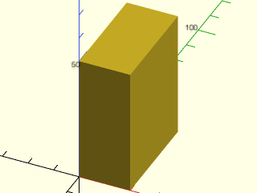

    include <BOSL2/std.scad>
    cube([20,40,50]);

  

**Example 3:** Anchoring.

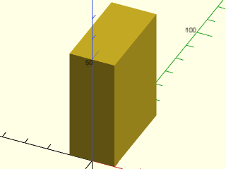

    include <BOSL2/std.scad>
    cube([20,40,50], anchor=BOTTOM+FRONT);

  

**Example 4:** Spin.

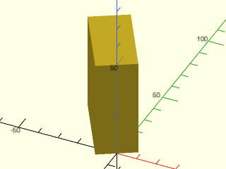

    include <BOSL2/std.scad>
    cube([20,40,50], anchor=BOTTOM+FRONT, spin=30);

  

**Example 5:** Orientation.

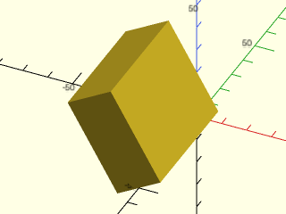

    include <BOSL2/std.scad>
    cube([20,40,50], anchor=BOTTOM+FRONT, spin=30, orient=FWD);

  

**Example 6:** Standard Connectors.

    include <BOSL2/std.scad>
    cube(40, center=true) show_anchors();

  

**Example 7:** Called as Function

    include <BOSL2/std.scad>
    vnf = cube([20,40,50]);
    vnf_polyhedron(vnf);

  

---

### Module: cuboid()

**Synopsis:** Creates a cube with chamfering and roundovers. [<abbr>Geom</abbr>]

**Topics:** [Shapes (3D)](Topics#shapes-3d), [Attachable](Topics#attachable)

**See Also:** [prismoid()](#functionmodule-prismoid), [rounded\_prism()](rounding.scad#functionmodule-rounded_prism)

**Usage:** Standard Cubes

- cuboid(size, [anchor=], [spin=], [orient=]);
- cuboid(size, p1=, ...);
- cuboid(p1=, p2=, ...);

**Usage:** Chamfered Cubes

- cuboid(size, [chamfer=], [edges=], [except=], [trimcorners=], ...);

**Usage:** Rounded Cubes

- cuboid(size, [rounding=], [teardrop=], [edges=], [except=], [trimcorners=], ...);

**Usage:** Attaching children

- cuboid(...) ATTACHMENTS;

**Description:** 

Creates a cube or cuboid object, with optional chamfering or rounding of edges and corners.
You cannot mix chamfering and rounding: just one edge treatment with the same size applies to all selected edges.
Negative chamfers and roundings can be applied to create external fillets, but they
apply only to edges around the top or bottom faces.  If you specify an edge set other than "ALL"
with negative roundings or chamfers then you will get an error.  See [Specifying Edges](attachments.scad#section-specifying-edges)
for information on how to specify edge sets.

**Arguments:** 

<abbr title="These args can be used by position or by name.">By&nbsp;Position</abbr> | What it does
-------------------- | ------------
`size`               | The size of the cube, a number or length 3 vector.

<abbr title="These args must be used by name, ie: name=value">By&nbsp;Name</abbr> | What it does
-------------------- | ------------
`chamfer`            | Size of chamfer, inset from sides.  Default: No chamfering.
`rounding`           | Radius of the edge rounding.  Default: No rounding.
`edges`              | Edges to mask.  See [Specifying Edges](attachments.scad#section-specifying-edges).  Default: all edges.
`except`             | Edges to explicitly NOT mask.  See [Specifying Edges](attachments.scad#section-specifying-edges).  Default: No edges.
`trimcorners`        | If true, rounds or chamfers corners where three chamfered/rounded edges meet.  Default: `true`
`teardrop`           | If given as a number, rounding around the bottom edge of the cuboid won't exceed this many degrees from vertical, altering to a chamfer at that angle.  If true, the limit angle is 45 degrees.  Default: `false`
`clip_angle`         | If given as a number, rounding around the bottom edge of the cuboid won't exceed this many degrees from vertical, with the rounding stopping at the bottom of the cuboid.  Default: (no clipping)
`p1`                 | Align the cuboid's corner at `p1`, if given.  Forces `anchor=FRONT+LEFT+BOTTOM`.
`p2`                 | If given with `p1`, defines the top back right corner point of the cuboid, so `p1` and `p2` together specify the cuboid by its bounds.
`anchor`             | Translate so anchor point is at origin (0,0,0).  See [anchor](attachments.scad#subsection-anchor).  Default: `CENTER`
`spin`               | Rotate this many degrees around the Z axis.  See [spin](attachments.scad#subsection-spin).  Default: `0`
`orient`             | Vector to rotate top toward.  See [orient](attachments.scad#subsection-orient).  Default: `UP`

**Example 1:** Simple regular cube.

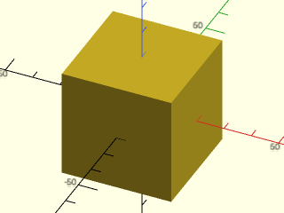

    include <BOSL2/std.scad>
    cuboid(40);

  

**Example 2:** Cuboid with a corner at the origin

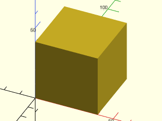

    include <BOSL2/std.scad>
    cuboid(40, anchor=FRONT+LEFT+BOT);

  

**Example 3:** Cuboid anchored on its right face

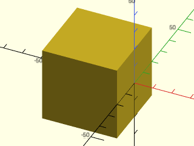

    include <BOSL2/std.scad>
    cuboid(40, anchor=RIGHT);

  

**Example 4:** Cube with minimum cornerpoint given.

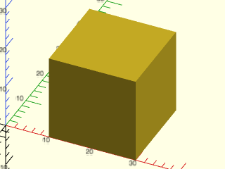

    include <BOSL2/std.scad>
    cuboid(20, p1=[10,0,0]);

  

**Example 5:** Rectangular cube, with given X, Y, and Z sizes.

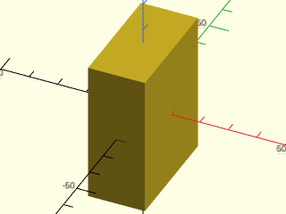

    include <BOSL2/std.scad>
    cuboid([20,40,50]);

  

**Example 6:** Cube by Opposing Corners.

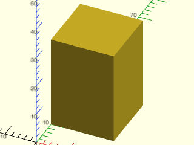

    include <BOSL2/std.scad>
    cuboid(p1=[0,10,0], p2=[20,30,30]);

  

**Example 7:** Chamferred Edges and Corners.

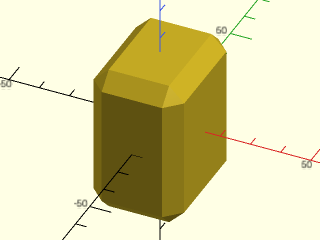

    include <BOSL2/std.scad>
    cuboid([30,40,50], chamfer=5);

  

**Example 8:** Chamferred Edges, Untrimmed Corners.

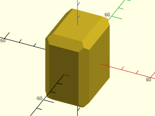

    include <BOSL2/std.scad>
    cuboid([30,40,50], chamfer=5, trimcorners=false);

  

**Example 9:** Rounded Edges and Corners

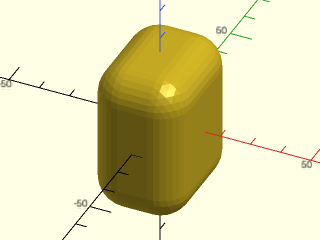

    include <BOSL2/std.scad>
    cuboid([30,40,50], rounding=10);

  

**Example 10:** Rounded Edges and Corners with Teardrop Bottoms

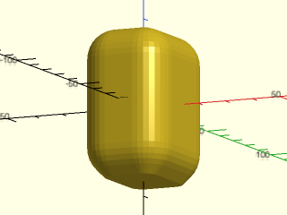

    include <BOSL2/std.scad>
    cuboid([30,40,50], rounding=10, teardrop=true);

  

**Example 11:** Rounded Edges and Corners with Clipped Bottoms

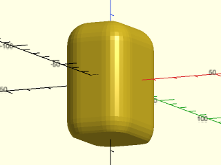

    include <BOSL2/std.scad>
    cuboid([30,40,50], rounding=10, clip_angle=40);

  

**Example 12:** Rounded Edges, Untrimmed Corners

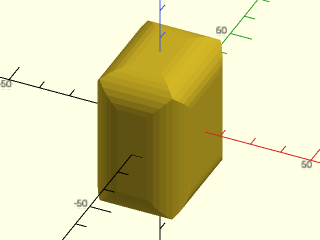

    include <BOSL2/std.scad>
    cuboid([30,40,50], rounding=10, trimcorners=false);

  

**Example 13:** Chamferring Selected Edges

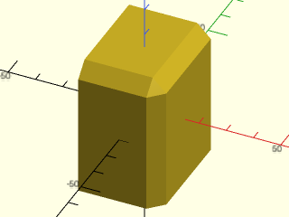

    include <BOSL2/std.scad>
    cuboid(
        [30,40,50], chamfer=5,
        edges=[TOP+FRONT,TOP+RIGHT,FRONT+RIGHT],
        $fn=24
    );

  

**Example 14:** Rounding Selected Edges

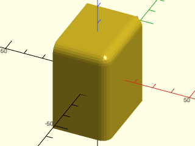

    include <BOSL2/std.scad>
    cuboid(
        [30,40,50], rounding=5,
        edges=[TOP+FRONT,TOP+RIGHT,FRONT+RIGHT],
        $fn=24
    );

  

**Example 15:** Negative Chamferring

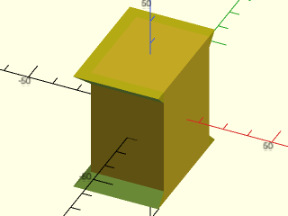

    include <BOSL2/std.scad>
    cuboid(
        [30,40,50], chamfer=-5,
        edges=[TOP,BOT], except=RIGHT,
        $fn=24
    );

  

**Example 16:** Negative Chamferring, Untrimmed Corners

    include <BOSL2/std.scad>
    cuboid(
        [30,40,50], chamfer=-5,
        edges=[TOP,BOT], except=RIGHT,
        trimcorners=false, $fn=24
    );

  

**Example 17:** Negative Rounding

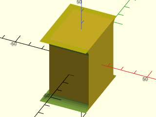

    include <BOSL2/std.scad>
    cuboid(
        [30,40,50], rounding=-5,
        edges=[TOP,BOT], except=RIGHT,
        $fn=24
    );

  

**Example 18:** Negative Rounding, Untrimmed Corners

    include <BOSL2/std.scad>
    cuboid(
        [30,40,50], rounding=-5,
        edges=[TOP,BOT], except=RIGHT,
        trimcorners=false, $fn=24
    );

  

**Example 19:** Roundings and Chamfers can be as large as the full size of the cuboid, so long as the edges would not interfere.

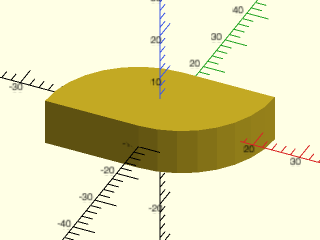

    include <BOSL2/std.scad>
    cuboid([40,20,10], rounding=20, edges=[FWD+RIGHT,BACK+LEFT]);

  

**Example 20:** Standard anchors

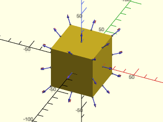

    include <BOSL2/std.scad>
    cuboid(40) show_anchors();

  

---

### Function/Module: prismoid()

**Synopsis:** Creates a rectangular prismoid shape with optional roundovers and chamfering. [<abbr>Geom</abbr>] [<abbr>VNF</abbr>]

**Topics:** [Shapes (3D)](Topics#shapes-3d), [Attachable](Topics#attachable), [VNF Generators](Topics#vnf-generators)

**See Also:** [cuboid()](#module-cuboid), [rounded\_prism()](rounding.scad#functionmodule-rounded_prism), [trapezoid()](shapes2d.scad#functionmodule-trapezoid), [edge\_profile()](masks.scad#module-edge_profile)

**Usage:** 

- prismoid(size1, size2, [h|l|height|length], [shift], [xang=], [yang=], ...) [ATTACHMENTS];

**Usage:** Chamfered and/or Rounded Prismoids

- prismoid(size1, size2, h|l|height|length, [chamfer=], [rounding=]...) [ATTACHMENTS];
- prismoid(size1, size2, h|l|height|length, [chamfer1=], [chamfer2=], [rounding1=], [rounding2=], ...) [ATTACHMENTS];

**Usage:** As Function

- vnf = prismoid(...);

**Description:** 

Creates a rectangular prismoid shape with optional roundovers and chamfering.
You can only round or chamfer the vertical(ish) edges.  For those edges, you can
specify rounding and/or chamferring per-edge, and for top and bottom separately.
If you want to round the bottom or top edges see [`rounded_prism()`](rounding.scad#functionmodule-rounded_prism) or [`edge_profile()`](masks.scad#module-edge_profile)

Specification of the prismoid is similar to specification for [`trapezoid()`](shapes2d.scad#functionmodule-trapezoid).  You can specify the dimensions of the
bottom and top and its height to get a symmetric prismoid.  You can use the shift argument to shift the top face around.
You can also specify base angles either in the X direction, Y direction or both.  In order to avoid overspecification,
you may need to specify a parameter such as size2 as a list of two values, one of which is undef.  For example,
specifying `size2=[100,undef]` sets the size in the X direction but allows the size in the Y direction to be computed based on yang.

The anchors on the top and bottom faces have spin pointing back.  The anchors on the side faces have spin point UP.
The anchors on the top and bottom edges also have anchors that point clockwise as viewed from outside the shapep.
The anchors on the side edges and the corners have spin with positive Z component, pointing along the edge where the anchor is located.
A degenerate prismoid with a line segment for the top or bottom has its top or bottom edge anchors set to provide an anchor for that top
or bottom edge.  So for example, if the top is `[0,10]` then the top edge is parallel to the Y axis and you can anchor to that
edge using the `TOP+RIGHT` or `TOP+LEFT` anchors; these anchors point in the direction that divides the edge in half and provide
the `$edge_angle` and `$edge_length` values generally provided by edge anchors.  The UP or DOWN anchor is in the same location but always points
in the Z direction and provides no edge data.

**Arguments:** 

<abbr title="These args can be used by position or by name.">By&nbsp;Position</abbr> | What it does
-------------------- | ------------
`size1`              | [width, length] of the bottom end of the prism.
`size2`              | [width, length] of the top end of the prism.
`h`                  / `l`                  / `height`             / `length`             | Height of the prism.
`shift`              | [X,Y] amount to shift the center of the top end with respect to the center of the bottom end.

<abbr title="These args must be used by name, ie: name=value">By&nbsp;Name</abbr> | What it does
-------------------- | ------------
`xang`               | base angle in the X direction.  Can be a scalar or list of two values, one of which may be undef
`yang`               | base angle in the Y direction.  Can be a scalar or list of two values, one of which may be undef
`rounding`           | The roundover radius for the vertical-ish edges of the prismoid.  If given as a list of four numbers, gives individual radii for each corner, in the order [X+Y+,X-Y+,X-Y-,X+Y-]. Default: 0 (no rounding)
`rounding1`          | The roundover radius for the bottom of the vertical-ish edges of the prismoid.  If given as a list of four numbers, gives individual radii for each corner, in the order [X+Y+,X-Y+,X-Y-,X+Y-].
`rounding2`          | The roundover radius for the top of the vertical-ish edges of the prismoid.  If given as a list of four numbers, gives individual radii for each corner, in the order [X+Y+,X-Y+,X-Y-,X+Y-].
`chamfer`            | The chamfer size for the vertical-ish edges of the prismoid.  If given as a list of four numbers, gives individual chamfers for each corner, in the order [X+Y+,X-Y+,X-Y-,X+Y-].  Default: 0 (no chamfer)
`chamfer1`           | The chamfer size for the bottom of the vertical-ish edges of the prismoid.  If given as a list of four numbers, gives individual chamfers for each corner, in the order [X+Y+,X-Y+,X-Y-,X+Y-].
`chamfer2`           | The chamfer size for the top of the vertical-ish edges of the prismoid.  If given as a list of four numbers, gives individual chamfers for each corner, in the order [X+Y+,X-Y+,X-Y-,X+Y-].
`anchor`             | Translate so anchor point is at origin (0,0,0).  See [anchor](attachments.scad#subsection-anchor).  Default: `BOTTOM`
`spin`               | Rotate this many degrees around the Z axis after anchor.  See [spin](attachments.scad#subsection-spin).  Default: `0`
`orient`             | Vector to rotate top toward, after spin.  See [orient](attachments.scad#subsection-orient).  Default: `UP`

**Example 1:** Truncated Pyramid

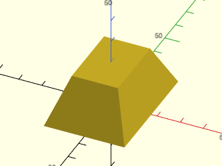

    include <BOSL2/std.scad>
    prismoid(size1=[35,50], size2=[20,30], h=20);

  

**Example 2:** Rectangular Pyramid

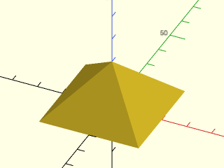

    include <BOSL2/std.scad>
    prismoid([40,40], [0,0], h=20);

  

**Example 3:** Prism

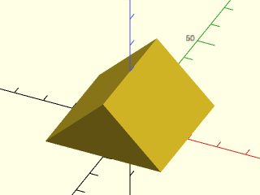

    include <BOSL2/std.scad>
    prismoid(size1=[40,40], size2=[0,40], h=20);

  

**Example 4:** Wedge

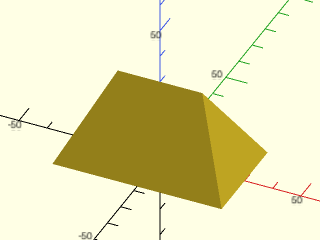

    include <BOSL2/std.scad>
    prismoid(size1=[60,35], size2=[30,0], h=30);

  

**Example 5:** Truncated Tetrahedron

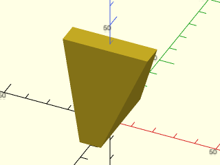

    include <BOSL2/std.scad>
    prismoid(size1=[10,40], size2=[40,10], h=40);

  

**Example 6:** Inverted Truncated Pyramid

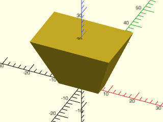

    include <BOSL2/std.scad>
    prismoid(size1=[15,5], size2=[30,20], h=20);

  

**Example 7:** Right Prism

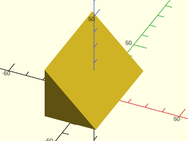

    include <BOSL2/std.scad>
    prismoid(size1=[30,60], size2=[0,60], shift=[-15,0], h=30);

  

**Example 8:** Shifting/Skewing

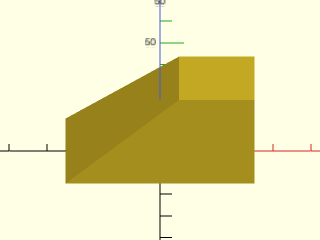

    include <BOSL2/std.scad>
    prismoid(size1=[50,30], size2=[20,20], h=20, shift=[15,5]);

  

**Example 9:** Specifying bottom, height and angle

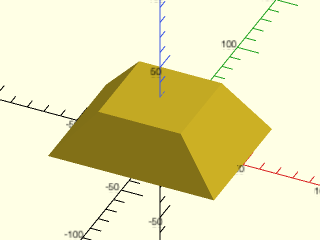

    include <BOSL2/std.scad>
    prismoid(size1=[100,75], h=30, xang=50, yang=70);

  

**Example 10:** Specifying top, height and angle, with asymmetric angles

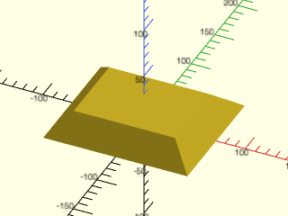

    include <BOSL2/std.scad>
    prismoid(size2=[100,75], h=30, xang=[50,60], yang=[70,40]);

  

**Example 11:** Specifying top, bottom and angle for X and using that to define height. Giving yang here would likely give a conflicting height calculation, which is not allowed.

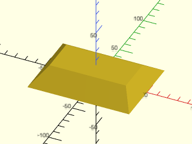

    include <BOSL2/std.scad>
    prismoid(size1=[100,75], size2=[75,35], xang=50);

  

**Example 12:** The same as the previous example but we give a shift in Y.  Note that shift.x must be undef because you cannot give combine an angle with a shift, so a shift.x value would conflict with xang being defined.

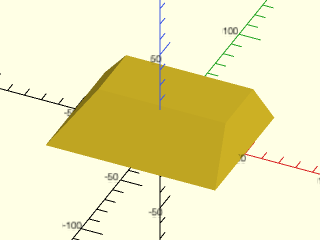

 

    include <BOSL2/std.scad>
    prismoid(size1=[100,75], size2=[75,35], xang=50, shift=[undef,20]);

**Example 13:** The X dimensions defined by the base length, angle and height; the Y dimensions defined by the top length, angle, and height.

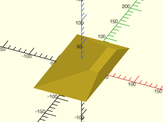

 

    include <BOSL2/std.scad>
    prismoid(size1=[100,undef], size2=[undef,75], h=30, xang=[20,90], yang=30);

**Example 14:** Rounding

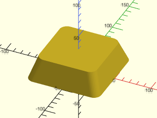

    include <BOSL2/std.scad>
    prismoid(100, 80, rounding=10, h=30);

  

**Example 15:** Chamfers

    include <BOSL2/std.scad>
    prismoid(100, 80, chamfer=5, h=30);

  

**Example 16:** Gradiant Rounding

    include <BOSL2/std.scad>
    prismoid(100, 80, rounding1=10, rounding2=0, h=30);

  

**Example 17:** Per Corner Rounding

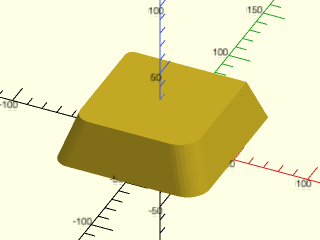

    include <BOSL2/std.scad>
    prismoid(100, 80, rounding=[0,5,10,15], h=30);

  

**Example 18:** Per Corner Chamfer

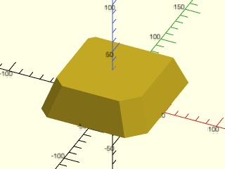

    include <BOSL2/std.scad>
    prismoid(100, 80, chamfer=[0,5,10,15], h=30);

  

**Example 19:** Mixing Chamfer and Rounding

    include <BOSL2/std.scad>
    prismoid(
        100, 80, h=30,
        chamfer=[0,5,0,10],
        rounding=[5,0,10,0]
    );

  

**Example 20:** Really Mixing It Up

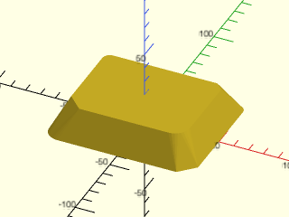

    include <BOSL2/std.scad>
    prismoid(
        size1=[100,80], size2=[80,60], h=20,
        chamfer1=[0,5,0,10], chamfer2=[5,0,10,0],
        rounding1=[5,0,10,0], rounding2=[0,5,0,10]
    );

  

**Example 21:** How to Round a Top or Bottom Edge

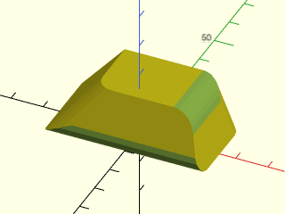

 

    include <BOSL2/std.scad>
    diff()
    prismoid([50,30], [30,20], shift=[3,6], h=15, rounding=[5,0,5,0]) {
        edge_profile([TOP+RIGHT, BOT+FRONT], excess=10, convexity=20) {
            mask2d_roundover(h=5,mask_angle=$edge_angle);
        }
    }

**Example 22:** Standard anchors

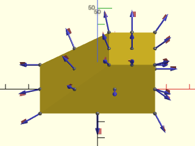

    include <BOSL2/std.scad>
    prismoid(size1=[50,30], size2=[20,20], h=20, shift=[15,5])
        show_anchors();

  

**Example 23:** When the top or bottom is degenerate, you can anchor to and round the degenerate edge by using either one of the edge anchors that correspond to that edge.  But note that [`edge_profile()`](masks.scad#module-edge\_profile) does not work for this degenerate case.  We used `TOP+RIGHT` below as the anchor point, but `TOP+LEFT` produces an identical result.

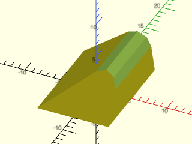

    include <BOSL2/std.scad>
    diff()
    prismoid([10,14],[0,8], shift=[4,3], h=7)
      attach(TOP+RIGHT, FWD+LEFT, inside=true)
        rounding_edge_mask(r=2,l=$edge_length+6);

  

---

### Function/Module: regular\_prism()

**Synopsis:** Creates a regular prism with roundovers and chamfering [<abbr>Geom</abbr>] [<abbr>VNF</abbr>]

**Topics:** [Textures](Topics#textures), [Rounding](Topics#rounding), [Chamfers](Topics#chamfers), [Shapes (3D)](Topics#shapes-3d), [Attachable](Topics#attachable)

**See Also:** [cyl()](#functionmodule-cyl), [rounded\_prism()](rounding.scad#functionmodule-rounded_prism), [texture()](skin.scad#function-texture), [linear\_sweep()](skin.scad#functionmodule-linear_sweep), [EDGE()](constants.scad#function-edge), [FACE()](constants.scad#function-face)

**Usage:** Normal prisms

- regular_prism(n, h|l=|height=|length=, r, [center=|anchor=], [realign=]) [ATTACHMENTS];
- regular_prism(n, h|l=|height=|length=, d=|id=|od=|ir=|or=|side=, ...) [ATTACHMENTS];
- regular_prism(n, h|l=|height=|length=, r1=|d1=|id1=|od1=|ir1=|or1=|side1=,r2=|d2=|id2=|od2=|ir2=|or2=|side2=, ...) [ATTACHMENTS];

**Usage:** Chamferred end prisms

- regular_prism(n, h, r, chamfer=, [chamfang=], [from_end=], ...);
- regular_prism(n, h, r, chamfer1=, [chamfang1=], [from_end=], ...);
- regular_prism(n, h, r, chamfer2=, [chamfang2=], [from_end=], ...);
- regular_prism(n, h, r, chamfer1=, chamfer2=, [chamfang1=], [chamfang2=], [from_end=], ...);

**Usage:** Rounded end prisms

- regular_prism(n, h, r, rounding=, ...);
- regular_prism(n, h, r, rounding1=, ...);
- regular_prism(n, h, r, rounding2=, ...);
- regular_prism(n, h, r, rounding1=, rounding2=, ...);

**Usage:** Textured prisms

- regular_prism(n, h, r, texture=, [tex_size=]|[tex_reps=], [tex_depth=], [tex_rot=], [tex_samples=], [style=], [tex_inset=], ...);

**Usage:** Called as a function to get a VNF

- vnf = rounded_prism(...);

**Description:** 

Creates a prism whose ends are similar `n`-sided regular polygons, with optional rounding, chamfers or textures.
You can specify the size of the ends using diameter or radius measured either inside or outside.  Alternatively
you can give the length of the side of the polygon.  You can specify chamfers and roundings for the ends, but not
the vertical edges.  See [`rounded_prism()`](rounding.scad#functionmodule-rounded_prism) for prisms with rounded vertical edges.  You can also specify texture for the side
faces, but note that texture is not compatible with any roundings or chamfers.
See [Texturing](skin.scad#section-texturing) for more details on how textures work.

Anchors are based on the VNF of the prism.  Especially for tapered or shifted prisms, this may give unexpected anchor positions, such as top side anchors
being located at the bottom of the shape, so confirm anchor positions before use.
Additional named face and edge anchors are located on the side faces and edges of the prism.
You can use `EDGE(i)`, `EDGE(TOP,i)` and `EDGE(BOT,i)` as a shorthand for accessing the named edge anchors, and `FACE(i)` for the face anchors.
The "edge0" anchor identifies an edge located along the X+ axis, and then edges
are labeled counting up in the clockwise direction.  Similarly "face0" is the face immediately clockwise from "edge0", and face
labeling proceeds clockwise.  The top and bottom edge anchors label edges directly above and below the face with the same label.
If you set `realign=true` then "face0" has its normal pointing in the X+ direction.

This module is similar to [`cyl()`](#functionmodule-cyl).  It differs in the following ways:  you can specify side length or inner radius/diameter, you can apply roundings with
different `$fn` than the number of prism faces, you can apply texture to the flat faces without forcing a high facet count,
anchors are located on the true object instead of the ideal cylinder and you can anchor to the edges and faces.  Chamfers and roundings
for this module are **always** evaluated relative to the faces of the prism and never at corners as is done by default in [`cyl()`](#functionmodule-cyl).

Fully specifying the shape requires a height and the radius at each end.  You can replace one of those three parameters with
an angle.  If you give the height, angle, and one radius then the other radius is calculated so that the internal angle at the base of
the prism is the specified angle.  If you give the angle and the radius at each end then the height is calculated so that the internal
angle at one of the ends is the angle you specified. Which end gets the specified angle depends on the relative sizes of the ends
and whether the angle is smaller or larger than 90 degrees.

**Named Anchors:** 

Anchor Name | Position
----------- | --------
"edge0", "edge1", etc. | Center of each side edge, spin pointing up along the edge.  Can access with EDGE(i)
"face0", "face1", etc. | Center of each side face, spin pointing up.  Can access with FACE(i)
"top_edge0", "top_edge1", etc | Center of each top edge, spin pointing clockwise (from top). Can access with EDGE(TOP,i)
"bot_edge0", "bot_edge1", etc | Center of each bottom edge, spin pointing clockwise (from bottom).  Can access with EDGE(BOT,i)
"top_corner0", "top_corner1", etc | Top corner, pointing in direction of associated edge anchor, spin up along associated edge
"bot_corner0", "bot_corner1", etc | Bottom corner, pointing in direction of associated edge anchor, spin up along associated edge

**Arguments:** 

<abbr title="These args can be used by position or by name.">By&nbsp;Position</abbr> | What it does
-------------------- | ------------
`l`                  / `h`                  / `length`             / `height`             | Length of prism
`r`                  | Outer radius of prism.
`center`             | A true value sets `anchor=CENTER`, false sets `anchor=DOWN`.  Default is `anchor=CENTER`.

<abbr title="These args must be used by name, ie: name=value">By&nbsp;Name</abbr> | What it does
-------------------- | ------------
`r1`                 / `or1`                | Outer radius of the bottom of prism
`r2`                 / `or2`                | Outer radius of the top end of prism
`d`                  | Outer Diameter of prism
`d1`                 / `od1`                | Outer diameter of bottom of prism
`d2`                 / `od2`                | Outer diameter of top end of prism
`ir`                 | Inner radius of prism
`ir1`                | Inner radius of bottom of prism
`ir2`                | Inner radius of top of prism
`id`                 | Inner diameter of prism
`id1`                | Inner diameter of bottom of prism
`id2`                | Inner diameter of top of prism
`side`               | Side length of prism faces
`side1`              | Side length of prism faces at the bottom
`side2`              | Side length of prism faces at the top
`ang`                | specify the prism angle instead of height or instead of the dimension at one of the two ends.
`shift`              | [X,Y] amount to shift the center of the top end with respect to the center of the bottom end.
`chamfer`            | The size of the chamfers on the ends of the prism.  (Also see: `from_end=`)  Default: none.
`chamfer1`           | The size of the chamfer on the bottom end of the prism.  (Also see: `from_end1=`)  Default: none.
`chamfer2`           | The size of the chamfer on the top end of the prism.  (Also see: `from_end2=`)  Default: none.
`chamfang`           | The angle in degrees of the chamfers away from the ends of the prismr.  Default: Chamfer angle is halfway between the endcap and side face.
`chamfang1`          | The angle in degrees of the bottom chamfer away from the bottom end of the prism.  Default: Chamfer angle is halfway between the endcap and side face.
`chamfang2`          | The angle in degrees of the top chamfer away from the top end of the prism.  Default: Chamfer angle is halfway between the endcap and side face.
`from_end`           | If true, chamfer is measured along the side face from the ends of the prism, instead of inset from the edge.  Default: `false`.
`from_end1`          | If true, chamfer on the bottom end of the prism is measured along the side face from the end of the prism, instead of inset from the edge.  Default: `false`.
`from_end2`          | If true, chamfer on the top end of the prism is measured along the side face from the end of the prism, instead of inset from the edge.  Default: `false`.
`rounding`           | The radius of the rounding on the ends of the prism.  Default: none.
`rounding1`          | The radius of the rounding on the bottom end of the prism.
`rounding2`          | The radius of the rounding on the top end of the prism.
`realign`            | If true, rotate the prism by half the angle of one face so that face0's normal points in the X+ direction.  Default: false
`teardrop`           | If given as a number, rounding around the bottom edge of the prism won't exceed this many degrees from vertical.  If true, the limit angle is 45 degrees.  Default: `false`
`clip_angle`         | Clip the rounding arc at the bottom of the prism at this angle away from vertical, with a corner at the base of the cylinder and a smooth joint at the side.  An angle of 90 gives a complete circle and an angle of zero clips away the entire rounding.  Default: 90 (no clipping)
`texture`            | A texture name string, or a rectangular array of scalar height values (0.0 to 1.0), or a VNF tile that defines the texture to apply to vertical surfaces.  See [`texture()`](skin.scad#function-texture) for what named textures are supported.
`tex_size`           | An optional 2D target size (2-vector or scalar) for the textures.  Actual texture sizes are scaled somewhat to fit evenly on the available surface. Default: `[5,5]`
`tex_reps`           | If given instead of tex_size, a scalar or 2-vector giving the number of texture tile repetitions in the horizontal and vertical directions.
`tex_inset`          | If numeric, lowers the texture into the surface by the specified proportion, e.g. 0.5 would lower it half way into the surface.  If `true`, insets by exactly its full depth.  Default: `false`
`tex_rot`            | Rotate texture by specified angle, which must be a multiple of 90 degrees.  Default: 0
`tex_depth`          | Specify texture depth; if negative, invert the texture.  Default: 1.
`tex_samples`        | Minimum number of "bend points" to have in VNF texture tiles.  Default: 8
`style`              | [`vnf_vertex_array()`](vnf.scad#functionmodule-vnf_vertex_array) style used to triangulate heightfield textures.  Default: "min_edge"
`anchor`             | Translate so anchor point is at origin (0,0,0).  See [anchor](attachments.scad#subsection-anchor).  Default: `CENTER`
`spin`               | Rotate this many degrees around the Z axis after anchor.  See [spin](attachments.scad#subsection-spin).  Default: `0`
`orient`             | Vector to rotate top toward, after spin.  See [orient](attachments.scad#subsection-orient).  Default: `UP`

**Example 1:** Simple prism

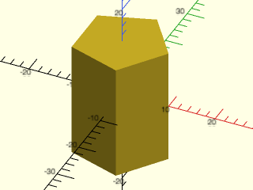

    include <BOSL2/std.scad>
    regular_prism(5,r=10,h=25);

  

**Example 2:** With end rounding

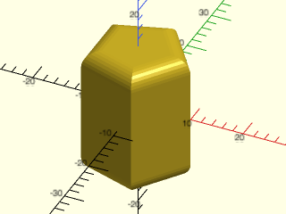

    include <BOSL2/std.scad>
    regular_prism(5,r=10,h=25,rounding=3,$fn=32);

  

**Example 3:** With teardrop end rounding

    include <BOSL2/std.scad>
    regular_prism(5,r=10,h=25,rounding=3,teardrop=40,$fn=32);

  

**Example 4:** With clipped end rounding

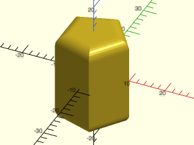

    include <BOSL2/std.scad>
    regular_prism(5,r=10,h=25,rounding=3,clip_angle=40,$fn=32);

  

**Example 5:** By side length at bottom, inner radius at top, shallow chamfer

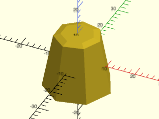

 

    include <BOSL2/std.scad>
    regular_prism(7, side1=10, ir2=7, height=20,chamfer2=2,chamfang2=20);

**Example 6:** By angle and base radius

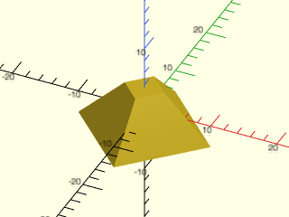

    include <BOSL2/std.scad>
    regular_prism(4, r1=10, height=7, ang=45);

  

**Example 7:** By angle and top radius

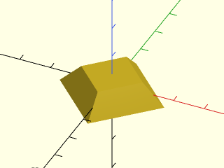

    include <BOSL2/std.scad>
    regular_prism(4, r2=10, height=7, ang=45);

  

**Example 8:** By angle with height omitted; the specified 70 deg agle appears at the bottom in this case

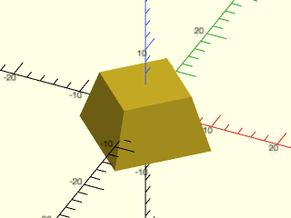

    include <BOSL2/std.scad>
    regular_prism(4, r1=10, r2=7, ang=70);

  

**Example 9:** By angle with height omitted; we interchanged r1 and r2 and now the specified 70 deg angle is at the top

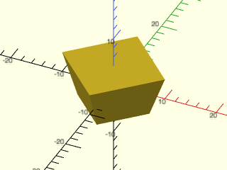

    include <BOSL2/std.scad>
    regular_prism(4, r1=7, r2=10, ang=70);

  

**Example 10:** With shift

    include <BOSL2/std.scad>
    regular_prism(4, d=12, h=10, shift=[12,7]);

  

**Example 11:** Attaching child to face

    include <BOSL2/std.scad>
    regular_prism(5, d1=15, d2=10, h=20)
      recolor("lightblue")
        attach("face1",BOT) regular_prism(n=4,r1=3,r2=1,h=3);

  

**Example 12:** Attaching child to edge

    include <BOSL2/std.scad>
    regular_prism(5, d1=15, d2=10, h=20)
      recolor("lightblue")
        attach("edge2",RIGHT) cuboid([4,4,20]);

  

**Example 13:** Placing child on top along an edge of a regular prism is possible with the top\_edge anchors, but you cannot use [`align()`](attachments.scad#module-align) or [`attach()`](attachments.scad#module-attach), so you must manually anchor and spin the child by half of the polygon angle (180/n) to get to face0 and then 360/n more for each subsequent face.  If you set `realign=true` then you don't need the initial angle for face0.

 

    include <BOSL2/std.scad>
    regular_prism(5, d1=25, d2=20, h=15, realign=false) color("lightblue"){
       position("top_edge1") prismoid([5,5],[2,2],h=3,spin=-360/5*1.5,anchor=RIGHT+BOT);
       position("top_edge3") prismoid([5,5],[2,2],h=3,spin=-360/5*3.5,anchor=RIGHT+BOT);
    }

**Example 14:** Textured prism

 

    include <BOSL2/std.scad>
    regular_prism(5, side=25, h=50, texture="diamonds", tex_size=[5,5], style="concave");

---

### Function/Module: textured\_tile()

**Synopsis:** Creates a cube or trapezoidal prism with a textured top face for attaching to objects. [<abbr>Geom</abbr>] [<abbr>VNF</abbr>]

**Topics:** [Shapes (3D)](Topics#shapes-3d), [Attachable](Topics#attachable), [VNF Generators](Topics#vnf-generators), [Textures](Topics#textures)

**See Also:** [cuboid()](#module-cuboid), [prismoid()](#functionmodule-prismoid), [texture()](skin.scad#function-texture), [cyl()](#functionmodule-cyl), [rotate\_sweep()](skin.scad#functionmodule-rotate_sweep), [linear\_sweep()](skin.scad#functionmodule-linear_sweep), [plot3d()](#functionmodule-plot3d)

**Usage:** 

- textured_tile(texture, [size], [w1=], [w2=], [ang=], [shift=], [h=/height=/thickness=], [atype=], [diff=], [tex_extra=], [tex_skip=], ...) [ATTACHMENTS];
- vnf = textured_tile(texture, [size], [w1=], [w2=], [ang=], [shift=], [h=/height=/thickness=], [atype=], [tex_extra=], [tex_skip=], ...);

**Description:** 

Creates a cuboid or trapezoidal prism and places a texture on the top face.
See [Texturing](skin.scad#section-texturing) for more details on how textures work.
You can specify the size of the object by giving a `size` scalar or vector as is
usual for a cube.  If you give a scalar, however, it applies only to the X and Y dimensions: the default is to create a thin tile, not a cube.
The Z size specifies the size of the shape **not** including the applied texture (in the same way that other textured objects work).
If you omit the Z value then for regular textures, the default thickness is 0.1, which provides a thin backing layer.  A zero thickness
base layer can produce invalid geometry when the texture contacts the bottom layer, so some non-zero base is necessary.  If you use a positive `inset`
then the texture actually sinks into its base, so the default is set to the 0.1 more than the inset depth.  To ensure a valid geometry, with a positive
`inset` or a texture that has negative values you must select a thickness strictly **larger** than the depth the texture extends below zero.

Textures are meant to be between 0 and 1 so that `tex_depth` and `tex_inset` behave as expected.  If you have a custom textures that
has a different range you can still use it directly, but you may find it more convenient to rescale a height map texture using [`fit_to_range()`](math.scad#function-fit_to_range)
or a VNF texture using [`fit_to_box()`](vectors.scad#function-fit_to_box).

You can also specify a trapzoidal prism using parameters equivalent to those accepted by [`trapezoid()`](shapes2d.scad#functionmodule-trapezoid), with one change:
`ysize` specifies the width of the prism in the Y direction, and `h`, `height` or `thickness` are used to specify the height
in the Z direction.  When you texture a trapezoid, the texture is scaled to the `w1` length if you specify it by size using `tex_size`.  The
scaling transformation that maps the texture onto the trapezoid is not linear and results in curvature of your texture.

Two anchor types are available.  The default `atype` is "tex", which assumes you want to place the texture on another object using
[`attach()`](attachments.scad#module-attach).  It provides anchors that ignore the base object and place the BOTTOM anchor at the bottom of the texture.  The TOP anchor
is at the top face of the texture.  Note that if your texture doesn't span the range from [0,1] these anchors won't be correctly located.
For an inset texture, the "tex" anchors are all at the top of the texture.  This anchor type works with `attach(face,BOT)` where `face` is some
face on a parent object that needs a texture. If you want to use the textured object directly the "std" anchors are probably more useful.
These anchors are the usual anchors for the base object, ignoring the applied texture.  If you want the anchors to be on top of the texture,
set `tex_inset=true`.

To aid in the application of inset anchors into parent objects with the module form, you can set `diff=true`, which causes the module
to create a "remove" tagged cuboid or prism to carve out space for the texture so that inset textures are cut into the parent object.
The texture itself is given a "keep" tag.  For this to work you must specify [`diff()`](attachments.scad#module-diff) above the parent; if you don't do that, the
tags are ignored and the tile appears as a solid object with no texture visible.  The cutout object extends 0.1 units above the surface
of the texture to prevent problems with exactly aligned faces.  The cutout does not extend out beyond the sides, so if the parent shape
has the exact same dimensions as the texture tile, you have exactly aligned faces along the edges.

Most of the heightfield textures are designed to repeat in a way that requires one extra line of the texture to complete the pattern.
The `tex_extra` parameter specifies the number of extra lines to repeat at the end of the texture and it defaults to 1 because most textures
do requires this extra line.  There is one exception: if you specify only a single tile, then you are probably using an image for your texture and do not want a repeated line, so in
this case, `tex_extra` defaults to zero.  If you need to adjust the number of extra lines you can set the `tex_extra` parameter to 0, or you can set it to a list of two
integers to control the extra line of texture in the X and Y directions independently.  The `tex_extra` parameter
is ignored for VNF textures.  A heightfield texture may also have extra margin along a starting side that makes the texture unbalanced.  You can
removed this using the `tex_skip` parameter, which defaults to zero and similarly specifies the number of lines to skip in the X and Y directions at
the starting edges of the tile.  You must have enough tile repetitions to accomodate the specified skip.

**Anchor Types:** 

Anchor Type | What it is
----------- | ----------
"tex" | Anchors around the texture, ignoring the base object.  (default)
"std" | Standard object anchors that ignore any applied texture.

**Arguments:** 

<abbr title="These args can be used by position or by name.">By&nbsp;Position</abbr> | What it does
-------------------- | ------------
`texture`            | A texture name string, or a rectangular array of scalar height values (0.0 to 1.0), or a VNF tile that defines the texture to apply to vertical surfaces.  See [`texture()`](skin.scad#function-texture) for what named textures are supported.
`size`               | The size the object when a cube is desired, a scalar, 2-vector or 3-vector.  If you give a scalar or 2-vector the default height is 0.1 or 0.1 more than the inset depth

<abbr title="These args must be used by name, ie: name=value">By&nbsp;Name</abbr> | What it does
-------------------- | ------------
`ysize`              | The Y axis length of the trapezoidal prism
`w1`                 | The X axis width of the front end of the trapezoidal prism.
`w2`                 | The X axis width of the back end of the trapezoidal prism
`ang`                | Specify the front angle(s) of the trapezoidal prism.  Can give a scalar for an isosceles trapezoidal prism or a list of two angles, the left angle and right angle.  You must omit one of `h`, `w1`, or `w2` to allow the freedom to control the angles.
`shift`              | Scalar value to shift the back of the trapezoidal prism along the X axis by.  Cannot be combined with ang.  Default: 0
`h`                  / `height`             / `thickness`          | The thickness in the Z direction of the base that the texture sits on.  Default: 0.1 or for inset textures 0.1 more than the inset depth
`tex_size`           | An optional 2D target size (2-vector or scalar) for the textures.  Actual texture sizes are scaled somewhat to fit evenly on the available surface. Default: `[5,5]`
`tex_reps`           | If given instead of tex_size, a scalar or 2-vector giving the integer number of texture tile repetitions in the horizontal and vertical directions.
`tex_inset`          | If numeric, lowers the texture into the surface by the specified proportion, e.g. 0.5 would lower it half way into the surface.  If `true`, insets by exactly its full depth.  Default: `false`
`tex_rot`            | Rotate texture by specified angle, which must be a multiple of 90 degrees.  Default: 0
`tex_depth`          | Specify texture depth; if negative, invert the texture.  Default: 1.
`diff`               | if set to true then "remove" and "keep" tags are set to cut out a space for the texture so that inset textures can be attached.  Default: false
`tex_extra`          | number of extra lines of a hightfield texture to add at the end.  Can be a scalar or 2-vector to give x and y values.  Default: 0 if `tex_reps=[1,1]`, 1 otherwise
`tex_skip`           | number of lines of a heightfield texture to skip when starting.  Can be a scalar or two vector to give x and y values.  Default: 0
`style`              | [`vnf_vertex_array()`](vnf.scad#functionmodule-vnf_vertex_array) style used to triangulate heightfield textures.  Default: "min_edge"
`anchor`             | Translate so anchor point is at origin (0,0,0).  See [anchor](attachments.scad#subsection-anchor).  Default: `BOTTOM` if `astyle` is "tex", `CENTER` otherwise
`spin`               | Rotate this many degrees around the Z axis after anchor.  See [spin](attachments.scad#subsection-spin).  Default: `0`
`orient`             | Vector to rotate top toward, after spin.  See [orient](attachments.scad#subsection-orient).  Default: `UP`

**Example 1:** Basic textured tile

    include <BOSL2/std.scad>
    textured_tile("trunc_diamonds", 10, tex_reps=[5,5]);

  

**Example 2:** Attaching a tile to a cube

    include <BOSL2/std.scad>
    cuboid([12,12,4]) attach(TOP,BOT)
      textured_tile("trunc_pyramids", 10, tex_reps=[5,5],
                    style="convex");

  

**Example 3:** This inset texture doesn't look obviously different, but you can see that the object is below the XY plane.

    include <BOSL2/std.scad>
    textured_tile("trunc_pyramids_vnf", 10, tex_reps=[5,5],
                  tex_inset=true);

  

**Example 4:** Here we use the `diff` option combined with [`diff()`](attachments.scad#module-diff) to attach the inset texture to the front of a parent cuboid.

    include <BOSL2/std.scad>
    diff()
      cuboid([12,5,10]) attach(FRONT, BOT)
        textured_tile("trunc_pyramids_vnf", [10,8],
                      tex_reps=[5,5], tex_inset=true, diff=true);

  

**Example 5:** Tile shaped like a rhombic prism

    include <BOSL2/std.scad>
    textured_tile("ribs", w1=10, w2=10, shift=4, ysize=7,
                  tex_reps=[5,1]);

  

**Example 6:** A tile shaped like a trapezoidal prism.  Note that trapezoidal tiles always distort the texture, resulting in curves

    include <BOSL2/std.scad>
    textured_tile("diamonds", w1=10, w2=7, ysize=7, tex_reps=5);

  

**Example 7:** An inset trapezoidal tile placed into a cube

    include <BOSL2/std.scad>
    diff()cuboid([10,10,2])
      attach(TOP,BOT)
        textured_tile("trunc_diamonds", tex_reps=[5,5],
                      tex_inset=true, diff=true,
                      w1=8, w2=4, ysize=8);

  

**Example 8:** This example shows what happens if you set `tex_extra` to zero for the "pyramids" texture.  Note that the texture doesn't finish.  The default of `tex_extra=1` produces the correct result.

    include <BOSL2/std.scad>
    textured_tile("pyramids", 10, tex_reps=[5,5], tex_extra=0);

  

**Example 9:** This texture has an asymmetry with the default `tex_extra=1`.

    include <BOSL2/std.scad>
    textured_tile("trunc_ribs", 10, tex_reps=[5,1]);

  

**Example 10:** It could be fixed by setting `tex_extra=2`, which would place an extra flat strip on the right.  But another option is to use the `tex_skip` parameter to trim the flat part from the left.  Note that we are also skipping in the y direction, but it doesn't make a difference for this texture, except that you need to have enough texture tiles to accommodate the skip, so we increased the Y reps value to 2.  You can also set `tex_skip` to a vector.

    include <BOSL2/std.scad>
    textured_tile("trunc_ribs", 10, tex_reps=[5,2], tex_skip=1);

  

**Example 11:** Textures can be used to place images onto objects.  Here we place a simple image into a cube, leaving a border around the image.

    include <BOSL2/std.scad>
    textured_tile("trunc_ribs", 10, tex_reps=[5,2], tex_skip=1);
     img = [
        [0, 0, 0, 0, 0, 0, 0, 0, 0, 0, 0, 0],
        [0, 1, 1, 1, 1, 1, 1, 1, 1, 1, 1, 0],
        [0, 1, 0, 0, 0, 0, 0, 0, 0, 0, 1, 0],
        [0, 1, 0, 0, 0, 0, 0, 0, 0, 0, 1, 0],
        [0, 1, 0, 0, 0, 0, 0, 0, 0, 0, 1, 0],
        [0, 1, 0, 0, 0,.5,.5, 0, 0, 0, 1, 0],
        [0, 1, 0, 0, 0,.5,.5, 0, 0, 0, 1, 0],
        [0, 1, 0, 0, 0, 0, 0, 0, 0, 0, 1, 0],
        [0, 1, 0, 0, 0, 0, 0, 0, 0, 0, 1, 0],
        [0, 1, 0, 0, 0, 0, 0, 0, 0, 0, 1, 0],
        [0, 1, 1, 1, 1, 1, 1, 1, 1, 1, 1, 0],
        [0, 0, 0, 0, 0, 0, 0, 0, 0, 0, 0, 0],
     ];
     cuboid(25) attach([TOP,FWD,RIGHT],BOT)
       textured_tile(img, [20,20], tex_reps=1);

  

---

### Module: rect\_tube()

**Synopsis:** Creates a rectangular tube. [<abbr>Geom</abbr>]

**Topics:** [Shapes (3D)](Topics#shapes-3d), [Attachable](Topics#attachable), [VNF Generators](Topics#vnf-generators)

**See Also:** [tube()](#module-tube)

**Usage:** Typical Rectangular Tubes

- rect_tube(h, size, isize, [center|anchor=], [shift]);
- rect_tube(h, size, wall=, [center=|anchor=]);
- rect_tube(h, isize=, wall=, [center=|anchor=]);

**Usage:** Tapering Rectangular Tubes

- rect_tube(h, size1=, size2=, wall=, ...);
- rect_tube(h, isize1=, isize2=, wall=, ...);
- rect_tube(h, size1=, size2=, isize1=, isize2=, ...);

**Usage:** Chamfered

- rect_tube(h, size, isize, chamfer=, ...);
- rect_tube(h, size, isize, chamfer1=, chamfer2= ...);
- rect_tube(h, size, isize, ichamfer=, ...);
- rect_tube(h, size, isize, ichamfer1=, ichamfer2= ...);
- rect_tube(h, size, isize, chamfer=, ichamfer=, ...);

**Usage:** Rounded

- rect_tube(h, size, isize, rounding=, ...);
- rect_tube(h, size, isize, rounding1=, rounding2= ...);
- rect_tube(h, size, isize, irounding=, ...);
- rect_tube(h, size, isize, irounding1=, irounding2= ...);
- rect_tube(h, size, isize, rounding=, irounding=, ...);

**Usage:** Attaching Children

- rect_tube(...) ATTACHMENTS;

**Description:** 

Creates a rectangular or prismoid tube with optional roundovers and/or chamfers.
You can only round or chamfer the vertical(ish) edges.  For those edges, you can
specify rounding and/or chamferring per-edge, and for top and bottom, inside and
outside  separately.

By default if you specify a chamfer or rounding then it applies as specified to the
outside, and an inside rounding is calculated to maintain constant width
if your wall thickness is uniform.  If the wall thickness is not uniform, the default
inside rounding is calculated based on the smaller of the two wall thicknesses.
Note that the values of the more specific chamfers and roundings inherit from the
more general ones, so `rounding2` is determined from `rounding`.  The constant
width default applies when the inner rounding and chamfer are both undef.
You can give an inner chamfer or rounding as a list with undef entries if you want to specify
some corner roundings and allow others to be computed.

Attachment to the rectangular tube places objects on the **outside** of the tube.
If you need to anchor to the inside of a tube, use [`attach_part()`](attachments.scad#module-attach_part) with the part name "inside"
to switch goeomtry to the inside.

**Attachable Parts:** 

Attachable Part | What it is
--------------- | ----------
"inside" | The inside of the tube

**Arguments:** 

<abbr title="These args can be used by position or by name.">By&nbsp;Position</abbr> | What it does
-------------------- | ------------
`h`                  / `l`                  / `height`             / `length`             | The height or length of the rectangular tube.  Default: 1
`size`               | The outer [X,Y] size of the rectangular tube.
`isize`              | The inner [X,Y] size of the rectangular tube.
`center`             | A true value sets `anchor=CENTER`, false sets `anchor=DOWN`.  Default is `anchor=CENTER`.
`shift`              | [X,Y] amount to shift the center of the top end with respect to the center of the bottom end.

<abbr title="These args must be used by name, ie: name=value">By&nbsp;Name</abbr> | What it does
-------------------- | ------------
`wall`               | The thickness of the rectangular tube wall.
`size1`              | The [X,Y] size of the outside of the bottom of the rectangular tube.
`size2`              | The [X,Y] size of the outside of the top of the rectangular tube.
`isize1`             | The [X,Y] size of the inside of the bottom of the rectangular tube.
`isize2`             | The [X,Y] size of the inside of the top of the rectangular tube.
`rounding`           | The roundover radius for the outside edges of the rectangular tube.
`rounding1`          | The roundover radius for the outside bottom corner of the rectangular tube.
`rounding2`          | The roundover radius for the outside top corner of the rectangular tube.
`chamfer`            | The chamfer size for the outside edges of the rectangular tube.
`chamfer1`           | The chamfer size for the outside bottom corner of the rectangular tube.
`chamfer2`           | The chamfer size for the outside top corner of the rectangular tube.
`irounding`          | The roundover radius for the inside edges of the rectangular tube. Default: Computed for uniform wall thickness (see above)
`irounding1`         | The roundover radius for the inside bottom corner of the rectangular tube.
`irounding2`         | The roundover radius for the inside top corner of the rectangular tube.
`ichamfer`           | The chamfer size for the inside edges of the rectangular tube.  Default: Computed for uniform wall thickness (see above)
`ichamfer1`          | The chamfer size for the inside bottom corner of the rectangular tube.
`ichamfer2`          | The chamfer size for the inside top corner of the rectangular tube.
`anchor`             | Translate so anchor point is at origin (0,0,0).  See [anchor](attachments.scad#subsection-anchor).  Default: `BOTTOM`
`spin`               | Rotate this many degrees around the Z axis after anchor.  See [spin](attachments.scad#subsection-spin).  Default: `0`
`orient`             | Vector to rotate top toward, after spin.  See [orient](attachments.scad#subsection-orient).  Default: `UP`

**Example 1:** 

    include <BOSL2/std.scad>
    rect_tube(size=50, wall=5, h=30);

  

**Example 2:** 

    include <BOSL2/std.scad>
    rect_tube(size=[100,60], wall=5, h=30);

  

**Example 3:** 

    include <BOSL2/std.scad>
    rect_tube(isize=[60,80], wall=5, h=30);

  

**Example 4:** 

    include <BOSL2/std.scad>
    rect_tube(size=[100,60], isize=[90,50], h=30);

  

**Example 5:** 

    include <BOSL2/std.scad>
    rect_tube(size1=[100,60], size2=[70,40], wall=5, h=30);

  

**Example 6:** 

    include <BOSL2/std.scad>
    rect_tube(
        size1=[100,60], size2=[70,40],
        isize1=[40,20], isize2=[65,35], h=15
    );

  

**Example 7:** With rounding

    include <BOSL2/std.scad>
    rect_tube(size=100, wall=5, rounding=10, h=30);

  

**Example 8:** With rounding

    include <BOSL2/std.scad>
    rect_tube(size=100, wall=5, chamfer=10, h=30);

  

**Example 9:** Outer Rounding Only

    include <BOSL2/std.scad>
    rect_tube(size=100, wall=5, rounding=10, irounding=0, h=30);

  

**Example 10:** Outer Chamfer Only

    include <BOSL2/std.scad>
    rect_tube(size=100, wall=5, chamfer=5, ichamfer=0, h=30);

  

**Example 11:** Outer Rounding, Inner Chamfer

    include <BOSL2/std.scad>
    rect_tube(size=100, wall=5, rounding=10, ichamfer=8, h=30);

  

**Example 12:** Inner Rounding, Outer Chamfer

    include <BOSL2/std.scad>
    rect_tube(size=100, wall=5, chamfer=10, irounding=8, h=30);

  

**Example 13:** Gradiant Rounding

    include <BOSL2/std.scad>
    rect_tube(
        size1=100, size2=80, wall=5, h=30,
        rounding1=10, rounding2=0,
        irounding1=8, irounding2=0
    );

  

**Example 14:** Per Corner Rounding

    include <BOSL2/std.scad>
    rect_tube(
        size=100, wall=10, h=30,
        rounding=[0,5,10,15], irounding=0
    );

  

**Example 15:** Per Corner Chamfer

    include <BOSL2/std.scad>
    rect_tube(
        size=100, wall=10, h=30,
        chamfer=[0,5,10,15], ichamfer=0
    );

  

**Example 16:** Mixing Chamfer and Rounding

    include <BOSL2/std.scad>
    rect_tube(
        size=100, wall=10, h=30,
        chamfer=[0,10,0,20],
        rounding=[10,0,20,0]
    );

  

**Example 17:** Really Mixing It Up

    include <BOSL2/std.scad>
    rect_tube(
        size1=[100,80], size2=[80,60],
        isize1=[50,30], isize2=[70,50], h=20,
        chamfer1=[0,5,0,10], ichamfer1=[0,3,0,8],
        chamfer2=[5,0,10,0], ichamfer2=[3,0,8,0],
        rounding1=[5,0,10,0], irounding1=[3,0,8,0],
        rounding2=[0,5,0,10], irounding2=[0,3,0,8]
    );

  

**Example 18:** Some interiors chamfered, others with default rounding

    include <BOSL2/std.scad>
    rect_tube(
        size=100, wall=10, h=30,
        rounding=[0,10,20,30], ichamfer=[8,8,undef,undef]
    );

  

**Example 19:** An example from above with a cube attached to the inside using [`attach_part()`](attachments.scad#module-attach\_part).

    include <BOSL2/std.scad>
    rect_tube(
           size=100, wall=10, h=30,
           chamfer=[0,10,0,20],
           rounding=[10,0,20,0]
       )
       attach_part("inside")
       attach(BACK,BOT) cuboid(20);

  

---

### Function/Module: wedge()

**Synopsis:** Creates a 3d triangular wedge. [<abbr>Geom</abbr>] [<abbr>VNF</abbr>]

**Topics:** [Shapes (3D)](Topics#shapes-3d), [Attachable](Topics#attachable), [VNF Generators](Topics#vnf-generators)

**Usage:** As Module

- wedge(size, [center|anchor=], ...) [ATTACHMENTS];

**Usage:** As Function

- vnf = wedge(size, [center|anchor=], ...);

**Description:** 

When called as a module, creates a 3D triangular wedge with the hypotenuse in the X+Z+ quadrant.
When called as a function, creates a VNF for a 3D triangular wedge with the hypotenuse in the X+Z+ quadrant.
The anchors for the wedge are the anchors of the wedge's bounding box.  The named enchors listed below
give the sloped face and edges, and those edge anchors have spin oriented with positive Z value in the
direction of the sloped edge.

**Arguments:** 

<abbr title="These args can be used by position or by name.">By&nbsp;Position</abbr> | What it does
-------------------- | ------------
`size`               | [width, thickness, height].  Default: [1,1,1]
`center`             | A true value sets `anchor=CENTER`, false sets `anchor=FRONT+LEFT+BOTTOM`.  Default: anchor = `FRONT+LEFT+BOTTOM`

<abbr title="These args must be used by name, ie: name=value">By&nbsp;Name</abbr> | What it does
-------------------- | ------------
`anchor`             | Translate so anchor point is at origin (0,0,0).  See [anchor](attachments.scad#subsection-anchor).  Default: `FRONT+LEFT+BOTTOM`
`spin`               | Rotate this many degrees around the Z axis after anchor.  See [spin](attachments.scad#subsection-spin).  Default: `0`
`orient`             | Vector to rotate top toward, after spin.  See [orient](attachments.scad#subsection-orient).  Default: `UP`

**Named Anchors:** 

Anchor Name | Position
----------- | --------
"hypot" | Center of angled wedge face, perpendicular to that face.
"hypot_left" | Left side of angled wedge face, bisecting the angle between the left side and angled faces.
"hypot_right" | Right side of angled wedge face, bisecting the angle between the right side and angled faces.
"top_edge" | Top edge anchor which, unlike the UP anchor, points in direction that bisects the edge, and provides `$edge_length` and `$edge_angle`.
"bot_edge" | The bottom tip edge with an anchor direction that properly bisects the edge and the `$edge_length` and `$edge_angle` parameters set.

**Example 1:** Centered

    include <BOSL2/std.scad>
    wedge([20, 40, 15], center=true);

  

**Example 2:** *Non*-Centered

    include <BOSL2/std.scad>
    wedge([20, 40, 15]);

  

**Example 3:** Standard Anchors

    include <BOSL2/std.scad>
    wedge([40, 80, 30], center=true)
        show_anchors(custom=false);
    color([0.5,0.5,0.5,0.1])
        cube([40, 80, 30], center=true);

  

**Example 4:** Named Anchors

    include <BOSL2/std.scad>
    wedge([40, 80, 30], center=true)
        show_anchors(std=false);

  

**Example 5:** Rounding the top of the wedge using the "top\_edge" anchor

    include <BOSL2/std.scad>
    $fn=32;
    diff()
      wedge([10,15,7])
        attach("top_edge", FWD+LEFT, inside=true)
        rounding_edge_mask(r=2, l=$edge_length+1);

  

---

### Function/Module: octahedron()

**Synopsis:** Creates an octahedron with axis-aligned points. [<abbr>Geom</abbr>] [<abbr>VNF</abbr>]

**Topics:** [Shapes (3D)](Topics#shapes-3d), [Attachable](Topics#attachable), [VNF Generators](Topics#vnf-generators)

**See Also:** [prismoid()](#functionmodule-prismoid)

**Usage:** As Module

- octahedron(size, ...) [ATTACHMENTS];

**Usage:** As Function

- vnf = octahedron(size, ...);

**Description:** 

When called as a module, creates an octahedron with axis-aligned points.
When called as a function, creates a [VNF](vnf.scad) of an octahedron with axis-aligned points.

**Arguments:** 

<abbr title="These args can be used by position or by name.">By&nbsp;Position</abbr> | What it does
-------------------- | ------------
`size`               | Width of the octahedron, tip to tip.  Can be a 3-vector.  Default: [1,1,1]

<abbr title="These args must be used by name, ie: name=value">By&nbsp;Name</abbr> | What it does
-------------------- | ------------
`anchor`             | Translate so anchor point is at origin (0,0,0).  See [anchor](attachments.scad#subsection-anchor).  Default: `CENTER`
`spin`               | Rotate this many degrees around the Z axis after anchor.  See [spin](attachments.scad#subsection-spin).  Default: `0`
`orient`             | Vector to rotate top toward, after spin.  See [orient](attachments.scad#subsection-orient).  Default: `UP`

**Example 1:** 

    include <BOSL2/std.scad>
    octahedron(size=40);

  

**Example 2:** Anchors

    include <BOSL2/std.scad>
    octahedron(size=40) show_anchors();

  

**Example 3:** 

    include <BOSL2/std.scad>
    octahedron([10,15,25]);

  

---

## Section: Cylinders

### Function/Module: cylinder()

**Synopsis:** Creates an attachable cylinder. [<abbr>Geom</abbr>] [<abbr>VNF</abbr>] [<abbr>Ext</abbr>]

**Topics:** [Shapes (3D)](Topics#shapes-3d), [Attachable](Topics#attachable), [VNF Generators](Topics#vnf-generators)

**See Also:** [cyl()](#functionmodule-cyl)

**Usage:** As Module (as in native OpenSCAD)

- cylinder(h, r=/d=, [center=]);
- cylinder(h, r1/d1=, r2/d2=, [center=]);

**Usage:** With BOSL2 anchoring and attachment extensions

- cylinder(h, r=/d=, [center=|anchor=], [spin=], [orient=]) [ATTACHMENTS];
- cylinder(h, r1/d1=, r2/d2=, [center=|anchor=], [spin=], [orient=]) [ATTACHMENTS];

**Usage:** As Function (BOSL2 extension)

- vnf = cylinder(h, r=/d=, ...);
- vnf = cylinder(h, r1/d1=, r2/d2=, ...);

**Description:** 

Creates a 3D cylinder or conic object.
This modules extends the built-in `cylinder()` module by adding support for attachment and by adding a function version.
When called as a function, returns a [VNF](vnf.scad) for a cylinder.  The defaults

**Arguments:** 

<abbr title="These args can be used by position or by name.">By&nbsp;Position</abbr> | What it does
-------------------- | ------------
`h`                  | The height of the cylinder. Default: 1
`r1`                 | The bottom radius of the cylinder. Default: 1
`r2`                 | The top radius of the cylinder.  Default: 1
`center`             | A true value sets `anchor=CENTER`, false sets `anchor=BOTTOM`.  Default: false (`anchor=BOTTOM`)

<abbr title="These args must be used by name, ie: name=value">By&nbsp;Name</abbr> | What it does
-------------------- | ------------
`d1`                 | The bottom diameter of the cylinder.
`d2`                 | The top diameter of the cylinder.
`r`                  | The radius of the cylinder.
`d`                  | The diameter of the cylinder.
`anchor`             | Translate so anchor point is at origin (0,0,0).  See [anchor](attachments.scad#subsection-anchor).  Default: `BOTTOM`
`spin`               | Rotate this many degrees around the Z axis after anchor.  See [spin](attachments.scad#subsection-spin).  Default: `0`
`orient`             | Vector to rotate top toward, after spin.  See [orient](attachments.scad#subsection-orient).  Default: `UP`

**Example 1:** By Radius

    include <BOSL2/std.scad>
    xdistribute(30) {
        cylinder(h=40, r=10);
        cylinder(h=40, r1=10, r2=5);
    }

  

**Example 2:** By Diameter

    include <BOSL2/std.scad>
    xdistribute(30) {
        cylinder(h=40, d=25);
        cylinder(h=40, d1=25, d2=10);
    }

  

**Example 3:** Anchoring

 

    include <BOSL2/std.scad>
    cylinder(h=40, r1=10, r2=5, anchor=BOTTOM+FRONT);

**Example 4:** Spin

 

    include <BOSL2/std.scad>
    cylinder(h=40, r1=10, r2=5, anchor=BOTTOM+FRONT, spin=45);

**Example 5:** Orient

 

    include <BOSL2/std.scad>
    cylinder(h=40, r1=10, r2=5, anchor=BOTTOM+FRONT, spin=45, orient=FWD);

**Example 6:** Standard Connectors

 

    include <BOSL2/std.scad>
    xdistribute(40) {
        cylinder(h=30, d=25) show_anchors();
        cylinder(h=30, d1=25, d2=10) show_anchors();
    }

---

### Function/Module: cyl()

**Synopsis:** Creates an attachable cylinder with roundovers, chamfering or texturing. [<abbr>Geom</abbr>] [<abbr>VNF</abbr>]

**Topics:** [Cylinders](Topics#cylinders), [Textures](Topics#textures), [Rounding](Topics#rounding), [Chamfers](Topics#chamfers)

**See Also:** [regular\_prism()](#functionmodule-regular_prism), [texture()](skin.scad#function-texture), [rotate\_sweep()](skin.scad#functionmodule-rotate_sweep), [cylinder()](#functionmodule-cylinder)

**Usage:** Normal Cylinders

- cyl(l|h|length|height, r, [r2], [center|anchor=], [circum=], [realign=]) [ATTACHMENTS];
- cyl(l|h|length|height, d=, ...) [ATTACHMENTS];
- cyl(l|h|length|height, r1=|d1=, r2=|d2=, ...) [ATTACHMENTS];

**Usage:** Chamferred Cylinders

- cyl(..., chamfer=, [chamfang=], [from_end=], ...);
- cyl(..., [chamfer1=], [chamfer2=], [chamfang1=], [chamfang2=], [from_end=], ...);

**Usage:** Rounded End Cylinders

- cyl(..., rounding=, [teardrop=], [clip_angle=], ...);
- cyl(..., [rounding1=], [rounding2=], [teardrop=], [clip_angle=], ...);

**Usage:** Textured Cylinders

- cyl(..., texture=, [tex_size=]|[tex_reps=], [tex_depth=], [tex_rot=], [tex_samples=], [style=], [tex_taper=], [tex_inset=], ...);

**Usage:** Called as a function to get a VNF

- vnf = cyl(...);

**Description:** 

Creates cylinders in various anchorings and orientations, with optional rounding, chamfers, or textures.
You can use `h` and `l` interchangably, and all variants allow specifying size by either `r`|`d`,
or `r1`|`d1` and `r2`|`d2`.  The chamfers and rounding cannot be cumulatively longer than
the cylinder or cone's sloped side.  The more specific parameters like chamfer1 or rounding2 override the more
general ones like chamfer or rounding, so if you specify `rounding=3, chamfer2=3` you get a chamfer at the top and
rounding at the bottom.  You can specify extra height at either end (e.g. with `extra=`) for use with difference(); the extra
height is ignored by anchoring.

You can apply a texture to the cylinder using the usual texture parameters.
See [Texturing](skin.scad#section-texturing) for more details on how textures work.
When creating a textured cylinder, the number of facets is determined by the sampling of the texture.  Any `$fn`, `$fa` or `$fs` values in
effect are ignored.  To create a textured prism with a specified number of flat facets use [`regular_prism()`](#functionmodule-regular_prism).  Anchors for cylinders
appear on the ideal cylinder, not on actual discretized shape the module produces. For anchors on the shape surface, use [`regular_prism()`](#functionmodule-regular_prism).

When chamfering or rounding, the angle of chamfers is done at the face of the facets of the shape.
If `circum=false` (the default) then the radius or chamfer length is measured at the corner of the shape.  If `circum=true`
then the radius or chamfer length applies in the more usual way in the center of a facet.  For cylinders with a large `$fn`
the difference between these two things is negligible, but it can be quite sigificant when `$fn` is small.
This means that when `circum=false` the size of chamfers and roundings (and whether they fit) can depend on current `$fn`.

When the `realign` parameter is false the shape's has an edge aligned with the X+ axis.
If `realign` is true then a face is aligned with the X+ axis.  By default
`realign` is false when `circum` is false and true if `circum` is true.  This means that when `$fn` is a multiple of four the approximate cylinder always
has exactly correct dimensions on the X and Y axes regardless of the setting for circum, and it also means that cylinders match "octa"
style spheroids on any of the coordinate planes.

If you use the positional parameters, this module has an inconsistency with the native [`cylinder()`](#functionmodule-cylinder) module.  The `cylinder()` module
has a default of `r2=1` so `cylinder(10,5)` produces a cone with radius 1 at the top, but `cyl()` defaults to a right angle cylinder in this case.

**Figure 2.2.1:** Chamfers on cones can be tricky.  This figure shows chamfers of the same size and same angle, A=30 degrees.  Note that the angle is measured on the inside, and produces a quite different looking chamfer at the top and bottom of the cone.  Straight black arrows mark the size of the chamfers, which may not even appear the same size visually.  When you do not give an angle, the triangle that is cut off will be isoceles, like the triangle at the top, with two equal angles.

 

**Figure 2.2.2:** The cone in this example is narrow but has the same slope.  With negative chamfers, the angle A=30 degrees is on the outside.  The chamfers are again quite different looking.  As before, the default features two congruent angles, and in this case it happens at the bottom of the cone but not the top.  The straight arrows again show the size of the chamfer.

 

**Arguments:** 

<abbr title="These args can be used by position or by name.">By&nbsp;Position</abbr> | What it does
-------------------- | ------------
`l`                  / `h`                  / `length`             / `height`             | Length of cylinder along oriented axis.  Default: 1
`r`                  | Radius of cylinder.  Default: 1
`center`             | A true value sets `anchor=CENTER`, false sets `anchor=DOWN`.

<abbr title="These args must be used by name, ie: name=value">By&nbsp;Name</abbr> | What it does
-------------------- | ------------
`r1`                 | Radius of the negative (X-, Y-, Z-) end of cylinder.
`r2`                 | Radius of the positive (X+, Y+, Z+) end of cylinder.
`d`                  | Diameter of cylinder.
`d1`                 | Diameter of the negative (X-, Y-, Z-) end of cylinder.
`d2`                 | Diameter of the positive (X+, Y+, Z+) end of cylinder.
`circum`             | If true, cylinder should circumscribe the circle of the given size.  Otherwise inscribes.  Default: `false`
`shift`              | [X,Y] amount to shift the center of the top end with respect to the center of the bottom end.
`chamfer`            | The size of the chamfers on the ends of the cylinder.  (Also see: `from_end=`)  Default: none.
`chamfer1`           | The size of the chamfer on the bottom end of the cylinder.  (Also see: `from_end1=`)  Default: none.
`chamfer2`           | The size of the chamfer on the top end of the cylinder.  (Also see: `from_end2=`)  Default: none.
`chamfang`           | The angle in degrees of the chamfers away from the ends of the cylinder.  Default: Chamfer angle is halfway between the endcap and cone face.
`chamfang1`          | The angle in degrees of the bottom chamfer away from the bottom end of the cylinder.  Default: Chamfer angle is halfway between the endcap and cone face.
`chamfang2`          | The angle in degrees of the top chamfer away from the top end of the cylinder.  Default: Chamfer angle is halfway between the endcap and cone face.
`from_end`           | If true, chamfer is measured along the conic face from the ends of the cylinder, instead of inset from the edge.  Default: `false`.
`from_end1`          | If true, chamfer on the bottom end of the cylinder is measured along the conic face from the end of the cylinder, instead of inset from the edge.  Default: `false`.
`from_end2`          | If true, chamfer on the top end of the cylinder is measured along the conic face from the end of the cylinder, instead of inset from the edge.  Default: `false`.
`rounding`           | The radius of the rounding on the ends of the cylinder.  Default: none.
`rounding1`          | The radius of the rounding on the bottom end of the cylinder.
`rounding2`          | The radius of the rounding on the top end of the cylinder.
`extra`              | Add extra height at both ends that is invisible to anchoring for use with differencing.  Default: 0
`extra1`             | Add extra height to the bottom end
`extra2`             | Add extra height to the top end.
`realign`            | If false a vertical edge is aligned to the X+ axis.  If true a vertical face is aligned to the X+ axis.  Default: false if `circum=false` and true if `circum=true`
`teardrop`           | If given as a number, rounding around the bottom edge of the cylinder won't exceed this many degrees from horizontal.  If true, the limit angle is 45 degrees.  Default: `false`
`clip_angle`         | Clip the rounding arc at the bottom of the cylinder at this angle away from vertical, with a corner at the base of the cylinder and a smooth joint at the side.  An angle of 90 gives a complete circle and an angle of zero clips away the entire rounding.  Default: 90 (no clipping)
`texture`            | A texture name string, or a rectangular array of scalar height values (0.0 to 1.0), or a VNF tile that defines the texture to apply to vertical surfaces.  See [`texture()`](skin.scad#function-texture) for what named textures are supported.
`tex_size`           | An optional 2D target size (2-vector or scalar) for the textures.  Actual texture sizes are scaled somewhat to fit evenly on the available surface. Default: `[5,5]`
`tex_reps`           | If given instead of tex_size, a scalar or 2-vector giving the integer number of texture tile repetitions in the horizontal and vertical directions.
`tex_inset`          | If numeric, lowers the texture into the surface by the specified proportion, e.g. 0.5 would lower it halfway into the surface.  If `true`, insets by exactly its full depth.  Default: `false`
`tex_rot`            | Rotate texture by specified angle, which must be a multiple of 90 degrees.  Default: 0
`tex_depth`          | Specify texture depth; if negative, invert the texture.  Default: 1.
`tex_samples`        | Minimum number of "bend points" to have in VNF texture tiles.  Default: 8
`tex_taper`          | The `tex_taper` parameter to [`rotate_sweep()`](skin.scad#functionmodule-rotate_sweep).  If given as a number, tapers the texture depth to zero at the ends over the specified fraction of the height.  You can also give a lookup table or function to create custom depth taperings across the height of the cylinder.  The lookup table or function should be defined on the interval [0,1] where 0 gives the depth multiplier at the bottom and 1 the depth multiplier at the top.  Default: no taper
`style`              | [`vnf_vertex_array()`](vnf.scad#functionmodule-vnf_vertex_array) style used to triangulate heightfield textures.  Default: "min_edge"
`anchor`             | Translate so anchor point is at origin (0,0,0).  See [anchor](attachments.scad#subsection-anchor).  Default: `CENTER`
`spin`               | Rotate this many degrees around the Z axis after anchor.  See [spin](attachments.scad#subsection-spin).  Default: `0`
`orient`             | Vector to rotate top toward, after spin.  See [orient](attachments.scad#subsection-orient).  Default: `UP`

**Example 1:** By radius

    include <BOSL2/std.scad>
    xdistribute(30) {
        cyl(l=40, r=10);
        cyl(l=40, r1=10, r2=5);
    }

  

**Example 2:** By diameter

    include <BOSL2/std.scad>
    xdistribute(30) {
        cyl(l=40, d=25);
        cyl(l=40, d1=25, d2=10);
    }

  

**Example 3:** Chamferring

    include <BOSL2/std.scad>
    xdistribute(60) {
        // Shown Left to right.
        cyl(l=40, d=40, chamfer=7);  // Default chamfang=45
        cyl(l=40, d=40, chamfer=7, chamfang=30, from_end=false);
        cyl(l=40, d=40, chamfer=7, chamfang=30, from_end=true);
    }

  

**Example 4:** Rounding

    include <BOSL2/std.scad>
    cyl(l=40, d=40, rounding=10);

  

**Example 5:** Teardrop Bottom Rounding

    include <BOSL2/std.scad>
    cyl(l=40, d=40, rounding=10, teardrop=true);

  

**Example 6:** Clipped Bottom Rounding

    include <BOSL2/std.scad>
    cyl(l=40, d=40, rounding=10, clip_angle=40);

  

**Example 7:** Heterogenous Chamfers and Rounding

    include <BOSL2/std.scad>
    ydistribute(80) {
        // Shown Front to Back.
        cyl(l=40, d=40, rounding1=15, orient=UP);
        cyl(l=40, d=40, chamfer2=5, orient=UP);
        cyl(l=40, d=40, chamfer1=12, rounding2=10, orient=UP);
    }

  

**Example 8:** Putting it all together

    include <BOSL2/std.scad>
    cyl(
        l=20, d1=25, d2=15,
        chamfer1=5, chamfang1=60,
        from_end=true, rounding2=5
    );

  

**Example 9:** External chamfers

    include <BOSL2/std.scad>
    cyl(l=50, r=30, chamfer=-5, chamfang=30, $fa=1, $fs=1);

  

**Example 10:** External Roundings

    include <BOSL2/std.scad>
    cyl(l=50, r=30, rounding1=-5, rounding2=5, $fa=1, $fs=1);

  

**Example 11:** Standard Connectors

    include <BOSL2/std.scad>
    xdistribute(40) {
        cyl(l=30, d=25) show_anchors();
        cyl(l=30, d1=25, d2=10) show_anchors();
    }

  

**Example 12:** Texturing with heightfield diamonds

    include <BOSL2/std.scad>
    cyl(h=40, r=20, texture="diamonds", tex_size=[5,5]);

  

**Example 13:** Texturing with heightfield pyramids

    include <BOSL2/std.scad>
    cyl(h=40, r1=20, r2=15,
        texture="pyramids", tex_size=[5,5],
        style="convex");

  

**Example 14:** Texturing with heightfield truncated pyramids

    include <BOSL2/std.scad>
    cyl(h=40, r1=20, r2=15, chamfer=5,
        texture="trunc_pyramids",
        tex_size=[5,5], style="convex");

  

**Example 15:** Texturing with VNF tile "dots"

    include <BOSL2/std.scad>
    cyl(h=40, r1=20, r2=15, rounding=9,
        texture="dots", tex_size=[5,5],
        tex_samples=6);

  

**Example 16:** Texturing with VNF tile "bricks\_vnf"

    include <BOSL2/std.scad>
    cyl(h=50, r1=25, r2=20, shift=[0,10], rounding1=-10,
        texture="bricks_vnf", tex_size=[10,10],
        tex_depth=0.5, style="concave");

  

**Example 17:** No Texture Taper

    include <BOSL2/std.scad>
    cyl(d1=25, d2=20, h=30, rounding=5,
        texture="trunc_ribs", tex_size=[5,1]);

  

**Example 18:** Taper Texure at Extreme Ends

    include <BOSL2/std.scad>
    cyl(d1=25, d2=20, h=30, rounding=5,
        texture="trunc_ribs", tex_taper=0,
        tex_size=[5,1]);

  

**Example 19:** Taper Texture over First and Last 10%

    include <BOSL2/std.scad>
    cyl(d1=25, d2=20, h=30, rounding=5,
        texture="trunc_ribs", tex_taper=0.1,
        tex_size=[5,1]);

  

**Example 20:** Making a Clay Pattern Roller

 

    include <BOSL2/std.scad>
    tex = [
        [0,0,0,0,0,0,0,0,0,0,0,0,0,0,0,0,],
        [0,0,0,0,0,0,0,0,0,0,0,0,0,0,0,0,],
        [1,1,1,0,0,1,1,1,1,1,1,1,1,1,1,1,],
        [1,1,1,0,0,1,1,1,1,1,1,1,1,1,1,1,],
        [0,1,1,0,0,1,1,0,0,0,0,0,0,0,0,0,],
        [0,1,1,0,0,1,1,0,0,0,0,0,0,0,0,0,],
        [0,1,1,0,0,1,1,0,0,1,1,1,1,1,1,0,],
        [0,1,1,0,0,1,1,0,0,1,1,1,1,1,1,0,],
        [0,1,1,0,0,1,1,0,0,1,1,0,0,1,1,0,],
        [0,1,1,0,0,1,1,0,0,1,1,0,0,1,1,0,],
        [0,1,1,0,0,1,1,1,1,1,1,0,0,1,1,0,],
        [0,1,1,0,0,1,1,1,1,1,1,0,0,1,1,0,],
        [0,1,1,0,0,0,0,0,0,0,0,0,0,1,1,0,],
        [0,1,1,0,0,0,0,0,0,0,0,0,0,1,1,0,],
        [0,1,1,1,1,1,1,1,1,1,1,1,1,1,1,0,],
        [0,1,1,1,1,1,1,1,1,1,1,1,1,1,1,0,],
        [0,0,0,0,0,0,0,0,0,0,0,0,0,0,0,0,],
    ];
    diff()
    cyl(d=20*10/PI, h=10, chamfer=0,
        texture=tex, tex_reps=[20,1], tex_depth=-1,
        style="concave") {
            attach([TOP,BOT]) {
                cyl(d1=20*10/PI, d2=30, h=5, anchor=BOT)
                    attach(TOP) {
                        tag("remove") zscale(0.5) up(3) sphere(d=15);
                    }
            }
    }

---

### Function/Module: xcyl()

**Synopsis:** Creates a cylinder oriented along the X axis. [<abbr>Geom</abbr>] [<abbr>VNF</abbr>]

**Topics:** [Cylinders](Topics#cylinders), [Textures](Topics#textures), [Rounding](Topics#rounding), [Chamfers](Topics#chamfers)

**See Also:** [texture()](skin.scad#function-texture), [rotate\_sweep()](skin.scad#functionmodule-rotate_sweep), [cyl()](#functionmodule-cyl)

**Usage:** Typical

- xcyl(l|h|length|height, r|d=, [anchor=], ...) [ATTACHMENTS];
- xcyl(l|h|length|height, r1=|d1=, r2=|d2=, [anchor=], ...) [ATTACHMENTS];

**Description:** 

Creates an attachable cylinder with roundovers, chamfering, and optional texture, oriented along the X axis.

Used as a function, this is a shortcut for `cyl()` with `orient=RIGHT`, but otherwise using the same arguments excluding `orient`, which is not accepted.
Used as a module, the difference from cyl() is in the anchors, which don't get reoriented with the cylinder but maintain
the orientations you specify.
For example, top and right anchors on xcyl() are on the top curved surface and the right (positive x) end,
respectively, whereas with cyl() these anchors are associated with the top end and right side.

See [`cyl()`](#functionmodule-cyl) for more detailed usage and arguments.  The `realign` parameter is referenced to the Z- axis.

**Example 1:** By radius. The cone shows anchor arrows for `TOP` and `RIGHT`.

    include <BOSL2/std.scad>
    ydistribute(50) {
        xcyl(l=35, r=10);
        xcyl(l=35, r1=15, r2=5) {
            attach(TOP) anchor_arrow();
            attach(RIGHT) anchor_arrow();
        }
    }

  

**Example 2:** By diameter

    include <BOSL2/std.scad>
    ydistribute(50) {
        xcyl(l=35, d=20);
        xcyl(l=35, d1=30, d2=10);
    }

  

---

### Function/Module: ycyl()

**Synopsis:** Creates a cylinder oriented along the y axis. [<abbr>Geom</abbr>] [<abbr>VNF</abbr>]

**Topics:** [Cylinders](Topics#cylinders), [Textures](Topics#textures), [Rounding](Topics#rounding), [Chamfers](Topics#chamfers)

**See Also:** [texture()](skin.scad#function-texture), [rotate\_sweep()](skin.scad#functionmodule-rotate_sweep), [cyl()](#functionmodule-cyl)

**Usage:** Typical

- ycyl(l|h|length|height, r|d=, [anchor=], ...) [ATTACHMENTS];
- ycyl(l|h|length|height, r1=|d1=, r2=|d2=, [anchor=], ...) [ATTACHMENTS];

**Description:** 

Creates an attachable cylinder with roundovers, chamfering, and optional texture, oriented along the Y axis.

Used as a function, this is a shortcut for `cyl()` with `orient=BACK`, but otherwise using the same arguments excluding `orient`, which is not accepted.
Used as a module, the difference from cyl() is in the anchors, which don't get reoriented with the cylinder but maintain
the orientations you specify.
For example, top and right anchors on ycyl() are on the top and right of the curved cylinder surface,
respectively, whereas with cyl() these anchors are associated with the top end and right side.

See [`cyl()`](#functionmodule-cyl) for more detailed usage and arguments.

**Example 1:** By radius. The cone shows anchor arrows for `TOP` and `RIGHT`.

    include <BOSL2/std.scad>
    xdistribute(50) {
        ycyl(l=35, r=10);
        ycyl(l=35, r1=15, r2=5) {
            attach(TOP) anchor_arrow();
            attach(RIGHT) anchor_arrow();
        }
    }

  

**Example 2:** By diameter

    include <BOSL2/std.scad>
    xdistribute(50) {
        ycyl(l=35, d=20);
        ycyl(l=35, d1=30, d2=10);
    }

  

---

### Module: zcyl()

**Synopsis:** Creates a cylinder oriented along the y axis. [<abbr>Geom</abbr>] [<abbr>VNF</abbr>]

**Topics:** [Cylinders](Topics#cylinders), [Textures](Topics#textures), [Rounding](Topics#rounding), [Chamfers](Topics#chamfers)

**See Also:** [texture()](skin.scad#function-texture), [rotate\_sweep()](skin.scad#functionmodule-rotate_sweep), [cyl()](#functionmodule-cyl)

**Usage:** Typical

- zcyl(l|h|length|height, r|d=, [anchor=], ...) [ATTACHMENTS];
- zcyl(l|h|length|height, r1=|d1=, r2=|d2=, [anchor=], ...) [ATTACHMENTS];

**Description:** 

Pass-through to [cyl()]. Creates an attachable cylinder with roundovers, chamfering, and optional texture, oriented along the Z axis.

This is a shortcut for `cyl()` with `orient=UP` (which is also the default for [cyl()]), but otherwise using the same arguments excluding `orient`, which is not accepted. Unlike `xcyl()` and `ycyl()`, anchoring for `zcyl()` works the same as for `cyl()`.

See [cyl()] for more detailed usage and arguments.

**Example 1:** By radius. The cone shows anchor arrows for `TOP` and `RIGHT`, which for `zcyl()` work the same as for `cyl()`.

    include <BOSL2/std.scad>
    xdistribute(50) {
        zcyl(l=35, r=10);
        zcyl(l=35, r1=15, r2=5) {
            attach(TOP) anchor_arrow();
            attach(RIGHT) anchor_arrow();
        }
    }

  

**Example 2:** By diameter

    include <BOSL2/std.scad>
    xdistribute(50) {
        zcyl(l=35, d=20);
        zcyl(l=35, d1=30, d2=10);
    }

  

---

### Module: hemicyl()

**Synopsis:** Creates a half cylinder, with optional rounding or chamfers on the flat face.

**Topics:** [Shapes (3D)](Topics#shapes-3d), [Cylinders](Topics#cylinders), [Attachable](Topics#attachable), [Rounding](Topics#rounding), [Chamfers](Topics#chamfers)

**See Also:** [cyl()](#functionmodule-cyl), [semicircle()](shapes2d.scad#functionmodule-semicircle), [arc()](drawing.scad#functionmodule-arc), [teardrop()](#functionmodule-teardrop)

**Usage:** Half cylinder

- hemicyl(h|l|height|length, r, [anchor=], [spin=], [orient=]) [ATTACHMENTS];
- hemicyl(h|l|height|length, d=, ...) [ATTACHMENTS];

**Usage:** Other circular segments

- hemicyl(h|l|height|length, r|d=, thickness=, ...) [ATTACHMENTS];
- hemicyl(h|l|height|length, r|d=, width=, [long=], ...) [ATTACHMENTS];
- hemicyl(h|l|height|length, r|d=, angle=, ...) [ATTACHMENTS];
- hemicyl(h|l|height|length, angle=, width=, ...) [ATTACHMENTS];
- hemicyl(h|l|height|length, angle=, thickness=, ...) [ATTACHMENTS];
- hemicyl(h|l|height|length, width=, thickness=, ...) [ATTACHMENTS];

**Usage:** Rounded, chamfered or flared edges

- hemicyl(..., [rounding=], [chamfer=], [end_rounding=], [end_chamfer=], [k=], [extra=]) [ATTACHMENTS];

**Description:** 

Creates a half-cylinder or an extrusion of a circular segment.
The flat face is on the LEFT, and the curved surface extends toward RIGHT.
Giving a radius or diameter specifies a half cylinder.  To get other fractions of the cylinder specify exactly
two of `r`/`d`, `angle`, `width`, and `thickness`.  The angle is the span of the circular arc.  The width is the width
of the flat face, and thickness is the distance from the flat face to the opposite side of the shape.
Combining radius and width gives two possible truncated cylinders, one smaller than 180 degrees and one larger.
The default is the smaller segment; `long=true` chooses the larger.  At width equal to the diameter both
choices give a half cylinder.  For a full cylinder use [`cyl()`](#functionmodule-cyl).
Height is required and is the first positional argument; radius is the second.  Name the remaining arguments.

You can independently chamfer and round each of the four edges of the flat face.  The edges where the curved surface
meets the flat face can be treated using `rounding=` or `chamfer=`, set to a scalar to treat both equally
or a list `[front,back]`.  Negative roundings and chamfers extend outward as usual.  Use `end_rounding=` and
`end_chamfer=` on the edges where two flat faces meet; a vector is interpreted as `[bottom,top]`.
You may mix signs, chamfers and roundings, but cannot give a nonzero chamfer and rounding for the same edge.
These parameters do not treat the curved rims at the cylinder ends.

Rounding and chamfer sizes are joint lengths: the path length across the two surfaces where the rounding/chamfer is placed.
Edge treatments on the vertical edges cannot have a joint length larger than the width of the flat face.
Edge treatments on the flat ends cannot be larger than the thickness.  The only other requirement is that they
joints can't interfere with each other.  When you use very large joint sizes this may produce odd effects; for example,
it means you can , so a huge joint on one side is only possible if the other side can be You can
you can clip off almost the entire semicircle using a chamfer, leaving only a thin sliver.  Some exterior (negative) chamfer configurations
lead to chamfers that cross the circle.  When this happens you need to reduce the chamfer size.

The roundings connecting to the circular surface are continuous curvature fourth degree beziers,
but unlike the continuous curvature roundings elsewhere in the library,
these roundings mate with a circle at onc end, which means they have nonzero curvature at that end of the joint.
This requires a different bezier definition, which means that the `k` parameter behaves somewhat differently, but
it is still between 0 and 1 and still controls the shape in the same general manner, with small `k` values giving pointier roundings
that hug the base curve, and large `k` giving blunter roundings.  The default is `k=0.75`.

Bezier sampling uses the segment count for a quarter circle whose radius equals the joint length
with a minimum of four segments.  Thus `$fn`, `$fa` and `$fs` control the count, not the actual angles or
lengths of the Bezier segments.

The `extra` parameter extends the remaining flat face toward LEFT by the specified distance, without moving
any anchors.  It is useful when subtracting or unioning the shape to avoid coincident faces.

Anchors describe the nominal shape without roundings, chamfers or extra, so an anchor need not lie on the
modified surface.  CENTER is midway between the flat face and the bulge at the right, at mid-height.
The named anchor "center" is instead on the axis of the cylinder that generates the shape.

Anchor directions whose XY components lie within the span of the arc attach to the curved surface as for a
cylinder.  Directions outside the span snap to the nearest of LEFT, LEFT+FWD, LEFT+BACK, FWD and BACK that is
also outside the span.  Ties snap toward LEFT, the middle of the flat face.  Use "front_edge" and "back_edge"
to reach the original flat-face edges at any angle.  The `_top` and `_bot` named variants change the position,
not the sideways direction.  Spin and orient rotate about the selected anchor.

**Arguments:** 

<abbr title="These args can be used by position or by name.">By&nbsp;Position</abbr> | What it does
-------------------- | ------------
`h`                  / `l`                  / `height`             / `length`             | Height of the half-cylinder
`r`                  | Radius of the half-cylinder

<abbr title="These args must be used by name, ie: name=value">By&nbsp;Name</abbr> | What it does
-------------------- | ------------
`d`                  | Diameter of the half-cylinder
`thickness`          | Distance along X from the flat face to the farthest point of the arc.
`width`              | width of the flat face (in the Y direction)
`angle`              | Span of the circular arc, in degrees, strictly between 0 and 360.  Default: 180 when only `r` or `d` specifies the cross-section.
`long`               | With `r`/`d` and `width`, select the larger segment when true.  Otherwise has no effect.  Default: false
`rounding`           | Rounding joint length for the vertical edges: a number or `[front,back]`.  Default: 0
`chamfer`            | Chamfer joint length  for the vertical edges: a number or `[front,back]`.  Default: 0
`end_rounding`       | Rounding joint length at the top and bottom of the flat face: a number or `[bottom,top]`.  Default: 0
`end_chamfer`        | Chamfer joint length at the top and bottom of the flat face: a number or `[bottom,top]`.  Default: 0
`extra`              | Nonnegative extension of the flat face toward LEFT; ignored by anchoring.  Default: 0
`k`                  | Bluntness of all Bezier roundings, from 0 (pointiest) to 1 (bluntest).  Default: 0.75
`anchor`             | Translate so anchor point is at origin (0,0,0). See [anchor](attachments.scad#subsection-anchor). Default: `CENTER`
`spin`               | Rotate this many degrees around the Z axis after anchor. See [anchor](attachments.scad#subsection-spin). Default: `0`
`orient`             | Vector to rotate top toward, after spin. See [orient](attachments.scad#subsection-orient). Default: `UP`

**Named Anchors:** 

Anchor Name | Position
----------- | --------
"center" | Cylinder axis at mid-height.  Points UP.
"center_top" | Cylinder axis at the nominal top.  Points UP.
"center_bot" | Cylinder axis at the nominal bottom.  Points UP, not DOWN.
"front_edge" | Middle of the nominal front long edge.  Points along the flat/curved-face bisector, with spin up along the edge.
"front_edge_top" | Top of the nominal front long edge.  Same direction and spin as "front_edge".
"front_edge_bot" | Bottom of the nominal front long edge.  Same direction and spin as "front_edge".
"back_edge" | Middle of the nominal back long edge.  Points along the flat/curved-face bisector, with spin up along the edge.
"back_edge_top" | Top of the nominal back long edge.  Same direction and spin as "back_edge".
"back_edge_bot" | Bottom of the nominal back long edge.  Same direction and spin as "back_edge".

**Example 1:** A half cylinder: height first, then radius.

    include <BOSL2/std.scad>
    hemicyl(20, 10);

  

**Example 2:** Named height aliases and diameter.  These specify the same half cylinder.

    include <BOSL2/std.scad>
    xdistribute(25) {
        hemicyl(l=20, d=20);
        hemicyl(height=20, r=10);
        hemicyl(length=20, d=20);
    }

  

**Example 3:** A thin segment, a half cylinder, and a larger segment, specified by thickness.

    include <BOSL2/std.scad>
    xdistribute(25) {
        hemicyl(16, 10, thickness=4);
        hemicyl(16, 10, thickness=10);
        hemicyl(16, 10, thickness=16);
    }

  

**Example 4:** Specifying the arc angle: 90, 180 and 270 degrees.

    include <BOSL2/std.scad>
    xdistribute(25) {
        hemicyl(16, 10, angle=90);
        hemicyl(16, 10, angle=180);
        hemicyl(16, 10, angle=270);
    }

  

**Example 5:** The two segments with radius 10 and chord width 16.  `long=true` selects the larger one.

    include <BOSL2/std.scad>
    xdistribute(30) {
        hemicyl(16, 10, width=16);
        hemicyl(16, d=20, width=16, long=true);
    }

  

**Example 6:** Inferring the radius.  All three combinations give radius 10 and arc angle 120 degrees.

    include <BOSL2/std.scad>
    xdistribute(25) {
        hemicyl(16, angle=120, width=10*sqrt(3));
        hemicyl(16, angle=120, thickness=5);
        hemicyl(16, width=10*sqrt(3), thickness=5);
    }

  

**Example 7:** Positive rounding on all four flat-face edges.  The curved end rims remain sharp.

    include <BOSL2/std.scad>
    $fa = 3;$fs = 0.2;
    hemicyl(24, 12, rounding=3, end_rounding=2);

  

**Example 8:** Different rounding sizes on the same shape: front 1, back 5, bottom 3, top 1.

    include <BOSL2/std.scad>
    $fa = 3;$fs = 0.2;
    hemicyl(24, 12, rounding=[1,5], end_rounding=[3,1]);

  

**Example 9:** Unequal chamfers on all four edges.

    include <BOSL2/std.scad>
    hemicyl(24, 12, chamfer=[2,4], end_chamfer=[1,3]);

  

**Example 10:** Mixing rounding and chamfer: round front/top, chamfer back/bottom.  Zeros select which parameter controls each edge.

    include <BOSL2/std.scad>
    $fa = 3;$fs = 0.2;
    hemicyl(24, 12, rounding=[4,0], chamfer=[0,2],
                    end_rounding=[0,3], end_chamfer=[1,0]);

  

**Example 11:** Round only the back long edge; the other three flat-face edges are unchanged.

    include <BOSL2/std.scad>
    $fa = 3;$fs = 0.2;
    hemicyl(24, 12, rounding=[0,4]);

  

**Example 12:** Negative rounding adds flares.  Long-edge and end flares meet in miter creases.

    include <BOSL2/std.scad>
    $fa = 3;$fs = 0.2;
    hemicyl(24, 12, rounding=-3, end_rounding=-3);

  

**Example 13:** Unequal negative treatments: a rounded flare on front/top and a flared chamfer on back/bottom.

    include <BOSL2/std.scad>
    $fa = 3;$fs = 0.2;
    hemicyl(24, 12, rounding=[-2,0], chamfer=[0,-4],
                    end_rounding=[0,-3], end_chamfer=[-1,0]);

  

**Example 14:** Mixed signs are also supported: front/top flare outward, while back/bottom round inward.

    include <BOSL2/std.scad>
    $fa = 3;$fs = 0.2;
    hemicyl(24, 12, rounding=[-3,2], end_rounding=[1,-2]);

  

**Example 15:** A top rounding uses the entire height.

    include <BOSL2/std.scad>
    $fa = 3;$fs = 0.2;
    hemicyl(8, 12, end_rounding=[0,8]);

  

**Example 16:** Bottom and top roundings meet, using the entire height.

    include <BOSL2/std.scad>
    $fa = 3;$fs = 0.2;
    hemicyl(20, 12, end_rounding=[8,12]);

  

**Example 17:** Combined roundings that use more that half the space

    include <BOSL2/std.scad>
    $fa = 3;$fs = 0.2;
    hemicyl(8, 12, rounding=[0,17], end_rounding=[0,8]);

  

**Example 18:** Small `k` gives a sharper roundover and large `k` a blunter one for the same size

    include <BOSL2/std.scad>
    $fa = 1;$fs = 0.5;
    ks = [0.25,0.95];
    for (i=[0:1])
        right(30*(i-1/2))
            hemicyl(24, 12, rounding=5, end_rounding=3, k=ks[i]);

  

**Example 19:** Extra material extends LEFT without moving the nominal flat-face anchor.

    include <BOSL2/std.scad>
    hemicyl(24, 12, rounding=-3, extra=3, anchor=LEFT);

  

**Example 20:** Subtracting a through groove.  Negative rounding eases the mouth; `extra` avoids a coincident face at the block's top.

 

    include <BOSL2/std.scad>
    diff()
        cuboid([40,40,20])
            attach(TOP, LEFT, inside=true)
                tag("remove") hemicyl(42, 10, rounding=-3, extra=1);

**Example 21:** A blind recess with flares on all four sides of its mouth.  The miter creases at the corners are intentional.

 

    include <BOSL2/std.scad>
    $fs=0.5;$fa=1;
    diff()
        cuboid([30,30,20])
            attach(TOP, LEFT, inside=true)
                hemicyl(20, 8, rounding=-2, end_rounding=-2, extra=1);

---

### Module: tube()

**Synopsis:** Creates a cylindrical or conical tube. [<abbr>Geom</abbr>]

**Topics:** [Shapes (3D)](Topics#shapes-3d), [Attachable](Topics#attachable), [VNF Generators](Topics#vnf-generators)

**See Also:** [rect\_tube()](#module-rect_tube)

**Usage:** Basic cylindrical tube, specifying inner and outer radius or diameter

- tube(h|l, or, ir, [center|anchor=], [realign=], [spin=],[orient=]) [ATTACHMENTS];
- tube(h|l, od=, id=, ...)  [ATTACHMENTS];

**Usage:** Specify wall thickness

- tube(h|l, or|od=|ir|id=, wall=, ...) [ATTACHMENTS];

**Usage:** Conical tubes

- tube(h|l, ir1=|id1=, ir2=|id2=, or1=|od1=, or2=|od2=, ...) [ATTACHMENTS];
- tube(h|l, or1=|od1=, or2=|od2=, wall=, ...) [ATTACHMENTS];

**Usage:** Rounded and chamfered tubes

- tube(..., [rounding=], [irounding=], [orounding=], [rounding1=], [rounding2=], [irounding1=], [irounding2=], [orounding1=], [orounding2=], [teardrop=], [clip_angle=]);
- tube(..., [chamfer=], [ichamfer=], [ochamfer=], [chamfer1=], [chamfer2=], [ichamfer1=], [ichamfer2=], [ochamfer1=], [ochamfer2=]);

**Description:** 

Makes a hollow tube that can be cylindrical or conical by specifying inner and outer dimensions or by giving one dimension and
wall thickness.  You can control the facet count of the inner tube explicitly using `ifn`, for example to create a square hole
in a circular tube that respects `$fs` and `$fa`.

When you give `wall`, it is the minimum distance between the inner and outer polygon surfaces.  The calculation takes
into account the facet counts of both polygons and their relative alignment.  Thus `wall` is not precisely the difference
between the inner and outer radii.  If you explicitly set `$fn` so that the inner and outer polygons have parallel edges
then `wall` is the distance between those parallel edges (which is only the difference of the radii if they are circumscribing.
(Versions prior to 2.0.752 had a bug where `wall` was interpreted as a change in radius, which for small facet
count gives an undersized wall.  If you need the old behavior, specify `ir` and `or` instead of using `wall`.)

The `circum` parameter specifies that a radius/diamter be treated as circumscribing, so for example a circumscribing inner
diameter guarantees that the hole is big enough to admit a cylinder of the specified diameter.  The options for `circum` are
  * `false`: Dimensions treated as usual, which makes the faceted cylinder inside the ideal cylinder
  * `"inner"`: The inner polygon circumscribes the idealized cylinder of the given radius/diameter
  * `"outer"`: The outer polygon circumscribes the idealized cylinder of the given radius/diameter
  * `"both"`: Both polygons circumscribe their idealized circle.
  * `true`: Equivalent to `"inner"`.

The `circum` applies only to dimensions you specify explicitly, not to dimensions derived from `wall`.  It is an error
to specify `circum` for a dimension derived from `wall`, e.g. to give `ir` and `wall` with `circum="outer"`.
For very small facet counts, specifying a circumscribing cylinder can enlarge the shape a lot.  This means that
an apparently reasonable shape like `tube(ir=10, or=14, $fn=4, circum="inner")` is illegal because the effective inner radius
is 14.14, which is larger than 14.

The `ifn` parameter specifies the number of facets on the inner polygon.  If `ifn` is not given, the inner and outer facet
counts are determined independently using `$fn`, `$fs` and `$fa` so they can be different.

Attachment to the tube places objects on the outside of the tube.  Attachment geometry is based on the idealized circular
dimensions, not on the polygon's vertices or facets.
If you need to anchor to the inside of a tube, use [`attach_part()`](attachments.scad#module-attach_part) with the part name "inside" to switch to the inside.

When `realign` is false the inner and outer cylinders each have an edge aligned with the X+ axis.
If `realign` is true then the inner and outer cylinders each have a face aligned with the X+ axis.  The inner and outer
cylinders are always aligned the same way.
By default `realign` is false when `circum` is false and true otherwise, i.e. if either the inner or outer cylinder is
circumscribing.  For a single cylinder, if `$fn` is a multiple of four
the approximate cylinder always has exactly correct dimensions on the X and Y axes if realign is true when that cylinder is circumscribing
and false otherwise.  This means that the tube will match dimensions on the X and Y axies by default if `circum=false` or if `circum="both"`.
If `circum="inside"` or `circum=true` then the innter cylinder will match dimensions and if `circum="outer"` then the outer cylinder with
match dimensions.  Similarly cylinders that match dimensions will match "octa" style spheroids.

**Attachable Parts:** 

Attachable Part | What it is
--------------- | ----------
"inside" | The inside of the tube

**Arguments:** 

<abbr title="These args can be used by position or by name.">By&nbsp;Position</abbr> | What it does
-------------------- | ------------
`h`                  / `l`                  / `height`             / `length`             | height of tube. Default: 1
`or`                 | Outer radius. Default: 1
`ir`                 | Inner radius.
`center`             | A true value sets `anchor=CENTER`, false sets `anchor=DOWN`. Default: `anchor=CENTER`

<abbr title="These args must be used by name, ie: name=value">By&nbsp;Name</abbr> | What it does
-------------------- | ------------
`od`                 | Outer diameter.
`id`                 | Inner diameter.
`wall`               | Wall thickness. Default: 1
`or1`                | Outer radius of bottom of tube.
`or2`                | Outer radius of top of tube.
`od1`                | Outer diameter of bottom of tube.
`od2`                | Outer diameter of top of tube.
`ir1`                | Inner radius of bottom of tube.
`ir2`                | Inner radius of top of tube.
`id1`                | Inner diameter of bottom of tube.
`id2`                | Inner diameter of top of tube.
`ifn`                | Set the number of facets on the inside of the tube.
`circum`             | `false`, `true`, `"inner"`, `"outer"`, or `"both"`.  Default: false
`shift`              | [X,Y] amount to shift the center of the top end with respect to the center of the bottom end.  Default: [0,0]
`rounding`           | The radius of the rounding on the ends of the tube. Default: none.
`rounding1`          | The radius of the rounding on the bottom end of the tube.
`rounding2`          | The radius of the rounding on the top end of the tube.
`irounding`          | The radius of the rounding on the inside of the ends of the tube.
`irounding1`         | The radius of the rounding on the bottom inside end of the tube.
`irounding2`         | The radius of the rounding on the top inside end of the tube.
`orounding`          | The radius of the rounding on the outside of the ends of the tube.
`orounding1`         | The radius of the rounding on the bottom outside end of the tube.
`orounding2`         | The radius of the rounding on the top outside end of the tube.
`rounding_fn`        | Set `$fn` for roundings.
`chamfer`            | The size of the chamfer on the ends of the tube. Default: none.
`chamfer1`           | The size of the chamfer on the bottom end of the tube.
`chamfer2`           | The size of the chamfer on the top end of the tube.
`ichamfer`           | The size of the chamfer on the inside of the ends of the tube.
`ichamfer1`          | The size of the chamfer on the bottom inside end of the tube.
`ichamfer2`          | The size of the chamfer on the top inside end of the tube.
`ochamfer`           | The size of the chamfer on the outside of the ends of the tube.
`ochamfer1`          | The size of the chamfer on the bottom outside end of the tube.
`ochamfer2`          | The size of the chamfer on the top outside end of the tube.
`teardrop`           | If given as a number, rounding around the bottom edges won't exceed this many degrees from the endcap, altering to a chamfer at that angle. If true, the limit angle is 45 degrees. Default: false
`clip_angle`         | If given as a number, rounding around the bottom edges won't exceed this many degrees from the endcap, with the rounding stopping at the bottom of the shape. Default: (no clipping)
`realign`            | If false a vertical edge is aligned to the X+ axis. If true a vertical face is aligned to the X+ axis. Default: false when circum=false, true otherwise.
`anchor`             | Translate so anchor point is at origin (0,0,0). See [anchor](attachments.scad#subsection-anchor). Default: `CENTER`
`spin`               | Rotate this many degrees around the Z axis after anchor. See [anchor](attachments.scad#subsection-spin). Default: `0`
`orient`             | Vector to rotate top toward, after spin. See [orient](attachments.scad#subsection-orient). Default: `UP`

**Example 1:** These all Produce the Same Tube

    include <BOSL2/std.scad>
    tube(h=30, or=40, wall=5);
    tube(h=30, ir=35, wall=5);
    tube(h=30, or=40, ir=35);
    tube(h=30, od=80, id=70);

  

**Example 2:** These all Produce the Same Conical Tube

    include <BOSL2/std.scad>
    tube(h=30, or1=40, or2=25, wall=5);
    tube(h=30, ir1=35, ir2=20, wall=5);
    tube(h=30, or1=40, or2=25, ir1=35, ir2=20);

  

**Example 3:** Circular Wedge

    include <BOSL2/std.scad>
    tube(h=30, or1=40, or2=30, ir1=20, ir2=30);

  

**Example 4:** Standard Connectors

    include <BOSL2/std.scad>
    tube(h=30, or=40, wall=5) show_anchors();

  

**Example 5:** Chamfered tube

    include <BOSL2/std.scad>
    back_half()
      tube(ir=10,or=20, h=30, chamfer=2);

  

**Example 6:** Rounded tube

    include <BOSL2/std.scad>
    back_half()
      tube(ir=10,or=20,or2=5,ir2=2, h=30,
          rounding1=5, rounding2=1.5);

  

**Example 7:** Rounded conical tube, with negative rounding at base

 

    include <BOSL2/std.scad>
    back_half()
      tube(ir=10,or=20,or2=5,ir2=2, h=30, rounding1=-5,rounding2=1.5);

**Example 8:** Teardrop bottom rounding

    include <BOSL2/std.scad>
    back_half()
      tube(ir=10,or=20,or2=5,ir2=2, h=30,
          rounding1=5, rounding2=1.5, teardrop=true);

  

**Example 9:** Clipped bottom rounding

    include <BOSL2/std.scad>
    back_half()
      tube(ir=10,or=20,or2=5,ir2=2, h=30,
          rounding1=5, rounding2=1.5, clip_angle=40);

  

**Example 10:** Mixing chamfers and roundings

 

    include <BOSL2/std.scad>
    tube(ir=10,or=20,h=30, ochamfer1=-5,irounding1=-3, orounding2=6, ichamfer2=2);

**Example 11:** Tube with a square hole circumscribing its diameter; the blue cylinder fits in the hole

    include <BOSL2/std.scad>
    tube(od=22, id=9, h=10, $fn=48, ifn=4, circum=true);
    color("lightblue") cyl(d=9, h=10, $fn=32);

  

**Example 12:** Same as above but `wall` sets the minimum thickness of the tube wall, and we set realign to false so the corner aligns with the X axis

 

    include <BOSL2/std.scad>
    tube(wall=1, id=9, h=10, $fn=48, ifn=4, circum="inner", realign=false);
    color("lightblue") cyl(d=9, h=10, $fn=32);

**Example 13:** Round ended hexagonal tube using `rounding_fn` to get sufficient facets on the roundings

 

    include <BOSL2/std.scad>
    tube(or=10, ir=7, h=10, $fn=6, rounding_fn=64, rounding=1.3, teardrop=true);

**Example 14:** This example shows a regular attachment to the outside of the tube in light blue and then using [`attach_part()`](attachments.scad#module-attach\_part) to attach the pink cube to the inside of the tube.

    include <BOSL2/std.scad>
    tube(ir1=10,ir2=20,h=20, wall=3){
      color("lightblue")attach(RIGHT,BOT) cuboid(4);
      color("pink")
         attach_part("inside")
         attach(BACK,BOT) cuboid(4);
    }

  

---

### Function/Module: pie\_slice()

**Synopsis:** Creates a pie slice shape. [<abbr>Geom</abbr>] [<abbr>VNF</abbr>]

**Topics:** [Shapes (3D)](Topics#shapes-3d), [Attachable](Topics#attachable), [VNF Generators](Topics#vnf-generators)

**See Also:** [wedge()](#functionmodule-wedge)

**Usage:** As Module

- pie_slice(l|h=|height=|length=, r, ang, [center]);
- pie_slice(l|h=|height=|length=, d=, ang=, ...);
- pie_slice(l|h=|height=|length=, r1=|d1=, r2=|d2=, ang=, ...);

**Usage:** As Function

- vnf = pie_slice(l|h=|height=|length=, r, ang, [center]);
- vnf = pie_slice(l|h=|height=|length=, d=, ang=, ...);
- vnf = pie_slice(l|h=|height=|length=, r1=|d1=, r2=|d2=, ang=, ...);

**Usage:** Attaching Children

- pie_slice(l|h, r, ang, ...) ATTACHMENTS;

**Description:** 

Creates a pie slice shape.

**Arguments:** 

<abbr title="These args can be used by position or by name.">By&nbsp;Position</abbr> | What it does
-------------------- | ------------
`h`                  / `l`                  / `height`             / `length`             | height of pie slice.
`r`                  | radius of pie slice.
`ang`                | pie slice angle in degrees.
`center`             | A true value sets `anchor=CENTER`, false sets `anchor=DOWN`.  Default: `anchor=CENTER`

<abbr title="These args must be used by name, ie: name=value">By&nbsp;Name</abbr> | What it does
-------------------- | ------------
`r1`                 | bottom radius of pie slice.
`r2`                 | top radius of pie slice.
`d`                  | diameter of pie slice.
`d1`                 | bottom diameter of pie slice.
`d2`                 | top diameter of pie slice.
`anchor`             | Translate so anchor point is at origin (0,0,0).  See [anchor](attachments.scad#subsection-anchor).  Default: `CENTER`
`spin`               | Rotate this many degrees around the Z axis after anchor.  See [spin](attachments.scad#subsection-spin).  Default: `0`
`orient`             | Vector to rotate top toward, after spin.  See [orient](attachments.scad#subsection-orient).  Default: `UP`

**Example 1:** Cylindrical Pie Slice

    include <BOSL2/std.scad>
    pie_slice(ang=45, l=20, r=30);

  

**Example 2:** Conical Pie Slice

    include <BOSL2/std.scad>
    pie_slice(ang=60, l=20, d1=50, d2=70);

  

**Example 3:** Big Slice

    include <BOSL2/std.scad>
    pie_slice(ang=300, l=20, d1=50, d2=70);

  

**Example 4:** Generating a VNF

    include <BOSL2/std.scad>
    vnf = pie_slice(ang=150, l=20, r1=30, r2=50);
    vnf_polyhedron(vnf);

  

---

## Section: Other Round Objects

### Function/Module: sphere()

**Synopsis:** Creates an attachable spherical object. [<abbr>Geom</abbr>] [<abbr>VNF</abbr>] [<abbr>Ext</abbr>]

**Topics:** [Shapes (3D)](Topics#shapes-3d), [Attachable](Topics#attachable), [VNF Generators](Topics#vnf-generators)

**See Also:** [spheroid()](#functionmodule-spheroid)

**Usage:** As Module (native OpenSCAD)

- sphere(r|d=);

**Usage:** Using BOSL2 attachments extensions

- sphere(r|d=, [anchor=], [spin=], [orient=]) [ATTACHMENTS];

**Usage:** As Function (BOSL2 extension)

- vnf = sphere(r|d=, [anchor=], [spin=], [orient=]) [ATTACHMENTS];

**Description:** 

Creates a sphere object.
This module extends the built-in `sphere()` module by providing support for BOSL2 anchoring and attachments, and a function form.
When called as a function, returns a [VNF](vnf.scad) for a sphere.

**Arguments:** 

<abbr title="These args can be used by position or by name.">By&nbsp;Position</abbr> | What it does
-------------------- | ------------
`r`                  | Radius of the sphere.

<abbr title="These args must be used by name, ie: name=value">By&nbsp;Name</abbr> | What it does
-------------------- | ------------
`d`                  | Diameter of the sphere.
`anchor`             | Translate so anchor point is at origin (0,0,0).  See [anchor](attachments.scad#subsection-anchor).  Default: `CENTER`
`spin`               | Rotate this many degrees around the Z axis after anchor.  See [spin](attachments.scad#subsection-spin).  Default: `0`
`orient`             | Vector to rotate top toward, after spin.  See [orient](attachments.scad#subsection-orient).  Default: `UP`

**Example 1:** By Radius

    include <BOSL2/std.scad>
    sphere(r=50);

  

**Example 2:** By Diameter

    include <BOSL2/std.scad>
    sphere(d=100);

  

**Example 3:** Anchoring

    include <BOSL2/std.scad>
    sphere(d=100, anchor=FRONT);

  

**Example 4:** Spin

    include <BOSL2/std.scad>
    sphere(d=100, anchor=FRONT, spin=45);

  

**Example 5:** Orientation

    include <BOSL2/std.scad>
    sphere(d=100, anchor=FRONT, spin=45, orient=FWD);

  

**Example 6:** Standard Connectors

    include <BOSL2/std.scad>
    sphere(d=50) show_anchors();

  

---

### Function/Module: spheroid()

**Synopsis:** Creates an attachable spherical object with controllable triangulation. [<abbr>Geom</abbr>] [<abbr>VNF</abbr>]

**Topics:** [Shapes (3D)](Topics#shapes-3d), [Attachable](Topics#attachable), [VNF Generators](Topics#vnf-generators)

**See Also:** [sphere()](#functionmodule-sphere)

**Usage:** Typical

- spheroid(r|d, [circum], [style]) [ATTACHMENTS];

**Usage:** As Function

- vnf = spheroid(r|d, [circum], [style]);

**Description:** 

Creates a spheroid object, with support for anchoring and attachments.
This is a drop-in replacement for the built-in `sphere()` module.  The `r` or `d` value can
be a 3-vector to produce an ellipsoid.  This differs from scaling the ellipsoid manually because
it doesn't rescale children that you attach to the ellipsoid.

When called as a function, returns a [VNF](vnf.scad) for a spheroid.
The exact triangulation of this spheroid can be controlled via the `style=`
argument, where the value can be one of `"orig"`, `"aligned"`, `"stagger"`,
`"octa"`, or `"icosa"`.
- `style="orig"` constructs a sphere the same way that the OpenSCAD `sphere()` built-in does.
- `style="aligned"` constructs a sphere where, if `$fn` is a multiple of 4, it has vertices at all axis maxima and minima.  ie: its bounding box is exactly the sphere diameter in length on all three axes.  This is the default.
- `style="stagger"` forms a sphere where all faces are triangular, but the top and bottom poles have thinner triangles.
- `style="octa"` forms a sphere by subdividing an octahedron.  This makes more uniform faces over the entirety of the sphere, and guarantees the bounding box is the sphere diameter in size on all axes.  The effective `$fn` value is quantized to a multiple of 4.  This is used in constructing rounded corners for various other shapes.
- `style="icosa"` forms a sphere by subdividing an icosahedron.  This makes even more uniform faces over the whole sphere.  The effective `$fn` value is quantized to a multiple of 5.  This sphere has a guaranteed bounding box when `$fn` is a multiple of 10.

By default the object spheroid() produces is a polyhedron whose vertices all lie on the requested sphere.  This means
the approximating polyhedron is inscribed in the sphere.
The `circum` argument requests a circumscribing sphere, where the true sphere is
inside and tangent to all the faces of the approximating polyhedron.  To produce
a circumscribing polyhedron, we use the dual polyhedron of the basic form.  The dual of a polyhedron is
a new polyhedron whose vertices are obtained from the faces of the parent polyhedron.
The "orig" and "align" forms are duals of each other.  If you request a circumscribing polyhedron in
these styles then the polyhedron looks the same as the default inscribing form.  But for the other
styles, the duals are completely different from their parents, and from each other.  Generation of the circumscribed versions (duals)
for "octa" and "icosa" is fast if you use the module form but can be slow (several minutes) if you use the functional
form and choose a large $fn value.

With style="align", the circumscribed sphere has its maximum radius on the X and Y axes
but is undersized on the Z axis.  With style="octa" the circumscribed sphere has faces at each axis, so
the radius on the axes is equal to the specified radius, which is the *minimum* radius of the circumscribed sphere.
The same thing is true for style="icosa" when $fn is a multiple of 10. This enables you to create spherical
holes with guaranteed on-axis dimensions.

The "octa" style has the property that it blends neatly with a cylinder of the same $fn along any of the coordinate axes.
This is true for both the regular and circumscribed "octa" spheroid.

**Arguments:** 

<abbr title="These args can be used by position or by name.">By&nbsp;Position</abbr> | What it does
-------------------- | ------------
`r`                  | Radius of the spheroid or 3-vector giving the 3 semiaxes.
`style`              | The style of the spheroid's construction. One of "orig", "aligned", "stagger", "octa", or "icosa".  Default: "aligned"

<abbr title="These args must be used by name, ie: name=value">By&nbsp;Name</abbr> | What it does
-------------------- | ------------
`d`                  | Diameter of the spheroid or 3-vector giving three axes lengths.
`circum`             | If true, the approximate sphere circumscribes the true sphere of the requested size.  Otherwise inscribes.  Note that for some styles, the circumscribed sphere looks different than the inscribed sphere.  Default: false (inscribes)
`anchor`             | Translate so anchor point is at origin (0,0,0).  See [anchor](attachments.scad#subsection-anchor).  Default: `CENTER`
`spin`               | Rotate this many degrees around the Z axis after anchor.  See [spin](attachments.scad#subsection-spin).  Default: `0`
`orient`             | Vector to rotate top toward, after spin.  See [orient](attachments.scad#subsection-orient).  Default: `UP`

**Example 1:** By Radius

    include <BOSL2/std.scad>
    spheroid(r=50);

  

**Example 2:** By Diameter

    include <BOSL2/std.scad>
    spheroid(d=100);

  

**Example 3:** style="orig"

    include <BOSL2/std.scad>
    spheroid(d=100, style="orig", $fn=10);

  

**Example 4:** style="aligned"

    include <BOSL2/std.scad>
    spheroid(d=100, style="aligned", $fn=10);

  

**Example 5:** style="stagger"

    include <BOSL2/std.scad>
    spheroid(d=100, style="stagger", $fn=10);

  

**Example 6:** style="stagger" with circum=true

    include <BOSL2/std.scad>
    spheroid(d=100, style="stagger", circum=true, $fn=10);

  

**Example 7:** style="octa", octahedral based tesselation.  In this style, $fn is quantized to a multiple of 4.

    include <BOSL2/std.scad>
    spheroid(d=100, style="octa", $fn=10);

  

**Example 8:** style="octa", with circum=true, produces mostly irregular hexagonal faces

    include <BOSL2/std.scad>
    spheroid(d=100, style="octa", circum=true, $fn=16);

  

**Example 9:** style="icosa", icosahedral based tesselation.  In this style, $fn is quantized to a multiple of 5.

    include <BOSL2/std.scad>
    spheroid(d=100, style="icosa", $fn=10);

  

**Example 10:** style="icosa", circum=true.  This style has hexagons and 12 pentagons, similar to (but not the same as) a soccer ball.

    include <BOSL2/std.scad>
    spheroid(d=100, style="icosa", circum=true, $fn=10);

  

**Example 11:** Joining "octa" style spheroid to a x-aligned cylinder

    include <BOSL2/std.scad>
    $fn=16;
    spheroid(r=10, style="octa");
    xcyl(r=10, h=15, anchor=RIGHT);

  

**Example 12:** Joining "octa" style spheroid to a x-aligned cylinder with `circum=true`.  Here the sphere is green and the cylinder a tiny bit oversized to prevent z-fighting where the faces of the cylinder and sphere overlap.

    include <BOSL2/std.scad>
    $fn=16;
    color("lightblue")spheroid(r=10, style="octa", circum=true);
    xcyl(r=10.01, h=15, anchor=RIGHT, circum=true);

  

**Example 13:** Ellipsoid

    include <BOSL2/std.scad>
    spheroid(r=[100,50,35]);

  

**Example 14:** Anchoring

    include <BOSL2/std.scad>
    spheroid(d=100, anchor=FRONT);

  

**Example 15:** Spin

    include <BOSL2/std.scad>
    spheroid(d=100, anchor=FRONT, spin=45);

  

**Example 16:** Orientation

    include <BOSL2/std.scad>
    spheroid(d=100, anchor=FRONT, spin=45, orient=FWD);

  

**Example 17:** Standard Connectors

    include <BOSL2/std.scad>
    spheroid(d=50) show_anchors();

  

**Example 18:** Called as Function

    include <BOSL2/std.scad>
    vnf = spheroid(d=100, style="icosa");
    vnf_polyhedron(vnf);

  

**Example 19:** With "orig" the circumscribing sphere has the same form.  The green sphere has a very high `$fn` so it is very close to spherical, and it is a tiny bit oversized so it pokes through the low points in the circumscribed sphere with low `$fn`.  An equal sized green dot in the middle of every face demonstrates that these spheres are in fact circumscribing.

    include <BOSL2/std.scad>
    color("green")spheroid(r=10.01, $fn=256);
    spheroid(r=10, style="orig", circum=true, $fn=16);

  

**Example 20:** With "aligned" the same is true: the circumscribing sphere is also aligned, if $fn is divisible by 4.

    include <BOSL2/std.scad>
    color("green")spheroid(r=10.01, $fn=256);
    spheroid(r=10, style="aligned", circum=true, $fn=16);

  

**Example 21:** For the other styles, the circumscribing sphere is different, as shown here with "stagger"

    include <BOSL2/std.scad>
    color("green")spheroid(r=10.01, $fn=256);
    spheroid(r=10, style="stagger", circum=true, $fn=16);

  

**Example 22:** The dual of "octa" that provides the circumscribing sphere has weird asymmetric hexagonal faces:

    include <BOSL2/std.scad>
    color("green")spheroid(r=10.01, $fn=256);
    spheroid(r=10, style="octa", circum=true, $fn=16);

  

**Example 23:** The dual of "icosa" features hexagons and always 12 pentagons:

    include <BOSL2/std.scad>
    color("green")spheroid(r=10.01, $fn=256);
    spheroid(r=10, style="icosa", circum=true, $fn=16);

  

---

### Function/Module: torus()

**Synopsis:** Creates an attachable torus. [<abbr>Geom</abbr>] [<abbr>VNF</abbr>]

**Topics:** [Shapes (3D)](Topics#shapes-3d), [Attachable](Topics#attachable), [VNF Generators](Topics#vnf-generators)

**See Also:** [spheroid()](#functionmodule-spheroid), [cyl()](#functionmodule-cyl)

**Usage:** As Module

- torus(r_maj|d_maj, r_min|d_min, [center], ...) [ATTACHMENTS];
- torus(or|od, ir|id, ...) [ATTACHMENTS];
- torus(r_maj|d_maj, or|od, ...) [ATTACHMENTS];
- torus(r_maj|d_maj, ir|id, ...) [ATTACHMENTS];
- torus(r_min|d_min, or|od, ...) [ATTACHMENTS];
- torus(r_min|d_min, ir|id, ...) [ATTACHMENTS];

**Usage:** As Function

- vnf = torus(r_maj|d_maj, r_min|d_min, [center], ...);
- vnf = torus(or|od, ir|id, ...);
- vnf = torus(r_maj|d_maj, or|od, ...);
- vnf = torus(r_maj|d_maj, ir|id, ...);
- vnf = torus(r_min|d_min, or|od, ...);
- vnf = torus(r_min|d_min, ir|id, ...);

**Description:** 

Creates an attachable toroidal shape.

**Figure 3.3.1:** 

 

**Arguments:** 

<abbr title="These args can be used by position or by name.">By&nbsp;Position</abbr> | What it does
-------------------- | ------------
`r_maj`              | major radius of torus ring. (use with 'r_min', or 'd_min')
`r_min`              | minor radius of torus ring. (use with 'r_maj', or 'd_maj')
`center`             | A true value sets `anchor=CENTER`, false sets `anchor=DOWN`.  Default: `anchor=CENTER`

<abbr title="These args must be used by name, ie: name=value">By&nbsp;Name</abbr> | What it does
-------------------- | ------------
`d_maj`              | major diameter of torus ring. (use with 'r_min', or 'd_min')
`d_min`              | minor diameter of torus ring. (use with 'r_maj', or 'd_maj')
`or`                 | outer radius of the torus. (use with 'ir', or 'id')
`ir`                 | inside radius of the torus. (use with 'or', or 'od')
`od`                 | outer diameter of the torus. (use with 'ir' or 'id')
`id`                 | inside diameter of the torus. (use with 'or' or 'od')
`anchor`             | Translate so anchor point is at origin (0,0,0).  See [anchor](attachments.scad#subsection-anchor).  Default: `CENTER`
`orient`             | Vector to rotate top toward, after spin.  See [orient](attachments.scad#subsection-orient).  Default: `UP`

**Example 1:** 

    include <BOSL2/std.scad>
    // These all produce the same torus.
    torus(r_maj=22.5, r_min=7.5);
    torus(d_maj=45, d_min=15);
    torus(or=30, ir=15);
    torus(od=60, id=30);
    torus(d_maj=45, id=30);
    torus(d_maj=45, od=60);
    torus(d_min=15, id=30);
    torus(d_min=15, od=60);
    vnf_polyhedron(torus(d_min=15, od=60), convexity=4);

  

**Example 2:** Standard Connectors

    include <BOSL2/std.scad>
    torus(od=60, id=30) show_anchors();

  

---

### Function/Module: teardrop()

**Synopsis:** Creates a teardrop shape. [<abbr>Geom</abbr>] [<abbr>VNF</abbr>]

**Topics:** [Shapes (3D)](Topics#shapes-3d), [Attachable](Topics#attachable), [VNF Generators](Topics#vnf-generators), [FDM Optimized](Topics#fdm-optimized)

**See Also:** [onion()](#functionmodule-onion), [teardrop2d()](shapes2d.scad#functionmodule-teardrop2d)

**Usage:** Typical

- teardrop(h|l=|length=|height=, r, [ang], [cap_h], [chamfer=], [bot_corner=], ...) [ATTACHMENTS];
- teardrop(h|l=|length=|height=, d=, [ang=], [cap_h=], [chamfer=], [bot_corner=], ...) [ATTACHMENTS];

**Usage:** Psuedo-Conical

- teardrop(h|l=|height=|length=, r1=, r2=, [ang=], [cap_h1=], [cap_h2=], [bot_corner1=], [bot_corner2=], ...)  [ATTACHMENTS];
- teardrop(h|l=|height=|length=, d1=, d2=, [ang=], [cap_h1=], [cap_h2=], [bot_corner1=], [bot_corner2=], ...)  [ATTACHMENTS];

**Usage:** As Function

- vnf = teardrop(h|l=|height=|length=, r|d=, [ang=], [cap_h=], ...);
- vnf = teardrop(h|l=|height=|length=, r1=|d1=, r2=|d2=, [ang=], [cap_h=], ...);
- vnf = teardrop(h|l=|height=|length=, r1=|d1=, r2=|d2=, [ang=], [cap_h1=], [cap_h2=], ...);

**Description:** 

Makes a teardrop extrusion along the Y axis, which is useful for 3D printable holes.
Optional chamfers can be added with positive or negative distances.  A positive distance
specifies the amount to inset the chamfer along the front/back faces of the shape.
The chamfer extends the same y distance into the shape.  If the radii are the same
then the chamfer will be a 45° chamfer, but in other cases it will not.
With caps, the chamfer must not be so big that it makes the cap height illegal.
Similarly the chamfer cannot be larger than `bot_corner` if it is set, and if you do
set chamfer exactly equal to bottom corner, then `$fn` must be even if `realign` is false
and odd otherwise.

**Arguments:** 

<abbr title="These args can be used by position or by name.">By&nbsp;Position</abbr> | What it does
-------------------- | ------------
`h`                  / `l`                  / `height`             / `length`             | Thickness of teardrop. Default: 1
`r`                  | Radius of circular part of teardrop.  Default: 1
`ang`                | Angle of hat walls from the Z axis.  Default: 45 degrees
`cap_h`              | If given, height above center where the shape will be truncated. Default: `undef` (no truncation)

<abbr title="These args must be used by name, ie: name=value">By&nbsp;Name</abbr> | What it does
-------------------- | ------------
`circum`             | produce a circumscribing teardrop shape.  Default: false
`bot_corner`         | create a bottom corner the specified distance below the given radius.  Default: 0
`r1`                 | Radius of circular portion of the front end of the teardrop shape.
`r2`                 | Radius of circular portion of the back end of the teardrop shape.
`d`                  | Diameter of circular portion of the teardrop shape.
`d1`                 | Diameter of circular portion of the front end of the teardrop shape.
`d2`                 | Diameter of circular portion of the back end of the teardrop shape.
`cap_h1`             | If given, height above center where the shape will be truncated, on the front side. Default: `undef` (no truncation)
`cap_h2`             | If given, height above center where the shape will be truncated, on the back side. Default: `undef` (no truncation)
`chamfer`            | Specifies size of chamfer as distance along the bottom and top faces.  Default: 0
`chamfer1`           | Specifies size of chamfer on bottom as distance along bottom face.  Default: 0
`chamfer2`           | Specifies size of chamfer on top as distance along top face.  Default: 0
`realign`            | if true, bottom of teardrop is flat; if false, bottom of teardrop is a point.  Default: false
`anchor`             | Translate so anchor point is at origin (0,0,0).  See [anchor](attachments.scad#subsection-anchor).  Default: `CENTER`
`spin`               | Rotate this many degrees around the Z axis after anchor.  See [spin](attachments.scad#subsection-spin).  Default: `0`
`orient`             | Vector to rotate top toward, after spin.  See [orient](attachments.scad#subsection-orient).  Default: `UP`

**Named Anchors:** 

Anchor Name | Position
----------- | --------
"cap" | The center of the top of the cap, oriented with the cap face normal.
"cap_fwd" | The front edge of the cap.
"cap_back" | The back edge of the cap.

**Example 1:** Typical Shape

    include <BOSL2/std.scad>
    teardrop(r=30, h=10, ang=30);

  

**Example 2:** Crop Cap

    include <BOSL2/std.scad>
    teardrop(r=30, h=10, ang=30, cap_h=40);

  

**Example 3:** Close Crop

    include <BOSL2/std.scad>
    teardrop(r=30, h=10, ang=30, cap_h=20);

  

**Example 4:** Psuedo-Conical

    include <BOSL2/std.scad>
    teardrop(r1=20, r2=30, h=40, cap_h1=25, cap_h2=35);

  

**Example 5:** Adding chamfers can be useful for a teardrop hole mask

    include <BOSL2/std.scad>
    teardrop(r=10, l=50, chamfer1=2, chamfer2=-1.5);

  

**Example 6:** This teardrop has a 1 unit clearance at the top and bottom using the cap and the bottom corner:

    include <BOSL2/std.scad>
    teardrop(r=10, l=50, cap_h=11, bot_corner=1);

  

**Example 7:** Getting a VNF

    include <BOSL2/std.scad>
    vnf = teardrop(r1=25, r2=30, l=20, cap_h1=25, cap_h2=35);
    vnf_polyhedron(vnf);

  

**Example 8:** Standard Conical Connectors

    include <BOSL2/std.scad>
    teardrop(d1=20, d2=30, h=20, cap_h1=11, cap_h2=16)
        show_anchors(custom=false);

  

**Example 9:** Named Conical Connectors

 

    include <BOSL2/std.scad>
    teardrop(d1=20, d2=30, h=20, cap_h1=11, cap_h2=16)
        show_anchors(std=false);

**Example 10:** Creating holes using attachment

    include <BOSL2/std.scad>
    $fn=32;
    diff()
      cuboid(15)
      attach([FWD,RIGHT],FWD,inside=true, shiftout=.1)
        tag("remove")teardrop(d=4, l=10);

  

**Example 11:** You can rotate the point using the `spin` option to [`attach()`](attachments.scad#module-attach).  Don't use the `spin` parameter to `teardrop()`.

    include <BOSL2/std.scad>
    $fn=32;
    diff()
      cuboid(15)
      attach(FWD,FWD,align=[TOP,BOT], inset=2,
             inside=true, shiftout=.1, spin=90)
        tag("remove")teardrop(d=4, l=10);

  

---

### Function/Module: onion()

**Synopsis:** Creates an attachable onion-like shape. [<abbr>Geom</abbr>] [<abbr>VNF</abbr>]

**Topics:** [Shapes (3D)](Topics#shapes-3d), [Attachable](Topics#attachable), [VNF Generators](Topics#vnf-generators), [FDM Optimized](Topics#fdm-optimized)

**See Also:** [teardrop()](#functionmodule-teardrop), [teardrop2d()](shapes2d.scad#functionmodule-teardrop2d)

**Usage:** As Module

- onion(r|d=, [ang=], [cap_h=], [circum=], [realign=], ...) [ATTACHMENTS];

**Usage:** As Function

- vnf = onion(r|d=, [ang=], [cap_h=], [circum=], [realign=], ...);

**Description:** 

Creates a sphere with a conical hat, to make a 3D teardrop.

**Arguments:** 

<abbr title="These args can be used by position or by name.">By&nbsp;Position</abbr> | What it does
-------------------- | ------------
`r`                  | radius of spherical portion of the bottom. Default: 1
`ang`                | Angle of cone on top from vertical. Default: 45 degrees
`cap_h`              | If given, height above sphere center to truncate teardrop shape.  Default: `undef` (no truncation)

<abbr title="These args must be used by name, ie: name=value">By&nbsp;Name</abbr> | What it does
-------------------- | ------------
`circum`             | set to true to circumscribe the specified radius/diameter.  Default: False
`realign`            | if false then the bottom is a point.  If true then the bottom is a flat face.  Default: False
`d`                  | diameter of spherical portion of bottom.
`anchor`             | Translate so anchor point is at origin (0,0,0).  See [anchor](attachments.scad#subsection-anchor).  Default: `CENTER`
`spin`               | Rotate this many degrees around the Z axis after anchor.  See [spin](attachments.scad#subsection-spin).  Default: `0`
`orient`             | Vector to rotate top toward, after spin.  See [orient](attachments.scad#subsection-orient).  Default: `UP`

**Named Anchors:** 

Anchor Name | Position
----------- | --------
"cap" | The center of the top of the cap, oriented with the cap face normal.
"tip" | The position where an un-capped onion comes to a point, oriented in the direction the point is from the center.

**Example 1:** Typical Shape

    include <BOSL2/std.scad>
    onion(r=30, ang=30);

  

**Example 2:** Crop Cap

    include <BOSL2/std.scad>
    onion(r=30, ang=30, cap_h=40);

  

**Example 3:** Close Crop

    include <BOSL2/std.scad>
    onion(r=30, ang=30, cap_h=20);

  

**Example 4:** Onions are useful for making the tops of large cylindrical voids.

    include <BOSL2/std.scad>
    difference() {
        cuboid([100,50,100], anchor=FWD+BOT);
        down(0.1)
            cylinder(h=50,d=50,anchor=BOT)
                attach(TOP)
                    onion(d=50, cap_h=30);
    }

  

**Example 5:** Standard Connectors

    include <BOSL2/std.scad>
    onion(d=30, ang=30, cap_h=20) show_anchors();

  

---

## Section: Text

### Module: text3d()

**Synopsis:** Creates an attachable 3d text block. [<abbr>Geom</abbr>]

**Topics:** [Attachments](Topics#attachments), [Text](Topics#text)

**See Also:** [path\_text()](#module-path_text), [text()](shapes2d.scad#module-text)

**Usage:** 

- text3d(text, [h], [size], [font], [em=], [language=], [script=], [direction=], [atype=], [anchor=], [spin=], [orient=]);

**Description:** 

Creates a 3D text block that supports anchoring and single-parameter attachment to attachable objects.  You cannot attach children to text.

Historically fonts were specified by their "body size", the height of the metal body
on which the glyphs were cast.  This means the size was an upper bound on the size
of the font glyphs, not a direct measurement of their size.  In digital typesetting,
the metal body is replaced by an invisible box, the em square, whose side length is
defined to be the font's size.  The glyphs can be contained in that square, or they
can extend beyond it, depending on the choices made by the font designer.  As a
result, the meaning of font size varies between fonts: two fonts at the "same" size
can differ significantly in the actual size of their characters.  Typographers
customarily specify the size in the units of "points".  A point is 1/72 inch.  In
OpenSCAD, you specify the size in OpenSCAD units (often treated as millimeters for 3d
printing), so if you want points you need to perform a suitable unit conversion.
In addition, the OpenSCAD font system has a bug: if you specify size=s you will
instead get a font whose size is s/0.72.  For many fonts this means the size of
capital letters is approximately equal to s, because it is common for fonts to
use about 70% of their height for the ascenders in the font.  To get the customary
font size, you should multiply your desired size by 0.72.

To find the fonts that you have available in your OpenSCAD installation,
go to the Help menu and select "Font List".

**Arguments:** 

<abbr title="These args can be used by position or by name.">By&nbsp;Position</abbr> | What it does
-------------------- | ------------
`text`               | Text to create.
`h`                  / `height`             / `thickness`          | Extrusion height for the text.  Default: 1
`size`               | The font is created at this size divided by 0.72.   Default: 10
`font`               | Font to use.  Default: "Liberation Sans" (standard OpenSCAD default)

<abbr title="These args must be used by name, ie: name=value">By&nbsp;Name</abbr> | What it does
-------------------- | ------------
`em`                 | Set the standard font size (the em) to this value without scaling by 0.72
`spacing`            | The relative spacing multiplier between characters.  Default: `1.0`
`direction`          | The text direction.  `"ltr"` for left to right.  `"rtl"` for right to left. `"ttb"` for top to bottom. `"btt"` for bottom to top.  Default: `"ltr"`
`language`           | The language the text is in.  Default: `"en"`
`script`             | The script the text is in.  Default: `"latin"`
`atype`              | Change vertical center between "baseline" and "ycenter".  Default: "baseline"
`anchor`             | Translate so anchor point is at origin (0,0,0).  See [anchor](attachments.scad#subsection-anchor).  Default: `"baseline"`
`center`             | Center the text.  Equivalent to `atype="center", anchor=CENTER`.  Default: false
`spin`               | Rotate this many degrees around the Z axis.  See [spin](attachments.scad#subsection-spin).  Default: `0`
`orient`             | Vector to rotate top toward.  See [orient](attachments.scad#subsection-orient).  Default: `UP`

**Anchor Types:** 

Anchor Type | What it is
----------- | ----------
baseline | Anchor center is relative to text baseline
ycenter | Anchor center is relative to the actual y direction center of the text

**Example 1:** 

    include <BOSL2/std.scad>
    text3d("Fogmobar", h=3, size=10);

  

**Example 2:** 

    include <BOSL2/std.scad>
    text3d("Fogmobar", h=2, size=12, font=":style=bold");

  

**Example 3:** 

    include <BOSL2/std.scad>
    text3d("Fogmobar", h=2, anchor=CENTER);

  

**Example 4:** 

    include <BOSL2/std.scad>
    text3d("Fogmobar", h=2, anchor=CENTER, atype="ycenter");

  

**Example 5:** 

    include <BOSL2/std.scad>
    text3d("Fogmobar", h=2, anchor=RIGHT);

  

**Example 6:** 

    include <BOSL2/std.scad>
    text3d("Fogmobar", h=2, anchor=RIGHT+BOT, atype="ycenter");

  

---

### Module: path\_text()

**Synopsis:** Creates 2d or 3d text placed along a path. [<abbr>Geom</abbr>]

**Topics:** [Text](Topics#text), [Paths](Topics#paths), [Paths (2D)](Topics#paths-2d), [Paths (3D)](Topics#paths-3d), [Path Generators](Topics#path-generators), [Path Generators (2D)](Topics#path-generators-2d)

**Usage:** 

- path_text(path, text, [size], [thickness], [font], [lettersize=], [offset=], [reverse=], [normal=], [top=], [textmetrics=], [kern=])

**Description:** 

Place the text letter by letter onto the specified path using textmetrics (if available and requested)
or user specified letter spacing.  The path can be 2D or 3D.  In 2D the text appears along the path with letters upright
as determined by the path direction.  In 3D by default letters are positioned on the tangent line to the path with the path normal
pointing toward the reader.  The path normal points away from the center of curvature (the opposite of the normal produced
by path_normals()).  Note that this means that if the center of curvature switches sides, the text flips upside down.
If you want text on such a path you must supply your own normal or top vector.

Text appears starting at the beginning of the path, so if the 3D path moves right to left,
then a left-to-right reading language displays in the wrong order (for a 2D path text appears upside down).
The text for a 3D path appears positioned to be read from "outside" of the curve (from a point on the other side of the
curve from the center of curvature).  If you need the text to read properly from the inside, you can set reverse to
true to flip the text, or supply your own normal.

If you do not have the experimental textmetrics feature enabled then you must specify the space for the letters
using lettersize, which can be a scalar or array.  You can easily get good results by using
a monospace font such as "Liberation Mono".  Note that even with text metrics, spacing may be different because path_text()
doesn't do kerning to adjust positions of individual glyphs.  Also if your font has ligatures they won't be used.

By default letters appear centered on the path.  The offset can be specified to shift letters toward the reader (in
the direction of the normal).

You can specify your own normal by setting `normal` to a direction or a list of directions.  Your normal vector should
point toward the reader.  You can also specify
top, which directs the top of the letters in a desired direction.  If you specify your own directions and they
are not perpendicular to the path, then the direction you specify takes priority and the
letters will not rest on the tangent line of the path.  Note that the normal or top directions that you
specify must not be parallel to the path.

Historically fonts were specified by their "body size", the height of the metal body
on which the glyphs were cast.  This means the size was an upper bound on the size
of the font glyphs, not a direct measurement of their size.  In digital typesetting,
the metal body is replaced by an invisible box, the em square, whose side length is
defined to be the font's size.  The glyphs can be contained in that square, or they
can extend beyond it, depending on the choices made by the font designer.  As a
result, the meaning of font size varies between fonts: two fonts at the "same" size
can differ significantly in the actual size of their characters.  Typographers
customarily specify the size in the units of "points".  A point is 1/72 inch.  In
OpenSCAD, you specify the size in OpenSCAD units (often treated as millimeters for 3d
printing), so if you want points you need to perform a suitable unit conversion.
In addition, the OpenSCAD font system has a bug: if you specify size=s you
instead get a font whose size is s/0.72.  For many fonts this means the size of
capital letters is approximately equal to s, because it is common for fonts to
use about 70% of their height for the ascenders in the font.  To get the customary
font size, you should multiply your desired size by 0.72.

To find the fonts that you have available in your OpenSCAD installation,
go to the Help menu and select "Font List".

**Arguments:** 

<abbr title="These args can be used by position or by name.">By&nbsp;Position</abbr> | What it does
-------------------- | ------------
`path`               | path to place the text on
`text`               | text to create
`size`               | The font is created at this size divided by 0.72.
`thickness`          / `h`                  / `height`             | thickness of letters (not allowed for 2D path)
`font`               | Font to use.  Default: "Liberation Sans" (standard OpenSCAD default)

<abbr title="These args must be used by name, ie: name=value">By&nbsp;Name</abbr> | What it does
-------------------- | ------------
`lettersize`         | scalar or array giving size of letters
`center`             | center text on the path instead of starting at the first point.  Default: false
`offset`             | distance to shift letters "up" (toward the reader).  Not allowed for 2D path.  Default: 0
`normal`             | direction or list of directions pointing toward the reader of the text.  Not allowed for 2D path.
`top`                | direction or list of directions pointing toward the top of the text
`reverse`            | reverse the letters if true.  Not allowed for 2D path.  Default: false
`textmetrics`        | if set to true and lettersize is not given then use the experimental textmetrics feature.  You must be running a dev snapshot that includes this feature and have the feature turned on in your preferences.  Default: false
`valign`             | align text to the path using "top", "bottom", "center" or "baseline".  You can also adjust position with a numerical offset as in "top-5" or "bottom+2".  This works only with textmetrics enabled.  You can give a simple numerical offset, which is relative to the baseline and works even without textmetrics.  Default: "baseline"
`kern`               | scalar or array giving spacing adjusments between each letter.  If it's an array it should have one less entry than the text string.  Default: 0
`language`           | text language, passed to OpenSCAD `text()`.  Default: "en"
`script`             | text script, passed to OpenSCAD `text()`.  Default: "latin"

**Example 1:** The examples use Liberation Mono, a monospaced font.  The width is 1/1.2 times the specified size for this font.  This text could wrap around a cylinder.

 

    include <BOSL2/std.scad>
    path = path3d(arc(100, r=25, angle=[245, 370]));
    color("red")stroke(path, width=.3);
    path_text(path, "Example text", font="Liberation Mono", size=5, lettersize = 5/1.2);

**Example 2:** By setting the normal to UP we can get text that lies flat, for writing around the edge of a disk:

 

    include <BOSL2/std.scad>
    path = path3d(arc(100, r=25, angle=[245, 370]));
    color("red")stroke(path, width=.3);
    path_text(path, "Example text", font="Liberation Mono", size=5, lettersize = 5/1.2, normal=UP);

**Example 3:** If we want text that reads from the other side we can use reverse.  Note we have to reverse the direction of the path and also set the reverse option.

 

    include <BOSL2/std.scad>
    path = reverse(path3d(arc(100, r=25, angle=[65, 190])));
    color("red")stroke(path, width=.3);
    path_text(path, "Example text", font="Liberation Mono", size=5, lettersize = 5/1.2, reverse=true);

**Example 4:** text debossed onto a cylinder in a spiral.  The text is 1 unit deep because it is half in, half out.

 

    include <BOSL2/std.scad>
    text = ("A long text example to wrap around a cylinder, possibly for a few times.");
    L = 5*len(text);
    maxang = 360*L/(PI*50);
    spiral = [for(a=[0:1:maxang]) [25*cos(a), 25*sin(a), 10-30/maxang*a]];
    difference(){
      cyl(d=50, l=50, $fn=120);
      path_text(spiral, text, size=5, lettersize=5/1.2, font="Liberation Mono", thickness=2);
    }

**Example 5:** Same example but text embossed.  Make sure you have enough depth for the letters to fully overlap the object.

 

    include <BOSL2/std.scad>
    text = ("A long text example to wrap around a cylinder, possibly for a few times.");
    L = 5*len(text);
    maxang = 360*L/(PI*50);
    spiral = [for(a=[0:1:maxang]) [25*cos(a), 25*sin(a), 10-30/maxang*a]];
    cyl(d=50, l=50, $fn=120);
    path_text(spiral, text, size=5, lettersize=5/1.2, font="Liberation Mono", thickness=2);

**Example 6:** Here the text baseline sits on the path.  (Note the default orientation makes text readable from below, so we specify the normal.)

 

    include <BOSL2/std.scad>
    path = arc(100, points = [[-20, 0, 20], [0,0,5], [20,0,20]]);
    color("red")stroke(path,width=.2);
    path_text(path, "Example Text", size=5, lettersize=5/1.2, font="Liberation Mono", normal=FRONT);

**Example 7:** If we use top to orient the text upward, the text baseline is no longer aligned with the path.

 

    include <BOSL2/std.scad>
    path = arc(100, points = [[-20, 0, 20], [0,0,5], [20,0,20]]);
    color("red")stroke(path,width=.2);
    path_text(path, "Example Text", size=5, lettersize=5/1.2, font="Liberation Mono", top=UP);

**Example 8:** This sine wave wrapped around the cylinder has a twisting normal that produces wild letter layout.  We fix it with a custom normal that is different at every path point.

 

    include <BOSL2/std.scad>
    path = [for(theta = [0:360]) [25*cos(theta), 25*sin(theta), 4*cos(theta*4)]];
    normal = [for(theta = [0:360]) [cos(theta), sin(theta),0]];
    zrot(-120)
    difference(){
      cyl(r=25, h=20, $fn=120);
      path_text(path, "A sine wave wiggles", font="Liberation Mono", lettersize=5/1.2, size=5, normal=normal);
    }

**Example 9:** The path center of curvature changes, and the text flips.

 

    include <BOSL2/std.scad>
    path =  zrot(-120,p=path3d( concat(arc(100, r=25, angle=[0,90]), back(50,p=arc(100, r=25, angle=[268, 180])))));
    color("red")stroke(path,width=.2);
    path_text(path, "A shorter example",  size=5, lettersize=5/1.2, font="Liberation Mono", thickness=2);

**Example 10:** We can fix it with top:

 

    include <BOSL2/std.scad>
    path =  zrot(-120,p=path3d( concat(arc(100, r=25, angle=[0,90]), back(50,p=arc(100, r=25, angle=[268, 180])))));
    color("red")stroke(path,width=.2);
    path_text(path, "A shorter example",  size=5, lettersize=5/1.2, font="Liberation Mono", thickness=2, top=UP);

**Example 11:** With a 2D path instead of 3D there's no ambiguity about direction and it works by default:

 

    include <BOSL2/std.scad>
    path =  zrot(-120,p=concat(arc(100, r=25, angle=[0,90]), back(50,p=arc(100, r=25, angle=[268, 180]))));
    color("red")stroke(path,width=.2);
    path_text(path, "A shorter example",  size=5, lettersize=5/1.2, font="Liberation Mono");

**Example 12:** The kern parameter lets you adjust the letter spacing either with a uniform value for each letter, or with an array to make adjustments throughout the text.  Here we show a case where adding some extra space gives a better look in a tight circle.  When textmetrics are off, `lettersize` can do this job, but with textmetrics, you'll need to use `kern` to make adjustments relative to the text metric sizes.

 

    include <BOSL2/std.scad>
    path = path3d(arc(100, r=12, angle=[150, 450]));
    color("red")stroke(path, width=.3);
    kern = [1,1.2,1,1,.3,-.2,1,0,.8,1,1.1];
    path_text(path, "Example text", font="Liberation Mono", size=5, lettersize = 5/1.2, kern=kern, normal=UP);

---

## Section: Miscellaneous

### Module: fillet()

**Synopsis:** Creates a smooth fillet between two faces. [<abbr>Geom</abbr>] [<abbr>VNF</abbr>]

**Topics:** [Shapes (3D)](Topics#shapes-3d), [Attachable](Topics#attachable)

**See Also:** [mask2d\_roundover()](masks.scad#functionmodule-mask2d_roundover)

**Usage:** 

- fillet(l|h=|length=|height=, r|d=, [ang=], [excess=], [rounding=|chamfer=]) [ATTACHMENTS];
- fillet(l|h=|length=|height=, r1=|d1=, r2=|d2=, [ang=], [excess=], [rounding=|chamfer=]) [ATTACHMENTS];

**Description:** 

Creates a shape that can be unioned into a concave joint between two faces, to fillet them.
Note that this module is the same as [`rounding_edge_mask()`](masks.scad#module-rounding_edge_mask), except that it does not
apply the default "remove" tag and has a different default angle.
It can be convenient to [`attach()`](attachments.scad#module-attach) the fillet to the edge of a parent object.
Many objects propagate the $edge_angle and $edge_length, which are used as defaults for the fillet.
If you attach the fillet to the edge, it will be hovering in space and you need to apply [`yrot()`](transforms.scad#functionmodule-yrot)
to place it on the parent object, generally either 90 degrees or -90 degrees dependong on which
face you want the fillet.

**Arguments:** 

<abbr title="These args can be used by position or by name.">By&nbsp;Position</abbr> | What it does
-------------------- | ------------
`l`                  / `h`                  / `length`             / `height`             | Length of mask.  Default: $edge_length if defined
`r`                  | Radius of the rounding.
`ang`                | Angle between faces for rounding.  Default: 180-$edge_angle if defined, otherwise 90

<abbr title="These args must be used by name, ie: name=value">By&nbsp;Name</abbr> | What it does
-------------------- | ------------
`r1`                 | Bottom radius of fillet.
`r2`                 | Top radius of fillet.
`d`                  | Diameter of the fillet.
`d1`                 | Bottom diameter of fillet.
`d2`                 | Top diameter of fillet.
`excess`             | Extra size for the fillet.  Defaults: .1
`rounding`           | Radius of roundong along ends.  Default: 0
`rounding1`          | Radius of rounding along bottom end
`rounding2`          | Radius of rounding along top end
`chamfer`            | Chamfer size of end chamfers.  Default: 0
`chamfer1`           | Chamfer size of chamfer at bottom end
`chamfer2`           | Chamfer size of chamfer at top end
`anchor`             | Translate so anchor point is at origin (0,0,0).  See [anchor](attachments.scad#subsection-anchor).  Default: `CENTER`
`spin`               | Rotate this many degrees around the Z axis after anchor.  See [spin](attachments.scad#subsection-spin).  Default: `0`
`orient`             | Vector to rotate top toward, after spin.  See [orient](attachments.scad#subsection-orient).  Default: `UP`

**Example 1:** 

    include <BOSL2/std.scad>
    union() {
      translate([0,2,-4])
        cube([20, 4, 24], anchor=BOTTOM);
      translate([0,-10,-4])
        cube([20, 20, 4], anchor=BOTTOM);
      color("green")
        fillet(
          l=20, r=10,
          spin=180, orient=RIGHT
        );
    }

  

**Example 2:** 

    include <BOSL2/std.scad>
    fillet(l=10, r=20, ang=60);

  

**Example 3:** 

    include <BOSL2/std.scad>
    fillet(l=10, r=20, ang=90);

  

**Example 4:** 

    include <BOSL2/std.scad>
    fillet(l=10, r=20, ang=120);

  

**Example 5:** Using with Attachments

    include <BOSL2/std.scad>
    cube(50,center=true) {
      position(FRONT+LEFT)
        fillet(l=50, r=10, spin=-90);
      position(BOT+FRONT)
        fillet(l=50, r=10, spin=180, orient=RIGHT);
    }

  

**Example 6:** 

    include <BOSL2/std.scad>
    cuboid(50){
      align(TOP,RIGHT,inset=10) fillet(l=50,r=10,orient=FWD);
      align(TOP,RIGHT,inset=20) cuboid([4,50,20],anchor=BOT);
    }

  

**Example 7:** Automatic positioning of the fillet at the odd angle of this shifted prismoid is simple using [`attach()`](attachments.scad#module-attach) with the inherited $edge\_angle.

    include <BOSL2/std.scad>
    $fn=64;
    prismoid([20,15],[12,17], h=10, shift=[3,5]){
      attach(TOP+RIGHT,FWD+LEFT,inside=false)
        yrot(90)fillet(r=4);
      attach(RIGHT,BOT)
        cuboid([22,22,2]);
    }

  

---

### Function/Module: plot3d()

**Synopsis:** Generates a surface by evaluating a function on a 2D grid [<abbr>Geom</abbr>] [<abbr>VNF</abbr>]

**Topics:** [Function Plotting](Topics#function-plotting)

**See Also:** [plot\_revolution()](#functionmodule-plot_revolution), [textured\_tile()](#functionmodule-textured_tile)

**Usage:** As Module

- plot3d(f, x, y, [zclip=], [zspan=], [base=], [convexity=], [style=]) [ATTACHMENTS];

**Usage:** As Function

- vnf = plot3d(f, x, y, [zclip=], [zspan=], [base=], [style=]);

**Description:** 

Given a function literal taking 2 parameters and a 2d grid, generate a surface where the height at any point is
the value of the function.  You can specify the grid using a range or using a list of points that
need not be uniformly spaced.  To create a valid polyhedron, the graph is closed at the sides and
a base is added below the smallest value.  By default this base has unit thickness, but you can
adjust it by setting the `base` parameter.  If you set `base=0` then you get a a zero thickness
sheet that is not a manifold without sides or a bottom.

Your function may have have excessively large values at some points, or you may not know exactly
what its extreme values are.  To manage these situations you can use either the `zclip` or `zspan`
parameter (but not both).  The `zclip` parameter is a 2-vector giving a minimum and maximum
value, either of which can be infinite.  If the function falls below the minimum it is set
equal to the minimum, and if it rises above the maximum it is set equal to the maximum.  The
`zspan` parameter is a 2-vector giving a minum and maximum value that must both be finite.
The function's values are scaled and shifted to exactly cover the range you specifiy
in `zspan`.

**Arguments:** 

<abbr title="These args can be used by position or by name.">By&nbsp;Position</abbr> | What it does
-------------------- | ------------
`f`                  | function literal accepting two arguments (x and y) that defines the function to compute
`x`                  | A list or range of values for x
`y`                  | A list or range of values for y

<abbr title="These args must be used by name, ie: name=value">By&nbsp;Name</abbr> | What it does
-------------------- | ------------
`zclip`              | A vector `[zmin,zmax]' that constrains the output of function to these bounds. Cannot be used with `zspan`.
`zspan`              | Rescale and shift the function values so the minimum value of f appears at zspan[0] and the maximum at zspan[1].  Cannot be used with `zclip`.
`base`               | Amount of extra thickness to add at the bottom of the model.  If set to zero, produce a non-manifold zero-thickness VNF.  Default: 1
`style`              | [`vnf_vertex_array()`](vnf.scad#functionmodule-vnf_vertex_array) style used to triangulate heightfield textures.  Default: "default"
`convexity`          | Max number of times a line could intersect a wall of the surface being formed. Module only.  Default: 10
`anchor`             | Translate so anchor point is at origin (0,0,0).  See [anchor](attachments.scad#subsection-anchor).  Default: `CENTER`
`spin`               | Rotate this many degrees around the Z axis.  See [spin](attachments.scad#subsection-spin).  Default: `0`
`orient`             | Vector to rotate top toward.  See [orient](attachments.scad#subsection-orient).  Default: `UP`
`spin`               | Rotate this many degrees around the Z axis after anchor.  See [spin](attachments.scad#subsection-spin).  Default: `0`
`orient`             | Vector to rotate top toward, after spin. See [orient](attachments.scad#subsection-orient).  Default: `UP`
`atype`              | Select "hull" or "intersect" anchor type.  Default: "hull"
`cp`                 | Centerpoint for determining intersection anchors or centering the shape.  Determines the base of the anchor vector.  Can be "centroid", "mean", "box" or a 3D point.  Default: "centroid"

**Anchor Types:** 

Anchor Type | What it is
----------- | ----------
"hull" | Anchors to the virtual convex hull of the shape.
"intersect" | Anchors to the surface of the shape.

**Named Anchors:** 

Anchor Name | Position
----------- | --------
"origin" | Anchor at the origin, oriented UP.

**Example 1:** A basic function calculation

    include <BOSL2/std.scad>
    func = function (x,y) 35*cos(3*norm([x,y]));
    plot3d(func, [-180:4:180], [-180:4:180]);

  

**Example 2:** Here we give the function inline and since it blows up we add clipping

 

    include <BOSL2/std.scad>
    plot3d(function (x,y) 1/norm([x,y]), [-2:.1:2], [-2:.1:2], zclip=[0,2],style="default");

**Example 3:** Clipped edges often don't look good and may be improved somewhat with more points.  Here we give lists with varying point spacing to improve the point density around the clipped top of the shape.

 

    include <BOSL2/std.scad>
    range = concat(
             lerpn(-2,-1,10,endpoint=false),
             lerpn(-1,1,75,endpoint=false),
             lerpn(1,2,10)
            );
    plot3d(function (x,y) 1/norm([x,y]), range, range, zclip=[0,2],style="default");

**Example 4:** Making a zero thickness VNF

    include <BOSL2/std.scad>
    fn = function (x,y) (x^2+y^2)/50;
    plot3d(fn, [-50:5:50], [-50:5:50], base=0);

  

**Example 5:** Use `zspan` to fit the plot vertically to a range and use anchoring to center it on the origin.

    include <BOSL2/std.scad>
    f = function(x,y) 10*(sin(20*x)^2+cos(20*y)^2)/norm([2*x,y]);
    plot3d(f, [10:.3:40], [4:.3:37],zspan=[0,25],anchor=BOT);

  

---

### Function/Module: plot\_revolution()

**Synopsis:** Generates a surface by evaluating a of z and theta and putting the result on a surface of revolution [<abbr>Geom</abbr>] [<abbr>VNF</abbr>]

**Topics:** [Function Plotting](Topics#function-plotting)

**See Also:** [plot3d()](#functionmodule-plot3d)

**Usage:** To create a cylinder or cone (by angle)

- plot_revolution(f, angle, z, [r=/d=] [r1=/d1], [r2=/d2=], [rclip=], [rspan=], [horiz=], [style=], [convexity=], ...) [ATTACHMENTS];

**Usage:** To create a cylinder or cone (by arclength)

- plot_revolution(f, arclength=, z=, [r=/d=] [r1=/d1], [r2=/d2=], [rclip=], [rspan=], [horiz=], [style=], [convexity=], ...) [ATTACHMENTS];

**Usage:** To create a surface of revolution

- plot_revolution(f, [angle], [arclength=], path=, [rclip=], [rspan=], [horiz=], [style=], [convexity=], ...) [ATTACHMENTS];

**Usage:** As Function

- vnf = plot_revolution(...);

**Description:** 

Given a function literal, `f`, sets `r=f(theta,z)` over a range of theta and z values, and uses the
computed r values to define the offset from a cylinder or surface of revolution.  You can specify
the theta range as a `angle` to give an angle range in degrees or with `arclength` to give an arc length
range in distance units.  Your function receives its parameters in
the form you specify, as angle or as arclength.  If you use `angle` then as the radius decreases, the
function shrinks in the horizontal direction to fit.  If you use `arclength` distance is preserved for
the function and as you move toward the top of a cone, the function occupies a larger amount
of total angle so that the arc length stays the same.

If the computed value produces a radius smaller than zero, it is rounded up to 0.01.  You can
specify a cylinder using the usual length and
radius or diameter parameters, or you can give `path`, a path having strictly positive x values
to define the textured surface of revolution.

Your function may have have excessively large values at some points, or you may not know exactly
what its extreme values are.  To manage these situations you can use either the `rclip` or `rspan`
parameter (but not both).  The `rclip` parameter is a 2-vector giving a minimum and maximum
value, either of which can be infinite.  If the function falls below the minimum it is set
equal to the minimum, and if it rises above the maximum it is set equal to the maximum.  The
`rspan` parameter is a 2-vector giving a minum and maximum value, which must both be finite.
The function's values are scaled and shifted to exactly cover the range you specifiy
in `rspan`.

The default is to erect the function normal to the surface.  You can also set `horiz=true` to
erect the function perpendicular to the rotation axis.  In the former case, the caps of the
model are likely to be irregularly shaped and not exactly the requested size, unless the function
evaluates to zero at the top and bottom of the path.  When `horiz=true` the top and bottom will
be flat.

**Arguments:** 

<abbr title="These args can be used by position or by name.">By&nbsp;Position</abbr> | What it does
-------------------- | ------------
`f`                  | function literal accepting two arguments (angle and z) that defines the function to compute
`angle`              | a list or range of angle values where the function is calculated
`z`                  | a list or range of z values to where the function is calculated, used only with cylinders and cones, not allowed with `path`.

<abbr title="These args must be used by name, ie: name=value">By&nbsp;Name</abbr> | What it does
-------------------- | ------------
`r`                  / `d`                  | radius or diameter of cylinder (not allowed with `path`)
`r1`                 / `d1`                 | radius or diameter of bottom end (not allowed with `path`)
`r2`                 / `d2`                 | radius or diameter of top end (not allowed with `path`)
`arclength`          | list or range of arc length values where the function is calculated
`path`               | path to revolve to produce the shape.  (If omitted you must supply cylinder parameters.)
`rclip`              | A vector `[rmin,rmax]' that constrains the output of function to these bounds, which may be infinite. Cannot be used with `rspan`.
`rspan`              | Rescale and shift the function values so the minimum value of f appears at rspan[0] and the maximum at rspan[1].  Cannot be used with `rclip`.
`style`              | [`vnf_vertex_array()`](vnf.scad#functionmodule-vnf_vertex_array) style used to triangulate heightfield textures.  Default: "default"
`convexity`          | Max number of times a line could intersect a wall of the surface being formed. Module only.  Default: 10
`anchor`             | Translate so anchor point is at origin (0,0,0).  See [anchor](attachments.scad#subsection-anchor).  Default: `CENTER`
`spin`               | Rotate this many degrees around the Z axis.  See [spin](attachments.scad#subsection-spin).  Default: `0`
`orient`             | Vector to rotate top toward.  See [orient](attachments.scad#subsection-orient).  Default: `UP`
`spin`               | Rotate this many degrees around the Z axis after anchor.  See [spin](attachments.scad#subsection-spin).  Default: `0`
`orient`             | Vector to rotate top toward, after spin. See [orient](attachments.scad#subsection-orient).  Default: `UP`
`atype`              | Select "hull" or "intersect" anchor type.  Default: "hull"
`cp`                 | Centerpoint for determining intersection anchors or centering the shape.  Determines the base of the anchor vector.  Can be "centroid", "mean", "box" or a 3D point.  Default: "centroid"

**Anchor Types:** 

Anchor Type | What it is
----------- | ----------
"hull" | Anchors to the virtual convex hull of the shape.
"intersect" | Anchors to the surface of the shape.

**Named Anchors:** 

Anchor Name | Position
----------- | --------
"origin" | Anchor at the origin, oriented UP.

**Example 1:** 

    include <BOSL2/std.scad>
    f = function (x,y) 5*cos(5*norm([x*180/50,y*180/50]))+5;
    plot_revolution(f, arclength=[-50:1:50], z=[-50:1:50], r=30);

  

**Example 2:** When specifying angle, the pattern shrinks at the top of the cone.

 

    include <BOSL2/std.scad>
    g = function (x,y) 5*sin(4*x)*cos(6*y)+5;
    plot_revolution(g, z=[-60:2:60], angle=[-180:4:180], r1=30, r2=16);

**Example 3:** When specifying arc length, the shape wraps around more cone at the top

 

    include <BOSL2/std.scad>
    g = function (x,y) 5*sin(8*x)*cos(6*y)+5;
    plot_revolution(g, z=[-60:.5:60], arclength=[-45:.5:45],r1=30,r2=16);

**Example 4:** Here we place a simple ridge function onto a cone using angle.  Note how the ribs narrow with the radius.

 

    include <BOSL2/std.scad>
    f = function(x,y) cos(20*x)+1;
    plot_revolution(f,z=[0:.1:20], angle=[-45:.1:45], r1=20,r2=10, horiz=true);
    cyl(h=20, r1=20,r2=10,anchor=BOT,$fn=64);

**Example 5:** Here using arc length to put the function on the cone results in relatively straight ridges that do not narrow at the top of the cone.  Note that we had to adjust the function to be properly scaled for the arc length parameter instead of angle.

 

    include <BOSL2/std.scad>
    f = function(x,y) cos(60*x)+1;
    plot_revolution(f,z=[0:.1:20], arclength=[-15:.1:15], r1=20,r2=10, horiz=true);
    cyl(h=20, r1=20,r2=10,anchor=BOT,$fn=64);

**Example 6:** Changing the arc length range position changes how the function maps onto the surface.

 

    include <BOSL2/std.scad>
    f = function(x,y) cos(60*x)+1;
    plot_revolution(f,z=[0:.1:20], arclength=[0:.1:30], r1=20,r2=10, horiz=true);
    cyl(h=20, r1=20,r2=10,anchor=BOT,$fn=64);

**Example 7:** Here we construct a model using a circular arc for the path, resulting in a spherical shape.  The left model has `horiz=false` and the right hand one has `horiz=true`.

 

    include <BOSL2/std.scad>
    hcount=4;        // Number of ribs to create
    vcount=2;        // How periods of oscillation for each rib
    stretch_ang=200; // Angle extent of oscillations
    g = function(x,y) sin(hcount * x + stretch_ang * sin(18 * vcount * y));
    xcopies(spacing=30)
      plot_revolution(g, [0:3:360], path=arc(200, r=10, angle=[-89,89]),style="min_edge", horiz=$idx==1);

---

### Module: ruler()

**Synopsis:** Creates a ruler. [<abbr>Geom</abbr>]

**Topics:** [Distance](Topics#distance)

**Usage:** 

- ruler(length, width, [thickness=], [depth=], [labels=], [pipscale=], [maxscale=], [colors=], [alpha=], [unit=], [inch=]) [ATTACHMENTS];

**Description:** 

Creates an attachable ruler for checking dimensions of the model.  The rule appears only in preview mode (F5) and is not displayed
when the model is rendered (F6).

**Arguments:** 

<abbr title="These args can be used by position or by name.">By&nbsp;Position</abbr> | What it does
-------------------- | ------------
`length`             | length of the ruler.  Default 100
`width`              | width of the ruler.  Default: size of the largest unit division

<abbr title="These args must be used by name, ie: name=value">By&nbsp;Name</abbr> | What it does
-------------------- | ------------
`thickness`          | thickness of the ruler. Default: 1
`depth`              | the depth of mark subdivisions. Default: 3
`labels`             | draw numeric labels for depths where labels are larger than 1.  Default: false
`pipscale`           | width scale of the pips relative to the next size up.  Default: 1/3
`maxscale`           | log10 of the maximum width divisions to display.  Default: based on input length
`colors`             | colors to use for the ruler, a list of two values.  Default: `["black","white"]`
`alpha`              | transparency value.  Default: 1.0
`unit`               | unit to mark.  Scales the ruler marks to a different length.  Default: 1
`inch`               | set to true for a ruler scaled to inches (assuming base dimension is mm).  Default: false
`anchor`             | Translate so anchor point is at origin (0,0,0).  See [anchor](attachments.scad#subsection-anchor).  Default: `LEFT+BACK+TOP`
`spin`               | Rotate this many degrees around the Z axis.  See [spin](attachments.scad#subsection-spin).  Default: `0`
`orient`             | Vector to rotate top toward.  See [orient](attachments.scad#subsection-orient).  Default: `UP`

**Example 1:** 

    include <BOSL2/std.scad>
    ruler(100,depth=3);

  

**Example 2:** 

 

    include <BOSL2/std.scad>
    ruler(100,depth=3,labels=true);

**Example 3:** 

    include <BOSL2/std.scad>
    ruler(27);

  

**Example 4:** 

    include <BOSL2/std.scad>
    ruler(27,maxscale=0);

  

**Example 5:** 

 

    include <BOSL2/std.scad>
    ruler(100,pipscale=3/4,depth=2);

**Example 6:** 

 

    include <BOSL2/std.scad>
    ruler(100,width=2,depth=2);

**Example 7:** Metric vs Imperial

 

    include <BOSL2/std.scad>
    ruler(12,width=50,inch=true,labels=true,maxscale=0);
    fwd(50)ruler(300,width=50,labels=true);

---

