# LibFile: skin.scad

This file provides functions and modules that construct shapes from a list of cross sections.
In the case of skin() you specify each cross sectional shape yourself, and the number of
points can vary.  The various forms of sweep use a fixed shape, which may follow a path, or
be transformed in other ways to produce the list of cross sections.  In all cases it is the
user's responsibility to avoid creating a self-intersecting shape, which will produce
cryptic CGAL errors.  This file was inspired by list-comprehension-demos skin():
- https://github.com/openscad/list-comprehension-demos/blob/master/skin.scad

To use, add the following lines to the beginning of your file:

    include <BOSL2/std.scad>

## File Contents

1. [Section: Skin and sweep](#section-skin-and-sweep)
    - [`skin()`](#functionmodule-skin) – Connect a sequence of arbitrary polygons into a 3D object. <sup title="Can return a VNF.">[<abbr>VNF</abbr>]</sup> <sup title="Can return geometry.">[<abbr>Geom</abbr>]</sup>
    - [`linear_sweep()`](#functionmodule-linear_sweep) – Create a linear extrusion from a path, with optional texturing. <sup title="Can return a VNF.">[<abbr>VNF</abbr>]</sup> <sup title="Can return geometry.">[<abbr>Geom</abbr>]</sup>
    - [`rotate_sweep()`](#functionmodule-rotate_sweep) – Create a surface of revolution from a path with optional texturing. <sup title="Can return a VNF.">[<abbr>VNF</abbr>]</sup> <sup title="Can return geometry.">[<abbr>Geom</abbr>]</sup>
    - [`spiral_sweep()`](#functionmodule-spiral_sweep) – Sweep a path along a helix. <sup title="Can return a VNF.">[<abbr>VNF</abbr>]</sup> <sup title="Can return geometry.">[<abbr>Geom</abbr>]</sup>
    - [`path_sweep()`](#functionmodule-path_sweep) – Sweep a 2d polygon path along a 2d or 3d path. <sup title="Can return a VNF.">[<abbr>VNF</abbr>]</sup> <sup title="Can return geometry.">[<abbr>Geom</abbr>]</sup>
    - [`path_sweep2d()`](#functionmodule-path_sweep2d) – Sweep a 2d polygon path along a 2d path allowing self-intersection. <sup title="Can return a VNF.">[<abbr>VNF</abbr>]</sup> <sup title="Can return geometry.">[<abbr>Geom</abbr>]</sup>
    - [`sweep()`](#functionmodule-sweep) – Construct a 3d object from arbitrary transformations of a 2d polygon path. <sup title="Can return a VNF.">[<abbr>VNF</abbr>]</sup> <sup title="Can return geometry.">[<abbr>Geom</abbr>]</sup>

2. [Section: Attaching children to sweeps](#section-attaching-children-to-sweeps)
    - [`sweep_attach()`](#module-sweep_attach) – Attach children to sides of a path\_sweep parent object <sup title="Can return geometry.">[<abbr>Geom</abbr>]</sup>

3. [Section: Functions for resampling and slicing profile lists](#section-functions-for-resampling-and-slicing-profile-lists)
    - [`subdivide_and_slice()`](#function-subdivide_and_slice) – Resample list of paths to have the same point count and interpolate additional paths. <sup title="Can return a list of Paths.">[<abbr>PathList</abbr>]</sup>
    - [`slice_profiles()`](#function-slice_profiles) – Linearly interpolates between path profiles. <sup title="Can return a list of Paths.">[<abbr>PathList</abbr>]</sup>
    - [`rot_resample()`](#function-rot_resample) – Resample a list of rotation operators. <sup title="Can return a list of transformation matrices.">[<abbr>MatList</abbr>]</sup>
    - [`associate_vertices()`](#function-associate_vertices) – Create vertex association to control how [`skin()`](#functionmodule-skin) links vertices. <sup title="Can return a list of Paths.">[<abbr>PathList</abbr>]</sup>

4. [Section: Introduction to Texturing](#section-introduction-to-texturing)
    1. [Subsection: Height Field Texture Maps](#subsection-height-field-texture-maps)
    2. [Subsection: VNF Textures](#subsection-vnf-textures)
    3. [Subsection: Textures from Graphic Images](#subsection-textures-from-graphic-images)
    

5. [Section: Texturing](#section-texturing)
    - [`texture()`](#function-texture) – Produce a standard texture.


## Section: Skin and sweep


### Function/Module: skin()

**Synopsis:** Connect a sequence of arbitrary polygons into a 3D object. <sup title="Can return a VNF.">[<abbr>VNF</abbr>]</sup> <sup title="Can return geometry.">[<abbr>Geom</abbr>]</sup>

**Topics:** [Extrusion](Topics#extrusion), [Skin](Topics#skin)

**See Also:** [vnf\_vertex\_array()](vnf.scad#functionmodule-vnf_vertex_array), [sweep()](#functionmodule-sweep), [linear\_sweep()](#functionmodule-linear_sweep), [rotate\_sweep()](#functionmodule-rotate_sweep), [spiral\_sweep()](#functionmodule-spiral_sweep), [path\_sweep()](#functionmodule-path_sweep), [offset\_sweep()](rounding.scad#functionmodule-offset_sweep)

**Usage:** As module:

- skin(profiles, slices, [z=], [refine=], [method=], [sampling=], [caps=], [closed=], [style=], [convexity=], [anchor=],[cp=],[spin=],[orient=],[atype=]) [ATTACHMENTS];

**Usage:** As function:

- vnf = skin(profiles, slices, [z=], [refine=], [method=], [sampling=], [caps=], [closed=], [style=], [anchor=],[cp=],[spin=],[orient=],[atype=]);

**Description:** 

Given a list of two or more path `profiles` in 3d space, produces faces to skin a surface between
the profiles.  Optionally the first and last profiles can have endcaps, or the first and last profiles
can be connected together.  Each profile should be roughly planar, but some variation is allowed.
Each profile must rotate in the same clockwise direction.  If called as a function, returns a
[VNF structure](vnf.scad) `[VERTICES, FACES]`.  If called as a module, creates a polyhedron
 of the skinned profiles.

The profiles can be specified either as a list of 3d curves or they can be specified as
2d curves with heights given in the `z` parameter.  It is your responsibility to ensure
that the resulting polyhedron is free from self-intersections, which would make it invalid
and can result in cryptic CGAL errors upon rendering with a second object present, even though the polyhedron appears
OK during preview or when rendered by itself.  The order of points in your profiles must be
consistent from slice to slice so that points match up without creating twists.  You can specify
profiles in any consistent order: if necessary, skin() reverses the faces to ensure that the final
result has clockwise faces as required by CGAL.  The face reversal test may give random results
if you use `skin()` to construct self-intersecting (invalid) polyhedra.

For this operation to be well-defined, the profiles must all have the same vertex count and
we must assume that profiles are aligned so that vertex `i` links to vertex `i` on all polygons.
Many interesting cases do not comply with this restriction.  Two basic methods can handle
these cases: either subdivide edges (insert additional points along edges)
or duplicate vertcies (insert edges of length 0) so that both polygons have
the same number of points.
Duplicating vertices allows two distinct points in one polygon to connect to a single point
in the other one, creating
triangular faces.  You can adjust non-matching polygons yourself
either by resampling them using [`subdivide_path()`](paths.scad#function-subdivide_path) or by duplicating vertices using
`repeat_entries`.  It is OK to pass a polygon that has the same vertex repeated, such as
a square with 5 points (two of which are identical), so that it can match up to a pentagon.
Such a combination would create a triangular face at the location of the duplicated vertex.
Alternatively, `skin` provides methods (described below) for inserting additional vertices
automatically to make incompatible paths match.

In order for skinned surfaces to look good it is usually necessary to use a fine sampling of
points on all of the profiles, and a large number of extra interpolated slices between the
profiles that you specify.  It is generally best if the triangles forming your polyhedron
are approximately equilateral.  The `slices` parameter specifies the number of slices to insert
between each pair of profiles, either a scalar to insert the same number everywhere, or a vector
to insert a different number between each pair.

Resampling may occur, depending on the `method` parameter, to make profiles compatible.
To force (possibly additional) resampling of the profiles to increase the point density you can set `refine=N`, which
multiplies the number of points on your profile by `N`.  You can choose between two resampling
schemes using the `sampling` option, which you can set to `"length"` or `"segment"`.
The length resampling method resamples proportional to length.
The segment method divides each segment of a profile into the same number of points.
This means that if you refine a profile with the "segment" method, you get N points
on each edge, but if you refine a profile with the "length" method, you get new points
distributed around the profile based on length, so small segments get fewer new points than longer ones.
A uniform division may be impossible, in which case the code computes an approximation, which may result
in arbitrary distribution of extra points.  See [`subdivide_path()`](paths.scad#function-subdivide_path) for more details.
Note that when dealing with continuous curves it is always better to adjust the
sampling in your code to generate the desired sampling rather than using the `refine` argument.

You can choose from five methods for specifying alignment for incommensurate profiles.
The available methods are `"distance"`, `"fast_distance"`, `"tangent"`, `"direct"` and `"reindex"`.
It is useful to distinguish between continuous curves like a circle and discrete profiles
like a hexagon or star, because the algorithms' suitability depend on this distinction.

The default method for aligning profiles is `method="direct"`.
If you simply supply a list of compatible profiles, they link up
exactly as you have provided them.  You may find that profiles you want to connect define the
right shapes but the point lists don't start from points that you want aligned in your skinned
polyhedron.  You can correct this yourself using `reindex_polygon`, or you can use the "reindex"
method, which looks for the index choice that minimizes the length of all of the edges
in the polyhedron to produce the least twisted possible result.  This algorithm has quadratic
run time so it can be slow with large profiles.

When the profiles are incommensurate, the "direct" and "reindex" resample them to match.  As noted above,
for continuous input curves, it is better to generate your curves directly at the desired sample size,
but for mapping between a discrete profile like a hexagon and a circle, the hexagon must be resampled
to match the circle.  When you use "direct" or "reindex" the default `sampling` value is
of `sampling="length"` to approximate a uniform length sampling of the profile.  This generally
produces the natural result for connecting two continuously sampled profiles or a continuous
profile and a polygonal one.  However depending on your particular case,
`sampling="segment"` may produce a more pleasing result.  These two approaches differ only when
the segments of your input profiles have unequal length.

The "distance", "fast_distance" and "tangent" methods work by duplicating vertices to create
triangular faces.  In the skined object created by two polygons, every vertex of a polygon must
have an edge that connects to some vertex on the other one.  If you connect two squares this can be
accomplished with four edges, but if you want to connect a square to a pentagon you must add a
fifth edge for the "extra" vertex on the pentagon.  You must now decide which vertex on the square to
connect the "extra" edge to.  How do you decide where to put that fifth edge?  The "distance" method answers this
question by using an optimization: it minimizes the total length of all the edges connecting
the two polygons.   This algorithm generally produces a good result when both profiles are discrete ones with
a small number of vertices.  It is computationally intensive (O(N^3)) and may be
slow on large inputs.  The resulting surfaces generally have curved faces, so be
sure to select a sufficiently large value for `slices` and `refine`.  Note that for
this method, `sampling` must be set to `"segment"`, and hence this is the default setting.
Using sampling by length would ignore the repeated vertices and ruin the alignment.
The "fast_distance" method restricts the optimization by assuming that an edge should connect
vertex 0 of the two polygons.  This reduces the run time to O(N^2) and makes
the method usable on profiles with more points if you take care to index the inputs to match.

The `"tangent"` method generally produces good results when
connecting a discrete polygon to a convex, finely sampled curve.  Given a polygon and a curve, consider one edge
on the polygon.  Find a plane passing through the edge that is tangent to the curve.  The endpoints of the edge and
the point of tangency define a triangular face in the output polyhedron.  If you work your way around the polygon
edges, you can establish a series of triangular faces in this way, with edges linking the polygon to the curve.
You can then complete the edge assignment by connecting all the edges in between the triangular faces together,
with many edges meeting at each polygon vertex.  The result is an alternation of flat triangular faces with conical
curves joining them.  Another way to think about it is that it splits the points on the curve up into groups and
connects all the points in one group to the same vertex on the polygon.

The "tangent" method may fail if the curved profile is non-convex, or doesn't have enough points to distinguish
all of the tangent points from each other. The algorithm treats whichever input profile has fewer points as the polygon,
and the other one as the curve.  Using `refine` with this method has little effect on the model, so
you should do it only for agreement with other profiles, and these models are linear, so extra slices also
have no effect.  For best efficiency set `refine=1` and `slices=0`.  As with the "distance" method, refinement
must be done using the "segment" sampling scheme to preserve alignment across duplicated points.
The "tangent" method produces similar results to the "distance" method on curved inputs.  If this
method fails due to concavity, "fast_distance" may be a good option.

It is possible to specify `method` and `refine` as arrays, but it is important to observe
matching rules when you do this.  If a pair of profiles is connected using "tangent" or "distance"
then the `refine` values for those two profiles must be equal.  If a profile is connected by
a vertex duplicating method on one side and a resampling method on the other side, then
`refine` must be set so that the resulting number of vertices matches the number that is
used for the resampled profiles.  The best way to avoid confusion is to ensure that the
profiles connected by "direct" or "reindex" all have the same number of points and at the
transition, the refined number of points matches.


**Arguments:** 

<abbr title="These args can be used by position or by name.">By&nbsp;Position</abbr> | What it does
-------------------- | ------------
`profiles`           | list of 2d or 3d profiles to be skinned.  (If 2d must also give `z`.)
`slices`             | scalar or vector number of slices to insert between each pair of profiles.  Set to zero to use only the profiles you provided.  Recommend starting with a value around 10.

<abbr title="These args must be used by name, ie: name=value">By&nbsp;Name</abbr> | What it does
-------------------- | ------------
`refine`             | resample profiles to this number of points per edge.  Can be a list to give a refinement for each profile.  Recommend using a value above 10 when using the "distance" or "fast_distance" methods.  Default: 1.
`sampling`           | sampling method to use with "direct" and "reindex" methods.  Can be "length" or "segment".  Ignored if any profile pair uses either the "distance", "fast_distance", or "tangent" methods.  Default: "length".
`closed`             | set to true to connect first and last profile (to make a torus).  Default: false
`caps`               | true to create endcap faces when closed is false.  Can be a length 2 boolean array.  Default is true if closed is false.
`method`             | method for connecting profiles, one of "distance", "fast_distance", "tangent", "direct" or "reindex".  Default: "direct".
`z`                  | array of height values for each profile if the profiles are 2d
`convexity`          | convexity setting for use with polyhedron.  (module only) Default: 10
`anchor`             | Translate so anchor point is at the origin.  Default: "origin"
`spin`               | Rotate this many degrees around Z axis after anchor.  Default: 0
`orient`             | Vector to rotate top toward after spin
`atype`              | Select "hull" or "intersect" anchor types. Default: "hull"
`cp`                 | Centerpoint for determining "intersect" anchors or centering the shape.  Determintes the base of the anchor vector.  Can be "centroid", "mean", "box" or a 3D point.  Default: "centroid"
`style`              | vnf_vertex_array style.  Default: "min_edge"

**Named Anchors:** 

Anchor Name | Position
----------- | --------
"origin" | The native position of the shape.

**Anchor Types:** 

Anchor Type | What it is
----------- | ----------
"hull" | Anchors to the virtual convex hull of the shape.
"intersect" | Anchors to the surface of the shape.

**Example 1:** 

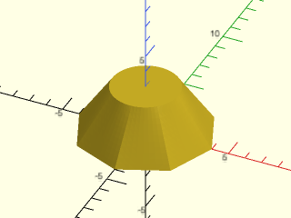

    include <BOSL2/std.scad>
    skin([octagon(4), circle($fn=70,r=2)], z=[0,3], slices=10);

<br clear="all" /><br/>

**Example 2:** Rotating the pentagon place the zero index at different locations, giving a twist

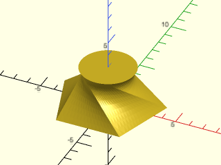

<br clear="all" />

    include <BOSL2/std.scad>
    skin([rot(90,p=pentagon(4)), circle($fn=80,r=2)], z=[0,3], slices=10);

**Example 3:** You can untwist it with the "reindex" method

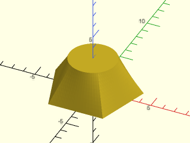

<br clear="all" />

    include <BOSL2/std.scad>
    skin([rot(90,p=pentagon(4)), circle($fn=80,r=2)], z=[0,3], slices=10, method="reindex");

**Example 4:** Offsetting the starting edge connects to circles in an interesting way:

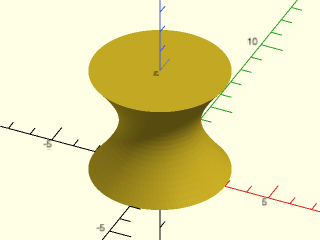

    include <BOSL2/std.scad>
    circ = circle($fn=80, r=3);
    skin([circ, rot(110,p=circ)], z=[0,5], slices=20);

<br clear="all" /><br/>

**Example 5:** 

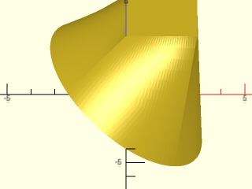

<br clear="all" />

    include <BOSL2/std.scad>
    skin([ yrot(37,p=path3d(circle($fn=128, r=4))), path3d(square(3),3)], method="reindex",slices=10);

**Example 6:** Ellipses connected with twist

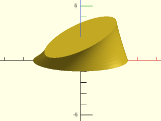

    include <BOSL2/std.scad>
    ellipse = xscale(2.5,p=circle($fn=80));
    skin([ellipse, rot(45,p=ellipse)], z=[0,1.5], slices=10);

<br clear="all" /><br/>

**Example 7:** Ellipses connected without a twist.  (Note ellipses stay in the same position: just the connecting edges are different.)

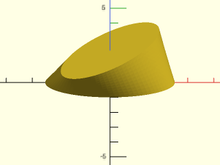

<br clear="all" />

    include <BOSL2/std.scad>
    ellipse = xscale(2.5,p=circle($fn=80));
    skin([ellipse, rot(45,p=ellipse)], z=[0,1.5], slices=10, method="reindex");

**Example 8:** 

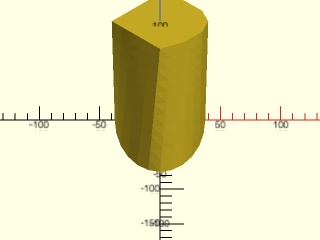

<br clear="all" />

    include <BOSL2/std.scad>
    $fn=24;
    skin([
          yrot(0, p=yscale(2,p=path3d(circle(d=75)))),
          [[40,0,100], [35,-15,100], [20,-30,100],[0,-40,100],[-40,0,100],[0,40,100],[20,30,100], [35,15,100]]
    ],slices=10);

**Example 9:** 

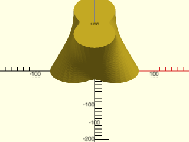

<br clear="all" />

    include <BOSL2/std.scad>
    $fn=48;
    skin([
        for (b=[0,90]) [
            for (a=[360:-360/$fn:0.01])
                point3d(polar_to_xy((100+50*cos((a+b)*2))/2,a),b/90*100)
        ]
    ], slices=20);

**Example 10:** Vaccum connector example from list-comprehension-demos

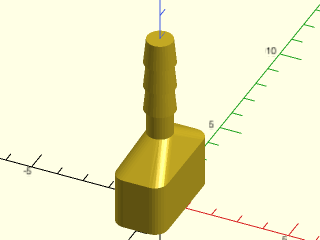

    include <BOSL2/std.scad>
    $fn=32;
    base = round_corners(square([2,4],center=true), radius=0.5);
    skin([
        path3d(base,0),
        path3d(base,2),
        path3d(circle(r=0.5),3),
        path3d(circle(r=0.5),4),
        for(i=[0:2]) each [path3d(circle(r=0.6), i+4),
                           path3d(circle(r=0.5), i+5)]
    ],slices=0);

<br clear="all" /><br/>

**Example 11:** Vaccum nozzle example from list-comprehension-demos, using "length" sampling (the default)

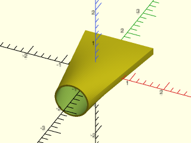

    include <BOSL2/std.scad>
    xrot(90)down(1.5)
    difference() {
        skin(
            [square([2,.2],center=true),
             circle($fn=64,r=0.5)], z=[0,3],
            slices=40,sampling="length",method="reindex");
        skin(
            [square([1.9,.1],center=true),
             circle($fn=64,r=0.45)], z=[-.01,3.01],
            slices=40,sampling="length",method="reindex");
    }

<br clear="all" /><br/>

**Example 12:** Same thing with "segment" sampling

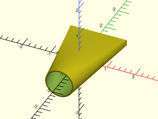

    include <BOSL2/std.scad>
    xrot(90)down(1.5)
    difference() {
        skin(
            [square([2,.2],center=true),
             circle($fn=64,r=0.5)], z=[0,3],
            slices=40,sampling="segment",method="reindex");
        skin(
            [square([1.9,.1],center=true),
             circle($fn=64,r=0.45)], z=[-.01,3.01],
            slices=40,sampling="segment",method="reindex");
    }

<br clear="all" /><br/>

**Example 13:** Forma Candle Holder (from list-comprehension-demos)

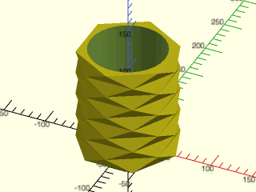

<br clear="all" />

    include <BOSL2/std.scad>
    r = 50;
    height = 140;
    layers = 10;
    wallthickness = 5;
    holeradius = r - wallthickness;
    difference() {
        skin([for (i=[0:layers-1]) zrot(-30*i,p=path3d(hexagon(ir=r),i*height/layers))],slices=0);
        up(height/layers) cylinder(r=holeradius, h=height);
    }

**Example 14:** A box that is octagonal on the outside and circular on the inside

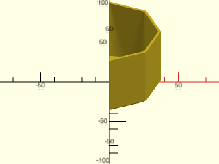

<br clear="all" />

    include <BOSL2/std.scad>
    height = 45;
    sub_base = octagon(d=71, rounding=2, $fn=128);
    base = octagon(d=75, rounding=2, $fn=128);
    interior = regular_ngon(n=len(base), d=60);
    right_half()
      skin([ sub_base, base, base, sub_base, interior], z=[0,2,height, height, 2], slices=0, refine=1, method="reindex");

**Example 15:** Connecting a pentagon and circle with the "tangent" method produces large triangular faces and cone shaped corners.

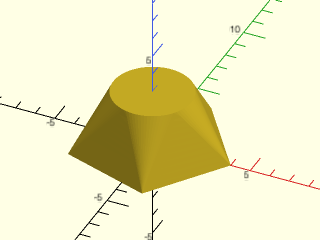

<br clear="all" />

    include <BOSL2/std.scad>
    skin([pentagon(4), circle($fn=80,r=2)], z=[0,3], slices=10, method="tangent");

**Example 16:** rounding corners of a square.  Note that `$fn` makes the number of points constant, and avoiding the `rounding=0` case keeps everything simple.  In this case, the connections between profiles are linear, so there is no benefit to setting `slices` bigger than zero.

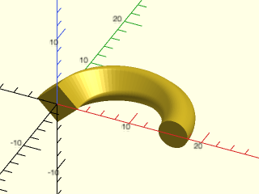

<br clear="all" />

    include <BOSL2/std.scad>
    shapes = [for(i=[.01:.045:2])zrot(-i*180/2,cp=[-8,0,0],p=xrot(90,p=path3d(regular_ngon(n=4, side=4, rounding=i, $fn=64))))];
    rotate(180) skin( shapes, slices=0);

**Example 17:** Here's a simplified version of the above, with `i=0` included.  That first layer has narrow triangles creating a stair step effect at the corners.

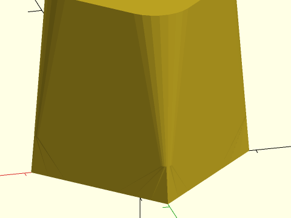

<br clear="all" />

    include <BOSL2/std.scad>
    shapes = [for(i=[0:.2:1]) path3d(regular_ngon(n=4, side=4, rounding=i, $fn=32),i*5)];
    skin(shapes, slices=0);

**Example 18:** You can fix it by specifying "tangent" for the first method, but you still need "direct" for the rest.


<br clear="all" />

    include <BOSL2/std.scad>
    shapes = [for(i=[0:.2:1]) path3d(regular_ngon(n=4, side=4, rounding=i, $fn=32),i*5)];
    skin(shapes, slices=0, method=concat(["tangent"],repeat("direct",len(shapes)-2)));

**Example 19:** Connecting square to pentagon using "direct" method.


<br clear="all" />

    include <BOSL2/std.scad>
    skin([regular_ngon(n=4, r=4), regular_ngon(n=5,r=5)], z=[0,4], refine=10, slices=10);

**Example 20:** Connecting square to shifted pentagon using "direct" method.

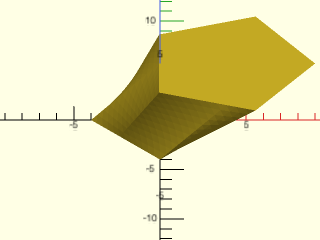

<br clear="all" />

    include <BOSL2/std.scad>
    skin([regular_ngon(n=4, r=4), right(4,p=regular_ngon(n=5,r=5))], z=[0,4], refine=10, slices=10);

**Example 21:** In this example reindexing does not fix the orientation of the triangle because it happens in 3d within skin(), so we have to reverse the triangle manually

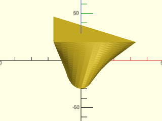

<br clear="all" />

    include <BOSL2/std.scad>
    ellipse = yscale(3,circle(r=10, $fn=32));
    tri = move([-50/3,-9],[[0,0], [50,0], [0,27]]);
    skin([ellipse, reverse(tri)], z=[0,20], slices=20, method="reindex");

**Example 22:** You can get a nicer transition by rotating the polygons for better alignment.  You have to resample yourself before calling `align_polygon`. The orientation is fixed so we do not need to reverse.

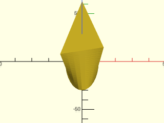

    include <BOSL2/std.scad>
    ellipse = yscale(3,circle(r=10, $fn=32));
    tri = move([-50/3,-9],
               subdivide_path([[0,0], [50,0], [0,27]], 32));
    aligned = align_polygon(ellipse,tri, [0:5:180]);
    skin([ellipse, aligned], z=[0,20], slices=20);

<br clear="all" /><br/>

**Example 23:** The "distance" method is a completely different approach.

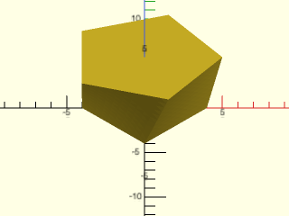

<br clear="all" />

    include <BOSL2/std.scad>
    skin([regular_ngon(n=4, r=4), regular_ngon(n=5,r=5)], z=[0,4], refine=10, slices=10, method="distance");

**Example 24:** Connecting pentagon to heptagon inserts two triangular faces on each side

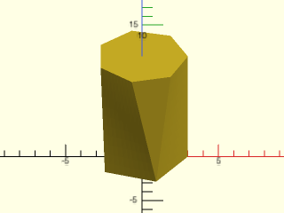

    include <BOSL2/std.scad>
    small = path3d(circle(r=3, $fn=5));
    big = up(2,p=yrot( 0,p=path3d(circle(r=3, $fn=7), 6)));
    skin([small,big],method="distance", slices=10, refine=10);

<br clear="all" /><br/>

**Example 25:** But just a slight rotation of the top profile moves the two triangles to one end

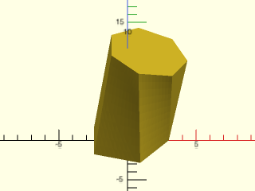

    include <BOSL2/std.scad>
    small = path3d(circle(r=3, $fn=5));
    big = up(2,p=yrot(14,p=path3d(circle(r=3, $fn=7), 6)));
    skin([small,big],method="distance", slices=10, refine=10);

<br clear="all" /><br/>

**Example 26:** Another "distance" example:

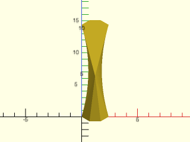

<br clear="all" />

    include <BOSL2/std.scad>
    off = [0,2];
    shape = turtle(["right",45,"move", "left",45,"move", "left",45, "move", "jump", [.5+sqrt(2)/2,8]]);
    rshape = rot(180,cp=centroid(shape)+off, p=shape);
    skin([shape,rshape],z=[0,4], method="distance",slices=10,refine=15);

**Example 27:** Slightly shifting the profile changes the optimal linkage

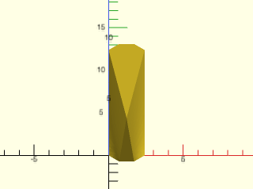

<br clear="all" />

    include <BOSL2/std.scad>
    off = [0,1];
    shape = turtle(["right",45,"move", "left",45,"move", "left",45, "move", "jump", [.5+sqrt(2)/2,8]]);
    rshape = rot(180,cp=centroid(shape)+off, p=shape);
    skin([shape,rshape],z=[0,4], method="distance",slices=10,refine=15);

**Example 28:** This optimal solution doesn't look terrible:

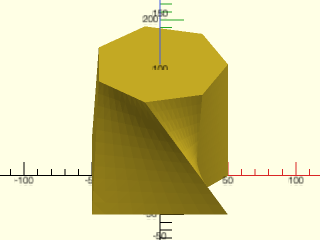

<br clear="all" />

    include <BOSL2/std.scad>
    prof1 = path3d([[-50,-50], [-50,50], [50,50], [25,25], [50,0], [25,-25], [50,-50]]);
    prof2 = path3d(regular_ngon(n=7, r=50),100);
    skin([prof1, prof2], method="distance", slices=10, refine=10);

**Example 29:** But this one looks better.  The "distance" method doesn't find it because it uses two more edges, so it clearly has a higher total edge distance.  We force it by doubling the first two vertices of one of the profiles.

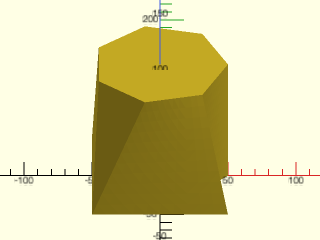

<br clear="all" />

    include <BOSL2/std.scad>
    prof1 = path3d([[-50,-50], [-50,50], [50,50], [25,25], [50,0], [25,-25], [50,-50]]);
    prof2 = path3d(regular_ngon(n=7, r=50),100);
    skin([repeat_entries(prof1,[2,2,1,1,1,1,1]),
          prof2],
         method="distance", slices=10, refine=10);

**Example 30:** The "distance" method often produces results similar to the "tangent" method if you use it with a polygon and a curve, but the results can also look like this:

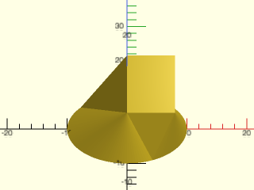

<br clear="all" />

    include <BOSL2/std.scad>
    skin([path3d(circle($fn=128, r=10)), xrot(39, p=path3d(square([8,10]),10))],  method="distance", slices=0);

**Example 31:** Using the "tangent" method produces:

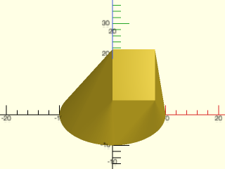

<br clear="all" />

    include <BOSL2/std.scad>
    skin([path3d(circle($fn=128, r=10)), xrot(39, p=path3d(square([8,10]),10))],  method="tangent", slices=0);

**Example 32:** Torus using hexagons and pentagons, where `closed=true`

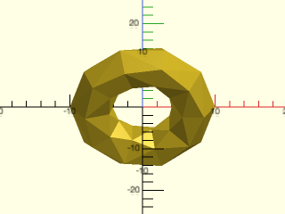

<br clear="all" />

    include <BOSL2/std.scad>
    hex = right(7,p=path3d(hexagon(r=3)));
    pent = right(7,p=path3d(pentagon(r=3)));
    N=5;
    skin(
         [for(i=[0:2*N-1]) yrot(360*i/2/N, p=(i%2==0 ? hex : pent))],
         refine=1,slices=0,method="distance",closed=true);

**Example 33:** A smooth morph is achieved when you can calculate all the slices yourself.  Since you provide all the slices, set `slices=0`.

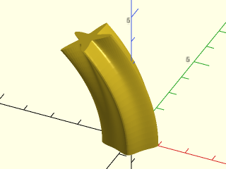

<br clear="all" />

    include <BOSL2/std.scad>
    skin([for(n=[.1:.02:.5])
             yrot(n*60-.5*60,p=path3d(supershape(step=360/128,m1=5,n1=n, n2=1.7),5-10*n))],
         slices=0);

**Example 34:** Another smooth supershape morph:

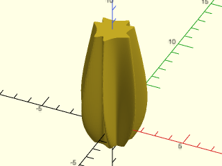

<br clear="all" />

    include <BOSL2/std.scad>
    skin([for(alpha=[-.2:.05:1.5])
             path3d(supershape(step=360/256,m1=7, n1=lerp(2,3,alpha),
                               n2=lerp(8,4,alpha), n3=lerp(4,17,alpha)),alpha*5)],
         slices=0);

**Example 35:** Several polygons connected using "distance"

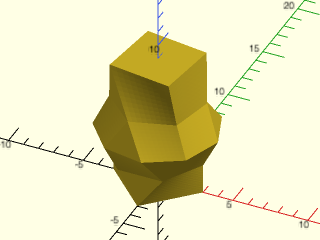

    include <BOSL2/std.scad>
    skin([regular_ngon(n=4, r=3),
          regular_ngon(n=6, r=3),
          regular_ngon(n=9, r=4),
          rot(17,p=regular_ngon(n=6, r=3)),
          rot(37,p=regular_ngon(n=4, r=3))],
         z=[0,2,4,6,9], method="distance", slices=10, refine=10);

<br clear="all" /><br/>

**Example 36:** Vertex count of the polygon changes at every profile

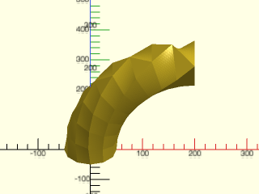

<br clear="all" />

    include <BOSL2/std.scad>
    skin([
        for (ang = [0:10:90])
        rot([0,ang,0], cp=[200,0,0], p=path3d(circle(d=100,$fn=12-(ang/10))))
    ],method="distance",slices=10,refine=10);

**Example 37:** Möbius Strip.  This is a tricky model because when you work your way around to the connection, the direction of the profiles is flipped, so how can the proper geometry be created?  The trick is to duplicate the first profile and turn the caps off.  The model closes up and forms a valid polyhedron.

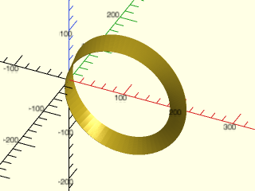

<br clear="all" />

    include <BOSL2/std.scad>
    skin([
      for (ang = [0:5:360])
      rot([0,ang,0], cp=[100,0,0], p=rot(ang/2, p=path3d(square([1,30],center=true))))
    ], caps=false, slices=0, refine=20);

**Example 38:** This model of two scutoids packed together is based on https://www.thingiverse.com/thing:3024272 by mathgrrl

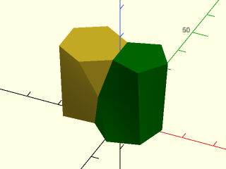

<br clear="all" />

    include <BOSL2/std.scad>
    sidelen = 10;  // Side length of scutoid
    height = 25;   // Height of scutoid
    angle = -15;   // Angle (twists the entire form)
    push = -5;     // Push (translates the base away from the top)
    flare = 1;     // Flare (the two pieces will be different unless this is 1)
    midpoint = .5; // Height of the extra vertex (as a fraction of total height); the two pieces will be different unless this is .5)
    pushvec = rot(angle/2,p=push*RIGHT);  // Push direction is the average of the top and bottom mating edges
    pent = path3d(apply(move(pushvec)*rot(angle),pentagon(side=sidelen,align_side=RIGHT,anchor="side0")));
    hex = path3d(hexagon(side=flare*sidelen, align_side=RIGHT, anchor="side0"),height);
    pentmate = path3d(pentagon(side=flare*sidelen,align_side=LEFT,anchor="side0"),height);
              // Native index would require mapping first and last vertices together, which is not allowed, so shift
    hexmate = list_rotate(
                            path3d(apply(move(pushvec)*rot(angle),hexagon(side=sidelen,align_side=LEFT,anchor="side0"))),
                            -1);
    join_vertex = lerp(
                        mean(select(hex,1,2)),     // midpoint of "extra" hex edge
                        mean(select(hexmate,0,1)), // midpoint of "extra" hexmate edge
                        midpoint);
    augpent = repeat_entries(pent, [1,2,1,1,1]);         // Vertex 1 splits at the top, forming a triangular face with the hexagon
    augpent_mate = repeat_entries(pentmate,[2,1,1,1,1]); // For mating pentagon it is vertex 0 that splits
               // Middle is the interpolation between top and bottom except for the join vertex, which is doubled because it splits
    middle = list_set(lerp(augpent,hex,midpoint),[1,2],[join_vertex,join_vertex]);
    middle_mate = list_set(lerp(hexmate,augpent_mate,midpoint), [0,1], [join_vertex,join_vertex]);
    skin([augpent,middle,hex],  slices=10, refine=10, sampling="segment");
    color("green")skin([augpent_mate,middle_mate,hexmate],  slices=10,refine=10, sampling="segment");

**Example 39:** If you create a self-intersecting polyhedron the result is invalid.  In some cases self-intersection may be obvous.  Here is a more subtle example.

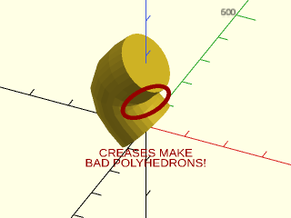

<br clear="all" />

    include <BOSL2/std.scad>
    skin([
           for (a = [0:30:180]) let(
               pos  = [-60*sin(a),     0, a    ],
               pos2 = [-60*sin(a+0.1), 0, a+0.1]
           ) move(pos,
               p=rot(from=UP, to=pos2-pos,
                   p=path3d(circle(d=150))
               )
           )
       ],refine=1,slices=0);
       color("red") {
           zrot(25) fwd(130) xrot(75) {
               linear_extrude(height=0.1) {
                   ydistribute(25) {
                       text(text="BAD POLYHEDRONS!", size=20, halign="center", valign="center");
                       text(text="CREASES MAKE", size=20, halign="center", valign="center");
                   }
               }
           }
           up(160) zrot(25) fwd(130) xrot(75) {
               stroke(zrot(30, p=yscale(0.5, p=circle(d=120))),width=10,closed=true);
           }
       }

---

### Function/Module: linear\_sweep()

**Synopsis:** Create a linear extrusion from a path, with optional texturing. <sup title="Can return a VNF.">[<abbr>VNF</abbr>]</sup> <sup title="Can return geometry.">[<abbr>Geom</abbr>]</sup>

**Topics:** [Extrusion](Topics#extrusion), [Textures](Topics#textures), [Sweep](Topics#sweep)

**See Also:** [rotate\_sweep()](#functionmodule-rotate_sweep), [sweep()](#functionmodule-sweep), [spiral\_sweep()](#functionmodule-spiral_sweep), [path\_sweep()](#functionmodule-path_sweep), [offset\_sweep()](rounding.scad#functionmodule-offset_sweep)

**Usage:** As Module

- linear_sweep(region, [height], [center=], [slices=], [twist=], [scale=], [style=], [caps=], [convexity=]) [ATTACHMENTS];

**Usage:** With Texturing

- linear_sweep(region, [height], [center=], texture=, [tex_size=]|[tex_reps=], [tex_depth=], [style=], [tex_samples=], ...) [ATTACHMENTS];

**Usage:** As Function

- vnf = linear_sweep(region, [height], [center=], [slices=], [twist=], [scale=], [style=], [caps=]);
- vnf = linear_sweep(region, [height], [center=], texture=, [tex_size=]|[tex_reps=], [tex_depth=], [style=], [tex_samples=], ...);

**Description:** 

If called as a module, creates a polyhedron that is the linear extrusion of the given 2D region or polygon.
If called as a function, returns a VNF that can be used to generate a polyhedron of the linear extrusion
of the given 2D region or polygon.  One benefit of this, over `linear_extrude region(rgn)` is
that it supports `anchor`, `spin`, `orient` and attachments.  It can make more refined
twisted extrusions by using `maxseg` to subsample flat faces, and it also supports texturing.

Anchoring for linear_sweep is based on the anchors for the swept region rather than from the polyhedron that is created.  This can produce more
predictable anchors for LEFT, RIGHT, FWD and BACK in many cases, but the anchors may be approximately
correct only for twisted objects, and corner anchors may point in unexpected directions in some cases.  These anchors also ignore any applied texture.
If you need anchors directly computed from the surface you can pass the vnf from linear_sweep
to [`vnf_polyhedron()`](vnf.scad#module-vnf_polyhedron), which computes anchors directly from the full VNF.
Additional named face and edge anchors are located on the side faces and vertical edges of the prism.
When you sweep a polygon you can use `EDGE(i)`, `EDGE(TOP,i)` and `EDGE(BOT,i)` as a shorthand for
accessing the named edge anchors, and `FACE(i)` for the face anchors.
The "edge0" anchor identifies an edge located along the X+ axis, and then edges
are labeled counting up in the clockwise direction.  Similarly "face0" is the face immediately clockwise from "edge0", and face
labeling proceeds clockwise.  The top and bottom edge anchors label edges directly above and below the face with the same label.
When you sweep a region, the region is decomposed using [`region_parts()`](regions.scad#function-region_parts) and the anchors are generated for the region components
in the order produced by the decomposition, working entirely through each component and then on to the next component.
The anchors for twisted shapes may be inaccurate.

**Arguments:** 

<abbr title="These args can be used by position or by name.">By&nbsp;Position</abbr> | What it does
-------------------- | ------------
`region`             | The 2D [Region](regions.scad) or polygon that is to be extruded.
`h`                  / `height`             / `l`                  / `length`             | The height to extrude the region.  Default: 1
`center`             | If true, the created polyhedron is vertically centered.  If false, it is extruded upward from the XY plane.  Default: `false`

<abbr title="These args must be used by name, ie: name=value">By&nbsp;Name</abbr> | What it does
-------------------- | ------------
`twist`              | The number of degrees to rotate the top of the shape, clockwise around the Z axis, relative to the bottom.  Default: 0
`scale`              | The amount to scale the top of the shape, in the X and Y directions, relative to the size of the bottom.  Default: 1
`shift`              | The amount to shift the top of the shape, in the X and Y directions, relative to the position of the bottom.  Default: [0,0]
`slices`             | The number of slices to divide the shape into along the Z axis, to allow refinement of detail, especially when working with a twist.  Default: `twist/5`
`maxseg`             | If given, then any long segments of the region are subdivided to be shorter than this length.  This can refine twisting flat faces a lot.  Default: `undef` (no subsampling)
`texture`            | A texture name string, or a rectangular array of scalar height values (0.0 to 1.0), or a VNF tile that defines the texture to apply to vertical surfaces.  See [`texture()`](#function-texture) for what named textures are supported.
`tex_size`           | An optional 2D target size (2-vector or scalar) for the textures.  Actual texture sizes are scaled somewhat to evenly fit the available surface. Default: `[5,5]`
`tex_reps`           | If given instead of tex_size, a scalar or 2-vector giving the integer number of texture tile repetitions in the horizontal and vertical directions.
`tex_inset`          | If numeric, lowers the texture into the surface by the specified proportion, e.g. 0.5 would lower it half way into the surface.  If `true`, insets by exactly its full depth.  Default: `false`
`tex_rot`            | Rotate texture by specified angle, which must be a multiple of 90 degrees.  Default: 0
`tex_depth`          | Specify texture depth; if negative, invert the texture.  Default: 1.
`tex_samples`        | Minimum number of "bend points" to have in VNF texture tiles.  Default: 8
`style`              | The style to use when triangulating the surface of the object.  Valid values are `"default"`, `"alt"`, or `"quincunx"`.
`caps`               | If false do not create end caps.  Can be a boolean vector.  Default: true
`convexity`          | Max number of surfaces any single ray could pass through.  Module use only.
`cp`                 | Centerpoint for determining intersection anchors or centering the shape.  Determines the base of the anchor vector.  Can be "centroid", "mean", "box" or a 3D point.  Default: `"centroid"`
`atype`              | Set to "hull" or "intersect" to select anchor type.  Default: "hull"
`anchor`             | Translate so anchor point is at origin (0,0,0).  See [anchor](attachments.scad#subsection-anchor).  Default: `"origin"`
`spin`               | Rotate this many degrees around the Z axis after anchor.  See [spin](attachments.scad#subsection-spin).  Default: `0`
`orient`             | Vector to rotate top toward, after spin.  See [orient](attachments.scad#subsection-orient).  Default: `UP`

**Anchor Types:** 

Anchor Type | What it is
----------- | ----------
"hull" | Anchors to the virtual convex hull of the shape.
"intersect" | Anchors to the surface of the shape.
"bbox" | Anchors to the bounding box of the extruded shape.

**Named Anchors:** 

Anchor Name | Position
----------- | --------
"origin" | Centers the extruded shape vertically only, but keeps the original path positions in the X and Y.  Oriented UP.
"original_base" | Keeps the original path positions in the X and Y, but at the bottom of the extrusion.  Oriented DOWN.
"original_top" | Keeps the original path positions in the X and Y, but at the top height of the extrusion.  Oriented UP.
"edge0", "edge1", etc. | Center of each side edge, spin pointing up along the edge.  Can access with EDGE(i)
"face0", "face1", etc. | Center of each side face, spin pointing up.  Can access with FACE(i)
"top_edge0", "top_edge1", etc | Center of each top edge, spin pointing clockwise (from top). Can access with EDGE(TOP,i)
"bot_edge0", "bot_edge1", etc | Center of each bottom edge, spin pointing clockwise (from bottom).  Can access with EDGE(BOT,i)
"top_corner0", "top_corner1", etc | Top corner, pointing in direction of associated edge anchor, spin up along associated edge
"bot_corner0", "bot_corner1", etc | Bottom corner, pointing in direction of associated edge anchor, spin up along associated edge

**Example 1:** Extruding a Compound Region.

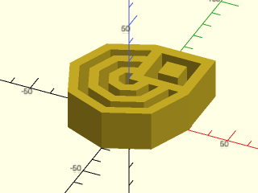

<br clear="all" />

    include <BOSL2/std.scad>
    rgn1 = [for (d=[10:10:60]) circle(d=d,$fn=8)];
    rgn2 = [square(30,center=false)];
    rgn3 = [for (size=[10:10:20]) move([15,15],p=square(size=size, center=true))];
    mrgn = union(rgn1,rgn2);
    orgn = difference(mrgn,rgn3);
    linear_sweep(orgn,height=20,convexity=16);

**Example 2:** With Twist, Scale, Shift, Slices and Maxseg.

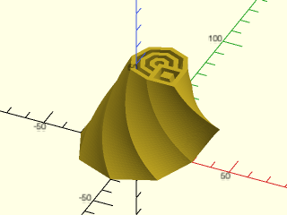

    include <BOSL2/std.scad>
    rgn1 = [for (d=[10:10:60]) circle(d=d,$fn=8)];
    rgn2 = [square(30,center=false)];
    rgn3 = [
        for (size=[10:10:20])
        apply(
           move([15,15]),
           square(size=size, center=true)
        )
    ];
    mrgn = union(rgn1,rgn2);
    orgn = difference(mrgn,rgn3);
    linear_sweep(
        orgn, height=50, maxseg=2, slices=40,
        twist=90, scale=0.5, shift=[10,5],
        convexity=16
    );

<br clear="all" /><br/>

**Example 3:** Anchors on an Extruded Region

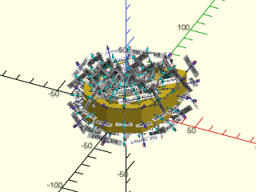

    include <BOSL2/std.scad>
    rgn1 = [for (d=[10:10:60]) circle(d=d,$fn=8)];
    rgn2 = [square(30,center=false)];
    rgn3 = [
        for (size=[10:10:20])
        apply(
            move([15,15]),
            rect(size=size)
        )
    ];
    mrgn = union(rgn1,rgn2);
    orgn = difference(mrgn,rgn3);
    linear_sweep(orgn,height=20,convexity=16)
        show_anchors();

<br clear="all" /><br/>

**Example 4:** "diamonds" texture.

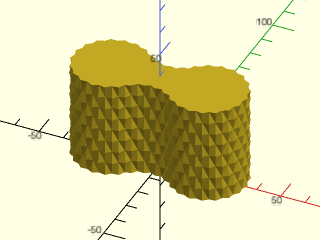

    include <BOSL2/std.scad>
    path = glued_circles(r=15, spread=40, tangent=45);
    linear_sweep(
        path, texture="diamonds", tex_size=[5,10],
        h=40, style="concave");

<br clear="all" /><br/>

**Example 5:** "pyramids" texture.

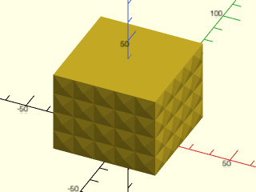

    include <BOSL2/std.scad>
    linear_sweep(
        rect(50), texture="pyramids", tex_size=[10,10],
        h=40, style="convex");

<br clear="all" /><br/>

**Example 6:** "bricks\_vnf" texture.

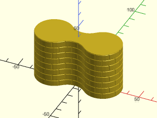

    include <BOSL2/std.scad>
    path = glued_circles(r=15, spread=40, tangent=45);
    linear_sweep(
        path, texture="bricks_vnf", tex_size=[10,10],
        tex_depth=0.25, h=40);

<br clear="all" /><br/>

**Example 7:** User defined heightfield texture.

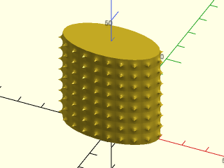

    include <BOSL2/std.scad>
    path = ellipse(r=[20,10]);
    texture = [for (i=[0:9])
        [for (j=[0:9])
            1/max(0.5,norm([i,j]-[5,5])) ]];
    linear_sweep(
        path, texture=texture, tex_size=[5,5],
        h=40, style="min_edge", anchor=BOT);

<br clear="all" /><br/>

**Example 8:** User defined VNF tile texture.

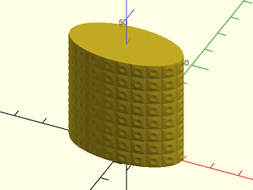

    include <BOSL2/std.scad>
    path = ellipse(r=[20,10]);
    tex = let(n=16,m=0.25) [
         [
             each resample_path(path3d(square(1)),n),
             each move([0.5,0.5],
                 p=path3d(circle(d=0.5,$fn=n),m)),
             [1/2,1/2,0],
         ], [
             for (i=[0:1:n-1]) each [
                 [i,(i+1)%n,(i+3)%n+n],
                 [i,(i+3)%n+n,(i+2)%n+n],
                 [2*n,n+i,n+(i+1)%n],
             ]
         ]
    ];
    linear_sweep(path, texture=tex, tex_size=[5,5], h=40);

<br clear="all" /><br/>

**Example 9:** Textured with twist and scale.

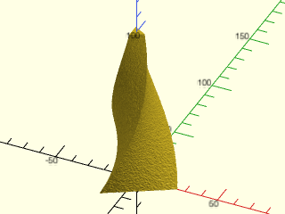

    include <BOSL2/std.scad>
    linear_sweep(regular_ngon(n=3, d=50),
        texture="rough", h=100, tex_depth=.4,
        tex_size=[20,20], style="min_edge",
        convexity=10, scale=0.2, twist=120);

<br clear="all" /><br/>

**Example 10:** As Function

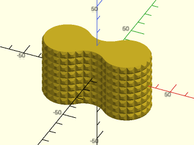

    include <BOSL2/std.scad>
    path = glued_circles(r=15, spread=40, tangent=45);
    vnf = linear_sweep(
        path, h=40, texture="trunc_pyramids", tex_size=[5,5],
        tex_depth=1, style="convex");
    vnf_polyhedron(vnf, convexity=10);

<br clear="all" /><br/>

**Example 11:** VNF tile that has no top/bottom edges and produces a disconnected result

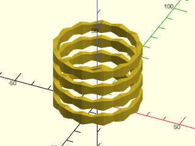

    include <BOSL2/std.scad>
    shape = skin([rect(2/5),
                  rect(2/3),
                  rect(2/5)],
                 z=[0,1/2,1],
                 slices=0,
                 caps=false);
    tile = move([0,1/2,2/3],yrot(90,shape));
    linear_sweep(circle(20), texture=tile,
                 tex_size=[10,10],tex_depth=5,
                 h=40,convexity=4);

<br clear="all" /><br/>

**Example 12:** The same tile from above, turned 90 degrees. Note that it has endcaps on the disconnected components.  These do not appear if `caps=false`.

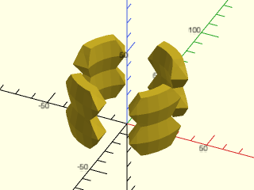

    include <BOSL2/std.scad>
    shape = skin([rect(2/5),
                  rect(2/3),
                  rect(2/5)],
                 z=[0,1/2,1],
                 slices=0,
                 caps=false);
    tile = move([1/2,1,2/3],xrot(90,shape));
    linear_sweep(circle(20), texture=tile,
                 tex_size=[30,20],tex_depth=15,
                 h=40,convexity=4);

<br clear="all" /><br/>

**Example 13:** This example shows a disconnected component combined with the base component.

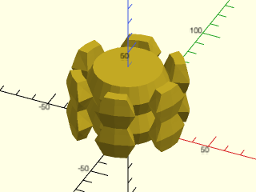

    include <BOSL2/std.scad>
    shape = skin([rect(2/5),
                  rect(2/3),
                  rect(2/5)],
                 z=[0,1/2,1],
                 slices=0,
                 caps=false);
    tile = xscale(.5,move([1/2,1,2/3],xrot(90,shape)));
    peak = [[[0,0,0],[1,0,0]],
            [[0,1/2,1/4],[1,1/2,1/4]],
            [[0,1,0],[1,1,0]]];
    peakvnf = vnf_vertex_array(peak,reverse=true);
    doubletile = vnf_join([tile,
                           right(.5,tile),
                           peakvnf
                          ]);
    linear_sweep(circle(20), texture=doubletile,
                 tex_size=[40,20],tex_depth=15, h=40);

<br clear="all" /><br/>

**Example 14:** Here is a simple basket weave pattern created using a texture.  We have removed the back to make the weave easier to see.


<br clear="all" />

    include <BOSL2/std.scad>
    diag_weave_vnf = [
       [[0.2, 0, 0], [0.8, 0, 0], [1, 0.2, 0.5], [1, 0.8, 0.5], [0.7, 0.5, 0.5],
        [0.5, 0.3, 0], [0.2, 0, 0.5], [0.8, 0, 0.5], [1, 0.2, 1], [1, 0.8, 1],
        [0.7, 0.5, 1], [0.5, 0.3, 0.5], [1, 0.2, 0], [1, 0.8, 0], [0.8, 1, 0.5],
         [0.2, 1, 0.5], [0.5, 0.7, 0.5], [0.7, 0.5, 0], [0.8, 1, 1], [0.2, 1, 1],
         [0.5, 0.7, 1], [0.8, 1, 0], [0.2, 1, 0], [0, 0.8, 0.5], [0, 0.2, 0.5],
         [0.3, 0.5, 0.5], [0.5, 0.7, 0], [0, 0.8, 1], [0, 0.2, 1], [0.3, 0.5, 1],
         [0, 0.8, 0], [0, 0.2, 0], [0.3, 0.5, 0], [0.2, 0, 1], [0.8, 0, 1], [0.5, 0.3, 1]],
        [[0, 1, 5], [1, 2, 4, 5], [7, 11, 10, 8], [8, 10, 9], [7, 8, 2, 1], [9, 10, 4, 3],
         [10, 11, 5, 4], [0, 5, 11, 6], [12, 13, 17], [13, 14, 16, 17], [3, 4, 20, 18],
         [18, 20, 19], [3, 18, 14, 13], [19, 20, 16, 15], [20, 4, 17, 16], [12, 17, 4, 2],
         [21, 22, 26], [22, 23, 25, 26], [15, 16, 29, 27], [27, 29, 28], [15, 27, 23, 22],
         [28, 29, 25, 24], [29, 16, 26, 25], [21, 26, 16, 14], [30, 31, 32], [31, 6, 11, 32],
         [24, 25, 35, 33], [33, 35, 34], [24, 33, 6, 31], [34, 35, 11, 7],
         [35, 25, 32, 11], [30, 32, 25, 23]]
    ];
    front_half(y=33){
      cyl(d=14.5,h=1,anchor=BOT,rounding=1/3,$fa=1,$fs=.5);
      linear_sweep(circle(d=12), h=12, scale=1.3, texture=diag_weave_vnf,
                   tex_size=[5,5], convexity=12);
    }

---

### Function/Module: rotate\_sweep()

**Synopsis:** Create a surface of revolution from a path with optional texturing. <sup title="Can return a VNF.">[<abbr>VNF</abbr>]</sup> <sup title="Can return geometry.">[<abbr>Geom</abbr>]</sup>

**Topics:** [Extrusion](Topics#extrusion), [Sweep](Topics#sweep), [Revolution](Topics#revolution), [Textures](Topics#textures)

**See Also:** [linear\_sweep()](#functionmodule-linear_sweep), [sweep()](#functionmodule-sweep), [spiral\_sweep()](#functionmodule-spiral_sweep), [path\_sweep()](#functionmodule-path_sweep), [offset\_sweep()](rounding.scad#functionmodule-offset_sweep)

**Usage:** As Function

- vnf = rotate_sweep(shape, [angle], ...);

**Usage:** As Module

- rotate_sweep(shape, [angle], ...) [ATTACHMENTS];

**Usage:** With Texturing

- rotate_sweep(shape, texture=, [tex_size=]|[tex_reps=], [tex_depth=], [tex_samples=], [tex_rot=], [tex_inset=], ...) [ATTACHMENTS];

**Description:** 

Takes a path or [region](regions.scad) and sweeps it in a rotation around the Z axis, with optional texturing.
When called as a function, returns a [VNF](vnf.scad).
When called as a module, creates the sweep as geometry.  By default the sweep starts on the X+ axis.  For 360 degree sweeps this
may be inconsistent with the native rotate_extrude(), which historically started on the X- axis.  The `start` parameter changes where
the sweep starts; set it to 180 to get the historical rotate_extrude() behavior.

The region or path that you provide to sweep is defined in the XY plane and cannot have any negative x values.  By default a path is treated as a closed shape.
(Regions are always composed of closed polygons.)  When you apply a texture, no path in your region can have more than one edge on the Y axis.
If you give a path whose endpoints are not on the Y axis and specify `caps=true` then the path
endpoints are connected to the Y axis by a horizontal segment at each end, and the corresponding top and bottom surfaces in the revolution do not receive texture.
You can terminate just one end of the path on the Y axis and in this case, you get a single untextured cap.  If your texture is not zero at the
edges, the endcaps may appear textured rather than flat, because the top perimeter follows the texture.

When `caps=true` you can use `tex_taper` to change the depth of the texture along the length of the path given in `shape`.  This
can be useful for forcing flat caps on a textured object by forcing the texture depth to zero at the ends.
The simplest option is to set `tex_taper` to a value between 0 and 0.5.  In this case, the texture depth linearly falls to zero
at both ends, starting at the specified fraction from the end.  For example, if `tex_taper=1/3` then the center third of the object
will have the normal texture depth, and the texture falls to zero over the top and bottom thirds.  For more control over the texture
tapering you can also set `tex_taper` to a lookup table suited to the `lookup()` function.  The lookup table is evaluated at 0 to
determine the texture depth multiplier at the bottom and at 1 to determine the texture depth multiplier at the top.  The final option is
to set `tex_taper` to a function that takes one parameter and is defined on [0,1].  Using these more sophisticated methods you can actually
change the shape of the object.  If you want to ensure flat caps, simply make sure that your lookup table or function maps both zero and one to zero.
Texture multipliers can be any number.  If the multiplier is negative it inverts the texture, and if the multiplier exceeds one, the texture
scales to larger than your specified `tex_depth` value.

If you want to place just one or a few copies of a texture onto an object rather than texturing the entire object you can do that by using
and angle smaller than 360.  However, if you want to control the aspect ratio of the resulting texture you must carefully calculate the proper
angle to use to ensure that the arc length in the horizontal direction is the proper length compared to the arc length in the vertical direction.
To simplify this process you can use `pixel_aspect` or `tex_aspect`.  You can set `tex_aspect` for any type of tile and it specifies
the desired aspect ratio (width/height) for the tiles.  You must specify `tex_reps` in order to use this feature.  For heightfields you can instead provide
a pixel aspect ratio, which is suited to the case where your texture is a non-square image that you want to place on a curved object.  For a simple cylinder
it is obvious what the horizontal arc length is; for other objects this is computed based on the average radius of the longest path in `shape`.

**Arguments:** 

<abbr title="These args can be used by position or by name.">By&nbsp;Position</abbr> | What it does
-------------------- | ------------
`shape`              | The polygon or [region](regions.scad) to sweep around the Z axis.
`angle`              | If given, specifies the number of degrees to sweep the region around the Z axis, counterclockwise from the X+ axis.  Default: 360 (full rotation)

<abbr title="These args must be used by name, ie: name=value">By&nbsp;Name</abbr> | What it does
-------------------- | ------------
`start`              | Start extrusion at this angle counterclockwise from the X+ axis.  Default:0
`texture`            | A texture name string, or a rectangular array of scalar height values (0.0 to 1.0), or a VNF tile that defines the texture to apply to vertical surfaces.  See [`texture()`](#function-texture) for what named textures are supported.
`tex_size`           | An optional 2D target size (2-vector or scalar) for the textures.  Actual texture sizes are scaled somewhat to evenly fit the available surface. Default: `[5,5]`
`tex_reps`           | If given instead of tex_size, a scalar or 2-vector giving the integer number of texture tile repetitions in the horizontal and vertical directions.
`tex_inset`          | If numeric, lowers the texture into the surface by the specified proportion, e.g. 0.5 would lower it half way into the surface.  If `true`, insets by exactly its full depth.  Default: `false`
`tex_rot`            | Rotate texture by specified angle, which must be a multiple of 90 degrees.  Default: 0
`tex_depth`          | Specify texture depth; if negative, invert the texture.  Default: 1.
`tex_samples`        | Minimum number of "bend points" to have in VNF texture tiles.  Default: 8
`tex_taper`          | If `caps=true`, scales the texture depth along the path given in `shape`.  If set to a scalar between 0 and 0.5, adjusts the specfied top and bottom fraction of the path linearly to zero depth.  You can also provide a lookup table or function defining the scala factor over the range [0,1].  Default: no taper
`tex_aspect`         | Choose the angle of the revolution to maintain this aspect ratio for the tiles.  You must specify tex_reps.  Overrides any angle specified.
`pixel_aspect`       | Choose the angle of the revolution to maintain this apsect ratio for pixels in a heightfield texture.  You must specify tex_reps.  Overrides any angle specified.
`style`              | [`vnf_vertex_array()`](vnf.scad#functionmodule-vnf_vertex_array) style.  Default: "min_edge"
`caps`               | If true and `shape` is a path whose endpoints are to the right of the Y axis, then adds untextured caps to the top and/or bottom of the revolved surface.  Ignored if `shape` is not a path or if its endpoints are on the Y axis.   Default: `false`
`convexity`          | (Module only) Convexity setting for use with polyhedron.  Default: 10
`cp`                 | Centerpoint for determining "intersect" anchors or centering the shape.  Determintes the base of the anchor vector.  Can be "centroid", "mean", "box" or a 3D point.  Default: "centroid"
`atype`              | Select "hull" or "intersect" anchor types.  Default: "hull"
`anchor`             | Translate so anchor point is at the origin. Default: "origin"
`spin`               | Rotate this many degrees around Z axis after anchor. Default: 0
`orient`             | Vector to rotate top toward after spin (module only)

**Named Anchors:** 

Anchor Name | Position
----------- | --------
"origin" | The native position of the shape.
"start-centroid" | (module only) When `angle<360`, the centroid of the shape, on the face at the starting face of the object
"end-centroid" | (module only) When `angle<360`, the centroid of the shape, on the face at the ending face of the object

**Anchor Types:** 

Anchor Type | What it is
----------- | ----------
"hull" | Anchors to the virtual convex hull of the shape.
"intersect" | Anchors to the surface of the shape.

**Example 1:** Sweeping a shape that looks like a plus sign


    include <BOSL2/std.scad>
    rgn = right(30,
            union([for (a = [0, 90])
                     zrot(a, rect([15,5]))]));
    rotate_sweep(rgn);

<br clear="all" /><br/>

**Example 2:** Sweeping a region with multiple components


    include <BOSL2/std.scad>
    rgn = [
        for (a = [0, 120, 240]) let(
            cp = polar_to_xy(15, a) + [30,0]
        ) each [
            move(cp, p=circle(r=10)),
            move(cp, p=hexagon(d=15)),
        ]
    ];
    rotate_sweep(rgn, angle=240);

<br clear="all" /><br/>

**Example 3:** Torus with bricks texture


    include <BOSL2/std.scad>
    path = right(50, p=circle(d=40));
    rotate_sweep(path, texture="bricks_vnf",tex_size=10,
                   tex_depth=0.5, style="concave");

<br clear="all" /><br/>

**Example 4:** Applying a texture to a region.  Both the inside and outside receive texture.


    include <BOSL2/std.scad>
    rgn = [
        right(40, p=circle(d=50)),
        right(40, p=circle(d=40,$fn=6)),
    ];
    rotate_sweep(
        rgn, texture="diamonds",
        tex_size=[10,10], tex_depth=1,
        angle=240, style="concave");

<br clear="all" /><br/>

**Example 5:** The simplest way to create a cylinder with just a single line segment and `caps=true`.  With this cylinder, the top and bottom have no texture.


    include <BOSL2/std.scad>
    rotate_sweep([[20,-10],[20,10]], texture="dots",
                 tex_reps=[6,2],caps=true);

<br clear="all" /><br/>

**Example 6:** If we manually connect the top and bottom then they also receive texture.


    include <BOSL2/std.scad>
    rotate_sweep([[0,-10],[20,-10],[20,10],[0,10]],
                 tex_reps=[6,6],tex_depth=1.5,
                 texture="dots");

<br clear="all" /><br/>

**Example 7:** You can connect just the top or bottom alone instead of both to get texture on one and a flat cap on the other.  Here you can see that the sloped top has texture but the bottom does not.  Also, the texture doesn't fit neatly on the side and top like it did in the previous two examples, but makes a somewhat ugly transition across the corner.  You have to size your object carefully so that the tops and sides each fit an integer number of texture tiles to avoid this type of transition.


    include <BOSL2/std.scad>
    rotate_sweep([[15,-10],[15,10],[0,15]],
                 texture="dots", tex_reps=[6,6],
                 angle=90,caps=true,tex_depth=1.5);

<br clear="all" /><br/>

**Example 8:** Ribbed sphere.


    include <BOSL2/std.scad>
    path = arc(r=20, $fn=64, angle=[-90, 90]);
    rotate_sweep(path, 360, texture = texture("wave_ribs",n=15),
                 tex_size=[8,1.5]);

<br clear="all" /><br/>

**Example 9:** This model uses `caps=true` to create the untextured caps with a user supplied texture.  They are flat because the texture is zero at its edges.


    include <BOSL2/std.scad>
    tex = [
        [0, 0, 0, 0, 0, 0, 0, 0, 0, 0, 0],
        [0, 0, 1, 1, 1, 1, 1, 1, 1, 1, 1],
        [0, 0, 1, 0, 0, 0, 0, 0, 0, 0, 1],
        [0, 0, 1, 0, 0, 0, 0, 0, 0, 0, 1],
        [0, 0, 1, 0, 0, 1, 1, 1, 0, 0, 1],
        [0, 0, 1, 0, 0, 0, 0, 1, 0, 0, 1],
        [0, 0, 1, 0, 0, 0, 0, 1, 0, 0, 1],
        [0, 0, 1, 1, 1, 1, 1, 1, 0, 0, 1],
        [0, 0, 0, 0, 0, 0, 0, 0, 0, 0, 1],
        [0, 0, 0, 0, 0, 0, 0, 0, 0, 0, 1],
        [0, 0, 1, 1, 1, 1, 1, 1, 1, 1, 1],
        [0, 0, 0, 0, 0, 0, 0, 0, 0, 0, 0],
    ];
    path = arc(cp=[0,0], r=40, start=60, angle=-120);
    rotate_sweep(
        path, caps=true,
        texture=tex, tex_size=[20,20],
        tex_depth=1, style="concave");

<br clear="all" /><br/>

**Example 10:** An example with a more complicated path.  Here the caps are not flat because the diamonds texture is not zero at the edges.


    include <BOSL2/std.scad>
    bezpath = [
        [15, 30], [10,15],
        [10,  0], [20, 10], [30,12],
        [30,-12], [20,-10], [10, 0],
        [10,-15], [15,-30]
    ];
    path = bezpath_curve(bezpath, splinesteps=32);
    rotate_sweep(
        path, caps=true,
        texture="diamonds", tex_size=[10,10],
        tex_depth=1, style="concave");

<br clear="all" /><br/>

**Example 11:** The normal direction at the ends is perpendicular to the Z axis, so even though the texture is not zero, the caps are flat, unlike the previous example.


    include <BOSL2/std.scad>
    path = [
        [20, 30], [20, 20],
        each arc(r=20, corner=[[20,20],[10,0],[20,-20]]),
        [20,-20], [20,-30],
    ];
    rotate_sweep(
        path, caps=true,
        texture="diamonds",
        tex_size=[5,5], tex_depth=1,
        style="concave",
        convexity=10);

<br clear="all" /><br/>

**Example 12:** The top cap is definitely not flat.


    include <BOSL2/std.scad>
    rotate_sweep(
        arc(r=20,angle=[-45,45],n=45),
        caps=true, texture="diamonds",
        tex_size=[5,5], tex_depth=2,
        convexity=10);

<br clear="all" /><br/>

**Example 13:** Setting `tex_taper=0` abruptly tapers right at the caps so that the cap is flat:


    include <BOSL2/std.scad>
    rotate_sweep(
        arc(r=20,angle=[-45,45],n=45),
        caps=true, texture="diamonds",
        tex_size=[5,5], tex_depth=2,
        tex_taper=0, convexity=10);

<br clear="all" /><br/>

**Example 14:** Setting `tex_taper=0.5` tapers gradually across the entire shape:


    include <BOSL2/std.scad>
    rotate_sweep(
        arc(r=20,angle=[-45,45],n=45),
        caps=true, texture="diamonds",
        tex_size=[5,5], tex_depth=2,
        tex_taper=.5, convexity=10);

<br clear="all" /><br/>

**Example 15:** The path given here starts and ends on the Y axis, but you can still request (zero size) caps so that you can use tapering, which is permitted only when caps are enabled.


    include <BOSL2/std.scad>
    rotate_sweep(
       arc(r=20, angle=[-90,90], n=45), texture="dots",
       caps=true, tex_reps=[15,10], tex_taper=0.5, tex_depth=2);

<br clear="all" /><br/>

**Example 16:** Tapering of textures via lookup table to be maximal at the bottom and 0 at the top.


    include <BOSL2/std.scad>
    path = [
        [20, 30], [20, 20],
        each arc(r=20, corner=[[20,20],[10,0],[20,-20]]),
        [20,-20], [20,-30],
    ];
    rotate_sweep(
        path, caps=true,
        texture="trunc_pyramids",
        tex_size=[5,5], tex_depth=1,
        tex_taper=[[0,1], [1,0]],
        style="convex",
        convexity=10);

<br clear="all" /><br/>

**Example 17:** Here we use a cosine function (lifted so it stays nonnegative) to scale the texture.  Since the taper function rises as high as 2 the effective texture depth is 4 at the peaks.


    include <BOSL2/std.scad>
    rotate_sweep([[20,-20],[20,20]],texture="trunc_diamonds",
                 caps=true, tex_reps=[20,16], tex_depth=2,
                 tex_taper=function(x) 1-cos(360*3*x));

<br clear="all" /><br/>

**Example 18:** Here we use a sine function that goes below zero in the top half of the object.  This inverts the texture and the result is that the inverted texture bulges outward with the change in the texture depth that the taper applies.  In the bottom section, the scaling applies directly.


    include <BOSL2/std.scad>
    rotate_sweep([[10,-12],[10,12]], caps=true, tex_reps=[16,6],
                 tex_taper=function(x) sin(360*x),tex_depth=2,
                 texture="dots");

<br clear="all" /><br/>

**Example 19:** We adjust the VNF texture from the previous example so its "zero" level is at 1/2.  This makes the result symmetric between the positive and negative taperings.


    include <BOSL2/std.scad>
    tex = up(1/2,zscale(1/2,texture("dots")));
    rotate_sweep([[10,-12],[10,12]], caps=true, tex_reps=[16,6],
                 tex_taper=function(x) sin(360*x),tex_depth=2,
                 texture=tex);

<br clear="all" /><br/>

**Example 20:** Here we create a texture effect entirely with tapering using a constant "texture" of 3/4.  The inverted texture is 1-3/4 = 1/4, so the negative regions of the function create shallower bands.


<br clear="all" />

    include <BOSL2/std.scad>
    rotate_sweep([[20,-20],[20,20]], caps=true, tex_reps=[30,45], texture=[[3/4]],
                 tex_taper=function(x) sin(2.5*360*x),tex_depth=4);

**Example 21:** This VNF tile makes a closed shape and the actual main extrusion is not created.  We give `caps=true` to prevent the shape from being closed on the outside, but because the VNF tile has no edges, no actual cap is created.


<br clear="all" />

    include <BOSL2/std.scad>
    shape = skin([rect(2/5),
                  rect(2/3),
                  rect(2/5)],
                 z=[0,1/2,1],
                 slices=0,
                 caps=false);
    tile = move([0,1/2,2/3],yrot(90,shape));
    path = [for(y=[-30:30]) [ 20-3*(1-cos((y+30)/60*360)),y]];
    rotate_sweep(path, caps=false, texture=tile,
                 tex_size=[10,10], tex_depth=5);

**Example 22:** Adding the angle parameter cuts off the extrusion.  Note how each extruded component is capped.


<br clear="all" />

    include <BOSL2/std.scad>
    shape = skin([rect(2/5),
                  rect(2/3),
                  rect(2/5)],
                 z=[0,1/2,1],
                 slices=0,
                 caps=false);
    tile = move([0,1/2,2/3],yrot(90,shape));
    path = [for(y=[-30:30]) [ 20-3*(1-cos((y+30)/60*360)),y]];
    rotate_sweep(path, caps=true, texture=tile,
                 tex_size=[10,15], tex_depth=5, angle=215);

**Example 23:** Turning the texture 90 degrees with `tex_rot` produces a texture that ends at the top and bottom.


<br clear="all" />

    include <BOSL2/std.scad>
    shape = skin([rect(2/5),
                  rect(2/3),
                  rect(2/5)],
                 z=[0,1/2,1],
                 slices=0,
                 caps=false);
    tile = move([0,1/2,2/3],yrot(90,shape));
    path = [for(y=[-30:30]) [ 20-3*(1-cos((y+30)/60*360)),y]];
    rotate_sweep(path, caps=true, texture=tile, tex_rot=90,
                 tex_size=[12,8], tex_depth=9, angle=360);

**Example 24:** A basket weave texture, here only halfway around the circle to avoid clutter.


<br clear="all" />

    include <BOSL2/std.scad>
    diag_weave_vnf = [
        [[0.2, 0, 0], [0.8, 0, 0], [1, 0.2, 0.5], [1, 0.8, 0.5], [0.7, 0.5, 0.5],
         [0.5, 0.3, 0], [0.2, 0, 0.5], [0.8, 0, 0.5], [1, 0.2, 1], [1, 0.8, 1],
         [0.7, 0.5, 1], [0.5, 0.3, 0.5], [1, 0.2, 0], [1, 0.8, 0], [0.8, 1, 0.5],
         [0.2, 1, 0.5], [0.5, 0.7, 0.5], [0.7, 0.5, 0], [0.8, 1, 1], [0.2, 1, 1],
         [0.5, 0.7, 1], [0.8, 1, 0], [0.2, 1, 0], [0, 0.8, 0.5], [0, 0.2, 0.5],
         [0.3, 0.5, 0.5], [0.5, 0.7, 0], [0, 0.8, 1], [0, 0.2, 1], [0.3, 0.5, 1],
         [0, 0.8, 0], [0, 0.2, 0], [0.3, 0.5, 0], [0.2, 0, 1], [0.8, 0, 1], [0.5, 0.3, 1]],
        [[0, 1, 5], [1, 2, 4, 5], [7, 11, 10, 8], [8, 10, 9], [7, 8, 2, 1], [9, 10, 4, 3],
         [10, 11, 5, 4], [0, 5, 11, 6], [12, 13, 17], [13, 14, 16, 17], [3, 4, 20, 18],
         [18, 20, 19], [3, 18, 14, 13], [19, 20, 16, 15], [20, 4, 17, 16], [12, 17, 4, 2],
         [21, 22, 26], [22, 23, 25, 26], [15, 16, 29, 27], [27, 29, 28], [15, 27, 23, 22],
         [28, 29, 25, 24], [29, 16, 26, 25], [21, 26, 16, 14], [30, 31, 32], [31, 6, 11, 32],
         [24, 25, 35, 33], [33, 35, 34], [24, 33, 6, 31], [34, 35, 11, 7],
         [35, 25, 32, 11], [30, 32, 25, 23]]
    ];
    path = [for(y=[-30:30]) [ 20-3*(1-cos((y+30)/60*360)),y]];
    down(31)linear_extrude(height=1)arc(r=23,angle=[0,180], wedge=true);
    rotate_sweep(path, caps=true, texture=diag_weave_vnf, angle=180,
                 tex_size=[10,10], convexity=12, tex_depth=2);

**Example 25:** Textures can be used to place images onto objects.  If you want to place an image onto a cylinder you probably don't want it to cover the whole cylinder, or to create many small copies.  To do this you can create a textured cylinder with an angle less than 360 degrees to hold the texture.  In this example we calculate the angle so that the output has the same aspect ratio.  The default `tex_extra` of zero for a single tile ensures that the image appears without an extra border.


    include <BOSL2/std.scad>
    img = [
       [0, 0, 0, 0, 0, 0, 0, 0, 0, 0, 0, 0],
       [0, 1, 1, 1, 1, 1, 1, 1, 1, 1, 1, 0],
       [0, 1, 0, 0, 0, 0, 0, 0, 0, 0, 1, 0],
       [0, 1, 0, 0, 0, 0, 0, 0, 0, 0, 1, 0],
       [0, 1, 0, 0, 0, 0, 0, 0, 0, 0, 1, 0],
       [0, 1, 0, 0, 0,.5,.5, 0, 0, 0, 1, 0],
       [0, 1, 0, 0, 0,.5,.5, 0, 0, 0, 1, 0],
       [0, 1, 0, 0, 0, 0, 0, 0, 0, 0, 1, 0],
       [0, 1, 0, 0, 0, 0, 0, 0, 0, 0, 1, 0],
       [0, 1, 0, 0, 0, 0, 0, 0, 0, 0, 1, 0],
       [0, 1, 1, 1, 1, 1, 1, 1, 1, 1, 1, 0],
       [0, 0, 0, 0, 0, 0, 0, 0, 0, 0, 0, 0],
    ];
    h = 20;
    r = 15;
    ang = len(img[0])/len(img)*h/(2*PI*r)*360;
    rotate_sweep([[r,-h/2],[r,h/2]], texture=img,
                 tex_reps=1,angle=ang, caps=true);

<br clear="all" /><br/>

**Example 26:** Here we have combined the above model with a suitable cylinder.  With a coarse texture like this you need to either match the `$fn` of the cylinder to the texture, or choose a sufficiently fine cylinder to avoid conflicting facets.


    include <BOSL2/std.scad>
    img = [
       [0, 0, 0, 0, 0, 0, 0, 0, 0, 0, 0, 0],
       [0, 1, 1, 1, 1, 1, 1, 1, 1, 1, 1, 0],
       [0, 1, 0, 0, 0, 0, 0, 0, 0, 0, 1, 0],
       [0, 1, 0, 0, 0, 0, 0, 0, 0, 0, 1, 0],
       [0, 1, 0, 0, 0, 0, 0, 0, 0, 0, 1, 0],
       [0, 1, 0, 0, 0,.5,.5, 0, 0, 0, 1, 0],
       [0, 1, 0, 0, 0,.5,.5, 0, 0, 0, 1, 0],
       [0, 1, 0, 0, 0, 0, 0, 0, 0, 0, 1, 0],
       [0, 1, 0, 0, 0, 0, 0, 0, 0, 0, 1, 0],
       [0, 1, 0, 0, 0, 0, 0, 0, 0, 0, 1, 0],
       [0, 1, 1, 1, 1, 1, 1, 1, 1, 1, 1, 0],
       [0, 0, 0, 0, 0, 0, 0, 0, 0, 0, 0, 0],
    ];
    h = 20;
    r = 15;
    ang = len(img[0])/len(img)*h/(2*PI*r)*360;
    rotate_sweep([[r,-h/2],[r,h/2]], texture=img,
                 tex_reps=1,angle=ang, caps=true);
    cyl(r=r,h=27,$fn=128);

<br clear="all" /><br/>

**Example 27:** Above we explicitly calculated the required angle to produce the correct aspect ratio.  Here we use `pixel_aspect` which produces an output whose average width has the desired aspect ratio.


    include <BOSL2/std.scad>
    img = [
       [0, 0, 0, 0, 0, 0, 0, 0, 0, 0, 0, 0],
       [0, 1, 1, 1, 1, 1, 1, 1, 1, 1, 1, 0],
       [0, 1, 0, 0, 0, 0, 0, 0, 0, 0, 1, 0],
       [0, 1, 0, 0, 0, 0, 0, 0, 0, 0, 1, 0],
       [0, 1, 0, 0, 0, 0, 0, 0, 0, 0, 1, 0],
       [0, 1, 0, 0, 0,.5,.5, 0, 0, 0, 1, 0],
       [0, 1, 0, 0, 0,.5,.5, 0, 0, 0, 1, 0],
       [0, 1, 0, 0, 0, 0, 0, 0, 0, 0, 1, 0],
       [0, 1, 0, 0, 0, 0, 0, 0, 0, 0, 1, 0],
       [0, 1, 0, 0, 0, 0, 0, 0, 0, 0, 1, 0],
       [0, 1, 1, 1, 1, 1, 1, 1, 1, 1, 1, 0],
       [0, 0, 0, 0, 0, 0, 0, 0, 0, 0, 0, 0],
    ];
    rotate_sweep([[15,-10],[5,10]], texture=img,
                 tex_reps=[1,1], caps=true, pixel_aspect=1);
    cyl(r1=16,r2=4,h=24,$fn=128);

<br clear="all" /><br/>

**Example 28:** Here we apply the texture to a sphere using the automatic `pixel_aspect` to determine the angle.  Note that using [`spheroid()`](shapes3d.scad#functionmodule-spheroid) with the circum option eliminates artifacts arising due to mimatched faceting.


    include <BOSL2/std.scad>
    img = [
       [0, 0, 0, 0, 0, 0, 0, 0, 0, 0, 0, 0],
       [0, 1, 1, 1, 1, 1, 1, 1, 1, 1, 1, 0],
       [0, 1, 0, 0, 0, 0, 0, 0, 0, 0, 1, 0],
       [0, 1, 0, 0, 0, 0, 0, 0, 0, 0, 1, 0],
       [0, 1, 0, 0, 0, 0, 0, 0, 0, 0, 1, 0],
       [0, 1, 0, 0, 0,.5,.5, 0, 0, 0, 1, 0],
       [0, 1, 0, 0, 0,.5,.5, 0, 0, 0, 1, 0],
       [0, 1, 0, 0, 0, 0, 0, 0, 0, 0, 1, 0],
       [0, 1, 0, 0, 0, 0, 0, 0, 0, 0, 1, 0],
       [0, 1, 0, 0, 0, 0, 0, 0, 0, 0, 1, 0],
       [0, 1, 1, 1, 1, 1, 1, 1, 1, 1, 1, 0],
       [0, 0, 0, 0, 0, 0, 0, 0, 0, 0, 0, 0],
    ];
    arc = arc(r=10, angle=[-44,44],n=100);
    rotate_sweep(arc, texture=img, tex_reps=[1,1],
                 caps=true, pixel_aspect=1);
    spheroid(10,$fn=64,circum=true);

<br clear="all" /><br/>

---

### Function/Module: spiral\_sweep()

**Synopsis:** Sweep a path along a helix. <sup title="Can return a VNF.">[<abbr>VNF</abbr>]</sup> <sup title="Can return geometry.">[<abbr>Geom</abbr>]</sup>

**Topics:** [Extrusion](Topics#extrusion), [Sweep](Topics#sweep), [Spiral](Topics#spiral)

**See Also:** [thread\_helix()](threading.scad#module-thread_helix), [linear\_sweep()](#functionmodule-linear_sweep), [rotate\_sweep()](#functionmodule-rotate_sweep), [sweep()](#functionmodule-sweep), [path\_sweep()](#functionmodule-path_sweep), [offset\_sweep()](rounding.scad#functionmodule-offset_sweep)

**Usage:** As Module

- spiral_sweep(poly, h, r|d=, turns, [taper=], [center=], [taper1=], [taper2=], [internal=], ...)[ATTACHMENTS];
- spiral_sweep(poly, h, r1=|d1=, r2=|d2=, turns, [taper=], [center=], [taper1=], [taper2=], [internal=], ...)[ATTACHMENTS];

**Usage:** As Function

- vnf = spiral_sweep(poly, h, r|d=, turns, ...);
- vnf = spiral_sweep(poly, h, r1=|d1=, r1=|d2=, turns, ...);

**Description:** 

Takes a closed 2D polygon path, centered on the XY plane, and sweeps/extrudes it along a 3D spiral path
of a given radius, height, and degrees of rotation.  The origin in the profile traces out the helix of the specified radius.
If turns is positive the path is right-handed;  if turns is negative the path is left-handed.
Such an extrusion can be used to make screw threads.

The lead_in options specify a lead-in section where the ends of the spiral scale down to avoid a sharp cut face at the ends.
You can specify the length of this scaling directly with the lead_in parameters or as an angle using the lead_in_ang parameters.
If you give a positive value, the extrusion is lengthenend by the specified distance or angle; if you give a negative
value then the scaled end is included in the extrusion length specified by `turns`.  If the value is zero then no scaled ends
are produced.  The shape of the scaled ends can be controlled with the lead_in_shape parameter.  Supported options are "sqrt", "linear"
"smooth" and "cut".

The inside argument changes how the extrusion lead-in sections are formed.  If it is true then they scale
toward the outside, like would be needed for internal threading.  If internal is fale then the lead-in sections scale
toward the inside, like would be appropriate for external threads.

**Arguments:** 

<abbr title="These args can be used by position or by name.">By&nbsp;Position</abbr> | What it does
-------------------- | ------------
`poly`               | Array of points of a polygon path, to be extruded.
`h`                  | height of the spiral extrusion path
`r`                  | Radius of the spiral extrusion path
`turns`              | number of revolutions to include in the spiral

<abbr title="These args must be used by name, ie: name=value">By&nbsp;Name</abbr> | What it does
-------------------- | ------------
`d`                  | Diameter of the spiral extrusion path.
`d1`                 / `r1`                 | Bottom inside diameter or radius of spiral to extrude along.
`d2`                 / `r2`                 | Top inside diameter or radius of spiral to extrude along.
`lead_in`            | Specify linear length of the lead-in scaled section of the spiral.  Default: 0
`lead_in1`           | Specify linear length of the lead-in scaled section of the spiral at the bottom
`lead_in2`           | Specify linear length of the lead-in scaled section of the spiral at the top
`lead_in_ang`        | Specify angular  length of the lead-in scaled section of the spiral
`lead_in_ang1`       | Specify angular length of the lead-in scaled section of the spiral at the bottom
`lead_in_ang2`       | Specify angular length of the lead-in scaled section of the spiral at the top
`lead_in_shape`      | Specify the shape of the thread lead in by giving a text string or function.  Default: "sqrt"
`lead_in_shape1`     | Specify the shape of the thread lead-in at the bottom by giving a text string or function.
`lead_in_shape2`     | Specify the shape of the thread lead-in at the top by giving a text string or function.
`lead_in_sample`     | Factor to increase sample rate in the lead-in section.  Default: 10
`internal`           | if true make internal threads.  The only effect this has is to change how the extrusion lead-in section are formed. When true, the extrusion scales toward the outside; when false, it scales toward the inside.  Default: false
`anchor`             | Translate so anchor point is at origin (0,0,0).  See [anchor](attachments.scad#subsection-anchor).  Default: `CENTER`
`spin`               | Rotate this many degrees around the Z axis after anchor.  See [spin](attachments.scad#subsection-spin).  Default: `0`
`orient`             | Vector to rotate top toward, after spin.  See [orient](attachments.scad#subsection-orient).  Default: `UP`

**Example 1:** 


    include <BOSL2/std.scad>
    poly = [[-10,0], [-3,-5], [3,-5], [10,0], [0,-30]];
    spiral_sweep(poly, h=200, r=50, turns=3, $fn=36);

<br clear="all" /><br/>

---

### Function/Module: path\_sweep()

**Synopsis:** Sweep a 2d polygon path along a 2d or 3d path. <sup title="Can return a VNF.">[<abbr>VNF</abbr>]</sup> <sup title="Can return geometry.">[<abbr>Geom</abbr>]</sup>

**Topics:** [Extrusion](Topics#extrusion), [Sweep](Topics#sweep), [Paths](Topics#paths), [Textures](Topics#textures)

**See Also:** [sweep\_attach()](#module-sweep_attach), [linear\_sweep()](#functionmodule-linear_sweep), [rotate\_sweep()](#functionmodule-rotate_sweep), [sweep()](#functionmodule-sweep), [spiral\_sweep()](#functionmodule-spiral_sweep), [path\_sweep2d()](#functionmodule-path_sweep2d), [offset\_sweep()](rounding.scad#functionmodule-offset_sweep), [bezier\_sweep()](beziers.scad#functionmodule-bezier_sweep)

**Usage:** As module

- path_sweep(shape, path, [method], [normal=], [closed=], [twist=], [twist_by_length=], [symmetry=], [scale=], [scale_by_length=], [last_normal=], [tangent=], [uniform=], [relaxed=], [caps=], [style=], [convexity=], [anchor=], [cp=], [spin=], [orient=], [atype=]) [ATTACHMENTS];

**Usage:** As function

- vnf = path_sweep(shape, path, [method], [normal=], [closed=], [twist=], [twist_by_length=], [symmetry=], [scale=], [scale_by_length=], [last_normal=], [tangent=], [uniform=], [relaxed=], [caps=], [style=], [transforms=], [anchor=], [cp=], [spin=], [orient=], [atype=]);

**Description:** 

Takes as input `shape`, a 2D polygon path (list of points), and `path`, a 2d or 3d path (also a list of points)
and constructs a polyhedron by sweeping the shape along the path. When run as a module returns the polyhedron geometry.
When run as a function returns a VNF by default or if you set `transforms=true` then it returns a list of transformations suitable as input to `sweep`.

The sweeping process places one copy of the shape for each point in the path.  The origin in `shape` is translated to
the point in `path`.  The normal vector of the shape, which points in the Z direction, is aligned with the tangent
vector for the path, so this process is constructing a shape whose normal cross sections are equal to your specified shape.
If you do not supply a list of tangent vectors then an approximate tangent vector is computed
based on the path points you supply using [`path_tangents()`](paths.scad#function-path_tangents).

**Figure 1.5.1:** This example shows how the shape, in this case the quadrilateral defined by `[[0, 0], [0, 1], [0.25, 1], [1, 0]]`, appears as the cross section of the swept polyhedron.  The blue line shows the path.  The normal vector to the shape is shown in black; it is based at the origin and points upward in the Z direction.  The sweep aligns this normal vector with the blue path tangent, which in this case, flips the shape around.  For a 2D path like this one, the Y direction in the shape is mapped to the Z direction in the sweep.


<br clear="all" />


In the figure you can see that the swept polyhedron, shown in transparent gray, has the quadrilateral as its cross
section.  The quadrilateral is positioned perpendicular to the path, which is shown in blue, so that the normal
vector for the quadrilateral is parallel to the tangent vector for the path.  The origin for the shape is the point
that follows the path.  For a 2D path, the Y axis of the shape is mapped to the Z axis and in this case,
pointing the quadrilateral's normal vector (in black) along the tangent line of
the path, which is going in the direction of the blue arrow, requires that the quadrilateral be "turned around".  If we
reverse the order of points in the path we get a different result:

**Figure 1.5.2:** The same sweep operation with the path traveling in the opposite direction.  To line up the normal correctly, the shape is reversed compared to Figure 1, so the resulting sweep looks quite different.


<br clear="all" />


If your shape is too large for the curves in the path you can create a situation where the shapes cross each
other.  This results in an invalid polyhedron, which may appear OK when previewed or rendered alone, but can result
in cryptic CGAL errors when rendered with a second object in your model.  You may be able to use [`path_sweep2d()`](#functionmodule-path_sweep2d)
to produce a valid model in cases like this.  You can debug models like this using the `profiles=true` option, which shows all
the cross sections in your polyhedron.  If any of them intersect, the polyhedron will be invalid.

**Figure 1.5.3:** We have scaled the path to an ellipse and show a large triangle as the shape.  The triangle is sometimes bigger than the local radius of the path, leading to an invalid polyhedron, which you can identify because the red lines cross in the middle.


<br clear="all" />


During the sweep operation the shape's normal vector aligns with the tangent vector of the path.
This leaves an ambiguity about how the shape is rotated as it sweeps along the path.
For 2D paths, this ambiguity is resolved by aligning the Y axis of the shape to the Z axis of the swept polyhedron.
You can force the  shape to twist as it sweeps along the path using the `twist` parameter, which specifies the total
number of degrees to twist along the whole swept polyhedron.  This produces a result like the one shown below.

**Figure 1.5.4:** The shape twists as we sweep.  Note that it still aligns the origin in the shape with the path, and still aligns the normal vector with the path tangent vector.


<br clear="all" />


The `twist` argument adds the specified number of degrees of twist into the model, and it may be positive or
negative.  When `closed=true` the starting shape and ending shape must match to avoid a sudden extreme twist at the
joint.  By default `twist` is therefore required to be a multiple of 360.  However, if your shape has rotational
symmetry, this requirement is overly strict.  You can specify the symmetry using the `symmetry` argument, and then
you can choose smaller twists consistent with the specified symmetry.  The symmetry argument gives the number of
rotations that map the shape exactly onto itself, so a pentagon has 5-fold symmetry.  This argument is valid
only for closed sweeps.  When you specify symmetry, the twist must be a multiple of 360/symmetry.

The twist is normally spread uniformly along your shape based on the path length.  If you set `twist_by_length` to
false, then the twist is uniform based on the point count of your path.  Twisted shapes produce twisted
faces, so if you want them to look good, you should use lots of points on your path and also lots of points on the
shape.  If your shape is a simple polygon, use [`subdivide_path()`](paths.scad#function-subdivide_path) to increase
the number of points.

As noted above, the sweep process has an ambiguity regarding the twist.  For 2D paths it is easy to resolve this
ambiguity by aligning the Y axis in the shape to the Z axis in the swept polyhedron.  When the path is
three-dimensional, things become more complex.  It is no longer possible to use a simple alignment rule like the
one we use in 2D.  You may find that the shape rotates unexpectedly around its axis as it traverses the path.  The
`method` parameter allows you to specify how the shapes are aligned, resulting in different twist in the resulting
polyhedron.  You can choose from three different methods for selecting the rotation of your shape.  None of these
methods produce good, or even valid, results on all inputs, so it is important to select a suitable method.

The three methods you can choose using the `method` parameter are:

The "incremental" method (the default) works by adjusting the shape at each step by the minimal rotation that makes the shape normal to the tangent
at the next point.  This method is robust in that it always produces a valid result for well-behaved paths with sufficiently high
sampling.  Unfortunately, it can produce a large amount of undesirable twist.  When constructing a closed shape this algorithm in
its basic form provides no guarantee that the start and end shapes match up.  To prevent a sudden twist at the last segment,
the method calculates the required twist for a good match and distributes it over the whole model (as if you had specified a
twist amount).  If you specify `symmetry` this may allow the algorithm to choose a smaller twist for this alignment.
To start the algorithm, we need an initial condition.  This is supplied by
using the `normal` argument to give a direction to align the Y axis of your shape.  By default the normal points UP if the path
makes an angle of 45 deg or less with the xy plane and it points BACK if the path makes a higher angle with the XY plane.  You
can also supply `last_normal` to provide an ending orientation constraint.  Be aware that the curve may still exhibit
twisting in the middle.  This method is the default because it is the most robust, not because it generally produces the best result.

The "natural" method works by computing the Frenet frame at each point on the path.  This is defined by the tangent to the curve and
the normal that lies in the plane defined by the curve at each point.  This normal points in the direction of curvature of the curve.
The result is a well-behaved set of shape positions without any unexpected twisting&mdash;as long as the curvature never falls to zero.  At a
point of zero curvature (a flat point), the curve does not define a plane and the natural normal is not defined.  Furthermore, even if
you skip over this troublesome point so the normal is defined, it can change direction abruptly when the curvature is zero, leading to
a nasty twist and an invalid model.  A simple example is a circular arc joined to another arc that curves the other direction.  Note
that the X axis of the shape is aligned with the normal from the Frenet frame.

The "manual" method allows you to specify your desired normal either globally with a single vector, or locally with
a list of normal vectors for every path point.  The normal you supply is projected to be orthogonal to the tangent to the
path, and the Y direction of your shape is aligned with the projected normal. (This is different from the "natural" method.)
Careless choice of a normal may result in a twist in the shape, or an error if your normal is parallel to the path tangent.
If you set `relax=true` then the condition that the cross sections are orthogonal to the path is relaxed and the swept object
uses the actual specified normal.  In this case, the tangent is projected to be orthogonal to your supplied normal to define
the cross section orientation.  Specifying a list of normal vectors gives you complete control over the orientation of your
cross sections and can be useful if you want to position your model to be on the surface of some solid.

You can also apply scaling to the profile along the path.  You can give a list of scalar scale factors or a list of 2-vector scale.
In the latter scale the x and y scales of the profile are scaled separately before the profile is placed onto the path.  For non-closed
paths you can also give a single scale value or a 2-vector, which is treated as the final scale.  The intermediate sections
are then scaled by linear interpolation either relative to length (if scale_by_length is true) or by point count otherwise.

The `caps` parameter controls what happens at the ends of the polyhedron.  If `closed=true` the shape links to itself and has no
ends, but when `closed` is false, the two ends are, by default capped with flat faces.  If you set `caps=false` then the ends
receive no faces and the resulting non-manifold polyhedron has exposed edges.  You can also set caps to a number, which adds a
rounded cap with the specified radius, or you can set caps to an [`offset_sweep()`](rounding.scad#functionmodule-offset_sweep) end treatment, and the specified sweep
is attached as a cap.  Note that you are **adding** a rounded cap, not rounding the specified shape as is common for many other
library modules.  The rounded cap is attached to the end face and may not blend neatly with the swept shape unless the sides of
the swept shape are perpendicular to the end cap.

You can use set `transforms` to true to return a list of transformation matrices instead of the swept shape.  In this case, you can
often omit shape entirely.  The exception is when `closed=true` and you are using the "incremental" method.  In this case, `path_sweep`
uses the shape to correct for twist when the shape closes on itself, so you must include a valid shape.

By default path sweep objects are anchored to the named anchor "origin", which places the swept object right where you created it.
Generally you would not want to set an anchor for a swept object, but instead change the path if you want to move it to a different location,
but you can also anchor using VNF anchoring.  Use either `atype="hull"` (the default) or `atype="intersect"` to create anchors based on the
the object's VNF data.  The center of the object is determined based on the `cp` argument and can be "centroid" (the default), "mean" to use the mean of the object,
or "box" to use the center of the bounding box.  For complicated objects you may find it difficult to get useful results from the anchoring
system, which is designed for an object whose center is inside the object.  When using an anchors, confirm that it is in the location you desire.

You can apply a texture to the path sweep object using the usual texture parameters.
See [Texturing](skin.scad#section-texturing) for more details on how textures work.
This works by passing through to [`vnf_vertex_array()`](vnf.scad#functionmodule-vnf_vertex_array), which also has more details on
texturing.  Note that textures work only when the shape is a path; you cannot apply a texture to a region.

**Arguments:** 

<abbr title="These args can be used by position or by name.">By&nbsp;Position</abbr> | What it does
-------------------- | ------------
`shape`              | A 2D polygon path or region describing the shape to be swept.
`path`               | 2D or 3D path giving the path to sweep over
`method`             | one of "incremental", "natural" or "manual".  Default: "incremental"

<abbr title="These args must be used by name, ie: name=value">By&nbsp;Name</abbr> | What it does
-------------------- | ------------
`normal`             | normal vector for initializing the incremental method, or for setting normals with method="manual".  Default: UP if the path makes an angle lower than 45 degrees to the xy plane, BACK otherwise.
`closed`             | path is a closed loop.  Default: false
`twist`              | amount of twist to add in degrees.  For closed sweeps must be a multiple of 360/symmetry.  Default: 0
`twist_by_length`    | if true then interpolate twist based on the path length of the path. If false interoplate based on point count.  Default: true
`symmetry`           | symmetry of the shape when closed=true.  Allows the shape to join with a 360/symmetry rotation instead of a full 360 rotation.  Default: 1
`scale`              | Amount to scale the profiles.  If you give a scalar the scale starts at 1 and ends at your specified value. The same is true for a 2-vector, but x and y are scaled separately.   You can also give a vector of values, one for each path point, and you can give a list of 2-vectors that give the x and y scales of your profile for every point on the path (a Nx2 matrix for a path of length N.  Default: 1 (no scaling)
`scale_by_length`    | if true then interpolate scale based on the path length of the path. If false interoplate based on point count.  Default: true
`last_normal`        | normal to last point in the path for the "incremental" method.  Constrains the orientation of the last cross section if you supply it.
`uniform`            | if set to false then compute tangents using the uniform=false argument, which may give better results when your path is non-uniformly sampled.  This argument is passed to [`path_tangents()`](paths.scad#function-path_tangents).  Default: true
`tangent`            | a list of tangent vectors in case you need more accuracy (particularly at the end points of your curve)
`relaxed`            | set to true with the "manual" method to relax the orthogonality requirement of cross sections to the path tangent.  Default: false
`caps`               | if closed is false, set caps to false to leave the ends open.  Other values are true to create a flat cap, a number a rounded cap, or an [`offset_sweep()`](rounding.scad#functionmodule-offset_sweep) end treatment to create the specified offset sweep.  Can be a single value or pair of values to control the caps independently at each end.  Default: true
`style`              | vnf_vertex_array style.  Default: "min_edge"
`profiles`           | if true then display all the cross section profiles instead of the solid shape.  Can help debug a sweep.  (module only) Default: false
`width`              | the width of lines used for profile display.  (module only) Default: 1
`transforms`         | set to true to return transforms instead of a VNF.  These transforms can be manipulated and passed to sweep().  (function only)  Default: false.
`convexity`          | convexity parameter for polyhedron().  (module only)  Default: 10
`texture`            | A texture name string, or a rectangular array of scalar height values (0.0 to 1.0), or a VNF tile that defines the texture to apply to vertical surfaces.  See [`texture()`](#function-texture) for what named textures are supported.
`tex_size`           | An optional 2D target size (2-vector or scalar) for the texture at the first point of your shape and first path point.  Actual texture sizes are scaled somewhat to evenly fit the available surface. Default: `[5,5]`
`tex_reps`           | If given instead of tex_size, a scalar or 2-vector giving the integer number of texture tile repetitions in the horizontal and vertical directions.
`tex_inset`          | If numeric, lowers the texture into the surface by the specified proportion, e.g. 0.5 would lower it half way into the surface.  If `true`, insets by exactly its full depth.  Default: `false`
`tex_rot`            | Rotate texture by specified angle, which must be a multiple of 90 degrees.  Default: 0
`tex_depth`          | Specify texture depth; if negative, invert the texture.  Default: 1.
`tex_samples`        | Minimum number of "bend points" to have in VNF texture tiles.  Default: 8
`tex_extra`          | number of extra lines of a hightfield texture to add at the end.  Can be a scalar or 2-vector to give x and y values.  Default: 1
`tex_skip`           | number of lines of a heightfield texture to skip when starting.  Can be a scalar or two vector to give x and y values.  Default: 0
`anchor`             | Translate so anchor point is at the origin. Default: "origin"
`spin`               | Rotate this many degrees around Z axis after anchor. Default: 0
`orient`             | Vector to rotate top toward after spin
`atype`              | Select "hull" or "intersect" anchor types.  Default: "hull"
`cp`                 | Centerpoint for determining "intersect" anchors or centering the shape.  Determintes the base of the anchor vector.  Can be "centroid", "mean", "box" or a 3D point.  Default: "centroid"

**Side Effects:** 

- `$sweep_path` is set to the path defining the swept object
- `$sweep_shape` is set to the shape being swept
- `$sweep_closed` is true if the sweep is closed and false otherwise
- `$sweep_transforms` is set to the array of transformation matrices that define the swept object.
- `$sweep_scales` is set to the array of scales that were applied at each point to create the swept object.
- `$sweep_twist` set to a scalar value giving the total twist across the path sweep object.

**Anchor Types:** 

Anchor Type | What it is
----------- | ----------
"hull" | Anchors to the virtual convex hull of the shape.
"intersect" | Anchors to the surface of the shape.

**Named Anchors:** 

Anchor Name | Position
----------- | --------
"origin" | The native position of the shape
"start" | When `closed==false`, the origin point of the shape, on the starting face of the object
"end" | When `closed==false`, the origin point of the shape, on the ending face of the object
"start-centroid" | When `closed==false`, the centroid of the shape, on the starting face of the object
"end-centroid" | When `closed==false`, the centroid of the shape, on the ending face of the object

**Example 1:** A simple sweep of a square along a sine wave:


    include <BOSL2/std.scad>
    path = [for(theta=[-180:5:180]) [theta/10, 10*sin(theta)]];
    sq = square(6,center=true);
    path_sweep(sq,path);

<br clear="all" /><br/>

**Example 2:** If the square is not centered, then we get a different result because the shape is in a different place relative to the origin:


    include <BOSL2/std.scad>
    path = [for(theta=[-180:5:180]) [theta/10, 10*sin(theta)]];
    sq = square(6);
    path_sweep(sq,path);

<br clear="all" /><br/>

**Example 3:** It may not be obvious, but the polyhedron in the previous example is invalid.  It results in CGAL errors when you combine it with other shapes.  To see this, set profiles to true and look at the left side.  The profiles cross each other and intersect.  Any time this happens, your polyhedron is invalid, even if it seems to be working at first.  Another observation from the profile display is that we have more profiles than needed over a lot of the shape, so if the model is slow, using fewer profiles in the flat portion of the curve might speed up the calculation.


<br clear="all" />

    include <BOSL2/std.scad>
    path = [for(theta=[-180:5:180]) [theta/10, 10*sin(theta)]];
    sq = square(6);
    path_sweep(sq,path,profiles=true,width=.1,$fn=8);

**Example 4:** We'll use this shape in several examples


<br clear="all" />

    include <BOSL2/std.scad>
    ushape = [[-10, 0],[-10, 10],[ -7, 10],[ -7, 2],[  7, 2],[  7, 7],[ 10, 7],[ 10, 0]];
    polygon(ushape);

**Example 5:** Sweep along a clockwise elliptical arc, using default "incremental" method.


<br clear="all" />

    include <BOSL2/std.scad>
    ushape = [[-10, 0],[-10, 10],[ -7, 10],[ -7, 2],[  7, 2],[  7, 7],[ 10, 7],[ 10, 0]];
    elliptic_arc = xscale(2, p=arc($fn=64,angle=[180,00], r=30));  // Clockwise
    path_sweep(ushape, path3d(elliptic_arc));

**Example 6:** Sweep along a counter-clockwise elliptical arc.  Note that the orientation of the shape flips.


<br clear="all" />

    include <BOSL2/std.scad>
    ushape = [[-10, 0],[-10, 10],[ -7, 10],[ -7, 2],[  7, 2],[  7, 7],[ 10, 7],[ 10, 0]];
    elliptic_arc = xscale(2, p=arc($fn=64,angle=[0,180], r=30));   // Counter-clockwise
    path_sweep(ushape, path3d(elliptic_arc));

**Example 7:** Sweep along a clockwise elliptical arc, using "natural" method, which lines up the X axis of the shape with the direction of curvature.  This means the X axis points inward, so a counterclockwise arc gives:


<br clear="all" />

    include <BOSL2/std.scad>
    ushape = [[-10, 0],[-10, 10],[ -7, 10],[ -7, 2],[  7, 2],[  7, 7],[ 10, 7],[ 10, 0]];
    elliptic_arc = xscale(2, p=arc($fn=64,angle=[0,180], r=30));  // Counter-clockwise
    path_sweep(ushape, elliptic_arc, method="natural");

**Example 8:** Sweep along a clockwise elliptical arc, using "natural" method.  If the curve is clockwise then the shape flips upside-down to align the X axis.


<br clear="all" />

    include <BOSL2/std.scad>
    ushape = [[-10, 0],[-10, 10],[ -7, 10],[ -7, 2],[  7, 2],[  7, 7],[ 10, 7],[ 10, 0]];
    elliptic_arc = xscale(2, p=arc($fn=64,angle=[180,0], r=30));  // Clockwise
    path_sweep(ushape, path3d(elliptic_arc), method="natural");

**Example 9:** Sweep along a clockwise elliptical arc, using "manual" method.  You can orient the shape in a direction you choose (subject to the constraint that the profiles remain normal to the path):


<br clear="all" />

    include <BOSL2/std.scad>
    ushape = [[-10, 0],[-10, 10],[ -7, 10],[ -7, 2],[  7, 2],[  7, 7],[ 10, 7],[ 10, 0]];
    elliptic_arc = xscale(2, p=arc($fn=64,angle=[180,0], r=30));  // Clockwise
    path_sweep(ushape, path3d(elliptic_arc), method="manual", normal=UP+RIGHT);

**Example 10:** Here we changed the ellipse to be more pointy, and with the same results as above we get a shape with an irregularity in the middle where it maintains the specified direction around the point of the ellipse.  If the ellipse were more pointy, this would result in a bad polyhedron:


<br clear="all" />

    include <BOSL2/std.scad>
    ushape = [[-10, 0],[-10, 10],[ -7, 10],[ -7, 2],[  7, 2],[  7, 7],[ 10, 7],[ 10, 0]];
    elliptic_arc = yscale(2, p=arc($fn=64,angle=[180,0], r=30));  // Clockwise
    path_sweep(ushape, path3d(elliptic_arc), method="manual", normal=UP+RIGHT);

**Example 11:** It is easy to produce an invalid shape when your path has a smaller radius of curvature than the width of your shape.  The exact threshold where the shape becomes invalid depends on the density of points on your path.  The error may not be immediately obvious, as the swept shape appears fine when alone in your model, but adding a cube to the model reveals the problem.  In this case the pentagon is turned so its longest direction points inward to create the singularity.


<br clear="all" />

    include <BOSL2/std.scad>
    qpath = [for(x=[-3:.01:3]) [x,x*x/1.8,0]];
    // Prints 0.9, but we use pentagon with radius of 1.0 > 0.9
    echo(radius_of_curvature = 1/max(path_curvature(qpath)));
    path_sweep(apply(rot(90),pentagon(r=1)), qpath, normal=BACK, method="manual");
    cube(0.5);    // Adding a small cube forces a CGAL computation, which reveals
                  // the error by displaying nothing or giving a cryptic message

**Example 12:** Using the `relax` option we allow the profiles to deviate from orthogonality to the path.  This eliminates the crease that broke the previous example because the sections are all parallel to each other.


<br clear="all" />

    include <BOSL2/std.scad>
    qpath = [for(x=[-3:.01:3]) [x,x*x/1.8,0]];
    path_sweep(apply(rot(90),pentagon(r=1)), qpath, normal=BACK, method="manual", relaxed=true);
    cube(0.5);    // Adding a small cube is not a problem with this valid model

**Example 13:** Using the `profiles=true` option can help debug bad polyhedra such as this one.  If any of the profiles intersect or cross each other, the polyhedron will be invalid.  In this case, you can see these intersections in the middle of the shape, which may give insight into how to fix your shape.   The profiles may also help you identify cases with a valid polyhedron where you have more profiles than needed to adequately define the shape.


<br clear="all" />

    include <BOSL2/std.scad>
    tri= scale([4.5,2.5],[[0, 0], [0, 1], [1, 0]]);
    path = left(4,xscale(1.5,arc(r=5,n=25,angle=[-70,70])));
    path_sweep(tri,path,profiles=true,width=.1);

**Example 14:** This 3d arc produces a result that twists to an undefined angle.  By default the incremental method sets the starting normal to UP, but the ending normal is unconstrained.


<br clear="all" />

    include <BOSL2/std.scad>
    ushape = [[-10, 0],[-10, 10],[ -7, 10],[ -7, 2],[  7, 2],[  7, 7],[ 10, 7],[ 10, 0]];
    arc = yrot(37, p=path3d(arc($fn=64, r=30, angle=[0,180])));
    path_sweep(ushape, arc, method="incremental");

**Example 15:** You can constrain the last normal as well.  Here we point it right, which produces a nice result.


<br clear="all" />

    include <BOSL2/std.scad>
    ushape = [[-10, 0],[-10, 10],[ -7, 10],[ -7, 2],[  7, 2],[  7, 7],[ 10, 7],[ 10, 0]];
    arc = yrot(37, p=path3d(arc($fn=64, r=30, angle=[0,180])));
    path_sweep(ushape, arc, method="incremental", last_normal=RIGHT);

**Example 16:** Here we constrain the last normal to UP.  Be aware that the behavior in the middle is unconstrained.


<br clear="all" />

    include <BOSL2/std.scad>
    ushape = [[-10, 0],[-10, 10],[ -7, 10],[ -7, 2],[  7, 2],[  7, 7],[ 10, 7],[ 10, 0]];
    arc = yrot(37, p=path3d(arc($fn=64, r=30, angle=[0,180])));
    path_sweep(ushape, arc, method="incremental", last_normal=UP);

**Example 17:** The "natural" method produces a very different result


<br clear="all" />

    include <BOSL2/std.scad>
    ushape = [[-10, 0],[-10, 10],[ -7, 10],[ -7, 2],[  7, 2],[  7, 7],[ 10, 7],[ 10, 0]];
    arc = yrot(37, p=path3d(arc($fn=64, r=30, angle=[0,180])));
    path_sweep(ushape, arc, method="natural");

**Example 18:** When the path starts at an angle of more than 45 deg to the xy plane the initial normal for "incremental" is BACK.  This produces the effect of the shape rising up out of the xy plane.  (Using UP for a vertical path is invalid, hence the need for a split in the defaults.)


<br clear="all" />

    include <BOSL2/std.scad>
    ushape = [[-10, 0],[-10, 10],[ -7, 10],[ -7, 2],[  7, 2],[  7, 7],[ 10, 7],[ 10, 0]];
    arc = xrot(75, p=path3d(arc($fn=64, r=30, angle=[0,180])));
    path_sweep(ushape, arc, method="incremental");

**Example 19:** Adding twist


    include <BOSL2/std.scad>
    // Counter-clockwise
    elliptic_arc = xscale(2, p=arc($fn=64,angle=[0,180], r=3));
    path_sweep(pentagon(r=1), path3d(elliptic_arc), twist=72);

<br clear="all" /><br/>

**Example 20:** Closed shape


    include <BOSL2/std.scad>
    ellipse = xscale(2, p=circle($fn=64, r=3));
    path_sweep(pentagon(r=1), path3d(ellipse), closed=true);

<br clear="all" /><br/>

**Example 21:** Closed shape with added twist


    include <BOSL2/std.scad>
    ellipse = xscale(2, p=circle($fn=64, r=3));
    // Looks better with finer sampling
    pentagon = subdivide_path(pentagon(r=1), 30);
    path_sweep(pentagon, path3d(ellipse),
               closed=true, twist=360);

<br clear="all" /><br/>

**Example 22:** The last example was a lot of twist.  In order to use less twist you have to tell `path_sweep` that your shape has symmetry, in this case 5-fold.  Mobius strip with pentagon cross section:


    include <BOSL2/std.scad>
    ellipse = xscale(2, p=circle($fn=64, r=3));
    // Looks better with finer sampling
    pentagon = subdivide_path(pentagon(r=1), 30);
    path_sweep(pentagon, path3d(ellipse), closed=true,
               symmetry = 5, twist=2*360/5);

<br clear="all" /><br/>

**Example 23:** A helical path reveals the big problem with the "incremental" method: it can introduce unexpected and extreme twisting.  (Note helix example came from list-comprehension-demos)


<br clear="all" />

    include <BOSL2/std.scad>
    function helix(t) = [(t / 1.5 + 0.5) * 30 * cos(6 * 360 * t),
                         (t / 1.5 + 0.5) * 30 * sin(6 * 360 * t),
                          200 * (1 - t)];
    helix_steps = 200;
    helix = [for (i=[0:helix_steps]) helix(i/helix_steps)];
    ushape = [[-10, 0],[-10, 10],[ -7, 10],[ -7, 2],[  7, 2],[  7, 7],[ 10, 7],[ 10, 0]];
    path_sweep(ushape, helix);

**Example 24:** You can constrain both ends, but still the twist remains:


<br clear="all" />

    include <BOSL2/std.scad>
    function helix(t) = [(t / 1.5 + 0.5) * 30 * cos(6 * 360 * t),
                         (t / 1.5 + 0.5) * 30 * sin(6 * 360 * t),
                          200 * (1 - t)];
    helix_steps = 200;
    helix = [for (i=[0:helix_steps]) helix(i/helix_steps)];
    ushape = [[-10, 0],[-10, 10],[ -7, 10],[ -7, 2],[  7, 2],[  7, 7],[ 10, 7],[ 10, 0]];
    path_sweep(ushape, helix, normal=UP, last_normal=UP);

**Example 25:** Even if you manually guess the amount of twist and remove it, the result twists one way and then the other:


<br clear="all" />

    include <BOSL2/std.scad>
    function helix(t) = [(t / 1.5 + 0.5) * 30 * cos(6 * 360 * t),
                         (t / 1.5 + 0.5) * 30 * sin(6 * 360 * t),
                          200 * (1 - t)];
    helix_steps = 200;
    helix = [for (i=[0:helix_steps]) helix(i/helix_steps)];
    ushape = [[-10, 0],[-10, 10],[ -7, 10],[ -7, 2],[  7, 2],[  7, 7],[ 10, 7],[ 10, 0]];
    path_sweep(ushape, helix, normal=UP, last_normal=UP, twist=360);

**Example 26:** To get a good result you must use a different method.


<br clear="all" />

    include <BOSL2/std.scad>
    function helix(t) = [(t / 1.5 + 0.5) * 30 * cos(6 * 360 * t),
                         (t / 1.5 + 0.5) * 30 * sin(6 * 360 * t),
                          200 * (1 - t)];
    helix_steps = 200;
    helix = [for (i=[0:helix_steps]) helix(i/helix_steps)];
    ushape = [[-10, 0],[-10, 10],[ -7, 10],[ -7, 2],[  7, 2],[  7, 7],[ 10, 7],[ 10, 0]];
    path_sweep(ushape, helix, method="natural");

**Example 27:** It may look like the shape above is flat, but the profiles are slightly tilted due to the nonzero torsion of the curve.  If you want as flat as possible, specify it so with the "manual" method:


<br clear="all" />

    include <BOSL2/std.scad>
    function helix(t) = [(t / 1.5 + 0.5) * 30 * cos(6 * 360 * t),
                         (t / 1.5 + 0.5) * 30 * sin(6 * 360 * t),
                          200 * (1 - t)];
    helix_steps = 200;
    helix = [for (i=[0:helix_steps]) helix(i/helix_steps)];
    ushape = [[-10, 0],[-10, 10],[ -7, 10],[ -7, 2],[  7, 2],[  7, 7],[ 10, 7],[ 10, 0]];
    path_sweep(ushape, helix, method="manual", normal=UP);

**Example 28:** What if you want to angle the shape inward?  This requires a different normal at every point in the path:


<br clear="all" />

    include <BOSL2/std.scad>
    function helix(t) = [(t / 1.5 + 0.5) * 30 * cos(6 * 360 * t),
                         (t / 1.5 + 0.5) * 30 * sin(6 * 360 * t),
                          200 * (1 - t)];
    helix_steps = 200;
    helix = [for (i=[0:helix_steps]) helix(i/helix_steps)];
    normals = [for(i=[0:helix_steps]) [-cos(6*360*i/helix_steps), -sin(6*360*i/helix_steps), 2.5]];
    ushape = [[-10, 0],[-10, 10],[ -7, 10],[ -7, 2],[  7, 2],[  7, 7],[ 10, 7],[ 10, 0]];
    path_sweep(ushape, helix, method="manual", normal=normals);

**Example 29:** When using "manual" it is important to choose a normal that works for the whole path, producing a consistent result.  Here we have specified an upward normal, and indeed the shape is pointed up everywhere, but two abrupt transitional twists render the model invalid.


<br clear="all" />

    include <BOSL2/std.scad>
    yzcircle = yrot(90,p=path3d(circle($fn=64, r=30)));
    ushape = [[-10, 0],[-10, 10],[ -7, 10],[ -7, 2],[  7, 2],[  7, 7],[ 10, 7],[ 10, 0]];
    path_sweep(ushape, yzcircle, method="manual", normal=UP, closed=true);

**Example 30:** The "natural" method introduces twists when the curvature changes direction.  A warning is displayed.


<br clear="all" />

    include <BOSL2/std.scad>
    arc1 = path3d(arc(angle=90, r=30));
    arc2 = xrot(-90, cp=[0,30],p=path3d(arc(angle=[90,180], r=30)));
    two_arcs = path_merge_collinear(concat(arc1,arc2));
    ushape = [[-10, 0],[-10, 10],[ -7, 10],[ -7, 2],[  7, 2],[  7, 7],[ 10, 7],[ 10, 0]];
    path_sweep(ushape, two_arcs, method="natural");

**Example 31:** The only simple way to get a good result is the "incremental" method:


<br clear="all" />

    include <BOSL2/std.scad>
    arc1 = path3d(arc(angle=90, r=30));
    arc2 = xrot(-90, cp=[0,30],p=path3d(arc(angle=[90,180], r=30)));
    arc3 = apply( translate([-30,60,30])*yrot(90), path3d(arc(angle=[270,180], r=30)));
    three_arcs = path_merge_collinear(concat(arc1,arc2,arc3));
    ushape = [[-10, 0],[-10, 10],[ -7, 10],[ -7, 2],[  7, 2],[  7, 7],[ 10, 7],[ 10, 0]];
    path_sweep(ushape, three_arcs, method="incremental");

**Example 32:** knot example from list-comprehension-demos, "incremental" method


<br clear="all" />

    include <BOSL2/std.scad>
    function knot(a,b,t) =   // rolling knot
         [ a * cos (3 * t) / (1 - b* sin (2 *t)),
           a * sin( 3 * t) / (1 - b* sin (2 *t)),
         1.8 * b * cos (2 * t) /(1 - b* sin (2 *t))];
    a = 0.8; b = sqrt (1 - a * a);
    ksteps = 400;
    knot_path = [for (i=[0:ksteps-1]) 50 * knot(a,b,(i/ksteps)*360)];
    ushape = [[-10, 0],[-10, 10],[ -7, 10],[ -7, 2],[  7, 2],[  7, 7],[ 10, 7],[ 10, 0]];
    path_sweep(ushape, knot_path, closed=true, method="incremental");

**Example 33:** knot example from list-comprehension-demos, "natural" method.  Which one do you like better?


<br clear="all" />

    include <BOSL2/std.scad>
    function knot(a,b,t) =   // rolling knot
         [ a * cos (3 * t) / (1 - b* sin (2 *t)),
           a * sin( 3 * t) / (1 - b* sin (2 *t)),
         1.8 * b * cos (2 * t) /(1 - b* sin (2 *t))];
    a = 0.8; b = sqrt (1 - a * a);
    ksteps = 400;
    knot_path = [for (i=[0:ksteps-1]) 50 * knot(a,b,(i/ksteps)*360)];
    ushape = [[-10, 0],[-10, 10],[ -7, 10],[ -7, 2],[  7, 2],[  7, 7],[ 10, 7],[ 10, 0]];
    path_sweep(ushape, knot_path, closed=true, method="natural");

**Example 34:** knot with twist.  Note if you twist it the other direction the center section untwists because of the natural twist there.  Also compare to the "incremental" method, which has less twist in the center.


<br clear="all" />

    include <BOSL2/std.scad>
    function knot(a,b,t) =   // rolling knot
         [ a * cos (3 * t) / (1 - b* sin (2 *t)),
           a * sin( 3 * t) / (1 - b* sin (2 *t)),
         1.8 * b * cos (2 * t) /(1 - b* sin (2 *t))];
    a = 0.8; b = sqrt (1 - a * a);
    ksteps = 400;
    knot_path = [for (i=[0:ksteps-1]) 50 * knot(a,b,(i/ksteps)*360)];
    path_sweep(subdivide_path(pentagon(r=12),30), knot_path, closed=true,
               twist=-360*8, symmetry=5, method="natural");

**Example 35:** twisted knot with twist distributed by path sample points instead of by length using `twist_by_length=false`


<br clear="all" />

    include <BOSL2/std.scad>
    function knot(a,b,t) =   // rolling knot
            [ a * cos (3 * t) / (1 - b* sin (2 *t)),
              a * sin( 3 * t) / (1 - b* sin (2 *t)),
            1.8 * b * cos (2 * t) /(1 - b* sin (2 *t))];
    a = 0.8; b = sqrt (1 - a * a);
    ksteps = 400;
    knot_path = [for (i=[0:ksteps-1]) 50 * knot(a,b,(i/ksteps)*360)];
    path_sweep(subdivide_path(pentagon(r=12),30), knot_path, closed=true,
               twist=-360*8, symmetry=5, method="natural", twist_by_length=false);

**Example 36:** This torus knot example comes from list-comprehension-demos.  The knot lies on the surface of a torus.  When we use the "natural" method the swept figure is angled compared to the surface of the torus because the curve doesn't follow geodesics of the torus.


<br clear="all" />

    include <BOSL2/std.scad>
    function knot(phi,R,r,p,q) =
        [ (r * cos(q * phi) + R) * cos(p * phi),
          (r * cos(q * phi) + R) * sin(p * phi),
           r * sin(q * phi) ];
    ushape = 3*[[-10, 0],[-10, 10],[ -7, 10],[ -7, 2],[  7, 2],[  7, 7],[ 10, 7],[ 10, 0]];
    points = 50;       // points per loop
    R = 400; r = 150;  // Torus size
    p = 2;  q = 5;     // Knot parameters
    %torus(r_maj=R,r_min=r);
    k = max(p,q) / gcd(p,q) * points;
    knot_path   = [ for (i=[0:k-1]) knot(360*i/k/gcd(p,q),R,r,p,q) ];
    path_sweep(rot(90,p=ushape),knot_path,  method="natural", closed=true);

**Example 37:** By computing the normal to the torus at the path we can orient the path to lie on the surface of the torus:


<br clear="all" />

    include <BOSL2/std.scad>
    function knot(phi,R,r,p,q) =
        [ (r * cos(q * phi) + R) * cos(p * phi),
          (r * cos(q * phi) + R) * sin(p * phi),
           r * sin(q * phi) ];
    function knot_normal(phi,R,r,p,q) =
        knot(phi,R,r,p,q)
            - R*unit(knot(phi,R,r,p,q)
                - [0,0, knot(phi,R,r,p,q)[2]]) ;
    ushape = 3*[[-10, 0],[-10, 10],[ -7, 10],[ -7, 2],[  7, 2],[  7, 7],[ 10, 7],[ 10, 0]];
    points = 50;       // points per loop
    R = 400; r = 150;  // Torus size
    p = 2;  q = 5;     // Knot parameters
    %torus(r_maj=R,r_min=r);
    k = max(p,q) / gcd(p,q) * points;
    knot_path   = [ for (i=[0:k-1]) knot(360*i/k/gcd(p,q),R,r,p,q) ];
    normals = [ for (i=[0:k-1]) knot_normal(360*i/k/gcd(p,q),R,r,p,q) ];
    path_sweep(ushape,knot_path,normal=normals, method="manual", closed=true);

**Example 38:** The left hand example uses the automatically computed derivatives.  The example on the right uses a user-supplied tangent to ensure that the ends are aligned with the coordinate system.  Even with a simple circular arc you may find that the ends are not aligned as expedted by the automatically computed approximate tangent vectors.


<br clear="all" />

    include <BOSL2/std.scad>
    $fa=1; $fs=0.5;
    theta_range=[180:2:450];
    path = [for (theta = theta_range)
               polar_to_xy(0.5*PHI^(2*theta/180), theta)];
    tangents = [for (theta = theta_range)
                   [-sin(theta), cos(theta), 0]];
    circ = circle(1, $fn=32);
    path_sweep(circ, path);
    right(8)
       path_sweep(circ, path, tangent=tangents);

**Example 39:** You can request the transformations and manipulate them before passing them on to sweep.  Here we construct a tube that changes scale by first generating the transforms and then applying the scale factor and connecting the inside and outside.  Note that the wall thickness varies because it is produced by scaling.


<br clear="all" />

    include <BOSL2/std.scad>
    shape = star(n=5, r=10, ir=5);
    rpath = arc(25, points=[[29,6,-4], [3,4,6], [1,1,7]]);
    trans = path_sweep(shape, rpath, transforms=true);
    outside = [for(i=[0:len(trans)-1]) trans[i]*scale(lerp(1,1.5,i/(len(trans)-1)))];
    inside = [for(i=[len(trans)-1:-1:0]) trans[i]*scale(lerp(1.1,1.4,i/(len(trans)-1)))];
    sweep(shape, concat(outside,inside),closed=true);

**Example 40:** An easier way to scale your model is to use the scale parameter.


    include <BOSL2/std.scad>
    elliptic_arc = xscale(2, p=arc($fn=64,angle=[0,180], r=3));
    path_sweep(pentagon(r=1), path3d(elliptic_arc), scale=2);

<br clear="all" /><br/>

**Example 41:** Scaling only in the y direction of the profile (z direction in the model in this case)


    include <BOSL2/std.scad>
    elliptic_arc = xscale(2, p=arc($fn=64,angle=[0,180], r=3));
    path_sweep(rect(2), path3d(elliptic_arc), scale=[1,2]);

<br clear="all" /><br/>

**Example 42:** Specifying scale at every point for a closed path


    include <BOSL2/std.scad>
    N=64;
    path = circle(r=5, $fn=64);
    theta = lerpn(0,360,N,endpoint=false);
    scale = [for(t=theta) sin(6*t)/5+1];
    path_sweep(rect(2), path3d(path), closed=true, scale=scale);

<br clear="all" /><br/>

**Example 43:** Using path\_sweep on a region


<br clear="all" />

    include <BOSL2/std.scad>
    rgn1 = [for (d=[10:10:60]) circle(d=d,$fn=8)];
    rgn2 = [square(30,center=false)];
    rgn3 = [for (size=[10:10:20]) move([15,15],p=square(size=size, center=true))];
    mrgn = union(rgn1,rgn2);
    orgn = difference(mrgn,rgn3);
    path_sweep(orgn,arc(r=40,angle=180));

**Example 44:** A region with a twist


<br clear="all" />

    include <BOSL2/std.scad>
    region = [for(i=pentagon(5)) move(i,p=circle(r=2,$fn=25))];
    path_sweep(region,
               circle(r=16,$fn=75),closed=true,
               twist=360/5*2,symmetry=5);

**Example 45:** Cutting a cylinder with a curved path. In this case, the incremental method produces just a slight twist but the natural method produces an extreme twist.  But manual specification produces no twist, as desired:


<br clear="all" />

    include <BOSL2/std.scad>
    $fn=90;
    r=8;
    thickness=1;
    len=21;
    curve = [for(theta=[0:4:359])
               [r*cos(theta), r*sin(theta), 10+sin(6*theta)]];
    difference(){
      cylinder(r=r, h=len);
      down(.5)cylinder(r=r-thickness, h=len+1);
      path_sweep(left(.05,square([1.1,1])), curve, closed=true,
                 method="manual", normal=UP);
    }

**Example 46:** The "start" and "end" anchors are located at the origin point of the swept shape.


<br clear="all" />

    include <BOSL2/std.scad>
    shape = back_half(right_half(star(n=5,id=5,od=10)),y=-1);
    path = arc(angle=[0,180],d=30);
    path_sweep(shape,path,method="natural"){
      attach(["start","end"]) anchor_arrow(s=5);
    }

**Example 47:** The "start-centroid" and "end-centroid" anchors are located at the centroid the swept shape.


<br clear="all" />

    include <BOSL2/std.scad>
    shape = back_half(right_half(star(n=5,id=5,od=10)),y=-1);
    path = arc(angle=[0,180],d=30);
    path_sweep(shape,path,method="natural"){
      attach(["start-centroid","end-centroid"]) anchor_arrow(s=5);
    }

**Example 48:** Note that the "start" anchors are backward compared to the direction of the sweep, so you have to attach the TOP to align the shape with its ends.


<br clear="all" />

    include <BOSL2/std.scad>
    shape = back_half(right_half(star(n=5,id=5,od=10)),y=-1)[0];
    path = arc(angle=[0,180],d=30);
    path_sweep(shape,path,method="natural",scale=[1,1.5])
      recolor("red"){
        attach("start",TOP) stroke([path3d(shape)],width=.5);
        attach("end") stroke([path3d(yscale(1.5,shape))],width=.5);
      }

**Example 49:** Applying a texture to a sweep


<br clear="all" />

    include <BOSL2/std.scad>
    ellipse = xscale(2, p=circle($fn=64, r=3));
    pentagon = subdivide_path(pentagon(r=1), 30);
    path_sweep(pentagon, path3d(ellipse),
               closed=true, twist=360*2/5,symmetry=5,
               texture="bricks_vnf",tex_reps=[10,40],
               tex_depth=.1);

**Example 50:** Applying rounded end caps to a sweep


    include <BOSL2/std.scad>
    $fs=1;$fa=1;
    path_sweep(circle(r=5), arc(r=15, angle=[0,230]),caps=2.5);

<br clear="all" /><br/>

**Example 51:** Using a small `$fn` creates a chamfer on the endcap


<br clear="all" />

    include <BOSL2/std.scad>
    $fs=1;$fa=1;
    path_sweep(circle(r=5), arc(r=15, angle=[0,230]),caps=1, $fn=4);

**Example 52:** One flat endcap and one rounding with a negative radius


<br clear="all" />

    include <BOSL2/std.scad>
    $fs=1;$fa=1;
    path_sweep(circle(r=5), arc(r=15, angle=[180,330]),caps=[true, -3]);

---

### Function/Module: path\_sweep2d()

**Synopsis:** Sweep a 2d polygon path along a 2d path allowing self-intersection. <sup title="Can return a VNF.">[<abbr>VNF</abbr>]</sup> <sup title="Can return geometry.">[<abbr>Geom</abbr>]</sup>

**Topics:** [Extrusion](Topics#extrusion), [Sweep](Topics#sweep), [Paths](Topics#paths)

**See Also:** [linear\_sweep()](#functionmodule-linear_sweep), [rotate\_sweep()](#functionmodule-rotate_sweep), [sweep()](#functionmodule-sweep), [spiral\_sweep()](#functionmodule-spiral_sweep), [path\_sweep()](#functionmodule-path_sweep), [offset\_sweep()](rounding.scad#functionmodule-offset_sweep)

**Usage:** as module

- path_sweep2d(shape, path, [closed], [caps], [quality], [style], [convexity=], [anchor=], [spin=], [orient=], [atype=], [cp=]) [ATTACHMENTS];

**Usage:** as function

- vnf = path_sweep2d(shape, path, [closed], [caps], [quality], [style], [anchor=], [spin=], [orient=], [atype=], [cp=]);

**Description:** 

Takes an input 2D polygon (the shape) and a 2d path, and constructs a polyhedron by sweeping the shape along the path.
When run as a module returns the polyhedron geometry.  When run as a function returns a VNF.

See [`path_sweep()`](#functionmodule-path_sweep) for more details on how the sweep operation works and for introductory examples.
This 2d version is different because local self-intersections (creases in the output) are allowed and do not produce CGAL errors.
This is accomplished by using offset() calculations, which are more expensive than simply copying the shape along
the path, so if you do not have local self-intersections, use [`path_sweep()`](#functionmodule-path_sweep) instead.  If xmax is the largest x value (in absolute value)
of the shape, then path_sweep2d() works as long as the offset of `path` exists at `delta=xmax`.  If the offset vanishes, as in the
case of a circle offset by more than its radius, then you get an error about a degenerate offset.
Global self-intersections still give rise to CGAL errors.  You can handle these by partitioning your model.  The y axis of the
shape is mapped to the z axis in the swept polyhedron, and no twisting can occur.
The quality parameter is passed to offset to determine the offset quality.

**Arguments:** 

<abbr title="These args can be used by position or by name.">By&nbsp;Position</abbr> | What it does
-------------------- | ------------
`shape`              | a 2D polygon describing the shape to be swept
`path`               | a 2D path giving the path to sweep over
`closed`             | path is a closed loop.  Default: false
`caps`               | true to create endcap faces when closed is false.  Can be a length 2 boolean array.  Default is true if closed is false.
`quality`            | quality of offset used in calculation.  Default: 1
`style`              | vnf_vertex_array style.  Default: "min_edge"

<abbr title="These args must be used by name, ie: name=value">By&nbsp;Name</abbr> | What it does
-------------------- | ------------
`convexity`          | convexity parameter for polyhedron (module only)  Default: 10
`anchor`             | Translate so anchor point is at the origin.  Default: "origin"
`spin`               | Rotate this many degrees around Z axis after anchor.  Default: 0
`orient`             | Vector to rotate top toward after spin
`atype`              | Select "hull" or "intersect" anchor types.  Default: "hull"
`cp`                 | Centerpoint for determining "intersect" anchors or centering the shape.  Determines the base of the anchor vector.  Can be "centroid", "mean", "box" or a 3D point.  Default: "centroid"

**Named Anchors:** 

Anchor Name | Position
----------- | --------
"origin" | The native position of the shape.

**Anchor Types:** 

Anchor Type | What it is
----------- | ----------
"hull" | Anchors to the virtual convex hull of the shape.
"intersect" | Anchors to the surface of the shape.

**Example 1:** Sine wave example with self-intersections at each peak.  This would fail with path\_sweep().


    include <BOSL2/std.scad>
    sinewave = [for(i=[-30:10:360*2+30]) [i/40,3*sin(i)]];
    path_sweep2d(circle(r=3,$fn=15), sinewave);

<br clear="all" /><br/>

**Example 2:** The ends can look weird if they are in a place where self intersection occurs.  This is a natural result of how offset behaves at ends of a path.


    include <BOSL2/std.scad>
    coswave = [for(i=[0:10:360*1.5]) [i/40,3*cos(i)]];
    zrot(-20)
      path_sweep2d( circle(r=3,$fn=15), coswave);

<br clear="all" /><br/>

**Example 3:** This closed path example works ok as long as the hole in the center remains open.


<br clear="all" />

    include <BOSL2/std.scad>
    ellipse = yscale(3,p=circle(r=3,$fn=120));
    path_sweep2d(circle(r=2.5,$fn=32), reverse(ellipse), closed=true);

**Example 4:** When the hole is closed a global intersection renders the model invalid.  You can fix this by taking the union of the two (valid) halves.


<br clear="all" />

    include <BOSL2/std.scad>
    ellipse = yscale(3,p=circle(r=3,$fn=120));
    L = len(ellipse);
    path_sweep2d(circle(r=3.25, $fn=32), select(ellipse,floor(L*.2),ceil(L*.8)),closed=false);
    path_sweep2d(circle(r=3.25, $fn=32), select(ellipse,floor(L*.7),ceil(L*.3)),closed=false);

---

### Function/Module: sweep()

**Synopsis:** Construct a 3d object from arbitrary transformations of a 2d polygon path. <sup title="Can return a VNF.">[<abbr>VNF</abbr>]</sup> <sup title="Can return geometry.">[<abbr>Geom</abbr>]</sup>

**Topics:** [Extrusion](Topics#extrusion), [Sweep](Topics#sweep), [Paths](Topics#paths), [Textures](Topics#textures)

**See Also:** [sweep\_attach()](#module-sweep_attach), [linear\_sweep()](#functionmodule-linear_sweep), [rotate\_sweep()](#functionmodule-rotate_sweep), [spiral\_sweep()](#functionmodule-spiral_sweep), [path\_sweep()](#functionmodule-path_sweep), [path\_sweep2d()](#functionmodule-path_sweep2d), [offset\_sweep()](rounding.scad#functionmodule-offset_sweep)

**Usage:** As Module

- sweep(shape, transforms, [closed], [caps], [style], [convexity=], [anchor=], [spin=], [orient=], [atype=]) [ATTACHMENTS];

**Usage:** As Function

- vnf = sweep(shape, transforms, [closed], [caps], [style], [anchor=], [spin=], [orient=], [atype=]);

**Description:** 

The input `shape` must be a non-self-intersecting 2D polygon or region, and `transforms`
is a list of 4x4 transformation matrices.  The sweep algorithm applies each transformation in sequence
to the shape input and links the resulting polygons together to form a polyhedron.
If `closed=true` then the first and last transformation are linked together.
As a function, returns the VNF for the polyhedron.  As a module, computes the polyhedron.

The `caps` parameter controls what happens at the ends of the polyhedron.  If `closed=true` the shape links to itself and has no
ends, but when `closed` is false, the two ends are, by default capped with flat faces.  If you set `caps=false` then the ends
receive no faces and the resulting non-manifold polyhedron has exposed edges.  You can also set caps to a number, which adds a
rounded cap with the specified radius, or you can set caps to an [`offset_sweep()`](rounding.scad#functionmodule-offset_sweep) end treatment, and the specified sweep
is attached as a cap.  Note that you are **adding** a rounded cap, not rounding the specified shape as is common for many other
library modules.  The rounded cap is attached to the end face and may not blend neatly with the swept shape unless the sides of
the swept shape are perpendicular to the end cap.

This is a powerful, general framework for producing polyhedra.  It is important
to ensure that your resulting polyhedron does not include any self-intersections, or it will
be invalid and generate CGAL errors.  If you get such errors, most likely you have an
overlooked self-intersection.  The errors do not occur when your shape is alone
in your model, but errors arise if you add a second object to the model.  This may mislead you into
thinking the second object caused a problem.  Even adding a simple cube to the model reveals the problem.

You can apply a texture to the sweep object using the usual texture parameters.
See [Texturing](skin.scad#section-texturing) for more details on how textures work.
This works by passing through to [`vnf_vertex_array()`](vnf.scad#functionmodule-vnf_vertex_array), which also has more details on
texturing.  Note that textures work only when the shape is a path; you cannot apply a texture to a region.
The texture tiles are oriented on the path sweep so that the Y axis of the tile is aligned with the sweep direction.


**Arguments:** 

<abbr title="These args can be used by position or by name.">By&nbsp;Position</abbr> | What it does
-------------------- | ------------
`shape`              | 2d path or region, describing the shape to be swept.
`transforms`         | list of 4x4 matrices to apply
`closed`             | set to true to form a closed (torus) model.  Default: false
`caps`               | if closed is false, set caps to false to leave the ends open.  Other values are true to create a flat cap, a number a rounded cap, or an [`offset_sweep()`](rounding.scad#functionmodule-offset_sweep) end treatment to create the specified offset sweep.  Can be a single value or pair of values to control the caps independently at each end.  Default: true
`style`              | vnf_vertex_array style.  Default: "min_edge"

<abbr title="These args must be used by name, ie: name=value">By&nbsp;Name</abbr> | What it does
-------------------- | ------------
`convexity`          | convexity setting for use with polyhedron. (module only) Default: 10
`texture`            | A texture name string, or a rectangular array of scalar height values (0.0 to 1.0), or a VNF tile that defines the texture to apply to vertical surfaces.  See [`texture()`](#function-texture) for what named textures are supported.
`tex_size`           | An optional 2D target size (2-vector or scalar) for the texture at the first point of your shape and first transformation.  Actual texture sizes are scaled somewhat to evenly fit the available surface. Default: `[5,5]`
`tex_reps`           | If given instead of tex_size, a scalar or 2-vector giving the integer number of texture tile repetitions in the horizontal and vertical directions.
`tex_inset`          | If numeric, lowers the texture into the surface by the specified proportion, e.g. 0.5 would lower it half way into the surface.  If `true`, insets by exactly its full depth.  Default: `false`
`tex_rot`            | Rotate texture by specified angle, which must be a multiple of 90 degrees.  Default: 0
`tex_depth`          | Specify texture depth; if negative, invert the texture.  Default: 1.
`tex_samples`        | Minimum number of "bend points" to have in VNF texture tiles.  Default: 8
`tex_extra`          | number of extra lines of a hightfield texture to add at the end.  Can be a scalar or 2-vector to give x and y values.  Default: 1
`tex_skip`           | number of lines of a heightfield texture to skip when starting.  Can be a scalar or two vector to give x and y values.  Default: 0
`normals`            | if provided, used this array of normals for calculating the texture.  Dimension should be len(transforms) x len(shape).
`cp`                 | Centerpoint for determining "intersect" anchors or centering the shape.  Determintes the base of the anchor vector.  Can be "centroid", "mean", "box" or a 3D point.  Default: "centroid"
`atype`              | Select "hull" or "intersect" anchor types.  Default: "hull"
`anchor`             | Translate so anchor point is at the origin. Default: "origin"
`spin`               | Rotate this many degrees around Z axis after anchor. Default: 0
`orient`             | Vector to rotate top toward after spin (module only)

**Named Anchors:** 

Anchor Name | Position
----------- | --------
"origin" | The native position of the shape.

**Anchor Types:** 

Anchor Type | What it is
----------- | ----------
"hull" | Anchors to the virtual convex hull of the shape.
"intersect" | Anchors to the surface of the shape.

**Example 1:** A bent object that also changes shape along its length.


<br clear="all" />

    include <BOSL2/std.scad>
    radius = 75;
    angle = 40;
    shape = circle(r=5,$fn=32);
    T = [for(i=[0:25]) xrot(-angle*i/25,cp=[0,radius,0])*scale([1+i/25, 2-i/25,1])];
    sweep(shape,T);

**Example 2:** This is the "sweep-drop" example from list-comprehension-demos.


<br clear="all" />

    include <BOSL2/std.scad>
    function drop(t) = 100 * 0.5 * (1 - cos(180 * t)) * sin(180 * t) + 1;
    function path(t) = [0, 0, 80 + 80 * cos(180 * t)];
    function rotate(t) = 180 * pow((1 - t), 3);
    step = 0.01;
    path_transforms = [for (t=[0:step:1-step]) translate(path(t)) * zrot(rotate(t)) * scale([drop(t), drop(t), 1])];
    sweep(reverse(circle(1, $fn=12)), path_transforms);

**Example 3:** Another example from list-comprehension-demos


<br clear="all" />

    include <BOSL2/std.scad>
    function f(x) = 3 - 2.5 * x;
    function r(x) = 2 * 180 * x * x * x;
    pathstep = 1;
    height = 100;
    shape_points = subdivide_path(square(10),40,closed=true);
    path_transforms = [for (i=[0:pathstep:height]) let(t=i/height) up(i) * scale([f(t),f(t),i]) * zrot(r(t))];
    sweep(shape_points, path_transforms);

**Example 4:** Twisted container.  Note that this technique doesn't create a fixed container wall thickness.


<br clear="all" />

    include <BOSL2/std.scad>
    shape = subdivide_path(square(30,center=true), 40, closed=true);
    outside = [for(i=[0:24]) up(i)*rot(i)*scale(1.25*i/24+1)];
    inside = [for(i=[24:-1:2]) up(i)*rot(i)*scale(1.2*i/24+1)];
    sweep(shape, concat(outside,inside));

**Example 5:** "sweet-drop" with a dots texture


<br clear="all" />

    include <BOSL2/std.scad>
    function drop(t) = 100 * 0.5 * (1 - cos(180 * t)) * sin(180 * t) + 1;
    function path(t) = [0, 0, 80 + 80 * cos(180 * t)];
    function rotate(t) = 180 * pow((1 - t), 3);
    step = 0.01;
    path_transforms = [for (t=[0:step:1-step]) translate(path(t)) * zrot(rotate(t)) * scale([drop(t), drop(t), 1])];
    sweep(reverse(circle(1, $fn=12)), path_transforms, texture="dots", tex_reps=[12,12],tex_depth=.1);

---

## Section: Attaching children to sweeps


### Module: sweep\_attach()

**Synopsis:** Attach children to sides of a path\_sweep parent object <sup title="Can return geometry.">[<abbr>Geom</abbr>]</sup>

**Topics:** [Extrusion](Topics#extrusion), [Sweep](Topics#sweep), [Paths](Topics#paths)

**See Also:** [path\_sweep()](#functionmodule-path_sweep)

**Usage:** 

- path_sweep(...) { sweep_attach(parent, [child], [frac], [idx=], [len=], [spin=], [overlap=], [atype=]) CHILDREN; }
- sweep(...) { sweep_attach(parent, [child], [frac], [idx=], [len=], [spin=], [overlap=], [atype=]) CHILDREN; }

**Description:** 

Attaches children to the sides of a [`path_sweep()`](#functionmodule-path_sweep) or [`sweep()`](#functionmodule-sweep) object.  You supply a position along the path,
either by path fraction, length, or index.  In the case of `sweep()` objects the path is defined as the path traced out
by the origin of the shape under the transformation list.  Objects are attached with their UP direction aligned with
the anchor for the profile and their BACK direction pointing in the direction of the sweep.

Like [`attach()`](attachments.scad#module-attach) this module has a parent-child anchor mode where you specify the child anchor and it is
aligned with the anchor on the sweep.  As with [`attach()`](attachments.scad#module-attach), the child `anchor` and `orient` parameters are ignored.
Alternatively, you can use parent anchor mode, giving only the parent anchor and the child appears at its
child-specified (default) anchor point.  The spin parameter spins the child around the attachment anchor axis.

For a path_sweep() with no scaling, if you give a location or index that is exactly at one of the sections, the normal is in the plane
of the section.  In the general case if you give a location in between sections the normal is normal to the facet.  If you
give a location at a section in the general case the normal is the average of the normals of the two adjacent facets.
For twisted or other complicated sweeps the normals may not be accurate.  If you need accurate normals for such shapes, you must
use the anchors for the VNF swept shape directly&mdash;it is a tradeoff between easy specification of the anchor location on the
swept object, which may be difficult with direct anchors, and accuracy of the normal.

For closed sweeps the index wraps around and can be positive or negative.  For sweeps that are not closed the index must
be positive and no longer than the length of the path.  In some cases for closed path_sweeps the shape can be a Möbius strip
and it may take more than one cycle to return to the starting point.  The extra twist is properly handled in this case.
If you construct a Möbius strip using the generic [`sweep()`](#functionmodule-sweep) then information about the amount of twist is not available
to `sweep_attach()` so it is not handled automatically.

The anchor you give acts as a 2D anchor to the path or region used by the sweep, in the XY plane as that shape appears
before it is transformed to form the swept object.  As with [`region()`](regions.scad#module-region), you can control the anchor using `cp` and `atype`,
and you can check the anchors by using the same anchors with [`region()`](regions.scad#module-region) in a two dimensional test case.

Note that [`path_sweep2d()`](#functionmodule-path_sweep2d) does not support `sweep_attach()` because it doesn't compute the transform list, which is
the input used to calculate the attachment transform.

**Arguments:** 

<abbr title="These args can be used by position or by name.">By&nbsp;Position</abbr> | What it does
-------------------- | ------------
`parent`             | 2d anchor to the shape used in the path_sweep parent
`child`              | optional 3d anchor for anchoring the child to the parent
`frac`               | position along the path_sweep path as a fraction of total length

<abbr title="These args must be used by name, ie: name=value">By&nbsp;Name</abbr> | What it does
-------------------- | ------------
`idx`                | index into the path_sweep path (use instead of frac)
`len`                | absolute length along the path_sweep path (use instead of frac)
`spin`               | spin the child this amount around the anchor axis.  Default: 0
`overlap`            | Amount to lower the shape into the parent.  Default: 0
`cp`                 | Centerpoint for determining intersection anchors or centering the shape.  Determintes the base of the anchor vector.  Can be "centroid", "mean", "box" or a 2D point.  Default: "centroid"
`atype`              | Set to "hull" or "intersect" to select anchor type.  Default: "hull"

**Anchor Types:** 

Anchor Type | What it is
----------- | ----------
"hull" | Anchors to the virtual convex hull of the region.
"intersect" | Anchors to the outer edge of the region.

**Example 1:** This example shows several children positioned at different places on the parent.  The blue cone is positioned using its TOP anchor and is sunk into the parent with overlay.  The three orange cubes show how they rotate to follow the local sweep direction.


<br clear="all" />

    include <BOSL2/std.scad>
    function a(h) = arc(points=[[-20,0],[0,h],[20,0]],n=24);
    shape = concat(
                   a(2), // bottom
                   back(6,reverse(a(4))) // top
            );
    path = xrot(90,path3d(arc(points=[[-40,0],[0,5],[40,-20]],n=36)));
    path_sweep(shape,path) {
        sweep_attach(BACK,BOT,0.2) recolor("red") cyl(d1=5,d2=0,h=8,$fn=12);
        sweep_attach(BACK,TOP,0.5,overlap=3) recolor("blue") cyl(d1=5,d2=0,h=8,$fn=12);
        sweep_attach(RIGHT,BOT,idx=15) recolor("orange") cuboid([3,3,5]);
        sweep_attach(RIGHT,BOT,idx=1) recolor("orange") cuboid([3,3,5]);
        sweep_attach(RIGHT,BOT,idx=32) recolor("orange") cuboid([3,3,5]);
    }

**Example 2:** In this example with scaling the objects' normals are not in the plane of the path\_sweep sections.


    include <BOSL2/std.scad>
    shape = hexagon(r=4);
    path = xscale(2,arc(r=15, angle=[0,75],n=10));
    path_sweep(shape,path,scale=3)
    {
       sweep_attach(RIGHT,BOT,0)
          color_this("red")cuboid([1,1,4]);
       sweep_attach(RIGHT,BOT,0.5)
          color_this("blue")cuboid([1,1,4]);
       sweep_attach(BACK,BOT,1/3)
          color_this("lightblue")prismoid(3,1,3);
    }

<br clear="all" /><br/>

**Example 3:** This pentagonal torus is a mobius strip.  It takes five times around to return to your starting point.  Here the red box has gone 4.4 times around.


<br clear="all" />

    include <BOSL2/std.scad>
    ellipse = xscale(2, p=circle($fn=64, r=3));
    pentagon = subdivide_path(pentagon(r=1), 30);
    path_sweep(pentagon, path3d(ellipse),
               closed=true, twist=360*2/5,symmetry=5)
      sweep_attach(RIGHT,BOT,4.4) color("red") cuboid([.25,.25,3]);

**Example 4:** Example using [`sweep()`](#functionmodule-sweep)


<br clear="all" />

    include <BOSL2/std.scad>
    function f(x) = 3 - 2.5 * x;
    function r(x) = 2 * 180 * x * x * x;
    pathstep = 1;
    height = 100;
    shape_points = subdivide_path(square(10),40,closed=true);
    path_transforms = [for (i=[0:pathstep:height]) let(t=i/height) up(i) * scale([f(t),f(t),i]) * zrot(r(t))];
    sweep(shape_points, path_transforms){
      sweep_attach(RIGHT,BOT,idx=33)
            color_this("red")cuboid([5,5,5]);
      sweep_attach(FWD,BOT,idx=65)
            color_this("red")cuboid([5,5,5]);
    }

---

## Section: Functions for resampling and slicing profile lists


### Function: subdivide\_and\_slice()

**Synopsis:** Resample list of paths to have the same point count and interpolate additional paths. <sup title="Can return a list of Paths.">[<abbr>PathList</abbr>]</sup>

**Topics:** [Paths](Topics#paths), [Path Subdivision](Topics#path-subdivision)

**See Also:** [slice\_profiles()](#function-slice_profiles)

**Usage:** 

- newprof = subdivide_and_slice(profiles, slices, [numpoints], [method], [closed]);

**Description:** 

Subdivides the input profiles to have length `numpoints` where `numpoints` must be at least as
big as the largest input profile.  By default `numpoints` is set equal to the length of the
largest profile.  You can set `numpoints="lcm"` to sample to the least common multiple of all
curves, which avoids sampling artifacts but may produce a huge output.  After subdivision,
profiles are sliced.

**Arguments:** 

<abbr title="These args can be used by position or by name.">By&nbsp;Position</abbr> | What it does
-------------------- | ------------
`profiles`           | profiles to operate on
`slices`             | number of slices to insert between each pair of profiles.  May be a vector
`numpoints`          | number of points after sampling.
`method`             | method used for calling [`subdivide_path()`](paths.scad#function-subdivide_path), either `"length"` or `"segment"`.  Default: `"length"`
`closed`             | the first and last profile are connected.  Default: false

---

### Function: slice\_profiles()

**Synopsis:** Linearly interpolates between path profiles. <sup title="Can return a list of Paths.">[<abbr>PathList</abbr>]</sup>

**Topics:** [Paths](Topics#paths), [Path Subdivision](Topics#path-subdivision)

**See Also:** [subdivide\_and\_slice()](#function-subdivide_and_slice)

**Usage:** 

- profs = slice_profiles(profiles, slices, [closed]);

**Description:** 

Given an input list of profiles, linearly interpolate between each pair to produce a
more finely sampled list.  The parameters `slices` specifies the number of slices to
be inserted between each pair of profiles and can be a number or a list.

**Arguments:** 

<abbr title="These args can be used by position or by name.">By&nbsp;Position</abbr> | What it does
-------------------- | ------------
`profiles`           | list of paths to operate on.  They must be lists of the same shape and length.
`slices`             | number of slices to insert between each pair, or a list to vary the number inserted.
`closed`             | set to true if last profile connects to first one.  Default: false

---

### Function: rot\_resample()

**Synopsis:** Resample a list of rotation operators. <sup title="Can return a list of transformation matrices.">[<abbr>MatList</abbr>]</sup>

**Topics:** [Matrices](Topics#matrices), [Interpolation](Topics#interpolation), [Rotation](Topics#rotation)

**See Also:** [subdivide\_and\_slice()](#function-subdivide_and_slice), [slice\_profiles()](#function-slice_profiles)

**Usage:** 

- rlist = rot_resample(rotlist, n, [method=], [twist=], [scale=], [smoothlen=], [long=], [turns=], [closed=])

**Description:** 

Takes as input a list of rotation matrices in 3d.  Produces as output a resampled
list of rotation operators (4x4 matrixes) suitable for use with sweep().  You can optionally apply twist to
the output with the twist parameter, which is either a scalar to apply a uniform
overall twist, or a vector to apply twist non-uniformly.  Similarly you can apply
scaling either overall or with a vector.  The smoothlen parameter applies smoothing
to the twist and scaling to prevent abrupt changes.  This is done by a moving average
of the smoothing or scaling values.  The default of 1 means no smoothing.  The long parameter causes
the interpolation to be done the "long" way around the rotation instead of the short way.
Note that the rotation matrix cannot distinguish which way you rotate, only the place you
end after rotation.  Another ambiguity arises if your rotation is more than 360 degrees.
You can add turns with the turns parameter, so giving turns=1 add 360s degrees to the
rotation so it completes one full turn plus the additional rotation given by the transform.
You can give long as a scalar or as a vector.  Finally if closed is true then the
resampling connects back to the beginning.

The default is to resample based on the length of the arc defined by each rotation operator.  This produces
uniform sampling over all of the transformations.  It requires that each rotation has nonzero length.
In this case n specifies the total number of samples.  If you set method to "count" then you get
n samples for each transform.  You can set n to a vector to vary the samples at each step.

**Arguments:** 

<abbr title="These args can be used by position or by name.">By&nbsp;Position</abbr> | What it does
-------------------- | ------------
`rotlist`            | list of rotation operators in 3d to resample
`n`                  | Number of rotations to produce as output when method is "length" or number for each transformation if method is "count".  Can be a vector when method is "count"

<abbr title="These args must be used by name, ie: name=value">By&nbsp;Name</abbr> | What it does
-------------------- | ------------
`method`             | sampling method, either "length" or "count"
`twist`              | scalar or vector giving twist to add overall or at each rotation.  Default: none
`scale`              | scalar or vector giving scale factor to add overall or at each rotation.  Default: none
`smoothlen`          | amount of smoothing to apply to scaling and twist.  Should be an odd integer.  Default: 1
`long`               | resample the "long way" around the rotation, a boolean or list of booleans.  Default: false
`turns`              | add extra turns.  If a scalar adds the turns to every rotation, or give a vector.  Default: 0
`closed`             | if true then the rotation list is treated as closed.  Default: false

**Example 1:** Resampling the arc from a compound rotation with translations thrown in.


<br clear="all" />

    include <BOSL2/std.scad>
    tran = rot_resample([ident(4), back(5)*up(4)*xrot(-10)*zrot(-20)*yrot(117,cp=[10,0,0])], n=25);
    sweep(circle(r=1,$fn=3), tran);

**Example 2:** Applying a scale factor


<br clear="all" />

    include <BOSL2/std.scad>
    tran = rot_resample([ident(4), back(5)*up(4)*xrot(-10)*zrot(-20)*yrot(117,cp=[10,0,0])], n=25, scale=2);
    sweep(circle(r=1,$fn=3), tran);

**Example 3:** Applying twist


<br clear="all" />

    include <BOSL2/std.scad>
    tran = rot_resample([ident(4), back(5)*up(4)*xrot(-10)*zrot(-20)*yrot(117,cp=[10,0,0])], n=25, twist=60);
    sweep(circle(r=1,$fn=3), tran);

**Example 4:** Going the long way


<br clear="all" />

    include <BOSL2/std.scad>
    tran = rot_resample([ident(4), back(5)*up(4)*xrot(-10)*zrot(-20)*yrot(117,cp=[10,0,0])], n=25, long=true);
    sweep(circle(r=1,$fn=3), tran);

**Example 5:** Getting transformations from turtle3d


<br clear="all" />

    include <BOSL2/std.scad>
    include<BOSL2/turtle3d.scad>
    tran=turtle3d(["arcsteps",1,"up", 10, "arczrot", 10,170],transforms=true);
    sweep(circle(r=1,$fn=3),rot_resample(tran, n=40));

**Example 6:** If you specify a larger angle in turtle you need to use the long argument


<br clear="all" />

    include <BOSL2/std.scad>
    include<BOSL2/turtle3d.scad>
    tran=turtle3d(["arcsteps",1,"up", 10, "arczrot", 10,270],transforms=true);
    sweep(circle(r=1,$fn=3),rot_resample(tran, n=40,long=true));

**Example 7:** And if the angle is over 360 you need to add turns to get the right result.  Note long is false when the remaining angle after subtracting full turns is below 180:


<br clear="all" />

    include <BOSL2/std.scad>
    include<BOSL2/turtle3d.scad>
    tran=turtle3d(["arcsteps",1,"up", 10, "arczrot", 10,90+360],transforms=true);
    sweep(circle(r=1,$fn=3),rot_resample(tran, n=40,long=false,turns=1));

**Example 8:** Here the remaining angle is 270, so long must be set to true


<br clear="all" />

    include <BOSL2/std.scad>
    include<BOSL2/turtle3d.scad>
    tran=turtle3d(["arcsteps",1,"up", 10, "arczrot", 10,270+360],transforms=true);
    sweep(circle(r=1,$fn=3),rot_resample(tran, n=40,long=true,turns=1));

**Example 9:** Note the visible line at the scale transition


<br clear="all" />

    include <BOSL2/std.scad>
    include<BOSL2/turtle3d.scad>
    tran = turtle3d(["arcsteps",1,"arcup", 10, 90, "arcdown", 10, 90], transforms=true);
    rtran = rot_resample(tran,200,scale=[1,6]);
    sweep(circle(1,$fn=32),rtran);

**Example 10:** Observe how using a large smoothlen value eases that transition


<br clear="all" />

    include <BOSL2/std.scad>
    include<BOSL2/turtle3d.scad>
    tran = turtle3d(["arcsteps",1,"arcup", 10, 90, "arcdown", 10, 90], transforms=true);
    rtran = rot_resample(tran,200,scale=[1,6],smoothlen=17);
    sweep(circle(1,$fn=32),rtran);

**Example 11:** A similar issues can arise with twist, where a "line" is visible at the transition


<br clear="all" />

    include <BOSL2/std.scad>
    include<BOSL2/turtle3d.scad>
    tran = turtle3d(["arcsteps", 1, "arcup", 10, 90, "move", 10], transforms=true,state=[1,-.5,0]);
    rtran = rot_resample(tran,100,twist=[0,60],smoothlen=1);
    sweep(subdivide_path(rect([3,3]),40),rtran);

**Example 12:** Here's the smoothed twist transition


<br clear="all" />

    include <BOSL2/std.scad>
    include<BOSL2/turtle3d.scad>
    tran = turtle3d(["arcsteps", 1, "arcup", 10, 90, "move", 10], transforms=true,state=[1,-.5,0]);
    rtran = rot_resample(tran,100,twist=[0,60],smoothlen=17);
    sweep(subdivide_path(rect([3,3]),40),rtran);

**Example 13:** Toothed belt based on a list-comprehension-demos example.  This version has a smoothed twist transition.  Try changing smoothlen to 1 to see the more abrupt transition that occurs without smoothing.


<br clear="all" />

    include <BOSL2/std.scad>
    include<BOSL2/turtle3d.scad>
    r_small = 19;       // radius of small curve
    r_large = 46;       // radius of large curve
    flat_length = 100;  // length of flat belt section
    teeth=42;           // number of teeth
    belt_width = 12;
    tooth_height = 9;
    belt_thickness = 3;
    angle = 180 - 2*atan((r_large-r_small)/flat_length);
    beltprofile = path3d(subdivide_path(
                    square([belt_width, belt_thickness],anchor=FWD),
                    20));
    beltrots =
      turtle3d(["arcsteps",1,
                "move", flat_length,
                "arcleft", r_small, angle,
                "move", flat_length,
      // Closing path will be interpolated
      //        "arcleft", r_large, 360-angle
               ],transforms=true);
    beltpath = rot_resample(beltrots,teeth*4,
                            twist=[180,0,-180,0],
                            long=[false,false,false,true],
                            smoothlen=15,closed=true);
    belt = [for(i=idx(beltpath))
              let(tooth = floor((i+$t*4)/2)%2)
              apply(beltpath[i]*
                      yscale(tooth
                             ? tooth_height/belt_thickness
                             : 1),
                    beltprofile)
           ];
    skin(belt,slices=0,closed=true);

---

### Function: associate\_vertices()

**Synopsis:** Create vertex association to control how [`skin()`](#functionmodule-skin) links vertices. <sup title="Can return a list of Paths.">[<abbr>PathList</abbr>]</sup>

**Topics:** [Extrusion](Topics#extrusion), [Skinning](Topics#skinning), [Paths](Topics#paths)

**See Also:** [skin()](#functionmodule-skin)

**Usage:** 

- newpoly = associate_vertices(polygons, split);

**Description:** 

Takes as input a list of polygons and duplicates specified vertices in each polygon in the list through the series so
that the input can be passed to `skin()`.  This allows you to decide how the vertices are linked up rather than accepting
the automatically computed minimal distance linkage.  However, the number of vertices in the polygons must not decrease in the list.
The output is a list of polygons that all have the same number of vertices with some duplicates.  You specify the vertex splitting
using the `split`, which is a list where each entry corresponds to a polygon: split[i] is a value or list specifying which vertices in polygon i to split.
Give the empty list if you don't want a split for a particular polygon.  If you list a vertex once then it is split and mapped to
two vertices in the next polygon.  If you list it N times then N copies are created to map to N+1 vertices in the next polygon.
You must ensure that each mapping produces the correct number of vertices to exactly map onto every vertex of the next polygon.
If you split only vertex i of a polygon, that means it maps to vertices i and i+1 of the next polygon.  Vertex 0 always
maps to vertex 0 and the last vertices always map to each other, so if you want something different than that you need to reindex
your polygons.

**Arguments:** 

<abbr title="These args can be used by position or by name.">By&nbsp;Position</abbr> | What it does
-------------------- | ------------
`polygons`           | list of polygons to split
`split`              | list of lists of split vertices

**Example 1:** If you skin together a square and hexagon using the optimal distance method you get two triangular faces on opposite sides:


<br clear="all" />

    include <BOSL2/std.scad>
    sq = regular_ngon(4,side=2);
    hex = apply(rot(15),hexagon(side=2));
    skin([sq,hex], slices=10, refine=10, method="distance", z=[0,4]);

**Example 2:** Using associate\_vertices you can change the location of the triangular faces.  Here they are connect to two adjacent vertices of the square:


<br clear="all" />

    include <BOSL2/std.scad>
    sq = regular_ngon(4,side=2);
    hex = apply(rot(15),hexagon(side=2));
    skin(associate_vertices([sq,hex],[[1,2]]), slices=10, refine=10, sampling="segment", z=[0,4]);

**Example 3:** Here the two triangular faces connect to a single vertex on the square.  Note that we had to rotate the hexagon to line them up because the vertices match counting forward, so in this case vertex 0 of the square matches to vertices 0, 1, and 2 of the hexagon.


<br clear="all" />

    include <BOSL2/std.scad>
    sq = regular_ngon(4,side=2);
    hex = apply(rot(60),hexagon(side=2));
    skin(associate_vertices([sq,hex],[[0,0]]), slices=10, refine=10, sampling="segment", z=[0,4]);

**Example 4:** This example shows several polygons, with only a single vertex split at each step:


<br clear="all" />

    include <BOSL2/std.scad>
    sq = regular_ngon(4,side=2);
    pent = pentagon(side=2);
    hex = hexagon(side=2);
    sep = regular_ngon(7,side=2);
    profiles = associate_vertices([sq,pent,hex,sep], [1,3,4]);
    skin(profiles ,slices=10, refine=10, method="distance", z=[0,2,4,6]);

**Example 5:** The polygons cannot shrink, so if you want to have decreasing polygons you'll need to concatenate multiple results.  It is perfectly OK to duplicate a profile as shown here, where the pentagon is duplicated:


<br clear="all" />

    include <BOSL2/std.scad>
    sq = regular_ngon(4,side=2);
    pent = pentagon(side=2);
    grow = associate_vertices([sq,pent], [1]);
    shrink = associate_vertices([sq,pent], [2]);
    skin(concat(grow, reverse(shrink)), slices=10, refine=10, method="distance", z=[0,2,2,4]);

---

## Section: Introduction to Texturing

Some operations are able to add texture to the objects they create.  A texture can be any regularly repeated variation in the height of the surface.
To define a texture you need to specify how the height should vary over a rectangular block that is repeated to tile the object.  Because textures
are based on rectangular tiling, this means adding textures to curved shapes may result in distortion of the basic texture unit.  For example, if you
texture a cone, the scale of the texture is larger at the wide end of the cone and smaller at the narrower end of the cone.

You can specify a texture using two methods: a height field or a VNF.  For each method you also must specify the scale of the texture, which
gives the size of the rectangular unit in your object that corresponds to one texture tile.  This scale does not preserve
aspect ratio: you can stretch the texture as desired.

## Subsection: Height Field Texture Maps

The simplest way to specify a texture map is to give a 2d array of
height values that specify the height of the texture on a grid.
Values in the height field should generally range from 0 to 1.  A zero height
in the height field corresponds to the height of the surface and 1
the highest point in the texture above the surface being textured.

**Figure 4.1.1:** Here is a 2d texture described by a "grid" that just contains a single row.  Such a texture can be used to create ribbing. The texture is `[[0, 1, 1, 0]]`, and the fixture shows three repetitions of the basic texture unit.


<br clear="all" />


Line segments connect the dots within the texture and also the dots between adjacent texture tiles.
The size of the texture (specified with `tex_size`) includes the segment that connects the tile to the next one.
Note that the grid is always uniformly spaced.
By default textures are created with unit depth, meaning that the top surface
of the texture is 1 unit above the surface being textured, assuming that the texture
is designed to span the range from 0 to 1.  The `tex_depth` parameter can adjust
this dimension of a texture without changing anything else, setting `tex_depth` negative
inverts a texture, and `tex_inset` lowers a texture into the textured object.
Textures that extend beyond the interval [0,1] are accepted, but the behavior of the
`tex_depth` and `tex_inset` parameters may be less intuitive.

**Figure 4.1.2:** 


<br clear="all" />


If you want to keep the texture the same size but make the slope
steeper you need to add more points to make the uniform grid fine enough
to represent the slope you want.  This means that creating sharp edges
can require a large number of points, resulting in longer run times.
When using the built-in textures you can control the number of points
using the `n=` argument to [`texture()`](#function-texture).

**Figure 4.1.3:** 


<br clear="all" />


A more serious limitation of height field textures is that some shapes, such as hexagons or circles, cannot be accurately represented because
their points don't fall on any grid.  Trying to create such shapes is difficult and requires many points to approximate the
true point positions for the desired shape.  This makes the texture slow to compute.
Another serious limitation is more subtle.  In the 2D examples above, it is obvious how to connect the
dots together.  But in 3D example we need to triangulate the points on a grid, and this triangulation is not unique.
The `style` argument lets you specify how the points are triangulated using the styles supported by [`vnf_vertex_array()`](vnf.scad#functionmodule-vnf_vertex_array).
In the example below we have expanded the 2D example into 3D:

```openscad
    [[0,0,0,0],
     [0,1,1,0],
     [0,1,1,0],
     [0,0,0,0]]
```


and we show the 3D triangulations produced by the different styles:

**Figure 4.1.4:** 


<br clear="all" />


Note that of the seven available styles, five produce a different result.  There may exist some concave shape where none of the styles
produce the right result everywhere on the shape.  If this happens it would be another limitation of height field textures.  (If you have an
example of such a texture and shape please let us know!)

## Subsection: VNF Textures

VNF textures overcome all of the limitations of height field textures, but with two costs.  They can be more difficult to construct than
a simple array of height values, and they are significantly slower to compute for a tile with the same number of points.  However, for
textures that don't neatly lie on a grid, a VNF tile is more efficient than a finely sampled height field.  With VNF textures you can create
textures that have disconnected components, or concavities that cannot be expressed with a single valued height map.  However, you can also
create invalid textures that fail to close at the ends, so care is required to ensure that your resulting shape is valid.

A VNF texture is defined by providing a VNF whose projection onto the XY plane is contained in the unit square [0,1] x [0,1] so
that the VNF can be tiled.  The VNF is tiled without a gap, matching the edges, so the vertices along corresponding edges must match to make a
consistent triangulation possible.  The VNF cannot have any X or Y values outside the interval [0,1].  If you want a valid polyhedron
that OpenSCAD can render then you need to take care with edges of the tiles that correspond to endcap faces in the textured object.
So for example, in a linear sweep, the top and bottom edges of tiles end abruptly to form the end cap of the object.  You can make a valid object
in two ways.  One way is to create a tile with a single, complete edge along Y=0, and of course a corresponding edges along Y=1.  The second way
to make a valid object is to have no points at all on the Y=0 line, and of course none on Y=1.  In this case, the resulting texture produces
a collection of disconnected objects. The Z coordinates of your tile can be anything, but as with height fields, for the dimensional settings on textures
to work intuitively, you should construct your tile so that Z ranges from 0 to 1.  You can then use `tex_depth` to control the depth of the tile in use.

**Figure 4.2.1:** This is the "hexgrid" VNF tile, which creates a hexagonal grid texture, something that doesn't work well with a height field because the edges of the hexagon don't align with the grid.  Note how the tile ranges between 0 and 1 in both X, Y and Z.  In fact, to get a proper aspect ratio in your final texture you need to use the `tex_size` parameter to introduct a sqrt(3) scale factor.


<br clear="all" /><br/>

**Figure 4.2.2:** This is an example of a tile that has no edges at the top or bottom, so it creates disconnected rings.  See [`linear_sweep()`](#functionmodule-linear\_sweep) for examples showing this tile in use.


<br clear="all" /><br/>


A VNF texture provides a flat structure.  In order to apply this structure to a cylinder or other curved object, the VNF must be sliced
and "folded" so it can follow the curve.  This folding is controlled by the `tex_samples` parameter to [`cyl()`](shapes3d.scad#functionmodule-cyl), [`linear_sweep()`](#functionmodule-linear_sweep),
and [`rotate_sweep()`](#functionmodule-rotate_sweep).  Note that you specify it when you **use** the texture, not when you create it.  This differs from height
fields, where the analogous parameter is the `n=` parameter of the [`texture()`](#function-texture) function.  When `tex_samples` is too small, only the
points given in the VNF follows the surface, resulting in a blocky look and geometrical artifacts.

**Figure 4.2.3:** On the left the `tex_samples` value is small and the texture is blocky.  On the right, the default value of 8 allows a reasonable fit to the cylinder.


<br clear="all" />


When the VNF is sliced,
extra points can be introduced in the interior of faces leading to unexpected irregularities in the textures, which appear
as extra triangles.  These artifacts can be minimized by making the VNF texture's faces as large as possible rather than using
a triangulated VNF, but depending on the specific VNF texture, it may be impossible to entirely eliminate them.

**Figure 4.2.4:** The left shows a normal bricks\_vnf texture.  The right shows a texture that was first passed through [`vnf_triangulate()`](vnf.scad#function-vnf\_triangulate).  Note the extra triangle artifacts visible at the ends on the brick faces.


<br clear="all" />

## Subsection: Textures from Graphic Images


In additional to creating textured surfaces, the texturing feature of BOSL2 can be used to place relief images onto objects
using a single repetition of a large heightfield texture array. In order to do this, you'll need a way to import your image into OpenSCAD.

The BOSL2 scripts folder contains three scripts for creating heightfield texture arrays from graphic images.
Right-click the links to the python scripts to download them to your local system, then run them from the command line.
The html link will open in your browser.

   - [**img2scad.html**](https://htmlpreview.github.io/?https://github.com/BelfrySCAD/BOSL2/blob/master/scripts/img2scad.html)
can create a texture array from any image your browser can render.

   - [**img2scad.py**](https://raw.githubusercontent.com/BelfrySCAD/BOSL2/master/scripts/img2scad.py)
is a python script that creates a texture array from most common raster image formats, including gif, png, jpeg.

   - [**geotiff2scad.py**](https://raw.githubusercontent.com/BelfrySCAD/BOSL2/master/scripts/geotiff2scad.py)
is a python script creates a texture array from geotiff depth maps.

Each of these scripts places a named array in an .scad file with names specified at run time.   Use include<> to add the array to your model.

Both **img2scad.py** and **img2scad.html** create texture arrays from graphics, but the html page has a few additional capabilities
and it provides a graphical user interface.

On the right is a [`textured_tile()`](shapes3d.scad#functionmodule-textured_tile) with the texture array created by **img2scad.html** from the .png file on the left:


The image luminance is directly translated into texture depth in the example above.  Better results can be obtained by passing
the original image through an AI image processor to produce a depth map from the image before creating the texture array.


AI image processing tool and workflows are still evolving rapidly. See the [discussion](https://github.com/BelfrySCAD/BOSL2/discussions/1731) on depth map workflows for current best practices.

Sources of whole planet GeoTIFF Data include:
   * [USGS Astrogeology Science Center](https://astrogeology.usgs.gov/search)
   * [NASA PDS (Planetary Data System)](https://pds.nasa.gov)
   * [OpenPlanetaryMap / OpenPlanetary](https://github.com/OpenPlanetary/opm)

GeoTIFF data for smaller areas comes from the Space Shuttle Radar Topography Mission. Data covering about 80% of the Earth's surface
is available from [Earthdata](https://www.earthdata.nasa.gov/data/instruments/srtm/data-access-tools)

A globe created using the **geotiff2scad.py** script to generate the texture array:


## Section: Texturing


### Function: texture()

**Synopsis:** Produce a standard texture.

**Topics:** [Textures](Topics#textures), [Knurling](Topics#knurling)

**Topics:** [Extrusion](Topics#extrusion), [Textures](Topics#textures)

**See Also:** [linear\_sweep()](#functionmodule-linear_sweep), [rotate\_sweep()](#functionmodule-rotate_sweep), [cyl()](shapes3d.scad#functionmodule-cyl), [vnf\_vertex\_array()](vnf.scad#functionmodule-vnf_vertex_array), [sweep()](#functionmodule-sweep), [path\_sweep()](#functionmodule-path_sweep), [textured\_tile()](shapes3d.scad#functionmodule-textured_tile)

**Usage:** 

- tx = texture(tex, [n=], [inset=], [gap=], [roughness=]);

**Description:** 

Given a texture name, returns a texture.  Textures can come in two varieties:
- Heightfield textures, which are 2D arrays of scalars.  These are usually faster to render, but can be less precise and prone to triangulation errors.  The table below gives the recommended style for the best triangulation.  If results are still incorrect, switch to the similar VNF tile by adding the "_vnf" suffix.
- VNF Tile textures, which are VNFs that cover the unit square [0,0] x [1,1].  These tend to be slower to render, but allow greater flexibility and precision for shapes that don't align with a grid.

In the descriptions below, imagine the textures positioned on the XY plane, so "horizontal" refers to the "sideways" dimensions of the texture and
"up" and "down" refer to the depth dimension, perpendicular to the surface being textured.  If a texture is placed on a cylinder, the "depth" becomes the radial direction and "horizontal"
refers to the vertical and tangential directions on the cylindrical surface.  All horizontal dimensions for VNF textures are relative to the unit square
on which the textures are defined, so a value of 0.25 for a gap or border refers to 1/4 of the texture's full length and/or width.  All supported textures appear below in the examples.

**Arguments:** 

<abbr title="These args can be used by position or by name.">By&nbsp;Position</abbr> | What it does
-------------------- | ------------
`tex`                | The name of the texture to get.

<abbr title="These args must be used by name, ie: name=value">By&nbsp;Name</abbr> | What it does
-------------------- | ------------
`n`                  | The number of samples to use for defining a heightfield texture.  Depending on the texture, the result is either n×n or 1×n.  Not allowed for VNF textures.  See the `tex_samples` argument to [`cyl()`](shapes3d.scad#functionmodule-cyl), [`linear_sweep()`](#functionmodule-linear_sweep) and [`rotate_sweep()`](#functionmodule-rotate_sweep) for controlling the sampling of VNF textures.
`border`             | The size of a border region on some VNF tile textures.  Generally between 0 and 0.5.
`gap`                | The gap between logically distinct parts of some VNF tiles.  (ie: gap between bricks, gap between truncated ribs, etc.)
`roughness`          | The amount of roughness used on the surface of some heightfield textures.  Generally between 0 and 0.5.

**Example 1:** **"bricks"** (Heightfield) = A brick-wall pattern.  Giving `n=` sets the number of heightfield samples to `n` by `n`.  Default: 24.  Giving `roughness=` creates a rough surface texture to the top brick faces by randomizing the brick height to a band of the specified height (relative to the tile range of 0 to 1), so with the default of 0.1 it means the top level varies randomly in [0.9,1].  Default: 0.1.  Use `style="convex"`.


    include <BOSL2/std.scad>
    tex = texture("bricks");
    linear_sweep(
        rect(30), texture=tex, h=30,
        tex_depth=1/2, tex_size=[10,10]
    );

<br clear="all" /><br/>

**Example 2:** **"bricks\_vnf"** (VNF) = VNF version of "bricks".  Giving `gap=` sets the "mortar" gap between adjacent bricks, default 0.05.  Giving `border=` specifies that the top face of the brick is smaller than the bottom of the brick by `border` on each of the four sides.  If `gap` is zero then a `border` value close to 0.5 causes the bricks to come to a sharp pointed edge, with just a tiny flat top surface.  Note that `gap+border` must be strictly smaller than 0.5.   Default is `border=0.05`.


    include <BOSL2/std.scad>
    tex = texture("bricks_vnf");
    linear_sweep(
        rect(30), texture=tex, h=30,
        tex_size=[10,10]
    );

<br clear="all" /><br/>

**Example 3:** "bricks\_vnf" texture with large border.


    include <BOSL2/std.scad>
    tex = texture("bricks_vnf",border=0.25);
    linear_sweep(
        rect(30), texture=tex, h=30,
        tex_size=[10,10]
    );

<br clear="all" /><br/>

**Example 4:** **"checkers"** (VNF) = A pattern of alternating checkerboard squares.  Giving `border=` specifies that the top face of the checker surface is smaller than the bottom by `border` on each of the four sides.  As `border` approaches 0.5 the tops come to sharp corners.  You must set `border` strictly between 0 and 0.5.  Default: 0.05.


    include <BOSL2/std.scad>
    tex = texture("checkers");
    linear_sweep(
        rect(30), texture=tex, h=30,
        tex_size=[10,10]
    );

<br clear="all" /><br/>

**Example 5:** "checkers" texture with large border.


    include <BOSL2/std.scad>
    tex = texture("checkers",border=0.25);
    linear_sweep(
        rect(30), texture=tex, h=30,
        tex_size=[10,10]
    );

<br clear="all" /><br/>

**Example 6:** **"cones"** (VNF) = Raised conical spikes.  Specify `$fn` to set the number of segments on the cone (this is rounded to a multiple of 4).  The default is `$fn=16`.  Note that `$fa` and `$fs` are ignored, since the scale of the texture is unknown at the time of definition.  Giving `border=` specifies the horizontal border width between the edge of the tile and the base of the cone.  The `border` value must be nonnegative and smaller than 0.5.  Default: 0.


    include <BOSL2/std.scad>
    tex = texture("cones", $fn=16);
    linear_sweep(
        rect(30), texture=tex, h=30, tex_depth=3,
        tex_size=[10,10]
    );

<br clear="all" /><br/>

**Example 7:** **"cubes"** (VNF) = Corner-cubes texture.  This texture needs to be scaled in vertically by sqrt(3) to have its correct aspect


    include <BOSL2/std.scad>
    tex = texture("cubes");
    linear_sweep(
        rect(30), texture=tex, h=30,
        tex_size=[10,10]
    );

<br clear="all" /><br/>

**Example 8:** "cubes" texture at the correct scale.


    include <BOSL2/std.scad>
    tex = texture("cubes");
    linear_sweep(
        rect(30), texture=tex, h=20*sqrt(3), tex_depth=3,
        tex_size=[10,10*sqrt(3)]
    );

<br clear="all" /><br/>

**Example 9:** **"diamonds"** (Heightfield) = Four-sided pyramid with the corners of the base aligned with the axes.  Compare to "pyramids".  Useful for knurling.  Giving `n=` sets the number of heightfield samples to `n x n`. Default: 2.  Use `style="concave"` for pointed bumps, or `style="default"` or `style="alt"` for a diagonal ribs.


    include <BOSL2/std.scad>
    tex = texture("diamonds");
    linear_sweep(
        rect(30), texture=tex, h=30,
        tex_size=[10,10], style="concave"
    );

<br clear="all" /><br/>

**Example 10:** "diamonds" texture can give diagonal ribbing with "default" style.


    include <BOSL2/std.scad>
    tex = texture("diamonds");
    linear_sweep(
        rect(30), texture=tex, h=30,
        tex_size=[10,10], style="default"
    );

<br clear="all" /><br/>

**Example 11:** "diamonds" texture gives diagonal ribbing the other direction with "alt" style.


    include <BOSL2/std.scad>
    tex = texture("diamonds");
    linear_sweep(
        rect(30), texture=tex, h=30,
        tex_size=[10,10], style="alt"
    );

<br clear="all" /><br/>

**Example 12:** **"diamonds\_vnf"** (VNF) = VNF version of "diamonds".


    include <BOSL2/std.scad>
    tex = texture("diamonds_vnf");
    linear_sweep(
        rect(30), texture=tex, h=30,
        tex_size=[10,10]
    );

<br clear="all" /><br/>

**Example 13:** **"dots"** (VNF) = Raised round bumps.  Specify `$fn` to set the number of segments on the dots (this is rounded to a multiple of 4).  The default is `$fn=16`.  Note that `$fa` and `$fs` are ignored, since the scale of the texture is unknown at the time of definition.  Giving `border=` specifies the horizontal width of the flat border region between the tile edge and the edge of the dots.  Must be nonnegative and strictly less than 0.5.  Default: 0.05.


    include <BOSL2/std.scad>
    tex = texture("dots", $fn=16);
    linear_sweep(
        rect(30), texture=tex, h=30,
        tex_depth=2, tex_size=[10,10]
    );

<br clear="all" /><br/>

**Example 14:** "dots" (VNF) = You can use the "dots" texture to create dimples (which used to exist as a separate texture) by specifying `tex_inset` and a negative `tex_depth`, which inverts the texture.


    include <BOSL2/std.scad>
    tex = texture("dots", $fn=16);
    linear_sweep(
        rect(30), texture=tex, h=30, tex_depth=-2,
        tex_inset=1, tex_size=[10,10]
    );

<br clear="all" /><br/>

**Example 15:** **"hex\_grid"** (VNF) = A hexagonal grid defined by V-grove borders.  Giving `border=` specifies that the top face of the hexagon is smaller than the bottom by `border` on the left and right sides.  This means the V-groove top width for grooves running parallel to the Y axis are double the border value.  If the texture is scaled in the Y direction by sqrt(3) then the groove is uniform on all six sides of the hexagon.  Border must be strictly between 0 and 0.5, default: 0.1.


    include <BOSL2/std.scad>
    tex = texture("hex_grid");
    linear_sweep(
        rect(30), texture=tex, h=30,
        tex_size=[10,10]
    );

<br clear="all" /><br/>

**Example 16:** "hex\_grid" texture with large border


    include <BOSL2/std.scad>
    tex = texture("hex_grid", border=0.4);
    linear_sweep(
        rect(30), texture=tex, h=30,
        tex_size=[10,10]
    );

<br clear="all" /><br/>

**Example 17:** "hex\_grid" scaled in Y by sqrt(3) so hexagons are regular and grooves are all the same width.  Note height of cube is also scaled so tile fits without being automatically adjusted to fit, ruining our choice of scale.


    include <BOSL2/std.scad>
    tex = texture("hex_grid",border=.07);
    linear_sweep(
        rect(30), texture=tex, h=quantup(30,10*sqrt(3)),
        tex_size=[10,10*sqrt(3)], tex_depth=3
    );

<br clear="all" /><br/>

**Example 18:** "hex\_grid" texture, with approximate scaling because 17 is close to sqrt(3) times 10.


    include <BOSL2/std.scad>
    tex = texture("hex_grid");
    linear_sweep(
        rect(30), texture=tex, h=34,
        tex_size=[10,17]
    );

<br clear="all" /><br/>

**Example 19:** **"hills"** (Heightfield) = Wavy sine-wave hills and valleys,  Giving `n=` sets the number of heightfield samples to `n` x `n`.  Default: 12.  Set `style="quincunx"`.


    include <BOSL2/std.scad>
    tex = texture("hills");
    linear_sweep(
        rect(30), texture=tex, h=30,
        tex_size=[10,10], style="quincunx"
    );

<br clear="all" /><br/>

**Example 20:** **"pyramids"** (Heightfield) = Four-sided pyramid with the edges of the base aligned with the axess.  Compare to "diamonds". Useful for knurling.  Giving `n=` sets the number of heightfield samples to `n` by `n`. Default: 2. Set style to "convex".  Note that style="concave" or style="min\_edge" produce mini-diamonds with flat squares in between.


    include <BOSL2/std.scad>
    tex = texture("pyramids");
    linear_sweep(
        rect(30), texture=tex, h=30,
        tex_size=[10,10], style="convex"
    );

<br clear="all" /><br/>

**Example 21:** "pyramids" texture, with "concave" produces a mini-diamond texture.  Note that "min\_edge" also gives this result.


    include <BOSL2/std.scad>
    tex = texture("pyramids");
    linear_sweep(
        rect(30), texture=tex, h=30,
        tex_size=[10,10], style="concave"
    );

<br clear="all" /><br/>

**Example 22:** **"pyramids\_vnf"** (VNF) = VNF version of "pyramids".


    include <BOSL2/std.scad>
    tex = texture("pyramids_vnf");
    linear_sweep(
        rect(30), texture=tex, h=30,
        tex_size=[10,10]
    );

<br clear="all" /><br/>

**Example 23:** **"ribs"** (Heightfield) = Vertically aligned triangular ribs.  Giving `n=` sets the number of heightfield samples to `n` by 1.  Default: 2.  The choice of style does not matter.


    include <BOSL2/std.scad>
    tex = texture("ribs");
    linear_sweep(
        rect(30), texture=tex, h=30, tex_depth=3,
        tex_size=[10,10], style="concave"
    );

<br clear="all" /><br/>

**Example 24:** **"rough"** (Heightfield) = A pseudo-randomized rough texture.  Giving `n=` sets the number of heightfield samples to `n` by `n`.  Default: 32.  The texture is filled with random values ranging from 0 to 1.  To control the height of the random texture use the `tex_depth` parameter.


    include <BOSL2/std.scad>
    tex = texture("rough");
    linear_sweep(
        rect(30), texture=tex, h=30, tex_depth=0.2,
        tex_size=[10,10], style="min_edge"
    );

<br clear="all" /><br/>

**Example 25:** **"tri\_grid"** (VNF) = A triangular grid defined by V-groove borders  Giving `border=` specifies that the top face of the triangular surface is smaller than the bottom by `border` along the horizontal edges (parallel to the X axis).  This means the V-groove top width of the grooves parallel to the X axis are double the border value.  (The other grooves are wider.) If the tile is scaled in the Y direction by sqrt(3) then the groove is uniform on the three sides of the triangle.  The border must be strictly between 0 and 1/6, default: 0.05.


    include <BOSL2/std.scad>
    tex = texture("tri_grid");
    linear_sweep(
        rect(30), texture=tex, h=30,
        tex_size=[10,10]
    );

<br clear="all" /><br/>

**Example 26:** "tri\_grid" texture with large border.  (Max border for tri\_grid is 1/6.)


    include <BOSL2/std.scad>
    tex = texture("tri_grid",border=.12);
    linear_sweep(
        rect(30), texture=tex, h=30,
        tex_size=[10,10]
    );

<br clear="all" /><br/>

**Example 27:** "tri\_grid" texture scaled in Y by sqrt(3) so triangles are equilateral and grooves are all the same width.  Note we have to ensure the height evenly fits the scaled texture tiles.


    include <BOSL2/std.scad>
    tex = texture("tri_grid",border=.04);
    linear_sweep(
        rect(30), texture=tex, h=quantup(30,10*sqrt(3)),
        tex_size=[10,10*sqrt(3)], tex_depth=3
    );

<br clear="all" /><br/>

**Example 28:** "tri\_grid" texture.  Here scale makes Y approximately sqrt(3) larger than X so triangles are close to equilateral.


    include <BOSL2/std.scad>
    tex = texture("tri_grid");
    linear_sweep(
        rect(30), texture=tex, h=34,
        tex_size=[10,17]
    );

<br clear="all" /><br/>

**Example 29:** **"trunc\_diamonds"** (VNF) = Truncated diamonds, four-sided pyramids with the base corners aligned with the axes and the top cut off.  Or you can interpret it as V-groove lines at 45º angles.  Giving `border=` specifies that the width and height of the top surface of the diamond are smaller by `border` at the left, right, top, and bottom.  The border is measured in the **horizontal** direction.  This means the V-groove width is sqrt(2) times the border value.  The border must be strictly between 0 and sqrt(2)/4, which is about 0.35.  Default: 0.1.


    include <BOSL2/std.scad>
    tex = texture("trunc_diamonds");
    linear_sweep(
        rect(30), texture=tex, h=30,
        tex_size=[10,10]
    );

<br clear="all" /><br/>

**Example 30:** "trunc\_diamonds" texture with large border.


    include <BOSL2/std.scad>
    tex = texture("trunc_diamonds",border=.25);
    linear_sweep(
        rect(30), texture=tex, h=30,
        tex_size=[10,10]
    );

<br clear="all" /><br/>

**Example 31:** **"trunc\_pyramids"** (Heightfield) = Truncated pyramids, four sided pyramids with the base edges aligned to the axes and the top cut off.  Giving `n=` sets the number of heightfield samples to `n` by `n`.  Default: 6.  Set `style="convex"`.


    include <BOSL2/std.scad>
    tex = texture("trunc_pyramids");
    linear_sweep(
        rect(30), texture=tex, h=30,
        tex_size=[10,10], style="convex"
    );

<br clear="all" /><br/>

**Example 32:** **"trunc\_pyramids\_vnf"** (VNF) = Truncated pyramids, four sided pyramids with the base edges aligned to the axes and the top cut off.  You can also regard this as a grid of V-grooves.  Giving `border=` specifies that the top face is smaller than the top by `border` on all four sides.  This means the V-groove top width is double the border value.  The border must be strictly between 0 and 0.5.  Default: 0.1.


    include <BOSL2/std.scad>
    tex = texture("trunc_pyramids_vnf");
    linear_sweep(
        rect(30), texture=tex, h=30,
        tex_size=[10,10]
    );

<br clear="all" /><br/>

**Example 33:** "trunc\_pyramids\_vnf" texture with large border


    include <BOSL2/std.scad>
    tex = texture("trunc_pyramids_vnf", border=.4);
    linear_sweep(
        rect(30), texture=tex, h=30,
        tex_size=[10,10]
    );

<br clear="all" /><br/>

**Example 34:** **"trunc\_ribs"** (Heightfield) = Truncated ribs.  Vertically aligned triangular ribs with the tops cut off, and with rib separation equal to the width of the flat tops.  Giving `n=` sets the number of heightfield samples to `n` by `1`.  Default: 4.  The style does not matter.


    include <BOSL2/std.scad>
    tex = texture("trunc_ribs");
    linear_sweep(
        rect(30), h=30, texture=tex,
        tex_depth=3, tex_size=[10,10],
        style="concave"
    );

<br clear="all" /><br/>

**Example 35:** **"trunc\_ribs\_vnf"** (VNF) = Vertically aligned triangular ribs with the tops cut off.  Giving `gap=` sets the bottom gap between ribs.  Giving `border=` specifies that the top rib face is smaller than its base by `border` on both the left and right sides.  The gap measures the flat part between ribs and the border the width of the sloping portion. In order to fit, gap+2*border must be less than 1.  (This is because the gap is counted once but the border counts on both sides.)  Defaults: gap=1/4, border=1/4.


    include <BOSL2/std.scad>
    tex = texture("trunc_ribs_vnf", gap=0.25, border=1/6);
    linear_sweep(
        rect(30), h=30, texture=tex,
        tex_depth=3, tex_size=[10,10]
    );

<br clear="all" /><br/>

**Example 36:** **"wave\_ribs"** (Heightfield) = Vertically aligned wavy ribs.  Giving `n=` sets the number of heightfield samples to `n` by `1`.  Default: 8.  The style does not matter.


    include <BOSL2/std.scad>
    tex = texture("wave_ribs");
    linear_sweep(
        rect(30), h=30, texture=tex,
        tex_size=[10,10], tex_depth=3, style="concave"
    );

<br clear="all" /><br/>

---

