# LibFile: threading.scad

Provides generic threading support and specialized support for standard triangular (UTS/ISO) threading,
trapezoidal threading (ACME), garden hose couplers, pipe threading, buttress threading, square threading and ball screws.

To use, add the following lines to the beginning of your file:

    include <BOSL2/std.scad>
    include <BOSL2/threading.scad>

## File Contents

1. [Section: Thread Ends and Options](#section-thread-ends-and-options)

2. [Section: Standard (UTS/ISO) Threading](#section-standard-utsiso-threading)
    - [`threaded_rod()`](#module-threaded_rod) – Creates an UTS/ISO triangular threaded rod. [<abbr>Geom</abbr>]
    - [`threaded_nut()`](#module-threaded_nut) – Creates an UTS/ISO triangular threaded nut. [<abbr>Geom</abbr>]

3. [Section: Trapezoidal Threading](#section-trapezoidal-threading)
    - [`trapezoidal_threaded_rod()`](#module-trapezoidal_threaded_rod) – Creates a trapezoidal threaded rod. [<abbr>Geom</abbr>]
    - [`trapezoidal_threaded_nut()`](#module-trapezoidal_threaded_nut) – Creates a trapezoidal threaded nut. [<abbr>Geom</abbr>]
    - [`acme_threaded_rod()`](#module-acme_threaded_rod) – Creates an ACME threaded rod. [<abbr>Geom</abbr>]
    - [`acme_threaded_nut()`](#module-acme_threaded_nut) – Creates an ACME threaded nut. [<abbr>Geom</abbr>]

4. [Section: Garden hose connectors](#section-garden-hose-connectors)
    - [`garden_hose_threaded_rod()`](#module-garden_hose_threaded_rod) – Creates a threaded rod compatible with the North American garden hose thread. [<abbr>Geom</abbr>]
    - [`garden_hose_male()`](#module-garden_hose_male) – Creates a male garden hose coupler [<abbr>Geom</abbr>]
    - [`garden_hose_female()`](#module-garden_hose_female) – Creates a female garden hose coupler with textured surface [<abbr>Geom</abbr>]
    - [`garden_hose_gasket()`](#module-garden_hose_gasket) – Creates a North American garden hose washer or gasket [<abbr>Geom</abbr>]

5. [Section: Pipe Threading](#section-pipe-threading)
    - [`npt_threaded_rod()`](#module-npt_threaded_rod) – Creates NPT pipe threading. [<abbr>Geom</abbr>]
    - [`bspp_threaded_rod()`](#module-bspp_threaded_rod) – Creates British Standard Parallel Pipe (BSPP) threading. [<abbr>Geom</abbr>]

6. [Section: Buttress Threading](#section-buttress-threading)
    - [`buttress_threaded_rod()`](#module-buttress_threaded_rod) – Creates a buttress-threaded rod. [<abbr>Geom</abbr>]
    - [`buttress_threaded_nut()`](#module-buttress_threaded_nut) – Creates a buttress-threaded nut. [<abbr>Geom</abbr>]

7. [Section: Square Threading](#section-square-threading)
    - [`square_threaded_rod()`](#module-square_threaded_rod) – Creates a square-threaded rod. [<abbr>Geom</abbr>]
    - [`square_threaded_nut()`](#module-square_threaded_nut) – Creates a square-threaded nut. [<abbr>Geom</abbr>]

8. [Section: Ball Screws](#section-ball-screws)
    - [`ball_screw_rod()`](#module-ball_screw_rod) – Creates a ball screw rod. [<abbr>Geom</abbr>]

9. [Section: Generic Threading](#section-generic-threading)
    - [`generic_threaded_rod()`](#module-generic_threaded_rod) – Creates a generic threaded rod. [<abbr>Geom</abbr>]
    - [`generic_threaded_nut()`](#module-generic_threaded_nut) – Creates a generic threaded nut. [<abbr>Geom</abbr>]
    - [`thread_helix()`](#module-thread_helix) – Creates a thread helix to add to a cylinder. [<abbr>Geom</abbr>]

## Section: Thread Ends and Options

A standard process for making machine screws is to begin with round stock that has
beveled ends.  This stock is then rolled between flat, grooved plates to form the threads.
The result is a bolt that looks like this at the end:

**Figure 1.1:** 

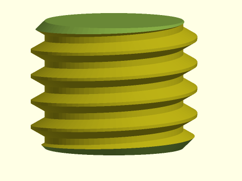

 

**Figure 1.2:** A properly mated screw and bolt with beveled ends

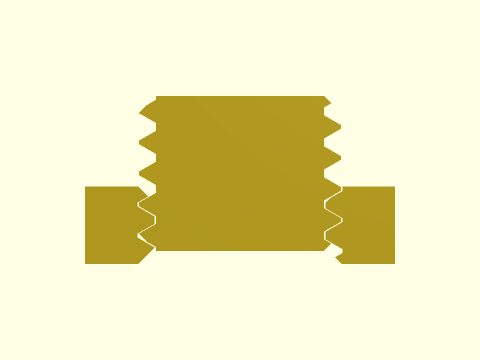

 

Cross threading occurs when the bolt is misaligned with the threads in the nut.
It can destroy the threads, or cause the nut to jam.  The standard beveled end process
makes cross threading a possibility because the beveled partial threads can pass
each other when the screw enters the nut.

**Figure 1.3:** 

 

In addition, those partial screw threads may be weak, and easily broken.  They do
not contribute to the strength of the assembly.
In 1891 Clinton A. Higbee received a patent for a modification to screw threads
https://patents.google.com/patent/US447775A meant to address these limitations.
Instead of beveling the end of the screw, Higbee said to remove the partial thread.
The resulting screw might look like this:

**Figure 1.4:** 

 

Because the threads are complete everywhere, cross threading is unlikely to occur.
This type of threading has been called "Higbee threads", but in recent machinist
handbooks it is called "blunt start" threading.
This style of thread is not commonly used in metal fasteners because it requires
machining the threads, which is much more costly than the rolling procedure described
above.  However, plastic threads usually have some sort of gradual thread end.
For 3D printed models, there is no reason to choose the standard
bevel end bolt, so in this library the blunt start threads are the default.
If you need standard bevel-end threads, you can choose them with the `blunt_start` options.
Note that blunt start threads are more efficient.

Various options exist for controlling the ends of threads. You can specify bevels on threaded rods.
In conventional threading, bevels are needed on the ends to remove sharp, thin edges, and
the bevel is sized to the full outer diameter of the threaded rod.
With blunt start threading, the bevel appears on the unthreaded part of the rod.
On a threaded rod, a bevel value of `true` or a positive bevel value cut off the corner.

**Figure 1.5:** 

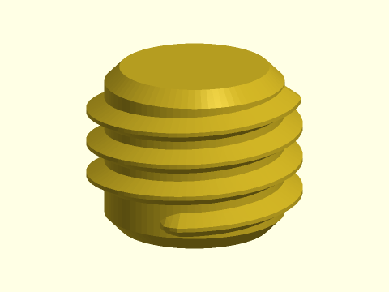

 

A negative bevel value produces a flaring bevel, that might be useful if the rod needs to mate with another part.
You can also set `bevel="reverse"` to get a flaring bevel of the default size.

**Figure 1.6:** Negative bevel on a regular threaded rod.

 

If you set `internal=true` to create a mask for a threaded hole, then bevels are reversed: positive bevels flare outward so that when you subtract
the threaded rod it gives a beveled edge to the hole.  In this case, negative bevels go inward, which might be useful to
create a bevel at the bottom of a threaded hole.

**Figure 1.7:** Threaded rod mask produced using `internal=true` with regular bevel at the top and reversed bevel at the bottom.

 

You can also extend the unthreaded section using the `end_len` parameters.  A long unthreaded section makes
it impossible to tilt the bolt and produce misaligned threads, so it could make assembly easier.

**Figure 1.8:** Negative bevel on a regular threaded rod.

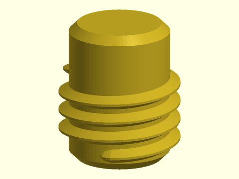

 

It is also possible to adjust the length of the lead-in section of threads, or the
shape of that lead-in section.  The lead-in length can be set using the `lead_in` arguments
to specify a length or the `lead_in_ang` arguments to specify an angle.  For general
threading applications, making the lead in long creates a smaller thread that could
be more fragile and more prone to cross threading.

**Figure 1.9:** 

 

To change the form of the thread end you use the `lead_in_shape` argument.
You can specify "sqrt", "cut" or "smooth" shapes.  The "sqrt" shape is the historical
shape used in the library.  The "cut" shape is available to model Higbee pattern threads, but
is not as good as the others in practice, because the flat faces on the threads can hit each other.
The lead-in shape is produced by applying a scale factor to the thread cross section that varies along the lead-in length.
You can also specify a custom shape
by giving a function literal, `f(x,L)` where `L` is the total linear
length of the lead-in section and `x` is a value between 0 and 1 giving
the position in the lead in, with 0 being the tip and 1 being the full height thread.
The return value must be a 2-vector giving the thread width scale and thread height
scale at that location.  If `x<0` the function must return a thread height scale
of zero, but it is usually best if the thread width scale does not go to zero,
because that results in a sharply-pointed thread end.  If `x>1` the function must
return `[1,1]`.

**Figure 1.10:** The standard lead in shapes

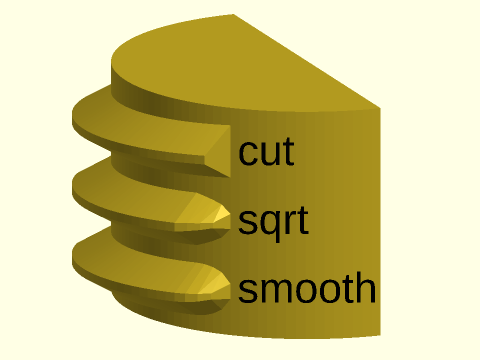

 

## Section: Standard (UTS/ISO) Threading

### Module: threaded\_rod()

**Synopsis:** Creates an UTS/ISO triangular threaded rod. [<abbr>Geom</abbr>]

**Topics:** [Threading](Topics#threading), [Screws](Topics#screws)

**See Also:** [threaded\_nut()](#module-threaded_nut)

**Usage:** 

- threaded_rod(d, l|length, pitch, [internal=], ...) [ATTACHMENTS];

**Description:** 

Constructs a standard ISO (metric) or UTS (English) threaded rod.  These threads are close to triangular,
with a 60° thread angle.  You can give diameter value that specifies the outer diameter, producing
the "basic form", or you can
set `d` to a triplet `[d_min, d_pitch, d_major]`, which are parameters determined by the ISO and UTS specifications
that define clearance sizing for the threading.  See [screws.scad](screws.scad) for making screws
using the specification parameters.

**Arguments:** 

<abbr title="These args can be used by position or by name.">By&nbsp;Position</abbr> | What it does
-------------------- | ------------
`d`                  | Outer diameter of threaded rod, or a triplet of [d_min, d_pitch, d_major].
`l`                  / `length`             / `h`                  / `height`             | length of threaded rod.
`pitch`              | Length between threads.

<abbr title="These args must be used by name, ie: name=value">By&nbsp;Name</abbr> | What it does
-------------------- | ------------
`left_handed`        | if true, create left-handed threads.  Default = false
`starts`             | The number of lead starts.  Default: 1
`bevel`              | Sets bevel for both ends. Set to true for default size, a number to specify a bevel size, false for no bevel, and "reverse" for an inverted bevel. Default: false for blunt start ends, true otherwise
`bevel1`             | Set bevel for bottom end.
`bevel2`             | Set bevel for top end.
`internal`           | If true, make this a mask for making internal threads.
`d1`                 | Bottom outside diameter of threads.
`d2`                 | Top outside diameter of threads.
`blunt_start`        | If true apply truncated blunt start threads at both ends.  Default: true
`blunt_start1`       | If true apply truncated blunt start threads bottom end.
`blunt_start2`       | If true apply truncated blunt start threads top end.
`end_len`            | Specify the unthreaded length at the end after blunt start threads.  Default: 0
`end_len1`           | Specify unthreaded length at the bottom
`end_len2`           | Specify unthreaded length at the top
`lead_in`            | Specify linear length of the lead in section of the threading with blunt start threads
`lead_in1`           | Specify linear length of the lead in section of the threading at the bottom with blunt start threads
`lead_in2`           | Specify linear length of the lead in section of the threading at the top with blunt start threads
`lead_in_ang`        | Specify angular length in degrees of the lead in section of the threading with blunt start threads
`lead_in_ang1`       | Specify angular length in degrees of the lead in section of the threading at the bottom with blunt start threads
`lead_in_ang2`       | Specify angular length in degrees of the lead in section of the threading at the top with blunt start threads
`lead_in_shape`      | Specify the shape of the thread lead in by giving a text string or function.  Default: "default"
`teardrop`           | If true, adds a teardrop profile to the back (Y+) side of the threaded rod, for 3d printability of horizontal holes. If numeric, specifies the proportional extra distance of the teardrop flat top from the screw center, or set to "max" for a pointed teardrop. Default: false
`anchor`             | Translate so anchor point is at origin (0,0,0).  See [anchor](attachments.scad#subsection-anchor).  Default: `CENTER`
`spin`               | Rotate this many degrees around the Z axis after anchor.  See [spin](attachments.scad#subsection-spin). Default: 0
`orient`             | Vector to rotate top toward, after spin.  See [orient](attachments.scad#subsection-orient).  Default: `UP`
`$slop`              | The printer-specific slop value, which adds clearance (`4*$slop`) to internal threads.

**Example 1:** 

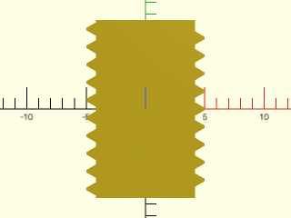

    include <BOSL2/std.scad>
    include <BOSL2/threading.scad>
    projection(cut=true)
        threaded_rod(d=10, l=15, pitch=1.5, orient=BACK);

  

**Example 2:** 

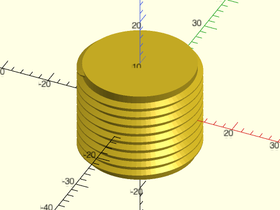

 

    include <BOSL2/std.scad>
    include <BOSL2/threading.scad>
    threaded_rod(d=25, height=20, pitch=2, $fa=1, $fs=1);

**Example 3:** 

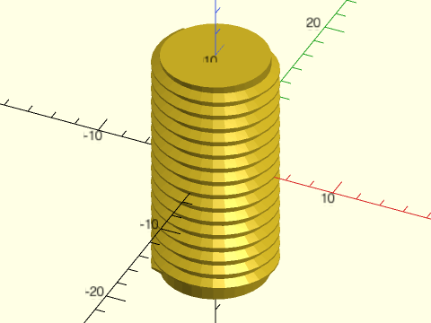

 

    include <BOSL2/std.scad>
    include <BOSL2/threading.scad>
    threaded_rod(d=10, l=20, pitch=1.25, left_handed=true, $fa=1, $fs=1);

**Example 4:** 

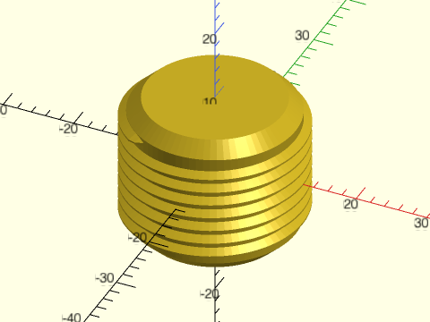

 

    include <BOSL2/std.scad>
    include <BOSL2/threading.scad>
    threaded_rod(d=25, l=20, pitch=2, $fa=1, $fs=1, end_len=1.5, bevel=true);

**Example 5:** 

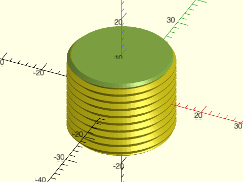

 

    include <BOSL2/std.scad>
    include <BOSL2/threading.scad>
    threaded_rod(d=25, l=20, pitch=2, $fa=1, $fs=1, blunt_start=false);

**Example 6:** Masking a Horizontal Threaded Hole

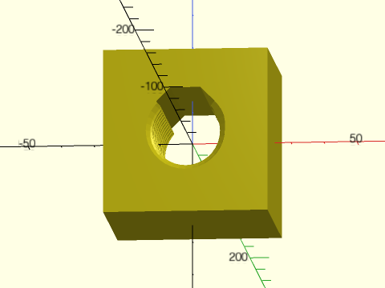

    include <BOSL2/std.scad>
    include <BOSL2/threading.scad>
    difference() {
      cuboid(50);
      threaded_rod(
          d=25, l=51, pitch=4, $fn=36,
          internal=true, bevel=true,
          blunt_start=false,
          teardrop=true, orient=FWD
      );
    }

  

**Example 7:** Diamond threading where both left-handed and right-handed nuts travel (in the same direction) on the threaded rod:

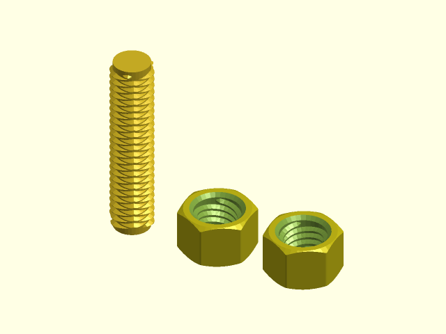

 

    include <BOSL2/std.scad>
    include <BOSL2/threading.scad>
    $fn=32;
    $slop = 0.075;
    d = 3/8*INCH;
    pitch = 1/16*INCH;
    starts=3;
    xdistribute(19){
        intersection(){
          threaded_rod(l=40, pitch=pitch, d=d,starts=starts,anchor=BOTTOM,end_len=.44);
          threaded_rod(l=40, pitch=pitch, d=d, left_handed=true,starts=starts,anchor=BOTTOM);
        }
        threaded_nut(nutwidth=4.5/8*INCH,id=d,h=3/8*INCH,pitch=pitch,starts=starts,anchor=BOTTOM);
        threaded_nut(nutwidth=4.5/8*INCH,id=d,h=3/8*INCH,pitch=pitch,starts=starts,left_handed=true,anchor=BOTTOM);
    }

---

### Module: threaded\_nut()

**Synopsis:** Creates an UTS/ISO triangular threaded nut. [<abbr>Geom</abbr>]

**Topics:** [Threading](Topics#threading), [Screws](Topics#screws)

**See Also:** [threaded\_rod()](#module-threaded_rod)

**Usage:** 

- threaded_nut(nutwidth, id, h|height|thickness, pitch,...) [ATTACHMENTS];

**Description:** 

Constructs a hex nut or square nut for an ISO (metric) or UTS (English) threaded rod.
The inner diameter is measured from the bottom of the threads.

**Arguments:** 

<abbr title="These args can be used by position or by name.">By&nbsp;Position</abbr> | What it does
-------------------- | ------------
`nutwidth`           | flat to flat width of nut
`id`                 | inner diameter of threaded hole, measured from bottom of threads
`h`                  / `height`             / `l`                  / `length`             / `thickness`          | height/thickness of nut. Only `h` is positional, others must be named.
`pitch`              | Distance between threads, or zero for no threads.

<abbr title="These args must be used by name, ie: name=value">By&nbsp;Name</abbr> | What it does
-------------------- | ------------
`shape`              | specifies shape of nut, either "hex" or "square".  Default: "hex"
`left_handed`        | if true, create left-handed threads.  Default = false
`starts`             | The number of lead starts.  Default: 1
`bevel`              | if true, bevel the outside of the nut.  Default: true for hex nuts, false for square nuts
`bevel1`             | if true, bevel the outside of the nut bottom.
`bevel2`             | if true, bevel the outside of the nut top.
`bevang`             | set the angle for the outside nut bevel.  Default: 30
`ibevel`             | if true, bevel the inside (the hole).   Default: true
`ibevel1`            | if true bevel the inside, bottom end.
`ibevel2`            | if true bevel the inside, top end.
`blunt_start`        | If true apply truncated blunt start threads at both ends.  Default: true
`blunt_start1`       | If true apply truncated blunt start threads bottom end.
`blunt_start2`       | If true apply truncated blunt start threads top end.
`end_len`            | Specify the unthreaded length at the end after blunt start threads.  Default: 0
`end_len1`           | Specify unthreaded length at the bottom
`end_len2`           | Specify unthreaded length at the top
`lead_in`            | Specify linear length of the lead in section of the threading with blunt start threads
`lead_in1`           | Specify linear length of the lead in section of the threading at the bottom with blunt start threads
`lead_in2`           | Specify linear length of the lead in section of the threading at the top with blunt start threads
`lead_in_ang`        | Specify angular length in degrees of the lead in section of the threading with blunt start threads
`lead_in_ang1`       | Specify angular length in degrees of the lead in section of the threading at the bottom with blunt start threads
`lead_in_ang2`       | Specify angular length in degrees of the lead in section of the threading at the top with blunt start threads
`lead_in_shape`      | Specify the shape of the thread lead in by giving a text string or function.  Default: "default"
`anchor`             | Translate so anchor point is at origin (0,0,0).  See [anchor](attachments.scad#subsection-anchor).  Default: `CENTER`
`spin`               | Rotate this many degrees around the Z axis after anchor.  See [spin](attachments.scad#subsection-spin). Default: 0
`orient`             | Vector to rotate top toward, after spin.  See [orient](attachments.scad#subsection-orient).  Default: `UP`
`$slop`              | The printer-specific slop value, which adds clearance (`4*$slop`) to internal threads.

**Example 1:** 

 

    include <BOSL2/std.scad>
    include <BOSL2/threading.scad>
    threaded_nut(nutwidth=16, id=8, h=8, pitch=1.25, $slop=0.05, $fa=1, $fs=1);

**Example 2:** 

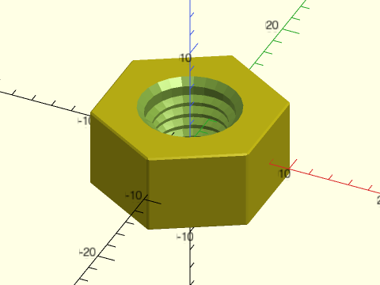

 

    include <BOSL2/std.scad>
    include <BOSL2/threading.scad>
    threaded_nut(nutwidth=16, id=8, h=8, pitch=1.25, left_handed=true, bevel=false, $slop=0.1, $fa=1, $fs=1);

**Example 3:** 

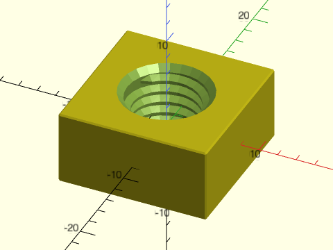

 

    include <BOSL2/std.scad>
    include <BOSL2/threading.scad>
    threaded_nut(shape="square", nutwidth=16, id=8, h=8, pitch=1.25, $slop=0.1, $fa=1, $fs=1);

**Example 4:** 

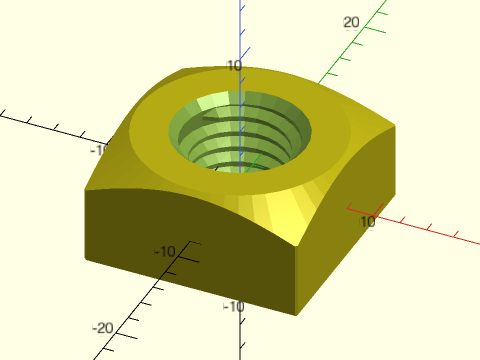

 

    include <BOSL2/std.scad>
    include <BOSL2/threading.scad>
    threaded_nut(shape="square", nutwidth=16, id=8, h=8, pitch=1.25, bevel2=true, $slop=0.1, $fa=1, $fs=1);

**Example 5:** 

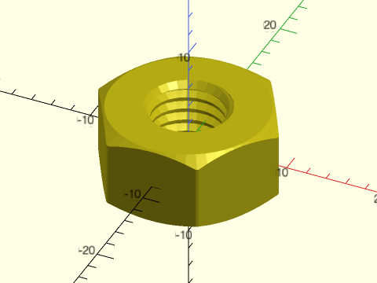

 

    include <BOSL2/std.scad>
    include <BOSL2/threading.scad>
    rot(90)threaded_nut(nutwidth=16, id=8, h=8, pitch=1.25,blunt_start=false, $slop=0.1, $fa=1, $fs=1);

---

## Section: Trapezoidal Threading

### Module: trapezoidal\_threaded\_rod()

**Synopsis:** Creates a trapezoidal threaded rod. [<abbr>Geom</abbr>]

**Topics:** [Threading](Topics#threading), [Screws](Topics#screws)

**See Also:** [trapezoidal\_threaded\_nut()](#module-trapezoidal_threaded_nut)

**Usage:** 

- trapezoidal_threaded_rod(d, l|length, pitch, [thread_angle=|flank_angle=], [thread_depth=], [internal=], ...) [ATTACHMENTS];

**Description:** 

Constructs a threaded rod with a symmetric trapezoidal thread.  Trapezoidal threads are used for lead screws because
they are one of the strongest symmetric profiles.  This tooth shape is stronger than a similarly
sized square thread becuase of its wider base.  However, it does place a radial load on the nut, unlike the square thread.
For loads in only one direction the asymmetric buttress thread profile can bear greater loads.

By default produces the nominal dimensions
for metric trapezoidal threads: a thread angle of 30° and a depth set to half the pitch.
You can also specify your own trapezoid parameters.  For ACME threads see acme_threaded_rod().

**Figure 3.1.1:** 

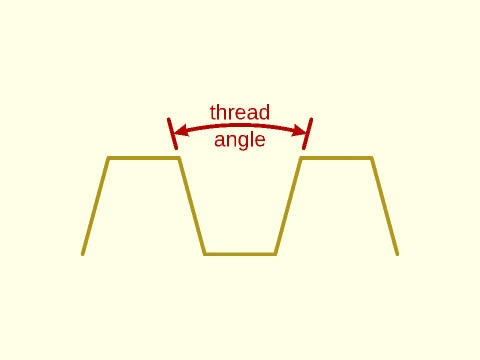

 

**Figure 3.1.2:** 

 

**Arguments:** 

<abbr title="These args can be used by position or by name.">By&nbsp;Position</abbr> | What it does
-------------------- | ------------
`d`                  | Outer diameter of threaded rod.
`l`                  / `length`             / `h`                  / `height`             | Length of threaded rod.
`pitch`              | Thread spacing.

<abbr title="These args must be used by name, ie: name=value">By&nbsp;Name</abbr> | What it does
-------------------- | ------------
`thread_angle`       | Angle between two thread faces.  Default: 30
`thread_depth`       | Depth of threads.  Default: pitch/2
`flank_angle`        | Angle of thread faces to plane perpendicular to screw.
`left_handed`        | If true, create left-handed threads.  Default: false
`starts`             | The number of lead starts.  Default: 1
`bevel`              | Sets bevel for both ends. Set to true for default size, a number to specify a bevel size, false for no bevel, and "reverse" for an inverted bevel. Default: false for blunt start ends, true otherwise
`bevel1`             | Set bevel for bottom end.
`bevel2`             | Set bevel for top end.
`internal`           | If true, make this a mask for making internal threads.  Default: false
`d1`                 | Bottom outside diameter of threads.
`d2`                 | Top outside diameter of threads.
`blunt_start`        | If true apply truncated blunt start threads at both ends.  Default: true
`blunt_start1`       | If true apply truncated blunt start threads bottom end.
`blunt_start2`       | If true apply truncated blunt start threads top end.
`end_len`            | Specify the unthreaded length at the end after blunt start threads.  Default: 0
`end_len1`           | Specify unthreaded length at the bottom
`end_len2`           | Specify unthreaded length at the top
`lead_in`            | Specify linear length of the lead in section of the threading with blunt start threads
`lead_in1`           | Specify linear length of the lead in section of the threading at the bottom with blunt start threads
`lead_in2`           | Specify linear length of the lead in section of the threading at the top with blunt start threads
`lead_in_ang`        | Specify angular length in degrees of the lead in section of the threading with blunt start threads
`lead_in_ang1`       | Specify angular length in degrees of the lead in section of the threading at the bottom with blunt start threads
`lead_in_ang2`       | Specify angular length in degrees of the lead in section of the threading at the top with blunt start threads
`lead_in_shape`      | Specify the shape of the thread lead in by giving a text string or function.  Default: "default"
`teardrop`           | If true, adds a teardrop profile to the back (Y+) side of the threaded rod, for 3d printability of horizontal holes. If numeric, specifies the proportional extra distance of the teardrop flat top from the screw center, or set to "max" for a pointed teardrop. Default: false
`anchor`             | Translate so anchor point is at origin (0,0,0).  See [anchor](attachments.scad#subsection-anchor).  Default: `CENTER`
`spin`               | Rotate this many degrees around the Z axis after anchor.  See [spin](attachments.scad#subsection-spin). Default: 0
`orient`             | Vector to rotate top toward, after spin.  See [orient](attachments.scad#subsection-orient).  Default: `UP`
`$slop`              | The printer-specific slop value, which adds clearance (`4*$slop`) to internal threads.

**Example 1:** A threaded rod profile.

    include <BOSL2/std.scad>
    include <BOSL2/threading.scad>
    projection(cut=true)
        trapezoidal_threaded_rod(d=10, l=15, pitch=2,
           orient=BACK);

  

**Example 2:** Standard metric threading

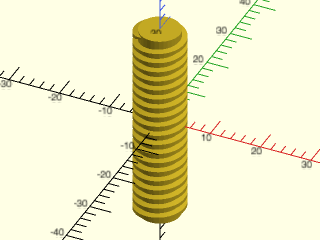

    include <BOSL2/std.scad>
    include <BOSL2/threading.scad>
    trapezoidal_threaded_rod(d=10, l=40, pitch=2, $fn=32);

  

**Example 3:** Standard metric threading with `blunt_start` disabled, causing `bevel=true` to be the default.

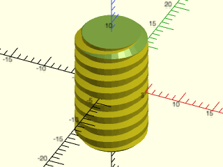

    include <BOSL2/std.scad>
    include <BOSL2/threading.scad>
    rot(-65) trapezoidal_threaded_rod(d=10, l=17, pitch=2,
        blunt_start=false, $fn=32);

  

**Example 4:** Standard metric threading with default `blunt_start=true` and forced `bevel=true`.

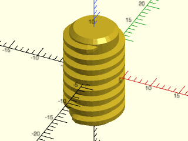

    include <BOSL2/std.scad>
    include <BOSL2/threading.scad>
    trapezoidal_threaded_rod(d=10, l=17, pitch=2,
        bevel=true, $fn=32);

  

**Example 5:** Standard metric left-hand threadh

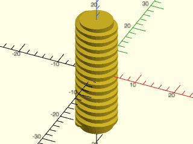

    include <BOSL2/std.scad>
    include <BOSL2/threading.scad>
    trapezoidal_threaded_rod(d=10, h=30, pitch=2,
        left_handed=true, $fa=1, $fs=1);

  

**Example 6:** Triple left-hand thread.

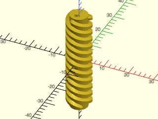

    include <BOSL2/std.scad>
    include <BOSL2/threading.scad>
    trapezoidal_threaded_rod(d=10, l=40, pitch=3,
        left_handed=true, starts=3, $fn=36);

  

**Example 7:** Triple thread with anchoring and orientation demonstrated.

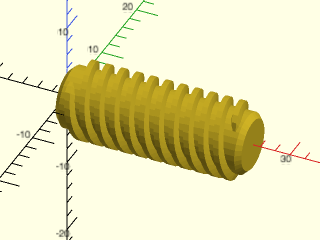

    include <BOSL2/std.scad>
    include <BOSL2/threading.scad>
    trapezoidal_threaded_rod(l=25, d=10, pitch=2,
        starts=3, $fa=1, $fs=1, bevel=true,
        orient=RIGHT, anchor=BOTTOM);

  

**Example 8:** A 90° thread, resulting in 45° slopes friendly for 3D printing.

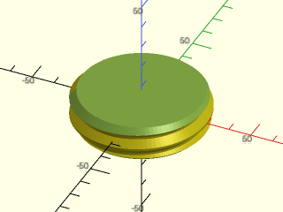

    include <BOSL2/std.scad>
    include <BOSL2/threading.scad>
    trapezoidal_threaded_rod(d=60, l=16, pitch=8,
        thread_depth=3, thread_angle=90,
        blunt_start=false, $fa=2, $fs=2);

  

**Example 9:** A 90° thread occupying the full length of the rod.

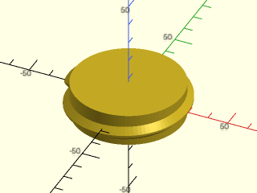

    include <BOSL2/std.scad>
    include <BOSL2/threading.scad>
    trapezoidal_threaded_rod(d=60, l=16, pitch=8,
        thread_depth=3, thread_angle=90,
        end_len=0, $fa=2, $fs=2);

  

**Example 10:** Quadruple left-handed 90° threads on a short cylinder, approximating fastening lugs.

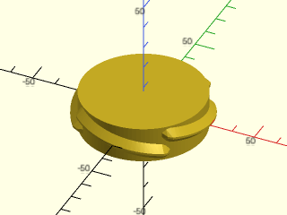

    include <BOSL2/std.scad>
    include <BOSL2/threading.scad>
    trapezoidal_threaded_rod(d=60, l=16, pitch=8,
        thread_depth=3, thread_angle=90,
        left_handed=true, starts=4,
        $fa=2, $fs=2,end_len=0);

  

**Example 11:** 

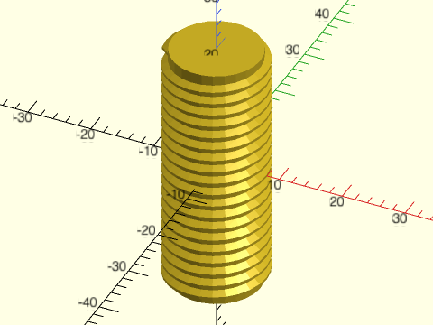

    include <BOSL2/std.scad>
    include <BOSL2/threading.scad>
    trapezoidal_threaded_rod(d=16, l=40,
        pitch=2, thread_angle=60);

  

**Example 12:** 

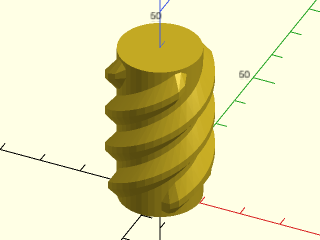

    include <BOSL2/std.scad>
    include <BOSL2/threading.scad>
    trapezoidal_threaded_rod(d=25, l=40,
        pitch=10, thread_depth=8/3,
        thread_angle=100, starts=4, anchor=BOT,
        $fa=2, $fs=2,end_len=-2);

  

**Example 13:** 

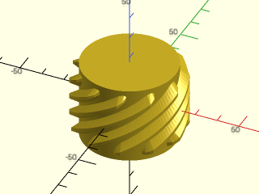

    include <BOSL2/std.scad>
    include <BOSL2/threading.scad>
    trapezoidal_threaded_rod(d=50, l=35,
        pitch=8, thread_angle=60,
        starts=11, lead_in=3, $fn=120);

  

**Example 14:** Unthreaded top end section

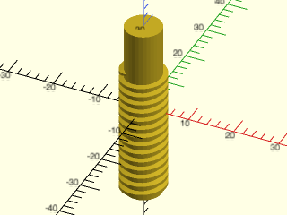

    include <BOSL2/std.scad>
    include <BOSL2/threading.scad>
    trapezoidal_threaded_rod(d=10, l=40,
        end_len2=10, pitch=2, $fn=32);

  

**Example 15:** Using as a mask to make internal threads

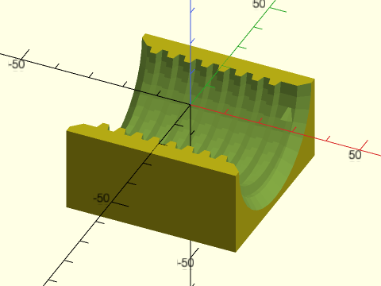

 

    include <BOSL2/std.scad>
    include <BOSL2/threading.scad>
    bottom_half() difference() {
        cube(50, center=true);
        trapezoidal_threaded_rod(d=40, l=51, pitch=5, thread_angle=30, internal=true, bevel=true, orient=RIGHT, $fn=36);
    }

**Example 16:** Masking a horizontal threaded hole

    include <BOSL2/std.scad>
    include <BOSL2/threading.scad>
    difference() {
      cuboid(50);
      trapezoidal_threaded_rod(
          d=25, l=51, pitch=4, $fn=36,
          thread_angle=30,
          internal=true, bevel=true,
          blunt_start=false,
          teardrop=true, orient=FWD
      );
    }

  

---

### Module: trapezoidal\_threaded\_nut()

**Synopsis:** Creates a trapezoidal threaded nut. [<abbr>Geom</abbr>]

**Topics:** [Threading](Topics#threading), [Screws](Topics#screws)

**See Also:** [trapezoidal\_threaded\_rod()](#module-trapezoidal_threaded_rod)

**Usage:** 

- trapezoidal_threaded_nut(nutwidth, id, h|height|thickness, pitch, [thread_angle=|flank_angle=], [thread_depth], ...) [ATTACHMENTS];

**Description:** 

Constructs a hex nut or square nut for a symmetric trapzoidal threaded rod.  By default produces
the nominal dimensions for metric trapezoidal threads: a thread angle of 30° and a depth
set to half the pitch.  You can also specify your own trapezoid parameters.  For ACME threads see
acme_threaded_nut().

**Arguments:** 

<abbr title="These args can be used by position or by name.">By&nbsp;Position</abbr> | What it does
-------------------- | ------------
`nutwidth`           | flat to flat width of nut
`id`                 | inner diameter of threaded hole, measured from bottom of threads
`h`                  / `height`             / `l`                  / `length`             / `thickness`          | height/thickness of nut.
`pitch`              | Thread spacing.

<abbr title="These args must be used by name, ie: name=value">By&nbsp;Name</abbr> | What it does
-------------------- | ------------
`thread_angle`       | Angle between two thread faces.  Default: 30
`thread_depth`       | Depth of the threads.  Default: pitch/2
`flank_angle`        | Angle of thread faces to plane perpendicular to screw.
`shape`              | specifies shape of nut, either "hex" or "square".  Default: "hex"
`left_handed`        | if true, create left-handed threads.  Default = false
`starts`             | The number of lead starts.  Default = 1
`bevel`              | if true, bevel the outside of the nut.  Default: true for hex nuts, false for square nuts
`bevel1`             | if true, bevel the outside of the nut bottom.
`bevel2`             | if true, bevel the outside of the nut top.
`bevang`             | set the angle for the outside nut bevel.  Default: 30
`ibevel`             | if true, bevel the inside (the hole).   Default: true
`ibevel1`            | if true bevel the inside, bottom end.
`ibevel2`            | if true bevel the inside, top end.
`blunt_start`        | If true apply truncated blunt start threads at both ends.  Default: true
`blunt_start1`       | If true apply truncated blunt start threads bottom end.
`blunt_start2`       | If true apply truncated blunt start threads top end.
`end_len`            | Specify the unthreaded length at the end after blunt start threads.  Default: 0
`end_len1`           | Specify unthreaded length at the bottom
`end_len2`           | Specify unthreaded length at the top
`lead_in`            | Specify linear length of the lead in section of the threading with blunt start threads
`lead_in1`           | Specify linear length of the lead in section of the threading at the bottom with blunt start threads
`lead_in2`           | Specify linear length of the lead in section of the threading at the top with blunt start threads
`lead_in_ang`        | Specify angular length in degrees of the lead in section of the threading with blunt start threads
`lead_in_ang1`       | Specify angular length in degrees of the lead in section of the threading at the bottom with blunt start threads
`lead_in_ang2`       | Specify angular length in degrees of the lead in section of the threading at the top with blunt start threads
`lead_in_shape`      | Specify the shape of the thread lead in by giving a text string or function.  Default: "default"
`anchor`             | Translate so anchor point is at origin (0,0,0).  See [anchor](attachments.scad#subsection-anchor).  Default: `CENTER`
`spin`               | Rotate this many degrees around the Z axis after anchor.  See [spin](attachments.scad#subsection-spin). Default: 0
`orient`             | Vector to rotate top toward, after spin.  See [orient](attachments.scad#subsection-orient).  Default: `UP`
`$slop`              | The printer-specific slop value, which adds clearance (`4*$slop`) to internal threads.

**Example 1:** 

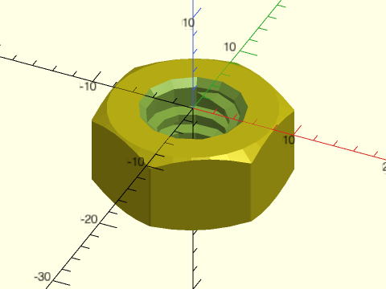

 

    include <BOSL2/std.scad>
    include <BOSL2/threading.scad>
    trapezoidal_threaded_nut(nutwidth=16, id=8, h=8, pitch=2, $slop=0.1, anchor=UP);

**Example 2:** 

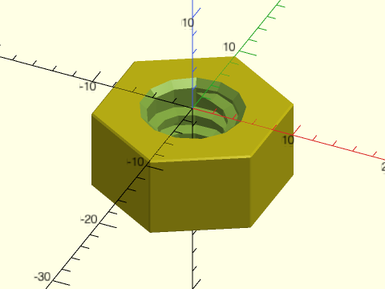

 

    include <BOSL2/std.scad>
    include <BOSL2/threading.scad>
    trapezoidal_threaded_nut(nutwidth=16, id=8, h=8, pitch=2, bevel=false, $slop=0.05, anchor=UP);

**Example 3:** 

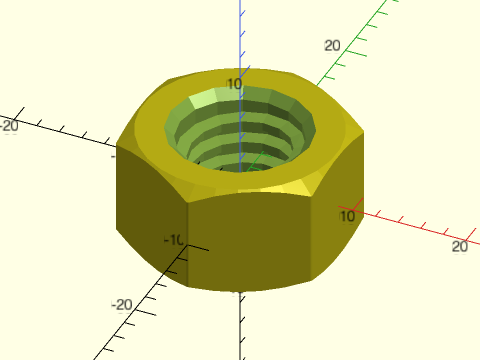

 

    include <BOSL2/std.scad>
    include <BOSL2/threading.scad>
    trapezoidal_threaded_nut(nutwidth=17.4, id=10, h=10, pitch=2, $slop=0.1, left_handed=true);

**Example 4:** 

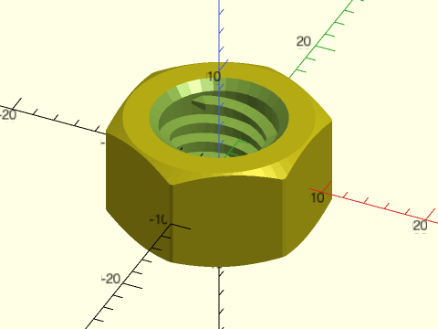

 

    include <BOSL2/std.scad>
    include <BOSL2/threading.scad>
    trapezoidal_threaded_nut(nutwidth=17.4, id=10, h=10, pitch=2, starts=3, $fa=1, $fs=1, $slop=0.15);

**Example 5:** 

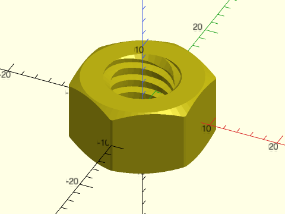

 

    include <BOSL2/std.scad>
    include <BOSL2/threading.scad>
    trapezoidal_threaded_nut(nutwidth=17.4, id=10, h=10, pitch=2, starts=3, $fa=1, $fs=1, $slop=0.15, blunt_start=false);

**Example 6:** 

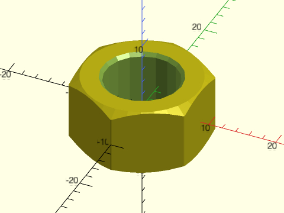

 

    include <BOSL2/std.scad>
    include <BOSL2/threading.scad>
    trapezoidal_threaded_nut(nutwidth=17.4, id=10, h=10, pitch=0, $slop=0.2);   // No threads

---

### Module: acme\_threaded\_rod()

**Synopsis:** Creates an ACME threaded rod. [<abbr>Geom</abbr>]

**Topics:** [Threading](Topics#threading), [Screws](Topics#screws)

**See Also:** [acme\_threaded\_nut()](#module-acme_threaded_nut)

**Usage:** 

- acme_threaded_rod(d, l|length, tpi|pitch=, [internal=], ...) [ATTACHMENTS];

**Description:** 

Constructs an ACME trapezoidal threaded screw rod.  This form has a 29° thread angle with a
symmetric trapezoidal thread.

**Arguments:** 

<abbr title="These args can be used by position or by name.">By&nbsp;Position</abbr> | What it does
-------------------- | ------------
`d`                  | Outer diameter of threaded rod.
`l`                  / `length`             / `h`                  / `height`             | Length of threaded rod.
`tpi`                | threads per inch.

<abbr title="These args must be used by name, ie: name=value">By&nbsp;Name</abbr> | What it does
-------------------- | ------------
`pitch`              | thread spacing (alternative to tpi)
`starts`             | The number of lead starts.  Default = 1
`left_handed`        | if true, create left-handed threads.  Default = false
`bevel`              | Sets bevel for both ends. Set to true for default size, a number to specify a bevel size, false for no bevel, and "reverse" for an inverted bevel. Default: false for blunt start ends, true otherwise
`bevel1`             | Set bevel for bottom end.
`bevel2`             | Set bevel for top end.
`internal`           | If true, this is a mask for making internal threads.
`blunt_start`        | If true apply truncated blunt start threads at both ends.  Default: true
`blunt_start1`       | If true apply truncated blunt start threads bottom end.
`blunt_start2`       | If true apply truncated blunt start threads top end.
`end_len`            | Specify the unthreaded length at the end after blunt start threads.  Default: 0
`end_len1`           | Specify unthreaded length at the bottom
`end_len2`           | Specify unthreaded length at the top
`lead_in`            | Specify linear length of the lead in section of the threading with blunt start threads
`lead_in1`           | Specify linear length of the lead in section of the threading at the bottom with blunt start threads
`lead_in2`           | Specify linear length of the lead in section of the threading at the top with blunt start threads
`lead_in_ang`        | Specify angular length in degrees of the lead in section of the threading with blunt start threads
`lead_in_ang1`       | Specify angular length in degrees of the lead in section of the threading at the bottom with blunt start threads
`lead_in_ang2`       | Specify angular length in degrees of the lead in section of the threading at the top with blunt start threads
`lead_in_shape`      | Specify the shape of the thread lead in by giving a text string or function.  Default: "default"
`teardrop`           | If true, adds a teardrop profile to the back (Y+) side of the threaded rod, for 3d printability of horizontal holes. If numeric, specifies the proportional extra distance of the teardrop flat top from the screw center, or set to "max" for a pointed teardrop. Default: false
`anchor`             | Translate so anchor point is at origin (0,0,0).  See [anchor](attachments.scad#subsection-anchor).  Default: `CENTER`
`spin`               | Rotate this many degrees around the Z axis after anchor.  See [spin](attachments.scad#subsection-spin). Default: 0
`orient`             | Vector to rotate top toward, after spin.  See [orient](attachments.scad#subsection-orient).  Default: `UP`
`$slop`              | The printer-specific slop value, which adds clearance (`4*$slop`) to internal threads.

**Example 1:** 

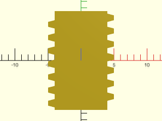

    include <BOSL2/std.scad>
    include <BOSL2/threading.scad>
    projection(cut=true)
        acme_threaded_rod(d=10, l=15, pitch=2, orient=BACK);

  

**Example 2:** 

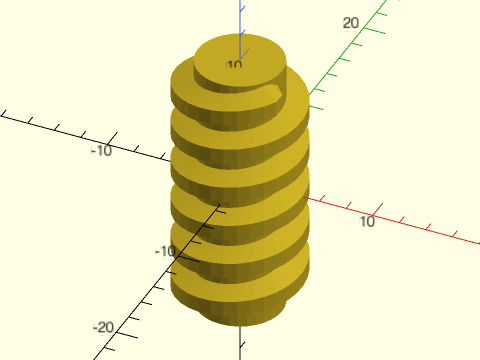

 

    include <BOSL2/std.scad>
    include <BOSL2/threading.scad>
    acme_threaded_rod(d=3/8*INCH, l=20, pitch=1/8*INCH, $fn=32);

**Example 3:** 

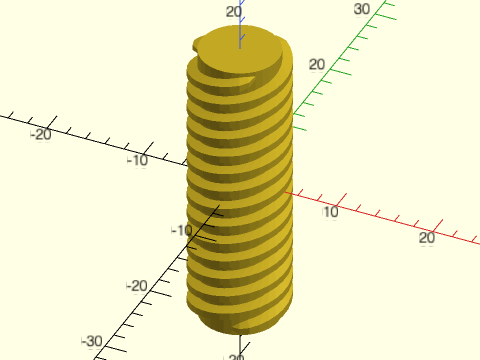

 

    include <BOSL2/std.scad>
    include <BOSL2/threading.scad>
    acme_threaded_rod(d=10, l=30, pitch=2, starts=3, $fa=1, $fs=1);

**Example 4:** Masking a Horizontal Threaded Hole

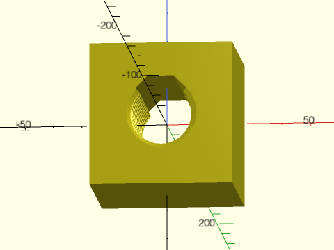

    include <BOSL2/std.scad>
    include <BOSL2/threading.scad>
    difference() {
      cuboid(50);
      acme_threaded_rod(
          d=25, l=51, pitch=4, $fn=36,
          internal=true, bevel=true,
          blunt_start=false,
          teardrop=true, orient=FWD
      );
    }

  

---

### Module: acme\_threaded\_nut()

**Synopsis:** Creates an ACME threaded nut. [<abbr>Geom</abbr>]

**Topics:** [Threading](Topics#threading), [Screws](Topics#screws)

**See Also:** [acme\_threaded\_rod()](#module-acme_threaded_rod)

**Usage:** 

- acme_threaded_nut(nutwidth, id, h|height|thickness, tpi|pitch=, [shape=], ...) [ATTACHMENTS];

**Description:** 

Constructs a hexagonal or square nut for an ACME threaded screw rod.

**Arguments:** 

<abbr title="These args can be used by position or by name.">By&nbsp;Position</abbr> | What it does
-------------------- | ------------
`nutwidth`           | flat to flat width of nut.
`id`                 | inner diameter of threaded hole, measured from bottom of threads
`h`                  / `height`             / `l`                  / `length`             / `thickness`          | height/thickness of nut.
`tpi`                | threads per inch

<abbr title="These args must be used by name, ie: name=value">By&nbsp;Name</abbr> | What it does
-------------------- | ------------
`pitch`              | Thread spacing (alternative to tpi)
`shape`              | specifies shape of nut, either "hex" or "square".  Default: "hex"
`left_handed`        | if true, create left-handed threads.  Default = false
`starts`             | Number of lead starts.  Default: 1
`bevel`              | if true, bevel the outside of the nut.  Default: true for hex nuts, false for square nuts
`bevel1`             | if true, bevel the outside of the nut bottom.
`bevel2`             | if true, bevel the outside of the nut top.
`bevang`             | set the angle for the outside nut bevel.  Default: 30
`ibevel`             | if true, bevel the inside (the hole).   Default: true
`ibevel1`            | if true bevel the inside, bottom end.
`ibevel2`            | if true bevel the inside, top end.
`blunt_start`        | If true apply truncated blunt start threads at both ends.  Default: true
`blunt_start1`       | If true apply truncated blunt start threads bottom end.
`blunt_start2`       | If true apply truncated blunt start threads top end.
`end_len`            | Specify the unthreaded length at the end after blunt start threads.  Default: 0
`end_len1`           | Specify unthreaded length at the bottom
`end_len2`           | Specify unthreaded length at the top
`lead_in`            | Specify linear length of the lead in section of the threading with blunt start threads
`lead_in1`           | Specify linear length of the lead in section of the threading at the bottom with blunt start threads
`lead_in2`           | Specify linear length of the lead in section of the threading at the top with blunt start threads
`lead_in_ang`        | Specify angular length in degrees of the lead in section of the threading with blunt start threads
`lead_in_ang1`       | Specify angular length in degrees of the lead in section of the threading at the bottom with blunt start threads
`lead_in_ang2`       | Specify angular length in degrees of the lead in section of the threading at the top with blunt start threads
`lead_in_shape`      | Specify the shape of the thread lead in by giving a text string or function.  Default: "default"
`anchor`             | Translate so anchor point is at origin (0,0,0).  See [anchor](attachments.scad#subsection-anchor).  Default: `CENTER`
`spin`               | Rotate this many degrees around the Z axis after anchor.  See [spin](attachments.scad#subsection-spin). Default: 0
`orient`             | Vector to rotate top toward, after spin.  See [orient](attachments.scad#subsection-orient).  Default: `UP`
`$slop`              | The printer-specific slop value, which adds clearance (`4*$slop`) to internal threads.

**Example 1:** 

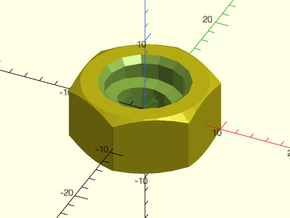

 

    include <BOSL2/std.scad>
    include <BOSL2/threading.scad>
    acme_threaded_nut(nutwidth=16, id=3/8*INCH, h=8, tpi=8, $slop=0.05);

**Example 2:** 

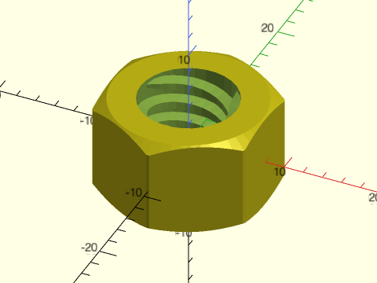

 

    include <BOSL2/std.scad>
    include <BOSL2/threading.scad>
    acme_threaded_nut(nutwidth=16, id=3/8*INCH, h=10, tpi=12, starts=3, $slop=0.1, $fa=1, $fs=1, ibevel=false);

**Example 3:** 

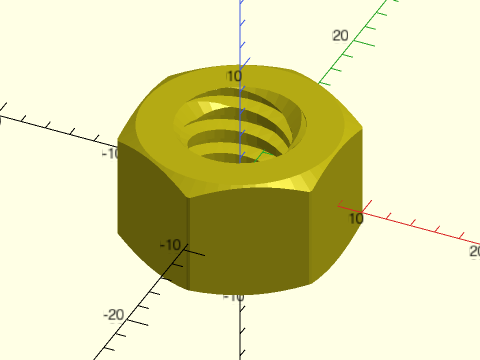

 

    include <BOSL2/std.scad>
    include <BOSL2/threading.scad>
    acme_threaded_nut(nutwidth=16, id=3/8*INCH, h=10, tpi=12, starts=3, $slop=0.1, $fa=1, $fs=1, blunt_start=false);

---

## Section: Garden hose connectors

The GHT ("garden hose thread") standard in the United States, its territories, and Canada uses the NH ("National Hose") designation. Specifically, the 3/4-11.5NH threads are full form threads produced by cutting threads in metal. A compatible standard 3/4-11.5NHR designates thin-walled couplers produced by rolling thin material, usually brass, typically found on cheaper hoses.

For the 3/4-11.5NH garden hose threads, ANSI-ASME B1.20.7 specifies a non-tapered thread 1+1/16 inches (27 mm) in diameter with a pitch of 11.5 threads per inch (TPI).
In other countries, a British Standard Pipe (BSP) thread is used, which is 14 TPI, not compatible with the GHT standard. These modules implement the GHT standard.

### Module: garden\_hose\_threaded\_rod()

**Synopsis:** Creates a threaded rod compatible with the North American garden hose thread. [<abbr>Geom</abbr>]

**Topics:** [Threading](Topics#threading), [Screws](Topics#screws)

**See Also:** [garden\_hose\_male()](#module-garden_hose_male), [garden\_hose\_female()](#module-garden_hose_female)

**Usage:** 

- garden_hose_threaded_rod(d, l|length, [internal=], ...) [ATTACHMENTS];

**Description:** 

Constructs a threaded rod compatible with 3/4-11.5NH garden hose threads as described by ANSI-ASME B1.20.7.

**Arguments:** 

<abbr title="These args can be used by position or by name.">By&nbsp;Position</abbr> | What it does
-------------------- | ------------
`l`                  / `length`             / `h`                  / `height`             | Length of threaded rod. Only `l` is positional, others must be named.

<abbr title="These args must be used by name, ie: name=value">By&nbsp;Name</abbr> | What it does
-------------------- | ------------
`bevel`              | Sets bevel for both ends. Set to true for default size, a number to specify a bevel size, false for no bevel, and "reverse" for an inverted bevel. Default: false for blunt start ends, true otherwise
`bevel1`             | Set bevel for bottom end.
`bevel2`             | Set bevel for top end.
`internal`           | If true, make this a mask for making internal threads.  Default: false
`blunt_start`        | If true apply truncated blunt start threads at both ends.  Default: true
`blunt_start1`       | If true apply truncated blunt start threads bottom end.
`blunt_start2`       | If true apply truncated blunt start threads top end.
`end_len`            | Specify the unthreaded length at the end after blunt start threads.  Default: 0
`end_len1`           | Specify unthreaded length at the bottom
`end_len2`           | Specify unthreaded length at the top
`lead_in`            | Specify linear length of the lead in section of the threading with blunt start threads
`lead_in1`           | Specify linear length of the lead in section of the threading at the bottom with blunt start threads
`lead_in2`           | Specify linear length of the lead in section of the threading at the top with blunt start threads
`lead_in_ang`        | Specify angular length in degrees of the lead in section of the threading with blunt start threads
`lead_in_ang1`       | Specify angular length in degrees of the lead in section of the threading at the bottom with blunt start threads
`lead_in_ang2`       | Specify angular length in degrees of the lead in section of the threading at the top with blunt start threads
`lead_in_shape`      | Specify the shape of the thread lead in by giving a text string or function.  Default: "default"
`teardrop`           | If true, adds a teardrop profile to the back (Y+) side of the threaded rod, for 3d printability of horizontal holes. If numeric, specifies the proportional extra distance of the teardrop flat top from the screw center, or set to "max" for a pointed teardrop. Default: false
`anchor`             | Translate so anchor point is at origin (0,0,0).  See [anchor](attachments.scad#subsection-anchor).  Default: `CENTER`
`spin`               | Rotate this many degrees around the Z axis after anchor.  See [spin](attachments.scad#subsection-spin). Default: 0
`orient`             | Vector to rotate top toward, after spin.  See [orient](attachments.scad#subsection-orient).  Default: `UP`
`$slop`              | The printer-specific slop value, which adds clearance (`4*$slop`) to internal threads.

**Example 1:** Garden hose threaded rod of arbitrary length.

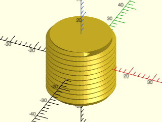

    include <BOSL2/std.scad>
    include <BOSL2/threading.scad>
    garden_hose_threaded_rod(l=25, $fn=60);

  

---

### Module: garden\_hose\_male()

**Synopsis:** Creates a male garden hose coupler [<abbr>Geom</abbr>]

**Topics:** [Threading](Topics#threading)

**See Also:** [garden\_hose\_female()](#module-garden_hose_female)

**Usage:** 

- garden_hose_male([wall], ...) [ATTACHMENTS];

**Description:** 

Constructs a standard male coupler compatible with a standard North American garden hose, using ANSI-ASME B1.20.7 specifications.
The `wall` thickness default is set to give the coupler an inner diameter of 25/32" according to the spec.
This results in a wall thickness sligtly over 2 mm, creating a ring-shaped surface that compresses a rubber gasket in the mating female coupler.
For structural integrity when 3D printing, you may want to make the wall thickness thicker, which would reduce the inner diameter and flow rate through the coupler.

**Arguments:** 

<abbr title="These args can be used by position or by name.">By&nbsp;Position</abbr> | What it does
-------------------- | ------------
`wall`               | wall thickness inside the inner thread diameter. Default = 2.13729
`anchor`             | Translate so anchor point is at origin (0,0,0). See [anchor](attachments.scad#subsection-anchor).  Default: `BOTTOM`
`spin`               | Rotate this many degrees around the Z axis after anchor. See [spin](attachments.scad#subsection-spin).  Default: 0
`orient`             | Vector to rotate top toward, after spin. See [orient](attachments.scad#subsection-orient). Default: `UP`

**Example 1:** 

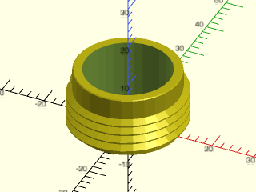

    include <BOSL2/std.scad>
    include <BOSL2/threading.scad>
    garden_hose_male();

  

---

### Module: garden\_hose\_female()

**Synopsis:** Creates a female garden hose coupler with textured surface [<abbr>Geom</abbr>]

**Topics:** [Threading](Topics#threading)

**See Also:** 

**Usage:** 

- garden_hose_female([gasket_seat], [wall=], [texture=], ...) [ATTACHMENTS];

**Description:** 

Constructs a female hose coupler compatible with a standard North American garden hose, using [ANSI-ASME B1.20.7 specifications](https://web.archive.org/web/20170826074605/http://gost-snip.su/download/asme_b1_20_7i991_hose_coupling_screw_threads_inch)
for the threads, with space to accommodate a rubber gasket assuming a standard 25/32" inner diameter.
The mating male coupler, if created with `garden_hose_male()`, may have a smaller inner diameter, which would still completely cover the gasket.

For structural integrity when 3D printing, the `wall` and `gasket_seat` parameters have arbitrary but reasonable default values. The larger these values, the stronger the part.

This design does not include a slip joint between the rotating collar and the pipe that seals against the gasket. The coupler consists of only a rotating collar that seals against the gasket, which should be lubricated with silicone grease to allow the gasket to slide between the male and female coupler while tightening.

**Arguments:** 

<abbr title="These args can be used by position or by name.">By&nbsp;Position</abbr> | What it does
-------------------- | ------------
`gasket_seat`        | thickness of structure that the rubber sealing gasket rests on. Default: 5
`addl_space`         | Millimeters of additional space between the threads and gasket seat, to accommodate a swivel tube with a brim. Default: 0
`wall`               | wall thickness around the thread outer diameter. Default: 5
`texture`            | texture for outside of coupler, one of "knurled", "ribbed", "sharp_ribbed", "hex_faces", or "none". Default: "none"
`anchor`             | Translate so anchor point is at origin (0,0,0). See [anchor](attachments.scad#subsection-anchor).  Default: `BOTTOM`
`spin`               | Rotate this many degrees around the Z axis after anchor. See [spin](attachments.scad#subsection-spin).  Default: 0
`orient`             | Vector to rotate top toward, after spin. See [orient](attachments.scad#subsection-orient). Default: `UP`

**Example 1:** Female garden hose connectors with different finishes. Clockwise from top: knurled, sharp\_knurled, ribbed, sharp\_ribbed. Center: hex\_faces.

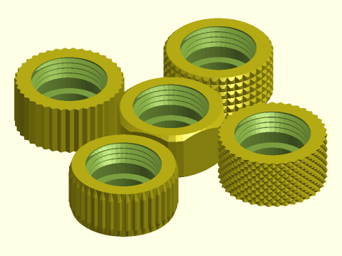

 

    include <BOSL2/std.scad>
    include <BOSL2/threading.scad>
    $fn = 48;
    back(40) garden_hose_female(texture="knurled");
    right(40) garden_hose_female(texture="sharp_knurled");
    fwd(40) garden_hose_female(texture="ribbed");
    left(40) garden_hose_female(texture="sharp_ribbed");
    garden_hose_female(texture="hex_faces");

---

### Module: garden\_hose\_gasket()

**Synopsis:** Creates a North American garden hose washer or gasket [<abbr>Geom</abbr>]

**Topics:** [Threading](Topics#threading)

**See Also:** [garden\_hose\_female()](#module-garden_hose_female)

**Usage:** 

- garden_hose_gasket([od=], [id=], [thickness=]) [ATTACHMENTS];

**Description:** 

Constructs a garden hose washer that fits inside a female hose coupler compatible with a standard North American garden hose. This would typically be 3D printed using TPU or another waterproof flexible material.

**Arguments:** 

<abbr title="These args can be used by position or by name.">By&nbsp;Position</abbr> | What it does
-------------------- | ------------
`od`                 | Outer diameter, normally 1" converted to millimeters. Default: 25.4
`id`                 | Inner diameter, normally 5/8" converted to millimeters. Default: 15.875
`thickness`          | Normally 1/8" thick, converted to millimeters. Default: 3
`anchor`             | Translate so anchor point is at origin (0,0,0). See [anchor](attachments.scad#subsection-anchor).  Default: `BOTTOM`
`spin`               | Rotate this many degrees around the Z axis after anchor. See [spin](attachments.scad#subsection-spin).  Default: 0
`orient`             | Vector to rotate top toward, after spin. See [orient](attachments.scad#subsection-orient).

**Example 1:** 

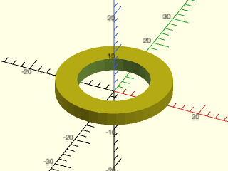

    include <BOSL2/std.scad>
    include <BOSL2/threading.scad>
    garden_hose_gasket();

  

**Example 2:** Cut-away assembly view of male hose connector (yellow), female hose connector (green), and hose gasket (brown).

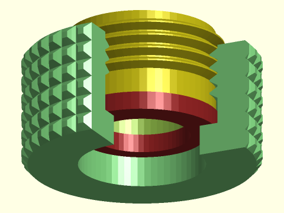

 

    include <BOSL2/std.scad>
    include <BOSL2/threading.scad>
    $fn = 60;
    color("lightgreen") difference() {
        garden_hose_female(texture="knurled");
        down(3) cube(25);
    }
    color("brown") up(5) garden_hose_gasket();
    up(8.01) zrot(60) xrot(180) garden_hose_male(anchor=TOP);

---

## Section: Pipe Threading

### Module: npt\_threaded\_rod()

**Synopsis:** Creates NPT pipe threading. [<abbr>Geom</abbr>]

**Topics:** [Threading](Topics#threading), [Screws](Topics#screws)

**See Also:** [acme\_threaded\_rod()](#module-acme_threaded_rod)

**Usage:** 

- npt_threaded_rod(size, [internal=], ...) [ATTACHMENTS];

**Description:** 

Constructs a standard NPT pipe end threading. If `internal=true`, creates a mask for making
internal pipe threads.  Tapers smaller upward if `internal=false`.  Tapers smaller downward
if `internal=true`.  If `hollow=true` and `internal=false`, then the pipe threads are
hollowed out into a pipe with the apropriate internal diameter.

**Arguments:** 

<abbr title="These args can be used by position or by name.">By&nbsp;Position</abbr> | What it does
-------------------- | ------------
`size`               | NPT standard pipe size in inches.  1/16", 1/8", 1/4", 3/8", 1/2", 3/4", 1", 1+1/4", 1+1/2", or 2".  Default: 1/2"

<abbr title="These args must be used by name, ie: name=value">By&nbsp;Name</abbr> | What it does
-------------------- | ------------
`left_handed`        | If true, create left-handed threads.  Default = false
`bevel`              | Sets bevel for both ends. Set to true for default size, a number to specify a bevel size, false for no bevel, and "reverse" for an inverted bevel. Default: false for blunt start ends, true otherwise
`bevel1`             | Set bevel for bottom end.
`bevel2`             | Set bevel for top end.
`hollow`             | If true, create a pipe with the correct internal diameter.
`internal`           | If true, make this a mask for making internal threads.
`anchor`             | Translate so anchor point is at origin (0,0,0).  See [anchor](attachments.scad#subsection-anchor).  Default: `CENTER`
`spin`               | Rotate this many degrees around the Z axis after anchor.  See [spin](attachments.scad#subsection-spin). Default: 0
`orient`             | Vector to rotate top toward, after spin.  See [orient](attachments.scad#subsection-orient).  Default: `UP`
`$slop`              | The printer-specific slop value, which adds clearance (`4*$slop`) to internal threads.

**Example 1:** The straight gray rectangle reveals the tapered threads.

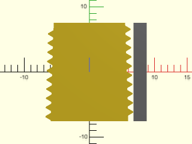

 

    include <BOSL2/std.scad>
    include <BOSL2/threading.scad>
    projection(cut=true) npt_threaded_rod(size=1/4, orient=BACK);
    right(.533*INCH/2) color("gray") rect([2,0.5946*INCH],anchor=LEFT);

**Example 2:** 

    include <BOSL2/std.scad>
    include <BOSL2/threading.scad>
    npt_threaded_rod(size=3/8, $fn=72);

  

**Example 3:** 

 

    include <BOSL2/std.scad>
    include <BOSL2/threading.scad>
    npt_threaded_rod(size=1/2, $fn=72, bevel=true);

**Example 4:** 

 

    include <BOSL2/std.scad>
    include <BOSL2/threading.scad>
    npt_threaded_rod(size=1/2, left_handed=true, $fn=72);

**Example 5:** 

 

    include <BOSL2/std.scad>
    include <BOSL2/threading.scad>
    npt_threaded_rod(size=3/4, hollow=true, $fn=96);

**Example 6:** 

 

    include <BOSL2/std.scad>
    include <BOSL2/threading.scad>
    diff("remove"){
       cuboid([40,40,40])
       tag("remove"){
         up(.01)position(TOP)
             npt_threaded_rod(size=3/4, $fn=96, internal=true, $slop=0.1, anchor=TOP);
         cyl(d=3/4*INCH, l=42, $fn=32);
       }
    }

---

### Module: bspp\_threaded\_rod()

**Synopsis:** Creates British Standard Parallel Pipe (BSPP) threading. [<abbr>Geom</abbr>]

**Topics:** [Threading](Topics#threading), [Screws](Topics#screws)

**See Also:** [npt\_threaded\_rod()](#module-npt_threaded_rod)

**Usage:** 

- bspp_threaded_rod(size, [internal=], ...) [ATTACHMENTS];

**Description:** 

British Standard Pipe (BSP) is a set of screw thread standards used internationally (except in the USA)
for connecting pipes.  This module implements British STandard Pipe Parallel (BSPP) thread, where the
threads are paralell, rather than tapered, and the joint is achieved by compression of an O-ring seal or washer.
Constructs a BSPP end threading. If `internal=true`, creates a mask for making internal pipe threads.

The size was originally based on the inner diameter (in inches) of the pipe, but contemporary pipes have
thinner walls, and hence an inner diameter larger than the nominal size.

**Arguments:** 

<abbr title="These args can be used by position or by name.">By&nbsp;Position</abbr> | What it does
-------------------- | ------------
`size`               | BSP standard pipe size.  1/16, 1/8, 1/4, 3/8, 1/2, 5/8, 3/4, 7/8, 1, 1+1/8, 1+1/4, 1+3/8, 1+1/2, 1+5/8, 1+3/4, 1+7/8 or 2.
`l`                  / `length`             / `h`                  / `height`             | Length of threaded rod.

<abbr title="These args must be used by name, ie: name=value">By&nbsp;Name</abbr> | What it does
-------------------- | ------------
`left_handed`        | If true, create left-handed threads.  Default: false
`starts`             | The number of lead starts.  Default: 1
`internal`           | If true, make this a mask for making internal threads.  Default: false
`bevel`              | Sets bevel for both ends. Set to true for default size, a number to specify a bevel size, false for no bevel, and "reverse" for an inverted bevel. Default: false for blunt start ends, true otherwise
`bevel1`             | Set bevel for bottom end. Overrides bevel=.
`bevel2`             | Set bevel for top end. Overrides bevel=.
`blunt_start`        | If true apply truncated blunt start threads at both ends.  Default: true
`blunt_start1`       | If true apply truncated blunt start threads bottom end.
`blunt_start2`       | If true apply truncated blunt start threads top end.
`end_len`            | Specify the unthreaded length at the end after blunt start threads.  Default: 0
`end_len1`           | Specify unthreaded length at the bottom
`end_len2`           | Specify unthreaded length at the top
`lead_in`            | Specify linear length of the lead in section of the threading with blunt start threads
`lead_in1`           | Specify linear length of the lead in section of the threading at the bottom with blunt start threads
`lead_in2`           | Specify linear length of the lead in section of the threading at the top with blunt start threads
`lead_in_ang`        | Specify angular length in degrees of the lead in section of the threading with blunt start threads
`lead_in_ang1`       | Specify angular length in degrees of the lead in section of the threading at the bottom with blunt start threads
`lead_in_ang2`       | Specify angular length in degrees of the lead in section of the threading at the top with blunt start threads
`lead_in_shape`      | Specify the shape of the thread lead in by giving a text string or function.  Default: "default"
`anchor`             | Translate so anchor point is at origin (0,0,0).  See [anchor](attachments.scad#subsection-anchor).  Default: `CENTER`
`spin`               | Rotate this many degrees around the Z axis after anchor.  See [spin](attachments.scad#subsection-spin). Default: 0
`orient`             | Vector to rotate top toward, after spin.  See [orient](attachments.scad#subsection-orient).  Default: `UP`
`$slop`              | The printer-specific slop value, which adds clearance (`4*$slop`) to internal threads.

**Example 1:** 

 

    include <BOSL2/std.scad>
    include <BOSL2/threading.scad>
    bspp_threaded_rod(size=3/8, length = 10, $fn=72);

**Example 2:** 

 

    include <BOSL2/std.scad>
    include <BOSL2/threading.scad>
    bspp_threaded_rod(size=1/2, length = 10, $fn=72, bevel=true);

**Example 3:** 

 

    include <BOSL2/std.scad>
    include <BOSL2/threading.scad>
    bspp_threaded_rod(size=1/2, length = 10, left_handed=true, $fn=72);

**Example 4:** 

 

    include <BOSL2/std.scad>
    include <BOSL2/threading.scad>
    bspp_threaded_rod(size=3/4, length = 10, internal=true, $fn=96);

**Example 5:** 

 

    include <BOSL2/std.scad>
    include <BOSL2/threading.scad>
    diff("remove"){
       cuboid([30,30,30])
       tag("remove"){
         up(.01)position(TOP)
             bspp_threaded_rod(size=1/2, length=30, $fn=96, internal=true, $slop=0.1, anchor=TOP);
         cyl(d=3/4*INCH, l=42, $fn=32);
      }
    }

---

## Section: Buttress Threading

### Module: buttress\_threaded\_rod()

**Synopsis:** Creates a buttress-threaded rod. [<abbr>Geom</abbr>]

**Topics:** [Threading](Topics#threading), [Screws](Topics#screws)

**See Also:** [buttress\_threaded\_nut()](#module-buttress_threaded_nut)

**Usage:** 

- buttress_threaded_rod(d, l|length, pitch, [internal=], ...) [ATTACHMENTS];

**Description:** 

Constructs a simple buttress threaded rod with a 45° angle.  The buttress thread or sawtooth thread has low friction and high loading
in one direction at the cost of higher friction and inferior loading in the other direction.  Buttress threads are sometimes used on
vises, which are loaded only in one direction.

**Arguments:** 

<abbr title="These args can be used by position or by name.">By&nbsp;Position</abbr> | What it does
-------------------- | ------------
`d`                  | Outer diameter of threaded rod.
`l`                  / `length`             / `h`                  / `height`             | Length of threaded rod.
`pitch`              | Thread spacing.

<abbr title="These args must be used by name, ie: name=value">By&nbsp;Name</abbr> | What it does
-------------------- | ------------
`left_handed`        | if true, create left-handed threads.  Default = false
`starts`             | Number of lead starts.  Default: 1
`bevel`              | Sets bevel for both ends. Set to true for default size, a number to specify a bevel size, false for no bevel, and "reverse" for an inverted bevel. Default: false for blunt start ends, true otherwise
`bevel1`             | Set bevel for bottom end.
`bevel2`             | Set bevel for top end.
`internal`           | If true, this is a mask for making internal threads.
`blunt_start`        | If true apply truncated blunt start threads at both ends.  Default: true
`blunt_start1`       | If true apply truncated blunt start threads bottom end.
`blunt_start2`       | If true apply truncated blunt start threads top end.
`end_len`            | Specify the unthreaded length at the end after blunt start threads.  Default: 0
`end_len1`           | Specify unthreaded length at the bottom
`end_len2`           | Specify unthreaded length at the top
`lead_in`            | Specify linear length of the lead in section of the threading with blunt start threads
`lead_in1`           | Specify linear length of the lead in section of the threading at the bottom with blunt start threads
`lead_in2`           | Specify linear length of the lead in section of the threading at the top with blunt start threads
`lead_in_ang`        | Specify angular length in degrees of the lead in section of the threading with blunt start threads
`lead_in_ang1`       | Specify angular length in degrees of the lead in section of the threading at the bottom with blunt start threads
`lead_in_ang2`       | Specify angular length in degrees of the lead in section of the threading at the top with blunt start threads
`lead_in_shape`      | Specify the shape of the thread lead in by giving a text string or function.  Default: "default"
`teardrop`           | If true, adds a teardrop profile to the back (Y+) side of the threaded rod, for 3d printability of horizontal holes. If numeric, specifies the proportional extra distance of the teardrop flat top from the screw center, or set to "max" for a pointed teardrop. Default: false
`d1`                 | Bottom outside diameter of threads.
`d2`                 | Top outside diameter of threads.
`anchor`             | Translate so anchor point is at origin (0,0,0).  See [anchor](attachments.scad#subsection-anchor).  Default: `CENTER`
`spin`               | Rotate this many degrees around the Z axis after anchor.  See [spin](attachments.scad#subsection-spin). Default: 0
`orient`             | Vector to rotate top toward, after spin.  See [orient](attachments.scad#subsection-orient).  Default: `UP`
`$slop`              | The printer-specific slop value, which adds clearance (`4*$slop`) to internal threads.

**Example 1:** 

    include <BOSL2/std.scad>
    include <BOSL2/threading.scad>
    projection(cut=true)
        buttress_threaded_rod(d=10, l=15, pitch=2, orient=BACK);

  

**Example 2:** 

 

    include <BOSL2/std.scad>
    include <BOSL2/threading.scad>
    buttress_threaded_rod(d=25, l=20, pitch=2, $fa=1, $fs=1,end_len=0);

**Example 3:** 

 

    include <BOSL2/std.scad>
    include <BOSL2/threading.scad>
    buttress_threaded_rod(d=10, l=20, pitch=1.25, left_handed=true, $fa=1, $fs=1);

**Example 4:** Masking a Horizontal Threaded Hole

    include <BOSL2/std.scad>
    include <BOSL2/threading.scad>
    difference() {
      cuboid(50);
      buttress_threaded_rod(
          d=25, l=51, pitch=4, $fn=36,
          internal=true, bevel=true,
          blunt_start=false,
          teardrop=true, orient=FWD
      );
    }

  

---

### Module: buttress\_threaded\_nut()

**Synopsis:** Creates a buttress-threaded nut. [<abbr>Geom</abbr>]

**Topics:** [Threading](Topics#threading), [Screws](Topics#screws)

**See Also:** [buttress\_threaded\_rod()](#module-buttress_threaded_rod)

**Usage:** 

- buttress_threaded_nut(nutwidth, id, h|height|thickness, pitch, ...) [ATTACHMENTS];

**Description:** 

Constructs a hexagonal or square nut for a simple buttress threaded screw rod.

**Arguments:** 

<abbr title="These args can be used by position or by name.">By&nbsp;Position</abbr> | What it does
-------------------- | ------------
`nutwidth`           | diameter of the nut.
`id`                 | inner diameter of threaded hole, measured from bottom of threads
`h`                  / `height`             / `l`                  / `length`             / `thickness`          | height/thickness of nut.
`pitch`              | Thread spacing.

<abbr title="These args must be used by name, ie: name=value">By&nbsp;Name</abbr> | What it does
-------------------- | ------------
`shape`              | specifies shape of nut, either "hex" or "square".  Default: "hex"
`left_handed`        | if true, create left-handed threads.  Default = false
`starts`             | The number of lead starts.  Default: 1
`bevel`              | if true, bevel the outside of the nut.  Default: true for hex nuts, false for square nuts
`bevel1`             | if true, bevel the outside of the nut bottom.
`bevel2`             | if true, bevel the outside of the nut top.
`bevang`             | set the angle for the outside nut bevel.  Default: 30
`ibevel`             | if true, bevel the inside (the hole).   Default: true
`ibevel1`            | if true bevel the inside, bottom end.
`ibevel2`            | if true bevel the inside, top end.
`blunt_start`        | If true apply truncated blunt start threads at both ends.  Default: true
`blunt_start1`       | If true apply truncated blunt start threads bottom end.
`blunt_start2`       | If true apply truncated blunt start threads top end.
`end_len`            | Specify the unthreaded length at the end after blunt start threads.  Default: 0
`end_len1`           | Specify unthreaded length at the bottom
`end_len2`           | Specify unthreaded length at the top
`lead_in`            | Specify linear length of the lead in section of the threading with blunt start threads
`lead_in1`           | Specify linear length of the lead in section of the threading at the bottom with blunt start threads
`lead_in2`           | Specify linear length of the lead in section of the threading at the top with blunt start threads
`lead_in_ang`        | Specify angular length in degrees of the lead in section of the threading with blunt start threads
`lead_in_ang1`       | Specify angular length in degrees of the lead in section of the threading at the bottom with blunt start threads
`lead_in_ang2`       | Specify angular length in degrees of the lead in section of the threading at the top with blunt start threads
`lead_in_shape`      | Specify the shape of the thread lead in by giving a text string or function.  Default: "default"
`anchor`             | Translate so anchor point is at origin (0,0,0).  See [anchor](attachments.scad#subsection-anchor).  Default: `CENTER`
`spin`               | Rotate this many degrees around the Z axis after anchor.  See [spin](attachments.scad#subsection-spin). Default: 0
`orient`             | Vector to rotate top toward, after spin.  See [orient](attachments.scad#subsection-orient).  Default: `UP`
`$slop`              | The printer-specific slop value, which adds clearance (`4*$slop`) to internal threads.

**Example 1:** 

 

    include <BOSL2/std.scad>
    include <BOSL2/threading.scad>
    buttress_threaded_nut(nutwidth=16, id=8, h=8, pitch=1.25, left_handed=true, $slop=0.05, $fa=1, $fs=1);

---

## Section: Square Threading

### Module: square\_threaded\_rod()

**Synopsis:** Creates a square-threaded rod. [<abbr>Geom</abbr>]

**Topics:** [Threading](Topics#threading), [Screws](Topics#screws)

**See Also:** [square\_threaded\_nut()](#module-square_threaded_nut)

**Usage:** 

- square_threaded_rod(d, l|length, pitch, [internal=], ...) [ATTACHMENTS];

**Description:** 

Constructs a square profile threaded screw rod.  The greatest advantage of square threads is
that they have the least friction and a much higher intrinsic efficiency than trapezoidal threads.
They produce no radial load on the nut.  However, square threads cannot carry as much load as trapezoidal threads.

**Arguments:** 

<abbr title="These args can be used by position or by name.">By&nbsp;Position</abbr> | What it does
-------------------- | ------------
`d`                  | Outer diameter of threaded rod.
`l`                  / `length`             / `h`                  / `height`             | Length of threaded rod.
`pitch`              | Thread spacing.

<abbr title="These args must be used by name, ie: name=value">By&nbsp;Name</abbr> | What it does
-------------------- | ------------
`left_handed`        | if true, create left-handed threads.  Default = false
`starts`             | The number of lead starts.  Default = 1
`bevel`              | Sets bevel for both ends. Set to true for default size, a number to specify a bevel size, false for no bevel, and "reverse" for an inverted bevel. Default: false for blunt start ends, true otherwise
`bevel1`             | Set bevel for bottom end.
`bevel2`             | Set bevel for top end.
`internal`           | If true, this is a mask for making internal threads.
`blunt_start`        | If true apply truncated blunt start threads at both ends.  Default: true
`blunt_start1`       | If true apply truncated blunt start threads bottom end.
`blunt_start2`       | If true apply truncated blunt start threads top end.
`end_len`            | Specify the unthreaded length at the end after blunt start threads.  Default: 0
`end_len1`           | Specify unthreaded length at the bottom
`end_len2`           | Specify unthreaded length at the top
`lead_in`            | Specify linear length of the lead in section of the threading with blunt start threads
`lead_in1`           | Specify linear length of the lead in section of the threading at the bottom with blunt start threads
`lead_in2`           | Specify linear length of the lead in section of the threading at the top with blunt start threads
`lead_in_ang`        | Specify angular length in degrees of the lead in section of the threading with blunt start threads
`lead_in_ang1`       | Specify angular length in degrees of the lead in section of the threading at the bottom with blunt start threads
`lead_in_ang2`       | Specify angular length in degrees of the lead in section of the threading at the top with blunt start threads
`lead_in_shape`      | Specify the shape of the thread lead in by giving a text string or function.  Default: "default"
`teardrop`           | If true, adds a teardrop profile to the back (Y+) side of the threaded rod, for 3d printability of horizontal holes. If numeric, specifies the proportional extra distance of the teardrop flat top from the screw center, or set to "max" for a pointed teardrop. Default: false
`d1`                 | Bottom outside diameter of threads.
`d2`                 | Top outside diameter of threads.
`anchor`             | Translate so anchor point is at origin (0,0,0).  See [anchor](attachments.scad#subsection-anchor).  Default: `CENTER`
`spin`               | Rotate this many degrees around the Z axis after anchor.  See [spin](attachments.scad#subsection-spin). Default: 0
`orient`             | Vector to rotate top toward, after spin.  See [orient](attachments.scad#subsection-orient).  Default: `UP`
`$slop`              | The printer-specific slop value, which adds clearance (`4*$slop`) to internal threads.

**Example 1:** 

    include <BOSL2/std.scad>
    include <BOSL2/threading.scad>
    projection(cut=true)
        square_threaded_rod(d=10, l=15, pitch=2, orient=BACK);

  

**Example 2:** 

 

    include <BOSL2/std.scad>
    include <BOSL2/threading.scad>
    square_threaded_rod(d=10, l=20, pitch=2, starts=2, $fn=32);

**Example 3:** Masking a Horizontal Threaded Hole

    include <BOSL2/std.scad>
    include <BOSL2/threading.scad>
    difference() {
      cuboid(50);
      square_threaded_rod(
          d=25, l=51, pitch=4, $fn=36,
          internal=true, bevel=true,
          blunt_start=false,
          teardrop=true, orient=FWD
      );
    }

  

---

### Module: square\_threaded\_nut()

**Synopsis:** Creates a square-threaded nut. [<abbr>Geom</abbr>]

**Topics:** [Threading](Topics#threading), [Screws](Topics#screws)

**See Also:** [square\_threaded\_rod()](#module-square_threaded_rod)

**Usage:** 

- square_threaded_nut(nutwidth, id, h|height|thickness, pitch, ...) [ATTACHMENTS];

**Description:** 

Constructs a hexagonal or square nut for a square profile threaded screw rod.

**Arguments:** 

<abbr title="These args can be used by position or by name.">By&nbsp;Position</abbr> | What it does
-------------------- | ------------
`nutwidth`           | diameter of the nut.
`id`                 | inner diameter of threaded hole, measured from bottom of threads
`h`                  / `height`             / `l`                  / `length`             / `thickness`          | height/thickness of nut.
`pitch`              | Length between threads.

<abbr title="These args must be used by name, ie: name=value">By&nbsp;Name</abbr> | What it does
-------------------- | ------------
`shape`              | specifies shape of nut, either "hex" or "square".  Default: "hex"
`left_handed`        | if true, create left-handed threads.  Default = false
`starts`             | The number of lead starts.  Default = 1
`bevel`              | if true, bevel the outside of the nut.  Default: true for hex nuts, false for square nuts
`bevel1`             | if true, bevel the outside of the nut bottom.
`bevel2`             | if true, bevel the outside of the nut top.
`bevang`             | set the angle for the outside nut bevel.  Default: 30
`ibevel`             | if true, bevel the inside (the hole).   Default: true
`ibevel1`            | if true bevel the inside, bottom end.
`ibevel2`            | if true bevel the inside, top end.
`blunt_start`        | If true apply truncated blunt start threads at both ends.  Default: true
`blunt_start1`       | If true apply truncated blunt start threads bottom end.
`blunt_start2`       | If true apply truncated blunt start threads top end.
`end_len`            | Specify the unthreaded length at the end after blunt start threads.  Default: 0
`end_len1`           | Specify unthreaded length at the bottom
`end_len2`           | Specify unthreaded length at the top
`lead_in`            | Specify linear length of the lead in section of the threading with blunt start threads
`lead_in1`           | Specify linear length of the lead in section of the threading at the bottom with blunt start threads
`lead_in2`           | Specify linear length of the lead in section of the threading at the top with blunt start threads
`lead_in_ang`        | Specify angular length in degrees of the lead in section of the threading with blunt start threads
`lead_in_ang1`       | Specify angular length in degrees of the lead in section of the threading at the bottom with blunt start threads
`lead_in_ang2`       | Specify angular length in degrees of the lead in section of the threading at the top with blunt start threads
`lead_in_shape`      | Specify the shape of the thread lead in by giving a text string or function.  Default: "default"
`anchor`             | Translate so anchor point is at origin (0,0,0).  See [anchor](attachments.scad#subsection-anchor).  Default: `CENTER`
`spin`               | Rotate this many degrees around the Z axis after anchor.  See [spin](attachments.scad#subsection-spin). Default: 0
`orient`             | Vector to rotate top toward, after spin.  See [orient](attachments.scad#subsection-orient).  Default: `UP`
`$slop`              | The printer-specific slop value, which adds clearance (`4*$slop`) to internal threads.

**Example 1:** 

 

    include <BOSL2/std.scad>
    include <BOSL2/threading.scad>
    square_threaded_nut(nutwidth=16, id=10, h=10, pitch=2, starts=2, $slop=0.1, $fn=32);

---

## Section: Ball Screws

### Module: ball\_screw\_rod()

**Synopsis:** Creates a ball screw rod. [<abbr>Geom</abbr>]

**Topics:** [Threading](Topics#threading), [Screws](Topics#screws)

**Usage:** 

- ball_screw_rod(d, l|length, pitch, [ball_diam], [ball_arc], [internal=], ...) [ATTACHMENTS];

**Description:** 

Constructs a ball screw rod.  This type of rod is used with ball bearings.

**Arguments:** 

<abbr title="These args can be used by position or by name.">By&nbsp;Position</abbr> | What it does
-------------------- | ------------
`d`                  | Outer diameter of threaded rod.
`l`                  / `length`             / `h`                  / `height`             | Length of threaded rod.
`pitch`              | Thread spacing. Also, the diameter of the ball bearings used.
`ball_diam`          | The diameter of the ball bearings to use with this ball screw.
`ball_arc`           | The arc portion, in degrees, that should touch the ball bearings. Default: 120

<abbr title="These args must be used by name, ie: name=value">By&nbsp;Name</abbr> | What it does
-------------------- | ------------
`left_handed`        | if true, create left-handed threads.  Default = false
`starts`             | The number of lead starts.  Default = 1
`bevel`              | Sets bevel for both ends. Set to true for default size, a number to specify a bevel size, false for no bevel, and "reverse" for an inverted bevel. Default: false for blunt start ends, true otherwise
`bevel1`             | Set bevel for bottom end.
`bevel2`             | Set bevel for top end.
`internal`           | If true, make this a mask for making internal threads.
`blunt_start`        | If true apply truncated blunt start threads at both ends.  Default: true
`blunt_start1`       | If true apply truncated blunt start threads bottom end.
`blunt_start2`       | If true apply truncated blunt start threads top end.
`end_len`            | Specify the unthreaded length at the end after blunt start threads.  Default: 0
`end_len1`           | Specify unthreaded length at the bottom
`end_len2`           | Specify unthreaded length at the top
`lead_in`            | Specify linear length of the lead in section of the threading with blunt start threads
`lead_in1`           | Specify linear length of the lead in section of the threading at the bottom with blunt start threads
`lead_in2`           | Specify linear length of the lead in section of the threading at the top with blunt start threads
`lead_in_ang`        | Specify angular length in degrees of the lead in section of the threading with blunt start threads
`lead_in_ang1`       | Specify angular length in degrees of the lead in section of the threading at the bottom with blunt start threads
`lead_in_ang2`       | Specify angular length in degrees of the lead in section of the threading at the top with blunt start threads
`lead_in_shape`      | Specify the shape of the thread lead in by giving a text string or function.  Default: "default"
`anchor`             | Translate so anchor point is at origin (0,0,0).  See [anchor](attachments.scad#subsection-anchor).  Default: `CENTER`
`spin`               | Rotate this many degrees around the Z axis after anchor.  See [spin](attachments.scad#subsection-spin). Default: 0
`orient`             | Vector to rotate top toward, after spin.  See [orient](attachments.scad#subsection-orient).  Default: `UP`
`$slop`              | The printer-specific slop value, which adds clearance (`4*$slop`) to internal threads.

**Example 1:** Thread Profile, ball\_diam=4, ball\_arc=100

 

    include <BOSL2/std.scad>
    include <BOSL2/threading.scad>
    projection(cut=true) ball_screw_rod(d=10, l=15, pitch=5, ball_diam=4, ball_arc=100, orient=BACK, $fn=24, blunt_start=false);

**Example 2:** Thread Profile, ball\_diam=4, ball\_arc=120

 

    include <BOSL2/std.scad>
    include <BOSL2/threading.scad>
    projection(cut=true) ball_screw_rod(d=10, l=15, pitch=5, ball_diam=4, ball_arc=120, orient=BACK, $fn=24, blunt_start=false);

**Example 3:** Thread Profile, ball\_diam=3, ball\_arc=120

 

    include <BOSL2/std.scad>
    include <BOSL2/threading.scad>
    projection(cut=true) ball_screw_rod(d=10, l=15, pitch=5, ball_diam=3, ball_arc=120, orient=BACK, $fn=24, blunt_start=false);

**Example 4:** 

 

    include <BOSL2/std.scad>
    include <BOSL2/threading.scad>
    ball_screw_rod(d=15, l=20, pitch=8, ball_diam=5, ball_arc=120, $fa=1, $fs=0.5, blunt_start=false);

**Example 5:** 

 

    include <BOSL2/std.scad>
    include <BOSL2/threading.scad>
    ball_screw_rod(d=15, l=20, pitch=5, ball_diam=4, ball_arc=120, $fa=1, $fs=0.5, blunt_start=false);

**Example 6:** 

 

    include <BOSL2/std.scad>
    include <BOSL2/threading.scad>
    ball_screw_rod(d=15, l=20, pitch=5, ball_diam=4, ball_arc=120, left_handed=true, $fa=1, $fs=0.5, blunt_start=false);

---

## Section: Generic Threading

### Module: generic\_threaded\_rod()

**Synopsis:** Creates a generic threaded rod. [<abbr>Geom</abbr>]

**Topics:** [Threading](Topics#threading), [Screws](Topics#screws)

**See Also:** [generic\_threaded\_nut()](#module-generic_threaded_nut)

**Usage:** 

- generic_threaded_rod(d, l|length, pitch, profile, [internal=], ...) [ATTACHMENTS];

**Description:** 

Constructs a generic threaded rod using an arbitrary thread profile that you supply.  The rod can be tapered
(e.g. for pipe threads).  For specific thread types use other modules that supply the appropriate profile.

You give the profile as a 2D path that gets scaled by the pitch to produce the final thread shape.  The profile
X values must be between -1/2 and 1/2.  The Y=0 point aligns with the specified rod diameter, so generally you
want a Y value of zero at the peak (which makes your specified diameter the outer diameter of the threads).  The
value in the valleys of the thread should then be `-depth/pitch` due to the scaling by the thread pitch.  The first
and last points should generally have the same Y value, but it is not necessary to give values at X=1/2 or X=-1/2
if unless the Y values differ from the interior points in the profile.  Generally you should center the profile
horizontally in the interval [-1/2, 1/2].

If internal is true then produce a thread mask to difference from an object.  When internal is true the rod
diameter is enlarged to correct for the polygonal nature of circles to ensure that the internal diameter is the
specified size.  The diameter is also increased by `4 * $slop` to create clearance for threading by allowing a
`2 * $slop` gap on each side. If `bevel=true` and `internal=false` then the ends of the rod are beveled.
When `bevel=true` and `internal=true`, the ends of the rod are filled in so that the rod mask creates a
bevel when subtracted from an object.  The bevel is at 45° and is the depth of the threads.

Blunt start threading, which is the default, specifies that the thread ends abruptly at its full width instead of
running off the end of the shaft and leaving a sharp edged partial thread at the end of the screw.  This makes
screws easier to start and prevents cross threading.  Blunt start threads should always be superior, and they are
faster to model, but if you really need standard threads that run off the end you can set `blunt_start=false`.

The teardrop option cuts off the threads with a teardrop for 3d printability of horizontal holes.  By default,
if the screw outer radius is r then the flat top is distance 1.05r from the center, adding a 5% space.
You can set teardrop to a numerical value to adjust that percentage, e.g. a value of 0.1 would give a 10% space.
You can set teardrop to "max" to create a pointy-top teardrop with no flat section.

**Arguments:** 

<abbr title="These args can be used by position or by name.">By&nbsp;Position</abbr> | What it does
-------------------- | ------------
`d`                  | Outer diameter of threaded rod.
`l`                  / `length`             / `h`                  / `height`             | Length of threaded rod.
`pitch`              | Thread spacing.
`profile`            | A 2D path giving the shape of a thread

<abbr title="These args must be used by name, ie: name=value">By&nbsp;Name</abbr> | What it does
-------------------- | ------------
`left_handed`        | If true, create left-handed threads.  Default: false
`starts`             | The number of lead starts.  Default: 1
`internal`           | If true, make this a mask for making internal threads.  Default: false
`d1`                 | Bottom outside diameter of threads.
`d2`                 | Top outside diameter of threads.
`bevel`              | Sets bevel for both ends. Set to true for default size, a number to specify a bevel size, false for no bevel, and "reverse" for an inverted bevel. Default: false for blunt start ends, true otherwise
`bevel1`             | Set bevel for bottom end. Overrides bevel=.
`bevel2`             | Set bevel for top end. Overrides bevel=.
`blunt_start`        | If true apply truncated blunt start threads at both ends.  Default: true
`blunt_start1`       | If true apply truncated blunt start threads bottom end.
`blunt_start2`       | If true apply truncated blunt start threads top end.
`end_len`            | Specify the unthreaded length at the end after blunt start threads.  Default: 0
`end_len1`           | Specify unthreaded length at the bottom
`end_len2`           | Specify unthreaded length at the top
`lead_in`            | Specify linear length of the lead in section of the threading with blunt start threads
`lead_in1`           | Specify linear length of the lead in section of the threading at the bottom with blunt start threads
`lead_in2`           | Specify linear length of the lead in section of the threading at the top with blunt start threads
`lead_in_ang`        | Specify angular length in degrees of the lead in section of the threading with blunt start threads
`lead_in_ang1`       | Specify angular length in degrees of the lead in section of the threading at the bottom with blunt start threads
`lead_in_ang2`       | Specify angular length in degrees of the lead in section of the threading at the top with blunt start threads
`lead_in_shape`      | Specify the shape of the thread lead in by giving a text string or function.  Default: "default"
`teardrop`           | If true, adds a teardrop profile to the back (Y+) side of the threaded rod, for 3d printability of horizontal holes. If numeric, specifies the proportional extra distance of the teardrop flat top from the screw center, or set to "max" for a pointed teardrop (see above). Default: false
`anchor`             | Translate so anchor point is at origin (0,0,0).  See [anchor](attachments.scad#subsection-anchor).  Default: `CENTER`
`spin`               | Rotate this many degrees around the Z axis after anchor.  See [spin](attachments.scad#subsection-spin). Default: 0
`orient`             | Vector to rotate top toward, after spin.  See [orient](attachments.scad#subsection-orient).  Default: `UP`
`$slop`              | The printer-specific slop value, which adds clearance (`4*$slop`) to internal threads.

**Example 1:** Example Tooth Profile.  Note that the X range of the profile must be in [-1/2,1/2] because the profile is scaled up by the pitch to produce the final thread profile.

    include <BOSL2/std.scad>
    include <BOSL2/threading.scad>
    pitch = 2;
    depth = pitch * cos(30) * 5/8;
    profile = [
        [-7/16, -depth/pitch*1.07],
        [-6/16, -depth/pitch],
        [-1/16,  0],
        [ 1/16,  0],
        [ 6/16, -depth/pitch],
        [ 7/16, -depth/pitch*1.07]
    ];
    stroke(profile, width=0.02);

  

**Example 2:** Here is the screw produced by the profile from Example 1.

    include <BOSL2/std.scad>
    include <BOSL2/threading.scad>
    pitch = 2;
    depth = pitch * cos(30) * 5/8;
    profile = [
        [-7/16, -depth/pitch*1.07],
        [-6/16, -depth/pitch],
        [-1/16,  0],
        [ 1/16,  0],
        [ 6/16, -depth/pitch],
        [ 7/16, -depth/pitch*1.07]
    ];
    generic_threaded_rod(d=10, l=40, pitch=2, profile=profile);

  

---

### Module: generic\_threaded\_nut()

**Synopsis:** Creates a generic threaded nut. [<abbr>Geom</abbr>]

**Topics:** [Threading](Topics#threading), [Screws](Topics#screws)

**See Also:** [generic\_threaded\_rod()](#module-generic_threaded_rod)

**Usage:** 

- generic_threaded_nut(nutwidth, id, h|height|thickness, pitch, profile, [$slop], ...) [ATTACHMENTS];

**Description:** 

Constructs a hexagonal or square nut for an generic threaded rod using a user-supplied thread profile.
See [`generic_threaded_rod()`](#module-generic_threaded_rod) for details on the profile specification.

**Arguments:** 

<abbr title="These args can be used by position or by name.">By&nbsp;Position</abbr> | What it does
-------------------- | ------------
`nutwidth`           | outer dimension of nut from flat to flat.
`id`                 | inner diameter of threaded hole, measured from bottom of threads
`h`                  / `height`             / `thickness`          | height/thickness of nut.
`pitch`              | Thread spacing.
`profile`            | Thread profile.

<abbr title="These args must be used by name, ie: name=value">By&nbsp;Name</abbr> | What it does
-------------------- | ------------
`shape`              | specifies shape of nut, either "hex" or "square".  Default: "hex"
`left_handed`        | if true, create left-handed threads.  Default = false
`starts`             | The number of lead starts.  Default = 1
`id1`                | inner diameter at the bottom
`id2`                | inner diameter at the top
`bevel`              | if true, bevel the outside of the nut.  Default: true for hex nuts, false for square nuts
`bevel1`             | if true, bevel the outside of the nut bottom.
`bevel2`             | if true, bevel the outside of the nut top.
`bevang`             | set the angle for the outside nut bevel.  Default: 30
`ibevel`             | if true, bevel the inside (the hole).   Default: true
`ibevel1`            | if true bevel the inside, bottom end.
`ibevel2`            | if true bevel the inside, top end.
`blunt_start`        | If true apply truncated blunt start threads at both ends.  Default: true
`blunt_start1`       | If true apply truncated blunt start threads bottom end.
`blunt_start2`       | If true apply truncated blunt start threads top end.
`end_len`            | Specify the unthreaded length at the end after blunt start threads.  Default: 0
`end_len1`           | Specify unthreaded length at the bottom
`end_len2`           | Specify unthreaded length at the top
`lead_in`            | Specify linear length of the lead in section of the threading with blunt start threads
`lead_in1`           | Specify linear length of the lead in section of the threading at the bottom with blunt start threads
`lead_in2`           | Specify linear length of the lead in section of the threading at the top with blunt start threads
`lead_in_ang`        | Specify angular length in degrees of the lead in section of the threading with blunt start threads
`lead_in_ang1`       | Specify angular length in degrees of the lead in section of the threading at the bottom with blunt start threads
`lead_in_ang2`       | Specify angular length in degrees of the lead in section of the threading at the top with blunt start threads
`lead_in_shape`      | Specify the shape of the thread lead in by giving a text string or function.  Default: "default"
`anchor`             | Translate so anchor point is at origin (0,0,0).  See [anchor](attachments.scad#subsection-anchor).  Default: `CENTER`
`spin`               | Rotate this many degrees around the Z axis after anchor.  See [spin](attachments.scad#subsection-spin). Default: 0
`orient`             | Vector to rotate top toward, after spin.  See [orient](attachments.scad#subsection-orient).  Default: `UP`
`$slop`              | The printer-specific slop value, which adds clearance (`4*$slop`) to internal threads.

---

### Module: thread\_helix()

**Synopsis:** Creates a thread helix to add to a cylinder. [<abbr>Geom</abbr>]

**Topics:** [Threading](Topics#threading), [Screws](Topics#screws)

**See Also:** [generic\_threaded\_rod()](#module-generic_threaded_rod)

**Usage:** 

- thread_helix(d, pitch, turns=, [thread_depth=], [thread_angle=|flank_angle=], [profile=], [starts=], [internal=], ...) {ATTACHMENTS};
- thread_helix(d1=,d2=, pitch=, turns=, [thread_depth=], [thread_angle=|flank_angle=], [profile=], [starts=], [internal=], ...) {ATTACHMENTS};

**Description:** 

Creates a right-handed helical thread with optional end tapering.  Unlike
{{generic_threaded_rod()}, this module just generates the thread, and you specify the total
angle of threading that you want, which makes it easy to put complete threads onto a longer
shaft.  It also optionally makes a finely divided taper at the thread ends.  However, it takes
2-3 times as long to render compared to [`generic_threaded_rod()`](#module-generic_threaded_rod).  This module was designed
to handle threads found in plastic and glass bottles.

You can specify a thread_depth and flank_angle, in which case you get a symmetric trapezoidal
thread, whose inner diameter (the base of the threads for external threading) is `d` (so the
total diameter is `d + thread_depth`). This differs from the threaded_rod modules, where
the specified diameter is the outer diameter. Alternatively you can give a profile, following
the same rules as for general_threaded_rod.  The Y=0 point align1 with the specified
diameter, and the profile should range in X from -1/2 to 1/2. You cannot specify both the
profile and the `thread_depth` or `flank_angle`.

Unlike {{generic_threaded_rod()}, when internal=true this module generates the threads, not a thread mask.
The profile needs to be inverted to produce the proper thread form.  If you use the built-in trapezoidal
thread you get the inverted thread, designed so that the inner diameter is d.  If you supply a custom profile
you must invert it yourself to get internal threads.  With adequate clearance
this thread would mate with the thread that uses the same parameters but has `internal=false`.
Unlike the threaded_rod modules, `thread_helix()` does not adjust the diameter for faceting, nor does it
subtract any `$slop` for clearance.

The `lead_in` options specify a lead-in section where the ends of the threads scale down to avoid a sharp face at the thread ends.
You can specify the length of this scaling directly with the `lead_in` parameters or as an angle using the `lead_in_ang` parameters.
If you give a positive value, the extrusion is lengthenend by the specified distance or angle; if you give a negative
value then the scaled end is included in the extrusion length specified by `turns`.  If the value is zero then no scaled ends
are produced.  The shape of the scaled ends can be controlled with the lead_in_shape parameter.  Supported options are "sqrt", "linear"
"smooth" and "cut".  Lead-in works on both internal and external threads.

**Figure 9.3.1:** 

 

**Figure 9.3.2:** 

 

**Arguments:** 

<abbr title="These args can be used by position or by name.">By&nbsp;Position</abbr> | What it does
-------------------- | ------------
`d`                  | Base diameter of threads.  Default: 10
`pitch`              | Distance between threads.  Default: 2

<abbr title="These args must be used by name, ie: name=value">By&nbsp;Name</abbr> | What it does
-------------------- | ------------
`turns`              | Number of revolutions to rotate thread around.
`thread_depth`       | Depth of threads from top to bottom.
`flank_angle`        | Angle of thread faces to plane perpendicular to screw. Default: 15°
`thread_angle`       | Angle between two thread faces.
`profile`            | If an asymmetrical thread profile is needed, it can be specified here.
`starts`             | The number of thread starts.  Default: 1
`left_handed`        | If true, thread has a left-handed winding.
`internal`           | if true make internal threads.  The only effect this has is to change how the thread lead_in is constructed. When true, the lead-in section tapers toward the outside; when false, it tapers toward the inside.  Default: false
`d1`                 | Bottom inside base diameter of threads.
`d2`                 | Top inside base diameter of threads.
`lead_in`            | Specify linear length of the lead in section of the threading with blunt start threads
`lead_in1`           | Specify linear length of the lead in section of the threading at the bottom with blunt start threads
`lead_in2`           | Specify linear length of the lead in section of the threading at the top with blunt start threads
`lead_in_ang`        | Specify angular length in degrees of the lead in section of the threading with blunt start threads
`lead_in_ang1`       | Specify angular length in degrees of the lead in section of the threading at the bottom with blunt start threads
`lead_in_ang2`       | Specify angular length in degrees of the lead in section of the threading at the top with blunt start threads
`lead_in_shape`      | Specify the shape of the thread lead in by giving a text string or function.  Default: "sqrt"
`lead_in_sample`     | Factor to increase sample rate in the lead-in section.  Default: 10
`anchor`             | Translate so anchor point is at origin (0,0,0).  See [anchor](attachments.scad#subsection-anchor).  Default: `CENTER`
`spin`               | Rotate this many degrees around the Z axis after anchor.  See [spin](attachments.scad#subsection-spin). Default: 0
`orient`             | Vector to rotate top toward, after spin.  See [orient](attachments.scad#subsection-orient).  Default: `UP`

**Example 1:** Typical Tooth Profile

    include <BOSL2/std.scad>
    include <BOSL2/threading.scad>
    pitch = 2;
    depth = pitch * cos(30) * 5/8;
    profile = [
        [-6/16, 0           ],
        [-1/16, depth/pitch ],
        [ 1/16, depth/pitch ],
        [ 6/16, 0           ],
    ];
    stroke(profile, width=0.02);

  

**Example 2:** 

 

    include <BOSL2/std.scad>
    include <BOSL2/threading.scad>
    thread_helix(d=10, pitch=2, thread_depth=0.75, flank_angle=15, turns=2.5, $fn=72);

**Example 3:** 

 

    include <BOSL2/std.scad>
    include <BOSL2/threading.scad>
    thread_helix(d=10, pitch=2, thread_depth=0.75, flank_angle=15, turns=2.5, lead_in=1, $fn=72);

**Example 4:** 

 

    include <BOSL2/std.scad>
    include <BOSL2/threading.scad>
    thread_helix(d=10, pitch=2, thread_depth=0.75, flank_angle=15, turns=2, lead_in=2, internal=true, $fn=72);

**Example 5:** 

 

    include <BOSL2/std.scad>
    include <BOSL2/threading.scad>
    thread_helix(d=10, pitch=2, thread_depth=0.75, flank_angle=15, turns=1, left_handed=true, lead_in=1, $fn=36);

---

