# LibFile: transforms.scad

Functions and modules that provide shortcuts for translation,
rotation and mirror operations.  Also provided are skew and frame_map,
which remaps the coordinate axes.  The shortcuts can act on
geometry, like the usual OpenSCAD rotate() and translate(). They
also work as functions that operate on lists of points in various
forms: paths, VNFS and bezier patches. Lastly, the function form
of the shortcuts can return a matrix representing the operation
the shortcut performs. The rotation and scaling shortcuts accept
an optional centerpoint for the rotation or scaling operation.

Almost all of the transformation functions take a point, a point
list, bezier patch, or VNF as a second positional argument to
operate on.  The exceptions are rot(), frame_map() and skew().

To use, add the following lines to the beginning of your file:

    include <BOSL2/std.scad>

## File Contents

1. [Section: Affine Transformations](#section-affine-transformations)

2. [Section: Translations](#section-translations)
    - [`move()`](#functionmodule-move) – Translates children in an arbitrary direction. [<abbr>Trans</abbr>] [<abbr>Path</abbr>] [<abbr>VNF</abbr>] [<abbr>Mat</abbr>]
    - [`left()`](#functionmodule-left) – Translates children leftward (X-). [<abbr>Trans</abbr>] [<abbr>Path</abbr>] [<abbr>VNF</abbr>] [<abbr>Mat</abbr>]
    - [`right()`](#functionmodule-right) – Translates children rightward (X+). [<abbr>Trans</abbr>] [<abbr>Path</abbr>] [<abbr>VNF</abbr>] [<abbr>Mat</abbr>]
    - [`fwd()`](#functionmodule-fwd) – Translates children forward (Y-). [<abbr>Trans</abbr>] [<abbr>Path</abbr>] [<abbr>VNF</abbr>] [<abbr>Mat</abbr>]
    - [`back()`](#functionmodule-back) – Translates children backward (Y+). [<abbr>Trans</abbr>] [<abbr>Path</abbr>] [<abbr>VNF</abbr>] [<abbr>Mat</abbr>]
    - [`down()`](#functionmodule-down) – Translates children downward (Z-). [<abbr>Trans</abbr>] [<abbr>Path</abbr>] [<abbr>VNF</abbr>] [<abbr>Mat</abbr>]
    - [`up()`](#functionmodule-up) – Translates children upward (Z+). [<abbr>Trans</abbr>] [<abbr>Path</abbr>] [<abbr>VNF</abbr>] [<abbr>Mat</abbr>]

3. [Section: Rotations](#section-rotations)
    - [`rot()`](#functionmodule-rot) – Rotates children in various ways. [<abbr>Trans</abbr>] [<abbr>Path</abbr>] [<abbr>VNF</abbr>] [<abbr>Mat</abbr>]
    - [`xrot()`](#functionmodule-xrot) – Rotates children around the X axis using the right-hand rule. [<abbr>Trans</abbr>] [<abbr>Path</abbr>] [<abbr>VNF</abbr>] [<abbr>Mat</abbr>]
    - [`yrot()`](#functionmodule-yrot) – Rotates children around the Y axis using the right-hand rule. [<abbr>Trans</abbr>] [<abbr>Path</abbr>] [<abbr>VNF</abbr>] [<abbr>Mat</abbr>]
    - [`zrot()`](#functionmodule-zrot) – Rotates children around the Z axis using the right-hand rule. [<abbr>Trans</abbr>] [<abbr>Path</abbr>] [<abbr>VNF</abbr>] [<abbr>Mat</abbr>]
    - [`tilt()`](#functionmodule-tilt) – Tilts children toward a direction [<abbr>Trans</abbr>] [<abbr>Path</abbr>] [<abbr>VNF</abbr>] [<abbr>Mat</abbr>]

4. [Section: Scaling](#section-scaling)
    - [`scale()`](#functionmodule-scale) – Scales children arbitrarily. [<abbr>Trans</abbr>] [<abbr>Path</abbr>] [<abbr>VNF</abbr>] [<abbr>Mat</abbr>] [<abbr>Ext</abbr>]
    - [`xscale()`](#functionmodule-xscale) – Scales children along the X axis. [<abbr>Trans</abbr>] [<abbr>Path</abbr>] [<abbr>VNF</abbr>] [<abbr>Mat</abbr>]
    - [`yscale()`](#functionmodule-yscale) – Scales children along the Y axis. [<abbr>Trans</abbr>] [<abbr>Path</abbr>] [<abbr>VNF</abbr>] [<abbr>Mat</abbr>]
    - [`zscale()`](#functionmodule-zscale) – Scales children along the Z axis. [<abbr>Trans</abbr>] [<abbr>Path</abbr>] [<abbr>VNF</abbr>] [<abbr>Mat</abbr>]

5. [Section: Reflection (Mirroring)](#section-reflection-mirroring)
    - [`mirror()`](#functionmodule-mirror) – Reflects children across an arbitrary plane. [<abbr>Trans</abbr>] [<abbr>Path</abbr>] [<abbr>VNF</abbr>] [<abbr>Mat</abbr>] [<abbr>Ext</abbr>]
    - [`xflip()`](#functionmodule-xflip) – Reflects children across the YZ plane. [<abbr>Trans</abbr>] [<abbr>Path</abbr>] [<abbr>VNF</abbr>] [<abbr>Mat</abbr>]
    - [`yflip()`](#functionmodule-yflip) – Reflects children across the XZ plane. [<abbr>Trans</abbr>] [<abbr>Path</abbr>] [<abbr>VNF</abbr>] [<abbr>Mat</abbr>]
    - [`zflip()`](#functionmodule-zflip) – Reflects children across the XY plane. [<abbr>Trans</abbr>] [<abbr>Path</abbr>] [<abbr>VNF</abbr>] [<abbr>Mat</abbr>]

6. [Section: Other Transformations](#section-other-transformations)
    - [`frame_map()`](#functionmodule-frame_map) – Rotates and possibly skews children from one frame of reference to another. [<abbr>Trans</abbr>] [<abbr>Path</abbr>] [<abbr>VNF</abbr>] [<abbr>Mat</abbr>]
    - [`skew()`](#functionmodule-skew) – Skews (or shears) children along various axes. [<abbr>Trans</abbr>] [<abbr>Path</abbr>] [<abbr>VNF</abbr>] [<abbr>Mat</abbr>]

7. [Section: Applying transformation matrices to data](#section-applying-transformation-matrices-to-data)
    - [`apply()`](#function-apply) – Applies a transformation matrix to a point, list of points, array of points, or a VNF. [<abbr>Path</abbr>] [<abbr>VNF</abbr>] [<abbr>Mat</abbr>]

## Section: Affine Transformations

OpenSCAD provides various built-in modules to transform geometry by
translation, scaling, rotation, and mirroring.  All of these operations
are affine transformations.  A three-dimensional affine transformation
can be represented by a 4x4 matrix.  The transformation shortcuts in this
file generally have three modes of operation.  They can operate
directly on geometry like their OpenSCAD built-in equivalents.  For example,
`left(10) cube()`.  They can operate on a list of points (or various other
types of geometric data).  For example, operating on a list of points: `points = left(10, [[1,2,3],[4,5,6]])`.
The third option is that the shortcut can return the transformation matrix
corresponding to its action.  For example, `M=left(10)`.

This capability allows you to store and manipulate transformations, and can
be useful in more advanced modeling.  You can multiply these matrices
together, analogously to applying a sequence of operations with the
built-in transformations.  So you can write `zrot(37)left(5)cube()`
to perform two operations on a cube.  You can also store
that same transformation by multiplying the matrices together: `M = zrot(37) * left(5)`.
Note that the order is exactly the same as the order used to apply the transformation.

Suppose you have constructed `M` as above.  What now?  You can use
the OpensCAD built-in `multmatrix` to apply it to some geometry:  `multmatrix(M) cube()`.
Alternative you can use the BOSL2 function `apply` to apply `M` to a point, a list
of points, a bezier patch, or a VNF.  For example, `points = apply(M, [[3,4,5],[5,6,7]])`.
Note that the `apply` function can work on both 2D and 3D data, but if you want to
operate on 2D data, you must choose transformations that don't modify z

You can use matrices as described above without understanding the details, just
treating a matrix as a box that stores a transformation.  The OpenSCAD manual section for multmatrix
gives some details of how this works.  We'll elaborate a bit more below.  An affine transformation
matrix for three dimensional data is a 4x4 matrix.  The top left 3x3 portion gives the linear
transformation to apply to the data.  For example, it could be a rotation or scaling, or combination of both.
The 3x1 column at the top right gives the translation to apply.  The bottom row should be `[0,0,0,1]`.  That
bottom row is only present to enable
the matrices to be multiplied together.  OpenSCAD ignores it and in fact `multmatrix`
accepts a 3x4 matrix, where that row is missing.  In order for a matrix to act on a point you have to
augment the point with an extra 1, making it a length 4 vector.  In OpenSCAD you can then compute the
the affine transformed point as `tran_point = M * point`.  However, this syntax hides a complication that
arises if you have a list of points.  A list of points like `[[1,2,3,1],[4,5,6,1],[7,8,9,1]]` has the augmented points
as row vectors on the list.  In order to transform such a list, it needs to be muliplied on the right
side, not the left side.

## Section: Translations

### Function/Module: move()

**Aliases:** translate()

**Synopsis:** Translates children in an arbitrary direction. [<abbr>Trans</abbr>] [<abbr>Path</abbr>] [<abbr>VNF</abbr>] [<abbr>Mat</abbr>]

**Topics:** [Affine](Topics#affine), [Matrices](Topics#matrices), [Transforms](Topics#transforms), [Translation](Topics#translation)

**See Also:** [left()](#functionmodule-left), [right()](#functionmodule-right), [fwd()](#functionmodule-fwd), [back()](#functionmodule-back), [down()](#functionmodule-down), [up()](#functionmodule-up), [spherical\_to\_xyz()](coords.scad#function-spherical_to_xyz), [altaz\_to\_xyz()](coords.scad#function-altaz_to_xyz), [cylindrical\_to\_xyz()](coords.scad#function-cylindrical_to_xyz), [polar\_to\_xy()](coords.scad#function-polar_to_xy)

**Usage:** As Module

- move(v) CHILDREN;

**Usage:** As a function to translate points, VNF, or Bezier patches

- pts = move(v, p);
- pts = move(STRING, p);

**Usage:** Get Translation Matrix

- mat = move(v);

**Description:** 

Translates geometry position or point position by the given vector.
* If called as a module, moves/translates all children.
* If called as a function with the `p` argument, returns the translated version of that `p` argument.  The `p` argument can be a point, list of points, [bezier patch](beziers.scad) or [VNF structure](vnf.scad).
* If called as a function without a `p` argument, returns a 4x4 transformation matrix.

The functional form of `move()` can also be invoked as `translate()`.

**Arguments:** 

<abbr title="These args can be used by position or by name.">By&nbsp;Position</abbr> | What it does
-------------------- | ------------
`v`                  | A 2D or 3D translation vector.  For function form with `p` a point list or VNF, can be "centroid", "mean" or "box".  Default: [0,0,0]
`p`                  | (function only) A point, list of points or VNF to be translated.

**Example 1:** 

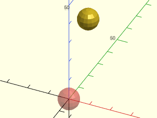

    include <BOSL2/std.scad>
    #sphere(d=10);
    move([0,20,30]) sphere(d=10);

  

**Example 2:** You can move a 3D object with a 2D vector.  The Z component is treated as zero.

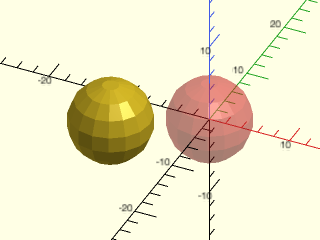

    include <BOSL2/std.scad>
    #sphere(d=10);
    move([-10,-5]) sphere(d=10);

  

**Example 3:** Move to centroid

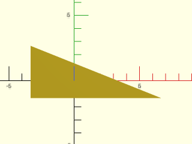

    include <BOSL2/std.scad>
    polygon(move("centroid", right_triangle([10,4])));

  

**Example 4:** Using Altitude-Azimuth Coordinates

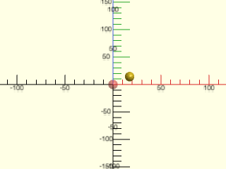

    include <BOSL2/std.scad>
    #sphere(d=10);
    move(altaz_to_xyz(30,90,20)) sphere(d=10);

  

**Example 5:** Using Spherical Coordinates

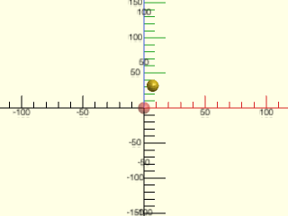

    include <BOSL2/std.scad>
    #sphere(d=10);
    move(spherical_to_xyz(20,45,30)) sphere(d=10);

  

**Example 6:** 

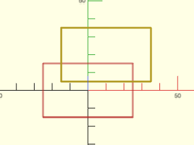

    include <BOSL2/std.scad>
    path = square([50,30], center=true);
    #stroke(path, closed=true);
    stroke(move([10,20],p=path), closed=true);

  

**Example 7:** 

    include <BOSL2/std.scad>
    pt1 = move([0,20,30], [15,23,42]);       // Returns: [15, 43, 72]
    pt2 = move([0,3,1], [[1,2,3],[4,5,6]]);  // Returns: [[1,5,4], [4,8,7]]
    mat = move([2,3]);      // Returns: [[1,0,0,2],[0,1,0,3],[0,0,1,0],[0,0,0,1]]
    mat3d = move([2,3,4]);  // Returns: [[1,0,0,2],[0,1,0,3],[0,0,1,4],[0,0,0,1]]

  

---

### Function/Module: left()

**Synopsis:** Translates children leftward (X-). [<abbr>Trans</abbr>] [<abbr>Path</abbr>] [<abbr>VNF</abbr>] [<abbr>Mat</abbr>]

**Topics:** [Affine](Topics#affine), [Matrices](Topics#matrices), [Transforms](Topics#transforms), [Translation](Topics#translation)

**See Also:** [move()](#functionmodule-move), [right()](#functionmodule-right), [fwd()](#functionmodule-fwd), [back()](#functionmodule-back), [down()](#functionmodule-down), [up()](#functionmodule-up)

**Usage:** As Module

- left(x) CHILDREN;

**Usage:** Translate Points

- pts = left(x, p);

**Usage:** Get Translation Matrix

- mat = left(x);

**Description:** 

Moves geometry or data to the left (in the X- direction) by the specified amount.  (If `x` is negative motion is to the right.)
* If called as a module, moves all children left.
* If called as a function with the `p` argument, returns the translated version of that `p` argument.  The `p` argument can be a point, list of points, [bezier patch](beziers.scad) or [VNF structure](vnf.scad).
* If called as a function without the `p` argument, returns a 4x4 transformation matrix.

**Arguments:** 

<abbr title="These args can be used by position or by name.">By&nbsp;Position</abbr> | What it does
-------------------- | ------------
`x`                  | Scalar amount to move left.  Default: 0
`p`                  | (function only) A point, list of points or VNF to be translated.

**Example 1:** 

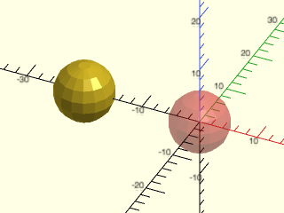

    include <BOSL2/std.scad>
    #sphere(d=10);
    left(20) sphere(d=10);

  

**Example 2:** 

    include <BOSL2/std.scad>
    pt1 = left(20, [23,42]);           // Returns: [3,42]
    pt2 = left(20, [15,23,42]);        // Returns: [-5,23,42]
    pt3 = left(3, [[1,2,3],[4,5,6]]);  // Returns: [[-2,2,3], [1,5,6]]
    mat3d = left(4);  // Returns: [[1,0,0,-4],[0,1,0,0],[0,0,1,0],[0,0,0,1]]

  

---

### Function/Module: right()

**Aliases:** xmove()

**Synopsis:** Translates children rightward (X+). [<abbr>Trans</abbr>] [<abbr>Path</abbr>] [<abbr>VNF</abbr>] [<abbr>Mat</abbr>]

**Topics:** [Affine](Topics#affine), [Matrices](Topics#matrices), [Transforms](Topics#transforms), [Translation](Topics#translation)

**See Also:** [move()](#functionmodule-move), [left()](#functionmodule-left), [fwd()](#functionmodule-fwd), [back()](#functionmodule-back), [down()](#functionmodule-down), [up()](#functionmodule-up)

**Usage:** As Module

- right(x) CHILDREN;

**Usage:** Translate Points

- pts = right(x, p);

**Usage:** Get Translation Matrix

- mat = right(x);

**Description:** 

Moves geometry or data to the right (in the X+ direction) by the specified amount.  (If `x` is negative motion is to the left.)
* If called as a module, moves all children right.
* If called as a function with the `p` argument, returns the translated version of that `p` argument.  The `p` argument can be a point, list of points, [bezier patch](beziers.scad) or [VNF structure](vnf.scad).
* If called as a function without the `p` argument, returns a 4x4 tranformation matrix.

You can also call this as `xmove()`.

**Arguments:** 

<abbr title="These args can be used by position or by name.">By&nbsp;Position</abbr> | What it does
-------------------- | ------------
`x`                  | Scalar amount to move right.  Default: 0
`p`                  | (function only) A point, list of points or VNF to be translated.

**Example 1:** 

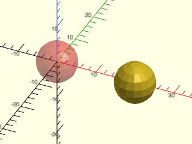

    include <BOSL2/std.scad>
    #sphere(d=10);
    right(20) sphere(d=10);

  

**Example 2:** 

    include <BOSL2/std.scad>
    pt1 = right(20, [23,42]);           // Returns: [43,42]
    pt2 = right(20, [15,23,42]);        // Returns: [35,23,42]
    pt3 = right(3, [[1,2,3],[4,5,6]]);  // Returns: [[4,2,3], [7,5,6]]
    pt4 = xmove(-2, [1,2,3]);           // Returns: [-1,2,3]
    mat3d = right(4);  // Returns: [[1,0,0,4],[0,1,0,0],[0,0,1,0],[0,0,0,1]]

  

---

### Function/Module: fwd()

**Synopsis:** Translates children forward (Y-). [<abbr>Trans</abbr>] [<abbr>Path</abbr>] [<abbr>VNF</abbr>] [<abbr>Mat</abbr>]

**Topics:** [Affine](Topics#affine), [Matrices](Topics#matrices), [Transforms](Topics#transforms), [Translation](Topics#translation)

**See Also:** [move()](#functionmodule-move), [left()](#functionmodule-left), [right()](#functionmodule-right), [back()](#functionmodule-back), [down()](#functionmodule-down), [up()](#functionmodule-up)

**Usage:** As Module

- fwd(y) CHILDREN;

**Usage:** Translate Points

- pts = fwd(y, p);

**Usage:** Get Translation Matrix

- mat = fwd(y);

**Description:** 

Moves geometry or data forward (in the Y- direction) by the specified amount.  (If `y` is negative motion is to the back.)
* If called as a module, moves all children forward.
* If called as a function with the `p` argument, returns the translated version of that `p` argument.  The `p` argument can be a point, list of points, [bezier patch](beziers.scad) or [VNF structure](vnf.scad).
* If called as a function without the `p` argument, returns a 4x4 transformation matrix.

**Arguments:** 

<abbr title="These args can be used by position or by name.">By&nbsp;Position</abbr> | What it does
-------------------- | ------------
`y`                  | Scalar amount to move forward.  Default: 0
`p`                  | (function only) A point, list of points or VNF to be translated.

**Example 1:** 

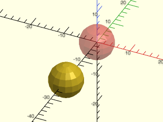

    include <BOSL2/std.scad>
    #sphere(d=10);
    fwd(20) sphere(d=10);

  

**Example 2:** 

    include <BOSL2/std.scad>
    pt1 = fwd(20, [23,42]);           // Returns: [23,22]
    pt2 = fwd(20, [15,23,42]);        // Returns: [15,3,42]
    pt3 = fwd(3, [[1,2,3],[4,5,6]]);  // Returns: [[1,-1,3], [4,2,6]]
    mat3d = fwd(4);  // Returns: [[1,0,0,0],[0,1,0,-4],[0,0,1,0],[0,0,0,1]]

  

---

### Function/Module: back()

**Aliases:** ymove()

**Synopsis:** Translates children backward (Y+). [<abbr>Trans</abbr>] [<abbr>Path</abbr>] [<abbr>VNF</abbr>] [<abbr>Mat</abbr>]

**Topics:** [Affine](Topics#affine), [Matrices](Topics#matrices), [Transforms](Topics#transforms), [Translation](Topics#translation)

**See Also:** [move()](#functionmodule-move), [left()](#functionmodule-left), [right()](#functionmodule-right), [fwd()](#functionmodule-fwd), [down()](#functionmodule-down), [up()](#functionmodule-up)

**Usage:** As Module

- back(y) CHILDREN;

**Usage:** Translate Points

- pts = back(y, p);

**Usage:** Get Translation Matrix

- mat = back(y);

**Description:** 

Moves geometry or data backward (in the Y+ direction) by the specified amount.  (If `y` is negative motion is forward.)
* If called as a module, moves all children backward.
* If called as a function with the `p` argument, returns the translated version of that `p` argument.  The `p` argument can be a point, list of points, [bezier patch](beziers.scad) or [VNF structure](vnf.scad).
* If called as a function without the `p` argument, returns a 4x4 transformation matrix.

You can also call this as `ymove()`.

**Arguments:** 

<abbr title="These args can be used by position or by name.">By&nbsp;Position</abbr> | What it does
-------------------- | ------------
`y`                  | Scalar amount to move back.  Default: 0
`p`                  | (function only) A point, list of points or VNF to be translated.

**Example 1:** 

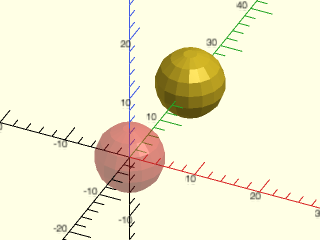

    include <BOSL2/std.scad>
    #sphere(d=10);
    back(20) sphere(d=10);

  

**Example 2:** 

    include <BOSL2/std.scad>
    pt1 = back(20, [23,42]);           // Returns: [23,62]
    pt2 = back(20, [15,23,42]);        // Returns: [15,43,42]
    pt3 = back(3, [[1,2,3],[4,5,6]]);  // Returns: [[1,5,3], [4,8,6]]
    pt4 = ymove(4, [2,2,2]);             // Returns: [2,6,2]
    mat3d = back(4);  // Returns: [[1,0,0,0],[0,1,0,4],[0,0,1,0],[0,0,0,1]]

  

---

### Function/Module: down()

**Synopsis:** Translates children downward (Z-). [<abbr>Trans</abbr>] [<abbr>Path</abbr>] [<abbr>VNF</abbr>] [<abbr>Mat</abbr>]

**Topics:** [Affine](Topics#affine), [Matrices](Topics#matrices), [Transforms](Topics#transforms), [Translation](Topics#translation)

**See Also:** [move()](#functionmodule-move), [left()](#functionmodule-left), [right()](#functionmodule-right), [fwd()](#functionmodule-fwd), [back()](#functionmodule-back), [up()](#functionmodule-up)

**Usage:** As Module

- down(z) CHILDREN;

**Usage:** Translate Points

- pts = down(z, p);

**Usage:** Get Translation Matrix

- mat = down(z);

**Description:** 

Moves geometry or data down (in the Z- direction) by the specified amount.  (If `z` is negative motion is upward.)
* If called as a module, moves all children down.
* If called as a function with the `p` argument, returns the translated version of that `p` argument.  The `p` argument can be a point, list of points, [bezier patch](beziers.scad) or [VNF structure](vnf.scad).
* If called as a function without the `p` argument, returns a 4x4 transformation matrix.

**Arguments:** 

<abbr title="These args can be used by position or by name.">By&nbsp;Position</abbr> | What it does
-------------------- | ------------
`z`                  | Scalar amount to move down.  Default: 0
`p`                  | Either a point, or a list of points to be translated when used as a function.

**Example 1:** 

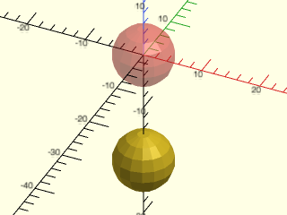

    include <BOSL2/std.scad>
    #sphere(d=10);
    down(20) sphere(d=10);

  

**Example 2:** 

    include <BOSL2/std.scad>
    pt1 = down(20, [15,23,42]);        // Returns: [15,23,22]
    pt2 = down(3, [[1,2,3],[4,5,6]]);  // Returns: [[1,2,0], [4,5,3]]
    mat3d = down(4);  // Returns: [[1,0,0,0],[0,1,0,0],[0,0,1,-4],[0,0,0,1]]

  

---

### Function/Module: up()

**Aliases:** zmove()

**Synopsis:** Translates children upward (Z+). [<abbr>Trans</abbr>] [<abbr>Path</abbr>] [<abbr>VNF</abbr>] [<abbr>Mat</abbr>]

**Topics:** [Affine](Topics#affine), [Matrices](Topics#matrices), [Transforms](Topics#transforms), [Translation](Topics#translation)

**See Also:** [move()](#functionmodule-move), [left()](#functionmodule-left), [right()](#functionmodule-right), [fwd()](#functionmodule-fwd), [back()](#functionmodule-back), [down()](#functionmodule-down)

**Usage:** As Module

- up(z) CHILDREN;

**Usage:** Translate Points

- pts = up(z, p);

**Usage:** Get Translation Matrix

- mat = up(z);

**Description:** 

Moves geometry or data up (in the Z+ direction) by the specified amount.  (If `z` is negative motion is downward.)
* If called as a module, moves all children up
* If called as a function with the `p` argument, returns the translated version of that `p` argument.  The `p` argument can be a point, list of points, [bezier patch](beziers.scad) or [VNF structure](vnf.scad).
* If called as a function without the `p` argument, returns a 4x4 transformation matrix.

You can also call this as `zmove()`.

**Arguments:** 

<abbr title="These args can be used by position or by name.">By&nbsp;Position</abbr> | What it does
-------------------- | ------------
`z`                  | Scalar amount to move up.  Default: 0
`p`                  | Either a point, or a list of points to be translated when used as a function.

**Example 1:** 

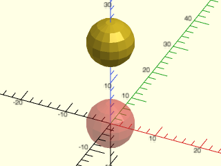

    include <BOSL2/std.scad>
    #sphere(d=10);
    up(20) sphere(d=10);

  

**Example 2:** 

    include <BOSL2/std.scad>
    pt1 = up(20, [15,23,42]);        // Returns: [15,23,62]
    pt2 = up(3, [[1,2,3],[4,5,6]]);  // Returns: [[1,2,6], [4,5,9]]
    p53 = zmove(-2, [3,3,3]);        // Returns: [3,3,1]
    mat3d = up(4);  // Returns: [[1,0,0,0],[0,1,0,0],[0,0,1,4],[0,0,0,1]]

  

---

## Section: Rotations

### Function/Module: rot()

**Synopsis:** Rotates children in various ways. [<abbr>Trans</abbr>] [<abbr>Path</abbr>] [<abbr>VNF</abbr>] [<abbr>Mat</abbr>]

**Topics:** [Affine](Topics#affine), [Matrices](Topics#matrices), [Transforms](Topics#transforms), [Rotation](Topics#rotation)

**See Also:** [xrot()](#functionmodule-xrot), [yrot()](#functionmodule-yrot), [zrot()](#functionmodule-zrot), [tilt()](#functionmodule-tilt)

**Usage:** As a Module

- rot(a, [cp=], [reverse=]) CHILDREN;
- rot([X,Y,Z], [cp=], [reverse=]) CHILDREN;
- rot(a, v, [cp=], [reverse=]) CHILDREN;
- rot(from=, to=, [a=], [reverse=]) CHILDREN;

**Usage:** As a Function to transform data in `p`

- pts = rot(a, p=, [cp=], [reverse=]);
- pts = rot([X,Y,Z], p=, [cp=], [reverse=]);
- pts = rot(a, v, p=, [cp=], [reverse=]);
- pts = rot([a], from=, to=, p=, [reverse=]);

**Usage:** As a Function to return a transform matrix

- M = rot(a, [cp=], [reverse=]);
- M = rot([X,Y,Z], [cp=], [reverse=]);
- M = rot(a, v, [cp=], [reverse=]);
- M = rot(from=, to=, [a=], [reverse=]);

**Description:** 

This is an expanded version of the built-in `rotate()` that behaves identically to the built-in with the same arguments,
but offers additional capabilities.
You can specify the rotation to perform in one of several ways:
* `rot(30)` or `rot(a=30)` rotates 30 degrees around the Z axis.
* `rot([20,30,40])` or `rot(a=[20,30,40])` rotates 20 degrees around the X axis, then 30 degrees around the Y axis, then 40 degrees around the Z axis.
* `rot(30, [1,1,0])` or `rot(a=30, v=[1,1,0])` rotates 30 degrees around the axis vector `[1,1,0]` (in the right-hand direction).
* `rot(from=[0,0,1], to=[1,0,0])` rotates the `from` vector to line up with the `to` vector, in this case the top to the right and hence equivalent to `rot(a=90,v=[0,1,0]`.  The axis of rotation is perpendicular to the two given vectors.
* `rot(from=[0,1,1], to=[1,1,0], a=45)` rotates 45 degrees around the `from` vector ([0,1,1]) and then rotates the `from` vector to align with the `to` vector.  Equivalent to `rot(from=[0,1,1],to=[1,1,0]) rot(a=45,v=[0,1,1])`.  You can also regard `a` as as post-rotation around the `to` vector.  For this form, `a` must be a scalar.
* If the `cp` centerpoint argument is given, then rotations are performed around that centerpoint.  So `rot(args...,cp=[1,2,3])` is equivalent to `move([1,2,3])rot(args...)move(-[1,2,3])`.
* If the `reverse` argument is true, then the rotations performed is exactly reversed.

The behavior and return value varies depending on how `rot()` is called:
* If called as a module, rotates all children.
* If called as a function with the `p=` argument, returns the rotated version of that `p=` argument.  The `p=` argument can be a point, list of points, [bezier patch](beziers.scad) or [VNF structure](vnf.scad).
* If called as a function without a `p` argument, returns the 4x4 rotation matrix.

This function (and sometimes [`frame_map()`](#functionmodule-frame_map) are the only two transformations that require
that the `p=` argument be given as a named argument rather than a positional argument.

**Arguments:** 

<abbr title="These args can be used by position or by name.">By&nbsp;Position</abbr> | What it does
-------------------- | ------------
`a`                  | Scalar angle or vector of XYZ rotation angles to rotate by, in degrees.  If you use the `from` and `to` arguments then `a` must be a scalar.  Default: `0`
`v`                  | vector for the axis of rotation.  Default: [0,0,1] or UP

<abbr title="These args must be used by name, ie: name=value">By&nbsp;Name</abbr> | What it does
-------------------- | ------------
`from`               | Starting vector for vector-based rotations.
`to`                 | Target vector for vector-based rotations.
`cp`                 | centerpoint to rotate around. Default: [0,0,0]
`reverse`            | If true, exactly reverses the rotation, including axis rotation ordering.  Default: false
`p`                  | (function only) A point, list of points, Bezier patch or VNF to be rotated.

**Example 1:** 

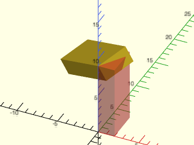

    include <BOSL2/std.scad>
    #cube([2,4,9]);
    rot([30,60,0], cp=[0,0,9]) cube([2,4,9]);

  

**Example 2:** 

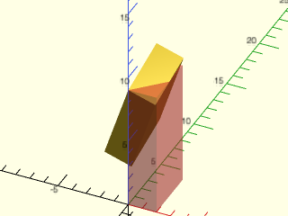

    include <BOSL2/std.scad>
    #cube([2,4,9]);
    rot(30, v=[1,1,0], cp=[0,0,9]) cube([2,4,9]);

  

**Example 3:** 

    include <BOSL2/std.scad>
    #cube([2,4,9]);
    rot(from=UP, to=LEFT+BACK) cube([2,4,9]);

  

**Example 4:** 

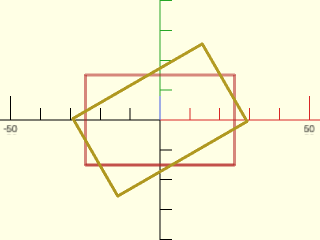

    include <BOSL2/std.scad>
    path = square([50,30], center=true);
    #stroke(path, closed=true);
    stroke(rot(30,p=path), closed=true);

  

---

### Function/Module: xrot()

**Synopsis:** Rotates children around the X axis using the right-hand rule. [<abbr>Trans</abbr>] [<abbr>Path</abbr>] [<abbr>VNF</abbr>] [<abbr>Mat</abbr>]

**Topics:** [Affine](Topics#affine), [Matrices](Topics#matrices), [Transforms](Topics#transforms), [Rotation](Topics#rotation)

**See Also:** [rot()](#functionmodule-rot), [yrot()](#functionmodule-yrot), [zrot()](#functionmodule-zrot), [tilt()](#functionmodule-tilt)

**Usage:** As Module

- xrot(a, [cp=]) CHILDREN;

**Usage:** As a function to rotate points

- rotated = xrot(a, p, [cp=]);

**Usage:** As a function to return rotation matrix

- mat = xrot(a, [cp=]);

**Description:** 

Rotates around the X+ axis by the given number of degrees.  If `cp` is given, rotate around that center point.
* If called as a module, rotates all children.
* If called as a function with the `p` argument, returns the rotated version of that `p` argument.  The `p` argument can be a point, list of points, [bezier patch](beziers.scad) or [VNF structure](vnf.scad).
* If called as a function without a `p` argument, returns the 4x4 rotation matrix.

**Arguments:** 

<abbr title="These args can be used by position or by name.">By&nbsp;Position</abbr> | What it does
-------------------- | ------------
`a`                  | Rotation angle in degrees.  Default: 0
`p`                  | (function only) A point, list of points, Bezier patch or VNF to be rotated.

<abbr title="These args must be used by name, ie: name=value">By&nbsp;Name</abbr> | What it does
-------------------- | ------------
`cp`                 | center point to rotate around. Default: [0,0,0]

**Example 1:** 

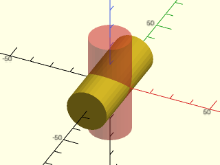

    include <BOSL2/std.scad>
    #cylinder(h=50, r=10, center=true);
    xrot(90) cylinder(h=50, r=10, center=true);

  

---

### Function/Module: yrot()

**Synopsis:** Rotates children around the Y axis using the right-hand rule. [<abbr>Trans</abbr>] [<abbr>Path</abbr>] [<abbr>VNF</abbr>] [<abbr>Mat</abbr>]

**Topics:** [Affine](Topics#affine), [Matrices](Topics#matrices), [Transforms](Topics#transforms), [Rotation](Topics#rotation)

**See Also:** [rot()](#functionmodule-rot), [xrot()](#functionmodule-xrot), [zrot()](#functionmodule-zrot), [tilt()](#functionmodule-tilt)

**Usage:** As Module

- yrot(a, [cp=]) CHILDREN;

**Usage:** Rotate Points

- rotated = yrot(a, p, [cp=]);

**Usage:** Get Rotation Matrix

- mat = yrot(a, [cp=]);

**Description:** 

Rotates around the Y+ axis by the given number of degrees.  If `cp` is given, rotate around that center point.
* If called as a module, rotates all children.
* If called as a function with the `p` argument, returns the rotated version of that `p` argument.  The `p` argument can be a point, list of points, [bezier patch](beziers.scad) or [VNF structure](vnf.scad).
* If called as a function without a `p` argument, returns the 4x4 rotation matrix.

**Arguments:** 

<abbr title="These args can be used by position or by name.">By&nbsp;Position</abbr> | What it does
-------------------- | ------------
`a`                  | Rotation angle in degrees.  Default: 0
`p`                  | (function only) A point, list of points, Bezier patch or VNF to be rotated.

<abbr title="These args must be used by name, ie: name=value">By&nbsp;Name</abbr> | What it does
-------------------- | ------------
`cp`                 | center point to rotate around. Default: [0,0,0]

**Example 1:** 

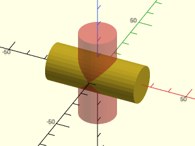

    include <BOSL2/std.scad>
    #cylinder(h=50, r=10, center=true);
    yrot(90) cylinder(h=50, r=10, center=true);

  

---

### Function/Module: zrot()

**Synopsis:** Rotates children around the Z axis using the right-hand rule. [<abbr>Trans</abbr>] [<abbr>Path</abbr>] [<abbr>VNF</abbr>] [<abbr>Mat</abbr>]

**Topics:** [Affine](Topics#affine), [Matrices](Topics#matrices), [Transforms](Topics#transforms), [Rotation](Topics#rotation)

**See Also:** [rot()](#functionmodule-rot), [xrot()](#functionmodule-xrot), [yrot()](#functionmodule-yrot), [tilt()](#functionmodule-tilt)

**Usage:** As Module

- zrot(a, [cp=]) CHILDREN;

**Usage:** As Function to rotate points

- rotated = zrot(a, p, [cp=]);

**Usage:** As Function to return rotation matrix

- mat = zrot(a, [cp=]);

**Description:** 

Rotates around the Z+ axis by the given number of degrees.  If `cp` is given, rotate around that center point.
* If called as a module, rotates all children.
* If called as a function with the `p` argument, returns the rotated version of that `p` argument.  The `p` argument can be a point, list of points, [bezier patch](beziers.scad) or [VNF structure](vnf.scad).
* If called as a function without a `p` argument, returns the 4x4 rotation matrix.

**Arguments:** 

<abbr title="These args can be used by position or by name.">By&nbsp;Position</abbr> | What it does
-------------------- | ------------
`a`                  | Rotation angle in degrees.  Default: 0
`p`                  | (function only) A point, list of points, Bezier patch or VNF to be rotated.

<abbr title="These args must be used by name, ie: name=value">By&nbsp;Name</abbr> | What it does
-------------------- | ------------
`cp`                 | centerpoint to rotate around. Default: [0,0,0]

**Example 1:** 

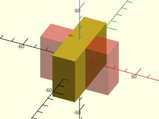

    include <BOSL2/std.scad>
    #cube(size=[60,20,40], center=true);
    zrot(90) cube(size=[60,20,40], center=true);

  

---

### Function/Module: tilt()

**Synopsis:** Tilts children toward a direction [<abbr>Trans</abbr>] [<abbr>Path</abbr>] [<abbr>VNF</abbr>] [<abbr>Mat</abbr>]

**Topics:** [Affine](Topics#affine), [Matrices](Topics#matrices), [Transforms](Topics#transforms), [Rotation](Topics#rotation)

**See Also:** [rot()](#functionmodule-rot), [xrot()](#functionmodule-xrot), [yrot()](#functionmodule-yrot), [zrot()](#functionmodule-zrot)

**Usage:** As a Module

- tilt(to, [reverse=], [cp=]) CHILDREN;

**Usage:** As a Function to transform data in `p`

- pts = tilt(to, p, [reverse=], [cp=]);

**Usage:** As a Function to return a transform matrix

- M = tilt(to, [reverse=], [cp=]);

**Description:** 

This is shorthand for `rot(from=UP,to=to)` and operates similarly.  It tilts things that point UP until they point in the direction of the given `to` vector.
* If the `cp` centerpoint argument is given, then the tilt/rotation is performed around that centerpoint.  So `tilt(...,cp=[1,2,3])` is equivalent to `move([1,2,3]) tilt(...) move([-1,-2,-3])`.
* If the `reverse` argument is true, then the tilt/rotation is reversed.

The behavior and return value varies depending on how `tilt()` is called:
* If called as a module, tilts all children.
* If called as a function with the `p` argument, returns the tilted version of that `p` argument.  The `p` argument can be a point, list of points, [bezier patch](beziers.scad) or [VNF structure](vnf.scad).
* If called as a function without a `p` argument, returns a 4x4 transformation matrix.

**Arguments:** 

<abbr title="These args can be used by position or by name.">By&nbsp;Position</abbr> | What it does
-------------------- | ------------
`to`                 | Target vector for vector-based rotations.
`p`                  | (function only) A point, list of points, Bezier patch or VNF to be rotated.

<abbr title="These args must be used by name, ie: name=value">By&nbsp;Name</abbr> | What it does
-------------------- | ------------
`cp`                 | centerpoint to tilt/rotate around. Default: [0,0,0]
`reverse`            | If true, reverses the rotation.  Default: false

**Example 1:** 

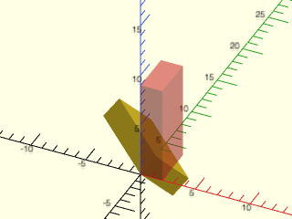

    include <BOSL2/std.scad>
    #cube([2,4,9]);
    tilt(LEFT+BACK) cube([2,4,9]);

  

**Example 2:** 

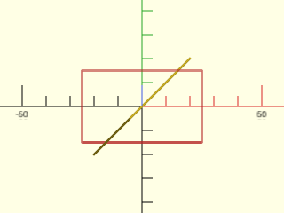

    include <BOSL2/std.scad>
    path = square([50,30], center=true);
    #stroke(path, closed=true);
    stroke(tilt(RIGHT+FWD,path3d(path)), closed=true);

  

---

## Section: Scaling

### Function/Module: scale()

**Synopsis:** Scales children arbitrarily. [<abbr>Trans</abbr>] [<abbr>Path</abbr>] [<abbr>VNF</abbr>] [<abbr>Mat</abbr>] [<abbr>Ext</abbr>]

**Topics:** [Affine](Topics#affine), [Matrices](Topics#matrices), [Transforms](Topics#transforms), [Scaling](Topics#scaling)

**See Also:** [xscale()](#functionmodule-xscale), [yscale()](#functionmodule-yscale), [zscale()](#functionmodule-zscale)

**Usage:** As Module (native OpenSCAD)

- scale(SCALAR) CHILDREN;
- scale([X,Y,Z]) CHILDREN;

**Usage:** As module with center point (BOSL2 extension)

- scale(v, cp=) CHILDREN;

**Usage:** As module with with scaling direction vector (BOSL2 extension)

- scale(v, dir=, [cp=]) CHILDREN;

**Usage:** Scale Points

- pts = scale(v, p, [cp=], [dir=]);

**Usage:** Get Scaling Matrix

- mat = scale(v, [cp=], [dir=]);

**Description:** 

Scales by the [X,Y,Z] scaling factors given in `v`.  If `v` is given as a scalar number, all axes are scaled uniformly by that amount.
If `v` has fewer than three dimensions, it is padded with 1 values, so scaling by [4] is the same as [4,1,1].  If you give `cp` a
vector value then the scaling is done relative to that specified center point.  If you give the vector `dir` then the scale factor, `v`, must
be a scalar and the scaling occurs along the direction of `dir`.  (The sign and magnitude of `dir` don't matter.)
* If called as the built-in module, scales all children.
* If called as a function with the `p` argument, returns the scaled version of that `p` argument.  The `p` argument can be a point, list of points, [bezier patch](beziers.scad) or [VNF structure](vnf.scad).
* If called as a function without a `p` argument, returns a 4x4 transformation matrix.

**Arguments:** 

<abbr title="These args can be used by position or by name.">By&nbsp;Position</abbr> | What it does
-------------------- | ------------
`v`                  | Either a numeric uniform scaling factor, or a list of [X,Y,Z] scaling factors.  Default: 1
`p`                  | (function only) A point, list of points, Bezier patch or VNF to scale.

<abbr title="These args must be used by name, ie: name=value">By&nbsp;Name</abbr> | What it does
-------------------- | ------------
`cp`                 | If given, centers the scaling on the point `cp`.
`dir`                | If given as a vector, scale along the direction of that vector.

**Example 1:** 

    include <BOSL2/std.scad>
    pt1 = scale(3, [3,1,4]);        // Returns: [9,3,12]
    pt2 = scale([2,3,4], [3,1,4]);  // Returns: [6,3,16]
    pt3 = scale([2,3,4], [[1,2,3],[4,5,6]]);  // Returns: [[2,6,12], [8,15,24]]
    mat2d = scale([2,3]);      // Returns: [[2,0,0,0],[0,3,0,0],[0,0,1,0],[0,0,0,1]]
    mat3d = scale([2,3,4]);    // Returns: [[2,0,0,0],[0,3,0,0],[0,0,4,0],[0,0,0,1]]

  

**Example 2:** 

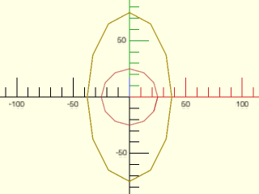

    include <BOSL2/std.scad>
    path = circle(d=50,$fn=12);
    #stroke(path,closed=true);
    stroke(scale([1.5,3],path),closed=true);

  

---

### Function/Module: xscale()

**Synopsis:** Scales children along the X axis. [<abbr>Trans</abbr>] [<abbr>Path</abbr>] [<abbr>VNF</abbr>] [<abbr>Mat</abbr>]

**Topics:** [Affine](Topics#affine), [Matrices](Topics#matrices), [Transforms](Topics#transforms), [Scaling](Topics#scaling)

**See Also:** [scale()](#functionmodule-scale), [yscale()](#functionmodule-yscale), [zscale()](#functionmodule-zscale)

**Usage:** As Module

- xscale(x, [cp=]) CHILDREN;

**Usage:** Scale Points

- scaled = xscale(x, p, [cp=]);

**Usage:** Get Affine Matrix

- mat = xscale(x, [cp=]);

**Description:** 

Scales in the X direction by the scale factor `x`. If `cp` is given either as a scalar X value or as an [X,Y,Z] value then X is used as the center for the scaling.
* If called as the built-in module, scales all children.
* If called as a function with the `p` argument, returns the scaled version of that `p` argument.  The `p` argument can be a point, list of points, [bezier patch](beziers.scad) or [VNF structure](vnf.scad).
* If called as a function without a `p` argument, returns a 4x4 transformation matrix.

**Arguments:** 

<abbr title="These args can be used by position or by name.">By&nbsp;Position</abbr> | What it does
-------------------- | ------------
`x`                  | Factor to scale by, along the X axis.  Default: 1
`p`                  | (function only) A point, list of points, Bezier patch or VNF to be scaled.

<abbr title="These args must be used by name, ie: name=value">By&nbsp;Name</abbr> | What it does
-------------------- | ------------
`cp`                 | If given as a point, centers the scaling on the point `cp`.  If given as a scalar, centers scaling on the point `[cp,0,0]`

**Example 1:** As Module

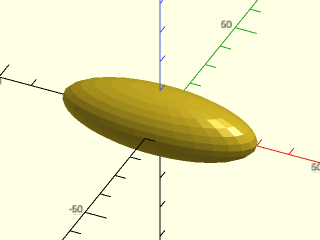

    include <BOSL2/std.scad>
    xscale(3) sphere(r=10);

  

**Example 2:** Scaling Points

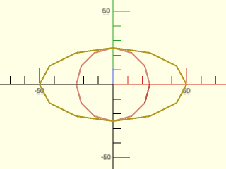

    include <BOSL2/std.scad>
    path = circle(d=50,$fn=12);
    #stroke(path,closed=true);
    stroke(xscale(2,path),closed=true);

  

---

### Function/Module: yscale()

**Synopsis:** Scales children along the Y axis. [<abbr>Trans</abbr>] [<abbr>Path</abbr>] [<abbr>VNF</abbr>] [<abbr>Mat</abbr>]

**Topics:** [Affine](Topics#affine), [Matrices](Topics#matrices), [Transforms](Topics#transforms), [Scaling](Topics#scaling)

**See Also:** [scale()](#functionmodule-scale), [xscale()](#functionmodule-xscale), [zscale()](#functionmodule-zscale)

**Usage:** As Module

- yscale(y, [cp=]) CHILDREN;

**Usage:** Scale Points

- scaled = yscale(y, p, [cp=]);

**Usage:** Get Affine Matrix

- mat = yscale(y, [cp=]);

**Description:** 

Scales in the Y direction by the scale factor `y`.  If `cp` is given either as a scalar Y value or as an [X,Y,Z] value then Y is used
as the center for the scaling.
* If called as the built-in module, scales all children.
* If called as a function with the `p` argument, returns the scaled version of that `p` argument.  The `p` argument can be a point, list of points, [bezier patch](beziers.scad) or [VNF structure](vnf.scad).
* If called as a function without a `p` argument, returns a 4x4 transformation matrix.

**Arguments:** 

<abbr title="These args can be used by position or by name.">By&nbsp;Position</abbr> | What it does
-------------------- | ------------
`y`                  | Factor to scale by, along the Y axis.  Default: 1
`p`                  | (function only) A point, list of points, Bezier patch or VNF to be scaled.

<abbr title="These args must be used by name, ie: name=value">By&nbsp;Name</abbr> | What it does
-------------------- | ------------
`cp`                 | If given as a point, centers the scaling on the point `cp`.  If given as a scalar, centers scaling on the point `[0,cp,0]`

**Example 1:** As Module

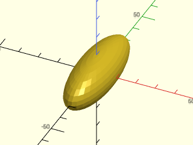

    include <BOSL2/std.scad>
    yscale(3) sphere(r=10);

  

**Example 2:** Scaling Points

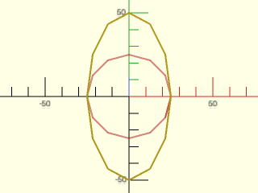

    include <BOSL2/std.scad>
    path = circle(d=50,$fn=12);
    #stroke(path,closed=true);
    stroke(yscale(2,path),closed=true);

  

---

### Function/Module: zscale()

**Synopsis:** Scales children along the Z axis. [<abbr>Trans</abbr>] [<abbr>Path</abbr>] [<abbr>VNF</abbr>] [<abbr>Mat</abbr>]

**Topics:** [Affine](Topics#affine), [Matrices](Topics#matrices), [Transforms](Topics#transforms), [Scaling](Topics#scaling)

**See Also:** [scale()](#functionmodule-scale), [xscale()](#functionmodule-xscale), [yscale()](#functionmodule-yscale)

**Usage:** As Module

- zscale(z, [cp=]) CHILDREN;

**Usage:** Scale Points

- scaled = zscale(z, p, [cp=]);

**Usage:** Get Affine Matrix

- mat = zscale(z, [cp=]);

**Description:** 

Scales along the Z axis by the scaling factor `z`.  If `cp` is given either as a scalar Z value or as an [X,Y,Z] value then Z is used
as the center for the scaling.
* If called as the built-in module, scales all children.
* If called as a function with the `p` argument, returns the scaled version of that `p` argument.  The `p` argument can be a point, list of points, [bezier patch](beziers.scad) or [VNF structure](vnf.scad).
* If called as a function without a `p` argument, returns a 4x4 transformation matrix.

**Arguments:** 

<abbr title="These args can be used by position or by name.">By&nbsp;Position</abbr> | What it does
-------------------- | ------------
`z`                  | Factor to scale by, along the Z axis.  Default: 1
`p`                  | (function only) A point, list of points, Bezier patch or VNF to be scaled.

<abbr title="These args must be used by name, ie: name=value">By&nbsp;Name</abbr> | What it does
-------------------- | ------------
`cp`                 | If given as a point, centers the scaling on the point `cp`.  If given as a scalar, centers scaling on the point `[0,0,cp]`

**Example 1:** As Module

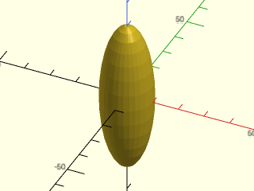

    include <BOSL2/std.scad>
    zscale(3) sphere(r=10);

  

**Example 2:** Scaling Points

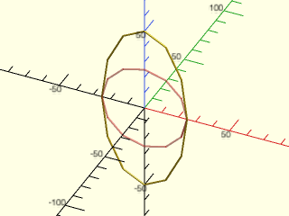

    include <BOSL2/std.scad>
    path = xrot(90,path3d(circle(d=50,$fn=12)));
    #stroke(path,closed=true);
    stroke(zscale(2,path),closed=true);

  

---

## Section: Reflection (Mirroring)

### Function/Module: mirror()

**Synopsis:** Reflects children across an arbitrary plane. [<abbr>Trans</abbr>] [<abbr>Path</abbr>] [<abbr>VNF</abbr>] [<abbr>Mat</abbr>] [<abbr>Ext</abbr>]

**Topics:** [Affine](Topics#affine), [Matrices](Topics#matrices), [Transforms](Topics#transforms), [Reflection](Topics#reflection), [Mirroring](Topics#mirroring)

**See Also:** [xflip()](#functionmodule-xflip), [yflip()](#functionmodule-yflip), [zflip()](#functionmodule-zflip)

**Usage:** As Module

- mirror(v) CHILDREN;

**Usage:** As Function

- pt = mirror(v, p);

**Usage:** Get Reflection/Mirror Matrix

- mat = mirror(v);

**Description:** 

Mirrors/reflects across the plane or line whose normal vector is given in `v`.
* Called as the built-in module, mirrors all children.
* If called as a function with the `p` argument, returns the mirrored version of that `p` argument.  The `p` argument can be a point, list of points, [bezier patch](beziers.scad) or [VNF structure](vnf.scad).
* Called as a function without a `p` argument, returns a 4x4 transformation matrix.

**Arguments:** 

<abbr title="These args can be used by position or by name.">By&nbsp;Position</abbr> | What it does
-------------------- | ------------
`v`                  | The normal vector of the line or plane to mirror across.
`p`                  | (function only) A point, list of points, Bezier patch or VNF to reflect.

**Example 1:** 

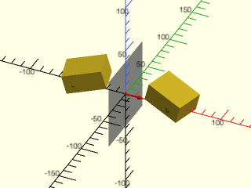

    include <BOSL2/std.scad>
    n = [1,0,0];
    module obj() right(20) rotate([0,15,-15]) cube([40,30,20]);
    obj();
    mirror(n) obj();
    rot(a=atan2(n.y,n.x),from=UP,to=n) {
        color("red") anchor_arrow(s=20, flag=false);
        color("#7777") cube([75,75,0.1], center=true);
    }

  

**Example 2:** 

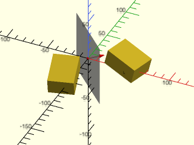

    include <BOSL2/std.scad>
    n = [1,1,0];
    module obj() right(20) rotate([0,15,-15]) cube([40,30,20]);
    obj();
    mirror(n) obj();
    rot(a=atan2(n.y,n.x),from=UP,to=n) {
        color("red") anchor_arrow(s=20, flag=false);
        color("#7777") cube([75,75,0.1], center=true);
    }

  

**Example 3:** 

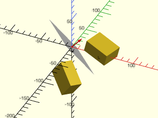

    include <BOSL2/std.scad>
    n = [1,1,1];
    module obj() right(20) rotate([0,15,-15]) cube([40,30,20]);
    obj();
    mirror(n) obj();
    rot(a=atan2(n.y,n.x),from=UP,to=n) {
        color("red") anchor_arrow(s=20, flag=false);
        color("#7777") cube([75,75,0.1], center=true);
    }

  

**Example 4:** 

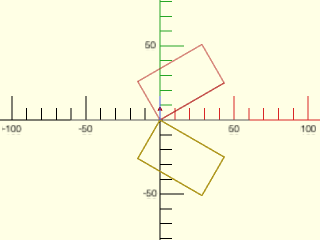

    include <BOSL2/std.scad>
    n = [0,1];
    path = rot(30, p=square([50,30]));
    color("gray") rot(from=[0,1],to=n) stroke([[-60,0],[60,0]]);
    color("red") stroke([[0,0],10*n],endcap2="arrow2");
    #stroke(path,closed=true);
    stroke(mirror(n, path),closed=true);

  

**Example 5:** 

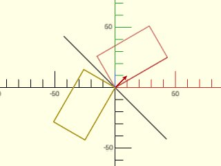

    include <BOSL2/std.scad>
    n = [1,1];
    path = rot(30, p=square([50,30]));
    color("gray") rot(from=[0,1],to=n) stroke([[-60,0],[60,0]]);
    color("red") stroke([[0,0],10*n],endcap2="arrow2");
    #stroke(path,closed=true);
    stroke(mirror(n, path),closed=true);

  

---

### Function/Module: xflip()

**Synopsis:** Reflects children across the YZ plane. [<abbr>Trans</abbr>] [<abbr>Path</abbr>] [<abbr>VNF</abbr>] [<abbr>Mat</abbr>]

**Topics:** [Affine](Topics#affine), [Matrices](Topics#matrices), [Transforms](Topics#transforms), [Reflection](Topics#reflection), [Mirroring](Topics#mirroring)

**See Also:** [mirror()](#functionmodule-mirror), [yflip()](#functionmodule-yflip), [zflip()](#functionmodule-zflip)

**Usage:** As Module

- xflip([x=]) CHILDREN;

**Usage:** As Function

- pt = xflip(p, [x]);

**Usage:** Get Affine Matrix

- mat = xflip([x=]);

**Description:** 

Mirrors/reflects across the origin [0,0,0], along the X axis.  If `x` is given as a scalar, reflects across [x,0,0].
* If called as a module, mirrors all children.
* If called as a function with the `p` argument, returns the reflected version of that `p` argument.  The `p` argument can be a point, list of points, [bezier patch](beziers.scad) or [VNF structure](vnf.scad).
* If called as a function without a `p` argument, returns a 4x4 transformation matrix.

**Arguments:** 

<abbr title="These args can be used by position or by name.">By&nbsp;Position</abbr> | What it does
-------------------- | ------------
`p`                  | (function only) A point, list of points, Bezier patch or VNF to reflect.
`x`                  | The X coordinate of the plane of reflection.  Default: 0

**Example 1:** 

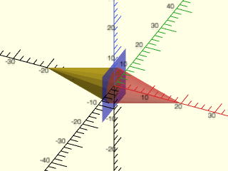

    include <BOSL2/std.scad>
    xflip() yrot(90) cylinder(d1=10, d2=0, h=20);
    color("blue", 0.25) cube([0.01,15,15], center=true);
    color("red", 0.333) yrot(90) cylinder(d1=10, d2=0, h=20);

  

**Example 2:** 

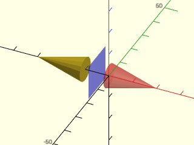

    include <BOSL2/std.scad>
    xflip(x=-5) yrot(90) cylinder(d1=10, d2=0, h=20);
    color("blue", 0.25) left(5) cube([0.01,15,15], center=true);
    color("red", 0.333) yrot(90) cylinder(d1=10, d2=0, h=20);

  

---

### Function/Module: yflip()

**Synopsis:** Reflects children across the XZ plane. [<abbr>Trans</abbr>] [<abbr>Path</abbr>] [<abbr>VNF</abbr>] [<abbr>Mat</abbr>]

**Topics:** [Affine](Topics#affine), [Matrices](Topics#matrices), [Transforms](Topics#transforms), [Reflection](Topics#reflection), [Mirroring](Topics#mirroring)

**See Also:** [mirror()](#functionmodule-mirror), [xflip()](#functionmodule-xflip), [zflip()](#functionmodule-zflip)

**Usage:** As Module

- yflip([y=]) CHILDREN;

**Usage:** As Function

- pt = yflip(p, [y]);

**Usage:** Get Affine Matrix

- mat = yflip([y=]);

**Description:** 

Mirrors/reflects across the origin [0,0,0], along the Y axis.  If `y` is given as a scalar, reflects across [0,y,0] instead.
* If called as a module, mirrors all children.
* If called as a function with the `p` argument, returns the reflected version of that `p` argument.  The `p` argument can be a point, list of points, [bezier patch](beziers.scad) or [VNF structure](vnf.scad).
* If called as a function without a `p` argument, returns a 4x4 transformation matrix.

**Arguments:** 

<abbr title="These args can be used by position or by name.">By&nbsp;Position</abbr> | What it does
-------------------- | ------------
`p`                  | (function only) A point, list of points, Bezier patch or VNF to reflect.
`y`                  | The Y coordinate of the plane of reflection.  Default: 0

**Example 1:** 

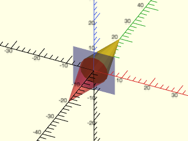

    include <BOSL2/std.scad>
    yflip() xrot(90) cylinder(d1=10, d2=0, h=20);
    color("blue", 0.25) cube([15,0.01,15], center=true);
    color("red", 0.333) xrot(90) cylinder(d1=10, d2=0, h=20);

  

**Example 2:** 

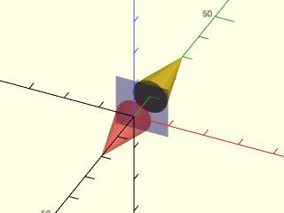

    include <BOSL2/std.scad>
    yflip(y=5) xrot(90) cylinder(d1=10, d2=0, h=20);
    color("blue", 0.25) back(5) cube([15,0.01,15], center=true);
    color("red", 0.333) xrot(90) cylinder(d1=10, d2=0, h=20);

  

---

### Function/Module: zflip()

**Synopsis:** Reflects children across the XY plane. [<abbr>Trans</abbr>] [<abbr>Path</abbr>] [<abbr>VNF</abbr>] [<abbr>Mat</abbr>]

**Topics:** [Affine](Topics#affine), [Matrices](Topics#matrices), [Transforms](Topics#transforms), [Reflection](Topics#reflection), [Mirroring](Topics#mirroring)

**See Also:** [mirror()](#functionmodule-mirror), [xflip()](#functionmodule-xflip), [yflip()](#functionmodule-yflip)

**Usage:** As Module

- zflip([z=]) CHILDREN;

**Usage:** As Function

- pt = zflip(p, [z]);

**Usage:** Get Affine Matrix

- mat = zflip([z=]);

**Description:** 

Mirrors/reflects across the origin [0,0,0], along the Z axis.  If `z` is given as a scalar, reflects across [0,0,z] instead.
* If called as a module, mirrors all children.
* If called as a function with the `p` argument, returns the reflected version of that `p` argument.  The `p` argument can be a point, list of points, [bezier patch](beziers.scad) or [VNF structure](vnf.scad).
* If called as a function without a `p` argument, returns a 4x4 transformation matrix.

**Arguments:** 

<abbr title="These args can be used by position or by name.">By&nbsp;Position</abbr> | What it does
-------------------- | ------------
`p`                  | (function only) A point, list of points, Bezier patch or VNF to reflect.
`z`                  | The Z coordinate of the plane of reflection.  Default: 0

**Example 1:** 

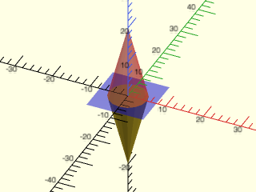

    include <BOSL2/std.scad>
    zflip() cylinder(d1=10, d2=0, h=20);
    color("blue", 0.25) cube([15,15,0.01], center=true);
    color("red", 0.333) cylinder(d1=10, d2=0, h=20);

  

**Example 2:** 

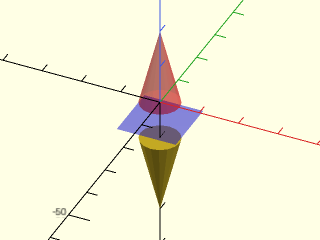

    include <BOSL2/std.scad>
    zflip(z=-5) cylinder(d1=10, d2=0, h=20);
    color("blue", 0.25) down(5) cube([15,15,0.01], center=true);
    color("red", 0.333) cylinder(d1=10, d2=0, h=20);

  

---

## Section: Other Transformations

### Function/Module: frame\_map()

**Synopsis:** Rotates and possibly skews children from one frame of reference to another. [<abbr>Trans</abbr>] [<abbr>Path</abbr>] [<abbr>VNF</abbr>] [<abbr>Mat</abbr>]

**Topics:** [Affine](Topics#affine), [Matrices](Topics#matrices), [Transforms](Topics#transforms), [Rotation](Topics#rotation)

**See Also:** [rot()](#functionmodule-rot), [xrot()](#functionmodule-xrot), [yrot()](#functionmodule-yrot), [zrot()](#functionmodule-zrot)

**Usage:** As module

- frame_map(v1, v2, v3, [reverse=]) CHILDREN;

**Usage:** As function to remap points

- transformed = frame_map(v1, v2, v3, p=points, [reverse=]);

**Usage:** As function to return a transformation matrix:

- map = frame_map(v1, v2, v3, [reverse=]);
- map = frame_map(x=VECTOR1, y=VECTOR2, [reverse=]);
- map = frame_map(x=VECTOR1, z=VECTOR2, [reverse=]);
- map = frame_map(y=VECTOR1, z=VECTOR2, [reverse=]);

**Description:** 

Maps one coordinate frame to another.  You must specify two or
three of `x`, `y`, and `z`.  The specified axes are mapped to the vectors you supplied, so if you
specify x=[1,1,0] then the x axis is mapped to the line y=x.  If you
give two inputs, the third vector is mapped to the appropriate normal to maintain a right hand
coordinate system.  For orthogonal right-handed axes the result is a rotation, and the
`reverse` parameter supplies the inverse map, which enables you to map two arbitrary
coordinate systems to each other by using the canonical coordinate system as an intermediary.
You cannot use the `reverse` option with non-orthogonal inputs.  Note that only the direction
of the specified vectors matters: each destination axis has unit length.  Non-orthogonal
axes can still change the lengths of other vectors and can skew the object.

You can use `frame_map()` as a module, or as a function.  In the functional form, you
need to provide the points to be transformed with the `p=` named argument (except in the
less common situation where you give all three of `x`, `y`, and `z`).
The functional form with no `p=` argument returns a 4x4 transformation matrix.

**Arguments:** 

<abbr title="These args can be used by position or by name.">By&nbsp;Position</abbr> | What it does
-------------------- | ------------
`x`                  | Destination 3D vector for x axis.
`y`                  | Destination 3D vector for y axis.
`z`                  | Destination 3D vector for z axis.
`p`                  | (function only) A point, list of points, Bezier patch or VNF to operate on.

<abbr title="These args must be used by name, ie: name=value">By&nbsp;Name</abbr> | What it does
-------------------- | ------------
`reverse`            | reverse direction of the map for orthogonal inputs.  Default: false

**Example 1:** Remap axes after linear extrusion

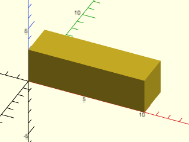

 

    include <BOSL2/std.scad>
    frame_map(x=[0,1,0], y=[0,0,1]) linear_extrude(height=10) square(3);

**Example 2:** This map is just a rotation around the z axis

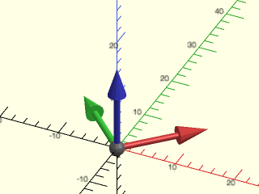

    include <BOSL2/std.scad>
    mat = frame_map(x=[1,1,0], y=[-1,1,0]);
    multmatrix(mat) frame_ref();

  

**Example 3:** This map is not a rotation because x and y aren't orthogonal

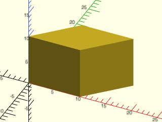

    include <BOSL2/std.scad>
    frame_map(x=[1,0,0], y=[1,1,0]) cube(10);

  

**Example 4:** This sends [1,1,0] to [0,1,1] and [-1,1,0] to [0,-1,1].  (Original directions shown in light shade, final directions shown dark.)

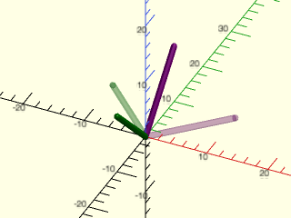

 

    include <BOSL2/std.scad>
    mat = frame_map(x=[0,1,1], y=[0,-1,1]) * frame_map(x=[1,1,0], y=[-1,1,0],reverse=true);
    color("purple",alpha=.2) stroke([[0,0,0],10*[1,1,0]]);
    color("green",alpha=.2)  stroke([[0,0,0],10*[-1,1,0]]);
    multmatrix(mat) {
       color("purple") stroke([[0,0,0],10*[1,1,0]]);
       color("green") stroke([[0,0,0],10*[-1,1,0]]);
    }

---

### Function/Module: skew()

**Synopsis:** Skews (or shears) children along various axes. [<abbr>Trans</abbr>] [<abbr>Path</abbr>] [<abbr>VNF</abbr>] [<abbr>Mat</abbr>]

**Topics:** [Affine](Topics#affine), [Matrices](Topics#matrices), [Transforms](Topics#transforms), [Skewing](Topics#skewing), [Shearing](Topics#shearing)

**See Also:** [move()](#functionmodule-move), [rot()](#functionmodule-rot), [scale()](#functionmodule-scale)

**Usage:** As Module

- skew([sxy=]|[axy=], [sxz=]|[axz=], [syx=]|[ayx=], [syz=]|[ayz=], [szx=]|[azx=], [szy=]|[azy=]) CHILDREN;

**Usage:** As Function to transform an input

- pts = skew(p, [sxy=]|[axy=], [sxz=]|[axz=], [syx=]|[ayx=], [syz=]|[ayz=], [szx=]|[azx=], [szy=]|[azy=]);

**Usage:** Get Skewing Transformation Matrix

- mat = skew([sxy=]|[axy=], [sxz=]|[axz=], [syx=]|[ayx=], [syz=]|[ayz=], [szx=]|[azx=], [szy=]|[azy=]);

**Description:** 

Skews geometry by the given skew factors.  Skewing is also referred to as shearing.
* If called as a module, skews all the children.
* If called as a function with the `p` argument, returns the skewed version of that `p` argument.  The `p` argument can be a point, list of points, [bezier patch](beziers.scad) or [VNF structure](vnf.scad).
* Called as a function without a `p` argument, returns the 4x4 transformation skew matrix.

Each skew factor is a multiplier.  For example, if `sxy=2`, then it skews along the X axis by 2x the value of the Y axis.

**Arguments:** 

<abbr title="These args can be used by position or by name.">By&nbsp;Position</abbr> | What it does
-------------------- | ------------
`p`                  | (function only) The point, path, Bezier patch, or VNF to skew.

<abbr title="These args must be used by name, ie: name=value">By&nbsp;Name</abbr> | What it does
-------------------- | ------------
`sxy`                | Skew factor multiplier for skewing along the X axis as you get farther from the Y axis.  Default: 0
`sxz`                | Skew factor multiplier for skewing along the X axis as you get farther from the Z axis.  Default: 0
`syx`                | Skew factor multiplier for skewing along the Y axis as you get farther from the X axis.  Default: 0
`syz`                | Skew factor multiplier for skewing along the Y axis as you get farther from the Z axis.  Default: 0
`szx`                | Skew factor multiplier for skewing along the Z axis as you get farther from the X axis.  Default: 0
`szy`                | Skew factor multiplier for skewing along the Z axis as you get farther from the Y axis.  Default: 0
`axy`                | Angle to skew along the X axis as you get farther from the Y axis.
`axz`                | Angle to skew along the X axis as you get farther from the Z axis.
`ayx`                | Angle to skew along the Y axis as you get farther from the X axis.
`ayz`                | Angle to skew along the Y axis as you get farther from the Z axis.
`azx`                | Angle to skew along the Z axis as you get farther from the X axis.
`azy`                | Angle to skew along the Z axis as you get farther from the Y axis.

**Example 1:** Skew along the X axis in 2D.

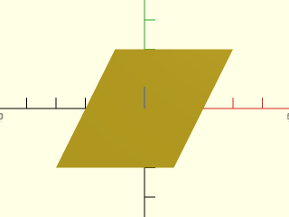

    include <BOSL2/std.scad>
    skew(sxy=0.5) square(40, center=true);

  

**Example 2:** Skew along the X axis by 30º in 2D.

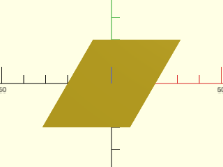

    include <BOSL2/std.scad>
    skew(axy=30) square(40, center=true);

  

**Example 3:** Skew along the Y axis in 2D.

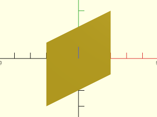

    include <BOSL2/std.scad>
    skew(syx=0.5) square(40, center=true);

  

**Example 4:** Skew along the X axis in 3D as a factor of Y coordinate.

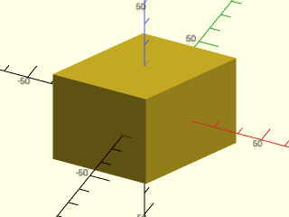

    include <BOSL2/std.scad>
    skew(sxy=0.5) cube(40, center=true);

  

**Example 5:** Skew along the X axis in 3D as a factor of Z coordinate.

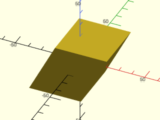

    include <BOSL2/std.scad>
    skew(sxz=0.5) cube(40, center=true);

  

**Example 6:** Skew along the Y axis in 3D as a factor of X coordinate.

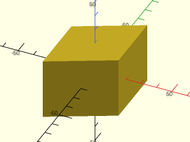

    include <BOSL2/std.scad>
    skew(syx=0.5) cube(40, center=true);

  

**Example 7:** Skew along the Y axis in 3D as a factor of Z coordinate.

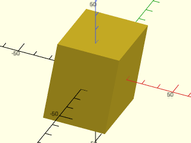

    include <BOSL2/std.scad>
    skew(syz=0.5) cube(40, center=true);

  

**Example 8:** Skew by 30º along the Z axis.

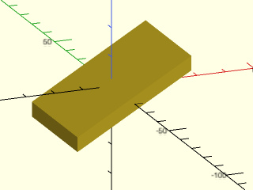

    include <BOSL2/std.scad>
    skew(azx=30) cube([40,40,5],center=true);

  

**Example 9:** Skew along the Z axis in 3D as a factor of X coordinate.

    include <BOSL2/std.scad>
    skew(szx=0.5) cube(40, center=true);

  

**Example 10:** Skew along the Z axis in 3D as a factor of Y coordinate.

    include <BOSL2/std.scad>
    skew(szy=0.75) cube(40, center=true);

  

**Example 11:** Skew Along Multiple Axes.

    include <BOSL2/std.scad>
    skew(sxy=0.5, syx=0.3, szy=0.75) cube(40, center=true);

  

**Example 12:** Calling as a 2D Function

    include <BOSL2/std.scad>
    pts = skew(square(40,center=true), sxy=0.5);
    color("yellow") stroke(pts, closed=true);
    color("blue") move_copies(pts) circle(d=3, $fn=8);

  

**Example 13:** Calling as a 3D Function

    include <BOSL2/std.scad>
    pts = skew(path3d(square(40,center=true)), szx=0.5, szy=0.3);
    stroke(pts,closed=true,dots=true,dots_color="blue");

  

---

## Section: Applying transformation matrices to data

### Function: apply()

**Synopsis:** Applies a transformation matrix to a point, list of points, array of points, or a VNF. [<abbr>Path</abbr>] [<abbr>VNF</abbr>] [<abbr>Mat</abbr>]

**Topics:** [Affine](Topics#affine), [Matrices](Topics#matrices), [Transforms](Topics#transforms)

**See Also:** [move()](#functionmodule-move), [rot()](#functionmodule-rot), [scale()](#functionmodule-scale), [skew()](#functionmodule-skew)

**Usage:** 

- pts = apply(transform, points);

**Description:** 

Applies the specified transformation matrix `transform` to a point, point list, bezier patch or VNF.
When `points` contains 2D or 3D points the transform matrix may be a 4x4 affine matrix or a 3x4
matrix&mdash;the 4x4 matrix with its final row removed.
For 2D data the matrix may not move or mix Z (no Z translation, and no shear or
rotation that changes Z); a Z scale is ignored if the matrix also changes X or Y, but
rejected if it's the only change.  When points contains 2D data you can also supply the transform as
a 3x3 affine transformation matrix or the corresponding 2x3 matrix with the last row deleted.

Any other combination of matrices produces an error, including acting with a 2D matrix (3x3) on 3D data.
The output of apply is always the same dimension as the input&mdash;projections are not supported.

Note that a matrix with a negative determinant such as any mirror reflection flips the orientation of faces.
For either a 4x4 or 3x4 transform, apply() checks the determinant of the effective linear transformation
and reverses each face's vertex order when it is negative, preserving the VNF's winding convention.  This adjustment applies
only to VNFs, not to beziers or point lists.

**Arguments:** 

<abbr title="These args can be used by position or by name.">By&nbsp;Position</abbr> | What it does
-------------------- | ------------
`transform`          | The 2D (3x3 or 2x3) or 3D (4x4 or 3x4) transformation matrix to apply.
`points`             | The point, point list, bezier patch, or VNF to apply the transformation to.

**Example 1:** 

    include <BOSL2/std.scad>
    path1 = path3d(circle(r=40));
    tmat = xrot(45);
    path2 = apply(tmat, path1);
    #stroke(path1,closed=true);
    stroke(path2,closed=true);

  

**Example 2:** 

    include <BOSL2/std.scad>
    path1 = circle(r=40);
    tmat = translate([10,5]);
    path2 = apply(tmat, path1);
    #stroke(path1,closed=true);
    stroke(path2,closed=true);

  

**Example 3:** 

    include <BOSL2/std.scad>
    path1 = circle(r=40);
    tmat = rot(30) * back(15) * scale([1.5,0.5,1]);
    path2 = apply(tmat, path1);
    #stroke(path1,closed=true);
    stroke(path2,closed=true);

  

---

