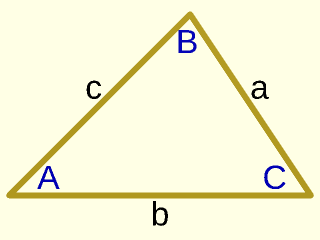
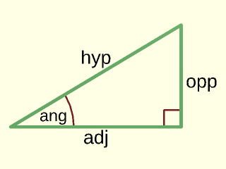

# LibFile: trigonometry.scad

Trigonometry shortcuts for people who can't be bothered to remember
all the function relations, or silly acronyms like SOHCAHTOA.

To use, add the following lines to the beginning of your file:

    include <BOSL2/std.scad>

## File Contents

1. [Section: General Triangle Functions](#section-general-triangle-functions)
    - [`law_of_cosines()`](#function-law_of_cosines) – Applies the Law of Cosines for an arbitrary triangle.
    - [`law_of_sines()`](#function-law_of_sines) – Applies the Law of Sines for an arbitrary triangle.

2. [Section: Right Triangle Functions](#section-right-triangle-functions)
    - [`hyp_opp_to_adj()`](#function-hyp_opp_to_adj) – Returns the adjacent side length from the lengths of the hypotenuse and the opposite side.
    - [`opp_hyp_to_adj()`](#function-opp_hyp_to_adj) – Returns the adjacent side length from the lengths of the opposite side and the hypotenuse.
    - [`hyp_ang_to_adj()`](#function-hyp_ang_to_adj) – Returns the adjacent side length from the length of the hypotenuse and the reference reference angle.
    - [`ang_hyp_to_adj()`](#function-ang_hyp_to_adj) – Returns the adjacent side length from the reference reference angle and the length of the hypotenuse.
    - [`opp_ang_to_adj()`](#function-opp_ang_to_adj) – Returns the adjacent side length from the length of the opposite side and the reference reference angle.
    - [`ang_opp_to_adj()`](#function-ang_opp_to_adj) – Returns the adjacent side length from the reference reference angle and the length of the opposite side.
    - [`hyp_adj_to_opp()`](#function-hyp_adj_to_opp) – Returns the opposite side length from the lengths of the hypotenuse and the adjacent side.
    - [`adj_hyp_to_opp()`](#function-adj_hyp_to_opp) – Returns the opposite side length from the lengths of the adjacent side and the hypotenuse.
    - [`hyp_ang_to_opp()`](#function-hyp_ang_to_opp) – Returns the opposite side length from the length of the hypotenuse and the reference reference angle.
    - [`ang_hyp_to_opp()`](#function-ang_hyp_to_opp) – Returns the opposite side length from the reference reference angle and the length of the hypotenuse.
    - [`adj_ang_to_opp()`](#function-adj_ang_to_opp) – Returns the opposite side length from the length of the adjacent side and the reference reference angle.
    - [`ang_adj_to_opp()`](#function-ang_adj_to_opp) – Returns the opposite side length from the reference reference angle and the length of the adjacent side.
    - [`adj_opp_to_hyp()`](#function-adj_opp_to_hyp) – Returns the hypotenuse length from the lengths of the adjacent and opposite sides.
    - [`opp_adj_to_hyp()`](#function-opp_adj_to_hyp) – Returns the hypotenuse length from the lengths of the opposite and adjacent sides.
    - [`adj_ang_to_hyp()`](#function-adj_ang_to_hyp) – Returns the hypotenuse length from the length of the adjacent side and the reference reference angle.
    - [`ang_adj_to_hyp()`](#function-ang_adj_to_hyp) – Returns the hypotenuse length from the reference reference angle and length of the adjacent side.
    - [`opp_ang_to_hyp()`](#function-opp_ang_to_hyp) – Returns the hypotenuse length from the length of the opposite side and the reference reference angle.
    - [`ang_opp_to_hyp()`](#function-ang_opp_to_hyp) – Returns the hypotenuse length from the reference reference angle and the length of the opposite side.
    - [`hyp_adj_to_ang()`](#function-hyp_adj_to_ang) – Returns the reference reference angle from the lengths of the hypotenuse and the adjacent side.
    - [`adj_hyp_to_ang()`](#function-adj_hyp_to_ang) – Returns the reference angle from the lengths of the adjacent side and the hypotenuse.
    - [`hyp_opp_to_ang()`](#function-hyp_opp_to_ang) – Returns the reference reference angle from the lengths of the hypotenuse and the opposite side.
    - [`opp_hyp_to_ang()`](#function-opp_hyp_to_ang) – Returns the reference reference angle from the lengths of the opposite side and the hypotenuse.
    - [`adj_opp_to_ang()`](#function-adj_opp_to_ang) – Returns the reference angle from the lengths of the adjacent and opposite sides.
    - [`opp_adj_to_ang()`](#function-opp_adj_to_ang) – Returns the reference reference angle from the lengths of the opposite and adjacent sides.

## Section: General Triangle Functions

### Function: law\_of\_cosines()

**Synopsis:** Applies the Law of Cosines for an arbitrary triangle.

**Topics:** [Geometry](Topics#geometry), [Trigonometry](Topics#trigonometry), [Triangles](Topics#triangles)

**See Also:** [law\_of\_sines()](#function-law_of_sines)

**Usage:** 

- C = law_of_cosines(a, b, c);
- c = law_of_cosines(a, b, C=);

**Description:** 

Applies the Law of Cosines for an arbitrary triangle.  Given three side lengths, returns the
reference angle in degrees for the corner opposite of the third side.  Given two side lengths, and the
reference angle between them, returns the length of the third side.
Impossible combinations of positive side lengths, or a positive included angle above 180 degrees, produce an error.

**Figure 1.1.1:** 

 

**Arguments:** 

<abbr title="These args can be used by position or by name.">By&nbsp;Position</abbr> | What it does
-------------------- | ------------
`a`                  | The length of the first side.
`b`                  | The length of the second side.
`c`                  | The length of the third side.

<abbr title="These args must be used by name, ie: name=value">By&nbsp;Name</abbr> | What it does
-------------------- | ------------
`C`                  | The reference angle in degrees of the corner opposite of the third side.

---

### Function: law\_of\_sines()

**Synopsis:** Applies the Law of Sines for an arbitrary triangle.

**Topics:** [Geometry](Topics#geometry), [Trigonometry](Topics#trigonometry), [Triangles](Topics#triangles)

**See Also:** [law\_of\_cosines()](#function-law_of_cosines)

**Usage:** 

- B = law_of_sines(a, A, b);
- b = law_of_sines(a, A, B=);

**Description:** 

Applies the Law of Sines for an arbitrary triangle.  Given side lengths `a` and `b` and the angle `A`
opposite `a`, returns the principal angle `B` opposite `b`.  A supplementary solution `180-B` may also
form a triangle when `A+(180-B)<180`.  Given `a`, its opposite angle `A`, and a second angle `B`,
returns the side opposite `B`.  Impossible combinations of positive sides and angles produce an error.

**Figure 1.2.1:** 

 

**Arguments:** 

<abbr title="These args can be used by position or by name.">By&nbsp;Position</abbr> | What it does
-------------------- | ------------
`a`                  | The length of the first side.
`A`                  | The reference angle in degrees of the corner opposite of the first side.
`b`                  | The length of the second side.

<abbr title="These args must be used by name, ie: name=value">By&nbsp;Name</abbr> | What it does
-------------------- | ------------
`B`                  | The reference angle in degrees of the corner opposite of the second side.

---

## Section: Right Triangle Functions

This is a set of functions to make it easier to perform trig calculations on right triangles.
In general, all these functions are named using these abbreviations:
- **ang**: The reference reference angle size in degrees.
- **hyp**: The length of the Hypotenuse.
- **adj**: The length of the side adjacent to the reference reference angle.
- **opp**: The length of the side opposite to the reference reference angle.

If you know two of those, and want to know the value of a third, you will need to call a
function named like `AAA_BBB_to_CCC()`.  For example, if you know the length of the hypotenuse,
and the length of the side adjacent to the reference reference angle, and want to learn the length of the side
opposite to the reference reference angle, you will call `opp = hyp_adj_to_opp(hyp,adj);`.

**Figure 2.1:** 

 

### Function: hyp\_opp\_to\_adj()

**Synopsis:** Returns the adjacent side length from the lengths of the hypotenuse and the opposite side.

**Topics:** [Geometry](Topics#geometry), [Trigonometry](Topics#trigonometry), [Triangles](Topics#triangles)

**See Also:** [adj\_ang\_to\_hyp()](#function-adj_ang_to_hyp), [adj\_ang\_to\_opp()](#function-adj_ang_to_opp), [adj\_opp\_to\_ang()](#function-adj_opp_to_ang), [adj\_opp\_to\_hyp()](#function-adj_opp_to_hyp), [hyp\_adj\_to\_ang()](#function-hyp_adj_to_ang), [hyp\_adj\_to\_opp()](#function-hyp_adj_to_opp), [hyp\_ang\_to\_adj()](#function-hyp_ang_to_adj), [hyp\_ang\_to\_opp()](#function-hyp_ang_to_opp), [hyp\_opp\_to\_ang()](#function-hyp_opp_to_ang), [opp\_ang\_to\_adj()](#function-opp_ang_to_adj), [opp\_ang\_to\_hyp()](#function-opp_ang_to_hyp), [ang\_adj\_to\_hyp()](#function-ang_adj_to_hyp), [ang\_adj\_to\_opp()](#function-ang_adj_to_opp), [opp\_adj\_to\_ang()](#function-opp_adj_to_ang), [opp\_adj\_to\_hyp()](#function-opp_adj_to_hyp), [adj\_hyp\_to\_ang()](#function-adj_hyp_to_ang), [adj\_hyp\_to\_opp()](#function-adj_hyp_to_opp), [ang\_hyp\_to\_adj()](#function-ang_hyp_to_adj), [ang\_hyp\_to\_opp()](#function-ang_hyp_to_opp), [opp\_hyp\_to\_adj()](#function-opp_hyp_to_adj), [opp\_hyp\_to\_ang()](#function-opp_hyp_to_ang), [ang\_opp\_to\_adj()](#function-ang_opp_to_adj), [ang\_opp\_to\_hyp()](#function-ang_opp_to_hyp)

**Usage:** 

- adj = hyp_opp_to_adj(hyp,opp);

**Description:** 

Given the lengths of the hypotenuse and opposite side of a right triangle, returns the length
of the adjacent side.

**Arguments:** 

<abbr title="These args can be used by position or by name.">By&nbsp;Position</abbr> | What it does
-------------------- | ------------
`hyp`                | The length of the hypotenuse of the right triangle.
`opp`                | The length of the side of the right triangle that is opposite from the reference reference angle.

**Example 1:** 

    include <BOSL2/std.scad>
    adj = hyp_opp_to_adj(5,3);  // Returns: 4

  

---

### Function: opp\_hyp\_to\_adj()

**Synopsis:** Returns the adjacent side length from the lengths of the opposite side and the hypotenuse.

**Topics:** [Geometry](Topics#geometry), [Trigonometry](Topics#trigonometry), [Triangles](Topics#triangles)

**See Also:** [adj\_ang\_to\_hyp()](#function-adj_ang_to_hyp), [adj\_ang\_to\_opp()](#function-adj_ang_to_opp), [adj\_opp\_to\_ang()](#function-adj_opp_to_ang), [adj\_opp\_to\_hyp()](#function-adj_opp_to_hyp), [hyp\_adj\_to\_ang()](#function-hyp_adj_to_ang), [hyp\_adj\_to\_opp()](#function-hyp_adj_to_opp), [hyp\_ang\_to\_adj()](#function-hyp_ang_to_adj), [hyp\_ang\_to\_opp()](#function-hyp_ang_to_opp), [hyp\_opp\_to\_adj()](#function-hyp_opp_to_adj), [hyp\_opp\_to\_ang()](#function-hyp_opp_to_ang), [opp\_ang\_to\_adj()](#function-opp_ang_to_adj), [opp\_ang\_to\_hyp()](#function-opp_ang_to_hyp), [ang\_adj\_to\_hyp()](#function-ang_adj_to_hyp), [ang\_adj\_to\_opp()](#function-ang_adj_to_opp), [opp\_adj\_to\_ang()](#function-opp_adj_to_ang), [opp\_adj\_to\_hyp()](#function-opp_adj_to_hyp), [adj\_hyp\_to\_ang()](#function-adj_hyp_to_ang), [adj\_hyp\_to\_opp()](#function-adj_hyp_to_opp), [ang\_hyp\_to\_adj()](#function-ang_hyp_to_adj), [ang\_hyp\_to\_opp()](#function-ang_hyp_to_opp), [opp\_hyp\_to\_ang()](#function-opp_hyp_to_ang), [ang\_opp\_to\_adj()](#function-ang_opp_to_adj), [ang\_opp\_to\_hyp()](#function-ang_opp_to_hyp)

**Usage:** 

- adj = opp_hyp_to_adj(opp,hyp);

**Description:** 

Given the lengths of the opposite side and hypotenuse of a right triangle, returns the length
of the adjacent side.

**Arguments:** 

<abbr title="These args can be used by position or by name.">By&nbsp;Position</abbr> | What it does
-------------------- | ------------
`opp`                | The length of the side of the right triangle that is opposite from the reference reference angle.
`hyp`                | The length of the hypotenuse of the right triangle.

**Example 1:** 

    include <BOSL2/std.scad>
    adj = opp_hyp_to_adj(3,5);  // Returns: 4

  

---

### Function: hyp\_ang\_to\_adj()

**Synopsis:** Returns the adjacent side length from the length of the hypotenuse and the reference reference angle.

**Topics:** [Geometry](Topics#geometry), [Trigonometry](Topics#trigonometry), [Triangles](Topics#triangles)

**See Also:** [adj\_ang\_to\_hyp()](#function-adj_ang_to_hyp), [adj\_ang\_to\_opp()](#function-adj_ang_to_opp), [adj\_opp\_to\_ang()](#function-adj_opp_to_ang), [adj\_opp\_to\_hyp()](#function-adj_opp_to_hyp), [hyp\_adj\_to\_ang()](#function-hyp_adj_to_ang), [hyp\_adj\_to\_opp()](#function-hyp_adj_to_opp), [hyp\_ang\_to\_opp()](#function-hyp_ang_to_opp), [hyp\_opp\_to\_adj()](#function-hyp_opp_to_adj), [hyp\_opp\_to\_ang()](#function-hyp_opp_to_ang), [opp\_ang\_to\_adj()](#function-opp_ang_to_adj), [opp\_ang\_to\_hyp()](#function-opp_ang_to_hyp), [ang\_adj\_to\_hyp()](#function-ang_adj_to_hyp), [ang\_adj\_to\_opp()](#function-ang_adj_to_opp), [opp\_adj\_to\_ang()](#function-opp_adj_to_ang), [opp\_adj\_to\_hyp()](#function-opp_adj_to_hyp), [adj\_hyp\_to\_ang()](#function-adj_hyp_to_ang), [adj\_hyp\_to\_opp()](#function-adj_hyp_to_opp), [ang\_hyp\_to\_adj()](#function-ang_hyp_to_adj), [ang\_hyp\_to\_opp()](#function-ang_hyp_to_opp), [opp\_hyp\_to\_adj()](#function-opp_hyp_to_adj), [opp\_hyp\_to\_ang()](#function-opp_hyp_to_ang), [ang\_opp\_to\_adj()](#function-ang_opp_to_adj), [ang\_opp\_to\_hyp()](#function-ang_opp_to_hyp)

**Usage:** 

- adj = hyp_ang_to_adj(hyp,ang);

**Description:** 

Given the length of the hypotenuse and the reference reference angle of a right triangle,
returns the length of the adjacent side.

**Arguments:** 

<abbr title="These args can be used by position or by name.">By&nbsp;Position</abbr> | What it does
-------------------- | ------------
`hyp`                | The length of the hypotenuse of the right triangle.
`ang`                | The reference reference angle of the right triangle in degrees

**Example 1:** 

    include <BOSL2/std.scad>
    adj = hyp_ang_to_adj(8,60);  // Returns: 4

  

---

### Function: ang\_hyp\_to\_adj()

**Synopsis:** Returns the adjacent side length from the reference reference angle and the length of the hypotenuse.

**Topics:** [Geometry](Topics#geometry), [Trigonometry](Topics#trigonometry), [Triangles](Topics#triangles)

**See Also:** [adj\_ang\_to\_hyp()](#function-adj_ang_to_hyp), [adj\_ang\_to\_opp()](#function-adj_ang_to_opp), [adj\_opp\_to\_ang()](#function-adj_opp_to_ang), [adj\_opp\_to\_hyp()](#function-adj_opp_to_hyp), [hyp\_adj\_to\_ang()](#function-hyp_adj_to_ang), [hyp\_adj\_to\_opp()](#function-hyp_adj_to_opp), [hyp\_ang\_to\_adj()](#function-hyp_ang_to_adj), [hyp\_ang\_to\_opp()](#function-hyp_ang_to_opp), [hyp\_opp\_to\_adj()](#function-hyp_opp_to_adj), [hyp\_opp\_to\_ang()](#function-hyp_opp_to_ang), [opp\_ang\_to\_adj()](#function-opp_ang_to_adj), [opp\_ang\_to\_hyp()](#function-opp_ang_to_hyp), [ang\_adj\_to\_hyp()](#function-ang_adj_to_hyp), [ang\_adj\_to\_opp()](#function-ang_adj_to_opp), [opp\_adj\_to\_ang()](#function-opp_adj_to_ang), [opp\_adj\_to\_hyp()](#function-opp_adj_to_hyp), [adj\_hyp\_to\_ang()](#function-adj_hyp_to_ang), [adj\_hyp\_to\_opp()](#function-adj_hyp_to_opp), [ang\_hyp\_to\_opp()](#function-ang_hyp_to_opp), [opp\_hyp\_to\_adj()](#function-opp_hyp_to_adj), [opp\_hyp\_to\_ang()](#function-opp_hyp_to_ang), [ang\_opp\_to\_adj()](#function-ang_opp_to_adj), [ang\_opp\_to\_hyp()](#function-ang_opp_to_hyp)

**Usage:** 

- adj = ang_hyp_to_adj(ang,hyp);

**Description:** 

Given  the reference reference angle and the length of the hypotenuse of a right triangle,
returns the length of the adjacent side.

**Arguments:** 

<abbr title="These args can be used by position or by name.">By&nbsp;Position</abbr> | What it does
-------------------- | ------------
`ang`                | The reference reference angle of the right triangle in degrees
`hyp`                | The length of the hypotenuse of the right triangle.

**Example 1:** 

    include <BOSL2/std.scad>
    adj = ang_hyp_to_adj(60,8);  // Returns: 4

  

---

### Function: opp\_ang\_to\_adj()

**Synopsis:** Returns the adjacent side length from the length of the opposite side and the reference reference angle.

**Topics:** [Geometry](Topics#geometry), [Trigonometry](Topics#trigonometry), [Triangles](Topics#triangles)

**See Also:** [adj\_ang\_to\_hyp()](#function-adj_ang_to_hyp), [adj\_ang\_to\_opp()](#function-adj_ang_to_opp), [adj\_opp\_to\_ang()](#function-adj_opp_to_ang), [adj\_opp\_to\_hyp()](#function-adj_opp_to_hyp), [hyp\_adj\_to\_ang()](#function-hyp_adj_to_ang), [hyp\_adj\_to\_opp()](#function-hyp_adj_to_opp), [hyp\_ang\_to\_adj()](#function-hyp_ang_to_adj), [hyp\_ang\_to\_opp()](#function-hyp_ang_to_opp), [hyp\_opp\_to\_adj()](#function-hyp_opp_to_adj), [hyp\_opp\_to\_ang()](#function-hyp_opp_to_ang), [opp\_ang\_to\_hyp()](#function-opp_ang_to_hyp), [ang\_adj\_to\_hyp()](#function-ang_adj_to_hyp), [ang\_adj\_to\_opp()](#function-ang_adj_to_opp), [opp\_adj\_to\_ang()](#function-opp_adj_to_ang), [opp\_adj\_to\_hyp()](#function-opp_adj_to_hyp), [adj\_hyp\_to\_ang()](#function-adj_hyp_to_ang), [adj\_hyp\_to\_opp()](#function-adj_hyp_to_opp), [ang\_hyp\_to\_adj()](#function-ang_hyp_to_adj), [ang\_hyp\_to\_opp()](#function-ang_hyp_to_opp), [opp\_hyp\_to\_adj()](#function-opp_hyp_to_adj), [opp\_hyp\_to\_ang()](#function-opp_hyp_to_ang), [ang\_opp\_to\_adj()](#function-ang_opp_to_adj), [ang\_opp\_to\_hyp()](#function-ang_opp_to_hyp)

**Usage:** 

- adj = opp_ang_to_adj(opp,ang);

**Description:** 

Given the length of the opposite side and the reference reference angle of a right triangle,
returns the length of the adjacent side.

**Arguments:** 

<abbr title="These args can be used by position or by name.">By&nbsp;Position</abbr> | What it does
-------------------- | ------------
`opp`                | The length of the side of the right triangle that is opposite from the reference reference angle.
`ang`                | The reference reference angle of the right triangle in degrees

**Example 1:** 

    include <BOSL2/std.scad>
    adj = opp_ang_to_adj(8,45);  // Returns: 8

  

---

### Function: ang\_opp\_to\_adj()

**Synopsis:** Returns the adjacent side length from the reference reference angle and the length of the opposite side.

**Topics:** [Geometry](Topics#geometry), [Trigonometry](Topics#trigonometry), [Triangles](Topics#triangles)

**See Also:** [adj\_ang\_to\_hyp()](#function-adj_ang_to_hyp), [adj\_ang\_to\_opp()](#function-adj_ang_to_opp), [adj\_opp\_to\_ang()](#function-adj_opp_to_ang), [adj\_opp\_to\_hyp()](#function-adj_opp_to_hyp), [hyp\_adj\_to\_ang()](#function-hyp_adj_to_ang), [hyp\_adj\_to\_opp()](#function-hyp_adj_to_opp), [hyp\_ang\_to\_adj()](#function-hyp_ang_to_adj), [hyp\_ang\_to\_opp()](#function-hyp_ang_to_opp), [hyp\_opp\_to\_adj()](#function-hyp_opp_to_adj), [hyp\_opp\_to\_ang()](#function-hyp_opp_to_ang), [opp\_ang\_to\_adj()](#function-opp_ang_to_adj), [opp\_ang\_to\_hyp()](#function-opp_ang_to_hyp), [ang\_adj\_to\_hyp()](#function-ang_adj_to_hyp), [ang\_adj\_to\_opp()](#function-ang_adj_to_opp), [opp\_adj\_to\_ang()](#function-opp_adj_to_ang), [opp\_adj\_to\_hyp()](#function-opp_adj_to_hyp), [adj\_hyp\_to\_ang()](#function-adj_hyp_to_ang), [adj\_hyp\_to\_opp()](#function-adj_hyp_to_opp), [ang\_hyp\_to\_adj()](#function-ang_hyp_to_adj), [ang\_hyp\_to\_opp()](#function-ang_hyp_to_opp), [opp\_hyp\_to\_adj()](#function-opp_hyp_to_adj), [opp\_hyp\_to\_ang()](#function-opp_hyp_to_ang), [ang\_opp\_to\_hyp()](#function-ang_opp_to_hyp)

**Usage:** 

- adj = ang_opp_to_adj(ang,opp);

**Description:** 

Given the reference reference angle of a right triangle, and the length of the side opposite of it,
returns the length of the adjacent side.

**Arguments:** 

<abbr title="These args can be used by position or by name.">By&nbsp;Position</abbr> | What it does
-------------------- | ------------
`ang`                | The reference reference angle of the right triangle in degrees
`opp`                | The length of the side of the right triangle that is opposite from the reference reference angle.

**Example 1:** 

    include <BOSL2/std.scad>
    adj = ang_opp_to_adj(45,8);  // Returns: 8

  

---

### Function: hyp\_adj\_to\_opp()

**Synopsis:** Returns the opposite side length from the lengths of the hypotenuse and the adjacent side.

**Topics:** [Geometry](Topics#geometry), [Trigonometry](Topics#trigonometry), [Triangles](Topics#triangles)

**See Also:** [adj\_ang\_to\_hyp()](#function-adj_ang_to_hyp), [adj\_ang\_to\_opp()](#function-adj_ang_to_opp), [adj\_opp\_to\_ang()](#function-adj_opp_to_ang), [adj\_opp\_to\_hyp()](#function-adj_opp_to_hyp), [hyp\_adj\_to\_ang()](#function-hyp_adj_to_ang), [hyp\_ang\_to\_adj()](#function-hyp_ang_to_adj), [hyp\_ang\_to\_opp()](#function-hyp_ang_to_opp), [hyp\_opp\_to\_adj()](#function-hyp_opp_to_adj), [hyp\_opp\_to\_ang()](#function-hyp_opp_to_ang), [opp\_ang\_to\_adj()](#function-opp_ang_to_adj), [opp\_ang\_to\_hyp()](#function-opp_ang_to_hyp), [ang\_adj\_to\_hyp()](#function-ang_adj_to_hyp), [ang\_adj\_to\_opp()](#function-ang_adj_to_opp), [opp\_adj\_to\_ang()](#function-opp_adj_to_ang), [opp\_adj\_to\_hyp()](#function-opp_adj_to_hyp), [adj\_hyp\_to\_ang()](#function-adj_hyp_to_ang), [adj\_hyp\_to\_opp()](#function-adj_hyp_to_opp), [ang\_hyp\_to\_adj()](#function-ang_hyp_to_adj), [ang\_hyp\_to\_opp()](#function-ang_hyp_to_opp), [opp\_hyp\_to\_adj()](#function-opp_hyp_to_adj), [opp\_hyp\_to\_ang()](#function-opp_hyp_to_ang), [ang\_opp\_to\_adj()](#function-ang_opp_to_adj), [ang\_opp\_to\_hyp()](#function-ang_opp_to_hyp)

**Usage:** 

- opp = hyp_adj_to_opp(hyp,adj);

**Description:** 

Given the lengths of the hypotenuse and the adjacent side, returns the length of the opposite side.

**Arguments:** 

<abbr title="These args can be used by position or by name.">By&nbsp;Position</abbr> | What it does
-------------------- | ------------
`hyp`                | The length of the hypotenuse of the right triangle.
`adj`                | The length of the side of the right triangle that is adjacent to the reference reference angle.

**Example 1:** 

    include <BOSL2/std.scad>
    opp = hyp_adj_to_opp(5,4);  // Returns: 3

  

---

### Function: adj\_hyp\_to\_opp()

**Synopsis:** Returns the opposite side length from the lengths of the adjacent side and the hypotenuse.

**Topics:** [Geometry](Topics#geometry), [Trigonometry](Topics#trigonometry), [Triangles](Topics#triangles)

**See Also:** [adj\_ang\_to\_hyp()](#function-adj_ang_to_hyp), [adj\_ang\_to\_opp()](#function-adj_ang_to_opp), [adj\_opp\_to\_ang()](#function-adj_opp_to_ang), [adj\_opp\_to\_hyp()](#function-adj_opp_to_hyp), [hyp\_adj\_to\_ang()](#function-hyp_adj_to_ang), [hyp\_adj\_to\_opp()](#function-hyp_adj_to_opp), [hyp\_ang\_to\_adj()](#function-hyp_ang_to_adj), [hyp\_ang\_to\_opp()](#function-hyp_ang_to_opp), [hyp\_opp\_to\_adj()](#function-hyp_opp_to_adj), [hyp\_opp\_to\_ang()](#function-hyp_opp_to_ang), [opp\_ang\_to\_adj()](#function-opp_ang_to_adj), [opp\_ang\_to\_hyp()](#function-opp_ang_to_hyp), [ang\_adj\_to\_hyp()](#function-ang_adj_to_hyp), [ang\_adj\_to\_opp()](#function-ang_adj_to_opp), [opp\_adj\_to\_ang()](#function-opp_adj_to_ang), [opp\_adj\_to\_hyp()](#function-opp_adj_to_hyp), [adj\_hyp\_to\_ang()](#function-adj_hyp_to_ang), [ang\_hyp\_to\_adj()](#function-ang_hyp_to_adj), [ang\_hyp\_to\_opp()](#function-ang_hyp_to_opp), [opp\_hyp\_to\_adj()](#function-opp_hyp_to_adj), [opp\_hyp\_to\_ang()](#function-opp_hyp_to_ang), [ang\_opp\_to\_adj()](#function-ang_opp_to_adj), [ang\_opp\_to\_hyp()](#function-ang_opp_to_hyp)

**Usage:** 

- opp = adj_hyp_to_opp(adj,hyp);

**Description:** 

Given the lengths of the adjacent side and the hypotenuse, returns the length of the opposite side.

**Arguments:** 

<abbr title="These args can be used by position or by name.">By&nbsp;Position</abbr> | What it does
-------------------- | ------------
`adj`                | The length of the side of the right triangle that is adjacent to the reference reference angle.
`hyp`                | The length of the hypotenuse of the right triangle.

**Example 1:** 

    include <BOSL2/std.scad>
    opp = adj_hyp_to_opp(4,5);  // Returns: 3

  

---

### Function: hyp\_ang\_to\_opp()

**Synopsis:** Returns the opposite side length from the length of the hypotenuse and the reference reference angle.

**Topics:** [Geometry](Topics#geometry), [Trigonometry](Topics#trigonometry), [Triangles](Topics#triangles)

**See Also:** [adj\_ang\_to\_hyp()](#function-adj_ang_to_hyp), [adj\_ang\_to\_opp()](#function-adj_ang_to_opp), [adj\_opp\_to\_ang()](#function-adj_opp_to_ang), [adj\_opp\_to\_hyp()](#function-adj_opp_to_hyp), [hyp\_adj\_to\_ang()](#function-hyp_adj_to_ang), [hyp\_adj\_to\_opp()](#function-hyp_adj_to_opp), [hyp\_ang\_to\_adj()](#function-hyp_ang_to_adj), [hyp\_opp\_to\_adj()](#function-hyp_opp_to_adj), [hyp\_opp\_to\_ang()](#function-hyp_opp_to_ang), [opp\_ang\_to\_adj()](#function-opp_ang_to_adj), [opp\_ang\_to\_hyp()](#function-opp_ang_to_hyp), [ang\_adj\_to\_hyp()](#function-ang_adj_to_hyp), [ang\_adj\_to\_opp()](#function-ang_adj_to_opp), [opp\_adj\_to\_ang()](#function-opp_adj_to_ang), [opp\_adj\_to\_hyp()](#function-opp_adj_to_hyp), [adj\_hyp\_to\_ang()](#function-adj_hyp_to_ang), [adj\_hyp\_to\_opp()](#function-adj_hyp_to_opp), [ang\_hyp\_to\_adj()](#function-ang_hyp_to_adj), [ang\_hyp\_to\_opp()](#function-ang_hyp_to_opp), [opp\_hyp\_to\_adj()](#function-opp_hyp_to_adj), [opp\_hyp\_to\_ang()](#function-opp_hyp_to_ang), [ang\_opp\_to\_adj()](#function-ang_opp_to_adj), [ang\_opp\_to\_hyp()](#function-ang_opp_to_hyp)

**Usage:** 

- opp = hyp_ang_to_opp(hyp,ang);

**Description:** 

Given the length of the hypotenuse of a right triangle and the reference reference angle, returns the length of the opposite side.

**Arguments:** 

<abbr title="These args can be used by position or by name.">By&nbsp;Position</abbr> | What it does
-------------------- | ------------
`hyp`                | The length of the hypotenuse of the right triangle.
`ang`                | The reference reference angle of the right triangle in degrees

**Example 1:** 

    include <BOSL2/std.scad>
    opp = hyp_ang_to_opp(8,30);  // Returns: 4

  

---

### Function: ang\_hyp\_to\_opp()

**Synopsis:** Returns the opposite side length from the reference reference angle and the length of the hypotenuse.

**Topics:** [Geometry](Topics#geometry), [Trigonometry](Topics#trigonometry), [Triangles](Topics#triangles)

**See Also:** [adj\_ang\_to\_hyp()](#function-adj_ang_to_hyp), [adj\_ang\_to\_opp()](#function-adj_ang_to_opp), [adj\_opp\_to\_ang()](#function-adj_opp_to_ang), [adj\_opp\_to\_hyp()](#function-adj_opp_to_hyp), [hyp\_adj\_to\_ang()](#function-hyp_adj_to_ang), [hyp\_adj\_to\_opp()](#function-hyp_adj_to_opp), [hyp\_ang\_to\_adj()](#function-hyp_ang_to_adj), [hyp\_ang\_to\_opp()](#function-hyp_ang_to_opp), [hyp\_opp\_to\_adj()](#function-hyp_opp_to_adj), [hyp\_opp\_to\_ang()](#function-hyp_opp_to_ang), [opp\_ang\_to\_adj()](#function-opp_ang_to_adj), [opp\_ang\_to\_hyp()](#function-opp_ang_to_hyp), [ang\_adj\_to\_hyp()](#function-ang_adj_to_hyp), [ang\_adj\_to\_opp()](#function-ang_adj_to_opp), [opp\_adj\_to\_ang()](#function-opp_adj_to_ang), [opp\_adj\_to\_hyp()](#function-opp_adj_to_hyp), [adj\_hyp\_to\_ang()](#function-adj_hyp_to_ang), [adj\_hyp\_to\_opp()](#function-adj_hyp_to_opp), [ang\_hyp\_to\_adj()](#function-ang_hyp_to_adj), [opp\_hyp\_to\_adj()](#function-opp_hyp_to_adj), [opp\_hyp\_to\_ang()](#function-opp_hyp_to_ang), [ang\_opp\_to\_adj()](#function-ang_opp_to_adj), [ang\_opp\_to\_hyp()](#function-ang_opp_to_hyp)

**Usage:** 

- opp = ang_hyp_to_opp(ang,hyp);

**Description:** 

Given the the reference reference angle and the length of the hypotenuse of a right triangle, returns the length of the opposite side.

**Arguments:** 

<abbr title="These args can be used by position or by name.">By&nbsp;Position</abbr> | What it does
-------------------- | ------------
`ang`                | The reference reference angle of the right triangle in degrees
`hyp`                | The length of the hypotenuse of the right triangle.

**Example 1:** 

    include <BOSL2/std.scad>
    opp = ang_hyp_to_opp(30,8);  // Returns: 4

  

---

### Function: adj\_ang\_to\_opp()

**Synopsis:** Returns the opposite side length from the length of the adjacent side and the reference reference angle.

**Topics:** [Geometry](Topics#geometry), [Trigonometry](Topics#trigonometry), [Triangles](Topics#triangles)

**See Also:** [adj\_ang\_to\_hyp()](#function-adj_ang_to_hyp), [adj\_opp\_to\_ang()](#function-adj_opp_to_ang), [adj\_opp\_to\_hyp()](#function-adj_opp_to_hyp), [hyp\_adj\_to\_ang()](#function-hyp_adj_to_ang), [hyp\_adj\_to\_opp()](#function-hyp_adj_to_opp), [hyp\_ang\_to\_adj()](#function-hyp_ang_to_adj), [hyp\_ang\_to\_opp()](#function-hyp_ang_to_opp), [hyp\_opp\_to\_adj()](#function-hyp_opp_to_adj), [hyp\_opp\_to\_ang()](#function-hyp_opp_to_ang), [opp\_ang\_to\_adj()](#function-opp_ang_to_adj), [opp\_ang\_to\_hyp()](#function-opp_ang_to_hyp), [ang\_adj\_to\_hyp()](#function-ang_adj_to_hyp), [ang\_adj\_to\_opp()](#function-ang_adj_to_opp), [opp\_adj\_to\_ang()](#function-opp_adj_to_ang), [opp\_adj\_to\_hyp()](#function-opp_adj_to_hyp), [adj\_hyp\_to\_ang()](#function-adj_hyp_to_ang), [adj\_hyp\_to\_opp()](#function-adj_hyp_to_opp), [ang\_hyp\_to\_adj()](#function-ang_hyp_to_adj), [ang\_hyp\_to\_opp()](#function-ang_hyp_to_opp), [opp\_hyp\_to\_adj()](#function-opp_hyp_to_adj), [opp\_hyp\_to\_ang()](#function-opp_hyp_to_ang), [ang\_opp\_to\_adj()](#function-ang_opp_to_adj), [ang\_opp\_to\_hyp()](#function-ang_opp_to_hyp)

**Usage:** 

- opp = adj_ang_to_opp(adj,ang);

**Description:** 

Given the length of the adjacent side of a right triangle, and the reference reference angle, returns the length of the opposite side.

**Arguments:** 

<abbr title="These args can be used by position or by name.">By&nbsp;Position</abbr> | What it does
-------------------- | ------------
`adj`                | The length of the side of the right triangle that is adjacent to the reference reference angle.
`ang`                | The reference reference angle of the right triangle in degrees

**Example 1:** 

    include <BOSL2/std.scad>
    opp = adj_ang_to_opp(8,45);  // Returns: 8

  

---

### Function: ang\_adj\_to\_opp()

**Synopsis:** Returns the opposite side length from the reference reference angle and the length of the adjacent side.

**Topics:** [Geometry](Topics#geometry), [Trigonometry](Topics#trigonometry), [Triangles](Topics#triangles)

**See Also:** [adj\_ang\_to\_hyp()](#function-adj_ang_to_hyp), [adj\_ang\_to\_opp()](#function-adj_ang_to_opp), [adj\_opp\_to\_ang()](#function-adj_opp_to_ang), [adj\_opp\_to\_hyp()](#function-adj_opp_to_hyp), [hyp\_adj\_to\_ang()](#function-hyp_adj_to_ang), [hyp\_adj\_to\_opp()](#function-hyp_adj_to_opp), [hyp\_ang\_to\_adj()](#function-hyp_ang_to_adj), [hyp\_ang\_to\_opp()](#function-hyp_ang_to_opp), [hyp\_opp\_to\_adj()](#function-hyp_opp_to_adj), [hyp\_opp\_to\_ang()](#function-hyp_opp_to_ang), [opp\_ang\_to\_adj()](#function-opp_ang_to_adj), [opp\_ang\_to\_hyp()](#function-opp_ang_to_hyp), [ang\_adj\_to\_hyp()](#function-ang_adj_to_hyp), [opp\_adj\_to\_ang()](#function-opp_adj_to_ang), [opp\_adj\_to\_hyp()](#function-opp_adj_to_hyp), [adj\_hyp\_to\_ang()](#function-adj_hyp_to_ang), [adj\_hyp\_to\_opp()](#function-adj_hyp_to_opp), [ang\_hyp\_to\_adj()](#function-ang_hyp_to_adj), [ang\_hyp\_to\_opp()](#function-ang_hyp_to_opp), [opp\_hyp\_to\_adj()](#function-opp_hyp_to_adj), [opp\_hyp\_to\_ang()](#function-opp_hyp_to_ang), [ang\_opp\_to\_adj()](#function-ang_opp_to_adj), [ang\_opp\_to\_hyp()](#function-ang_opp_to_hyp)

**Usage:** 

- opp = ang_adj_to_opp(ang,adj);

**Description:** 

Given the reference reference angle and the length of the adjacent side of a right triangle, returns the length of the opposite side.

**Arguments:** 

<abbr title="These args can be used by position or by name.">By&nbsp;Position</abbr> | What it does
-------------------- | ------------
`ang`                | The reference reference angle of the right triangle in degrees
`adj`                | The length of the side of the right triangle that is adjacent to the reference reference angle.

**Example 1:** 

    include <BOSL2/std.scad>
    opp = ang_adj_to_opp(45,8);  // Returns: 8

  

---

### Function: adj\_opp\_to\_hyp()

**Synopsis:** Returns the hypotenuse length from the lengths of the adjacent and opposite sides.

**Topics:** [Geometry](Topics#geometry), [Trigonometry](Topics#trigonometry), [Triangles](Topics#triangles)

**See Also:** [adj\_ang\_to\_hyp()](#function-adj_ang_to_hyp), [adj\_ang\_to\_opp()](#function-adj_ang_to_opp), [adj\_opp\_to\_ang()](#function-adj_opp_to_ang), [hyp\_adj\_to\_ang()](#function-hyp_adj_to_ang), [hyp\_adj\_to\_opp()](#function-hyp_adj_to_opp), [hyp\_ang\_to\_adj()](#function-hyp_ang_to_adj), [hyp\_ang\_to\_opp()](#function-hyp_ang_to_opp), [hyp\_opp\_to\_adj()](#function-hyp_opp_to_adj), [hyp\_opp\_to\_ang()](#function-hyp_opp_to_ang), [opp\_ang\_to\_adj()](#function-opp_ang_to_adj), [opp\_ang\_to\_hyp()](#function-opp_ang_to_hyp), [ang\_adj\_to\_hyp()](#function-ang_adj_to_hyp), [ang\_adj\_to\_opp()](#function-ang_adj_to_opp), [opp\_adj\_to\_ang()](#function-opp_adj_to_ang), [opp\_adj\_to\_hyp()](#function-opp_adj_to_hyp), [adj\_hyp\_to\_ang()](#function-adj_hyp_to_ang), [adj\_hyp\_to\_opp()](#function-adj_hyp_to_opp), [ang\_hyp\_to\_adj()](#function-ang_hyp_to_adj), [ang\_hyp\_to\_opp()](#function-ang_hyp_to_opp), [opp\_hyp\_to\_adj()](#function-opp_hyp_to_adj), [opp\_hyp\_to\_ang()](#function-opp_hyp_to_ang), [ang\_opp\_to\_adj()](#function-ang_opp_to_adj), [ang\_opp\_to\_hyp()](#function-ang_opp_to_hyp)

**Usage:** 

- hyp = adj_opp_to_hyp(adj,opp);

**Description:** 

Given the length of the adjacent and opposite sides of a right triangle, returns the length of the hypotenuse.

**Arguments:** 

<abbr title="These args can be used by position or by name.">By&nbsp;Position</abbr> | What it does
-------------------- | ------------
`adj`                | The length of the side of the right triangle that is adjacent to the reference reference angle.
`opp`                | The length of the side of the right triangle that is opposite from the reference reference angle.

**Example 1:** 

    include <BOSL2/std.scad>
    hyp = adj_opp_to_hyp(3,4);  // Returns: 5

  

---

### Function: opp\_adj\_to\_hyp()

**Synopsis:** Returns the hypotenuse length from the lengths of the opposite and adjacent sides.

**Topics:** [Geometry](Topics#geometry), [Trigonometry](Topics#trigonometry), [Triangles](Topics#triangles)

**See Also:** [adj\_ang\_to\_hyp()](#function-adj_ang_to_hyp), [adj\_ang\_to\_opp()](#function-adj_ang_to_opp), [adj\_opp\_to\_ang()](#function-adj_opp_to_ang), [adj\_opp\_to\_hyp()](#function-adj_opp_to_hyp), [hyp\_adj\_to\_ang()](#function-hyp_adj_to_ang), [hyp\_adj\_to\_opp()](#function-hyp_adj_to_opp), [hyp\_ang\_to\_adj()](#function-hyp_ang_to_adj), [hyp\_ang\_to\_opp()](#function-hyp_ang_to_opp), [hyp\_opp\_to\_adj()](#function-hyp_opp_to_adj), [hyp\_opp\_to\_ang()](#function-hyp_opp_to_ang), [opp\_ang\_to\_adj()](#function-opp_ang_to_adj), [opp\_ang\_to\_hyp()](#function-opp_ang_to_hyp), [ang\_adj\_to\_hyp()](#function-ang_adj_to_hyp), [ang\_adj\_to\_opp()](#function-ang_adj_to_opp), [opp\_adj\_to\_ang()](#function-opp_adj_to_ang), [adj\_hyp\_to\_ang()](#function-adj_hyp_to_ang), [adj\_hyp\_to\_opp()](#function-adj_hyp_to_opp), [ang\_hyp\_to\_adj()](#function-ang_hyp_to_adj), [ang\_hyp\_to\_opp()](#function-ang_hyp_to_opp), [opp\_hyp\_to\_adj()](#function-opp_hyp_to_adj), [opp\_hyp\_to\_ang()](#function-opp_hyp_to_ang), [ang\_opp\_to\_adj()](#function-ang_opp_to_adj), [ang\_opp\_to\_hyp()](#function-ang_opp_to_hyp)

**Usage:** 

- hyp = opp_adj_to_hyp(opp,adj);

**Description:** 

Given the length of the opposite and adjacent sides of a right triangle, returns the length of the hypotenuse.

**Arguments:** 

<abbr title="These args can be used by position or by name.">By&nbsp;Position</abbr> | What it does
-------------------- | ------------
`opp`                | The length of the side of the right triangle that is opposite from the reference reference angle.
`adj`                | The length of the side of the right triangle that is adjacent to the reference reference angle.

**Example 1:** 

    include <BOSL2/std.scad>
    hyp = opp_adj_to_hyp(4,3);  // Returns: 5

  

---

### Function: adj\_ang\_to\_hyp()

**Synopsis:** Returns the hypotenuse length from the length of the adjacent side and the reference reference angle.

**Topics:** [Geometry](Topics#geometry), [Trigonometry](Topics#trigonometry), [Triangles](Topics#triangles)

**See Also:** [adj\_ang\_to\_opp()](#function-adj_ang_to_opp), [adj\_opp\_to\_ang()](#function-adj_opp_to_ang), [adj\_opp\_to\_hyp()](#function-adj_opp_to_hyp), [hyp\_adj\_to\_ang()](#function-hyp_adj_to_ang), [hyp\_adj\_to\_opp()](#function-hyp_adj_to_opp), [hyp\_ang\_to\_adj()](#function-hyp_ang_to_adj), [hyp\_ang\_to\_opp()](#function-hyp_ang_to_opp), [hyp\_opp\_to\_adj()](#function-hyp_opp_to_adj), [hyp\_opp\_to\_ang()](#function-hyp_opp_to_ang), [opp\_ang\_to\_adj()](#function-opp_ang_to_adj), [opp\_ang\_to\_hyp()](#function-opp_ang_to_hyp), [ang\_adj\_to\_hyp()](#function-ang_adj_to_hyp), [ang\_adj\_to\_opp()](#function-ang_adj_to_opp), [opp\_adj\_to\_ang()](#function-opp_adj_to_ang), [opp\_adj\_to\_hyp()](#function-opp_adj_to_hyp), [adj\_hyp\_to\_ang()](#function-adj_hyp_to_ang), [adj\_hyp\_to\_opp()](#function-adj_hyp_to_opp), [ang\_hyp\_to\_adj()](#function-ang_hyp_to_adj), [ang\_hyp\_to\_opp()](#function-ang_hyp_to_opp), [opp\_hyp\_to\_adj()](#function-opp_hyp_to_adj), [opp\_hyp\_to\_ang()](#function-opp_hyp_to_ang), [ang\_opp\_to\_adj()](#function-ang_opp_to_adj), [ang\_opp\_to\_hyp()](#function-ang_opp_to_hyp)

**Usage:** 

- hyp = adj_ang_to_hyp(adj,ang);

**Description:** 

For a right triangle, given the length of the adjacent side, and the reference reference angle, returns the length of the hypotenuse.

**Arguments:** 

<abbr title="These args can be used by position or by name.">By&nbsp;Position</abbr> | What it does
-------------------- | ------------
`adj`                | The length of the side of the right triangle that is adjacent to the reference reference angle.
`ang`                | The reference reference angle of the right triangle in degrees

**Example 1:** 

    include <BOSL2/std.scad>
    hyp = adj_ang_to_hyp(4,60);  // Returns: 8

  

---

### Function: ang\_adj\_to\_hyp()

**Synopsis:** Returns the hypotenuse length from the reference reference angle and length of the adjacent side.

**Topics:** [Geometry](Topics#geometry), [Trigonometry](Topics#trigonometry), [Triangles](Topics#triangles)

**See Also:** [adj\_ang\_to\_hyp()](#function-adj_ang_to_hyp), [adj\_ang\_to\_opp()](#function-adj_ang_to_opp), [adj\_opp\_to\_ang()](#function-adj_opp_to_ang), [adj\_opp\_to\_hyp()](#function-adj_opp_to_hyp), [hyp\_adj\_to\_ang()](#function-hyp_adj_to_ang), [hyp\_adj\_to\_opp()](#function-hyp_adj_to_opp), [hyp\_ang\_to\_adj()](#function-hyp_ang_to_adj), [hyp\_ang\_to\_opp()](#function-hyp_ang_to_opp), [hyp\_opp\_to\_adj()](#function-hyp_opp_to_adj), [hyp\_opp\_to\_ang()](#function-hyp_opp_to_ang), [opp\_ang\_to\_adj()](#function-opp_ang_to_adj), [opp\_ang\_to\_hyp()](#function-opp_ang_to_hyp), [ang\_adj\_to\_opp()](#function-ang_adj_to_opp), [opp\_adj\_to\_ang()](#function-opp_adj_to_ang), [opp\_adj\_to\_hyp()](#function-opp_adj_to_hyp), [adj\_hyp\_to\_ang()](#function-adj_hyp_to_ang), [adj\_hyp\_to\_opp()](#function-adj_hyp_to_opp), [ang\_hyp\_to\_adj()](#function-ang_hyp_to_adj), [ang\_hyp\_to\_opp()](#function-ang_hyp_to_opp), [opp\_hyp\_to\_adj()](#function-opp_hyp_to_adj), [opp\_hyp\_to\_ang()](#function-opp_hyp_to_ang), [ang\_opp\_to\_adj()](#function-ang_opp_to_adj), [ang\_opp\_to\_hyp()](#function-ang_opp_to_hyp)

**Usage:** 

- hyp = ang_adj_to_hyp(ang,adj);

**Description:** 

For a right triangle, given the reference reference angle and length of the adjacent side, returns the length of the hypotenuse.

**Arguments:** 

<abbr title="These args can be used by position or by name.">By&nbsp;Position</abbr> | What it does
-------------------- | ------------
`ang`                | The reference reference angle of the right triangle in degrees
`adj`                | The length of the side of the right triangle that is adjacent to the reference reference angle.

**Example 1:** 

    include <BOSL2/std.scad>
    hyp = ang_adj_to_hyp(60,4);  // Returns: 8

  

---

### Function: opp\_ang\_to\_hyp()

**Synopsis:** Returns the hypotenuse length from the length of the opposite side and the reference reference angle.

**Topics:** [Geometry](Topics#geometry), [Trigonometry](Topics#trigonometry), [Triangles](Topics#triangles)

**See Also:** [adj\_ang\_to\_hyp()](#function-adj_ang_to_hyp), [adj\_ang\_to\_opp()](#function-adj_ang_to_opp), [adj\_opp\_to\_ang()](#function-adj_opp_to_ang), [adj\_opp\_to\_hyp()](#function-adj_opp_to_hyp), [hyp\_adj\_to\_ang()](#function-hyp_adj_to_ang), [hyp\_adj\_to\_opp()](#function-hyp_adj_to_opp), [hyp\_ang\_to\_adj()](#function-hyp_ang_to_adj), [hyp\_ang\_to\_opp()](#function-hyp_ang_to_opp), [hyp\_opp\_to\_adj()](#function-hyp_opp_to_adj), [hyp\_opp\_to\_ang()](#function-hyp_opp_to_ang), [opp\_ang\_to\_adj()](#function-opp_ang_to_adj), [ang\_adj\_to\_hyp()](#function-ang_adj_to_hyp), [ang\_adj\_to\_opp()](#function-ang_adj_to_opp), [opp\_adj\_to\_ang()](#function-opp_adj_to_ang), [opp\_adj\_to\_hyp()](#function-opp_adj_to_hyp), [adj\_hyp\_to\_ang()](#function-adj_hyp_to_ang), [adj\_hyp\_to\_opp()](#function-adj_hyp_to_opp), [ang\_hyp\_to\_adj()](#function-ang_hyp_to_adj), [ang\_hyp\_to\_opp()](#function-ang_hyp_to_opp), [opp\_hyp\_to\_adj()](#function-opp_hyp_to_adj), [opp\_hyp\_to\_ang()](#function-opp_hyp_to_ang), [ang\_opp\_to\_adj()](#function-ang_opp_to_adj), [ang\_opp\_to\_hyp()](#function-ang_opp_to_hyp)

**Usage:** 

- hyp = opp_ang_to_hyp(opp,ang);

**Description:** 

For a right triangle, given the length of the opposite side, and the reference reference angle, returns the length of the hypotenuse.

**Arguments:** 

<abbr title="These args can be used by position or by name.">By&nbsp;Position</abbr> | What it does
-------------------- | ------------
`opp`                | The length of the side of the right triangle that is opposite from the reference reference angle.
`ang`                | The reference reference angle of the right triangle in degrees

**Example 1:** 

    include <BOSL2/std.scad>
    hyp = opp_ang_to_hyp(4,30);  // Returns: 8

  

---

### Function: ang\_opp\_to\_hyp()

**Synopsis:** Returns the hypotenuse length from the reference reference angle and the length of the opposite side.

**Topics:** [Geometry](Topics#geometry), [Trigonometry](Topics#trigonometry), [Triangles](Topics#triangles)

**See Also:** [adj\_ang\_to\_hyp()](#function-adj_ang_to_hyp), [adj\_ang\_to\_opp()](#function-adj_ang_to_opp), [adj\_opp\_to\_ang()](#function-adj_opp_to_ang), [adj\_opp\_to\_hyp()](#function-adj_opp_to_hyp), [hyp\_adj\_to\_ang()](#function-hyp_adj_to_ang), [hyp\_adj\_to\_opp()](#function-hyp_adj_to_opp), [hyp\_ang\_to\_adj()](#function-hyp_ang_to_adj), [hyp\_ang\_to\_opp()](#function-hyp_ang_to_opp), [hyp\_opp\_to\_adj()](#function-hyp_opp_to_adj), [hyp\_opp\_to\_ang()](#function-hyp_opp_to_ang), [opp\_ang\_to\_adj()](#function-opp_ang_to_adj), [opp\_ang\_to\_hyp()](#function-opp_ang_to_hyp), [ang\_adj\_to\_hyp()](#function-ang_adj_to_hyp), [ang\_adj\_to\_opp()](#function-ang_adj_to_opp), [opp\_adj\_to\_ang()](#function-opp_adj_to_ang), [opp\_adj\_to\_hyp()](#function-opp_adj_to_hyp), [adj\_hyp\_to\_ang()](#function-adj_hyp_to_ang), [adj\_hyp\_to\_opp()](#function-adj_hyp_to_opp), [ang\_hyp\_to\_adj()](#function-ang_hyp_to_adj), [ang\_hyp\_to\_opp()](#function-ang_hyp_to_opp), [opp\_hyp\_to\_adj()](#function-opp_hyp_to_adj), [opp\_hyp\_to\_ang()](#function-opp_hyp_to_ang), [ang\_opp\_to\_adj()](#function-ang_opp_to_adj)

**Usage:** 

- hyp = ang_opp_to_hyp(ang,opp);

**Description:** 

For a right triangle, given the reference reference angle and the length of the opposite side, returns the length of the hypotenuse.

**Arguments:** 

<abbr title="These args can be used by position or by name.">By&nbsp;Position</abbr> | What it does
-------------------- | ------------
`ang`                | The reference reference angle of the right triangle in degrees
`opp`                | The length of the side of the right triangle that is opposite from the reference reference angle.

**Example 1:** 

    include <BOSL2/std.scad>
    hyp = ang_opp_to_hyp(30,4);  // Returns: 8

  

---

### Function: hyp\_adj\_to\_ang()

**Synopsis:** Returns the reference reference angle from the lengths of the hypotenuse and the adjacent side.

**Topics:** [Geometry](Topics#geometry), [Trigonometry](Topics#trigonometry), [Triangles](Topics#triangles)

**See Also:** [adj\_ang\_to\_hyp()](#function-adj_ang_to_hyp), [adj\_ang\_to\_opp()](#function-adj_ang_to_opp), [adj\_opp\_to\_ang()](#function-adj_opp_to_ang), [adj\_opp\_to\_hyp()](#function-adj_opp_to_hyp), [hyp\_adj\_to\_opp()](#function-hyp_adj_to_opp), [hyp\_ang\_to\_adj()](#function-hyp_ang_to_adj), [hyp\_ang\_to\_opp()](#function-hyp_ang_to_opp), [hyp\_opp\_to\_adj()](#function-hyp_opp_to_adj), [hyp\_opp\_to\_ang()](#function-hyp_opp_to_ang), [opp\_ang\_to\_adj()](#function-opp_ang_to_adj), [opp\_ang\_to\_hyp()](#function-opp_ang_to_hyp), [ang\_adj\_to\_hyp()](#function-ang_adj_to_hyp), [ang\_adj\_to\_opp()](#function-ang_adj_to_opp), [opp\_adj\_to\_ang()](#function-opp_adj_to_ang), [opp\_adj\_to\_hyp()](#function-opp_adj_to_hyp), [adj\_hyp\_to\_ang()](#function-adj_hyp_to_ang), [adj\_hyp\_to\_opp()](#function-adj_hyp_to_opp), [ang\_hyp\_to\_adj()](#function-ang_hyp_to_adj), [ang\_hyp\_to\_opp()](#function-ang_hyp_to_opp), [opp\_hyp\_to\_adj()](#function-opp_hyp_to_adj), [opp\_hyp\_to\_ang()](#function-opp_hyp_to_ang), [ang\_opp\_to\_adj()](#function-ang_opp_to_adj), [ang\_opp\_to\_hyp()](#function-ang_opp_to_hyp)

**Usage:** 

- ang = hyp_adj_to_ang(hyp,adj);

**Description:** 

For a right triangle, given the lengths of the hypotenuse and the adjacent side, returns the reference reference angle.

**Arguments:** 

<abbr title="These args can be used by position or by name.">By&nbsp;Position</abbr> | What it does
-------------------- | ------------
`hyp`                | The length of the hypotenuse of the right triangle.
`adj`                | The length of the side of the right triangle that is adjacent to the reference reference angle.

**Example 1:** 

    include <BOSL2/std.scad>
    ang = hyp_adj_to_ang(8,4);  // Returns: 60 degrees

  

---

### Function: adj\_hyp\_to\_ang()

**Synopsis:** Returns the reference angle from the lengths of the adjacent side and the hypotenuse.

**Topics:** [Geometry](Topics#geometry), [Trigonometry](Topics#trigonometry), [Triangles](Topics#triangles)

**See Also:** [adj\_ang\_to\_hyp()](#function-adj_ang_to_hyp), [adj\_ang\_to\_opp()](#function-adj_ang_to_opp), [adj\_opp\_to\_ang()](#function-adj_opp_to_ang), [adj\_opp\_to\_hyp()](#function-adj_opp_to_hyp), [hyp\_adj\_to\_ang()](#function-hyp_adj_to_ang), [hyp\_adj\_to\_opp()](#function-hyp_adj_to_opp), [hyp\_ang\_to\_adj()](#function-hyp_ang_to_adj), [hyp\_ang\_to\_opp()](#function-hyp_ang_to_opp), [hyp\_opp\_to\_adj()](#function-hyp_opp_to_adj), [hyp\_opp\_to\_ang()](#function-hyp_opp_to_ang), [opp\_ang\_to\_adj()](#function-opp_ang_to_adj), [opp\_ang\_to\_hyp()](#function-opp_ang_to_hyp), [ang\_adj\_to\_hyp()](#function-ang_adj_to_hyp), [ang\_adj\_to\_opp()](#function-ang_adj_to_opp), [opp\_adj\_to\_ang()](#function-opp_adj_to_ang), [opp\_adj\_to\_hyp()](#function-opp_adj_to_hyp), [adj\_hyp\_to\_opp()](#function-adj_hyp_to_opp), [ang\_hyp\_to\_adj()](#function-ang_hyp_to_adj), [ang\_hyp\_to\_opp()](#function-ang_hyp_to_opp), [opp\_hyp\_to\_adj()](#function-opp_hyp_to_adj), [opp\_hyp\_to\_ang()](#function-opp_hyp_to_ang), [ang\_opp\_to\_adj()](#function-ang_opp_to_adj), [ang\_opp\_to\_hyp()](#function-ang_opp_to_hyp)

**Usage:** 

- ang = adj_hyp_to_ang(adj,hyp);

**Description:** 

For a right triangle, given the lengths of the adjacent side and the hypotenuse, returns the reference reference angle.

**Arguments:** 

<abbr title="These args can be used by position or by name.">By&nbsp;Position</abbr> | What it does
-------------------- | ------------
`adj`                | The length of the side of the right triangle that is adjacent to the reference reference angle.
`hyp`                | The length of the hypotenuse of the right triangle.

**Example 1:** 

    include <BOSL2/std.scad>
    ang = adj_hyp_to_ang(4,8);  // Returns: 60 degrees

  

---

### Function: hyp\_opp\_to\_ang()

**Synopsis:** Returns the reference reference angle from the lengths of the hypotenuse and the opposite side.

**Topics:** [Geometry](Topics#geometry), [Trigonometry](Topics#trigonometry), [Triangles](Topics#triangles)

**See Also:** [adj\_ang\_to\_hyp()](#function-adj_ang_to_hyp), [adj\_ang\_to\_opp()](#function-adj_ang_to_opp), [adj\_opp\_to\_ang()](#function-adj_opp_to_ang), [adj\_opp\_to\_hyp()](#function-adj_opp_to_hyp), [hyp\_adj\_to\_ang()](#function-hyp_adj_to_ang), [hyp\_adj\_to\_opp()](#function-hyp_adj_to_opp), [hyp\_ang\_to\_adj()](#function-hyp_ang_to_adj), [hyp\_ang\_to\_opp()](#function-hyp_ang_to_opp), [hyp\_opp\_to\_adj()](#function-hyp_opp_to_adj), [opp\_ang\_to\_adj()](#function-opp_ang_to_adj), [opp\_ang\_to\_hyp()](#function-opp_ang_to_hyp), [ang\_adj\_to\_hyp()](#function-ang_adj_to_hyp), [ang\_adj\_to\_opp()](#function-ang_adj_to_opp), [opp\_adj\_to\_ang()](#function-opp_adj_to_ang), [opp\_adj\_to\_hyp()](#function-opp_adj_to_hyp), [adj\_hyp\_to\_ang()](#function-adj_hyp_to_ang), [adj\_hyp\_to\_opp()](#function-adj_hyp_to_opp), [ang\_hyp\_to\_adj()](#function-ang_hyp_to_adj), [ang\_hyp\_to\_opp()](#function-ang_hyp_to_opp), [opp\_hyp\_to\_adj()](#function-opp_hyp_to_adj), [opp\_hyp\_to\_ang()](#function-opp_hyp_to_ang), [ang\_opp\_to\_adj()](#function-ang_opp_to_adj), [ang\_opp\_to\_hyp()](#function-ang_opp_to_hyp)

**Usage:** 

- ang = hyp_opp_to_ang(hyp,opp);

**Description:** 

For a right triangle, given the lengths of the hypotenuse and the opposite sides, returns the reference reference angle.

**Arguments:** 

<abbr title="These args can be used by position or by name.">By&nbsp;Position</abbr> | What it does
-------------------- | ------------
`hyp`                | The length of the hypotenuse of the right triangle.
`opp`                | The length of the side of the right triangle that is opposite from the reference reference angle.

**Example 1:** 

    include <BOSL2/std.scad>
    ang = hyp_opp_to_ang(8,4);  // Returns: 30 degrees

  

---

### Function: opp\_hyp\_to\_ang()

**Synopsis:** Returns the reference reference angle from the lengths of the opposite side and the hypotenuse.

**Topics:** [Geometry](Topics#geometry), [Trigonometry](Topics#trigonometry), [Triangles](Topics#triangles)

**See Also:** [adj\_ang\_to\_hyp()](#function-adj_ang_to_hyp), [adj\_ang\_to\_opp()](#function-adj_ang_to_opp), [adj\_opp\_to\_ang()](#function-adj_opp_to_ang), [adj\_opp\_to\_hyp()](#function-adj_opp_to_hyp), [hyp\_adj\_to\_ang()](#function-hyp_adj_to_ang), [hyp\_adj\_to\_opp()](#function-hyp_adj_to_opp), [hyp\_ang\_to\_adj()](#function-hyp_ang_to_adj), [hyp\_ang\_to\_opp()](#function-hyp_ang_to_opp), [hyp\_opp\_to\_adj()](#function-hyp_opp_to_adj), [hyp\_opp\_to\_ang()](#function-hyp_opp_to_ang), [opp\_ang\_to\_adj()](#function-opp_ang_to_adj), [opp\_ang\_to\_hyp()](#function-opp_ang_to_hyp), [ang\_adj\_to\_hyp()](#function-ang_adj_to_hyp), [ang\_adj\_to\_opp()](#function-ang_adj_to_opp), [opp\_adj\_to\_ang()](#function-opp_adj_to_ang), [opp\_adj\_to\_hyp()](#function-opp_adj_to_hyp), [adj\_hyp\_to\_ang()](#function-adj_hyp_to_ang), [adj\_hyp\_to\_opp()](#function-adj_hyp_to_opp), [ang\_hyp\_to\_adj()](#function-ang_hyp_to_adj), [ang\_hyp\_to\_opp()](#function-ang_hyp_to_opp), [opp\_hyp\_to\_adj()](#function-opp_hyp_to_adj), [ang\_opp\_to\_adj()](#function-ang_opp_to_adj), [ang\_opp\_to\_hyp()](#function-ang_opp_to_hyp)

**Usage:** 

- ang = opp_hyp_to_ang(opp,hyp);

**Description:** 

For a right triangle, given the lengths of the opposite side and the hypotenuse, returns the reference reference angle.

**Arguments:** 

<abbr title="These args can be used by position or by name.">By&nbsp;Position</abbr> | What it does
-------------------- | ------------
`opp`                | The length of the side of the right triangle that is opposite from the reference reference angle.
`hyp`                | The length of the hypotenuse of the right triangle.

**Example 1:** 

    include <BOSL2/std.scad>
    ang = opp_hyp_to_ang(4,8);  // Returns: 30 degrees

  

---

### Function: adj\_opp\_to\_ang()

**Synopsis:** Returns the reference angle from the lengths of the adjacent and opposite sides.

**Topics:** [Geometry](Topics#geometry), [Trigonometry](Topics#trigonometry), [Triangles](Topics#triangles)

**See Also:** [adj\_ang\_to\_hyp()](#function-adj_ang_to_hyp), [adj\_ang\_to\_opp()](#function-adj_ang_to_opp), [adj\_opp\_to\_hyp()](#function-adj_opp_to_hyp), [hyp\_adj\_to\_ang()](#function-hyp_adj_to_ang), [hyp\_adj\_to\_opp()](#function-hyp_adj_to_opp), [hyp\_ang\_to\_adj()](#function-hyp_ang_to_adj), [hyp\_ang\_to\_opp()](#function-hyp_ang_to_opp), [hyp\_opp\_to\_adj()](#function-hyp_opp_to_adj), [hyp\_opp\_to\_ang()](#function-hyp_opp_to_ang), [opp\_ang\_to\_adj()](#function-opp_ang_to_adj), [opp\_ang\_to\_hyp()](#function-opp_ang_to_hyp), [ang\_adj\_to\_hyp()](#function-ang_adj_to_hyp), [ang\_adj\_to\_opp()](#function-ang_adj_to_opp), [opp\_adj\_to\_ang()](#function-opp_adj_to_ang), [opp\_adj\_to\_hyp()](#function-opp_adj_to_hyp), [adj\_hyp\_to\_ang()](#function-adj_hyp_to_ang), [adj\_hyp\_to\_opp()](#function-adj_hyp_to_opp), [ang\_hyp\_to\_adj()](#function-ang_hyp_to_adj), [ang\_hyp\_to\_opp()](#function-ang_hyp_to_opp), [opp\_hyp\_to\_adj()](#function-opp_hyp_to_adj), [opp\_hyp\_to\_ang()](#function-opp_hyp_to_ang), [ang\_opp\_to\_adj()](#function-ang_opp_to_adj), [ang\_opp\_to\_hyp()](#function-ang_opp_to_hyp)

**Usage:** 

- ang = adj_opp_to_ang(adj,opp);

**Description:** 

For a right triangle, given the lengths of the adjacent and opposite sides, returns the reference angle of the corner.

**Arguments:** 

<abbr title="These args can be used by position or by name.">By&nbsp;Position</abbr> | What it does
-------------------- | ------------
`adj`                | The length of the side of the right triangle that is adjacent to the reference reference angle.
`opp`                | The length of the side of the right triangle that is opposite from the reference reference angle.

**Example 1:** 

    include <BOSL2/std.scad>
    ang = adj_opp_to_ang(sqrt(3)/2,0.5);  // Returns: 30 degrees

  

---

### Function: opp\_adj\_to\_ang()

**Synopsis:** Returns the reference reference angle from the lengths of the opposite and adjacent sides.

**Topics:** [Geometry](Topics#geometry), [Trigonometry](Topics#trigonometry), [Triangles](Topics#triangles)

**See Also:** [adj\_ang\_to\_hyp()](#function-adj_ang_to_hyp), [adj\_ang\_to\_opp()](#function-adj_ang_to_opp), [adj\_opp\_to\_ang()](#function-adj_opp_to_ang), [adj\_opp\_to\_hyp()](#function-adj_opp_to_hyp), [hyp\_adj\_to\_ang()](#function-hyp_adj_to_ang), [hyp\_adj\_to\_opp()](#function-hyp_adj_to_opp), [hyp\_ang\_to\_adj()](#function-hyp_ang_to_adj), [hyp\_ang\_to\_opp()](#function-hyp_ang_to_opp), [hyp\_opp\_to\_adj()](#function-hyp_opp_to_adj), [hyp\_opp\_to\_ang()](#function-hyp_opp_to_ang), [opp\_ang\_to\_adj()](#function-opp_ang_to_adj), [opp\_ang\_to\_hyp()](#function-opp_ang_to_hyp), [ang\_adj\_to\_hyp()](#function-ang_adj_to_hyp), [ang\_adj\_to\_opp()](#function-ang_adj_to_opp), [opp\_adj\_to\_hyp()](#function-opp_adj_to_hyp), [adj\_hyp\_to\_ang()](#function-adj_hyp_to_ang), [adj\_hyp\_to\_opp()](#function-adj_hyp_to_opp), [ang\_hyp\_to\_adj()](#function-ang_hyp_to_adj), [ang\_hyp\_to\_opp()](#function-ang_hyp_to_opp), [opp\_hyp\_to\_adj()](#function-opp_hyp_to_adj), [opp\_hyp\_to\_ang()](#function-opp_hyp_to_ang), [ang\_opp\_to\_adj()](#function-ang_opp_to_adj), [ang\_opp\_to\_hyp()](#function-ang_opp_to_hyp)

**Usage:** 

- ang = opp_adj_to_ang(opp,adj);

**Description:** 

For a right triangle, given the lengths of the opposite and adjacent sides, returns the reference reference angle.

**Arguments:** 

<abbr title="These args can be used by position or by name.">By&nbsp;Position</abbr> | What it does
-------------------- | ------------
`opp`                | The length of the side of the right triangle that is opposite from the reference reference angle.
`adj`                | The length of the side of the right triangle that is adjacent to the reference reference angle.

**Example 1:** 

    include <BOSL2/std.scad>
    ang = opp_adj_to_ang(0.5,sqrt(3)/2);  // Returns: 30 degrees

  

---

