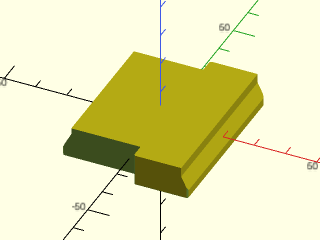

# LibFile: tripod\_mounts.scad

Mount plates for tripods.  Currently only the Manfrotto RC2 plate.

To use, add the following lines to the beginning of your file:

    include <BOSL2/std.scad>
    include <BOSL2/tripod_mounts.scad>

## File Contents

- [`manfrotto_rc2_plate()`](#module-manfrotto_rc2_plate) – Creates a Manfrotto RC2 tripod quick release mount plate. [<abbr>Geom</abbr>]

### Module: manfrotto\_rc2\_plate()

**Synopsis:** Creates a Manfrotto RC2 tripod quick release mount plate. [<abbr>Geom</abbr>]

**Topics:** [Parts](Topics#parts)

**See Also:** [threaded\_rod()](threading.scad#module-threaded_rod)

**Usage:** 

- manfrotto_rc2_plate([chamfer], [anchor=], [spin=], [orient=]) [ATTACHMENTS];

**Description:** 

Creates a Manfrotto RC2 quick release mount plate to mount to a tripod.  The chamfer argument
lets you control whether the model edges are chamfered.  By default all edges are chamfered,
but you can set it to "bot" to chamfer only the bottom, so that connections to a model larger
than the plate don't have a V-groove at the junction.  The plate is 10.5 mm thick.

**Arguments:** 

<abbr title="These args can be used by position or by name.">By&nbsp;Position</abbr> | What it does
-------------------- | ------------
`chamfer`            | "none" for no chamfer, "all" for full chamfering, and "bot" or "bottom" for bottom chamfering.  Default: "all".

<abbr title="These args must be used by name, ie: name=value">By&nbsp;Name</abbr> | What it does
-------------------- | ------------
`anchor`             | Translate so anchor point is at origin (0,0,0). See [anchor](attachments.scad#subsection-anchor). Default: CENTER
`spin`               | Rotate this many degrees around the Z axis. See [spin](attachments.scad#subsection-spin). Default: 0
`orient`             | Vector to rotate top towards. See [orient](attachments.scad#subsection-orient). Default: UP

**Example 1:** 

    include <BOSL2/std.scad>
    include <BOSL2/tripod_mounts.scad>
    manfrotto_rc2_plate();

  

**Example 2:** 

    include <BOSL2/std.scad>
    include <BOSL2/tripod_mounts.scad>
    manfrotto_rc2_plate("bot");

  

---

