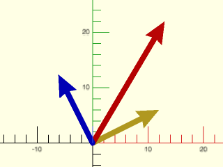
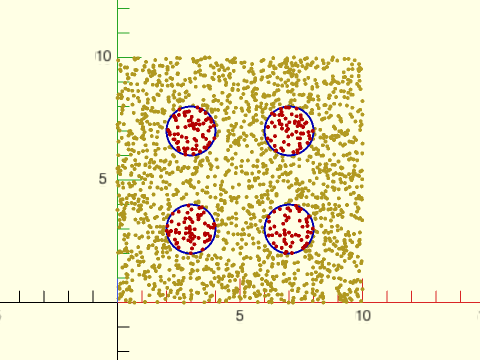
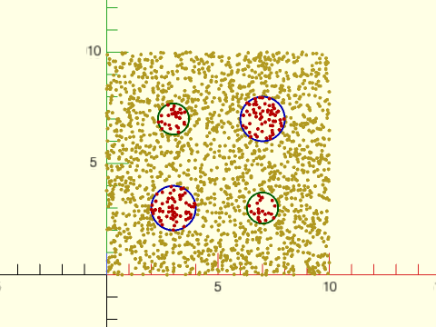
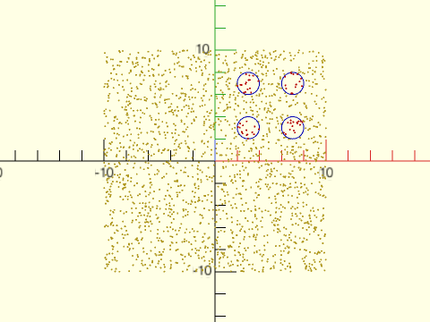
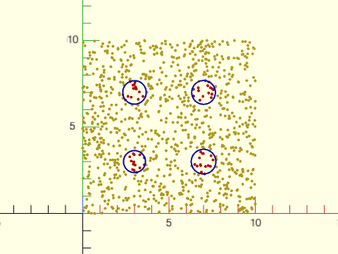
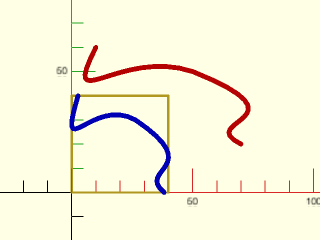
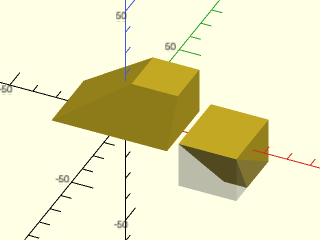

# LibFile: vectors.scad

This file provides some mathematical operations that apply to each
entry in a vector.  It provides normalization and angle computation, and
it provides functions for searching lists of vectors for matches to
a given vector.

To use, add the following lines to the beginning of your file:

    include <BOSL2/std.scad>

## File Contents

1. [Section: Vector Testing](#section-vector-testing)
    - [`is_vector()`](#function-is_vector) – Returns true if the given value is a vector.

2. [Section: Scalar operations on vectors](#section-scalar-operations-on-vectors)
    - [`add_scalar()`](#function-add_scalar) – Adds a scalar value to every item in a vector.
    - [`v_mul()`](#function-v_mul) – Returns the element-wise multiplication of two equal-length vectors.
    - [`v_div()`](#function-v_div) – Returns the element-wise division of two equal-length vectors.
    - [`v_abs()`](#function-v_abs) – Returns the absolute values of the given vector.
    - [`v_ceil()`](#function-v_ceil) – Returns the values of the given vector, rounded up.
    - [`v_floor()`](#function-v_floor) – Returns the values of the given vector, rounded down.
    - [`v_round()`](#function-v_round) – Returns the values of the given vector, rounded to the nearest whole number.
    - [`v_lookup()`](#function-v_lookup) – Like `lookup()`, but it can interpolate between vector results.

3. [Section: Vector Properties](#section-vector-properties)
    - [`unit()`](#function-unit) – Returns the unit length of a given vector.
    - [`v_theta()`](#function-v_theta) – Returns the angle counter-clockwise from X+ on the XY plane.
    - [`vector_angle()`](#function-vector_angle) – Returns the minor angle between two vectors.
    - [`vector_axis()`](#function-vector_axis) – Returns the perpendicular axis between two vectors.
    - [`vector_bisect()`](#function-vector_bisect) – Returns the vector that bisects two vectors.
    - [`vector_perp()`](#function-vector_perp) – Returns component of a vector perpendicular to a second vector

4. [Section: Vector Searching](#section-vector-searching)
    - [`closest_point()`](#function-closest_point) – Finds the closest point in a list of points.
    - [`furthest_point()`](#function-furthest_point) – Finds the furthest point in a list of points.
    - [`vector_search()`](#function-vector_search) – Finds points in a list that are close to a given point.
    - [`vector_search_tree()`](#function-vector_search_tree) – Makes a distance search tree for a list of points.
    - [`vector_nearest()`](#function-vector_nearest) – Finds the `k` nearest points in a list to a given point.

5. [Section: Bounds](#section-bounds)
    - [`pointlist_bounds()`](#function-pointlist_bounds) – Returns the min and max bounding coordinates for the given list of points.
    - [`fit_to_box()`](#function-fit_to_box) – Scale the x, y, and/or z coordinates of a list of points to span a range.

## Section: Vector Testing

### Function: is\_vector()

**Synopsis:** Returns true if the given value is a vector.

**Topics:** [Vectors](Topics#vectors), [Math](Topics#math)

**See Also:** [is\_matrix()](linalg.scad#function-is_matrix), [is\_path()](paths.scad#function-is_path), [is\_region()](regions.scad#function-is_region)

**Usage:** 

- bool = is_vector(v, [length], [zero=], [all_nonzero=], [eps=]);

**Description:** 

Returns true if v is a list of finite numbers.

**Arguments:** 

<abbr title="These args can be used by position or by name.">By&nbsp;Position</abbr> | What it does
-------------------- | ------------
`v`                  | The value to test to see if it is a vector.
`length`             | If given, make sure the vector is `length` items long.

<abbr title="These args must be used by name, ie: name=value">By&nbsp;Name</abbr> | What it does
-------------------- | ------------
`zero`               | If false, require that the `norm()` of the vector is not approximately zero.  If true, require the `norm()` of the vector to be approximately zero.  Default: `undef` (don't check vector `norm()`.)
`all_nonzero`        | If true, requires all elements of the vector to be more than `eps` different from zero.  Default: `false`
`eps`                | The minimum vector length that is considered non-zero.  Default: 1e-9

**Example 1:** 

    include <BOSL2/std.scad>
    is_vector(4);                          // Returns false
    is_vector([4,true,false]);             // Returns false
    is_vector([3,4,INF,5]);                // Returns false
    is_vector([3,4,5,6]);                  // Returns true
    is_vector([3,4,undef,5]);              // Returns false
    is_vector([3,4,5],3);                  // Returns true
    is_vector([3,4,5],4);                  // Returns false
    is_vector([]);                         // Returns false
    is_vector([0,4,0],3,zero=false);       // Returns true
    is_vector([0,0,0],zero=false);         // Returns false
    is_vector([0,0,1e-12],zero=false);     // Returns false
    is_vector([0,1,0],all_nonzero=true);   // Returns false
    is_vector([1,1,1],all_nonzero=true);   // Returns true
    is_vector([],zero=false);              // Returns false

  

---

## Section: Scalar operations on vectors

### Function: add\_scalar()

**Synopsis:** Adds a scalar value to every item in a vector.

**Topics:** [Vectors](Topics#vectors), [Math](Topics#math)

**See Also:** [v\_mul()](#function-v_mul), [v\_div()](#function-v_div)

**Usage:** 

- v_new = add_scalar(v, s);

**Description:** 

Given a vector and a scalar, returns the vector with the scalar added to each item in it.

**Arguments:** 

<abbr title="These args can be used by position or by name.">By&nbsp;Position</abbr> | What it does
-------------------- | ------------
`v`                  | The initial array.
`s`                  | A scalar value to add to every item in the array.

**Example 1:** 

    include <BOSL2/std.scad>
    a = add_scalar([1,2,3],3);            // Returns: [4,5,6]

  

---

### Function: v\_mul()

**Synopsis:** Returns the element-wise multiplication of two equal-length vectors.

**Topics:** [Vectors](Topics#vectors), [Math](Topics#math)

**See Also:** [add\_scalar()](#function-add_scalar), [v\_div()](#function-v_div)

**Usage:** 

- v3 = v_mul(v1, v2);

**Description:** 

Element-wise multiplication.  Multiplies each element of `v1` by the corresponding element of `v2`.
Both `v1` and `v2` must be the same length.  Returns a vector of the products.
The items in `v1` and `v2` can be anything that OpenSCAD can multiply together.

**Arguments:** 

<abbr title="These args can be used by position or by name.">By&nbsp;Position</abbr> | What it does
-------------------- | ------------
`v1`                 | The first vector.
`v2`                 | The second vector.

**Example 1:** 

    include <BOSL2/std.scad>
    v_mul([3,4,5], [8,7,6]);  // Returns [24, 28, 30]

  

---

### Function: v\_div()

**Synopsis:** Returns the element-wise division of two equal-length vectors.

**Topics:** [Vectors](Topics#vectors), [Math](Topics#math)

**See Also:** [add\_scalar()](#function-add_scalar), [v\_mul()](#function-v_mul)

**Usage:** 

- v3 = v_div(v1, v2);

**Description:** 

Element-wise vector division.  Divides each element of vector `v1` by
the corresponding element of vector `v2`.  Returns a vector of the quotients.

**Arguments:** 

<abbr title="These args can be used by position or by name.">By&nbsp;Position</abbr> | What it does
-------------------- | ------------
`v1`                 | The first vector.
`v2`                 | The second vector.

**Example 1:** 

    include <BOSL2/std.scad>
    v_div([24,28,30], [8,7,6]);  // Returns [3, 4, 5]

  

---

### Function: v\_abs()

**Synopsis:** Returns the absolute values of the given vector.

**Topics:** [Vectors](Topics#vectors), [Math](Topics#math)

**See Also:** [v\_ceil()](#function-v_ceil), [v\_floor()](#function-v_floor), [v\_round()](#function-v_round)

**Usage:** 

- v2 = v_abs(v);

**Description:** 

Returns a vector of the absolute value of each element of vector `v`.

**Arguments:** 

<abbr title="These args can be used by position or by name.">By&nbsp;Position</abbr> | What it does
-------------------- | ------------
`v`                  | The vector to get the absolute values of.

**Example 1:** 

    include <BOSL2/std.scad>
    v_abs([-1,3,-9]);  // Returns: [1,3,9]

  

---

### Function: v\_ceil()

**Synopsis:** Returns the values of the given vector, rounded up.

**Topics:** [Vectors](Topics#vectors), [Math](Topics#math)

**See Also:** [v\_abs()](#function-v_abs), [v\_floor()](#function-v_floor), [v\_round()](#function-v_round)

**Usage:** 

- v2 = v_ceil(v);

**Description:** 

Returns the given vector after performing a `ceil()` on all items.

---

### Function: v\_floor()

**Synopsis:** Returns the values of the given vector, rounded down.

**Topics:** [Vectors](Topics#vectors), [Math](Topics#math)

**See Also:** [v\_abs()](#function-v_abs), [v\_ceil()](#function-v_ceil), [v\_round()](#function-v_round)

**Usage:** 

- v2 = v_floor(v);

**Description:** 

Returns the given vector after performing a `floor()` on all items.

---

### Function: v\_round()

**Synopsis:** Returns the values of the given vector, rounded to the nearest whole number.

**Topics:** [Vectors](Topics#vectors), [Math](Topics#math)

**See Also:** [v\_abs()](#function-v_abs), [v\_floor()](#function-v_floor), [v\_ceil()](#function-v_ceil)

**Usage:** 

- v2 = v_round(v);

**Description:** 

Returns the given vector after performing a `round()` on all items.

---

### Function: v\_lookup()

**Synopsis:** Like `lookup()`, but it can interpolate between vector results.

**Topics:** [Vectors](Topics#vectors), [Math](Topics#math)

**See Also:** [v\_abs()](#function-v_abs), [v\_floor()](#function-v_floor), [v\_ceil()](#function-v_ceil), [v\_round()](#function-v_round)

**Usage:** 

- v2 = v_lookup(x, v);

**Description:** 

Works just like the built-in function [`lookup()`](https://en.wikibooks.org/wiki/OpenSCAD_User_Manual/Mathematical_Functions#lookup), except that it can also interpolate between vector result values of the same length.

**Arguments:** 

<abbr title="These args can be used by position or by name.">By&nbsp;Position</abbr> | What it does
-------------------- | ------------
`x`                  | The scalar value to look up.
`v`                  | A list of [KEY,VAL] pairs with scalar KEYs sorted in increasing order. VALs should either all be scalars, or all be vectors of the same length.

**Example 1:** 

    include <BOSL2/std.scad>
    x = v_lookup(4.5, [[4, [3,4,5]], [5, [5,6,7]]]);  // Returns: [4,5,6]

  

---

## Section: Vector Properties

### Function: unit()

**Synopsis:** Returns the unit length of a given vector.

**Topics:** [Vectors](Topics#vectors), [Math](Topics#math)

**See Also:** [v\_abs()](#function-v_abs), [v\_floor()](#function-v_floor), [v\_ceil()](#function-v_ceil), [v\_round()](#function-v_round)

**Usage:** 

- v = unit(v, [error]);

**Description:** 

Returns the unit length normalized version of vector v.  If passed a zero-length vector,
asserts an error unless `error` is given, in which case the value of `error` is returned.

**Arguments:** 

<abbr title="These args can be used by position or by name.">By&nbsp;Position</abbr> | What it does
-------------------- | ------------
`v`                  | The vector to normalize.
`error`              | If given, and input is a zero-length vector, this value is returned.  Default: Assert error on zero-length vector.

**Example 1:** 

    include <BOSL2/std.scad>
    v1 = unit([10,0,0]);   // Returns: [1,0,0]
    v2 = unit([0,10,0]);   // Returns: [0,1,0]
    v3 = unit([0,0,10]);   // Returns: [0,0,1]
    v4 = unit([0,-10,0]);  // Returns: [0,-1,0]
    v5 = unit([0,0,0],[1,2,3]);    // Returns: [1,2,3]
    v6 = unit([0,0,0]);    // Asserts an error.

  

---

### Function: v\_theta()

**Synopsis:** Returns the angle counter-clockwise from X+ on the XY plane.

**Topics:** [Vectors](Topics#vectors), [Math](Topics#math)

**See Also:** [unit()](#function-unit)

**Usage:** 

- theta = v_theta([X,Y]);

**Description:** 

Given a vector, returns the angle in degrees counter-clockwise from X+ on the XY plane.

---

### Function: vector\_angle()

**Synopsis:** Returns the minor angle between two vectors.

**Topics:** [Vectors](Topics#vectors), [Math](Topics#math)

**See Also:** [unit()](#function-unit), [v\_theta()](#function-v_theta)

**Usage:** 

- ang = vector_angle(v1,v2);
- ang = vector_angle([v1,v2]);
- ang = vector_angle(PT1,PT2,PT3);
- ang = vector_angle([PT1,PT2,PT3]);

**Description:** 

If given a single list of two vectors, like `vector_angle([V1,V2])`, returns the angle between the two vectors V1 and V2.
If given a single list of three points, like `vector_angle([A,B,C])`, returns the angle between the line segments AB and BC.
If given two vectors, like `vector_angle(V1,V2)`, returns the angle between the two vectors V1 and V2.
If given three points, like `vector_angle(A,B,C)`, returns the angle between the line segments AB and BC.

**Arguments:** 

<abbr title="These args can be used by position or by name.">By&nbsp;Position</abbr> | What it does
-------------------- | ------------
`v1`                 | First vector or point.
`v2`                 | Second vector or point.
`v3`                 | Third point in three point mode.

**Example 1:** 

    include <BOSL2/std.scad>
    ang1 = vector_angle(UP,LEFT);     // Returns: 90
    ang2 = vector_angle(RIGHT,LEFT);  // Returns: 180
    ang3 = vector_angle(UP+RIGHT,RIGHT);  // Returns: 45
    ang4 = vector_angle([10,10], [0,0], [10,-10]);  // Returns: 90
    ang5 = vector_angle([10,0,10], [0,0,0], [-10,10,0]);  // Returns: 120
    ang6 = vector_angle([[10,0,10], [0,0,0], [-10,10,0]]);  // Returns: 120

  

---

### Function: vector\_axis()

**Synopsis:** Returns the perpendicular axis between two vectors.

**Topics:** [Vectors](Topics#vectors), [Math](Topics#math)

**See Also:** [unit()](#function-unit), [v\_theta()](#function-v_theta), [vector\_angle()](#function-vector_angle)

**Usage:** 

- axis = vector_axis(v1,v2);
- axis = vector_axis([v1,v2]);
- axis = vector_axis(PT1,PT2,PT3);
- axis = vector_axis([PT1,PT2,PT3]);

**Description:** 

If given a single list of two vectors, like `vector_axis([V1,V2])`, returns the vector perpendicular the two vectors V1 and V2.
If given a single list of three points, like `vector_axis([A,B,C])`, returns the vector perpendicular to the plane through a, B and C.
If given two vectors, like `vector_axis(V1,V2)`, returns the vector perpendicular to the two vectors V1 and V2.
If given three points, like `vector_axis(A,B,C)`, returns the vector perpendicular to the plane through a, B and C.

**Arguments:** 

<abbr title="These args can be used by position or by name.">By&nbsp;Position</abbr> | What it does
-------------------- | ------------
`v1`                 | First vector or point.
`v2`                 | Second vector or point.
`v3`                 | Third point in three point mode.

**Example 1:** 

    include <BOSL2/std.scad>
    axis1 = vector_axis(UP,LEFT);     // Returns: [0,-1,0] (FWD)
    axis2 = vector_axis(RIGHT,LEFT);  // Returns: [0,-1,0] (FWD)
    axis3 = vector_axis(UP+RIGHT,RIGHT);  // Returns: [0,1,0] (BACK)
    axis4 = vector_axis([10,10], [0,0], [10,-10]);  // Returns: [0,0,-1] (DOWN)
    axis5 = vector_axis([10,0,10], [0,0,0], [-10,10,0]);  // Returns: [-0.57735, -0.57735, 0.57735]
    axis6 = vector_axis([[10,0,10], [0,0,0], [-10,10,0]]);  // Returns: [-0.57735, -0.57735, 0.57735]

  

---

### Function: vector\_bisect()

**Synopsis:** Returns the vector that bisects two vectors.

**Topics:** [Vectors](Topics#vectors), [Math](Topics#math)

**See Also:** [unit()](#function-unit), [v\_theta()](#function-v_theta), [vector\_angle()](#function-vector_angle), [vector\_axis()](#function-vector_axis)

**Usage:** 

- newv = vector_bisect(v1,v2);

**Description:** 

Returns a unit vector that exactly bisects the minor angle between two given vectors.
If the normalized vectors are approximately opposed, returns `undef`. Both inputs must be nonzero vectors of the same length.

---

### Function: vector\_perp()

**Synopsis:** Returns component of a vector perpendicular to a second vector

**Topics:** [Vectors](Topics#vectors), [Math](Topics#math)

**Usage:** 

- perp = vector_perp(v,w);

**Description:** 

Returns the component of vector w that is perpendicular to vector v. Vectors must have the same length.
The norm of the reference vector v must be at least 1e-9.

**Arguments:** 

<abbr title="These args can be used by position or by name.">By&nbsp;Position</abbr> | What it does
-------------------- | ------------
`v`                  | reference vector
`w`                  | vector whose perpendicular component is returned

**Example 1:** We extract the component of the red vector that is perpendicular to the yellow vector.  That component appears in blue.

 

    include <BOSL2/std.scad>
    v = [12,6];
    w = [13,22];
    stroke([[0,0],v],endcap2="arrow2");
    stroke([[0,0],w],endcap2="arrow2",color="red");
    stroke([[0,0],vector_perp(v,w)], endcap2="arrow2", color="blue");

---

## Section: Vector Searching

### Function: closest\_point()

**Synopsis:** Finds the closest point in a list of points.

**Topics:** [Geometry](Topics#geometry), [Points](Topics#points), [Distance](Topics#distance)

**See Also:** [pointlist\_bounds()](#function-pointlist_bounds), [furthest\_point()](#function-furthest_point)

**Usage:** 

- index = closest_point(pt, points);

**Description:** 

Given a nonempty list, `points`, finds the index of the closest member to `pt`.
All entries in `points` must have the same dimension as `pt`.

**Arguments:** 

<abbr title="These args can be used by position or by name.">By&nbsp;Position</abbr> | What it does
-------------------- | ------------
`pt`                 | The point to find the closest point to.
`points`             | The list of points to search.

---

### Function: furthest\_point()

**Synopsis:** Finds the furthest point in a list of points.

**Topics:** [Geometry](Topics#geometry), [Points](Topics#points), [Distance](Topics#distance)

**See Also:** [pointlist\_bounds()](#function-pointlist_bounds), [closest\_point()](#function-closest_point)

**Usage:** 

- index = furthest_point(pt, points);

**Description:** 

Given a nonempty list, `points`, finds the index of the furthest member from `pt`.
All points must have the same dimension as `pt`.

**Arguments:** 

<abbr title="These args can be used by position or by name.">By&nbsp;Position</abbr> | What it does
-------------------- | ------------
`pt`                 | The point to find the farthest point from.
`points`             | The list of points to search.

---

### Function: vector\_search()

**Synopsis:** Finds points in a list that are close to a given point.

**Topics:** [Search](Topics#search), [Points](Topics#points), [Closest](Topics#closest)

**See Also:** [vector\_search\_tree()](#function-vector_search_tree), [vector\_nearest()](#function-vector_nearest)

**Usage:** 

- indices = vector_search(query, r, target);

**Description:** 

Given a list of query points `query` and a `target` to search,
finds the points in `target` that match each query point. A match holds when the
distance between a point in `target` and a query point is less than or equal to `r`.
The returned list contains a list for each query point containing, in arbitrary
order, the indices of all points that match that query point.
You can also give a single query point; in that case the result is a list of matching indices.
The `target` may be a simple list of points or a search tree.
When `target` is a raw list of more than 400 points, a search tree is constructed for this call.
Shorter raw lists are searched directly. Search cost depends on the data distribution and number of matches.
Alternatively, `target` may be a prepared search structure built with [`vector_search_tree()`](#function-vector_search_tree),
which is faster for repeated searches since the structure is not rebuilt.

**Arguments:** 

<abbr title="These args can be used by position or by name.">By&nbsp;Position</abbr> | What it does
-------------------- | ------------
`query`              | A query point, or a list of query points to find matches for.
`r`                  | the search radius.
`target`             | list of the points to search for matches or a search tree.

**Example 1:** A set of four queries to find points within 1 unit of the query.  The circles show the search region and all have radius 1.

 

    include <BOSL2/std.scad>
    $fn=32;
    k = 2000;
    points = list_to_matrix(rands(0,10,k*2,seed=13333),2);
    queries = [for(i=[3,7],j=[3,7]) [i,j]];
    search_ind = vector_search(queries, 1, points);
    move_copies(points) circle(r=.08);
    for(i=idx(queries)){
        color("blue")stroke(move(queries[i],circle(r=1)), closed=true, width=.08);
        color("red") move_copies(select(points, search_ind[i])) circle(r=.08);
    }

**Example 2:** when a series of searches with different radius are needed, its is faster to pre-compute the tree

 

    include <BOSL2/std.scad>
    $fn=32;
    k = 2000;
    points = list_to_matrix(rands(0,10,k*2,seed=13333),2);
    queries1 = [for(i=[3,7]) [i,i]];
    queries2 = [for(i=[3,7]) [10-i,i]];
    r1 = 1;
    r2 = .7;
    search_tree = vector_search_tree(points);
    search_1 = vector_search(queries1, r1, search_tree);
    search_2 = vector_search(queries2, r2, search_tree);
    move_copies(points) circle(r=.08);
    for(i=idx(queries1)){
        color("blue")stroke(move(queries1[i],circle(r=r1)), closed=true, width=.08);
        color("red") move_copies(select(points, search_1[i])) circle(r=.08);
    }
    for(i=idx(queries2)){
        color("green")stroke(move(queries2[i],circle(r=r2)), closed=true, width=.08);
        color("red") move_copies(select(points, search_2[i])) circle(r=.08);
    }

---

### Function: vector\_search\_tree()

**Synopsis:** Makes a distance search tree for a list of points.

**Topics:** [Search](Topics#search), [Points](Topics#points), [Closest](Topics#closest)

**See Also:** [vector\_nearest()](#function-vector_nearest), [vector\_search()](#function-vector_search)

**Usage:** 

- tree = vector_search_tree(points,[leafsize],[treemin]);

**Description:** 

Constructs a search structure for use with [`vector_search()`](#function-vector_search) or [`vector_nearest()`](#function-vector_nearest).
At or above `treemin`, it builds a ball tree. Below `treemin`, it stores all points in a single leaf;
subsequent searches treat this as a search structure and don't attempt to build another search tree.
Subdivision stops when a node has at most `leafsize` points, or when all points in the node coincide.
A leaf of coincident points may therefore exceed `leafsize`; every original point index is retained.
Tree construction is typically O(n log n). Search cost is ideally O(log n), but real world performance
will be better on highly structured data and poor on random data.
This structure is useful for repeated searches of the same data because the cost of constructing
the tree is distributed over many searches.
For an empty list of points it returns an empty list.

**Arguments:** 

<abbr title="These args can be used by position or by name.">By&nbsp;Position</abbr> | What it does
-------------------- | ------------
`points`             | list of points to store in the search tree.
`leafsize`           | Subdivision stops at this many points. Default: 25
`treemin`            | Minimum size of the point list for which a tree data structure is constructed. Below this, a single leaf is used, regardless of leavesize. Default: 400

**Example 1:** A set of four queries to find points within 1 unit of the query.  The circles show the search region and all have radius 1.

 

    include <BOSL2/std.scad>
    $fn=32;
    k = 2000;
    points = random_points(k, scale=10, dim=2,seed=13333);
    queries = [for(i=[3,7],j=[3,7]) [i,j]];
    search_tree = vector_search_tree(points);
    search_ind = vector_search(queries,1,search_tree);
    move_copies(points) circle(r=.08);
    for(i=idx(queries)){
        color("blue") stroke(move(queries[i],circle(r=1)), closed=true, width=.08);
        color("red")  move_copies(select(points, search_ind[i])) circle(r=.08);
    }

---

### Function: vector\_nearest()

**Synopsis:** Finds the `k` nearest points in a list to a given point.

**Topics:** [Search](Topics#search), [Points](Topics#points), [Closest](Topics#closest)

**See Also:** [vector\_search()](#function-vector_search), [vector\_search\_tree()](#function-vector_search_tree)

**Usage:** 

- indices = vector_nearest(query, k, target);

**Description:** 

Search `target` for the `k` points closest to point `query`.
The input `target` is either a list of points to search or a search tree
pre-computed by `vector_search_tree()`. A list is returned containing the indices
of the points found in sorted order, closest point first.

**Arguments:** 

<abbr title="These args can be used by position or by name.">By&nbsp;Position</abbr> | What it does
-------------------- | ------------
`query`              | point to search for
`k`                  | number of neighbors to return
`target`             | a list of points or a search tree to search in

**Example 1:** Four queries to find the 15 nearest points.  The circles show the radius defined by the most distant query result.  Note they are different for each query.

 

    include <BOSL2/std.scad>
    $fn=32;
    k = 1000;
    points = list_to_matrix(rands(0,10,k*2,seed=13333),2);
    tree = vector_search_tree(points);
    queries = [for(i=[3,7],j=[3,7]) [i,j]];
    search_ind = [for(q=queries) vector_nearest(q, 15, tree)];
    move_copies(points) circle(r=.08);
    for(i=idx(queries)){
        circle = circle(r=norm(points[last(search_ind[i])]-queries[i]));
        color("red")  move_copies(select(points, search_ind[i])) circle(r=.08);
        color("blue") stroke(move(queries[i], circle), closed=true, width=.08);
    }

---

## Section: Bounds

### Function: pointlist\_bounds()

**Synopsis:** Returns the min and max bounding coordinates for the given list of points.

**Topics:** [Geometry](Topics#geometry), [Bounding Boxes](Topics#bounding-boxes), [Bounds](Topics#bounds), [Scaling](Topics#scaling)

**See Also:** [closest\_point()](#function-closest_point), [furthest\_point()](#function-furthest_point), [vnf\_bounds()](vnf.scad#function-vnf_bounds)

**Usage:** 

- pt_pair = pointlist_bounds(pts);

**Description:** 

Finds the bounds containing all the points in `pts`, which can be a list of points in any dimension.
Returns a list of two items: a list of the minimums and a list of the maximums.  For example, with
3d points `[[MINX, MINY, MINZ], [MAXX, MAXY, MAXZ]]`

**Arguments:** 

<abbr title="These args can be used by position or by name.">By&nbsp;Position</abbr> | What it does
-------------------- | ------------
`pts`                | List of points.

---

### Function: fit\_to\_box()

**Synopsis:** Scale the x, y, and/or z coordinates of a list of points to span a range.

**Topics:** [Geometry](Topics#geometry), [Bounding Boxes](Topics#bounding-boxes), [Bounds](Topics#bounds), [VNF Manipulation](Topics#vnf-manipulation)

**See Also:** [fit\_to\_range()](math.scad#function-fit_to_range)

**Usage:** 

- new_pts = fit_to_box(pts, [x=], [y=], [z=]);
- new_vnf = fit_to_box(vnf, [x=], [y=], [z=]);

**Description:** 

Given a list of 2D or 3D points, or a VNF structure, rescale and position one or more of the coordinates
to fit within specified ranges. At least one range (`x`, `y`, or `z`) must be specified. A normal use case
for this function is to rescale a VNF texture to fit within `0 <= z <= 1`.  The data along directions
that you do not specify is not changed from the input.

While a range is typically `[min_value,max_value]`, the minimum and maximum values can be reversed,
resulting in new coordinates being a rescaled mirror image of the original coordinates.
VNF face winding is adjusted for reflections. A constant target interval collapses that coordinate.
If a requested source coordinate is constant, its target interval must also be constant; otherwise an error is raised.

**Arguments:** 

<abbr title="These args can be used by position or by name.">By&nbsp;Position</abbr> | What it does
-------------------- | ------------
`pts`                | List of points, or a VNF structure.
`x`                  | `[min,max]` of rescaled x coordinates. Default: undef
`y`                  | `[min,max]` of rescaled y coordinates. Default: undef
`z`                  | `[min,max]` of rescaled z coordinates. Default: undef

**Example 1:** A 2D bezier path (red) rescaled (blue) to fit in a square.

    include <BOSL2/std.scad>
    bez = [
        [10,60], [-5,30],
        [20,60], [50,50], [100,30],
        [50,30], [70,20]
    ];
    path = bezpath_curve(bez);
    newpath = fit_to_box(path, x=[0,40], y=[0,40]);
    stroke(path, width=2, color="red");
    stroke(square(40), width=1, closed=true);
    stroke(newpath, width=2, color="blue");

  

**Example 2:** A prismoid (left) is rescaled to fit new x and z bounds. The z bounds minimum and maximum values are reversed, resulting in the new object on the right having inverted z coordinates.  The y bounds are not given, so they do not change.

 

    include <BOSL2/std.scad>
    vnf = prismoid(size1=[50,30], size2=[20,20], h=20, shift=[15,5]);
    vnf_boxed = fit_to_box(vnf, x=[30,55], z=[5,-15]);
    vnf_polyhedron(vnf);
    vnf_polyhedron(vnf_boxed);
    % cuboid(p1=[30,-15,-15],p2=[55,15,5]);

---

