# LibFile: vnf.scad

The Vertices'N'Faces structure (VNF) holds the data used by polyhedron() to construct objects: a vertex
list and a list of faces.  This library makes it easier to construct polyhedra by providing
functions to construct, merge, and modify VNF data, while avoiding common pitfalls such as
reversed faces.  It can find faults in your polyhedrons.  This file is for low level manipulation
of lists of vertices and faces: it can perform some simple transformations on VNF structures
but *cannot* perform boolean operations on the polyhedrons represented by VNFs.

To use, add the following lines to the beginning of your file:

    include <BOSL2/std.scad>

## File Contents

1. [Section: Creating Polyhedrons with VNF Structures](#section-creating-polyhedrons-with-vnf-structures)
    - [`vnf_vertex_array()`](#functionmodule-vnf_vertex_array) – Returns a VNF structure from a rectangular vertex list. [<abbr>VNF</abbr>] [<abbr>Geom</abbr>]
    - [`vnf_tri_array()`](#functionmodule-vnf_tri_array) – Returns a VNF from an array of points. The array need not be rectangular. [<abbr>VNF</abbr>]
    - [`vnf_join()`](#function-vnf_join) – Returns a single VNF structure from a list of VNF structures. [<abbr>VNF</abbr>]
    - [`vnf_from_polygons()`](#function-vnf_from_polygons) – Returns a VNF from a list of 3D polygons. [<abbr>VNF</abbr>]
    - [`vnf_from_region()`](#function-vnf_from_region) – Returns a 3D VNF given a 2D region. [<abbr>VNF</abbr>]

2. [Section: VNF Testing and Access](#section-vnf-testing-and-access)
    - [`is_vnf()`](#function-is_vnf) – Returns true given a VNF-like structure.
    - [`is_vnf_list()`](#function-is_vnf_list) – Returns true given a list of VNF-like structures.
    - [`vnf_vertices()`](#function-vnf_vertices) – Returns the list of vertex points from a VNF.
    - [`vnf_faces()`](#function-vnf_faces) – Returns the list of faces from a VNF.

3. [Section: Altering the VNF Internals](#section-altering-the-vnf-internals)
    - [`vnf_reverse_faces()`](#function-vnf_reverse_faces) – Reverses the faces of a VNF. [<abbr>VNF</abbr>]
    - [`vnf_quantize()`](#function-vnf_quantize) – Quantizes the vertex coordinates of a VNF. [<abbr>VNF</abbr>]
    - [`vnf_merge_points()`](#function-vnf_merge_points) – Consolidates duplicate vertices of a VNF. [<abbr>VNF</abbr>]
    - [`vnf_drop_unused_points()`](#function-vnf_drop_unused_points) – Removes unreferenced vertices from a VNF. [<abbr>VNF</abbr>]
    - [`vnf_triangulate()`](#function-vnf_triangulate) – Triangulates the faces of a VNF. [<abbr>VNF</abbr>]
    - [`vnf_unify_faces()`](#function-vnf_unify_faces) – Remove triangulation from VNF, returning a copy with full faces [<abbr>VNF</abbr>]
    - [`vnf_slice()`](#function-vnf_slice) – Slice the faces of a VNF along an axis. [<abbr>VNF</abbr>]

4. [Section: Turning a VNF into geometry](#section-turning-a-vnf-into-geometry)
    - [`vnf_polyhedron()`](#module-vnf_polyhedron) – Returns a polyhedron from a VNF or list of VNFs. [<abbr>Geom</abbr>]
    - [`vnf_wireframe()`](#module-vnf_wireframe) – Creates a wireframe model from a VNF. [<abbr>VNF</abbr>]

5. [Section: Operations on VNFs](#section-operations-on-vnfs)
    - [`vnf_volume()`](#function-vnf_volume) – Returns the volume of a VNF.
    - [`vnf_area()`](#function-vnf_area) – Returns the surface area of a VNF.
    - [`vnf_bounds()`](#function-vnf_bounds) – Returns the min and max bounding coordinates for the VNF.
    - [`projection()`](#function-projection) – Returns projection or intersection of vnf with XY plane [<abbr>VNF</abbr>]
    - [`vnf_halfspace()`](#function-vnf_halfspace) – Returns the intersection of the vnf with a half space. [<abbr>VNF</abbr>]
    - [`vnf_bend()`](#function-vnf_bend) – Bends a VNF around an axis. [<abbr>VNF</abbr>]
    - [`vnf_hull()`](#functionmodule-vnf_hull) – Compute convex hull of VNF or 3d path
    - [`vnf_boundary()`](#function-vnf_boundary) – Returns the boundary of a VNF as a list of paths [<abbr>VNF</abbr>]
    - [`vnf_small_offset()`](#function-vnf_small_offset) – Computes an offset surface to a VNF for small offset distances [<abbr>VNF</abbr>]
    - [`vnf_sheet()`](#function-vnf_sheet) – Extends a VNF into a thin sheet by extruding normal to the VNF [<abbr>VNF</abbr>]

6. [Section: Debugging Polyhedrons](#section-debugging-polyhedrons)
    - [`debug_vnf()`](#module-debug_vnf) – A replacement for `vnf_polyhedron()` to help with debugging. [<abbr>VNF</abbr>]
    - [`vnf_validate()`](#module-vnf_validate) – Echos non-manifold VNF errors to the console. [<abbr>VNF</abbr>]

## Section: Creating Polyhedrons with VNF Structures

VNF stands for "Vertices'N'Faces".  VNF structures are 2-item lists, `[VERTICES,FACES]` where the
first item is a list of vertex points, and the second is a list of face indices into the vertex
list.  Each VNF is self contained, with face indices referring only to its own vertex list.
You can construct a `polyhedron()` in parts by describing each part in a self-contained VNF, then
merge the various VNFs to get the completed polyhedron vertex list and faces.

### Function/Module: vnf\_vertex\_array()

**Synopsis:** Returns a VNF structure from a rectangular vertex list. [<abbr>VNF</abbr>] [<abbr>Geom</abbr>]

**Topics:** [VNF Generators](Topics#vnf-generators), [Lists](Topics#lists), [Textures](Topics#textures)

**See Also:** [vnf\_tri\_array()](#functionmodule-vnf_tri_array), [vnf\_join()](#function-vnf_join), [vnf\_from\_polygons()](#function-vnf_from_polygons), [vnf\_from\_region()](#function-vnf_from_region)

**Usage:** 

- vnf = vnf_vertex_array(points, [caps=], [cap1=], [cap2=], [style=], [reverse=], [col_wrap=], [row_wrap=], [triangulate=]);
- vnf_vertex_array(points, [caps=], [cap1=], [cap2=], [style=], [reverse=], [col_wrap=], [row_wrap=], [triangulate=],...) [ATTACHMENTS];

**Description:** 

Creates a VNF structure from a rectangular vertex list, creating edges that connect the adjacent vertices in the vertex list
and creating the faces defined by those edges.  You can optionally create the edges and faces to wrap the last column
back to the first column, or wrap the last row to the first.  Endcaps can be added to either
the first and/or last rows.  The style parameter determines how the quadrilaterals are divided into
triangles.  The styles are:
* "default" &mdash; arbitrary, systematic subdivision in the same direction
* "alt" &mdash; uniform subdivision in the other (alternate) direction
* "flip1" &mdash; arbitrary division that alternates the direction adjacent pairs of quadrilaterals.
* "flip2" &mdash; the alternating division that is the opposite of "flip1".
* "max_edge" &mdash; subdivide each quadrilateral on its longer edge, so the division may not be uniform across the shape
* "min_edge" &mdash; subdivide each quadrilateral on its shorter edge.  The opposite of "max_edge".
* "min_area" &mdash; creates the triangulation with the minimal area.  This is often, but not always the same as "min_edge"
* "quincunx" &mdash; adds a vertex in the center of each quadrilateral and creates four triangles
* "convex" &mdash; choose the locally convex division
* "concave" &mdash; choose the locally concave division
* "quad" &mdash; makes quadrilateral edges, which may not be coplanar, relying on OpensCAD to decide how to handle them.

**Choosing a style:** For smooth surfaces like spheres or swept profiles, "default" or "alt" are
usually fine.  Use "min_edge" to avoid long thin triangles on surfaces with varying curvature.
Use "convex" or "concave" when you need consistent surface bowing direction (e.g. for textures).
The "quincunx" style doubles the triangle count by adding center vertices&mdash;useful for
heightfield textures that need sub-quad detail, but avoid it for smooth surfaces as the center
points create saddle artifacts.  The "quad" style is fastest but faces may be non-coplanar.
Degenerate faces are not included in the output, but if this results in unused vertices, those unused vertices do still appear in the output.

The vertex list *must* be a rectangular array. If rows of points are generated based on a radius and one of
special variables `$fs` or `$fa`, the number of points may not be constant from row to row, causing the
array to be non-rectangular. Consider using `$fn` instead, or use [`vnf_tri_array()`](#functionmodule-vnf_tri_array) to create a VNF
object from a non-rectangular array.

You can apply a texture to the vertex array VNF using the usual texture parameters.
See [Texturing](skin.scad#section-texturing) for more details on how textures work.
The top left corner of the texture tile is aligned with `points[0][0]`, and the the X and Y directions correspond to `points[y][x]`.
In practice, it is probably easiest to observe the result and apply a suitable texture tile rotation by setting `tex_rot` if the result
is not what you wanted.  The reference scale of your point data is also taken from the square at the [0][0] corner.  This determines
the meaning of `tex_size` and it also affects the vertical texture scale.  The size of the texture tiles is proportional to the point
spacing of the location where they are placed, so if the points are closer together, you get small texture elements.  The specified `tex_depth`
is correct at the `points[0][0]` but would be different at places in the point array where the scale is different.  This
differs from [`rotate_sweep()`](skin.scad#functionmodule-rotate_sweep), which uses a uniform resampling of the curve you specify.

The vertical scale of texture elements adjusts based on the size of the grid square where it is placed.  By default, the height is scaled by the average
of the width and height of the texture element.  You can disable this scaling by setting `tex_scaling="const"`, which results
in a constant height that does not vary with the grid spacing.

The point data for `vnf_vertex_array()` is resampled using bilinear interpolation to match the required point density of the tile count, but the
sampling is based on the grid, not on the distance between points.  If you want to
avoid resampling, match the point data to the required point number for your tile count.  For height field textures this means
the number of data points must equal the tile count times the number of entries in the tile minus `tex_skip` plus `tex_extra`.
Note that `tex_extra` defaults to 1 along dimensions that are not wrapped.  For a VNF tile you need to have the the point
count equal to the tile count times tex_samples, plus one if wrapping is disabled.

For creating the texture, `vnf_vertex_array()` uses normals to the surface that it estimates from the surface data itself.
If you have more accurate normals or need the normals to take particular values, you can pass an array of normals
using the `normals` parameter.

You can set `return_edges=true` to return the paths of the four edges of the output.  In this case the return value
is `[vnf,edgelist]` where edgelist is [left (column 0 of points), right (last column of points), top (points[0]), bottom (last(points)]. If a given
edge does not exist then it will be the empty list in the output.  An edge only exists it is not capped and not wrapped.  The main
need for this feature is when you have added a texture and need a way to interface the shape with something else.  In this case you cannot
easily determine the edges yourself from the input point list. edges are not easily

**Arguments:** 

<abbr title="These args can be used by position or by name.">By&nbsp;Position</abbr> | What it does
-------------------- | ------------
`points`             | A list of vertices to divide into columns and rows.

<abbr title="These args must be used by name, ie: name=value">By&nbsp;Name</abbr> | What it does
-------------------- | ------------
`caps`               | If true, add endcap faces to the first **and** last rows.
`cap1`               | If true, add an endcap face to the first row.
`cap2`               | If true, add an endcap face to the last row.
`col_wrap`           | If true, add faces to connect the last column to the first.
`row_wrap`           | If true, add faces to connect the last row to the first.
`reverse`            | If true, reverse all face normals.
`style`              | The style of subdividing the quads into faces.  Valid options are "default", "alt", "flip1", "flip2",  "min_edge", "min_area", "quincunx", "convex" and "concave".
`triangulate`        | If true, triangulates endcaps to resolve possible CGAL issues.  This can be an expensive operation if the endcaps are complex.  Default: false
`convexity`          | (module) Max number of times a line could intersect a wall of the shape.
`texture`            | A texture name string, or a rectangular array of scalar height values (0.0 to 1.0), or a VNF tile that defines the texture to apply to vertical surfaces.  See [`texture()`](skin.scad#function-texture) for what named textures are supported.
`tex_size`           | An optional 2D target size for the textures at `points[0][0]`.  Actual texture sizes are scaled somewhat to evenly fit the available surface.
`tex_reps`           | If given instead of tex_size, a 2-vector giving the number of texture tile repetitions in the horizontal and vertical directions.
`tex_inset`          | If numeric, lowers the texture into the surface by the specified proportion, e.g. 0.5 would lower it half way into the surface.  If `true`, insets by exactly its full depth.  Default: `false`
`tex_rot`            | Rotate texture by specified angle, which must be a multiple of 90 degrees.  Default: 0
`tex_depth`          | Specify texture depth; if negative, invert the texture.  Default: 1.
`tex_samples`        | Minimum number of "bend points" to have in VNF texture tiles.  Default: 8
`tex_extra`          | number of extra lines of a hightfield texture to add at the end.  Can be a scalar or 2-vector to give x and y values.  Default: 1
`tex_skip`           | number of lines of a heightfield texture to skip when starting.  Can be a scalar or two vector to give x and y values.  Default: 0
`sidecaps`           | if `col_wrap==false` this controls whether to cap any floating ends of a VNF tile on the texture.  Does not affect the main texture surface.  Ignored it doesn't apply.  Default: false
`sidecap1`           | set sidecap only for the `points[][0]` edge of the output
`sidecap2`           | set sidecap only for the `points[][max]` edge of the output
`tex_scaling`        | set to "const" to disable grid size vertical scaling of the texture.  Default: "default"
`normals`            | array of normal vectors to each point in the point array for more accurate texture height calculation
`return_edges`       | if true return [vnf,edgelist] where edgelist is the paths of four edges, [left (column 0 of points), right (last column of points), top (points[0]), bottom (last(points)].  Default: false
`cp`                 | (module) Centerpoint for determining intersection anchors or centering the shape.  Determines the base of the anchor vector.  Can be "centroid", "mean", "box" or a 3D point.  Default: "centroid"
`anchor`             | (module) Translate so anchor point is at origin (0,0,0).  See [anchor](attachments.scad#subsection-anchor).  Default: `"origin"`
`spin`               | (module) Rotate this many degrees around the Z axis after anchor.  See [spin](attachments.scad#subsection-spin).  Default: `0`
`orient`             | (module) Vector to rotate top toward, after spin. See [orient](attachments.scad#subsection-orient).  Default: `UP`
`atype`              | (module) Select "hull" or "intersect" anchor type.  Default: "hull"

**Anchor Types:** 

Anchor Type | What it is
----------- | ----------
"hull" | Anchors to the virtual convex hull of the shape.
"intersect" | Anchors to the surface of the shape.

**Named Anchors:** 

Anchor Name | Position
----------- | --------
"origin" | Anchor at the origin, oriented UP.

**Example 1:** 

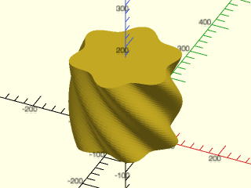

 

    include <BOSL2/std.scad>
    vnf = vnf_vertex_array(
        points=[
            for (h = [0:5:179]) [
                for (t = [0:5:359])
                    cylindrical_to_xyz(100 + 12 * cos((h/2 + t)*6), t, h)
            ]
        ],
        col_wrap=true, caps=true, reverse=true, style="alt"
    );
    vnf_polyhedron(vnf);

**Example 2:** Open shape made from a three arcs.

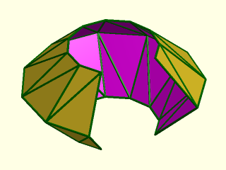

    include <BOSL2/std.scad>
    rows = [
        for(h=[-20:20:20])
            path3d(arc(r=40-abs(h), angle=280, 10), h)
    ];
    vnf = vnf_vertex_array(rows, reverse=true);
    vnf_polyhedron(vnf);
    color("green") vnf_wireframe(vnf);

  

**Example 3:** Open shape made from a three arcs, with `row_wrap=true`.

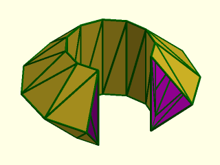

    include <BOSL2/std.scad>
    rows = [
        for(h=[-20:20:20])
            path3d(arc(r=40-abs(h), angle=280, 10), h)
    ];
    vnf = vnf_vertex_array(rows, reverse=true, row_wrap=true);
    vnf_polyhedron(vnf);
    color("green") vnf_wireframe(vnf);

  

**Example 4:** Open shape made from a three arcs, with `col_wrap=true`.

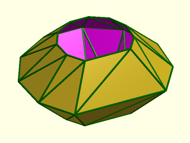

    include <BOSL2/std.scad>
    rows = [
        for(h=[-20:20:20])
            path3d(arc(r=40-abs(h), angle=280, 10), h)
    ];
    vnf = vnf_vertex_array(rows, reverse=true, col_wrap=true);
    vnf_polyhedron(vnf);
    color("green") vnf_wireframe(vnf);

  

**Example 5:** Open shape made from a three arcs, with `caps=true` and `col_wrap=true`.

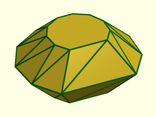

 

    include <BOSL2/std.scad>
    rows = [
        for(h=[-20:20:20])
            path3d(arc(r=40-abs(h), angle=280, 10), h)
    ];
    vnf = vnf_vertex_array(rows, reverse=true, caps=true, col_wrap=true);
    vnf_polyhedron(vnf);
    color("green") vnf_wireframe(vnf);

**Example 6:** Both `col_wrap` and `row_wrap` are true to make a torus.

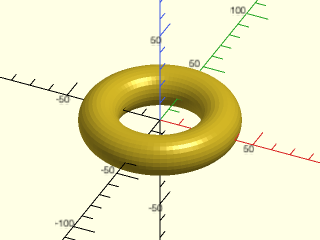

    include <BOSL2/std.scad>
    vnf = vnf_vertex_array(
        points=[
            for (a=[0:5:359])
                apply(
                    zrot(a) * right(30) * xrot(90),
                    path3d(circle(d=20))
                )
        ],
        col_wrap=true, row_wrap=true, reverse=true
    );
    vnf_polyhedron(vnf);

  

**Example 7:** Möbius Strip.  Note that `row_wrap` is not used, and the first and last profile copies are the same.

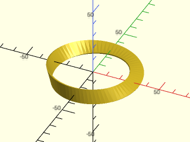

    include <BOSL2/std.scad>
    vnf = vnf_vertex_array(
        points=[
            for (a=[0:5:360]) apply(
                zrot(a) * right(30) * xrot(90) * zrot(a/2+60),
                path3d(square([1,10], center=true))
            )
        ],
        col_wrap=true, reverse=true
    );
    vnf_polyhedron(vnf);

  

**Example 8:** Assembling a Polyhedron from Multiple Parts

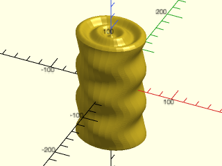

 

    include <BOSL2/std.scad>
    wall_points = [
        for (a = [-90:2:90]) apply(
            up(a) * scale([1-0.1*cos(a*6),1-0.1*cos((a+90)*6),1]),
            path3d(circle(d=100))
        )
    ];
    cap = [
        for (a = [0:0.01:1+EPSILON]) apply(
            up(90-5*sin(a*360*2)) * scale([a,a,1]),
            wall_points[0]
        )
    ];
    cap1 = [for (p=cap) down(90, p=zscale(-1, p=p))];
    cap2 = [for (p=cap) up(90, p=p)];
    vnf1 = vnf_vertex_array(points=wall_points, col_wrap=true);
    vnf2 = vnf_vertex_array(points=cap1, col_wrap=true);
    vnf3 = vnf_vertex_array(points=cap2, col_wrap=true, reverse=true);
    vnf_polyhedron([vnf1, vnf2, vnf3]);

**Example 9:** Building a Multi-Stage Cylindrical Ramp

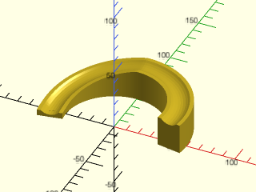

 

    include <BOSL2/std.scad>
    major_r = 50;
    groove_profile = [
        [-10,0], each arc(points=[[-7,0],[0,-3],[7,0]]), [10,0]
    ];
    ramp_profile = [ [-10,25], [90,25], [180,5], [190,5] ];
    rgroove = apply(right(major_r) * xrot(90), path3d(groove_profile));
    rprofile = round_corners(ramp_profile, radius=20, closed=false, $fn=72);
    vnf = vnf_vertex_array([
        for (a = [ramp_profile[0].x : 1 : last(ramp_profile).x]) let(
            z = lookup(a,rprofile),
            m = zrot(a) * up(z)
        )
        apply(m, [ [rgroove[0].x,0,-z], each rgroove, [last(rgroove).x,0,-z] ])
    ], caps=true, col_wrap=true, reverse=true);
    vnf_polyhedron(vnf, convexity=8);

**Example 10:** This vase shape cannot be constructed with rotational or linear sweeps. Using a vertex array to create a stack of polygons is the most practical way to make this and many other shapes. The cross-section is a rounded 9-pointed star that changes size and rotates back and forth as it rises in the z direction.

 

    include <BOSL2/std.scad>
    vprofile =
        smooth_path([[25,0], [35,8], [45,20], [40,40], [25,50], [30,65], [32,70], [37,80]],
                    relsize=1, method="corners");
    ridgepd = 20; // z period of star point wiggle
    ridgeamp = 5; // amplitude of star point wiggle
    polystack = [
        for(p=vprofile) let(r=p.x, z=p.y)
            path3d(
                smooth_path(
                    zrot(ridgeamp*sin(360*z/ridgepd), p=star(11, or=r+ridgeamp, ir=r-ridgeamp)),
                    relsize=0.6, splinesteps=5, method="corners", closed=true),
                z)
    ];
    vnf_polyhedron(vnf_vertex_array(polystack, col_wrap=true, caps=true));

**Example 11:** The previous vase shape with a pebbly texture, simply by adding `texture="dots"` to the `vnf_vertex_array()` call. Because textures are spread over grid units and not measurement units, the data points in the polygon stack should be uniformly spaced.

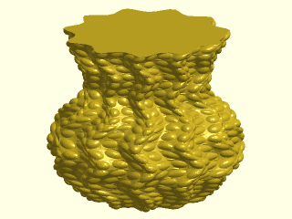

 

    include <BOSL2/std.scad>
    vprofile = resample_path(
        smooth_path([[25,0], [35,8], [45,20], [40,40], [25,50], [30,65], [32,70], [37,80]],
                    relsize=1, method="corners"),
        81, closed=false);
    ridgepd = 20; // z period of star point wiggle
    ridgeamp = 5; // amplitude of star point wiggle
    polystack = [
        for(p=vprofile) let(r=p.x, z=p.y)
            path3d(
                smooth_path(
                    zrot(ridgeamp*sin(360*z/ridgepd), p=star(11, or=r+ridgeamp, ir=r-ridgeamp)),
                    relsize=0.6, splinesteps=5, method="corners", closed=true),
                z)
    ];
    vnf_polyhedron(vnf_vertex_array(polystack, col_wrap=true, caps=true,
        texture="dots", tex_samples=1, tex_size=5));

**Example 12:** This point array defines a simple square, but with a non-uniform grid.

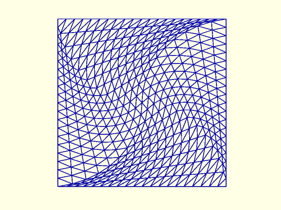

 

    include <BOSL2/std.scad>
    pts = [for(x=[-1:.1:1])
              [for(y=[-1:.1:1])
                  zrot(45*min([abs(x-1),abs(x+1),abs(y-1),abs(y+1)]),
                       20*[x,y,0])]];
    vnf=vnf_vertex_array(pts);
    color("blue") vnf_wireframe(vnf,width=.2);

**Example 13:** The non-uniform grid gives rise to a non-uniform texturing, showing the effect of the uniformity and distribution of the points when creating a texture.

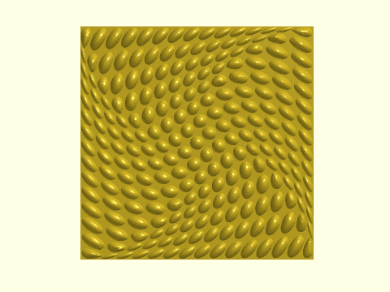

 

    include <BOSL2/std.scad>
    pts = [for(x=[-1:.1:1])
              [for(y=[-1:.1:1])
                  zrot(45*min([abs(x-1),abs(x+1),abs(y-1),abs(y+1)]),
                       20*[x,y,0])]];
    vnf_vertex_array(pts,texture="dots",tex_reps=15);

**Example 14:** Here is another example showing the effect of nonuniform sampling. Here is a surface with a wrinkle in both x and y directions, using location data generated by [`smooth_path()`](rounding.scad#function-smooth\_path), which uses beziers. Bezier curves have non-uniformly distributed points, indicated by the red dots along each edge, which results in a non-uniform texture tiling.

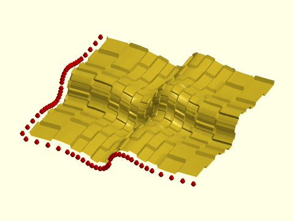

 

    include <BOSL2/std.scad>
    xprofile = smooth_path([[0,0,0], [25,0,0], [49,0,-10], [51,0,10], [75,0,0], [100,0,0]],
                    relsize=1, method="corners", splinesteps=4);
    yprofile = smooth_path([[0,0,0], [0,25,0], [0,49,-10], [0,51,10], [0,75,0], [0,100,0]],
                    relsize=1, method="corners", splinesteps=4);
    polystack = [
        for(xp=xprofile) [
            for(yp=yprofile) [xp.x, yp.y, xp.z+yp.z]
        ]
    ];
    vnf_vertex_array(polystack, texture="checkers", tex_depth=2, tex_reps=[8,8]);
    color("red") {
        for(p=xprofile) translate(p-[0,4,0]) sphere(1.5);
        for(p=yprofile) translate(p-[4,0,0]) sphere(1.5);
    }

**Example 15:** By passing the spline curves into [`resample_path()`](paths.scad#function-resample\_path), we can get a uniform distribution of the x and y profile points, as shown by the red dots, which results in a uniform texture tiling.

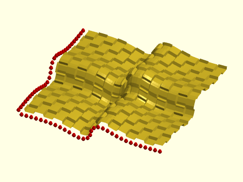

 

    include <BOSL2/std.scad>
    xprof = smooth_path([[0,0,0], [25,0,0], [49,0,-10], [51,0,10], [75,0,0], [100,0,0]],
                    relsize=1, method="corners", splinesteps=4);
    yprof = smooth_path([[0,0,0], [0,25,0], [0,49,-10], [0,51,10], [0,75,0], [0,100,0]],
                    relsize=1, method="corners", splinesteps=4);
    xprofile = resample_path(xprof, len(xprof), closed=false);
    yprofile = resample_path(yprof, len(yprof), closed=false);
    polystack = [
        for(xp=xprofile) [
            for(yp=yprofile) [xp.x, yp.y, xp.z+yp.z]
        ]
    ];
    vnf_vertex_array(polystack, texture="checkers", tex_depth=2, tex_reps=[8,8]);
    color("red") {
        for(p=xprofile) translate(p-[0,4,0]) sphere(1.5);
        for(p=yprofile) translate(p-[4,0,0]) sphere(1.5);
    }

**Example 16:** Triangulating using `style="default"`.  Triangulates the same direction for every quad.

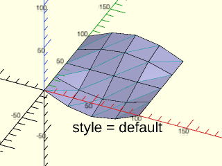

 

    include <BOSL2/std.scad>
    module show_triangulation(fn, style, steps) {
      pts = [for(u=[0:100/steps:100]) [for(v=[0:100/steps:100]) fn(u,v)]];
      vnf = vnf_vertex_array(pts, style=style);
      grid_vnf = vnf_vertex_array(pts, style="quad");
      color("#ccf") vnf_polyhedron(vnf);
      color("#0dd") vnf_wireframe(vnf, width=0.4);
      color("black") vnf_wireframe(grid_vnf, width=0.5);
      txt = str("style = ", style);
      rot($vpr) move([70,-30]) color("black")
        text(txt, size=10, halign="center", valign="top");
    }
    fn = function(u,v) [u, v, 16*sin(u*1.8)*-cos(v*1.8)];
    show_triangulation(fn, "default", steps=4);

**Example 17:** Triangulating using `style="alt"`.  The opposite triangulation from "default".

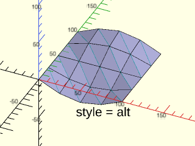

 

    include <BOSL2/std.scad>
    module show_triangulation(fn, style, steps) {
      pts = [for(u=[0:100/steps:100]) [for(v=[0:100/steps:100]) fn(u,v)]];
      vnf = vnf_vertex_array(pts, style=style);
      grid_vnf = vnf_vertex_array(pts, style="quad");
      color("#ccf") vnf_polyhedron(vnf);
      color("#0dd") vnf_wireframe(vnf, width=0.4);
      color("black") vnf_wireframe(grid_vnf, width=0.5);
      txt = str("style = ", style);
      rot($vpr) move([70,-30]) color("black")
        text(txt, size=10, halign="center", valign="top");
    }
    fn = function(u,v) [u, v, 16*sin(u*1.8)*-cos(v*1.8)];
    show_triangulation(fn, "alt", steps=4);

**Example 18:** Triangulating using `style="flip1"`.  Alternates triangulation direction in a grid.

 

    include <BOSL2/std.scad>
    module show_triangulation(fn, style, steps) {
      pts = [for(u=[0:100/steps:100]) [for(v=[0:100/steps:100]) fn(u,v)]];
      vnf = vnf_vertex_array(pts, style=style);
      grid_vnf = vnf_vertex_array(pts, style="quad");
      color("#ccf") vnf_polyhedron(vnf);
      color("#0dd") vnf_wireframe(vnf, width=0.4);
      color("black") vnf_wireframe(grid_vnf, width=0.5);
      txt = str("style = ", style);
      rot($vpr) move([70,-30]) color("black")
        text(txt, size=10, halign="center", valign="top");
    }
    fn = function(u,v) [u, v, 16*sin(u*1.8)*-cos(v*1.8)];
    show_triangulation(fn, "flip1", steps=4);

**Example 19:** Triangulating using `style="flip2"`.  The opposite pattern from "flip1".

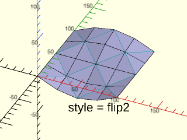

 

    include <BOSL2/std.scad>
    module show_triangulation(fn, style, steps) {
      pts = [for(u=[0:100/steps:100]) [for(v=[0:100/steps:100]) fn(u,v)]];
      vnf = vnf_vertex_array(pts, style=style);
      grid_vnf = vnf_vertex_array(pts, style="quad");
      color("#ccf") vnf_polyhedron(vnf);
      color("#0dd") vnf_wireframe(vnf, width=0.4);
      color("black") vnf_wireframe(grid_vnf, width=0.5);
      txt = str("style = ", style);
      rot($vpr) move([70,-30]) color("black")
        text(txt, size=10, halign="center", valign="top");
    }
    fn = function(u,v) [u, v, 16*sin(u*1.8)*-cos(v*1.8)];
    show_triangulation(fn, "flip2", steps=4);

**Example 20:** Triangulating using `style="quad"`.  Lets OpenSCAD do its own internal triangulation.  This may error out on older OpenSCAD versions.

 

    include <BOSL2/std.scad>
    module show_triangulation(fn, style, steps) {
      pts = [for(u=[0:100/steps:100]) [for(v=[0:100/steps:100]) fn(u,v)]];
      vnf = vnf_vertex_array(pts, style=style);
      grid_vnf = vnf_vertex_array(pts, style="quad");
      color("#ccf") vnf_polyhedron(vnf);
      color("#0dd") vnf_wireframe(vnf, width=0.4);
      color("black") vnf_wireframe(grid_vnf, width=0.5);
      txt = str("style = ", style);
      rot($vpr) move([70,-30]) color("black")
        text(txt, size=10, halign="center", valign="top");
    }
    fn = function(u,v) [u, v, 16*sin(u*1.8)*-cos(v*1.8)];
    show_triangulation(fn, "quad", steps=4);

**Example 21:** Triangulating using `style="quincunx"`.  This artificially adds interpolated points, which may or may not be useful.

 

    include <BOSL2/std.scad>
    module show_triangulation(fn, style, steps) {
      pts = [for(u=[0:100/steps:100]) [for(v=[0:100/steps:100]) fn(u,v)]];
      vnf = vnf_vertex_array(pts, style=style);
      grid_vnf = vnf_vertex_array(pts, style="quad");
      color("#ccf") vnf_polyhedron(vnf);
      color("#0dd") vnf_wireframe(vnf, width=0.4);
      color("black") vnf_wireframe(grid_vnf, width=0.5);
      txt = str("style = ", style);
      rot($vpr) move([70,-30]) color("black")
        text(txt, size=10, halign="center", valign="top");
    }
    fn = function(u,v) [u, v, 16*sin(u*1.8)*-cos(v*1.8)];
    show_triangulation(fn, "quincunx", steps=4);

**Example 22:** Triangulating using `style="convex"`.  This is useful for raised hill surfaces.

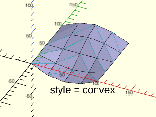

 

    include <BOSL2/std.scad>
    module show_triangulation(fn, style, steps) {
      pts = [for(u=[0:100/steps:100]) [for(v=[0:100/steps:100]) fn(u,v)]];
      vnf = vnf_vertex_array(pts, style=style);
      grid_vnf = vnf_vertex_array(pts, style="quad");
      color("#ccf") vnf_polyhedron(vnf);
      color("#0dd") vnf_wireframe(vnf, width=0.4);
      color("black") vnf_wireframe(grid_vnf, width=0.5);
      txt = str("style = ", style);
      rot($vpr) move([70,-30]) color("black")
        text(txt, size=10, halign="center", valign="top");
    }
    fn = function(u,v) [u, v, 16*sin(u*1.8)*-cos(v*1.8)];
    show_triangulation(fn, "convex", steps=4);

**Example 23:** Triangulating using `style="concave"`.  This is useful for dished surfaces.

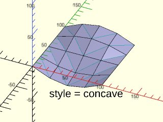

 

    include <BOSL2/std.scad>
    module show_triangulation(fn, style, steps) {
      pts = [for(u=[0:100/steps:100]) [for(v=[0:100/steps:100]) fn(u,v)]];
      vnf = vnf_vertex_array(pts, style=style);
      grid_vnf = vnf_vertex_array(pts, style="quad");
      color("#ccf") vnf_polyhedron(vnf);
      color("#0dd") vnf_wireframe(vnf, width=0.4);
      color("black") vnf_wireframe(grid_vnf, width=0.5);
      txt = str("style = ", style);
      rot($vpr) move([70,-30]) color("black")
        text(txt, size=10, halign="center", valign="top");
    }
    fn = function(u,v) [u, v, 16*sin(u*1.8)*-cos(v*1.8)];
    show_triangulation(fn, "concave", steps=4);

**Example 24:** Triangulating using `style="max_edge"`.  This selects the longer diagonal.

 

    include <BOSL2/std.scad>
    module show_triangulation(fn, style, steps) {
      pts = [for(u=[0:100/steps:100]) [for(v=[0:100/steps:100]) fn(u,v)]];
      vnf = vnf_vertex_array(pts, style=style);
      grid_vnf = vnf_vertex_array(pts, style="quad");
      color("#ccf") vnf_polyhedron(vnf);
      color("#0dd") vnf_wireframe(vnf, width=0.4);
      color("black") vnf_wireframe(grid_vnf, width=0.5);
      txt = str("style = ", style);
      rot($vpr) move([70,-30]) color("black")
        text(txt, size=10, halign="center", valign="top");
    }
    fn = function(u,v) [u, v, 16*sin(u*1.8)*-cos(v*1.8)];
    show_triangulation(fn, "max_edge", steps=4);

**Example 25:** Triangulating using `style="min_edge"`.  This selects the shorter diagonal.

 

    include <BOSL2/std.scad>
    module show_triangulation(fn, style, steps) {
      pts = [for(u=[0:100/steps:100]) [for(v=[0:100/steps:100]) fn(u,v)]];
      vnf = vnf_vertex_array(pts, style=style);
      grid_vnf = vnf_vertex_array(pts, style="quad");
      color("#ccf") vnf_polyhedron(vnf);
      color("#0dd") vnf_wireframe(vnf, width=0.4);
      color("black") vnf_wireframe(grid_vnf, width=0.5);
      txt = str("style = ", style);
      rot($vpr) move([70,-30]) color("black")
        text(txt, size=10, halign="center", valign="top");
    }
    fn = function(u,v) [u, v, 16*sin(u*1.8)*-cos(v*1.8)];
    show_triangulation(fn, "min_edge", steps=4);

**Example 26:** Triangulating using `style="min_area"`.  This triangulates in a way that minimizes face areas.

 

    include <BOSL2/std.scad>
    module show_triangulation(fn, style, steps) {
      pts = [for(u=[0:100/steps:100]) [for(v=[0:100/steps:100]) fn(u,v)]];
      vnf = vnf_vertex_array(pts, style=style);
      grid_vnf = vnf_vertex_array(pts, style="quad");
      color("#ccf") vnf_polyhedron(vnf);
      color("#0dd") vnf_wireframe(vnf, width=0.4);
      color("black") vnf_wireframe(grid_vnf, width=0.5);
      txt = str("style = ", style);
      rot($vpr) move([70,-30]) color("black")
        text(txt, size=10, halign="center", valign="top");
    }
    fn = function(u,v) [u, v, 16*sin(u*1.8)*-cos(v*1.8)];
    show_triangulation(fn, "min_area", steps=4);

---

### Function/Module: vnf\_tri\_array()

**Synopsis:** Returns a VNF from an array of points. The array need not be rectangular. [<abbr>VNF</abbr>]

**Topics:** [VNF Generators](Topics#vnf-generators), [Lists](Topics#lists)

**See Also:** [vnf\_vertex\_array()](#functionmodule-vnf_vertex_array), [vnf\_join()](#function-vnf_join), [vnf\_from\_polygons()](#function-vnf_from_polygons), [vnf\_merge\_points()](#function-vnf_merge_points)

**Usage:** 

- vnf = vnf_tri_array(points, [caps=], [cap1=], [cap2=], [reverse=], [col_wrap=], [row_wrap=], [limit_bunching=])
- vnf_tri_array(points, [caps=], [cap1=], [cap2=], [reverse=], [col_wrap=], [row_wrap=], [limit_bunching=],...) [ATTACHMENTS];

**Description:** 

Produces a VNF from an array of points where each row length can differ from the adjacent rows by
any amount. This enables the construction of triangular or even irregular VNF patches. The
resulting VNF can be wrapped along the rows by setting `row_wrap` to true, and wrapped along
columns by setting `col_wrap` to true. It is possible to do both at once.
If `row_wrap` is false or not provided, end caps can be generated across the top and/or bottom rows.

The algorithm starts with the first point on each row and recursively walks around finding the
minimum-length edge to make each new triangle face. This may result in several triangles being
connected to one vertex. When triangulating two rows that happen to be equal length, the result is
equivalent to [`vnf_vertex_array()`](#functionmodule-vnf_vertex_array) using the "min_edge" style. If you already have a rectangular
vertex list (equal length rows), you should use `vnf_vertex_array()` if you need a different
triangulation style.

Because the algorithm seeks the minimum-length new edge to generate triangles between two
unequal-lengthy rows of vertices, there are cases where this can causing bunching of several
triangles sharing a single vertex, if several successive points of one row are closest to a single
point on the other row. Example 6 demonstrates this. If the two rows are equal in length, this
doesn't happen. The `limit_bunching` parameter, by default, limits the number of *additional*
triangles that would normally be generated to the difference between the row lengths. Example 6
demonstrates the effect of disabling this limit.

If you need to merge two VNF arrays that share edges using `vnf_join()` you can remove the
duplicated vertices using `vnf_merge_points()`.

**Arguments:** 

<abbr title="These args can be used by position or by name.">By&nbsp;Position</abbr> | What it does
-------------------- | ------------
`points`             | List of point lists for each row.

<abbr title="These args must be used by name, ie: name=value">By&nbsp;Name</abbr> | What it does
-------------------- | ------------
`caps`               | If true, add endcap faces to the first **and** last rows.
`cap1`               | If true, add an endcap face to the first row.
`cap2`               | If true, add an endcap face to the last row.
`col_wrap`           | If true, add faces to connect the last column to the first.
`row_wrap`           | If true, add faces to connect the last row to the first.
`reverse`            | If true, reverse all face normals.
`limit_buncthing`    | If true, when triangulating between two rows of unequal length, then limit the number of additional triangles that would normally share a vertex. Ignored when the two row lengths are equal. If false, a vertex can be shared by unlimited triangles. Default: true
`convexity`          | (module) Max number of times a line could intersect a wall of the shape.
`cp`                 | (module) Centerpoint for determining intersection anchors or centering the shape.  Determines the base of the anchor vector.  Can be "centroid", "mean", "box" or a 3D point.  Default: "centroid"
`anchor`             | (module) Translate so anchor point is at origin (0,0,0).  See [anchor](attachments.scad#subsection-anchor).  Default: `"origin"`
`spin`               | (module) Rotate this many degrees around the Z axis after anchor.  See [spin](attachments.scad#subsection-spin).  Default: `0`
`orient`             | (module) Vector to rotate top toward, after spin. See [orient](attachments.scad#subsection-orient).  Default: `UP`
`atype`              | (module) Select "hull" or "intersect" anchor type.  Default: "hull"

**Anchor Types:** 

Anchor Type | What it is
----------- | ----------
"hull" | Anchors to the virtual convex hull of the shape.
"intersect" | Anchors to the surface of the shape.

**Named Anchors:** 

Anchor Name | Position
----------- | --------
"origin" | Anchor at the origin, oriented UP.

**Example 1:** Each row has one more point than the preceeding one.

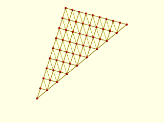

    include <BOSL2/std.scad>
    pts = [for(y=[1:1:10]) [for(x=[0:y-1]) [x,y,y]]];
    vnf = vnf_tri_array(pts);
    vnf_wireframe(vnf,width=0.1);
    color("red")move_copies(flatten(pts)) sphere(r=.15,$fn=9);

  

**Example 2:** Each row has two more points than the preceeding one.

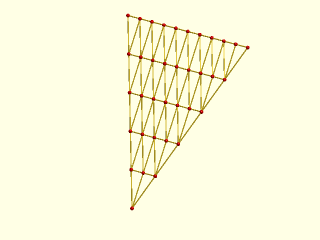

    include <BOSL2/std.scad>
    pts = [for(y=[0:2:10]) [for(x=[-y/2:y/2]) [x,y,y]]];
    vnf = vnf_tri_array(pts);
    vnf_wireframe(vnf,width=0.1);
    color("red")move_copies(flatten(pts)) sphere(r=.15,$fn=9);

  

**Example 3:** Merging two VNFs to construct a cone with one point length change between rows.

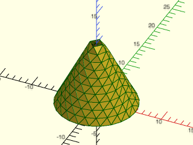

 

    include <BOSL2/std.scad>
    pts1 = [for(z=[0:10]) path3d(arc(3+z,r=z/2+1, angle=[0,180]),10-z)];
    pts2 = [for(z=[0:10]) path3d(arc(3+z,r=z/2+1, angle=[180,360]),10-z)];
    vnf = vnf_join([vnf_tri_array(pts1),
                      vnf_tri_array(pts2)]);
    color("green")vnf_wireframe(vnf,width=0.1);
    vnf_polyhedron(vnf);

**Example 4:** Cone with length change two between rows

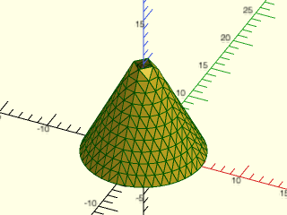

 

    include <BOSL2/std.scad>
    pts1 = [for(z=[0:1:10]) path3d(arc(3+2*z,r=z/2+1, angle=[0,180]),10-z)];
    pts2 = [for(z=[0:1:10]) path3d(arc(3+2*z,r=z/2+1, angle=[180,360]),10-z)];
    vnf = vnf_join([vnf_tri_array(pts1),
                     vnf_tri_array(pts2)]);
    color("green")vnf_wireframe(vnf,width=0.1);
    vnf_polyhedron(vnf);

**Example 5:** The number of points per row can change irregularly by any amount.

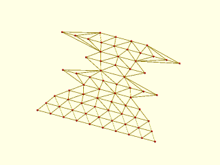

 

    include <BOSL2/std.scad>
    lens = [10,9,8,6,4,8,2,5,3,10,4];
    pts = [for(y=idx(lens)) lerpn([-lens[y],y,y],[lens[y],y,y],lens[y])];
    vnf = vnf_tri_array(pts);
    vnf_wireframe(vnf,width=0.1);
    color("red")move_copies(flatten(pts)) sphere(r=.15,$fn=9);

**Example 6:** The default parameter `limit_bunching=true` prevents too many triangles from sharing a single vertex in one row, if several points of one row happen to be closest to a single point on another row. In the left figure, `limit_bunching=false`, causing an endpoint on each row to get many triangles from the other row, because the algorithm seeks the shortest triangle leg distance once the first two points of each row are connected. This doesn't happen if both rows are the same length. The figure on the right uses the default `limit_bunching=true`, forcing the triangulation to stop adding too many triangles to the same vertex.

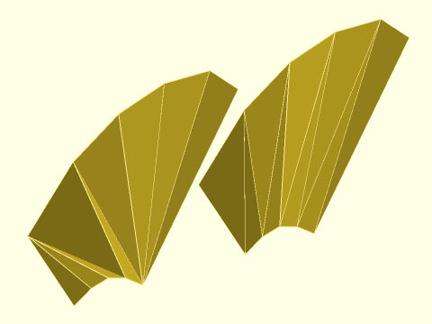

 

    include <BOSL2/std.scad>
    pts = [
        [[5,0,0], [4,0,1.4], [3,0,2], [2,0,1.4], [1,0,0]],
        [[14,10,0], [12,9,5], [9,8,7], [6,7,7], [3,6,5], [0,5,0]]
    ];
    vnf_tri_array(pts, limit_bunching=false);
    right(10) vnf_tri_array(pts);

**Example 7:** Model of a cymbal with roughly same-size facets, using a different number of points for each concentric ring of vertices.

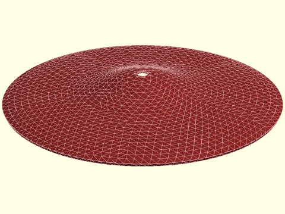

 

    include <BOSL2/std.scad>
    bez = [
        [[0,26], [35,26], [29,0], [80,16], [102,0]], //top
        [[99,-1], [79,15], [28,-1], [34,25], [-1,25]] // bottom
    ];
    points = [
        for(b=bez)
            for(u=[0.01:0.04:1]) let(
                bzp = bezier_points(b,u),
                r = bzp[0],
                n = max(3, round(360 / (6/r * 180/PI)))
            ) path3d(regular_ngon(n, r=r), bzp[1])
    ];
    vnf = vnf_tri_array(points, reverse=true, col_wrap=true, caps=true);
    color("brown") difference() {
        vnf_polyhedron(vnf);
        cylinder(30, d=8);
    }

---

### Function: vnf\_join()

**Synopsis:** Returns a single VNF structure from a list of VNF structures. [<abbr>VNF</abbr>]

**Topics:** [VNF Generators](Topics#vnf-generators), [Lists](Topics#lists)

**See Also:** [vnf\_tri\_array()](#functionmodule-vnf_tri_array), [vnf\_vertex\_array()](#functionmodule-vnf_vertex_array), [vnf\_from\_polygons()](#function-vnf_from_polygons), [vnf\_from\_region()](#function-vnf_from_region)

**Usage:** 

- vnf = vnf_join([VNF, VNF, VNF, ...]);

**Description:** 

Given a list of VNF structures, merges them all into a single VNF structure.
Combines all the points of the input VNFs and labels the faces appropriately.
All the points in the input VNFs appear in the output, even if they are
duplicated. It is valid to repeat points in a VNF, but if you
with to remove the duplicates that occur along joined edges, use [`vnf_merge_points()`](#function-vnf_merge_points).

This is a tool for manipulating polyhedron data. It is for
building up a full polyhedron from partial polyhedra.
It is *not* a union operator for VNFs. The VNFs to be joined must not intersect each other,
except at edges, otherwise the result is an invalid polyhedron. Also, the
result must not have any other illegal polyhedron characteristics, such as creating
more than two faces sharing the same edge.
If you want a valid result it is your responsibility to ensure that the polyhedron
has no holes, no intersecting faces or edges, and obeys all the requirements
that CGAL expects.

For example, if you combine two pyramids to try to make an octahedron, the result is
invalid because of the two internal faces created by the pyramid bases.  A valid
use would be to build a cube missing one face and a pyramid missing its base and
then join them into a cube with a point.

**Arguments:** 

<abbr title="These args can be used by position or by name.">By&nbsp;Position</abbr> | What it does
-------------------- | ------------
`vnfs`               | a list of the VNFs to joint into one VNF.

**Example 1:** Here is a VNF where the top face is missing.  It is not a valid polyhedron like this, but we can use it as a building block to make a polyhedron.

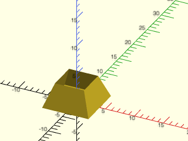

 

    include <BOSL2/std.scad>
    bottom = vnf_vertex_array([path3d(rect(8)), path3d(rect(5),4)],col_wrap=true,cap1=true);
    vnf_polyhedron(bottom);

**Example 2:** Here is a VNF that also has a missing face.

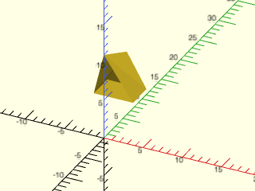

 

    include <BOSL2/std.scad>
    triangle = yrot(-90,path3d(regular_ngon(n=3,side=5,anchor=LEFT)));
    top = up(4,vnf_vertex_array([list_set(right(2.5,triangle),0,[0,0,7]),
                                right(6,triangle)
                                ], col_wrap=true, cap2=true));
    vnf_polyhedron(zrot(90,top));

**Example 3:** Using vnf\_join combines the two VNFs into a single VNF.  Note that they share an edge.  But the result still isn't closed, so it is not yet a valid polyhedron.

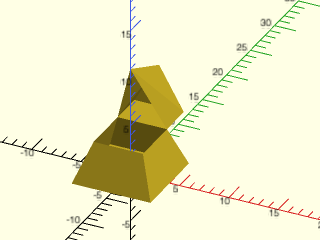

 

    include <BOSL2/std.scad>
    bottom = vnf_vertex_array([path3d(rect(8)), path3d(rect(5),4)],col_wrap=true,cap1=true);
    triangle = yrot(-90,path3d(regular_ngon(n=3,side=5,anchor=LEFT)));
    top = up(4,vnf_vertex_array([list_set(right(2.5,triangle),0,[0,0,7]),
                                 right(6,triangle)
                                ], col_wrap=true, cap2=true));
    full = vnf_join([bottom,zrot(90,top)]);
    vnf_polyhedron(full);

**Example 4:** If we add enough pieces, and the pieces are all consistent with each other, then we can arrive at a valid polyhedron like this one.  To be valid you need to meet all the CGAL requirements: every edge has exactly two faces, all faces are in clockwise order, no intersections of edges.

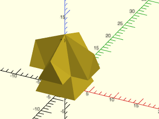

 

    include <BOSL2/std.scad>
    bottom = vnf_vertex_array([path3d(rect(8)), path3d(rect(5),4)],col_wrap=true,cap1=true);
    triangle = yrot(-90,path3d(regular_ngon(n=3,side=5,anchor=LEFT)));
    top = up(4,vnf_vertex_array([list_set(right(2.5,triangle),0,[0,0,7]),
                                 right(6,triangle)
                                ], col_wrap=true, cap2=true));
    full = vnf_join([bottom,
                      for(theta=[0:90:359]) zrot(theta,top)
                     ]);
    vnf_polyhedron(full);

**Example 5:** The vnf\_join function is not a union operator for polyhedra.  If any faces intersect, like they do in this example where we combine the faces of two cubes, the result is invalid and results in CGAL errors when you add more objects into the model.

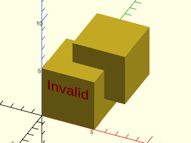

    include <BOSL2/std.scad>
    cube1 = cube(5);
    cube2 = move([2,2,2],cube1);
    badvnf = vnf_join([cube1,cube2]);
    vnf_polyhedron(badvnf);
    right(2.5)up(3)color("red")
          text3d("Invalid",size=1,anchor=CENTER,
          orient=FRONT,h=.1);

  

---

### Function: vnf\_from\_polygons()

**Synopsis:** Returns a VNF from a list of 3D polygons. [<abbr>VNF</abbr>]

**Topics:** [VNF Generators](Topics#vnf-generators), [Lists](Topics#lists)

**See Also:** [vnf\_tri\_array()](#functionmodule-vnf_tri_array), [vnf\_join()](#function-vnf_join), [vnf\_vertex\_array()](#functionmodule-vnf_vertex_array), [vnf\_from\_region()](#function-vnf_from_region)

**Usage:** 

- vnf = vnf_from_polygons(polygons, [eps]);

**Description:** 

Given a list of 3D polygons, produces a VNF containing those polygons.
It is up to the caller to make sure that the points are in the correct order to make the face
normals point outward.  No checking for duplicate vertices is done.  If you want to
remove duplicate vertices use [`vnf_merge_points()`](#function-vnf_merge_points).  Polygons with zero area are discarded from the face list by default.
If you give non-coplanar faces an error is displayed.  These checks increase run time by about 2x for triangular polygons, but
about 10x for pentagons; the checks can be disabled by setting fast=true.

**Arguments:** 

<abbr title="These args can be used by position or by name.">By&nbsp;Position</abbr> | What it does
-------------------- | ------------
`polygons`           | The list of 3D polygons to turn into a VNF
`fast`               | Set to true to skip area and coplanarity checks for increased speed.  Default: false
`eps`                | Polygons with area smaller than this are discarded.  Default: 1e-9

**Example 1:** Construction of a dodecahedron from pentagon faces.

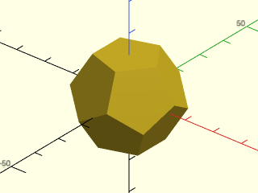

    include <BOSL2/std.scad>
    dihedral = 2*atan(PHI);   // dodecahedron face dihedral
    rpenta = 10;              // pentagon face radius
    edge = 2*rpenta*sin(36);  // edge length
    inrad = 0.5*edge * PHI*PHI/sqrt(3-PHI);   // inner radius
    face3d = path3d(pentagon(rpenta), inrad); // single face
    facepoints = [
        face3d,
        for(a=[36:72:360]) zrot(a, yrot(180-dihedral, face3d)),
        for(a=[36:72:360]) zrot(a, yrot(360-dihedral, face3d)),
        yrot(180, face3d)
    ];
    vnf = vnf_from_polygons(facepoints, fast=true);
    vnf_polyhedron(vnf);

  

---

### Function: vnf\_from\_region()

**Synopsis:** Returns a 3D VNF given a 2D region. [<abbr>VNF</abbr>]

**Topics:** [VNF Generators](Topics#vnf-generators), [Lists](Topics#lists)

**See Also:** [vnf\_vertex\_array()](#functionmodule-vnf_vertex_array), [vnf\_tri\_array()](#functionmodule-vnf_tri_array), [vnf\_join()](#function-vnf_join), [vnf\_from\_polygons()](#function-vnf_from_polygons)

**Usage:** 

- vnf = vnf_from_region(region, [transform], [reverse]);

**Description:** 

Given a (two-dimensional) region, applies the given transformation matrix to it and makes a (three-dimensional) triangulated VNF of
faces for that region, reversed if desired.

**Arguments:** 

<abbr title="These args can be used by position or by name.">By&nbsp;Position</abbr> | What it does
-------------------- | ------------
`region`             | The region to convert to a VNF.
`transform`          | If given, a transformation matrix to apply to the faces generated from the region. Default: No transformation applied.
`reverse`            | If true, reverse the normals of the faces generated from the region. An untransformed region has face normals pointing `UP`. Default: false

**Example 1:** 

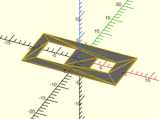

    include <BOSL2/std.scad>
    region = [square([20,10],center=true),
              right(5,square(4,center=true)),
              left(5,square(6,center=true))];
    vnf = vnf_from_region(region);
    color("gray")down(.125)
         linear_extrude(height=.125)region(region);
    vnf_wireframe(vnf,width=.25);

  

---

## Section: VNF Testing and Access

### Function: is\_vnf()

**Synopsis:** Returns true given a VNF-like structure.

**Topics:** [VNF Manipulation](Topics#vnf-manipulation)

**See Also:** [is\_vnf\_list()](#function-is_vnf_list), [vnf\_vertices()](#function-vnf_vertices), [vnf\_faces()](#function-vnf_faces)

**Usage:** 

- bool = is_vnf(x);

**Description:** 

Returns true if the given value looks like a VNF structure.

---

### Function: is\_vnf\_list()

**Synopsis:** Returns true given a list of VNF-like structures.

**Topics:** [VNF Manipulation](Topics#vnf-manipulation)

**See Also:** [is\_vnf()](#function-is_vnf), [vnf\_vertices()](#function-vnf_vertices), [vnf\_faces()](#function-vnf_faces)

**Description:** 

Returns true if the given value looks passingly like a list of VNF structures.

---

### Function: vnf\_vertices()

**Synopsis:** Returns the list of vertex points from a VNF.

**Topics:** [VNF Manipulation](Topics#vnf-manipulation)

**See Also:** [is\_vnf()](#function-is_vnf), [is\_vnf\_list()](#function-is_vnf_list), [vnf\_faces()](#function-vnf_faces)

**Description:** 

Given a VNF structure, returns the list of vertex points.

---

### Function: vnf\_faces()

**Synopsis:** Returns the list of faces from a VNF.

**Topics:** [VNF Manipulation](Topics#vnf-manipulation)

**See Also:** [is\_vnf()](#function-is_vnf), [is\_vnf\_list()](#function-is_vnf_list), [vnf\_vertices()](#function-vnf_vertices)

**Description:** 

Given a VNF structure, returns the list of faces, where each face is a list of indices into the VNF vertex list.

---

## Section: Altering the VNF Internals

### Function: vnf\_reverse\_faces()

**Synopsis:** Reverses the faces of a VNF. [<abbr>VNF</abbr>]

**Topics:** [VNF Manipulation](Topics#vnf-manipulation)

**See Also:** [vnf\_quantize()](#function-vnf_quantize), [vnf\_merge\_points()](#function-vnf_merge_points), [vnf\_drop\_unused\_points()](#function-vnf_drop_unused_points), [vnf\_triangulate()](#function-vnf_triangulate), [vnf\_slice()](#function-vnf_slice), [vnf\_unify\_faces()](#function-vnf_unify_faces)

**Usage:** 

- rvnf = vnf_reverse_faces(vnf);

**Description:** 

Reverses the orientation of all the faces in the given VNF.

---

### Function: vnf\_quantize()

**Synopsis:** Quantizes the vertex coordinates of a VNF. [<abbr>VNF</abbr>]

**Topics:** [VNF Manipulation](Topics#vnf-manipulation)

**See Also:** [vnf\_reverse\_faces()](#function-vnf_reverse_faces), [vnf\_merge\_points()](#function-vnf_merge_points), [vnf\_drop\_unused\_points()](#function-vnf_drop_unused_points), [vnf\_triangulate()](#function-vnf_triangulate), [vnf\_slice()](#function-vnf_slice)

**Usage:** 

- vnf2 = vnf_quantize(vnf,[q]);

**Description:** 

Quantizes the vertex coordinates of the VNF to the given quanta `q`.

**Arguments:** 

<abbr title="These args can be used by position or by name.">By&nbsp;Position</abbr> | What it does
-------------------- | ------------
`vnf`                | The VNF to quantize.
`q`                  | The quanta to quantize the VNF coordinates to.

---

### Function: vnf\_merge\_points()

**Synopsis:** Consolidates duplicate vertices of a VNF. [<abbr>VNF</abbr>]

**Topics:** [VNF Manipulation](Topics#vnf-manipulation)

**See Also:** [vnf\_reverse\_faces()](#function-vnf_reverse_faces), [vnf\_quantize()](#function-vnf_quantize), [vnf\_drop\_unused\_points()](#function-vnf_drop_unused_points), [vnf\_triangulate()](#function-vnf_triangulate), [vnf\_slice()](#function-vnf_slice), [vnf\_unify\_faces()](#function-vnf_unify_faces)

**Usage:** 

- new_vnf = vnf_merge_points(vnf, [eps]);

**Description:** 

Given a VNF, consolidates all duplicate vertices with a tolerance `eps`, relabeling the faces as necessary,
and eliminating any face with fewer than 3 vertices.  Unreferenced vertices of the input VNF are not dropped.
To remove such vertices uses [`vnf_drop_unused_points()`](#function-vnf_drop_unused_points).

**Arguments:** 

<abbr title="These args can be used by position or by name.">By&nbsp;Position</abbr> | What it does
-------------------- | ------------
`vnf`                | a VNF to consolidate
`eps`                | the tolerance in finding duplicates. Default: 1e-9

---

### Function: vnf\_drop\_unused\_points()

**Synopsis:** Removes unreferenced vertices from a VNF. [<abbr>VNF</abbr>]

**Topics:** [VNF Manipulation](Topics#vnf-manipulation)

**See Also:** [vnf\_reverse\_faces()](#function-vnf_reverse_faces), [vnf\_quantize()](#function-vnf_quantize), [vnf\_merge\_points()](#function-vnf_merge_points), [vnf\_triangulate()](#function-vnf_triangulate), [vnf\_slice()](#function-vnf_slice), [vnf\_unify\_faces()](#function-vnf_unify_faces)

**Usage:** 

- clean_vnf = vnf_drop_unused_points(vnf);

**Description:** 

Remove all unreferenced vertices from a VNF.  In most cases, unreferenced vertices cause no harm,
and this function may be slow on large VNFs.

---

### Function: vnf\_triangulate()

**Synopsis:** Triangulates the faces of a VNF. [<abbr>VNF</abbr>]

**Topics:** [VNF Manipulation](Topics#vnf-manipulation)

**See Also:** [vnf\_reverse\_faces()](#function-vnf_reverse_faces), [vnf\_quantize()](#function-vnf_quantize), [vnf\_merge\_points()](#function-vnf_merge_points), [vnf\_drop\_unused\_points()](#function-vnf_drop_unused_points), [vnf\_slice()](#function-vnf_slice), [vnf\_unify\_faces()](#function-vnf_unify_faces)

**Usage:** 

- vnf2 = vnf_triangulate(vnf);

**Description:** 

Triangulates faces in the VNF that have more than 3 vertices.

**Arguments:** 

<abbr title="These args can be used by position or by name.">By&nbsp;Position</abbr> | What it does
-------------------- | ------------
`vnf`                | VNF to triangulate

**Example 1:** 

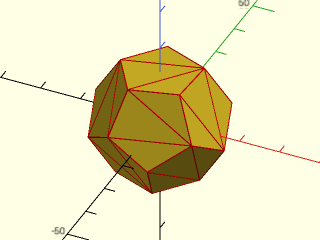

 

    include <BOSL2/std.scad>
    include <BOSL2/polyhedra.scad>
    vnf = zrot(33,regular_polyhedron_info("vnf", "dodecahedron", side=12));
    vnf_polyhedron(vnf);
    triangulated = vnf_triangulate(vnf);
    color("red")vnf_wireframe(triangulated,width=.3);

---

### Function: vnf\_unify\_faces()

**Synopsis:** Remove triangulation from VNF, returning a copy with full faces [<abbr>VNF</abbr>]

**Topics:** [VNF Manipulation](Topics#vnf-manipulation)

**See Also:** [vnf\_reverse\_faces()](#function-vnf_reverse_faces), [vnf\_quantize()](#function-vnf_quantize), [vnf\_merge\_points()](#function-vnf_merge_points), [vnf\_triangulate()](#function-vnf_triangulate), [vnf\_slice()](#function-vnf_slice)

**Usage:** 

- newvnf = vnf_unify_faces(vnf);

**Description:** 

When a VNF has been triangulated, the polygons that form the true faces have been chopped up into
triangles.  This can create problems for algorithms that operate on the VNF itself, where you might
want to be able to identify the true faces.  This function merges together the triangles that
form those true faces, turning a VNF where each true face is represented by a single entry
in the faces list of the VNF.  This function requires that the true faces have no internal vertices.
This is always true for a triangulated VNF, but might fail for a VNF with some other
face partition. If internal vertices are present, the output includes backtracking paths from
the boundary to all of those vertices.

**Arguments:** 

<abbr title="These args can be used by position or by name.">By&nbsp;Position</abbr> | What it does
-------------------- | ------------
`vnf`                | vnf whose faces you want to unify

**Example 1:** Original prism on the left is triangulated.  On the right, the result of unifying the faces.

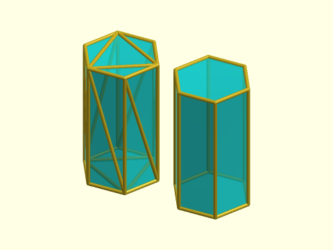

    include <BOSL2/std.scad>
    $fn=16;
    poly = linear_sweep(hexagon(side=10),h=35);
    vnf = vnf_unify_faces(poly);
    vnf_wireframe(poly);
    color([0,1,1,.70])vnf_polyhedron(poly);
    right(25){
      vnf_wireframe(vnf);
      color([0,1,1,.70])vnf_polyhedron(vnf);
    }

  

---

### Function: vnf\_slice()

**Synopsis:** Slice the faces of a VNF along an axis. [<abbr>VNF</abbr>]

**Topics:** [VNF Manipulation](Topics#vnf-manipulation)

**See Also:** [vnf\_reverse\_faces()](#function-vnf_reverse_faces), [vnf\_quantize()](#function-vnf_quantize), [vnf\_merge\_points()](#function-vnf_merge_points), [vnf\_drop\_unused\_points()](#function-vnf_drop_unused_points), [vnf\_triangulate()](#function-vnf_triangulate)

**Usage:** 

- sliced = vnf_slice(vnf, dir, cuts);

**Description:** 

Slice the faces of a VNF along a specified axis direction at a given list of cut points.
The cut points can appear in any order.  You can use this to refine the faces of a VNF before
applying a nonlinear transformation to its vertex set.

**Arguments:** 

<abbr title="These args can be used by position or by name.">By&nbsp;Position</abbr> | What it does
-------------------- | ------------
`vnf`                | VNF to slice
`dir`                | normal direction to the slices, either "X", "Y" or "Z"
`cuts`               | X, Y or Z values where cuts occur

**Example 1:** 

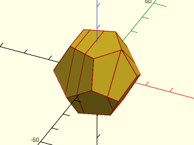

    include <BOSL2/std.scad>
    include <BOSL2/polyhedra.scad>
    vnf = regular_polyhedron_info("vnf", "dodecahedron", side=12);
    vnf_polyhedron(vnf);
    sliced = vnf_slice(vnf, "X", [-6,-1,10]);
    color("red")vnf_wireframe(sliced,width=.3);

  

---

## Section: Turning a VNF into geometry

### Module: vnf\_polyhedron()

**Synopsis:** Returns a polyhedron from a VNF or list of VNFs. [<abbr>Geom</abbr>]

**Topics:** [VNF Manipulation](Topics#vnf-manipulation)

**See Also:** [vnf\_wireframe()](#module-vnf_wireframe)

**Usage:** 

- vnf_polyhedron(vnf) [ATTACHMENTS];
- vnf_polyhedron([VNF, VNF, VNF, ...]) [ATTACHMENTS];

**Description:** 

Given a VNF structure, or a list of VNF structures, creates a polyhedron from them.

An arbitrary VNF may not have a geometry that matches well with the anchoring system.  The anchors are
automatically generated using one of two methods, the "hull" anchor type and the "intersect" anchor type.
The "hull" method is the default.  It finds an anchor point on the convex hull of the shape.  It does this
by taking a plane normal to the anchor direction and and shifting it to the most distant point on the VNF.
This plane may intersect the VNF in one point, several points, or even a face.  If it intersects in a face
the anchor is the face centroid.  Otherwise the anchor is the mean of the vertices of VNF that intersect the
plane.  The anchor direction will be the direction you originally specified.

The "intersect" method creates a ray based at the VNF center point that points in the anchor direction and
chooses the most distant intersection point as the anchor.  In this case, the anchor direction is
computed from the VNF geometry based on the face or edge where that intersection point lies.

**Arguments:** 

<abbr title="These args can be used by position or by name.">By&nbsp;Position</abbr> | What it does
-------------------- | ------------
`vnf`                | A VNF structure, or list of VNF structures.
`convexity`          | Max number of times a line could intersect a wall of the shape.
`cp`                 | Centerpoint for determining intersection anchors or centering the shape.  Determines the base of the anchor vector.  Can be "centroid", "mean", "box" or a 3D point.  Default: "centroid"
`anchor`             | Translate so anchor point is at origin (0,0,0).  See [anchor](attachments.scad#subsection-anchor).  Default: `"origin"`
`spin`               | Rotate this many degrees around the Z axis after anchor.  See [spin](attachments.scad#subsection-spin).  Default: `0`
`orient`             | Vector to rotate top toward, after spin. See [orient](attachments.scad#subsection-orient).  Default: `UP`
`atype`              | Select "hull" or "intersect" anchor type.  Default: "hull"

**Anchor Types:** 

Anchor Type | What it is
----------- | ----------
"hull" | Anchors to the virtual convex hull of the shape.
"intersect" | Anchors to the surface of the shape.

**Named Anchors:** 

Anchor Name | Position
----------- | --------
"origin" | Anchor at the origin, oriented UP.

---

### Module: vnf\_wireframe()

**Synopsis:** Creates a wireframe model from a VNF. [<abbr>VNF</abbr>]

**Topics:** [VNF Manipulation](Topics#vnf-manipulation)

**See Also:** [vnf\_polyhedron()](#module-vnf_polyhedron)

**Usage:** 

- vnf_wireframe(vnf, [width]);

**Description:** 

Given a VNF, creates a wire frame ball-and-stick model of the polyhedron with a cylinder for
each edge and a sphere at each vertex.  The width parameter specifies the width of the sticks
that form the wire frame and the diameter of the balls.

**Arguments:** 

<abbr title="These args can be used by position or by name.">By&nbsp;Position</abbr> | What it does
-------------------- | ------------
`vnf`                | A VNF structure
`width`              | width of the cylinders forming the wire frame.  Default: 1

**Example 1:** 

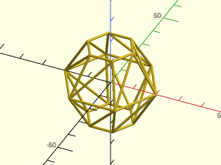

    include <BOSL2/std.scad>
    $fn=32;
    ball = sphere(r=20, $fn=6);
    vnf_wireframe(ball,width=1);

  

**Example 2:** 

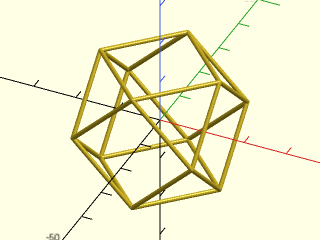

    include <BOSL2/std.scad>
    include <BOSL2/polyhedra.scad>
    $fn=32;
    cube_oct = regular_polyhedron_info("vnf",
                       name="cuboctahedron", or=20);
    vnf_wireframe(cube_oct);

  

**Example 3:** The spheres at the vertex are imperfect at aligning with the cylinders, so especially at low $fn things look prety ugly.  This is normal.

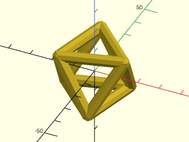

    include <BOSL2/std.scad>
    include <BOSL2/polyhedra.scad>
    $fn=8;
    octahedron = regular_polyhedron_info("vnf",
                          name="octahedron", or=20);
    vnf_wireframe(octahedron,width=5);

  

---

## Section: Operations on VNFs

### Function: vnf\_volume()

**Synopsis:** Returns the volume of a VNF.

**Topics:** [VNF Manipulation](Topics#vnf-manipulation)

**See Also:** [vnf\_area()](#function-vnf_area), [vnf\_halfspace()](#function-vnf_halfspace), [vnf\_bend()](#function-vnf_bend)

**Usage:** 

- vol = vnf_volume(vnf);

**Description:** 

Returns the volume enclosed by the given manifold VNF.   The VNF must describe a valid polyhedron with consistent face direction and
no holes; otherwise the results are undefined.  Returns a positive volume if face direction is clockwise and a negative volume
if face direction is counter-clockwise.

---

### Function: vnf\_area()

**Synopsis:** Returns the surface area of a VNF.

**Topics:** [VNF Manipulation](Topics#vnf-manipulation)

**See Also:** [vnf\_volume()](#function-vnf_volume), [vnf\_halfspace()](#function-vnf_halfspace), [vnf\_bend()](#function-vnf_bend)

**Usage:** 

- area = vnf_area(vnf);

**Description:** 

Returns the surface area in any VNF by adding up the area of all its faces.  The VNF need not be a manifold.

---

### Function: vnf\_bounds()

**Synopsis:** Returns the min and max bounding coordinates for the VNF.

**Topics:** [VNF Manipulation](Topics#vnf-manipulation), [Bounding Boxes](Topics#bounding-boxes), [Bounds](Topics#bounds)

**See Also:** [pointlist\_bounds()](vectors.scad#function-pointlist_bounds)

**Usage:** 

- min_max = vnf_bounds(vnf, [fast]);

**Description:** 

Finds the bounds of the VNF.  By default the calculation skips any points listed in the VNF vertex list
that are not used by the VNF.  However, this calculation may be slow on large VNFS.  If you set `fast=true`
then the calculation uses all the points listed in the VNF, regardless of whether they appear in the
actual object.  The returned list has the form `[[MINX, MINY, MINZ], [MAXX, MAXY, MAXZ]]`.

**Arguments:** 

<abbr title="These args can be used by position or by name.">By&nbsp;Position</abbr> | What it does
-------------------- | ------------
`vnf`                | vnf to get the bounds of
`fast`               | if true then ignore face data and process all vertices; if false, look only at vertices actually used in the geometry.  Default: false

**Example 1:** 

    include <BOSL2/std.scad>
    echo(vnf_bounds(cube([2,3,4],center=true)));   // Displays [[-1, -1.5, -2], [1, 1.5, 2]]

  

---

### Function: projection()

**Synopsis:** Returns projection or intersection of vnf with XY plane [<abbr>VNF</abbr>]

**Topics:** [VNF Manipulation](Topics#vnf-manipulation)

**See Also:** [vnf\_halfspace()](#function-vnf_halfspace)

**Usage:** 

- region = projection(vnf, [cut], [z]);

**Description:** 

This is documentation for the BOSL2 function form of `projection()`.  [Click Here for documentation for the builtin module.](https://github.com/BelfrySCAD/BelfrySCAD/wiki/Language-2D-to-3D#projection)

Project a VNF object onto the xy plane at position `z`, returning a region.

The default action (`cut=false`) is to projects the input VNF
onto the XY plane, returning a region.  As currently implemented, this operation
involves the 2D union of all the projected faces and can be
slow if the VNF has many faces.  Minimize the face count of the VNF for best performance.

When `cut=true`, returns the intersection of the VNF with the
XY plane at the position given by `z` (default `z=0`), which is again a region.
If the VNF does not intersect the plane, then returns the empty set.  This operation is
much faster than `cut=false`.

**Arguments:** 

<abbr title="These args can be used by position or by name.">By&nbsp;Position</abbr> | What it does
-------------------- | ------------
`vnf`                | The VNF object to project to a plane.
`cut`                | When true, returns a region containing intersection of the VNF with the plane. When false, projects the entire VNF onto the plane. Default: false
`z`                  | Optional z position of the XY plane, useful when `cut=true` to get a specific slice position. Ignored if `cut=false`. Default: 0

**Example 1:** Here's a VNF with two linked toruses and a small cube

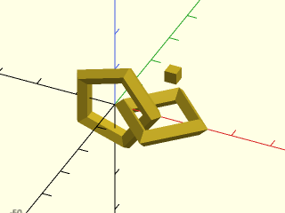

    include <BOSL2/std.scad>
    vnf = vnf_join([
             xrot(90,torus(id=15,od=24,$fn=5)),
             right(12,torus(id=15,od=24,$fn=4)),
             up(13,right(15,cube(3,center=true)))
          ]);
    vnf_polyhedron(vnf);

  

**Example 2:** Projection of above VNF with default behavior, `cut=false`

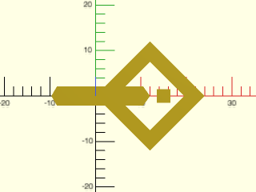

    include <BOSL2/std.scad>
    vnf = vnf_join([
             xrot(90,torus(id=15,od=24,$fn=5)),
             right(12,torus(id=15,od=24,$fn=4)),
             up(13,right(15,cube(3,center=true)))
          ]);
    reg = projection(vnf);
    region(reg);

  

**Example 3:** Tilted torus

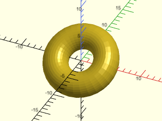

    include <BOSL2/std.scad>
    vnf = xrot(35,torus(id=4,od=12,$fn=32));
    vnf_polyhedron(vnf);

  

**Example 4:** Projection of tilted torus using `cut=true`

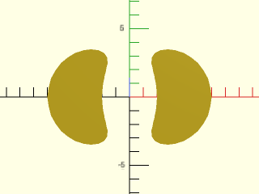

    include <BOSL2/std.scad>
    vnf = xrot(35,torus(id=4,od=12,$fn=32));
    reg = projection(vnf,cut=true);
    region(reg);

  

**Example 5:** Projection of tilted torus using `cut=true` at a different z position for the XY plane.

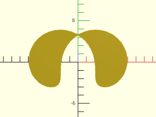

    include <BOSL2/std.scad>
    vnf = xrot(35,torus(id=4,od=12,$fn=32));
    reg = projection(vnf,cut=true,z=0.3);
    region(reg);

  

---

### Function: vnf\_halfspace()

**Synopsis:** Returns the intersection of the vnf with a half space. [<abbr>VNF</abbr>]

**Topics:** [VNF Manipulation](Topics#vnf-manipulation)

**See Also:** [vnf\_volume()](#function-vnf_volume), [vnf\_area()](#function-vnf_area), [vnf\_bend()](#function-vnf_bend)

**Usage:** 

- newvnf = vnf_halfspace(plane, vnf, [closed], [boundary]);

**Description:** 

Returns the intersection of the vnf with a half space.  The half space is defined by
plane = [A,B,C,D], taking the side where the normal [A,B,C] points: Ax+By+Cz≥D.
If closed is set to false then the cut face is not included in the vnf.  This could
allow further extension of the vnf by join with other vnfs using [`vnf_join()`](#function-vnf_join).
If your given VNF has holes (missing faces) or is not a complete polyhedron
then closed=true is may produce invalid results when it tries to construct closing faces
on the cut plane.  Set closed=false for such inputs.

If you set `boundary=true` then the return is the pair `[vnf,boundary]`, where `vnf` is the
VNF as usual (with `closed=false`) and boundary is a list giving each connected component of the cut
boundary surface.  Each entry in boundary is a list of index values that index into the vnf vertex list (vnf[0]).
This makes it possible to construct mating shapes, e.g. with [`skin()`](skin.scad#functionmodule-skin) or [`vnf_vertex_array()`](#functionmodule-vnf_vertex_array) that
can be combined using [`vnf_join()`](#function-vnf_join) to make a valid polyhedron.

The input to vnf_halfspace() does not need to be a closed, manifold polyhedron.
Because it adds the faces on the cut surface, you can use vnf_halfspace() to cap off an open shape if you
slice through a region that excludes all of the gaps in the input VNF.

**Arguments:** 

<abbr title="These args can be used by position or by name.">By&nbsp;Position</abbr> | What it does
-------------------- | ------------
`plane`              | plane defining the boundary of the half space
`vnf`                | VNF to cut
`closed`             | if false do not return the cut face(s) in the returned VNF.  Default: true
`boundary`           | if true return a pair [vnf,boundary] where boundary is a list of paths on the cut boundary indexed into the VNF vertex list.  If boundary is true, then closed is set to false.  Default: false

**Example 1:** 

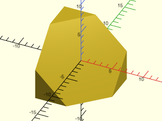

    include <BOSL2/std.scad>
    vnf = cube(10,center=true);
    cutvnf = vnf_halfspace([-1,1,-1,0], vnf);
    vnf_polyhedron(cutvnf);

  

**Example 2:** Cut face has 2 components

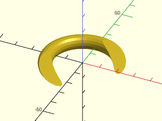

    include <BOSL2/std.scad>
    vnf = path_sweep(circle(r=4, $fn=16),
                     circle(r=20, $fn=64),closed=true);
    cutvnf = vnf_halfspace([-1,1,-4,0], vnf);
    vnf_polyhedron(cutvnf);

  

**Example 3:** Cut face is not simply connected

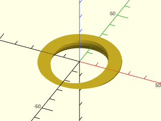

    include <BOSL2/std.scad>
    vnf = path_sweep(circle(r=4, $fn=16),
                     circle(r=20, $fn=64),closed=true);
    cutvnf = vnf_halfspace([0,0.7,-4,0], vnf);
    vnf_polyhedron(cutvnf);

  

**Example 4:** Cut object has multiple components

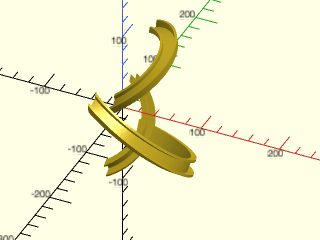

 

    include <BOSL2/std.scad>
    function knot(a,b,t) =   // rolling knot
         [ a * cos (3 * t) / (1 - b* sin (2 *t)),
           a * sin( 3 * t) / (1 - b* sin (2 *t)),
         1.8 * b * cos (2 * t) /(1 - b* sin (2 *t))];
    a = 0.8; b = sqrt (1 - a * a);
    ksteps = 400;
    knot_path = [for (i=[0:ksteps-1]) 50 * knot(a,b,(i/ksteps)*360)];
    ushape = [[-10, 0],[-10, 10],[ -7, 10],[ -7, 2],[  7, 2],[  7, 7],[ 10, 7],[ 10, 0]];
    knot=path_sweep(ushape, knot_path, closed=true, method="incremental");
    cut_knot = vnf_halfspace([1,0,0,0], knot);
    vnf_polyhedron(cut_knot);

**Example 5:** Cut a sphere with an arbitrary plane

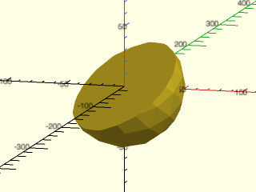

    include <BOSL2/std.scad>
    vnf1=spheroid(r=50, style="icosa", $fn=16);
    vnf2=vnf_halfspace([.8,1,-1.5,0], vnf1);
    vnf_polyhedron(vnf2);

  

**Example 6:** Cut it again, but with closed=false to leave an open boundary.

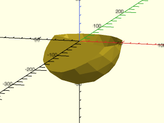

    include <BOSL2/std.scad>
    vnf1=spheroid(r=50, style="icosa", $fn=16);
    vnf2=vnf_halfspace([.8,1,-1.5,0], vnf1);
    vnf3=vnf_halfspace([0,0,-1,0], vnf2, closed=false);
    vnf_polyhedron(vnf3);

  

**Example 7:** Use {vnf\_join()} to combine with a mating vnf, in this case a reflection of the part we made.

    include <BOSL2/std.scad>
    vnf1=spheroid(r=50, style="icosa", $fn=16);
    vnf2=vnf_halfspace([.8,1,-1.5,0], vnf1);
    vnf3=vnf_halfspace([0,0,-1,0], vnf2, closed=false);
    vnf4=vnf_join([vnf3, zflip(vnf3,1)]);
    vnf_polyhedron(vnf4);

  

**Example 8:** When the input VNF is a surface with a boundary, if you use the default setting closed=true, then vnf\_halfspace() tries to construct closing faces from the edges created by the cut.  These faces may be invalid, for example if the cut points are collinear.  In this example the constructed face is a valid face.

    include <BOSL2/std.scad>
    patch=[
           [[10,-10,0],[1,-1,0],[-1,-1,0],[-10,-10,0]],
           [[10,-10,20],[1,-1,20],[-1,-1,20],[-10,-10,20]]
          ];
    vnf=bezier_vnf(patch);
    vnfcut = vnf_halfspace([-.8,0,-1,-14],vnf);
    vnf_polyhedron(vnfcut);

  

**Example 9:** Setting closed to false eliminates this (possibly invalid) face:

    include <BOSL2/std.scad>
    patch=[
           [[10,-10,0],[1,-1,0],[-1,-1,0],[-10,-10,0]],
           [[10,-10,20],[1,-1,20],[-1,-1,20],[-10,-10,20]]
          ];
    vnf=bezier_vnf(patch);
    vnfcut = vnf_halfspace([-.8,0,-1,-14],vnf,closed=false);
    vnf_polyhedron(vnfcut);

  

**Example 10:** Here is a VNF that has holes, so it is not a valid manifold.

 

    include <BOSL2/std.scad>
    outside = linear_sweep(circle(r=30), h=100, caps=false);
    inside = yrot(7,linear_sweep(circle(r=10), h=120, caps=false));
    open_vnf=vnf_join([outside, vnf_reverse_faces(inside)]);
    vnf_polyhedron(open_vnf);

**Example 11:** By cutting it at each end we can create closing faces, resulting in a valid manifold without holes.

 

    include <BOSL2/std.scad>
    outside = linear_sweep(circle(r=30), h=100, caps=false);
    inside = yrot(11,linear_sweep(circle(r=10), h=120, caps=false));
    open_vnf=vnf_join([outside, vnf_reverse_faces(inside)]);
    vnf = vnf_halfspace([0,0,1,5], vnf_halfspace([0,.7,-1,-75], open_vnf));
    vnf_polyhedron(vnf);

**Example 12:** If boundary=true then the return is a list with the VNF and boundary data.

    include <BOSL2/std.scad>
    vnf = path_sweep(circle(r=4, $fn=16),
                     circle(r=20, $fn=64),closed=true);
    cut_bnd = vnf_halfspace([-1,1,-4,0], vnf, boundary=true);
    cutvnf = cut_bnd[0];
    boundary = [for(b=cut_bnd[1]) select(cutvnf[0],b)];
    vnf_polyhedron(cutvnf);
    stroke(boundary,color="red");

  

---

### Function: vnf\_bend()

**Synopsis:** Bends a VNF around an axis. [<abbr>VNF</abbr>]

**Topics:** [VNF Manipulation](Topics#vnf-manipulation)

**See Also:** [vnf\_volume()](#function-vnf_volume), [vnf\_area()](#function-vnf_area), [vnf\_halfspace()](#function-vnf_halfspace)

**Usage:** 

- bentvnf = vnf_bend(vnf,r|d=,[axis=]);

**Description:** 

Bend a VNF around the X, Y or Z axis, splitting up faces as necessary.  Returns the bent
VNF.  For bending around the Z axis the input VNF must not cross the Y=0 plane.  For bending
around the X or Y axes the VNF must not cross the Z=0 plane.  If you wrap a VNF all the way around
it may intersect itself, which produces an invalid polyhedron.  It is your responsibility to
avoid this situation.  The 1:1
radius is where the curved length of the bent VNF matches the length of the original VNF.  If the
`r` or `d` arguments are given, then they specify the 1:1 radius or diameter.  If they are
not given, then the 1:1 radius is defined by the distance of the furthest vertex in the
original VNF from the Z=0 plane.  You can adjust the granularity of the bend using the standard
`$fa`, `$fs`, and `$fn` variables.

**Arguments:** 

<abbr title="These args can be used by position or by name.">By&nbsp;Position</abbr> | What it does
-------------------- | ------------
`vnf`                | The original VNF to bend.
`r`                  | If given, the radius where the size of the original shape is the same as in the original.

<abbr title="These args must be used by name, ie: name=value">By&nbsp;Name</abbr> | What it does
-------------------- | ------------
`d`                  | If given, the diameter where the size of the original shape is the same as in the original.
`axis`               | The axis to wrap around.  "X", "Y", or "Z".  Default: "Z"

**Example 1:** 

    include <BOSL2/std.scad>
    vnf0 = cube([100,40,10], center=true);
    vnf1 = up(50, p=vnf0);
    vnf2 = down(50, p=vnf0);
    bent1 = vnf_bend(vnf1, axis="Y");
    bent2 = vnf_bend(vnf2, axis="Y");
    vnf_polyhedron([bent1,bent2]);

  

**Example 2:** 

    include <BOSL2/std.scad>
    vnf0 = linear_sweep(star(n=5,step=2,d=100), height=10);
    vnf1 = up(50, p=vnf0);
    vnf2 = down(50, p=vnf0);
    bent1 = vnf_bend(vnf1, axis="Y");
    bent2 = vnf_bend(vnf2, axis="Y");
    vnf_polyhedron([bent1,bent2]);

  

**Example 3:** 

    include <BOSL2/std.scad>
    rgn = union(rect([100,20]),
                rect([20,100]));
    vnf0 = linear_sweep(zrot(45,p=rgn), height=10);
    vnf1 = up(50, p=vnf0);
    vnf2 = down(50, p=vnf0);
    bent1 = vnf_bend(vnf1, axis="Y");
    bent2 = vnf_bend(vnf2, axis="Y");
    vnf_polyhedron([bent1,bent2]);

  

**Example 4:** Bending Around X Axis.

    include <BOSL2/std.scad>
    rgnr = union(
        rect([20,100]),
        back(50, p=trapezoid(w1=40, w2=0, h=20, anchor=FRONT))
    );
    vnf0 = xrot(00,p=linear_sweep(rgnr, height=10));
    vnf1 = up(50, p=vnf0);
    #vnf_polyhedron(vnf1);
    bent1 = vnf_bend(vnf1, axis="X");
    vnf_polyhedron([bent1]);

  

**Example 5:** Bending Around Y Axis.

    include <BOSL2/std.scad>
    rgn = union(
        rect([20,100]),
        back(50, p=trapezoid(w1=40, w2=0, h=20, anchor=FRONT))
    );
    rgnr = zrot(-90, p=rgn);
    vnf0 = xrot(00,p=linear_sweep(rgnr, height=10));
    vnf1 = up(50, p=vnf0);
    #vnf_polyhedron(vnf1);
    bent1 = vnf_bend(vnf1, axis="Y");
    vnf_polyhedron([bent1]);

  

**Example 6:** Bending Around Z Axis.

    include <BOSL2/std.scad>
    rgn = union(
        rect([20,100]),
        back(50, p=trapezoid(w1=40, w2=0, h=20, anchor=FRONT))
    );
    rgnr = zrot(90, p=rgn);
    vnf0 = xrot(90,p=linear_sweep(rgnr, height=10));
    vnf1 = fwd(50, p=vnf0);
    #vnf_polyhedron(vnf1);
    bent1 = vnf_bend(vnf1, axis="Z");
    vnf_polyhedron([bent1]);

  

**Example 7:** Bending more than once around the cylinder

    include <BOSL2/std.scad>
    $fn=32;
    vnf = apply(fwd(5)*yrot(30),cube([100,2,5],center=true));
    bent = vnf_bend(vnf, axis="Z");
    vnf_polyhedron(bent);

  

---

### Function/Module: vnf\_hull()

**Synopsis:** Compute convex hull of VNF or 3d path

**Usage:** (as a function)

- vnf_hull = hull_vnf(vnf);

**Usage:** (as a module)

- vnf_hull(vnf,[fast]);

**Description:** 

Given a VNF or a list of 3d points, compute the convex hull
and return it as a VNF.  This differs from [`hull()`](geometry.scad#function-hull) and [`hull3d_faces()`](geometry.scad#function-hull3d_faces), which
return just the face list referenced to the input point list.  The returned
point list contains all the points that are actually used in the input
VNF, which may be many more points than are needed to represent the convex hull.
This is not usually a problem, but you can run the somewhat slow [`vnf_drop_unused_points()`](#function-vnf_drop_unused_points)
function to fix this if necessary.

If you call this as a module with a VNF it invokes hull() on the polyhedron described by the VNF.
The `fast` argument is ignored in this case.  If you call this as a module on a list of points then
it calls [`hull_points()`](geometry.scad#module-hull_points) and passes the `fast` argument.

**Arguments:** 

<abbr title="These args can be used by position or by name.">By&nbsp;Position</abbr> | What it does
-------------------- | ------------
`region`             | region or path listing points to compute the hull from.
`fast`               | (module only) if input is a point list (not a VNF) use a fasterer cheat that may handle more points, but could emit warnings.  Ignored if input is a VNF.  Default: false.

**Example 1:** Input is a VNF

 

    include <BOSL2/std.scad>
    ellipse = xscale(2, p=circle($fn=48, r=3));
    pentagon = subdivide_path(pentagon(r=1), 20);
    vnf=path_sweep(pentagon, path3d(ellipse),
                   closed=true, twist=360*2);
    vnfhull = vnf_hull(vnf);
    vnf_polyhedron(vnf);
    move([10,10])
      vnf_polyhedron(vnfhull);

**Example 2:** Input is a point list

    include <BOSL2/std.scad>
    h=helix(l=40, turns=1, r=8);
    color("red")move_copies(h)
      sphere(r=0.5,$fn=12);
    vnf_polyhedron(vnf_hull(h));

  

**Example 3:** As a module with a VNF as input

    include <BOSL2/std.scad>
    vnf = torus(d_maj=4, d_min=4);
    vnf_hull(vnf);

  

---

### Function: vnf\_boundary()

**Synopsis:** Returns the boundary of a VNF as a list of paths [<abbr>VNF</abbr>]

**Topics:** [VNF Manipulation](Topics#vnf-manipulation)

**See Also:** [vnf\_halfspace()](#function-vnf_halfspace), [vnf\_merge\_points()](#function-vnf_merge_points)

**Usage:** 

- boundary = vnf_boundary(vnf, [merge=], [idx=]);

**Description:** 

Returns the boundary of a VNF as a list of paths.  **The input VNF must not contain duplicate points.**  By default, vnf_boundary() calls [`vnf_merge_points()`](#function-vnf_merge_points)
to remove duplicate points.  Note, however, that this operation can be slow.  If you are **certain** there are no duplicate points you can
set `merge=false` to disable the automatic point merge and save time.  The result of running on a VNF with duplicate points is likely to
be incorrect or invalid; it may produce obscure errors.

The output is a list of closed 3D paths.  If the VNF has no boundary then the output is `[]`.  The boundary path(s) are
traversed in the same direction as the edges in the original VNF.

It is sometimes desirable to have the boundary available as an index list into the VNF vertex list.  However, merging the points in the VNF changes the
VNF vertex point list.  If you set `merge=false` you can also set `idx=true` to get an index list.  As noted above, you must be certain
that your in put VNF has no duplicate vertices, perhaps by running [`vnf_merge_points()`](#function-vnf_merge_points) yourself on it.  With `idx=true`
the output consists of indices into the VNF vertex list, which enables you to associate the vertices on the boundary path with the original VNF.

**Arguments:** 

<abbr title="These args can be used by position or by name.">By&nbsp;Position</abbr> | What it does
-------------------- | ------------
`vnf`                | input vnf

<abbr title="These args must be used by name, ie: name=value">By&nbsp;Name</abbr> | What it does
-------------------- | ------------
`merge`              | set to false to suppress the automatic invocation of [`vnf_merge_points()`](#function-vnf_merge_points).  Default: true
`idx`                | if true, return indices into VNF vertices instead of actual 3D points.  Must set `merge=false` to enable this.  Default: false

**Example 1:** In this example we know that the bezier patch VNF has no duplicate vertices, so we do not need to run [`vnf_merge_points()`](#function-vnf\_merge\_points).

 

    include <BOSL2/std.scad>
    patch = [
         // u=0,v=0                                         u=1,v=0
         [[-50,-50,  0], [-16,-50,  20], [ 16,-50, -20], [50,-50,  0]],
         [[-50,-16, 20], [-16,-16,  20], [ 16,-16, -20], [50,-16, 20]],
         [[-50, 16, 20], [-16, 16, -20], [ 16, 16,  20], [50, 16, 20]],
         [[-50, 50,  0], [-16, 50, -20], [ 16, 50,  20], [50, 50,  0]],
         // u=0,v=1                                         u=1,v=1
    ];
    bezvnf = bezier_vnf(patch);
    boundary = vnf_boundary(bezvnf);
    vnf_polyhedron(bezvnf);
    stroke(boundary,color="green");

**Example 2:** An example with two path components on the boundary.  The output from [`vnf_halfspace()`](#function-vnf\_halfspace) can contain duplicate vertices, so we must invoke [`vnf_merge_points()`](#function-vnf\_merge\_points).

    include <BOSL2/std.scad>
    vnf = torus(id=20,od=40,$fn=28);
    cutvnf=vnf_halfspace([0,1,0,0],
             vnf_halfspace([-1,.5,-2.5,-12], vnf, closed=false),
             closed=false);
    vnf_polyhedron(cutvnf);
    boundary = vnf_boundary(vnf_merge_points(cutvnf));
    stroke(boundary,color="green");

  

---

### Function: vnf\_small\_offset()

**Synopsis:** Computes an offset surface to a VNF for small offset distances [<abbr>VNF</abbr>]

**Topics:** [VNF Manipulation](Topics#vnf-manipulation)

**See Also:** [vnf\_sheet()](#function-vnf_sheet), [vnf\_merge\_points()](#function-vnf_merge_points)

**Usage:** 

- newvnf = vnf(vnf, delta, [merge=]);

**Description:** 

Computes a simple offset of a VNF by estimating the normal at every point based on the weighted average of surrounding polygons
in the mesh.  The offset distance, `delta`, must be small enough so that no self-intersection occurs, which is no issue when the
curvature is positive (like the outside of a sphere) but for negative curvature it means the offset distance must be smaller
than the smallest radius of curvature of the VNF. Any self-intersection that occurs
invalidates the resulting geometry, giving you an error when you introduce a second object into the model.
**It is your responsibility to avoid invalid geometry!**  It cannot be detected automatically.
The positive offset direction is toward the outside of the VNF, the faces that are colored yellow in the "thrown together" view.

**The input VNF must not contain duplicate points.**  By default, vnf_small_offset() calls [`vnf_merge_points()`](#function-vnf_merge_points)
to remove duplicate points.  Note, however, that this operation can be slow.  If you are **certain** there are no duplicate points you can
set `merge=false` to disable the automatic point merge and save time.  The result of running on a VNF with duplicate points is likely to
be incorrect or invalid.

**Arguments:** 

<abbr title="These args can be used by position or by name.">By&nbsp;Position</abbr> | What it does
-------------------- | ------------
`vnf`                | vnf to offset
`delta`              | distance of offset, positive to offset out, negative to offset in

<abbr title="These args must be used by name, ie: name=value">By&nbsp;Name</abbr> | What it does
-------------------- | ------------
`merge`              | set to false to suppress the automatic invocation of [`vnf_merge_points()`](#function-vnf_merge_points).  Default: true

**Example 1:** The original sphere is on the left and an offset sphere on the right.

    include <BOSL2/std.scad>
    vnf = sphere(d=100);
    xdistribute(spacing=125){
      vnf_polyhedron(vnf);
      vnf_polyhedron(vnf_small_offset(vnf,18));
    }

  

**Example 2:** The polyhedron on the left is enlarged to match the size of the offset polyhedron on the right.  The offset does **not** preserve coplanarity of faces.  This is because the vertices all move independently, so nothing constrains faces to remain coplanar.

 

    include <BOSL2/std.scad>
    include <BOSL2/polyhedra.scad>
    vnf = regular_polyhedron_info("vnf","pentagonal icositetrahedron",d=25);
    xdistribute(spacing=300){
      scale(11)vnf_polyhedron(vnf);
      vnf_polyhedron(vnf_small_offset(vnf,125));
    }

---

### Function: vnf\_sheet()

**Synopsis:** Extends a VNF into a thin sheet by extruding normal to the VNF [<abbr>VNF</abbr>]

**Topics:** [VNF Manipulation](Topics#vnf-manipulation)

**See Also:** [vnf\_small\_offset()](#function-vnf_small_offset), [vnf\_boundary()](#function-vnf_boundary), [vnf\_merge\_points()](#function-vnf_merge_points)

**Usage:** 

- newvnf = vnf_sheet(vnf, delta, [style=], [merge=]);

**Description:** 

Constructs a thin sheet from a vnf by offsetting the vnf along the normal vectors estimated at
each vertex by averaging the normals of the adjacent faces.  This is done using {{vnf_small_offset()}.
The `delta` parameter is a 2-vector specifying the offset distances for both surfaces that form the
final sheet. The values for each offset must be small enough so that no points cross each other
when the offset is computed, because that results in invalid geometry and rendering errors.
Rendering errors may not manifest until you add other objects to your model.
**It is your responsibility to avoid invalid geometry!**

Once the offsets to the original VNFs are computed, they are connected by filling
in the boundary strips between them.

A negative offset value extends the surface toward its "inside", which is the side that appears purple
in the "thrown together" view. Extending only toward the inside with a delta of `[0,-value]` or
`[-value,0]` (the order doesn't matter) means that your original VNF remains unchanged in the output.
Both offset surfaces may be extended in the same direction as long as the offset values are different.

**The input VNF must not contain duplicate points.**  By default, vnf_sheet() calls [`vnf_merge_points()`](#function-vnf_merge_points)
to remove duplicate points, although this operation can be slow. If you are **certain** there are no
duplicate points, you can set `merge=false` to disable the automatic point merge and save time. The
result of running on a VNF with duplicate points is likely to be incorrect or invalid, or it may result in cryptic errors.

**Arguments:** 

<abbr title="These args can be used by position or by name.">By&nbsp;Position</abbr> | What it does
-------------------- | ------------
`vnf`                | vnf to process
`delta`              | a 2-vector specifying two different offsets from the original VNF, in any order. Positive values offset the VNF from its "exterior" side, and negative values offset from the "interior" side.

<abbr title="These args must be used by name, ie: name=value">By&nbsp;Name</abbr> | What it does
-------------------- | ------------
`style`              | [`vnf_vertex_array()`](#functionmodule-vnf_vertex_array) style to use.  Default: "default"
`merge`              | If false, then do not run [`vnf_merge_points()`](#function-vnf_merge_points).  Default: true

**Example 1:** In this example, the top of the surface is "interior", so a negative thickness extends that side upward, preserving the "exterior" side of the surface at the bottom.

    include <BOSL2/std.scad>
    pts = [
        for(x=[30:5:180]) [
            for(y=[-6:0.5:6])
                [7*y,x, sin(x)*y^2]
        ]
    ];
    vnf=vnf_vertex_array(pts);
    vnf_polyhedron(vnf_sheet(vnf,[-10,0]));

  

**Example 2:** Same as previous example, but with both sides offset equally. The offset order doesn't matter. The output is shown transparent with the original surface inside. We can also set `merge=false` if we know our original VNF has no duplicate points.

    include <BOSL2/std.scad>
    pts = [
        for(x=[30:5:180]) [
            for(y=[-6:0.5:6])
                [7*y,x, sin(x)*y^2]
        ]
    ];
    vnf=vnf_vertex_array(pts, reverse=true);
    vnf_polyhedron(vnf);
    %vnf_polyhedron(vnf_sheet(vnf, [-6,6],
        merge=false));

  

**Example 3:** This example has multiple holes.

    include <BOSL2/std.scad>
    pts = [
        for(x=[-10:2:10]) [
            for(y=[-10:2:10])
                [x,1.4*y,(-abs(x)^3+y^3)/250]
        ]
    ];
    vnf = vnf_vertex_array(pts);
    newface = list_remove(vnf[1],
        [43,42,63,88,108,109,135,
        134,129,155,156,164,165]);
    newvnf = [vnf[0],newface];
    vnf_polyhedron(vnf_sheet(newvnf,[2,0]));

  

**Example 4:** When only a negative offset is applied to a sphere, the sheet is constructed inward, so the object appears unchanged, but cutting it in half reveals that we have changed the sphere into a shell.

    include <BOSL2/std.scad>
    vnf = sphere(d=100, $fn=28);
    left_half()
      vnf_polyhedron(vnf_sheet(vnf,[0,-15]));

  

---

## Section: Debugging Polyhedrons

### Module: debug\_vnf()

**Synopsis:** A replacement for `vnf_polyhedron()` to help with debugging. [<abbr>VNF</abbr>]

**Topics:** [VNF Manipulation](Topics#vnf-manipulation), [Debugging](Topics#debugging)

**Topics:** [Polyhedra](Topics#polyhedra), [Debugging](Topics#debugging)

**See Also:** [vnf\_validate()](#module-vnf_validate)

**Usage:** 

- debug_vnf(vnfs, [faces=], [vertices=], [opacity=], [size=], [convexity=], [filter=]);

**Description:** 

A drop-in module to replace `vnf_polyhedron()` to help debug vertices and faces.
Draws all the vertices at their 3D position, numbered in blue by their
position in the vertex array. Each face has its face number drawn
in red, aligned with the center of the face. All given faces are drawn with
transparency. All children of this module are drawn with transparency.
Works best with Thrown-Together preview mode, to see reversed faces.
You can set opacity to 0 if you want to supress the display of the polyhedron faces.

The vertex numbers are shown rotated to face you.  As you rotate your polyhedron you
can rerun the preview to display them oriented for viewing from a different viewpoint.

**Arguments:** 

<abbr title="These args can be used by position or by name.">By&nbsp;Position</abbr> | What it does
-------------------- | ------------
`vnf`                | VNF to display

<abbr title="These args must be used by name, ie: name=value">By&nbsp;Name</abbr> | What it does
-------------------- | ------------
`faces`              | if true display face numbers.  Default: true
`vertices`           | if true display vertex numbers.  Default: true
`opacity`            | Opacity of the polyhedron faces.  Default: 0.5
`convexity`          | The max number of walls a ray can pass through the given polygon paths.
`size`               | The size of the text used to label the faces and vertices.  Default: 1
`filter`             | If given a function literal of signature `function(i)`, shows only labels for vertices and faces that have a vertex index that gets a true result from that function.  Default: no filter.

**Example 1:** 

 

    include <BOSL2/std.scad>
    verts = [for (z=[-10,10], a=[0:120:359.9]) [10*cos(a),10*sin(a),z]];
    faces = [[0,1,2], [5,4,3], [0,3,4], [0,4,1], [1,4,5], [1,5,2], [2,5,3], [2,3,0]];
    debug_vnf([verts,faces], size=2);

---

### Module: vnf\_validate()

**Synopsis:** Echos non-manifold VNF errors to the console. [<abbr>VNF</abbr>]

**Topics:** [VNF Manipulation](Topics#vnf-manipulation), [Debugging](Topics#debugging)

**See Also:** [debug\_vnf()](#module-debug_vnf)

**Usage:** 

- vnf_validate(vnf, [size], [show_warns=], [check_isects=], [big_face=], [opacity=], [adjacent=], [label_verts=], [label_faces=], [wireframe=]);

**Description:** 

When called as a module, echoes the non-manifold errors to the console, and color hilites the
bad edges and vertices, overlaid on a transparent gray polyhedron of the VNF.

Currently checks for these problems:

Type    | Color    | Code         | Message
------- | -------- | ------------ | ---------------------------------
WARNING | Yellow   | BIG_FACE     | Face has more than 3 vertices (off by default; enable with `big_face=true`).
WARNING | Blue     | NULL_FACE    | Face has zero area.
ERROR   | Green    | BAD_INDEX    | Invalid face vertex index.
ERROR   | Cyan     | NONPLANAR    | Face vertices are not coplanar.
ERROR   | Brown    | DUP_FACE     | Multiple instances of the same face.
ERROR   | Orange   | MULTCONN     | Multiply Connected Geometry. Too many faces attached at Edge.
ERROR   | Violet   | REVERSAL     | Faces reverse across edge.
ERROR   | Red      | T_JUNCTION   | Vertex is mid-edge on another Face.
ERROR   | Pink     | FACE_ISECT   | Faces intersect.
ERROR   | Magenta  | HOLE_EDGE    | Edge bounds Hole.

Still to implement:
- Overlapping coplanar faces.

**Arguments:** 

<abbr title="These args can be used by position or by name.">By&nbsp;Position</abbr> | What it does
-------------------- | ------------
`vnf`                | The VNF to validate.
`size`               | The width of the lines and diameter of points used to highlight edges and vertices.  Module only.  Default: 1

<abbr title="These args must be used by name, ie: name=value">By&nbsp;Name</abbr> | What it does
-------------------- | ------------
`show_warns`         | If true show warnings for non-triangular faces.  Default: true
`check_isects`       | If true, performs slow checks for intersecting faces.  Default: false
`big_face`           | If true report faces with more than 3 vertices.  In practice, large faces (even non-planar) render correctly in both CGAL and Manifold, so this is off by default.  Default: false
`opacity`            | The opacity level to show the polyhedron itself with.    Default: 0.67
`label_verts`        | If true, shows labels at each vertex that show the vertex number.    Default: false
`label_faces`        | If true, shows labels at the center of each face that show the face number.    Default: false
`wireframe`          | If true, shows edges more clearly so you can see them in Thrown Together mode.    Default: false
`adjacent`           | If true, display only faces that are adjacent to a vertex listed in the errors.    Default: false

**Example 1:** BIG\_FACE Warnings; Faces with More Than 3 Vertices. CGAL often fails to accept that a face is planar after a rotation, if it has more than 3 vertices.

    include <BOSL2/std.scad>
    vnf = skin([
        path3d(regular_ngon(n=3, d=100),0),
        path3d(regular_ngon(n=5, d=100),100)
    ], slices=0, caps=true, method="tangent");
    vnf_validate(vnf);

  

**Example 2:** NONPLANAR Errors; Face Vertices are Not Coplanar

    include <BOSL2/std.scad>
    a = [  0,  0,-50];
    b = [-50,-50, 50];
    c = [-50, 50, 50];
    d = [ 50, 50, 60];
    e = [ 50,-50, 50];
    vnf = vnf_from_polygons([
        [a, b, e], [a, c, b], [a, d, c], [a, e, d], [b, c, d, e]
    ],fast=true);
    vnf_validate(vnf);

  

**Example 3:** MULTCONN Errors; More Than Two Faces Attached to the Same Edge.  This confuses CGAL, and can lead to failed renders.

 

    include <BOSL2/std.scad>
    vnf = vnf_triangulate(linear_sweep(union(square(50), square(50,anchor=BACK+RIGHT)), height=50));
    vnf_validate(vnf);

**Example 4:** REVERSAL Errors; Faces Reversed Across Edge

    include <BOSL2/std.scad>
    vnf1 = skin([
        path3d(square(100,center=true),0),
        path3d(square(100,center=true),100),
    ], slices=0, caps=false);
    vnf = vnf_join([vnf1, vnf_from_polygons([
        [[-50,-50,  0], [ 50, 50,  0], [-50, 50,  0]],
        [[-50,-50,  0], [ 50,-50,  0], [ 50, 50,  0]],
        [[-50,-50,100], [-50, 50,100], [ 50, 50,100]],
        [[-50,-50,100], [ 50,-50,100], [ 50, 50,100]],
    ])]);
    vnf_validate(vnf);

  

**Example 5:** T\_JUNCTION Errors; Vertex is Mid-Edge on Another Face.

    include <BOSL2/std.scad>
    vnf = [
        [
            each path3d(square(100,center=true),0),
            each path3d(square(100,center=true),100),
            [0,-50,100],
        ], [
           [0,2,1], [0,3,2], [0,8,4], [0,1,8], [1,5,8],
           [0,4,3], [4,7,3], [1,2,5], [2,6,5], [3,7,6],
           [3,6,2], [4,5,6], [4,6,7],
        ]
    ];
    vnf_validate(vnf);

  

**Example 6:** FACE\_ISECT Errors; Faces Intersect

 

    include <BOSL2/std.scad>
    vnf = vnf_join([
        linear_sweep(square(100,center=true), height=100),
        move([75,35,30],p=linear_sweep(square(100,center=true), height=100))
    ]);
    vnf_validate(vnf,size=2,check_isects=true);

**Example 7:** HOLE\_EDGE Errors; Edges Adjacent to Holes.

    include <BOSL2/std.scad>
    vnf = skin([
        path3d(regular_ngon(n=4, d=100),0),
        path3d(regular_ngon(n=5, d=100),100)
    ], slices=0, caps=false);
    vnf_validate(vnf,size=2);

  

---

