# LibFile: walls.scad

Walls and structural elements that 3D print without support.

To use, add the following lines to the beginning of your file:

    include <BOSL2/std.scad>
    include <BOSL2/walls.scad>

## File Contents

1. [Section: Walls](#section-walls)
    - [`sparse_wall()`](#module-sparse_wall) – Makes an open cross-braced rectangular wall. [<abbr>Geom</abbr>]
    - [`sparse_wall2d()`](#module-sparse_wall2d) – Makes an open cross-braced rectangular wall. [<abbr>Geom</abbr>]
    - [`sparse_cuboid()`](#module-sparse_cuboid) – Makes an open cross-braced cuboid [<abbr>Geom</abbr>]
    - [`hex_panel()`](#module-hex_panel) – Create a hexagon braced panel of any shape [<abbr>Geom</abbr>]
    - [`corrugated_wall()`](#module-corrugated_wall) – Makes a corrugated rectangular wall. [<abbr>Geom</abbr>]
    - [`thinning_wall()`](#module-thinning_wall) – Makes a rectangular wall with a thin middle. [<abbr>Geom</abbr>]
    - [`thinning_triangle()`](#module-thinning_triangle) – Makes a triangular wall with a thin middle. [<abbr>Geom</abbr>]
    - [`narrowing_strut()`](#module-narrowing_strut) – Makes a strut like an extruded baseball home plate. [<abbr>Geom</abbr>]

## Section: Walls

### Module: sparse\_wall()

**Synopsis:** Makes an open cross-braced rectangular wall. [<abbr>Geom</abbr>]

**Topics:** [FDM Optimized](Topics#fdm-optimized), [Walls](Topics#walls)

**See Also:** [hex\_panel()](#module-hex_panel), [corrugated\_wall()](#module-corrugated_wall), [thinning\_wall()](#module-thinning_wall), [thinning\_triangle()](#module-thinning_triangle), [narrowing\_strut()](#module-narrowing_strut)

**See Also:** [corrugated\_wall()](#module-corrugated_wall), [thinning\_wall()](#module-thinning_wall)

**Usage:** 

- sparse_wall(h, l, thick, [maxang=], [strut=], [max_bridge=]) [ATTACHMENTS];

**Description:** 

Makes an open rectangular strut with X-shaped cross-bracing, designed to reduce
the need for support material in 3D printing.

**Arguments:** 

<abbr title="These args can be used by position or by name.">By&nbsp;Position</abbr> | What it does
-------------------- | ------------
`h`                  | height of strut wall.  Default: 50
`l`                  | length of strut wall.  Default: 100
`thick`              | thickness of strut wall.  Default: 4

<abbr title="These args must be used by name, ie: name=value">By&nbsp;Name</abbr> | What it does
-------------------- | ------------
`maxang`             | maximum overhang angle of cross-braces, measured down from vertical.  Default: 30
`strut`              | the width of the cross-braces. Default: 5
`max_bridge`         | maximum bridging distance between cross-braces.  Default: 20
`anchor`             | Translate so anchor point is at origin (0,0,0).  See [anchor](attachments.scad#subsection-anchor).  Default: `CENTER`
`spin`               | Rotate this many degrees around the Z axis after anchor.  See [spin](attachments.scad#subsection-spin).  Default: `0`
`orient`             | Vector to rotate top towards, after spin.  See [orient](attachments.scad#subsection-orient).  Default: `UP`

**Example 1:** Typical Shape

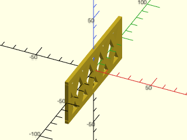

    include <BOSL2/std.scad>
    include <BOSL2/walls.scad>
    sparse_wall(h=40, l=100, thick=3);

  

**Example 2:** Thinner Strut

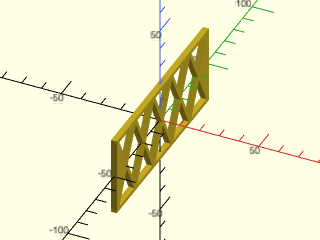

    include <BOSL2/std.scad>
    include <BOSL2/walls.scad>
    sparse_wall(h=40, l=100, thick=3, strut=2);

  

**Example 3:** Larger maxang

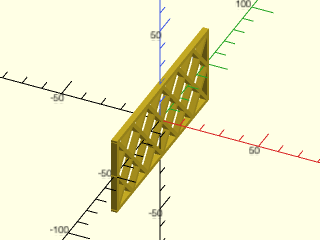

    include <BOSL2/std.scad>
    include <BOSL2/walls.scad>
    sparse_wall(h=40, l=100, thick=3, strut=2, maxang=45);

  

**Example 4:** Longer max\_bridge

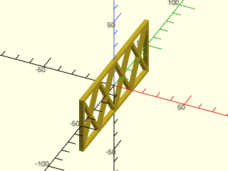

 

    include <BOSL2/std.scad>
    include <BOSL2/walls.scad>
    sparse_wall(h=40, l=100, thick=3, strut=2, maxang=45, max_bridge=30);

---

### Module: sparse\_wall2d()

**Synopsis:** Makes an open cross-braced rectangular wall. [<abbr>Geom</abbr>]

**Topics:** [FDM Optimized](Topics#fdm-optimized), [Walls](Topics#walls)

**See Also:** [sparse\_wall()](#module-sparse_wall), [hex\_panel()](#module-hex_panel), [corrugated\_wall()](#module-corrugated_wall), [thinning\_wall()](#module-thinning_wall), [thinning\_triangle()](#module-thinning_triangle), [narrowing\_strut()](#module-narrowing_strut)

**See Also:** [corrugated\_wall()](#module-corrugated_wall), [thinning\_wall()](#module-thinning_wall)

**Usage:** 

- sparse_wall2d(size, [maxang=], [strut=], [max_bridge=]) [ATTACHMENTS];

**Description:** 

Makes a 2D open rectangular square with X-shaped cross-bracing, designed to be extruded, to make a strut that reduces
the need for support material in 3D printing.

**Arguments:** 

<abbr title="These args can be used by position or by name.">By&nbsp;Position</abbr> | What it does
-------------------- | ------------
`size`               | The `[X,Y]` size of the outer rectangle.  Default: [50,100]

<abbr title="These args must be used by name, ie: name=value">By&nbsp;Name</abbr> | What it does
-------------------- | ------------
`maxang`             | maximum overhang angle of cross-braces.  Default: 30
`strut`              | the width of the cross-braces.  Default: 5
`max_bridge`         | maximum bridging distance between cross-braces.  Default: 20
`anchor`             | Translate so anchor point is at origin (0,0,0).  See [anchor](attachments.scad#subsection-anchor).  Default: `CENTER`
`spin`               | Rotate this many degrees around the Z axis after anchor.  See [spin](attachments.scad#subsection-spin).  Default: `0`

**Example 1:** Typical Shape

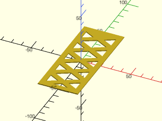

    include <BOSL2/std.scad>
    include <BOSL2/walls.scad>
    sparse_wall2d(size=[40,100]);

  

**Example 2:** Thinner Strut

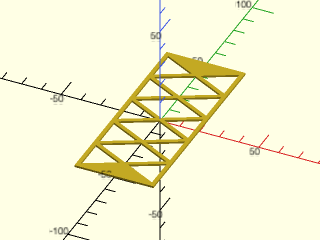

    include <BOSL2/std.scad>
    include <BOSL2/walls.scad>
    sparse_wall2d(size=[40,100], strut=2);

  

**Example 3:** Larger maxang

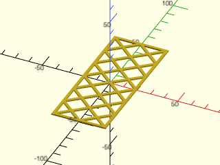

    include <BOSL2/std.scad>
    include <BOSL2/walls.scad>
    sparse_wall2d(size=[40,100], strut=2, maxang=45);

  

**Example 4:** Longer max\_bridge

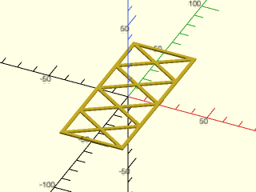

 

    include <BOSL2/std.scad>
    include <BOSL2/walls.scad>
    sparse_wall2d(size=[40,100], strut=2, maxang=45, max_bridge=30);

---

### Module: sparse\_cuboid()

**Synopsis:** Makes an open cross-braced cuboid [<abbr>Geom</abbr>]

**Topics:** [FDM Optimized](Topics#fdm-optimized), [Walls](Topics#walls)

**See Also:** [sparse\_wall()](#module-sparse_wall), [hex\_panel()](#module-hex_panel), [corrugated\_wall()](#module-corrugated_wall), [thinning\_wall()](#module-thinning_wall), [thinning\_triangle()](#module-thinning_triangle), [narrowing\_strut()](#module-narrowing_strut), [cuboid()](shapes3d.scad#module-cuboid)

**Usage:** 

- sparse_cuboid(size, [dir], [maxang=], [strut=], [max_bridge=]) [ATTACHMENTS];

**Description:** 

Makes an open rectangular cuboid with X-shaped cross-bracing to reduce the need for material in 3d printing.
The direction of the cross bracing can be aligned with the X, Y or Z axis.  This module can be
used as a drop-in replacement for [`cuboid()`](shapes3d.scad#module-cuboid) if you belatedly decide that your model would benefit from
the sparse construction.  Note that for Z aligned bracing the max_bridge parameter contrains the gaps that are parallel
to the Y axis, and the angle is measured relative to the X direction.

**Arguments:** 

<abbr title="These args can be used by position or by name.">By&nbsp;Position</abbr> | What it does
-------------------- | ------------
`size`               | The size of sparse wall, a number or length 3 vector.
`dir`                | direction of holes through the cuboid, must be a vector parallel to the X, Y or Z axes, or one of "X", "Y" or "Z".  Default: RIGHT (the X axis)

<abbr title="These args must be used by name, ie: name=value">By&nbsp;Name</abbr> | What it does
-------------------- | ------------
`maxang`             | maximum overhang angle of cross-braces, measured down from vertical.  Default: 30
`strut`              | the width of the cross-braces. Default: 5
`max_bridge`         | maximum bridging distance between cross-braces.  Default: 20
`chamfer`            | Size of chamfer, inset from sides.  Default: No chamfering.
`rounding`           | Radius of the edge rounding.  Default: No rounding.
`edges`              | Edges to mask.  See [Specifying Edges](attachments.scad#section-specifying-edges).  Default: all edges.
`except`             | Edges to explicitly NOT mask.  See [Specifying Edges](attachments.scad#section-specifying-edges).  Default: No edges.
`trimcorners`        | If true, rounds or chamfers corners where three chamfered/rounded edges meet.  Default: `true`
`teardrop`           | If given as a number, rounding around the bottom edge of the cuboid won't exceed this many degrees from vertical.  If true, the limit angle is 45 degrees.  Default: `false`
`anchor`             | Translate so anchor point is at origin (0,0,0).  See [anchor](attachments.scad#subsection-anchor).  Default: `CENTER`
`spin`               | Rotate this many degrees around the Z axis.  See [spin](attachments.scad#subsection-spin).  Default: `0`
`orient`             | Vector to rotate top towards.  See [orient](attachments.scad#subsection-orient).  Default: `UP`

**Example 1:** 

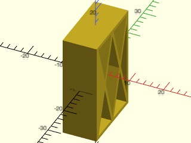

    include <BOSL2/std.scad>
    include <BOSL2/walls.scad>
    sparse_cuboid([10,20,30], strut=1);

  

**Example 2:** 

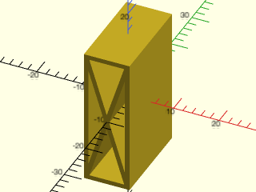

    include <BOSL2/std.scad>
    include <BOSL2/walls.scad>
    sparse_cuboid([10,20,30], "Y", strut=1);

  

**Example 3:** 

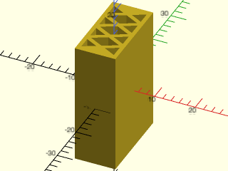

    include <BOSL2/std.scad>
    include <BOSL2/walls.scad>
    sparse_cuboid([10,20,30], UP, strut=1);

  

**Example 4:** 

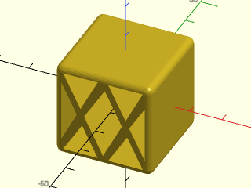

    include <BOSL2/std.scad>
    include <BOSL2/walls.scad>
    sparse_cuboid(30, FWD, strut=2, rounding=2, $fn=24);

  

---

### Module: hex\_panel()

**Synopsis:** Create a hexagon braced panel of any shape [<abbr>Geom</abbr>]

**Topics:** [FDM Optimized](Topics#fdm-optimized), [Walls](Topics#walls)

**See Also:** [sparse\_wall()](#module-sparse_wall), [corrugated\_wall()](#module-corrugated_wall), [thinning\_wall()](#module-thinning_wall), [thinning\_triangle()](#module-thinning_triangle), [narrowing\_strut()](#module-narrowing_strut)

**Usage:** 

- hex_panel(shape, strut, spacing, [frame=], [bevel=], [bevel_frame=], [shift=], [h=|height=|l=|length=], [anchor=], [orient=], [spin=])

**Description:** 

Produces a panel with a honeycomb interior that can be rectangular with optional beveling, or
an arbitrary polygon shape without beveling. The panel consists of a frame containing
a honeycob interior. The frame is laid out in the XY plane with the honeycob interior
and then extruded to the height h. The shape argument defines the outer bounderies of
the frame.

The simplest way to define the frame shape is to give a cuboid size as a 3d vector for
the shape argument.  The h argument is not allowed in this case.  With rectangular frames you can supply the
bevel argument which applies a 45 deg bevel on the specified list of edges.  These edges
can be LEFT, RIGHT, FRONT, or BACK to place a bevel the edge facing upward.  You can add
BOTTOM, as in LEFT+BOT, to get a bevel that faces down.  When beveling a separate beveled frame
is added to the model.  You can independently control its thickness by setting `bevel_frame`, which
defaults to the frame thickness.  Note also that `frame` and `bevel_frame` can be set to zero
to produce just the honeycomb.

The `shift=` parameter lets you shift the hex grid pattern by an [x,y] vector.  This is useful
when you need to align the hex pattern across adjacent panels that share an edge, or to
control the starting position of the honeycomb pattern within the panel.

The other option is to provide a 2D path as the shape argument. The path must not intersect
itself.  You must give the height argument in this case and you cannot give the bevel argument.
The panel is made from a linear extrusion of the specified shape.  In this case, anchoring
is done as usual for linear sweeps.  The shape appears centered in Z by default and you can
choose "hull" or "intersect" anchor types.

**Arguments:** 

<abbr title="These args can be used by position or by name.">By&nbsp;Position</abbr> | What it does
-------------------- | ------------
`shape`              | 3D size vector or a 2D path
`strut`              | thickness of hexagonal bracing
`spacing`            | center-to-center spacing of hex cells in the honeycomb.

<abbr title="These args must be used by name, ie: name=value">By&nbsp;Name</abbr> | What it does
-------------------- | ------------
`frame`              | width of the frame around the honeycomb.  Default: same as strut
`bevel`              | list of edges to bevel on rectangular case when shape is a size vector; allowed options are RIGHT, LEFT, BACK, or FRONT, or those directions with BOTTOM added.  Default: []
`bevel_frame`        | width of the frame applied at bevels.  Default: same as frame
`shift`              | 2D phase shift of the repeating hex grid.  Useful for aligning patterns across adjacent panels.  Default: [0,0]
`h`                  / `height`             / `l`                  / `length`             | thickness of the panel when shape is a path
`anchor`             | Translate so anchor point is at origin (0,0,0).  See [anchor](attachments.scad#subsection-anchor).  Default: `CENTER` for rectangular panels, `"zcenter"` for extrusions.
`spin`               | Rotate this many degrees around the Z axis after anchor.  See [spin](attachments.scad#subsection-spin).  Default: `0`
`orient`             | Vector to rotate top towards, after spin.  See [orient](attachments.scad#subsection-orient).  Default: `UP`
`atype`              | Select "hull", "intersect" anchor types.  Default: "hull"
`cp`                 | Centerpoint for determining "intersect" anchors or centering the shape.  Determintes the base of the anchor vector.  Can be "centroid", "mean", "box" or a 3D point.  Default: "centroid"

**Named Anchors:** 

Anchor Name | Position
----------- | --------
"base" | Anchor to the base of the shape in its native position
"top" | Anchor to the top of the shape in its native position
"zcenter" | Center shape in the Z direction in the native XY position (default)

**Anchor Types:** 

Anchor Type | What it is
----------- | ----------
hull | Anchors to the convex hull of the linear sweep of the path, ignoring any end roundings.
intersect | Anchors to the surface of the linear sweep of the path, ignoring any end roundings.

**Example 1:** 

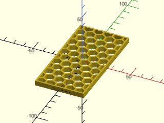

    include <BOSL2/std.scad>
    include <BOSL2/walls.scad>
    hex_panel([50, 100, 5], strut=1.5, spacing=10);

  

**Example 2:** 

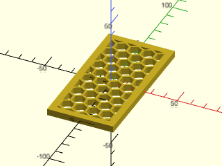

    include <BOSL2/std.scad>
    include <BOSL2/walls.scad>
    hex_panel([50, 100, 5], 1.5, 10, frame = 5);

  

**Example 3:** 

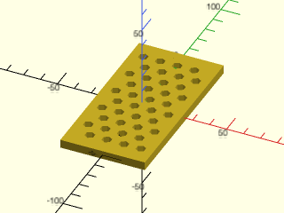

    include <BOSL2/std.scad>
    include <BOSL2/walls.scad>
    hex_panel([50, 100, 5], 5, 10.05);

  

**Example 4:** 

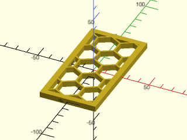

    include <BOSL2/std.scad>
    include <BOSL2/walls.scad>
    hex_panel([50, 100, 5], 1.5, 20, frame = 5);

  

**Example 5:** 

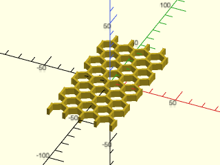

    include <BOSL2/std.scad>
    include <BOSL2/walls.scad>
    hex_panel([50, 100, 5], 1.5, 12, frame = 0);

  

**Example 6:** 

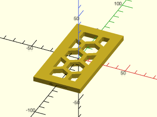

    include <BOSL2/std.scad>
    include <BOSL2/walls.scad>
    hex_panel([50, 100, 5], frame = 10, spacing = 20, strut = 4);

  

**Example 7:** 

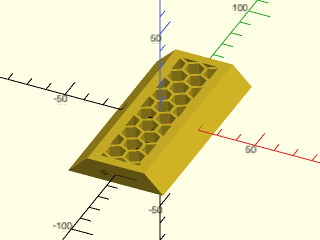

 

    include <BOSL2/std.scad>
    include <BOSL2/walls.scad>
    hex_panel([50, 100, 10], 1.5, 10, frame = 5, bevel = [LEFT, RIGHT]);

**Example 8:** 

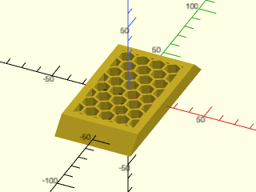

 

    include <BOSL2/std.scad>
    include <BOSL2/walls.scad>
    hex_panel([50, 100, 10], 1.5, 10, frame = 5, bevel = [FWD,  BACK]);

**Example 9:** 

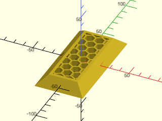

 

    include <BOSL2/std.scad>
    include <BOSL2/walls.scad>
    hex_panel([50, 100, 10], 1.5, 10, frame = 3, bevel = [LEFT, RIGHT, FWD, BACK]);

**Example 10:** 

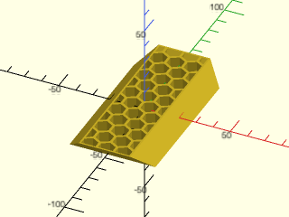

 

    include <BOSL2/std.scad>
    include <BOSL2/walls.scad>
    hex_panel([50, 100, 10], 1.5, 10, frame = 1, bevel = [LEFT, RIGHT, FWD+BOTTOM, BACK+BOTTOM]);

**Example 11:** 

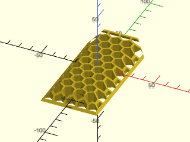

 

    include <BOSL2/std.scad>
    include <BOSL2/walls.scad>
    hex_panel([50, 100, 10], 1.5, 10, frame=2, bevel_frame=0, bevel = [FWD, BACK+BOT, RIGHT, LEFT]);

**Example 12:** Triangle

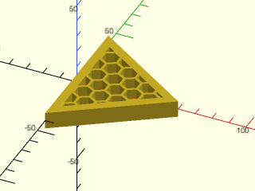

    include <BOSL2/std.scad>
    include <BOSL2/walls.scad>
    s = [[0, -40], [0, 40], [60, 0]];
    hex_panel(s, strut=1.5, spacing=10, h = 10, frame = 5);

  

**Example 13:** Concave polygon

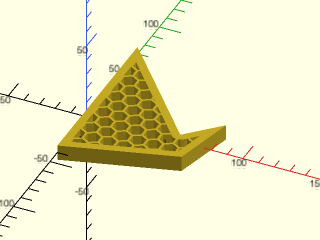

    include <BOSL2/std.scad>
    include <BOSL2/walls.scad>
    s = [[0, -40], [0, 70], [60, 0], [80, 20], [70, -20]];
    hex_panel(s, 1.5, 10, h = 10, frame = 5);

  

**Example 14:** Another concave example

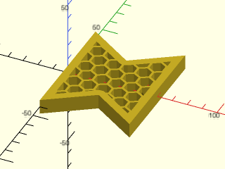

 

    include <BOSL2/std.scad>
    include <BOSL2/walls.scad>
    s = [[0, -40], [0, 40], [30, 20], [60, 40], [60, -40], [30, -20]];
    hex_panel(s, 1.5, 10, h = 10, frame = 5);

**Example 15:** Circular panel

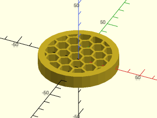

    include <BOSL2/std.scad>
    include <BOSL2/walls.scad>
    hex_panel(circle(30), 1.5, 10, h = 10, frame = 5);

  

**Example 16:** More complicated shape

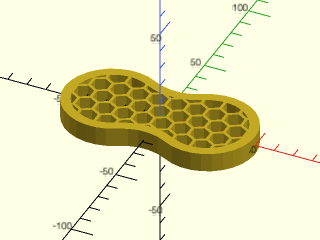

    include <BOSL2/std.scad>
    include <BOSL2/walls.scad>
    s = glued_circles(d=50, spread=50, tangent=30);
    hex_panel(s, 1.5, 10, h = 10, frame = 5);

  

**Example 17:** Care is required when arranging panels vertically for 3d printability.  Setting `orient=RIGHT` produces the correct result.

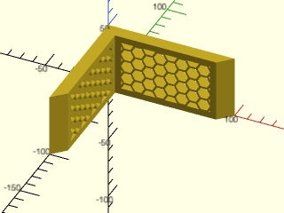

 

    include <BOSL2/std.scad>
    include <BOSL2/walls.scad>
    hex_panel([50, 100, 10], 1.5, 10, frame = 5, bevel = [FWD, BACK], anchor = BACK + RIGHT + BOTTOM, orient = RIGHT);
    zrot(-90)hex_panel([50, 100, 10], 1.5, 10, frame = 5,  bevel = [FWD, BACK], anchor = FWD + RIGHT + BOTTOM, orient = RIGHT);

**Example 18:** In this example panels one of the panels is positioned with `orient=FWD` which produces hexagons with 60 deg overhang edges that may not be 3d printable.  This example alsu uses `bevel_frame` to thin the material at the corner.

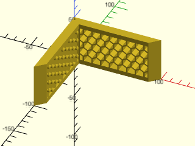

 

    include <BOSL2/std.scad>
    include <BOSL2/walls.scad>
    hex_panel([50, 100, 10], 1.5, 10, frame = 5, bevel_frame=1, bevel = [FWD,  BACK], anchor = BACK + RIGHT + BOTTOM, orient = RIGHT);
    hex_panel([100, 50, 10], 1.5, 10, frame = 5, bevel_frame=1, bevel = [LEFT, RIGHT], anchor = FWD + LEFT + BOTTOM, orient = FWD);

**Example 19:** Joining panels with [`attach()`](attachments.scad#module-attach).  In this case panels were joined front beveled edge to back beveled edge, which means the hex structure doesn't align at the joint

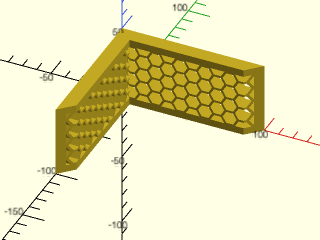

 

    include <BOSL2/std.scad>
    include <BOSL2/walls.scad>
    hex_panel([50, 100, 10], 1.5, 10, frame = 5, bevel_frame=0, bevel = [FWD, BACK], anchor = BACK + RIGHT + BOTTOM, orient = RIGHT)
      attach(BACK,FRONT)
         hex_panel([50, 100, 10], 1.5, 10, frame = 5, bevel_frame=0, bevel = [FWD, BACK]);

**Example 20:** Joining panels with [`attach()`](attachments.scad#module-attach).  Attaching BACK to BACK aligns the hex structure which looks better.

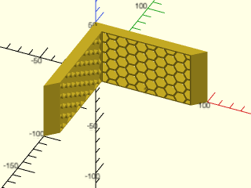

 

    include <BOSL2/std.scad>
    include <BOSL2/walls.scad>
    hex_panel([50, 100, 10], 1.5, 10, frame = 1, bevel = [FWD, BACK], anchor = BACK + RIGHT + BOTTOM, orient = RIGHT)
      attach(BACK,BACK)
         hex_panel([50, 100, 10], 1.5, 10, frame = 1, bevel = [FWD, BACK]);

**Example 21:** Using `shift=` to offset the hex grid pattern.

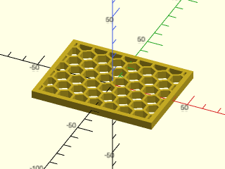

    include <BOSL2/std.scad>
    include <BOSL2/walls.scad>
    hex_panel([80, 60, 5], 1.5, 10, frame=3, shift=[5,5]);

  

---

### Module: corrugated\_wall()

**Synopsis:** Makes a corrugated rectangular wall. [<abbr>Geom</abbr>]

**Topics:** [FDM Optimized](Topics#fdm-optimized), [Walls](Topics#walls)

**See Also:** [sparse\_wall()](#module-sparse_wall), [thinning\_wall()](#module-thinning_wall), [thinning\_triangle()](#module-thinning_triangle), [narrowing\_strut()](#module-narrowing_strut)

**See Also:** [sparse\_wall()](#module-sparse_wall), [thinning\_wall()](#module-thinning_wall)

**Usage:** 

- corrugated_wall(h, l, thick, [strut=], [wall=]) [ATTACHMENTS];

**Description:** 

Makes a corrugated wall which relieves contraction stress while still
providing support strength.  Designed with 3D printing in mind.

**Arguments:** 

<abbr title="These args can be used by position or by name.">By&nbsp;Position</abbr> | What it does
-------------------- | ------------
`h`                  | height of strut wall.  Default: 50
`l`                  | length of strut wall.  Default: 100
`thick`              | thickness of strut wall.  Default: 5

<abbr title="These args must be used by name, ie: name=value">By&nbsp;Name</abbr> | What it does
-------------------- | ------------
`strut`              | the width of the frame.  Default: 5
`wall`               | thickness of corrugations.  Default: 2
`anchor`             | Translate so anchor point is at origin (0,0,0).  See [anchor](attachments.scad#subsection-anchor).  Default: `CENTER`
`spin`               | Rotate this many degrees around the Z axis after anchor.  See [spin](attachments.scad#subsection-spin).  Default: `0`
`orient`             | Vector to rotate top towards, after spin.  See [orient](attachments.scad#subsection-orient).  Default: `UP`

**Example 1:** Typical Shape

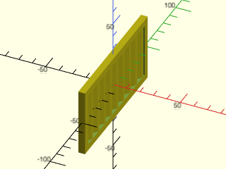

    include <BOSL2/std.scad>
    include <BOSL2/walls.scad>
    corrugated_wall(h=50, l=100);

  

**Example 2:** Wider Strut

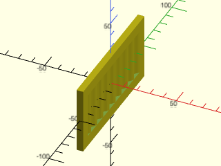

    include <BOSL2/std.scad>
    include <BOSL2/walls.scad>
    corrugated_wall(h=50, l=100, strut=8);

  

**Example 3:** Thicker Wall

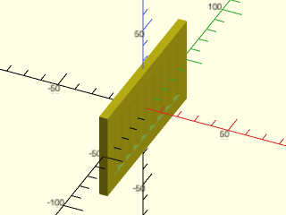

    include <BOSL2/std.scad>
    include <BOSL2/walls.scad>
    corrugated_wall(h=50, l=100, strut=8, wall=3);

  

---

### Module: thinning\_wall()

**Synopsis:** Makes a rectangular wall with a thin middle. [<abbr>Geom</abbr>]

**Topics:** [FDM Optimized](Topics#fdm-optimized), [Walls](Topics#walls)

**See Also:** [sparse\_wall()](#module-sparse_wall), [corrugated\_wall()](#module-corrugated_wall), [thinning\_triangle()](#module-thinning_triangle), [narrowing\_strut()](#module-narrowing_strut)

**See Also:** [sparse\_wall()](#module-sparse_wall), [corrugated\_wall()](#module-corrugated_wall), [thinning\_triangle()](#module-thinning_triangle)

**Usage:** 

- thinning_wall(h, l, thick, [ang=], [braces=], [strut=], [wall=]) [ATTACHMENTS];

**Description:** 

Makes a rectangular wall along the Y axis which thins to a smaller width in the center,
with angled supports to prevent critical overhangs.

**Arguments:** 

<abbr title="These args can be used by position or by name.">By&nbsp;Position</abbr> | What it does
-------------------- | ------------
`h`                  | Height of wall.  Default: 50
`l`                  | Length of wall (y dimension).  If given as a vector of two numbers, specifies bottom and top lengths, respectively.  Default: 100
`thick`              | Thickness of wall (x dimension).  Default: 5

<abbr title="These args must be used by name, ie: name=value">By&nbsp;Name</abbr> | What it does
-------------------- | ------------
`ang`                | Maximum overhang angle of diagonal brace.  Default: 30
`braces`             | If true, adds diagonal crossbraces for strength.  Default: false
`strut`              | The width of the borders and diagonal braces.  Default: min(h,l1,l2,thick)/2
`wall`               | The thickness of the thinned portion of the wall.  Default: `thick/2`
`anchor`             | Translate so anchor point is at origin (0,0,0).  See [anchor](attachments.scad#subsection-anchor).  Default: `CENTER`
`spin`               | Rotate this many degrees around the Z axis after anchor.  See [spin](attachments.scad#subsection-spin).  Default: `0`
`orient`             | Vector to rotate top towards, after spin.  See [orient](attachments.scad#subsection-orient).  Default: `UP`

**Example 1:** Typical Shape

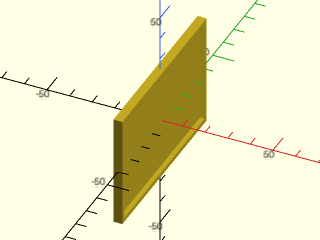

    include <BOSL2/std.scad>
    include <BOSL2/walls.scad>
    thinning_wall(h=50, l=80, thick=4);

  

**Example 2:** Trapezoidal

    include <BOSL2/std.scad>
    include <BOSL2/walls.scad>
    thinning_wall(h=50, l=[80,50], thick=4);

  

**Example 3:** Trapezoidal with Braces

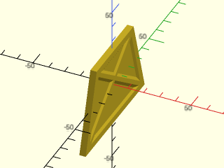

 

    include <BOSL2/std.scad>
    include <BOSL2/walls.scad>
    thinning_wall(h=50, l=[80,50], thick=4, strut=4, wall=2, braces=true);

---

### Module: thinning\_triangle()

**Synopsis:** Makes a triangular wall with a thin middle. [<abbr>Geom</abbr>]

**Topics:** [FDM Optimized](Topics#fdm-optimized), [Walls](Topics#walls)

**See Also:** [sparse\_wall()](#module-sparse_wall), [corrugated\_wall()](#module-corrugated_wall), [thinning\_wall()](#module-thinning_wall), [narrowing\_strut()](#module-narrowing_strut)

**See Also:** [thinning\_wall()](#module-thinning_wall)

**Usage:** 

- thinning_triangle(h, l, thick, [ang=], [strut=], [wall=], [diagonly=], [center=]) [ATTACHMENTS];

**Description:** 

Makes a triangular wall with thick edges, which thins to a smaller width in
the center, with angled supports to prevent critical overhangs.

**Arguments:** 

<abbr title="These args can be used by position or by name.">By&nbsp;Position</abbr> | What it does
-------------------- | ------------
`h`                  | height of wall.  Default: 50
`l`                  | length of wall.  Default: 100
`thick`              | thickness of wall.  Default: 5

<abbr title="These args must be used by name, ie: name=value">By&nbsp;Name</abbr> | What it does
-------------------- | ------------
`ang`                | maximum overhang angle of diagonal brace.  Default: 30
`strut`              | the width of the diagonal brace.  Default: 5
`wall`               | the thickness of the thinned portion of the wall.  Default: 3
`diagonly`           | boolean, which denotes only the diagonal side (hypotenuse) should be thick.  Default: false
`center`             | If true, centers shape.  If false, overrides `anchor` with `BOT+FRONT`.
`anchor`             | Translate so anchor point is at origin (0,0,0).  See [anchor](attachments.scad#subsection-anchor).  Default: `CENTER`
`spin`               | Rotate this many degrees around the Z axis after anchor.  See [spin](attachments.scad#subsection-spin).  Default: `0`
`orient`             | Vector to rotate top towards, after spin.  See [orient](attachments.scad#subsection-orient).  Default: `UP`

**Example 1:** Centered

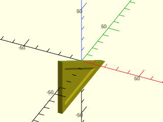

 

    include <BOSL2/std.scad>
    include <BOSL2/walls.scad>
    thinning_triangle(h=50, l=80, thick=4, ang=30, strut=5, wall=2, center=true);

**Example 2:** All Braces

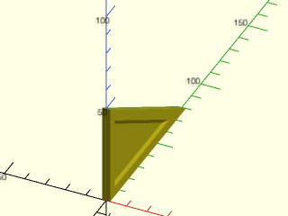

 

    include <BOSL2/std.scad>
    include <BOSL2/walls.scad>
    thinning_triangle(h=50, l=80, thick=4, ang=30, strut=5, wall=2, center=false);

**Example 3:** Diagonal Brace Only

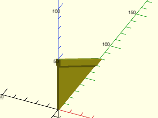

 

    include <BOSL2/std.scad>
    include <BOSL2/walls.scad>
    thinning_triangle(h=50, l=80, thick=4, ang=30, strut=5, wall=2, diagonly=true, center=false);

---

### Module: narrowing\_strut()

**Synopsis:** Makes a strut like an extruded baseball home plate. [<abbr>Geom</abbr>]

**Topics:** [FDM Optimized](Topics#fdm-optimized)

**See Also:** [sparse\_wall()](#module-sparse_wall), [corrugated\_wall()](#module-corrugated_wall), [thinning\_wall()](#module-thinning_wall), [thinning\_triangle()](#module-thinning_triangle)

**Usage:** 

- narrowing_strut(w, l, wall, [ang=]) [ATTACHMENTS];

**Description:** 

Makes a rectangular strut with the top side narrowing in a triangle.
The shape created may be likened to an extruded home plate from baseball.
This is useful for constructing parts that minimize the need to support
overhangs.

**Arguments:** 

<abbr title="These args can be used by position or by name.">By&nbsp;Position</abbr> | What it does
-------------------- | ------------
`w`                  | Width (thickness) of the strut.  Default: 10
`l`                  | Length of the strut.  Default: 100
`wall`               | height of rectangular portion of the strut.  Default: 5

<abbr title="These args must be used by name, ie: name=value">By&nbsp;Name</abbr> | What it does
-------------------- | ------------
`ang`                | angle that the trianglar side will converge at.  Default: 30
`anchor`             | Translate so anchor point is at origin (0,0,0).  See [anchor](attachments.scad#subsection-anchor).  Default: `BOTTOM`
`spin`               | Rotate this many degrees around the Z axis after anchor.  See [spin](attachments.scad#subsection-spin).  Default: `0`
`orient`             | Vector to rotate top towards, after spin.  See [orient](attachments.scad#subsection-orient).  Default: `UP`

**Example 1:** 

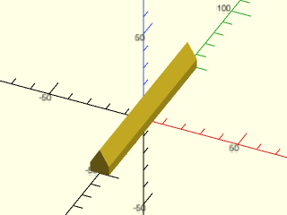

    include <BOSL2/std.scad>
    include <BOSL2/walls.scad>
    narrowing_strut(w=10, l=100, wall=5, ang=30);

  

---

