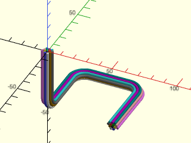

# LibFile: wiring.scad

Rendering for routed wire bundles

To use, add the following lines to the beginning of your file:

    include <BOSL2/std.scad>
    include <BOSL2/wiring.scad>

## File Contents

1. [Section: Modules](#section-modules)
    - [`wire_bundle()`](#module-wire_bundle) – Creates a wire bundle for a given number of wires. [<abbr>Geom</abbr>]

## Section: Modules

### Module: wire\_bundle()

**Synopsis:** Creates a wire bundle for a given number of wires. [<abbr>Geom</abbr>]

**Topics:** [Wiring](Topics#wiring)

**See Also:** [path\_sweep()](skin.scad#functionmodule-path_sweep), [path\_sweep2d()](skin.scad#functionmodule-path_sweep2d)

**Usage:** 

- wire_bundle(path, wires, [wirediam], [rounding], [wirenum=], [corner_steps=]);

**Description:** 

Creates a 3D object representing a bundle of wires that follow a given path,
with the corners rounded to a given radius.  There are 17 base wire colors.
If you have more than 17 wires, colors will get re-used.

**Arguments:** 

<abbr title="These args can be used by position or by name.">By&nbsp;Position</abbr> | What it does
-------------------- | ------------
`path`               | The 3D path that the wire bundle should follow.
`wires`              | The number of wires in the wire bundle.
`wirediam`           | The diameter of each wire in the bundle. Default: 2
`rounding`           | The radius that the path corners will be rounded to.  Default: 10

<abbr title="These args must be used by name, ie: name=value">By&nbsp;Name</abbr> | What it does
-------------------- | ------------
`wirenum`            | The first wire's offset into the color table.  Default: 0
`corner_steps`       | Use this number of segments on 90 deg corners (e.g. set `$fn` to `4*(corner_steps+1))`.  Default: 15

**Example 1:** 

 

    include <BOSL2/std.scad>
    include <BOSL2/wiring.scad>
    wire_bundle([[50,0,-50], [50,50,-50], [0,50,-50], [0,0,-50], [0,0,0]], rounding=10, wires=13);

---

