<!-- PDF page 1 -->

# OpenSCAD User Manual

## **Contents**

1 Introduction

1.1 Additional Resources

1.2 History

2 The OpenSCAD User Manual

3 The OpenSCAD Language Reference

4 Work in progress

5 Contents

6 Chapter 1 -- First Steps

6.1 Compiling and rendering our first model

6.2 See also

6.3 See also

6.3.1 There is no semicolon following the translate command

6.3.2 See Also

6.3.3 See Also

6.4 CGAL surfaces

6.5 CGAL grid only

6.6 The OpenCSG view

6.7 The Thrown Together View

6.8 See also

6.9 References

7 Chapter 2 -- The OpenSCAD User Interface

7.1 User Interface

7.1.1 Viewing area

7.1.2 Console window

7.1.3 Text editor

7.2 Interactive modification of the numerical value

7.3 View navigation

7.4 View setup

7.4.1 Render modes

7.4.1.1 OpenCSG (F9)

7.4.1.1.1 Implementation Details

7.4.1.2 CGAL (Surfaces and Grid, F10 and F11)

7.4.1.2.1 Implementation Details

7.4.2 View options

7.4.2.1 _Show Edges_ (Ctrl+1)

7.4.2.2 _Show Axes_ (Ctrl+2)

7.4.2.3 _Show Crosshairs_ (Ctrl+3)

7.4.3 Animation

7.4.4 View alignment

7.5 Dodecahedron

7.6 Icosahedron

7.7 Half-pyramid

7.8 Bounding Box

7.9 Linear Extrude extended use examples

7.9.1 Linear Extrude with Scale as an interpolated function

7.9.2 Linear Extrude with Twist as an interpolated function

7.9.3 Linear Extrude with Twist and Scale as interpolated functions

7.10 Rocket

7.11 Horns

7.12 Strandbeest

7.13 Previous

7.14 Next

7.14.1 Command line usage

7.14.2 Export options

7.14.2.1 Camera and image output

7.14.3 Constants

<!-- PDF page 2 -->

7.14.4 Command to build required files

7.14.5 Processing all .scad files in a folder

7.14.6 Makefile example

7.14.6.1 Automatic targets

7.14.7 Windows notes

7.14.8 MacOS notes

8 Chapter 3 -- Commented Example Projects

8.1 Dodecahedron

8.2 Icosahedron

8.3 Half-pyramid

8.4 Bounding Box

8.5 Linear Extrude extended use examples

8.5.1 Linear Extrude with Scale as an interpolated function

8.5.2 Linear Extrude with Twist as an interpolated function

8.5.3 Linear Extrude with Twist and Scale as interpolated functions

8.6 Rocket

8.7 Horns

8.8 Strandbeest

8.9 Previous

8.10 Next

9 Chapter 4 -- Export

9.1 Export

9.2 STL Export

9.3 Linear Extrude

9.4 Rotate Extrude

9.5 Getting Inkscape to work

9.6 Previous

9.7 Next

9.7.1 PS/EPS

9.7.2 SVG

9.7.3 Makefile automation

9.7.4 AI (Adobe Illustrator)

9.8 Previous

9.9 Next

10 Chapter 5 -- Using an external Editor with OpenSCAD

10.1 Why use an external editor

10.2 How to use an external editor

10.3 Support of external editors

10.4 Additional benefits

11 Chapter 6 -- Using OpenSCAD in a command line environment

11.1 Command line usage

11.2 Export options

11.2.1 Camera and image output

11.3 Constants

11.4 Command to build required files

11.5 Processing all .scad files in a folder

11.6 Makefile example

11.6.1 Automatic targets

11.7 Windows notes

11.8 MacOS notes

12 Chapter 7 -- Path locations

12.1 Env variables

12.2 Per platform roots

12.3 Read-only Resources

12.4 User Resources

12.5 Misc Resources

12.6 Reference

13 Chapter 8 -- Building OpenSCAD from Sources

13.1 Prebuilt binary packages

13.1.1 generic linux binary package

13.1.2 nightly builds

13.1.3 chrysn's Ubuntu packages

<!-- PDF page 3 -->

13.2 Building OpenSCAD yourself

13.2.1 Installing dependencies

13.2.1.1 Prepackaged dependencies

13.2.1.2 Verifying dependencies

13.2.2 Building the dependencies yourself

13.2.3 Build the OpenSCAD binary

13.2.4 Experimental

13.3 Compiling the test suite

13.4 Troubleshooting

13.4.1 Errors about incompatible library versions

13.4.2 OpenCSG didn't automatically build

13.4.3 CGAL didn't automatically build

13.4.4 Compiling fails with an Internal compiler error from GCC or GAS

13.4.5 Compiling is horribly slow and/or grinds the disk

13.4.6 BSD issues

13.4.7 Sun / Solaris / IllumOS / AIX / IRIX / Minix / etc

13.4.8 Test suite problems

13.4.9 I moved the dependencies I built and now openscad won't run

13.5 Tricks and tips

13.5.1 Reduce space of dependency build

13.5.2 Preferences

13.5.3 Setup environment to start developing OpenSCAD in Ubuntu 11.04

13.5.4 The Clang Compiler

13.6 Setup

13.7 Requirements

13.8 Build OpenSCAD

13.9 Downloads

13.10 Installing

13.11 Compiling Dependencies

13.11.1 Qt

13.11.2 CGAL

13.11.3 OpenCSG

13.11.4 OpenSCAD

13.12 Building an installer

13.13 Compiling the regression tests

13.14 Troubleshooting

13.14.1 CGAL

13.14.2 References

14 Chapter 9 -- Frequently Asked Questions

15 General

15.1 How is OpenSCAD pronounced?

15.2 Using OpenSCAD for Windows in VM's or via Remote desktop (Windows RDP or Linux XfreeRDP etc)

16 Display

16.1 Preview doesn't appear to work at all

16.2 What are those strange flickering artifacts in the preview?

16.3 Why are some parts (e.g. holes) of the model not rendered correctly?

16.4 Why is my model appearing with F5 but not F6?

16.5 Why is the preview so slow?

17 Import

17.1 Why is my imported STL file appearing with F5 but not F6?

17.2 I'm getting "Unsupported DXF Entity" warnings when importing DXF files. What does that mean?

18 Export

18.1 How can I export multiple parts from one script?

18.2 How can I export screenshots with higher resolution than the current window

19 Language

19.1 Why am I getting an error when writing a = a + 1?

20 User Interface

20.1 OpenSCAD isn't adhering to my GTK desktop theme

20.2 I'm not getting any menubar when running OpenSCAD in Ubuntu, how can I get it back?

20.3 Why are the error line numbers wrong?

20.4 I don't like the editor, can I use my favourite editor instead?

21 Errors / Problems

21.1 Why am I getting "no top level geometry to render"?

<!-- PDF page 4 -->

21.2 OpenSCAD crashed/was killed, are my unsaved changes lost?

21.3 OpenSCAD crashes when clicking "New" or loading a file on Windows

21.4 OpenSCAD fails to run refering to EVR.dll, MF.dll or MFPlat.dll on Windows

22 Reporting bugs, Requesting features

22.1 How do I report bugs?

22.2 How do I request new features?

22.3 How do I report bugs that are related to the Operating System I use?

22.3.1 Windows

22.3.2 Mac OSX

22.3.3 Linux

23 Chapter 10 -- Libraries

24 Library Locations

24.1 Setting OPENSCADPATH

25 MCAD

26 Other Libraries

26.1 Other OpenSCAD tutorials and documentation

27 Chapter 11 -- Command Glossary

27.1 Mathematical Operators

27.2 Mathematical Functions

27.3 String Functions

27.4 Primitive Solids

27.5 Transformations

27.6 Conditional and Iterator Functions

27.7 CSG Modelling

27.8 Modifier Characters

27.9 Modules

27.10 Include Statement

27.11 Other Language Features

27.12 2D Primitives

27.13 3D to 2D Projection

27.14 2D to 3D Extrusion

27.15 DXF Extrusion

27.16 STL Import

<!-- PDF page 5 -->

## Introduction

**OpenSCAD** is a software for creating solid 3D CAD objects.

[It is free software and available for GNU/Linux, Microsoft Windows and Mac OS X.](https://www.gnu.org/philosophy/free-sw.html)

[Unlike most free software for creating 3D models (such as the well-known application Blender), OpenSCAD does not focus on the artistic](https://en.wikibooks.org/wiki/Blender)

[aspects of 3D modelling, but instead focuses on the CAD aspects. So it might be the application you are looking for when you are planning to](https://en.wikipedia.org/wiki/Computer-aided_design)

create 3D models of machine parts, but probably is not what you are looking for when you are more interested in creating computer-animated

movies or organic life-like models.

OpenSCAD, unlike many CAD products, is not an interactive modeler. Instead it is something like a 2D/3D-compiler that reads in a program

file that describes the object and renders the model from this file. This gives you (the designer) full control over the modelling process. This

enables you to easily change any step in the modelling process and make designs that are defined by configurable parameters.

OpenSCAD has two main operating modes, _Preview_ and _Render_ [. Preview is relatively fast using 3D graphics and the computer's GPU, but is](https://en.wikipedia.org/wiki/Z-buffering)

[an approximation of the model and can produce artifacts; Preview uses OpenCSG and OpenGL. Render generates exact geometry and a fully](https://en.wikipedia.org/wiki/Z-fighting)

[tessellated](https://en.wikipedia.org/wiki/Tessellation_%0x28computer_graphics%0x29) [mesh. It is not an approximation and as such it is often a lengthy process, taking minutes or hours for larger designs. Render uses](https://en.wikipedia.org/wiki/Polygon_mesh)

[CGAL as its geometry engine.](https://en.wikipedia.org/wiki/CGAL)

OpenSCAD provides two types of 3D modelling:

[Constructive Solid Geometry (CSG)](https://en.wikipedia.org/wiki/Constructive_solid_geometry)

extrusion of 2D primitives into 3D space.

Autocad DXF files are used as the data exchange format for 2D outlines. In addition to 2D paths for extrusion it is also possible to read design

[parameters from DXF files. Besides DXF files, OpenSCAD can read and create 3D models in the STL and OFF file formats.](https://en.wikipedia.org/wiki/STL_%0x28file_format%0x29)

[OpenSCAD can be downloaded from https://www.openscad.org/. More information is available on the mailing list.](https://www.openscad.org/)

### Additional Resources

[A clear guided introduction to using OpenSCAD and to the OpenSCAD language is available in the OpenSCAD Tutorial.](https://en.wikibooks.org/wiki/OpenSCAD_Tutorial)

For Teachers: a basic 25-slide presentation from 2014 is available under [GNUFDL to walk your students through the process of using](https://en.wikipedia.org/wiki/GNU_Free_Documentation_License)

[OpenSCAD here.](http://www.appropedia.org/images/5/5f/Intro_to_OpenSCAD_2014_Long.pdf)

Fablab Lannion (France) edited a nice French-language [interactive tutorial that you might appreciate.](https://static.fablab-lannion.org/tutos/openscad/)

[A "cheat sheet" is a useful quick reference for the OpenSCAD language, with each item linking back to this Wikibook.](https://www.openscad.org/cheatsheet/)

### History

Periodically the two manuals below get cleaned up or have major transitions. Consider archiving the manuals prior to starting a major update.

This can be done for the two 'printable version' links below to the [Internet Archive](https://archive.org)

[2018-04-25 The OpenSCAD User Manual - Print Version & The OpenSCAD Language - Print Version](https://web.archive.org/web/20180425002648/https://en.wikibooks.org/wiki/OpenSCAD_User_Manual/Print_version)

[2019-07-22 The OpenSCAD User Manual Which includes links to the archives of the above two printed versions (as of this date).](https://web.archive.org/web/20190722042509/https://en.wikibooks.org/wiki/OpenSCAD_User_Manual)

The Wayback Machine no longer has a free user requested site archive, so below is just the two 'printable version' manuals

[2020-12-11 The OpenSCAD User Manual - Print Version & The OpenSCAD Language - Print Version](https://web.archive.org/web/20201211023636/https://en.wikibooks.org/wiki/OpenSCAD_User_Manual/Print_version)

## The OpenSCAD User Manual

1. [Introduction](https://en.wikibooks.org/wiki/OpenSCAD_User_Manual#Introduction)

2. [First Steps](https://en.wikibooks.org/wiki/OpenSCAD_User_Manual/First_Steps)

3. [The OpenSCAD User Interface](https://en.wikibooks.org/wiki/OpenSCAD_User_Manual/The_OpenSCAD_User_Interface)

4. [Input Devices](https://en.wikibooks.org/wiki/OpenSCAD_User_Manual/Input_Devices)

5. [Customizer](https://en.wikibooks.org/wiki/OpenSCAD_User_Manual/Customizer)

6. Import - STL, 3MF, OFF, AMF, DXF, SVG, CSG

1. [SVG Import](https://en.wikibooks.org/wiki/OpenSCAD_User_Manual/SVG_Import)

7. Export - STL, 3MF, OFF, AMF, DXF, SVG, CSG, PNG

1. [STL Export](https://en.wikibooks.org/wiki/OpenSCAD_User_Manual/STL_Export)

2. [CSG Export](https://en.wikibooks.org/wiki/OpenSCAD_User_Manual/CSG_Export)

3. [DXF Extrusion](https://en.wikibooks.org/wiki/OpenSCAD_User_Manual/DXF_Extrusion)

4. [Other 2D formats](https://en.wikibooks.org/wiki/OpenSCAD_User_Manual/Other_2D_formats)

<!-- PDF page 6 -->

8. [Example Projects](https://en.wikibooks.org/wiki/OpenSCAD_User_Manual/Commented_Example_Projects)

1. [Strandbeest](https://en.wikibooks.org/wiki/OpenSCAD_User_Manual/Example/Strandbeest)

9. [Paths](https://en.wikibooks.org/wiki/OpenSCAD_User_Manual/Paths)

10. [Using an external Editor with OpenSCAD](https://en.wikibooks.org/wiki/OpenSCAD_User_Manual/Using_an_external_Editor_with_OpenSCAD)

11. [Integration with other applications](https://en.wikibooks.org/wiki/OpenSCAD_User_Manual/Integration_with_other_applications)

12. [Using OpenSCAD in a command line environment](https://en.wikibooks.org/wiki/OpenSCAD_User_Manual/Using_OpenSCAD_in_a_command_line_environment)

13. [Building OpenSCAD from Sources](https://en.wikibooks.org/wiki/OpenSCAD_User_Manual/Building_OpenSCAD_from_Sources)

1. [Building on Linux/UNIX](https://en.wikibooks.org/wiki/OpenSCAD_User_Manual/Building_on_Linux/UNIX)

2. [Cross-compiling for Windows on Linux or Mac OS X](https://en.wikibooks.org/wiki/OpenSCAD_User_Manual/Cross-compiling_for_Windows_on_Linux_or_Mac_OS_X)

3. [Building on Windows (Outdated)](https://en.wikibooks.org/wiki/OpenSCAD_User_Manual/Building_on_Windows)

4. [Building on Windows (New)](https://en.wikibooks.org/wiki/OpenSCAD_User_Manual/Building_on_Microsoft_Windows)

5. [Building on Mac OS X](https://en.wikibooks.org/wiki/OpenSCAD_User_Manual/Building_on_Mac_OS_X)

6. [Submitting patches](https://en.wikibooks.org/wiki/OpenSCAD_User_Manual/Submitting_patches)

14. [Frequently Asked Questions](https://en.wikibooks.org/wiki/OpenSCAD_User_Manual/FAQ)

15. [Libraries](https://en.wikibooks.org/wiki/OpenSCAD_User_Manual/Libraries)

16. [Tips and Tricks](https://en.wikibooks.org/wiki/OpenSCAD_User_Manual/Tips_and_Tricks)

17. [Command Glossary - Very short name and syntax reference](https://en.wikibooks.org/wiki/OpenSCAD_User_Manual/Command_Glossary)

## The OpenSCAD Language Reference

1. [The OpenSCAD Language](https://en.wikibooks.org/wiki/OpenSCAD_User_Manual/The_OpenSCAD_Language)

1. [General - READ THIS FIRST - comments, values and data types, variables, vectors, getting input](https://en.wikibooks.org/wiki/OpenSCAD_User_Manual/General)

2. [3D objects -](https://en.wikibooks.org/wiki/OpenSCAD_User_Manual/Primitive_Solids)

1. [3D Primitive Solids - cube, sphere, cylinder, polyhedron](https://en.wikibooks.org/wiki/OpenSCAD_User_Manual/Primitive_Solids)

2. [3D to 2D Projection](https://en.wikibooks.org/wiki/OpenSCAD_User_Manual/3D_to_2D_Projection)

3. [2D Objects](https://en.wikibooks.org/wiki/OpenSCAD_User_Manual/Using_the_2D_Subsystem)

1. [2D Primitives - square, circle, polygon](https://en.wikibooks.org/wiki/OpenSCAD_User_Manual/2D_Primitives)

2. [Text - Generate text using installed or user supplied font files.](https://en.wikibooks.org/wiki/OpenSCAD_User_Manual/Text)

3. [2D to 3D - linear_extrude, rotate_extrude](https://en.wikibooks.org/wiki/OpenSCAD_User_Manual/2D_to_3D_Extrusion)

4. [Transform](https://en.wikibooks.org/wiki/OpenSCAD_User_Manual/Transformations)

1. [color](https://en.wikibooks.org/wiki/OpenSCAD_User_Manual/Transformations#color)

2. [rotate, translate, mirror, multmatrix](https://en.wikibooks.org/wiki/OpenSCAD_User_Manual/Transformations#rotate)

3. [scale, resize](https://en.wikibooks.org/wiki/OpenSCAD_User_Manual/Transformations#scale)

4. [offset, minkowski, hull](https://en.wikibooks.org/wiki/OpenSCAD_User_Manual/Transformations#offset)

5. [Combining transformations](https://en.wikibooks.org/wiki/OpenSCAD_User_Manual/Transformations#Combining_transformations)

5. [Boolean combination](https://en.wikibooks.org/wiki/OpenSCAD_User_Manual/CSG_Modelling)

1. [union, difference, intersection, render](https://en.wikibooks.org/wiki/OpenSCAD_User_Manual/CSG_Modelling#union)

6. Other Functions and Operators

1. [Conditional and Iterator Functions - for, intersection_for, if, conditional ? :, assign](https://en.wikibooks.org/wiki/OpenSCAD_User_Manual/Conditional_and_Iterator_Functions)

2. [Mathematical Operators - General, Vectors, Matrix multiplication](https://en.wikibooks.org/wiki/OpenSCAD_User_Manual/Mathematical_Operators)

3. [Mathematical Functions](https://en.wikibooks.org/wiki/OpenSCAD_User_Manual/Mathematical_Functions)

1. [Trigonometric (cos sin tan acos asin atan atan2)](https://en.wikibooks.org/wiki/OpenSCAD_User_Manual/Mathematical_Functions#Trigonometric_Functions)

2. [Other (abs ceil concat cross exp floor ln len let log lookup max min norm pow rands round sign sqrt)](https://en.wikibooks.org/wiki/OpenSCAD_User_Manual/Mathematical_Functions#Other_Mathematical_Functions)

4. [String Functions - str, chr, ord](https://en.wikibooks.org/wiki/OpenSCAD_User_Manual/String_Functions)

5. [Type Test Functions - is_undef, is_bool, is_num, is_string, is_list](https://en.wikibooks.org/wiki/OpenSCAD_User_Manual/Type_Test_Functions)

6. [List Comprehensions](https://en.wikibooks.org/wiki/OpenSCAD_User_Manual/List_Comprehensions)

7. [Other Language Features - Special '$' variables, echo, render, surface, search, version(), version_num(), parent_module(n)](https://en.wikibooks.org/wiki/OpenSCAD_User_Manual/Other_Language_Features)

[and $parent_modules, assert](https://en.wikibooks.org/wiki/OpenSCAD_User_Manual/Other_Language_Features#assert)

7. [User-Defined Functions and Modules - Functions, Modules, Children](https://en.wikibooks.org/wiki/OpenSCAD_User_Manual/User-Defined_Functions_and_Modules)

8. [Debugging aids -  % # ! * echo](https://en.wikibooks.org/wiki/OpenSCAD_User_Manual/Modifier_Characters)

9. External libraries and code files

1. [include - SCAD, CSG](https://en.wikibooks.org/wiki/OpenSCAD_User_Manual/Include_Statement)

2. [use - SCAD](https://en.wikibooks.org/wiki/OpenSCAD_User_Manual/Include_Statement)

3. [import - STL, OFF, DXF](https://en.wikibooks.org/wiki/OpenSCAD_User_Manual/Importing_Geometry)

1. [import_dxf - Deprecated](https://en.wikibooks.org/wiki/OpenSCAD_User_Manual/2D_Primitives#import_dxf)

2. [import_stl - Deprecated](https://en.wikibooks.org/wiki/OpenSCAD_User_Manual/Importing_Geometry#import_stl)

<!-- PDF page 7 -->

4. [export - STL, OFF, AMF, 3MF, DXF, SVG, PNG, CSG](https://en.wikibooks.org/wiki/OpenSCAD_User_Manual/Export)

5. [surface - PNG](https://en.wikibooks.org/wiki/OpenSCAD_User_Manual/Other_Language_Features#Surface)

## Work in progress

This section contains documentation about ongoing work which is available as experimental features in snapshot versions of OpenSCAD or

[not yet integrated at all and pending in a branch or pull-request at the OpenSCAD github repository.](https://github.com/openscad/openscad/branches)

[Work in progress - Overview](https://en.wikibooks.org/wiki/OpenSCAD_User_Manual/WIP#Overview)

[Inputdriver](https://en.wikibooks.org/wiki/OpenSCAD_User_Manual/WIP/Inputdriver)

[Offset Extrude](https://en.wikibooks.org/wiki/OpenSCAD_User_Manual/WIP/Offset_Extrude)

**Please add** **[{{alphabetical}}](https://en.wikibooks.org/wiki/Template:Alphabetical)** **only to book title pages.**

<!-- PDF page 8 -->

## Contents

[OpenSCAD User Manual without The OpenSCAD Language Reference](https://en.wikibooks.org/wiki/OpenSCAD_User_Manual/The_OpenSCAD_Language)

1. First Steps

2. The OpenSCAD User Interface

3. Commented Example Projects

4. Export

5. Using an external Editor with OpenSCAD

6. Using OpenSCAD in a command line environment

7. Path locations

8. Building OpenSCAD from Sources

1. Building on Linux/UNIX

2. Cross-compiling for Windows on Linux or Mac OS X

3. Building on Windows

4. Building on Mac OS X

9. Frequently Asked Questions

10. Libraries

11. Glossary

<!-- PDF page 9 -->

## Chapter 1 -- First Steps

#### OpenSCAD User Manual

For our first model, we create a simple 2×3×4 cuboid.

To get started, launch OpenSCAD. You should have a preview window, toolbar, console and editor windows open. If one is hidden you can

turn it on by going to the View menu and unselect the hidden items.

To create our cuboid we use the openSCAD editor window to type a one-line command:

**Usage example 1 - simple cuboid:**

```
cube([2,3,4]);

```
#### **Compiling and rendering our first model**

The cuboid can now be compiled and rendered by pressing F5 or F6 Function key on your keyboard

while the OpenSCAD editor has focus. You should now see your object in the preview window as

shown above.

#### **See also**

[Next: Positioning an object](https://en.wikibooks.org/w/index.php?title=OpenSCAD_User_Manual/Positioning_an_object&action=edit&redlink=1)

Open one of the many examples that come with OpenSCAD ( _File_, _Examples_ ). Or you can copy and

paste this simple example into the OpenSCAD window:

**Usage example 1**

```
difference() {
    cube(30, center=true);
    sphere(20);
}
translate([0, 0, 30]) {
    cylinder(h=40, r=10);
}

```

Then **press F5** to get a graphical preview of what you typed (or **press F6** to get a graphical view).

You get three types of movement in the preview frame:

1. Drag with left mouse button to rotate the view. The bottom line changes the rotate values.

2. Drag with any other mouse button (or control-drag under OSX) to translate (move) the view.

The bottom line changes translate values.

3. Use the mouse scroll to zoom in and out. Alternatively you can use the + and - keys, or right-

drag with the mouse while pressing a shift key (or control-shift-drag under OSX). The Viewport

line at the bottom of the window shows a change in the distance value.

### See also

[Previous: Model views](https://en.wikibooks.org/w/index.php?title=OpenSCAD_User_Manual/Model_views&action=edit&redlink=1)

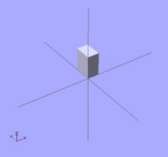

OpenSCAD Simple Cuboid

OpenSCAD after starting

OpenSCAD after pasting the example
code and pressing F5

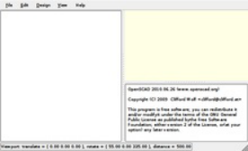

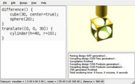

Next: [[../../The OpenSCAD User Interface/]] We have already seen how to create a simple cuboid. Our next task is to attempt to use the

translate positioning command to place an identical cuboid next to the existing cuboid. Type the data as shown below. There are a total of 4

lines of code. Press F5 or F6 function key when done to see the preview.

**Usage example 1 - positioning an object:**

```
cube([2,3,4]);
translate([3,0,0]) {
  cube([2,3,4]);
}

```
#### **There is no semicolon following the translate command**

<!-- PDF page 10 -->

Notice that there is no semicolon following the translate command. This is because the translate

command relates to the following object. If the semicolon was in place, then the effect of the position

translation would end, and the second cuboid would be placed at the same position as the first cuboid.

#### **See Also**

[Previous: Creating a simple model](https://en.wikibooks.org/w/index.php?title=OpenSCAD_User_Manual/Creating_a_simple_model&action=edit&redlink=1)

[Next: Changing the color of an object We can change the color of an object by giving it RGB values.](https://en.wikibooks.org/w/index.php?title=OpenSCAD_User_Manual/Changing_the_color_of_an_object&action=edit&redlink=1)

Instead of the traditional RGB values from 0 to 255 floating point values are used from 0.0 to 1.0.

Note: changing the colors works only in Preview mode (F5); render mode (F6) does not currently

support color.

**Usage example 1 - changing the color of an object:**

```
color([1,0,0]) cube([2,3,4]);
translate([3,0,0])
color([0,1,0]) cube([2,3,4]);
translate([6,0,0])
color([0,0,1]) cube([2,3,4]);

```

Color names can be used in the 2011.12 version (and newer). The names are the same used for Web

colors. For example: color("red") cube();

If you think of the entire command as a sentence, then color() is an "adjective" that describes the

"object" of the sentence (which is a "noun"). In this case, the object is the cube() to be created. The

adjective is placed before the noun in the sentence, like so: color() cube(); . In the same way,

translate() can be thought of as a "verb" that acts upon the object, and is placed like this: translate()

color() cube(); . The following code produces the same result:

```
translate([6,0,0])
{
   color([0,0,1])    // notice that there is NO semicolon
   cube([2,3,4]);    // notice the semicolon is at the end of all
related commands
}

```
#### **See Also**

[Previous: Positioning an object](https://en.wikibooks.org/w/index.php?title=OpenSCAD_User_Manual/Positioning_an_object&action=edit&redlink=1)

[Next: Model views](https://en.wikibooks.org/w/index.php?title=OpenSCAD_User_Manual/Model_views&action=edit&redlink=1)

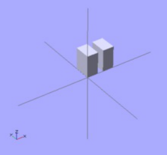

OpenSCAD positioning an object

OpenSCAD changing the color of an
object

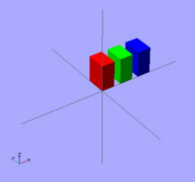

The "View" menu at the top of the OpenSCAD application window provides a variety of view options in the OpenSCAD model view window.

### CGAL surfaces

The surface view is the initial model view that appears when the model code is first rendered. You can get back to this view by choosing "View

>> CGAL Surfaces".

### CGAL grid only

Designers often choose "View >> CGAL Grid Only" when working with a particularly complex 3D model. The Grid Only view presents only the

"scaffolding" beneath the surface, also known as a wireframe. Think of the Eiffel Tower.

A wireframe is a visual presentation of a three dimensional or physical object. This method of modelling consists only of lines, points and

curves defining the edges of an object. Using a wireframe model allows visualization of the underlying design structure of a 3D model. Since

wireframe renderings are relatively simple and fast to calculate, they are often used in cases where a higher screen frame rate is needed (for

instance, when working with a particularly complex 3D model, or in real-time systems that model exterior phenomena). When greater

graphical detail is desired, surface textures can be added automatically after completion of the initial rendering of the wireframe. This allows

the designer to quickly review changes or rotate the object to new desired views without long delays associated with more realistic rendering.

The wireframe format is also well suited and widely used in programming tool paths for DNC (Direct Numerical Control) machine tools.

Wireframe models are also used as the input for CAM (computer-Aided Manufacturing). Wireframe is the most abstract and least realistic of

<!-- PDF page 11 -->

the three main CAD views. <sup>[1]</sup>

### The OpenCSG view

Choosing "View >> OpenCSG" uses the open constructive solid geometry library to generate the model view utilizing OpenGL. If the

OpenCSG library is not available or the video card or drivers do not support OpenGL, then this view does not produce visible output.

### The Thrown Together View

Choosing "View >> Thrown Together" overlays all the previous views together on the same screen. Importantly, objects subtracted by the

difference() command are rendered as solid objects in green (by default).

### See also

[Previous: Changing the color of an object](https://en.wikibooks.org/w/index.php?title=OpenSCAD_User_Manual/Changing_the_color_of_an_object&action=edit&redlink=1)

[Next: Opening an existing example model](https://en.wikibooks.org/w/index.php?title=OpenSCAD_User_Manual/Opening_an_existing_example_model&action=edit&redlink=1)

### References

1. ↑ ["Wire-frame model". Wikipedia. http://en.wikipedia.org/wiki/Wire-frame_model.](https://en.wikipedia.org/wiki/Wire-frame_model)

<!-- PDF page 12 -->

## Chapter 2 -- The OpenSCAD User Interface

#### OpenSCAD User Manual

### User Interface

The user interface of OpenSCAD has three parts

The viewing area

The console window

The text editor

#### **Viewing area**

Preview and rendering output goes into the viewing area. Using the _Show Axes_ menu entry an

indicator for the coordinate axes can be enabled.

#### **Console window**

Status information, warnings and errors are displayed in the console window.

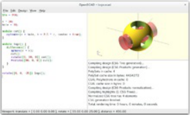

Main Window of OpenSCAD with a
small program generating the
OpenSCAD-Logo.

During a render a progress-bar is displayed at the bottom of the console. It includes a Cancel button to stop the render.

#### **Text editor**

The built-in text editor provides basic editing features like text search & replace and also supports syntax highlighting. There are predefined

color schemes that can be selected in the Preferences dialog.

OpenSCAD Editor with Find / Replace functionality.

### Interactive modification of the numerical value

It is possible to change a numeric value in the source code and observe the result in real time.

Placing the cursor after a digit and pressing Alt+ up arrow or Alt + down arrow will increment or decrement the chosen digit. The object is re-

rendered and displayed in _preview mode_ after each change of the selected number in the source code. The cursor is moved after the next

digit by Alt + right arrow, the further decimal digits are added when needed by moving the cursor after the last digit on the right side. The

cursor is moved left behind the most significant digits of the number by Alt + left arrow.


Key Description <mark>Alt</mark> + <mark>Up Arrow</mark> Increment the numeric value to the left of the cursor and preview the object. <mark>Alt</mark> + <mark>Down Arrow</mark> Decrement the


numeric value to the left of the cursor and preview the object. <mark>Alt</mark> + <mark>Left Arrow</mark> Move the cursor left to more significant digit. <mark>Alt</mark> + <mark>Right Arrow</mark>

Move the cursor right to less significant digit, eventually add one more decimal digit.

### View navigation

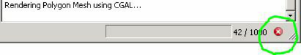

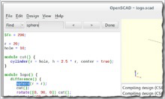

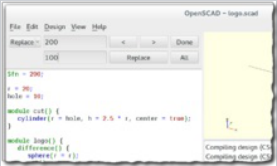

<!-- PDF page 13 -->

The viewing area is navigated primarily using the mouse:


Action Icons Description rotating the view Dragging with the left mouse button rotates the view along the axes of the viewing area. It

preserves the vertical axis' direction.

Double-click the left button to set the point of rotation.


⇧ Shift + Dragging with the left mouse button when the shift key is pressed rotates the view along the vertical axis and the axis pointing


towards the user. moving the viewing area Dragging with the right mouse button moves the viewing area. zooming Using the


scroll wheel Dragging with the middle mouse button ⇧ Shift + Dragging with the right or middle mouse button and the shift key


pressed <mark>⇧</mark> <mark>Shift</mark> + _+_ and _-_ The keys _+_ and _-_ rotation reset <mark>Ctrl</mark> <mark>+</mark> 0 Rotation can be reset using the shortcut <mark>Ctrl</mark> <mark>+</mark> 0 . translation


reset Ctrl <mark>+</mark> ⇧ Shift <mark>+</mark> 0 Translation can be reset using the shortcut Ctrl <mark>+</mark> ⇧ Shift <mark>+</mark> 0 .

### View setup

The viewing area can be configured to use different rendering methods and other options using the View menu. Most of the options described

here are available using shortcuts as well.

#### **Render modes**

**OpenCSG (F9)**

This method produces instantaneous results, but has low frame rates when working with highly nonconvex objects.

Selecting the OpenCSG mode using F9 switches to the last generated OpenCSG view, but does not re-evaluate the source code. You may

want to use the _Compile_ function (F5, found in the _Design_ menu) to re-evaluate the source code, build the OpenCSG objects and _then_ switch

to OpenCSG view.

**Implementation Details**

[In OpenCSG mode, the OpenCSG library is used for generating the visible model. This library uses advanced OpenGL features (2.0) like the](http://opencsg.org/)

Z buffer and does not require an explicit description of the resulting mesh – instead, it tracks how objects are to be combined. For example,

when rendering a spherical dent in a cube, it first renders the cube on the graphics card and then render the sphere, but instead of using the Z

buffer to **hide** the parts of the sphere that are covered by the cube, it renders **only** those parts of the sphere, visually resulting in a cube with

a spherical dent.

**CGAL (Surfaces and Grid, F10 and F11)**

This method might need some time when first used with a new program, but then has higher frame rates.

As before with OpenCSG, F10 and F11 enable only CGAL display mode and don't update the underlying objects; for that, use the _Compile_

_and Render_ function (F6, found in the _Design_ menu).

To combine the benefits of those two display methods, you can selectively wrap parts of your program in a [render function and force them to](https://en.wikibooks.org/wiki/OpenSCAD_User_Manual/The_OpenSCAD_Language#render)

be baken into a mesh even with OpenCSG mode enabled.

**Implementation Details**

The acronym CGAL refers to The Open Source Computational Geometry Algorithms Library.

In CGAL mode, the CGAL library is used to compute the mesh of the root object, which is then displayed using simple OpenGL.

#### **View options**

**_Show Edges_** **(Ctrl+1)**

If _Show Edges_ is enabled, both OpenCSG and CGAL mode render edges as well as

faces; CGAL even shows vertices. In CGAL grid mode, this option has no effect.

Enabling this option shows the difference between OpenCSG and CGAL quite clearly:

While in CGAL mode you see an edge drawn everywhere it "belongs", OpenCSG does

not show edges resulting from boolean operations – this is because they were never

explicitly calculated but are just where one object's Z clipping begins or ends.

**_Show Axes_** **(Ctrl+2)**

If _Show Axes_ is enabled, the origin of the global coordinate system is indicated by an

orthogonal axes indicator. Additionally, a smaller axes indicator with axes names are

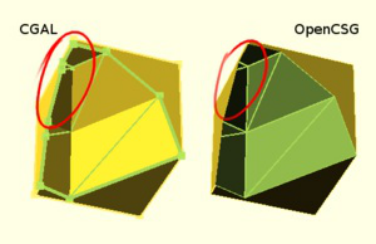

The difference between the CGAL and OpenCSG

<!-- PDF page 14 -->

shown in the lower left corner of the viewing area. The smaller axes indicator is marked approaches can be seen at edges created by boolean
operations.

x, y, z and coloured red, green, blue respectively.

**_Show Crosshairs_** **(Ctrl+3)**

If _Show Crosshairs_ is enabled, the center of the viewport is indicated by four lines pointing in the room diagonal directions of the global

coordinate system. This is useful when aligning the viewing area to a particular point in the model to keep it centered on screen during

rotation.

#### **Animation**

The _Animate_ option adds an animation bar to the lower edge of the screen. As soon as _FPS_ and _Steps_ are set (reasonable values to begin

with are 10 and 100, respectively), the current _Time_ is incremented by 1/ _Steps_, _FPS_ times per second, until it reaches 1, when it wraps back

to 0.

Every time _Time_ is changed, the program is re-evaluated with the variable $t set to the current time. Read more about how $t is used in

[section Other_Language_Features.](https://en.wikibooks.org/wiki/OpenSCAD_User_Manual/Other_Language_Features#$t)

#### **View alignment**

The menu items _Top, Bottom, …, Diagonal_ and _Center_ (Ctrl+4, Ctrl+5, …, Ctrl+0, Ctrl+Shift+0) align the view to the global coordinate system.

_Top, Bottom, Left, Right, Front_ and _Back_ align it in parallel to the axes, the _Diagonal_ option aligns it diagonally as it is aligned when

OpenSCAD starts.

The _Center_ option puts the coordinate center in the middle of the screen (but not rotate the view).

By default, the view is in _Perspective_ mode, meaning that distances far away from the viewer appear shorter, as seen in the real world eyes or

cameras. When the view mode is changed to _Orthogonal_, visible distances do not depend on the camera distance (the view simulates a

camera at an infinite distance with an infinite focal length). This is especially useful in combination with the _Top_ etc. options described above,

as these orthogonal views result in a 2D images similar to what one would see in an engineering drawing.

### Dodecahedron

```
//create a dodecahedron by intersecting 6 boxes
module dodecahedron(height)
{
    scale([height,height,height]) //scale by height parameter
    {
        intersection(){
            //make a cube
            cube([2,2,1], center = true);
            intersection_for(i=[0:4]) //loop i from 0 to 4, and intersect results
            {
                //make a cube, rotate it 116.565 degrees around the X axis,
                //then 72*i around the Z axis
                rotate([0,0,72*i])
                    rotate([116.565,0,0])
                    cube([2,2,1], center = true);
            }
        }
    }
}
//create 3 stacked dodecahedra
//call the module with a height of 1 and move up 2
translate([0,0,2])dodecahedron(1);
//call the module with a height of 2
dodecahedron(2);
//call the module with a height of 4 and move down 4
translate([0,0,-4])dodecahedron(4);

```
### Icosahedron

An icosahedron can be created from three orthogonal [golden-ratio rectangles inside a](https://en.wikipedia.org/wiki/Golden_ratio) hull() operation, where the golden ratio is

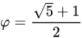

.

<!-- PDF page 15 -->

```
phi=0.5*(sqrt(5)+1); // golden ratio

// create an icosahedron by intersecting 3 orthogonal golden-ratio
rectangles
module icosahedron(edge_length) {
   st=0.0001;  // microscopic sheet thickness
   hull() {
       cube([edge_length*phi, edge_length, st], true);
       rotate([90,90,0]) cube([edge_length*phi, edge_length, st],
true);
       rotate([90,0,90]) cube([edge_length*phi, edge_length, st],
true);
   }
}

// display the 3 internal sheets alongside the icosahedron
edge=10;
translate([-20,0,0]) union() {
   cube([edge*phi, edge, 0.01], true);
   rotate([90,90,0]) cube([edge*phi, edge, 0.01], true);
   rotate([90,0,90]) cube([edge*phi, edge, 0.01], true);
}

icosahedron(edge);

```

This icosahedron renders in an edge-up orientation. Rotating this icosahedron by

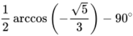

about the Y-axis results in a vertex-up orientation. Rotating by about the

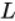

X-axis results in a face-up orientation. The edge length  is related to the inner diameter

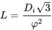

(distance between opposite faces) by .

### Half-pyramid


The Dodecahedron as rendered from
the example.

The icosahedron and its internal
structure as rendered from the example.

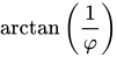


An upside-down half-pyramid is a useful shape for 3D printing a support for an overhang protruding from a vertical wall. With sloping sides no

steeper than 45°, no removable support structure needs to be printed.

While a half-pyramid can be made with a 4-sided cone (using the cylinder primitive) and subtracting a cube from half of it, the shape can be

easily made in one operation by a scaled linear extrude of a rectangle having the middle of one edge on the origin.

```
// Create a half-pyramid from a single linear extrusion
module halfpyramid(base, height) {
   linear_extrude(height, scale=0.01)
      translate([-base/2, 0, 0]) square([base, base/2]);
}

halfpyramid(20, 10);

```
### Bounding Box

The half-pyramid as rendered from the
example.

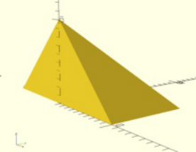

<!-- PDF page 16 -->

```
// Rather kludgy module for determining bounding box from intersecting projections
module BoundingBox()
{
    intersection()
    {
        translate([0,0,0])
        linear_extrude(height = 1000, center = true, convexity = 10, twist = 0)
        projection(cut=false) intersection()
        {
            rotate([0,90,0])
            linear_extrude(height = 1000, center = true, convexity = 10, twist = 0)
            projection(cut=false)
            rotate([0,-90,0])
            children(0);

            rotate([90,0,0])
            linear_extrude(height = 1000, center = true, convexity = 10, twist = 0)
            projection(cut=false)
            rotate([-90,0,0])
            children(0);
        }
        rotate([90,0,0])
        linear_extrude(height = 1000, center = true, convexity = 10, twist = 0)
        projection(cut=false)
        rotate([-90,0,0])
        intersection()
        {
            rotate([0,90,0])
            linear_extrude(height = 1000, center = true, convexity = 10, twist = 0)
            projection(cut=false)
            rotate([0,-90,0])
            children(0);

            rotate([0,0,0])
            linear_extrude(height = 1000, center = true, convexity = 10, twist = 0)
            projection(cut=false)
            rotate([0,0,0])
            children(0);
        }
    }
}

// Test module on ellipsoid
translate([0,0,40]) scale([1,2,3]) sphere(r=5);
BoundingBox() scale([1,2,3]) sphere(r=5);

```
### Linear Extrude extended use examples

#### **Linear Extrude with Scale as an interpolated function**

Bounding Box applied to an Ellipsoid


<!-- PDF page 17 -->

```
//Linear Extrude with Scale as an interpolated function
// This module does not need to be modified,
// - unless default parameters want to be changed
// - or additional parameters want to be forwarded (e.g. slices,...)
module linear_extrude_fs(height=1,isteps=20,twist=0){
 //union of piecewise generated extrudes
 union(){
   for(i = [ 0: 1: isteps-1]){
     //each new piece needs to be adjusted for height
     translate([0,0,i*height/isteps])
      linear_extrude(
       height=height/isteps,
       twist=twist/isteps,
       scale=f_lefs((i+1)/isteps)/f_lefs(i/isteps)
      )
       // if a twist constant is defined it is split into pieces
       rotate([0,0,-(i/isteps)*twist])
        // each new piece starts where the last ended
        scale(f_lefs(i/isteps))
         obj2D_lefs();
   }
 }
}
// This function defines the scale function
// - Function name must not be modified
// - Modify the contents/return value to define the function
function f_lefs(x) =
 let(span=150,start=20,normpos=45)
 sin(x*span+start)/sin(normpos);
// This module defines the base 2D object to be extruded
// - Function name must not be modified
// - Modify the contents to define the base 2D object
module obj2D_lefs(){
 translate([-4,-3])
  square([9,12]);
}

//Top rendered object demonstrating the interpolation steps
translate([0,0,25])
linear_extrude_fs(height=20,isteps=4);

linear_extrude_fs(height=20);

//Bottom rendered object demonstrating the inclusion of a twist
translate([0,0,-25])
linear_extrude_fs(height=20,twist=90,isteps=30);

```
#### **Linear Extrude with Twist as an interpolated function**


Example Linear Extrude of a rectangle
with scale following part of a sine curve
function

<!-- PDF page 18 -->

```
//Linear Extrude with Twist as an interpolated function
// This module does not need to be modified,
// - unless default parameters want to be changed
// - or additional parameters want to be forwarded (e.g. slices,...)
module linear_extrude_ft(height=1,isteps=20,scale=1){
  //union of piecewise generated extrudes
  union(){
    for(i = [ 0: 1: isteps-1]){
      //each new piece needs to be adjusted for height
      translate([0,0,i*height/isteps])
       linear_extrude(
        height=height/isteps,
        twist=f_left((i+1)/isteps)-f_left((i)/isteps),
        scale=(1-(1-scale)*(i+1)/isteps)/(1-(1-scale)*i/isteps)
       )
        //Rotate to next start point
        rotate([0,0,-f_left(i/isteps)])
         //Scale to end of last piece size
         scale(1-(1-scale)*(i/isteps))
          obj2D_left();
    }
  }
}
// This function defines the twist function
// - Function name must not be modified
// - Modify the contents/return value to define the function
function f_left(x) =
  let(twist=90,span=180,start=0)
  twist*sin(x*span+start);
// This module defines the base 2D object to be extruded
// - Function name must not be modified
// - Modify the contents to define the base 2D object
module obj2D_left(){
  translate([-4,-3])
   square([12,9]);
}

//Left rendered object demonstrating the interpolation steps
translate([-20,0])
linear_extrude_ft(height=30,isteps=5);

linear_extrude_ft(height=30);

//Right rendered object demonstrating the scale inclusion
translate([25,0])
linear_extrude_ft(height=30,scale=3);

```
#### **Linear Extrude with Twist and Scale as interpolated functions**

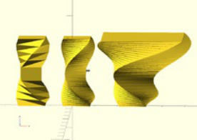

Example Linear Extrude of a rectangle
with twist following part of a sine curve
function

<!-- PDF page 19 -->

```
//Linear Extrude with Twist and Scale as interpolated functions
// This module does not need to be modified,
// - unless default parameters want to be changed
// - or additional parameters want to be forwarded
module linear_extrude_ftfs(height=1,isteps=20,slices=0){
  //union of piecewise generated extrudes
  union(){
   for(i=[0:1:isteps-1]){
    translate([0,0,i*height/isteps])
     linear_extrude(
      height=height/isteps,
      twist=leftfs_ftw((i+1)/isteps)-leftfs_ftw(i/isteps),
      scale=leftfs_fsc((i+1)/isteps)/leftfs_fsc(i/isteps),
      slices=slices
     )
      rotate([0,0,-leftfs_ftw(i/isteps)])
       scale(leftfs_fsc(i/isteps))
        obj2D_leftfs();
   }
  }
}
// This function defines the scale function
// - Function name must not be modified
// - Modify the contents/return value to define the function
function leftfs_fsc(x)=
  let(scale=3,span=140,start=20)
  scale*sin(x*span+start);
// This function defines the twist function
// - Function name must not be modified
// - Modify the contents/return value to define the function
function leftfs_ftw(x)=
  let(twist=30,span=360,start=0)
  twist*sin(x*span+start);
// This module defines the base 2D object to be extruded
// - Function name must not be modified
// - Modify the contents to define the base 2D object
module obj2D_leftfs(){
   square([12,9]);
}

//Left rendered objects demonstrating the steps effect
translate([0,-50,-60])
rotate([0,0,90])
linear_extrude_ftfs(height=50,isteps=3);

translate([0,-50,0])
linear_extrude_ftfs(height=50,isteps=3);

//Center rendered objects demonstrating the slices effect
translate([0,0,-60])
rotate([0,0,90])
linear_extrude_ftfs(height=50,isteps=3,slices=20);

linear_extrude_ftfs(height=50,isteps=3,slices=20);

//Right rendered objects with default parameters
translate([0,50,-60])
rotate([0,0,90])
linear_extrude_ftfs(height=50);

translate([0,50,0])
linear_extrude_ftfs(height=50);

```
### Rocket

<!-- PDF page 20 -->

```
// increase the visual detail
$fn = 100;

// the main body :
// a cylinder
rocket_d = 30;                 // 3 cm wide
rocket_r = rocket_d / 2;
rocket_h = 100;             // 10 cm tall
cylinder(d = rocket_d, h = rocket_h);

// the head :
// a cone
head_d = 40;                  // 4 cm wide
head_r = head_d / 2;
head_h = 40;                  // 4 cm tall
// prepare a triangle
tri_base = head_r;
tri_height = head_h;
tri_points = [[0,             0],
              [tri_base,     0],
              [0,    tri_height]];
// rotation around X-axis and then 360° around Z-axis
// put it on top of rocket's body
translate([0,0,rocket_h])
rotate_extrude(angle = 360)
    polygon(tri_points);

// the wings :
// 3x triangles
wing_w = 2;                    // 2 mm thick
many = 3;                    // 3x wings
wing_l = 40;                // length
wing_h = 40;                // height
wing_points = [[0,0],[wing_l,0],[0,wing_h]];

module wing() {
    // let it a bit inside the main body
    in_by = 1;                // 1 mm
    // set it up on the rocket's perimeter
    translate([rocket_r - in_by,0,0])
    // set it upright by rotating around X-axis
    rotate([90,0,0])
    // set some width and center it
    linear_extrude(height = wing_w,center = true)
    // make a triangle
        polygon(wing_points);
}

for (i = [0: many - 1])
    rotate([0, 0, 360 / many * i])
    wing();

```
### Horns


Example Linear Extrude of a rectangle
with twist and scale following part of a
sine curve function

A rocket using rotate_extrude()

Horns, by translation and twisting.

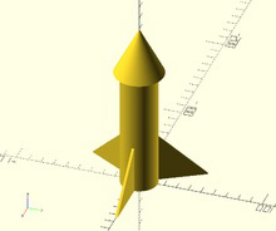

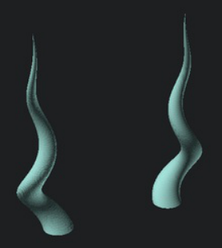

<!-- PDF page 21 -->

```
// The idea is to twist a translated circle:
// -
/*
    linear_extrude(height = 10, twist = 360, scale = 0)
    translate([1,0])
    circle(r = 1);
*/

module horn(height = 10, radius = 3,
            twist = 720, $fn = 50)
{
    // A centered circle translated by 1xR and
    // twisted by 360° degrees, covers a 2x(2xR) space.
    // -
    radius = radius/4;
    // De-translate.
    // -
    translate([-radius,0])
    // The actual code.
    // -
    linear_extrude(height = height, twist = twist,
                   scale=0, $fn = $fn)
    translate([radius,0])
    circle(r=radius);
}

translate([3,0])
mirror()
horn();

translate([-3,0])
horn();

```
### Strandbeest

[See the Strandbeest example here.](https://en.wikibooks.org/wiki/OpenSCAD_User_Manual/Example/Strandbeest)

### Previous

[Other 2D formats](https://en.wikibooks.org/wiki/OpenSCAD_User_Manual/Other_2D_formats)

### Next

[Paths](https://en.wikibooks.org/wiki/OpenSCAD_User_Manual/Paths)

#### **Command line usage**

OpenSCAD can not only be used as a GUI, but also handles command line arguments. Its usage line says:

OpenSCAD 2019.05 has these options:

<!-- PDF page 22 -->

```
 Usage: openscad [options] file.scad
 Allowed options:
   -o [ --o ] arg               output specified file instead of running the
                                GUI, the file extension specifies the type: stl,
                                off, amf, 3mf, csg, dxf, svg, png, echo, ast,
                                term, nef3, nefdbg

   -D [ --D ] arg               var=val -pre-define variables
   -p [ --p ] arg               customizer parameter file
   -P [ --P ] arg               customizer parameter set
   -h [ --help ]                print this help message and exit
   -v [ --version ]             print the version
   --info                       print information about the build process

   --camera arg                 camera parameters when exporting png:
                                =translate_x,y,z,rot_x,y,z,dist or
                                =eye_x,y,z,center_x,y,z
   --autocenter                 adjust camera to look at object's center
   --viewall                    adjust camera to fit object
   --imgsize arg                =width,height of exported png
   --render arg                 for full geometry evaluation when exporting png
   --preview arg                [=throwntogether] -for ThrownTogether preview
                                png
   --view arg                   =view options: axes | crosshairs | edges |
                                scales | wireframe
   --projection arg             =(o)rtho or (p)erspective when exporting png
   --csglimit arg               =n -stop rendering at n CSG elements when
                                exporting png
   --colorscheme arg            =colorscheme: *Cornfield | Metallic | Sunset |
                                Starnight | BeforeDawn | Nature | DeepOcean |
                                Solarized | Tomorrow | Tomorrow 2 | Tomorrow
                                Night | Monotone

   -d [ --d ] arg               deps_file -generate a dependency file for make
   -m [ --m ] arg               make_cmd -runs make_cmd file if file is missing
   -q [ --quiet ]               quiet mode (don't print anything *except*
                                errors)
   --hardwarnings               Stop on the first warning
   --check-parameters arg       =true/false, configure the parameter check for
                                user modules and functions
   --check-parameter-ranges arg =true/false, configure the parameter range check
                                for builtin modules
   --debug arg                  special debug info
   -s [ --s ] arg               stl_file deprecated, use -o
   -x [ --x ] arg               dxf_file deprecated, use -o

```

OpenSCAD 2015.03-1 has these options:

```
openscad     [ -o output_file [ -d deps_file ] ]\
             [ -m make_command ] [ -D var=val [..] ] \
             [ --help ] print this help message and exit \
             [ --version ] [ --info ] \
             [ --camera=translatex,y,z,rotx,y,z,dist | \
               --camera=eyex,y,z,centerx,y,z ] \
             [ --autocenter ] \
             [ --viewall ] \
             [ --imgsize=width,height ] [ --projection=(o)rtho|(p)ersp] \
             [ --render | --preview[=throwntogether] ] \
             [ --colorscheme=[Cornfield|Sunset|Metallic|Starnight|BeforeDawn|Nature|DeepOcean] ] \
             [ --csglimit=num ]\
             filename

```

OpenSCAD 2014.03+ has these options:

<!-- PDF page 23 -->

```
openscad     [ -o output_file [ -d deps_file ] ]\
             [ -m make_command ] [ -D var=val [..] ] \
             [ --version ] [ --info ] \
             [ --camera=translatex,y,z,rotx,y,z,dist | \
               --camera=eyex,y,z,centerx,y,z ] \
             [ --imgsize=width,height ] [ --projection=(o)rtho|(p)ersp] \
             [ --render | --preview[=throwntogether] ] \
             [ --csglimit=num ] \
             filename

```

Openscad 2013.05 had these options:

```
openscad     [ -o output_file [ -d deps_file ] ]\
             [ -m make_command ] [ -D var=val [..] ] [ --render ] \
             [ --camera=translatex,y,z,rotx,y,z,dist | \
               --camera=eyex,y,z,centerx,y,z ] \
             [ --imgsize=width,height ] [ --projection=(o)rtho|(p)ersp] \
             filename

```

Earlier releases had only these:

```
openscad [ -o output_file [ -d deps_file ] ] \
         [ -m make_command ] [ -D var=val [..] ] filename

```

The usage on OpenSCAD version 2011.09.30 (now deprecated) was:

```
openscad [ { -s stl_file | -o off_file | -x dxf_file } [ -d deps_file ] ]\
         [ -m make_command ] [ -D var=val [..] ] filename

```
#### **Export options**

When called with the -o option, OpenSCAD does not start the GUI, but executes the given file and exports to the _output_file_ in a format

depending on the extension ( .stl / .off / .dxf, .csg ).

Some versions use -s/-d/-o to determine the output file format instead; check with "openscad --help".

If the option -d is given in addition to an export command, all files accessed while building the mesh are written in the argument of -d in the

syntax of a Makefile.

For at least 2015.03-2+, specifying the extension .echo causes openscad to produce a text file containing error messages and the output of

all echo() calls in filename as they would appear in the console window visible in the GUI. Multiple output files are not supported, so using

this option you cannot also obtain the model that would have normally been generated.

**Camera and image output**

For 2013.05+, the option to output a .png image was added. There are two types of cameras available for the generation of images.

The first camera type is a 'gimbal' camera that uses Euler angles, translation, and a camera distance, like OpenSCAD's GUI viewport display

at the bottom of the OpenSCAD window.

The second camera type is a 'vector' camera, with an 'eye' camera location vector and a 'lookat' center vector.

--imgsize x,y chooses the .png dimensions and --projection chooses orthogonal or perspective, as in the GUI.

By default, cmdline .png output uses Preview mode (f5) with OpenCSG. For some situations it may be desirable to output the full render, with

CGAL. This is done by adding '--render' as an option.

#### **Constants**

In order to pre-define variables, use the -D option. It can be given repeatedly. Each occurrence of -D must be followed by an assignment.

Unlike normal OpenSCAD assignments, these assignments don't define variables, but constants, which cannot be changed inside the

program, and can thus be used to overwrite values defined in the program at export time.

If you want to assign the -D variable to another variable, the -D variable MUST be initialized in the main .scad program

<!-- PDF page 24 -->

```
param1=17;       // must be initialized
val=param1;      // param1 passed via -D on cmd-line
echo(val,param1); // outputs 17,17

```

without the first line, val would be undefined.

The right hand sides can be arbitrary OpenSCAD expressions, including mathematical operations and strings.

Be aware that your shell (bash, cmd, etc.) parses the arguments before passing them to openscad, therefore you need to properly quote or

escape arguments with special characters like spaces or quotation marks. For example to assign a string production to a quality parameter

one has to ensure the " characters OpenSCAD expects aren't stripped by the shell. In bash one could write:

```
openscad -o my_model_production.stl -D 'quality="production"' my_model.scad

```

or from the Windows prompt:

```
openscad.com -o my_model_production.stl -D "quality=""production""" my_model.scad

```

or you may need to escape the inner quotes instead:

```
openscad -o my_model_production.stl -D "quality=\"production\"" my_model.scad

```

Note that this sort of double-escaping isn't necessary when executing OpenSCAD from another process that isn't using a shell, because each

argument is passed separately. For example a Java application might start a process like so:

```
   pb = new ProcessBuilder("/usr/bin/openscad",
     "-o", "my_model_production.stl",
     "-D", "quality=\"production\"",
     "my_model.scad");

```
#### **Command to build required files**

In a complex build process, some missing files required by an OpenSCAD file can be generated if they are defined in a Makefile. If

OpenSCAD is given the option -m make, it starts make _file_ the first time it tries to access a missing _file_ .

#### **Processing all .scad files in a folder**

Example to convert all the .scad in a folder into .stl:

In a folder with .scad files, make a .bat file with text:

```
   FOR %%f in (*.scad)  DO openscad -o "%%~nf.stl" "%%f"

```

If it closes without processing, check to set the PATH by adding openscad directory to:

```
     Start - Settings - Control Panel - System - Advanced tab - Environment Variables - System
Variables, select Path, then click Edit.

```

Add the openscad directory to the list

#### **Makefile example**

The -d and -m options only make sense together. ( -m without -d would not consider modified dependencies when building exports, -d

without -m would require the files to be already built for the first run that generates the dependencies.)

Here is an example of a basic Makefile that creates an .stl file from an .scad file of the same name:

<!-- PDF page 25 -->

```
# explicit wildcard expansion suppresses errors when no files are found
include $(wildcard *.deps)

%.stl: %.scad
    openscad -m make -o $@ -d $@.deps $<

```

When make my_example.stl is run for the first time, it finds no .deps files, and must depend on my_example.scad . Because

my_example.stl is not yet preset, it gets created unconditionally. If OpenSCAD finds missing files, it calls make to build them, and it lists all

used files in my_example.stl.deps .

When make my_example.stl is called subsequently, it finds and includes my_example.stl.deps and check if any of the files listed there,

including my_example.scad, changed since my_example.stl was built, based on their time stamps. Only if that is the case, it builds

my_example.stl again.

**Automatic targets**

When building similar .stl files from a single .scad file, there is a way to automate that too:

```
# match "module foobar() { // `make` me"
TARGETS=$(shell sed '/^module [a-z0-9_-]*().*make..\?me.*$$/!d;s/module //;s/().*/.stl/' base.scad)

all: ${TARGETS}

# auto-generated .scad files with .deps make make re-build always. keeping the
# scad files solves this problem. (explanations are welcome.)
.SECONDARY: $(shell echo "${TARGETS}" | sed 's/\.stl/.scad/g')

# explicit wildcard expansion suppresses errors when no files are found
include $(wildcard *.deps)

%.scad:
    echo -ne 'use <base.scad>\n$*();' > $@

%.stl: %.scad
    openscad -m make -o $@ -d $@.deps $<

```

All objects that are supposed to be exported automatically have to be defined in base.scad in an own module with their future file name

(without the ".stl"), and have a comment like " // make me " in the line of the module definition. The " TARGETS= " line picks these out of the

base file and creates the file names. These are built when make all (or make, for short) is called.

As the convention from the last example is to create the .stl files from .scad files of the same base name, for each of these files, an .scad file

must be generated. This is done in the " %.scad: " paragraph; my_example.scad is a simple OpenSCAD file:

```
use <base.scad>
my_example();

```

The " .SECONDARY " line is there to keep make from deleting the generated .scad files. Its presence helps determine which files no longer

[need to be rebuilt; please post ideas about what exactly goes wrong there (or how to fix it better) on the talk page!](https://en.wikibooks.org/wiki/Talk:OpenSCAD_User_Manual/Using_OpenSCAD_in_a_command_line_environment)

#### **Windows notes**

On Windows, openscad.com should be called from the command line as a wrapper for openscad.exe. This is because Openscad uses the

'devenv' solution to the Command-Line/GUI output issue. Typing 'openscad' at the cmd.exe prompt calls the .com program wrapper by default.

#### **MacOS notes**

On MacOS the binary is normally hidden inside the App folder. If OpenSCAD is installed in the global Applications folder, it can be called from

command line like in the following example that just shows the OpenSCAD version:

```
macbook:/$ /Applications/OpenSCAD.app/Contents/MacOS/OpenSCAD -v
OpenSCAD version 2013.06

```

Alternatively, you may create a symbolic link to the binary to make calls from the command line easier:

<!-- PDF page 26 -->

```
 macbook:/$ sudo ln -sf /Applications/OpenSCAD.app/Contents/MacOS/OpenSCAD /usr/local/bin/openscad

```

Now you can call openscad directly without having to type in the full path.

```
 macbook:/$ openscad -v
 OpenSCAD version 2015.03-3

```

On some versions of MacOS, you might get the following error when attempting to run openscad via that link:

```
 This application failed to start because it could not find or load the Qt platform plugin "cocoa".

 Reinstalling the application may fix this problem.
 Abort trap: 6

```

You can fix this by creating a wrapper script to invoke the executable directly:

```
 sudo rm -f /usr/local/bin/openscad
 echo '#!/bin/sh' > test
 echo '/Applications/OpenSCAD.app/Contents/MacOS/OpenSCAD $*' >> test
 chmod +x test ; sudo mv test /usr/local/bin/openscad

```

<!-- PDF page 27 -->

## Chapter 3 -- Commented Example Projects

#### OpenSCAD User Manual

### Dodecahedron

```
//create a dodecahedron by intersecting 6 boxes
module dodecahedron(height)
{
    scale([height,height,height]) //scale by height parameter
    {
        intersection(){
            //make a cube
            cube([2,2,1], center = true);
            intersection_for(i=[0:4]) //loop i from 0 to 4, and intersect results
            {
                //make a cube, rotate it 116.565 degrees around the X axis,
                //then 72*i around the Z axis
                rotate([0,0,72*i])
                    rotate([116.565,0,0])
                    cube([2,2,1], center = true);
            }
        }
    }
}
//create 3 stacked dodecahedra
//call the module with a height of 1 and move up 2
translate([0,0,2])dodecahedron(1);
//call the module with a height of 2
dodecahedron(2);
//call the module with a height of 4 and move down 4
translate([0,0,-4])dodecahedron(4);

```
### Icosahedron

An icosahedron can be created from three orthogonal [golden-ratio rectangles inside a](https://en.wikipedia.org/wiki/Golden_ratio) hull()


operation, where the golden ratio is .

```
phi=0.5*(sqrt(5)+1); // golden ratio

```

```
// create an icosahedron by intersecting 3 orthogonal golden-ratio
rectangles
module icosahedron(edge_length) {
   st=0.0001;  // microscopic sheet thickness
   hull() {
       cube([edge_length*phi, edge_length, st], true);
       rotate([90,90,0]) cube([edge_length*phi, edge_length, st],
true);
       rotate([90,0,90]) cube([edge_length*phi, edge_length, st],
true);
   }
}

// display the 3 internal sheets alongside the icosahedron
edge=10;
translate([-20,0,0]) union() {
   cube([edge*phi, edge, 0.01], true);
   rotate([90,90,0]) cube([edge*phi, edge, 0.01], true);
   rotate([90,0,90]) cube([edge*phi, edge, 0.01], true);
}

icosahedron(edge);

```

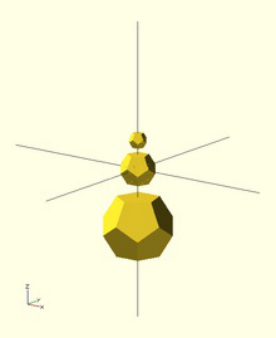

The Dodecahedron as rendered from
the example.

<!-- PDF page 28 -->


This icosahedron renders in an edge-up orientation. Rotating this icosahedron by about the Y-axis results in a vertex-up


orientation. Rotating by about the X-axis results in a face-up orientation.


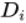

The edge length  is related to the inner diameter (distance between opposite faces) by

.

The icosahedron and its internal
structure as rendered from the example.

### Half-pyramid

An upside-down half-pyramid is a useful shape for 3D printing a support for an overhang protruding from a vertical wall. With sloping sides no

steeper than 45°, no removable support structure needs to be printed.

While a half-pyramid can be made with a 4-sided cone (using the cylinder primitive) and subtracting a cube from half of it, the shape can be

easily made in one operation by a scaled linear extrude of a rectangle having the middle of one edge on the origin.

```
// Create a half-pyramid from a single linear extrusion
module halfpyramid(base, height) {
   linear_extrude(height, scale=0.01)
      translate([-base/2, 0, 0]) square([base, base/2]);
}

halfpyramid(20, 10);

```
### Bounding Box

The half-pyramid as rendered from the
example.

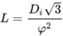


<!-- PDF page 29 -->

```
// Rather kludgy module for determining bounding box from intersecting projections
module BoundingBox()
{
    intersection()
    {
        translate([0,0,0])
        linear_extrude(height = 1000, center = true, convexity = 10, twist = 0)
        projection(cut=false) intersection()
        {
            rotate([0,90,0])
            linear_extrude(height = 1000, center = true, convexity = 10, twist = 0)
            projection(cut=false)
            rotate([0,-90,0])
            children(0);

            rotate([90,0,0])
            linear_extrude(height = 1000, center = true, convexity = 10, twist = 0)
            projection(cut=false)
            rotate([-90,0,0])
            children(0);
        }
        rotate([90,0,0])
        linear_extrude(height = 1000, center = true, convexity = 10, twist = 0)
        projection(cut=false)
        rotate([-90,0,0])
        intersection()
        {
            rotate([0,90,0])
            linear_extrude(height = 1000, center = true, convexity = 10, twist = 0)
            projection(cut=false)
            rotate([0,-90,0])
            children(0);

            rotate([0,0,0])
            linear_extrude(height = 1000, center = true, convexity = 10, twist = 0)
            projection(cut=false)
            rotate([0,0,0])
            children(0);
        }
    }
}

// Test module on ellipsoid
translate([0,0,40]) scale([1,2,3]) sphere(r=5);
BoundingBox() scale([1,2,3]) sphere(r=5);

```
### Linear Extrude extended use examples

#### **Linear Extrude with Scale as an interpolated function**

Bounding Box applied to an Ellipsoid


<!-- PDF page 30 -->

```
//Linear Extrude with Scale as an interpolated function
// This module does not need to be modified,
// - unless default parameters want to be changed
// - or additional parameters want to be forwarded (e.g. slices,...)
module linear_extrude_fs(height=1,isteps=20,twist=0){
 //union of piecewise generated extrudes
 union(){
   for(i = [ 0: 1: isteps-1]){
     //each new piece needs to be adjusted for height
     translate([0,0,i*height/isteps])
      linear_extrude(
       height=height/isteps,
       twist=twist/isteps,
       scale=f_lefs((i+1)/isteps)/f_lefs(i/isteps)
      )
       // if a twist constant is defined it is split into pieces
       rotate([0,0,-(i/isteps)*twist])
        // each new piece starts where the last ended
        scale(f_lefs(i/isteps))
         obj2D_lefs();
   }
 }
}
// This function defines the scale function
// - Function name must not be modified
// - Modify the contents/return value to define the function
function f_lefs(x) =
 let(span=150,start=20,normpos=45)
 sin(x*span+start)/sin(normpos);
// This module defines the base 2D object to be extruded
// - Function name must not be modified
// - Modify the contents to define the base 2D object
module obj2D_lefs(){
 translate([-4,-3])
  square([9,12]);
}

//Top rendered object demonstrating the interpolation steps
translate([0,0,25])
linear_extrude_fs(height=20,isteps=4);

linear_extrude_fs(height=20);

//Bottom rendered object demonstrating the inclusion of a twist
translate([0,0,-25])
linear_extrude_fs(height=20,twist=90,isteps=30);

```
#### **Linear Extrude with Twist as an interpolated function**

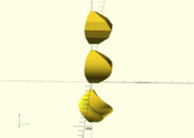

Example Linear Extrude of a rectangle
with scale following part of a sine curve
function

<!-- PDF page 31 -->

```
//Linear Extrude with Twist as an interpolated function
// This module does not need to be modified,
// - unless default parameters want to be changed
// - or additional parameters want to be forwarded (e.g. slices,...)
module linear_extrude_ft(height=1,isteps=20,scale=1){
  //union of piecewise generated extrudes
  union(){
    for(i = [ 0: 1: isteps-1]){
      //each new piece needs to be adjusted for height
      translate([0,0,i*height/isteps])
       linear_extrude(
        height=height/isteps,
        twist=f_left((i+1)/isteps)-f_left((i)/isteps),
        scale=(1-(1-scale)*(i+1)/isteps)/(1-(1-scale)*i/isteps)
       )
        //Rotate to next start point
        rotate([0,0,-f_left(i/isteps)])
         //Scale to end of last piece size
         scale(1-(1-scale)*(i/isteps))
          obj2D_left();
    }
  }
}
// This function defines the twist function
// - Function name must not be modified
// - Modify the contents/return value to define the function
function f_left(x) =
  let(twist=90,span=180,start=0)
  twist*sin(x*span+start);
// This module defines the base 2D object to be extruded
// - Function name must not be modified
// - Modify the contents to define the base 2D object
module obj2D_left(){
  translate([-4,-3])
   square([12,9]);
}

//Left rendered object demonstrating the interpolation steps
translate([-20,0])
linear_extrude_ft(height=30,isteps=5);

linear_extrude_ft(height=30);

//Right rendered object demonstrating the scale inclusion
translate([25,0])
linear_extrude_ft(height=30,scale=3);

```
#### **Linear Extrude with Twist and Scale as interpolated functions**


Example Linear Extrude of a rectangle
with twist following part of a sine curve
function

<!-- PDF page 32 -->

```
//Linear Extrude with Twist and Scale as interpolated functions
// This module does not need to be modified,
// - unless default parameters want to be changed
// - or additional parameters want to be forwarded
module linear_extrude_ftfs(height=1,isteps=20,slices=0){
  //union of piecewise generated extrudes
  union(){
   for(i=[0:1:isteps-1]){
    translate([0,0,i*height/isteps])
     linear_extrude(
      height=height/isteps,
      twist=leftfs_ftw((i+1)/isteps)-leftfs_ftw(i/isteps),
      scale=leftfs_fsc((i+1)/isteps)/leftfs_fsc(i/isteps),
      slices=slices
     )
      rotate([0,0,-leftfs_ftw(i/isteps)])
       scale(leftfs_fsc(i/isteps))
        obj2D_leftfs();
   }
  }
}
// This function defines the scale function
// - Function name must not be modified
// - Modify the contents/return value to define the function
function leftfs_fsc(x)=
  let(scale=3,span=140,start=20)
  scale*sin(x*span+start);
// This function defines the twist function
// - Function name must not be modified
// - Modify the contents/return value to define the function
function leftfs_ftw(x)=
  let(twist=30,span=360,start=0)
  twist*sin(x*span+start);
// This module defines the base 2D object to be extruded
// - Function name must not be modified
// - Modify the contents to define the base 2D object
module obj2D_leftfs(){
   square([12,9]);
}

//Left rendered objects demonstrating the steps effect
translate([0,-50,-60])
rotate([0,0,90])
linear_extrude_ftfs(height=50,isteps=3);

translate([0,-50,0])
linear_extrude_ftfs(height=50,isteps=3);

//Center rendered objects demonstrating the slices effect
translate([0,0,-60])
rotate([0,0,90])
linear_extrude_ftfs(height=50,isteps=3,slices=20);

linear_extrude_ftfs(height=50,isteps=3,slices=20);

//Right rendered objects with default parameters
translate([0,50,-60])
rotate([0,0,90])
linear_extrude_ftfs(height=50);

translate([0,50,0])
linear_extrude_ftfs(height=50);

```
### Rocket

<!-- PDF page 33 -->

```
// increase the visual detail
$fn = 100;

// the main body :
// a cylinder
rocket_d = 30;                 // 3 cm wide
rocket_r = rocket_d / 2;
rocket_h = 100;             // 10 cm tall
cylinder(d = rocket_d, h = rocket_h);

// the head :
// a cone
head_d = 40;                  // 4 cm wide
head_r = head_d / 2;
head_h = 40;                  // 4 cm tall
// prepare a triangle
tri_base = head_r;
tri_height = head_h;
tri_points = [[0,             0],
              [tri_base,     0],
              [0,    tri_height]];
// rotation around X-axis and then 360° around Z-axis
// put it on top of rocket's body
translate([0,0,rocket_h])
rotate_extrude(angle = 360)
    polygon(tri_points);

// the wings :
// 3x triangles
wing_w = 2;                    // 2 mm thick
many = 3;                    // 3x wings
wing_l = 40;                // length
wing_h = 40;                // height
wing_points = [[0,0],[wing_l,0],[0,wing_h]];

module wing() {
    // let it a bit inside the main body
    in_by = 1;                // 1 mm
    // set it up on the rocket's perimeter
    translate([rocket_r - in_by,0,0])
    // set it upright by rotating around X-axis
    rotate([90,0,0])
    // set some width and center it
    linear_extrude(height = wing_w,center = true)
    // make a triangle
        polygon(wing_points);
}

for (i = [0: many - 1])
    rotate([0, 0, 360 / many * i])
    wing();

```
### Horns

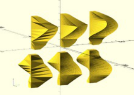

Example Linear Extrude of a rectangle
with twist and scale following part of a
sine curve function

A rocket using rotate_extrude()

Horns, by translation and twisting.


<!-- PDF page 34 -->

```
// The idea is to twist a translated circle:
// -
/*
    linear_extrude(height = 10, twist = 360, scale = 0)
    translate([1,0])
    circle(r = 1);
*/

module horn(height = 10, radius = 3,
            twist = 720, $fn = 50)
{
    // A centered circle translated by 1xR and
    // twisted by 360° degrees, covers a 2x(2xR) space.
    // -
    radius = radius/4;
    // De-translate.
    // -
    translate([-radius,0])
    // The actual code.
    // -
    linear_extrude(height = height, twist = twist,
                   scale=0, $fn = $fn)
    translate([radius,0])
    circle(r=radius);
}

translate([3,0])
mirror()
horn();

translate([-3,0])
horn();

```
### Strandbeest

[See the Strandbeest example here.](https://en.wikibooks.org/wiki/OpenSCAD_User_Manual/Example/Strandbeest)

### Previous

[Other 2D formats](https://en.wikibooks.org/wiki/OpenSCAD_User_Manual/Other_2D_formats)

### Next

[Paths](https://en.wikibooks.org/wiki/OpenSCAD_User_Manual/Paths)

<!-- PDF page 35 -->

## Chapter 4 -- Export

#### OpenSCAD User Manual **Export**

After rendering with F6, the "File --> Export" menu can be used to export as STL, OFF, AMF, DXF, SVG, CSG OR PNG (image).

Be sure to check the console window for error messages.

STL, OFF and DXF are imported using import()

CSG can be imported using include<> or loaded like an SCAD file

PNG can be imported using surface()

There are open pull requests for SVG and AMF, which require a bit more work/testing

The file suffix is used to determine type

#### **STL Export**

To export your design, select "Export as STL..." from the "File --> Export" menu, then enter a filename in the ensuing dialog box. Don't forget

to add the ".stl" extension.

**Trouble shooting** :

After _compile and render CGAL_ (F6), you may see that your design is _simple: no_ . That's bad news.

See line 8 in the following output from _OpenSCAD 2010.02_ :

```
Parsing design (AST generation)...
Compiling design (CSG Tree generation)...
Compilation finished.
Rendering Polygon Mesh using CGAL...
Number of vertices currently in CGAL cache: 732
Number of objects currently in CGAL cache: 12
   Top level object is a 3D object:
   Simple:         no                <*****************
   Valid:         yes
   Vertices:       22
   Halfedges:      70
   Edges:          35
   Halffacets:     32
   Facets:         16
   Volumes:         2
Total rendering time: 0 hours, 0 minutes, 0 seconds
Rendering finished.

```

When you try to export this to .STL, this message appears:

```
Object isn't a valid 2-manifold! Modify your design..

```

"Manifold" means that it is "water tight" and that there are no holes in the geometry. In a valid 2-manifold each edge must connect exactly two

facets. That means that the program must be able to connect a face with an object. E.g. if you use a cube of height 10 to carve out something

from a wider cube of height 10, it is not clear to which cube the top or the bottom belongs. So make the small extracting cube a bit "longer" (or

"shorter"):

```
difference() {
    // original
    cube (size = [2,2,2]);
    // object that carves out
    # translate ([0.5,0.5,-0.5]) {
        cube (size = [1,1,3]);
    }
}

```

<!-- PDF page 36 -->

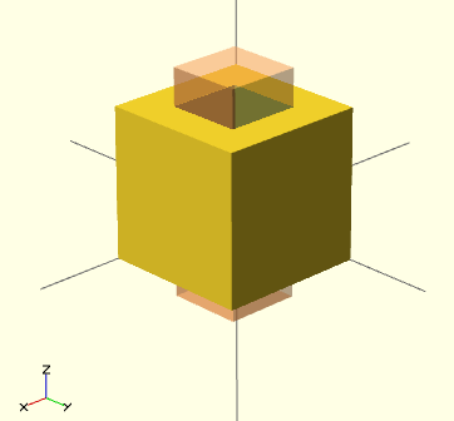

Correct use of difference

[Here is a more tricky little example taken from the OpenSCAD Forum (retrieved 15:13, 22 March 2010 (UTC)):](http://rocklinux.net/pipermail/openscad/2009-December/000018.html)

```
module example1() {
        cube([20, 20, 20]);
        translate([-20, -20, 0]) cube([20, 20, 20]);
        cube([50, 50, 5], center = true);
    }
module example2() {
        cube([20.1, 20.1, 20]);
        translate([-20, -20, 0]) cube([20.1, 20.1, 20]);
        cube([50, 50, 5], center = true);
    }

```

Example1 would render like this:

A not valid 2-manifold cube (simple = no)

The **example1** module is not a valid 2-manifold because both cubes are sharing one edge. They touch each other but do not intersect.

**Example2** is a valid 2-manifold because there is an intersection. Now the construct meets the 2-manifold constraint stipulating that _each edge_

_must connect exactly two facets._

[Pieces you are subtracting must extend past the original part. (OpenSCAD Tip: Manifold Space and Time, retrieved 18:40, 22 March 2010](http://www.iheartrobotics.com/2010/01/openscad-tip-manifold-space-and-time.html)

(UTC)).

For reference, another situation that causes the design to be non-exportable is when two faces that are each the result of a subtraction touch.

Then the error message comes up.

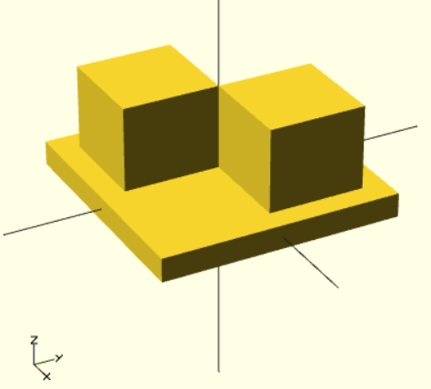

<!-- PDF page 37 -->

```
difference () {
   cube ([20,10,10]);
   translate ([10,0,0]) cube (10);
}
difference () {
   cube ([20,10,10]);
   cube (10);
}

```

simply touching surfaces is correctly handled.

```
translate ([10,0,0]) cube (10);
cube (10);

```

- STL, OFF, AMF, DXF, SVG, CSG, PNG

[With the import() and extrusion modules it is possible to convert 2D objects read from DXF files to 3D objects. See also 2D to 3D Extrusion.](https://en.wikibooks.org/wiki/OpenSCAD_User_Manual/2D_to_3D_Extrusion)

#### **Linear Extrude**

Example of linear extrusion of a 2D object imported from a DXF file.

```
linear_extrude(height = fanwidth, center = true, convexity = 10)
   import (file = "example009.dxf", layer = "fan_top");

```
#### **Rotate Extrude**

Example of rotational extrusion of a 2D object imported from a DXF file.

```
rotate_extrude(convexity = 10)
   import (file = "example009.dxf", layer = "fan_side", origin = fan_side_center);

```
#### **Getting Inkscape to work**

Inkscape is an open source drawing program. Tutorials for transferring 2d DXF drawings from Inkscape to OpenSCAD are available here:

[http://repraprip.blogspot.com/2011/05/inkscape-to-openscad-dxf-tutorial.html (Very simple, needs path segments to be straight lines)](http://repraprip.blogspot.com/2011/05/inkscape-to-openscad-dxf-tutorial.html)

[http://tonybuser.com/?tag=inkscape (More complicated, involves conversion to Postscript)](http://tonybuser.com/?tag=inkscape)

[http://bobcookdev.com/inkscape/inkscape-dxf.html (Better DXF Export, native support for bezier curves)](http://bobcookdev.com/inkscape/inkscape-dxf.html)

[http://www.bigbluesaw.com/saw/big-blue-saw-blog/general-updates/big-blue-saws-dxf-export-for-inkscape.html (even better support,](http://www.bigbluesaw.com/saw/big-blue-saw-blog/general-updates/big-blue-saws-dxf-export-for-inkscape.html)

works as of 10/29/2014, see link below registration window. Note: As of 6/17/15 only works with version 0.48.5 or earlier of inkscape, due

to a breaking change made in 0.91.)

[http://www.instructables.com/id/Convert-any-2D-image-to-a-3D-object-using-OpenSCAD/ (Convert any 2D image to a 3D object using](http://www.instructables.com/id/Convert-any-2D-image-to-a-3D-object-using-OpenSCAD/)

OpenSCAD)

[http://carrefour-numerique.cite-sciences.fr/fablab/wiki/doku.php?id=projets:de_inkscape_a_openscad (French, directly exports OpenSCAD](http://carrefour-numerique.cite-sciences.fr/fablab/wiki/doku.php?id=projets:de_inkscape_a_openscad)

file)

### Previous

[CSG Export](https://en.wikibooks.org/wiki/OpenSCAD_User_Manual/CSG_Export)

### Next

[Other 2D formats](https://en.wikibooks.org/wiki/OpenSCAD_User_Manual/Other_2D_formats)

[Currently, OpenSCAD supports DXF only as a graphics format for 2D graphics. Other common formats are PS/EPS, SVG and AI.](https://en.wikipedia.org/wiki/PostScript)

#### **PS/EPS**

<!-- PDF page 38 -->

[The pstoedit program can convert between various vector graphics formats. OpenSCAD needs the](http://www.pstoedit.net/) -polyaslines option passed to the dxf

output plugin to understand the file. The -mm option sets one mm to be one unit in the dxf; include this if you use one unit in OpenSCAD as

equal to one millimeter. The -dt options instructs pstoedit to render texts, which is usually what you want if you include text. (If the rendered

text's resolution in terms of polygon count is too low, the easiest solution is to scale up the eps before converting; if you know a more elegant

solution, please add it to the example.)

```
pstoedit -dt -f "dxf: -polyaslines -mm" infile.eps outfile.dxf

```
#### **SVG**

[Inkscape can convert SVG to EPS. Then pstoedit can convert the EPS to DXF.](http://inkscape.org)

```
inkscape -E intermediate.eps infile.svg
pstoedit -dt -f dxf:-polyaslines\ -mm intermediate.eps outfile.dxf

```
#### **Makefile automation**

The conversion can be automated using the make system; put the following lines in your Makefile :

```
 all: my_first_file.dxf my_second_file.dxf another_file.dxf

 %.eps: %.svg
     inkscape -E $@ $<

 %.dxf: %.eps
     pstoedit -dt -f dxf:-polyaslines\ -mm $< $@

```

The first line specifies which dxf files are to be generated when make is called in the current directory. The second paragraph specifies how

to convert a file ending in .svg to a file ending in .eps, and the third from .eps to .dxf.

A more complete makefile could autogenerate dxf files from the any svg in the folder. In which case, put the following lines into your

Makefile :

```
SVG := $(wildcard *.svg)
DXF := $(SVG:%.svg=%.dxf)
EPS := $(SVG:%.svg=%.eps)

.PHONY: all clean clean-eps clean-dxf

all: $(DXF)

%.eps: %.svg
    inkscape -E $*.eps $*.svg

%.dxf: %.eps
    pstoedit -dt -f "dxf: -polyaslines -mm" $*.eps $*.dxf

clean: clean-dxf clean-eps

clean-dxf:
    rm -f $(DXF)

clean-eps:
    rm -f $(EPS)

```

It's still possible to call make filename.dxf to build a particular file, but this code also allows for (re)building of all dxf files in a folder just by

calling make or make all .

This code is also universal enough that it's possible to put the code in a single file and symlink every makefile in any directory that has svg

files for dxf conversion by running:

```
ln -s /path/to/this/svg_to_dxf_makefile makefile

```

<!-- PDF page 39 -->

in each respective directory.

#### **AI (Adobe Illustrator)**

Although Adobe Illustrator CC/CC.2014 allows you to export illustrations as DXF (and select DXF format versions as early as 12), it uses DXF

entities that are not supported by OpenSCAD, such as POLYLINE and SPLINE .

Since pstoedit does not natively support Adobe Illustrator files, one alternative is to use [EXDXF, which is an Adobe Illustrator plug-in (30 free](http://www.baby-universe.co.jp/en/plug-in/products/exdxf-pro/)

trial exports and then you have to pay $90 to register the plugin).

Before exporting, it is recommended that you ensure that your Artboard is the same dimensions as the component you are exporting. Although

EXDXF provides you with numerous options when exporting to DXF the most important option for OpenSCAD compliance is to set Line

Conversion to Line and Arc .

OpenSCAD doesn't always provide information about the issues it encountered with a DXF import. If this happens, select Design | Flush

Caches and then Design | Reload and Compile .

### Previous

[DXF Extrusion](https://en.wikibooks.org/wiki/OpenSCAD_User_Manual/DXF_Extrusion)

### Next

[Short and Commented Example Projects](https://en.wikibooks.org/w/index.php?title=OpenSCAD_User_Manual/Short_and_Commented_Example_Projects&action=edit&redlink=1)

<!-- PDF page 40 -->

## Chapter 5 -- Using an external Editor with OpenSCAD

#### OpenSCAD User Manual

### Why use an external editor

Many people prefer to use a certain editor. They are used to the feature set and know the

keybindings. OpenSCADs editor is functional and simple but might lack features people know from

other editors. Moreover, external editor allows to use different monitors for editing and preview.

### How to use an external editor

OpenSCAD is able to check for changes of files and automatically recompile if a file change occurs.

To use this feature enable _"Design->Automatic Reload and Preview"_

Once the feature is activated, just load the scad file within OpenSCAD as usual ( _"File->Open.."_ ). After

that, open the scad file in your favorite editor too. Edit and work on the scad file within the external

editor. Whenever the file is saved to disk (from within the external editor), OpenSCAD recognizes the

file change and automatically recompiles accordingly.

The internal editor can be hidden by minimizing the frame with the mouse or by selecting _"View->Hide_

_editor"_ .

### Support of external editors

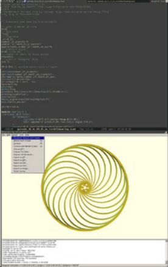

OpenSCAD session using emacs as an
external editor

In principle all editors can be used. Some even have extensions/modes to provide features for OpenSCAD.

**Atom** [: There is a Language OpenSCAD package for Atom that provides highlighting and snippets.](https://atom.io/packages/language-openscad)

**Emacs** [: OpenSCAD provides an emacs mode for OpenSCAD files. Use the link or install via emacs package management (ELPA) with](https://github.com/openscad/openscad/blob/master/contrib/scad-mode.el)

[the MELPA repository.](https://melpa.org)

**Geany** [: cobra18t provides a Geany syntax file for OpenSCAD. See](http://www.thingiverse.com/cobra18t/overview) _Instructions_ tab in Thingiverse to install it.

**Gedit** [: Andy Turner provides a Gedit syntax file for OpenSCAD.](https://github.com/AndrewJamesTurner)

**IntelliJ** : has an 'OpenSCAD Language Support' plugin.

**Kate** [: nerd256 provides a kate syntax file for OpenSCAD. See](http://www.thingiverse.com/nerd256/overview) _Instructions_ tab in Thingiverse to install it. You could create also a kate

_External tool_ to open OpenSCAD with the current file with script openscad %directory/%filename

**Notepad++** [: TheHeadlessSourceMan provides a Notepad++ syntax file for OpenSCAD. See](http://www.thingiverse.com/TheHeadlessSourceMan/overview) _Instructions_ tab in Thingiverse to install it.

**OpenSCADitor** [: OpenSCAD-dedicated editor](https://www.openscad.org/)

**Sublime** [: Syntax highlighting and Customizer support](http://www.thingiverse.com/thing:67566)

**Textmate** [: Syntax highlighting and Customizer support](http://www.thingiverse.com/thing:67566)

**VIM** [: vim.org provides a VIM syntax file for OpenSCAD.](http://www.vim.org/scripts/script.php?script_id=3556)

**Visual Studio Code** [: Free, open-source code editor Install the scad extension for syntax highlighting](https://code.visualstudio.com/)

### Additional benefits

Besides using your editor of choice, these solutions enable the flexible usage of multi-monitor set-ups. One can have one monitor set up to

depict the 3D object on the entire screen and a second monitor for the editor and other tools.

<!-- PDF page 41 -->

## Chapter 6 -- Using OpenSCAD in a command line environment

#### OpenSCAD User Manual **Command line usage**

OpenSCAD can not only be used as a GUI, but also handles command line arguments. Its usage line says:

OpenSCAD 2019.05 has these options:

```
 Usage: openscad [options] file.scad
 Allowed options:
   -o [ --o ] arg               output specified file instead of running the
                                GUI, the file extension specifies the type: stl,
                                off, amf, 3mf, csg, dxf, svg, png, echo, ast,
                                term, nef3, nefdbg

   -D [ --D ] arg               var=val -pre-define variables
   -p [ --p ] arg               customizer parameter file
   -P [ --P ] arg               customizer parameter set
   -h [ --help ]                print this help message and exit
   -v [ --version ]             print the version
   --info                       print information about the build process

   --camera arg                 camera parameters when exporting png:
                                =translate_x,y,z,rot_x,y,z,dist or
                                =eye_x,y,z,center_x,y,z
   --autocenter                 adjust camera to look at object's center
   --viewall                    adjust camera to fit object
   --imgsize arg                =width,height of exported png
   --render arg                 for full geometry evaluation when exporting png
   --preview arg                [=throwntogether] -for ThrownTogether preview
                                png
   --view arg                   =view options: axes | crosshairs | edges |
                                scales | wireframe
   --projection arg             =(o)rtho or (p)erspective when exporting png
   --csglimit arg               =n -stop rendering at n CSG elements when
                                exporting png
   --colorscheme arg            =colorscheme: *Cornfield | Metallic | Sunset |
                                Starnight | BeforeDawn | Nature | DeepOcean |
                                Solarized | Tomorrow | Tomorrow 2 | Tomorrow
                                Night | Monotone

   -d [ --d ] arg               deps_file -generate a dependency file for make
   -m [ --m ] arg               make_cmd -runs make_cmd file if file is missing
   -q [ --quiet ]               quiet mode (don't print anything *except*
                                errors)
   --hardwarnings               Stop on the first warning
   --check-parameters arg       =true/false, configure the parameter check for
                                user modules and functions
   --check-parameter-ranges arg =true/false, configure the parameter range check
                                for builtin modules
   --debug arg                  special debug info
   -s [ --s ] arg               stl_file deprecated, use -o
   -x [ --x ] arg               dxf_file deprecated, use -o

```

OpenSCAD 2015.03-1 has these options:

<!-- PDF page 42 -->

```
openscad     [ -o output_file [ -d deps_file ] ]\
             [ -m make_command ] [ -D var=val [..] ] \
             [ --help ] print this help message and exit \
             [ --version ] [ --info ] \
             [ --camera=translatex,y,z,rotx,y,z,dist | \
               --camera=eyex,y,z,centerx,y,z ] \
             [ --autocenter ] \
             [ --viewall ] \
             [ --imgsize=width,height ] [ --projection=(o)rtho|(p)ersp] \
             [ --render | --preview[=throwntogether] ] \
             [ --colorscheme=[Cornfield|Sunset|Metallic|Starnight|BeforeDawn|Nature|DeepOcean] ] \
             [ --csglimit=num ]\
             filename

```

OpenSCAD 2014.03+ has these options:

```
openscad     [ -o output_file [ -d deps_file ] ]\
             [ -m make_command ] [ -D var=val [..] ] \
             [ --version ] [ --info ] \
             [ --camera=translatex,y,z,rotx,y,z,dist | \
               --camera=eyex,y,z,centerx,y,z ] \
             [ --imgsize=width,height ] [ --projection=(o)rtho|(p)ersp] \
             [ --render | --preview[=throwntogether] ] \
             [ --csglimit=num ] \
             filename

```

Openscad 2013.05 had these options:

```
openscad     [ -o output_file [ -d deps_file ] ]\
             [ -m make_command ] [ -D var=val [..] ] [ --render ] \
             [ --camera=translatex,y,z,rotx,y,z,dist | \
               --camera=eyex,y,z,centerx,y,z ] \
             [ --imgsize=width,height ] [ --projection=(o)rtho|(p)ersp] \
             filename

```

Earlier releases had only these:

```
openscad [ -o output_file [ -d deps_file ] ] \
         [ -m make_command ] [ -D var=val [..] ] filename

```

The usage on OpenSCAD version 2011.09.30 (now deprecated) was:

```
openscad [ { -s stl_file | -o off_file | -x dxf_file } [ -d deps_file ] ]\
         [ -m make_command ] [ -D var=val [..] ] filename

```
#### **Export options**

When called with the -o option, OpenSCAD does not start the GUI, but executes the given file and exports to the _output_file_ in a format

depending on the extension ( .stl / .off / .dxf, .csg ).

Some versions use -s/-d/-o to determine the output file format instead; check with "openscad --help".

If the option -d is given in addition to an export command, all files accessed while building the mesh are written in the argument of -d in the

syntax of a Makefile.

For at least 2015.03-2+, specifying the extension .echo causes openscad to produce a text file containing error messages and the output of

all echo() calls in filename as they would appear in the console window visible in the GUI. Multiple output files are not supported, so using

this option you cannot also obtain the model that would have normally been generated.

**Camera and image output**

For 2013.05+, the option to output a .png image was added. There are two types of cameras available for the generation of images.

The first camera type is a 'gimbal' camera that uses Euler angles, translation, and a camera distance, like OpenSCAD's GUI viewport display

at the bottom of the OpenSCAD window.

<!-- PDF page 43 -->

The second camera type is a 'vector' camera, with an 'eye' camera location vector and a 'lookat' center vector.

--imgsize x,y chooses the .png dimensions and --projection chooses orthogonal or perspective, as in the GUI.

By default, cmdline .png output uses Preview mode (f5) with OpenCSG. For some situations it may be desirable to output the full render, with

CGAL. This is done by adding '--render' as an option.

#### **Constants**

In order to pre-define variables, use the -D option. It can be given repeatedly. Each occurrence of -D must be followed by an assignment.

Unlike normal OpenSCAD assignments, these assignments don't define variables, but constants, which cannot be changed inside the

program, and can thus be used to overwrite values defined in the program at export time.

If you want to assign the -D variable to another variable, the -D variable MUST be initialized in the main .scad program

```
param1=17;       // must be initialized
val=param1;      // param1 passed via -D on cmd-line
echo(val,param1); // outputs 17,17

```

without the first line, val would be undefined.

The right hand sides can be arbitrary OpenSCAD expressions, including mathematical operations and strings.

Be aware that your shell (bash, cmd, etc.) parses the arguments before passing them to openscad, therefore you need to properly quote or

escape arguments with special characters like spaces or quotation marks. For example to assign a string production to a quality parameter

one has to ensure the " characters OpenSCAD expects aren't stripped by the shell. In bash one could write:

```
openscad -o my_model_production.stl -D 'quality="production"' my_model.scad

```

or from the Windows prompt:

```
openscad.com -o my_model_production.stl -D "quality=""production""" my_model.scad

```

or you may need to escape the inner quotes instead:

```
openscad -o my_model_production.stl -D "quality=\"production\"" my_model.scad

```

Note that this sort of double-escaping isn't necessary when executing OpenSCAD from another process that isn't using a shell, because each

argument is passed separately. For example a Java application might start a process like so:

```
   pb = new ProcessBuilder("/usr/bin/openscad",
     "-o", "my_model_production.stl",
     "-D", "quality=\"production\"",
     "my_model.scad");

```
#### **Command to build required files**

In a complex build process, some missing files required by an OpenSCAD file can be generated if they are defined in a Makefile. If

OpenSCAD is given the option -m make, it starts make _file_ the first time it tries to access a missing _file_ .

#### **Processing all .scad files in a folder**

Example to convert all the .scad in a folder into .stl:

In a folder with .scad files, make a .bat file with text:

```
   FOR %%f in (*.scad)  DO openscad -o "%%~nf.stl" "%%f"

```

If it closes without processing, check to set the PATH by adding openscad directory to:

```
     Start - Settings - Control Panel - System - Advanced tab - Environment Variables - System
Variables, select Path, then click Edit.

```

<!-- PDF page 44 -->

Add the openscad directory to the list

#### **Makefile example**

The -d and -m options only make sense together. ( -m without -d would not consider modified dependencies when building exports, -d

without -m would require the files to be already built for the first run that generates the dependencies.)

Here is an example of a basic Makefile that creates an .stl file from an .scad file of the same name:

```
# explicit wildcard expansion suppresses errors when no files are found
include $(wildcard *.deps)

%.stl: %.scad
    openscad -m make -o $@ -d $@.deps $<

```

When make my_example.stl is run for the first time, it finds no .deps files, and must depend on my_example.scad . Because

my_example.stl is not yet preset, it gets created unconditionally. If OpenSCAD finds missing files, it calls make to build them, and it lists all

used files in my_example.stl.deps .

When make my_example.stl is called subsequently, it finds and includes my_example.stl.deps and check if any of the files listed there,

including my_example.scad, changed since my_example.stl was built, based on their time stamps. Only if that is the case, it builds

my_example.stl again.

**Automatic targets**

When building similar .stl files from a single .scad file, there is a way to automate that too:

```
# match "module foobar() { // `make` me"
TARGETS=$(shell sed '/^module [a-z0-9_-]*().*make..\?me.*$$/!d;s/module //;s/().*/.stl/' base.scad)

all: ${TARGETS}

# auto-generated .scad files with .deps make make re-build always. keeping the
# scad files solves this problem. (explanations are welcome.)
.SECONDARY: $(shell echo "${TARGETS}" | sed 's/\.stl/.scad/g')

# explicit wildcard expansion suppresses errors when no files are found
include $(wildcard *.deps)

%.scad:
    echo -ne 'use <base.scad>\n$*();' > $@

%.stl: %.scad
    openscad -m make -o $@ -d $@.deps $<

```

All objects that are supposed to be exported automatically have to be defined in base.scad in an own module with their future file name

(without the ".stl"), and have a comment like " // make me " in the line of the module definition. The " TARGETS= " line picks these out of the

base file and creates the file names. These are built when make all (or make, for short) is called.

As the convention from the last example is to create the .stl files from .scad files of the same base name, for each of these files, an .scad file

must be generated. This is done in the " %.scad: " paragraph; my_example.scad is a simple OpenSCAD file:

```
use <base.scad>
my_example();

```

The " .SECONDARY " line is there to keep make from deleting the generated .scad files. Its presence helps determine which files no longer

[need to be rebuilt; please post ideas about what exactly goes wrong there (or how to fix it better) on the talk page!](https://en.wikibooks.org/wiki/Talk:OpenSCAD_User_Manual/Using_OpenSCAD_in_a_command_line_environment)

#### **Windows notes**

On Windows, openscad.com should be called from the command line as a wrapper for openscad.exe. This is because Openscad uses the

'devenv' solution to the Command-Line/GUI output issue. Typing 'openscad' at the cmd.exe prompt calls the .com program wrapper by default.

#### **MacOS notes**

On MacOS the binary is normally hidden inside the App folder. If OpenSCAD is installed in the global Applications folder, it can be called from

<!-- PDF page 45 -->

command line like in the following example that just shows the OpenSCAD version:

```
macbook:/$ /Applications/OpenSCAD.app/Contents/MacOS/OpenSCAD -v
OpenSCAD version 2013.06

```

Alternatively, you may create a symbolic link to the binary to make calls from the command line easier:

```
 macbook:/$ sudo ln -sf /Applications/OpenSCAD.app/Contents/MacOS/OpenSCAD /usr/local/bin/openscad

```

Now you can call openscad directly without having to type in the full path.

```
 macbook:/$ openscad -v
 OpenSCAD version 2015.03-3

```

On some versions of MacOS, you might get the following error when attempting to run openscad via that link:

```
 This application failed to start because it could not find or load the Qt platform plugin "cocoa".

 Reinstalling the application may fix this problem.
 Abort trap: 6

```

You can fix this by creating a wrapper script to invoke the executable directly:

```
 sudo rm -f /usr/local/bin/openscad
 echo '#!/bin/sh' > test
 echo '/Applications/OpenSCAD.app/Contents/MacOS/OpenSCAD $*' >> test
 chmod +x test ; sudo mv test /usr/local/bin/openscad

```

<!-- PDF page 46 -->

## Chapter 7 -- Path locations

#### OpenSCAD User Manual OpenSCAD looks for and saves resources to various paths. This is an overview.

### Env variables

HOME

XDG_CONFIG_HOME

OPENSCAD_FONT_PATH

OPENSCADPATH

### Per platform roots

**ResourcesPath**

Posix:

Mac OS X: OpenSCAD.app/Contents/Resources

Windows:

**DocumentsPath**

Posix: $HOME/.local/share

Mac OS X: [NSDocumentDirectory], typically $HOME/Documents

Windows XP: [CSIDL_PERSONAL], typically C:\documents and settings\username\my documents

Windows Vista->: [CSIDL_PERSONAL], typically C:\users\username\documents

**UserConfigPath**

Posix: $XDG_CONFIG_HOME/OpenSCAD or $HOME/.config/OpenSCAD

Mac: [NSApplicationSupportDirectory], typically $HOME/Library/Application Support/OpenSCAD

Windows: [CSIDL_LOCAL_APPDATA], typically C:\Documents and Settings\username\Local Settings\Application Data

### Read-only Resources

libraries: **[ResourcesPath]** /libraries

fonts: **[ResourcesPath]** /fonts

render color schemes: **[ResourcesPath]** /color-schemes/render

editor color schemes: **[ResourcesPath]** /color-schemes/editor

### User Resources

libraries: $OPENSCADPATH, **[DocumentsPath]** /OpenSCAD/libraries

fonts

```
  * $HOME/.fonts

```

render color schemes: **[UserConfigPath]** /color-schemes/render

editor color schemes: **[UserConfigPath]** /color-schemes/editor

### Misc Resources

GUI preferences (Uses QSettings):

```
  * Posix: $HOME/.config/OpenSCAD.conf
  * Windows: Registry
  * Mac OS X: $HOME/Library/Preferences/org.openscad.OpenSCAD.plist

```

backups: **[DocumentsPath]** /OpenSCAD/backups

<!-- PDF page 47 -->

### Reference

this chapter is based on [https://github.com/openscad/openscad/wiki/Path-locations written by the developer kintel](https://github.com/openscad/openscad/wiki/Path-locations)

<!-- PDF page 48 -->

## Chapter 8 -- Building OpenSCAD from Sources

#### OpenSCAD User Manual

### Prebuilt binary packages

If you are lucky, you won't have to build it. Many Linux and BSD systems have pre-built OpenSCAD packages including Debian, Ubuntu,

Fedora, Arch, NetBSD and OpenBSD. Check your system's package manager for details.

#### **generic linux binary package**

There is also a generic linux binary package at [http://www.openscad.org that can be unpacked and run from within most linux systems. It is](http://www.openscad.org)

self contained and includes the required libraries.

#### **nightly builds**

[see https://build.opensuse.org/package/show/home:t-paul/OpenSCAD](https://build.opensuse.org/package/show/home:t-paul/OpenSCAD)

#### **chrysn's Ubuntu packages**

For Ubuntu systems you can also try chrysn's Ubuntu packages at his [launchpad PPA, or you can just copy/paste the following onto the](https://launchpad.net/~chrysn/+archive/openscad)

command line:

```
sudo add-apt-repository ppa:chrysn/openscad
sudo apt-get update
sudo apt-get install openscad

```

[His repositories for OpenSCAD and OpenCSG are here and here.](http://archive.amsuess.com/pool/contrib/o/openscad/)

### Building OpenSCAD yourself

If you wish to build OpenSCAD for yourself, start by installing **_git_** on your system using your package manager. Git is sometimes packaged

under the name 'scmgit' or 'git-core'. Then, use git to download the OpenSCAD source code

```
cd ~/
git clone https://github.com/openscad/openscad.git
cd openscad

```

Then get the MCAD library, which is now included with OpenSCAD binary distributions

```
git submodule init
git submodule update

```
#### **Installing dependencies**

OpenSCAD uses a large number of third-party libraries and tools. These are called dependencies. An up to date list of dependencies can

[usually be found in the README.md in openscad's main directory, here: https://github.com/openscad/openscad/ A brief list follows:](https://github.com/openscad/openscad/)

_Eigen, GCC or Clang, Bison, Flex, CGAL, Qt, GMP, MPFR, boost, cmake, OpenCSG, GLEW, QScintilla, glib2, harfbuzz, freetype2, pkg-_

_config, fontconfig_

**Prepackaged dependencies**

Most systems are set up to install pre-built dependencies using a 'package manager', such as **_apt_** on ubuntu or **_pacman_** on Arch Linux.

OpenSCAD comes with a 'helper script' that attempts to automatically run your package manager for you and download and install these pre-

built packages if they exist. Note you must be running as root and/or using _sudo_ to try this. Note that these scripts are likely to fail on Sun,

Solaris, AIX, IRIX, etc (skip to the 'building dependencies' section below).

```
./scripts/uni-get-dependencies.sh

```

<!-- PDF page 49 -->

**Verifying dependencies**

After attempting to install dependencies, you should double check them. Exit any shells and perhaps reboot.

Now verify that the version numbers are up to those listed in openscad/README.md file. Also verify that no packages were accidentally

missed. For example open a shell and run 'flex --version' or 'gcc --version'. These are good sanity checks to make sure your environment is

proper.

OpenSCAD comes with another helper script that attempts to automate this process on many Linux and BSD systems (Again, it won't work on

Sun/Solaris/Irix/AIX/etc).

```
./scripts/check-dependencies.sh

```

If you cannot verify that your dependencies are installed properly and of a sufficient version, then you may have to install some 'by hand' (see

the section below on building your own dependencies).

If your system has all the proper versions of dependencies, then continue to the 'Building OpenSCAD' section.

#### **Building the dependencies yourself**

On systems that lack updated dependency libraries or tools, you must to download each and build it and install it by hand. You can do this by

downloading and following installation instructions for each package separately. However OpenSCAD comes with scripts that attempt to

automate this process on Linux and BSD systems, by installing everything into a folder created under $HOME/openscad_deps. This script

does not build typical development dependencies like X11, Qt4, gcc, bash etc. But it attempts things like OpenCSG, CGAL, boost, etc.

To run the automated script, first set up the environment variables (if you don't use bash, replace "source" with a single ".")

```
source scripts/setenv-unibuild.sh

```

Then, run a second script to download and build.

```
./scripts/uni-build-dependencies.sh

```

(If you only need CGAL or OpenCSG, you can just run ' ./scripts/uni-build-dependencies.sh cgal' or opencsg and it builds only a single library.)

The complete download and build process can take several hours, depending on your network connection speed and system speed. It is

recommended to have at least 2 Gigabyte of free disk space to do the full dependency build. Each time you log into a new shell and wish to

re-compile OpenSCAD you need to re-run the 'source scripts/setenv-unibuild.sh' script.

After completion, return to the section above on 'verifying dependencies' to see if they installed correctly.

#### **Build the OpenSCAD binary**

Once you have installed your dependencies, you can build OpenSCAD.

```
qmake       # or qmake-qt4, depending on your distribution
make

```

You can also install OpenSCAD to /usr/local/ if you wish. The 'openscad' binary is put under /usr/local/bin, the libraries and examples reside

under something like /usr/local/share/openscad possibly depending on your system. Note that if you have previously installed a binary linux

package of openscad, you should take care to delete /usr/local/lib/openscad and /usr/local/share/openscad because they are not the same

paths as what the standard qmake-built 'install' target uses.

```
sudo make install

```

**Note:** on Debian-based systems create a package and install OpenSCAD using:

```
sudo checkinstall -D make install

```

<!-- PDF page 50 -->

If you prefer not to install you can run " ./openscad " directly whilst still in the ~/openscad directory.

#### **Experimental**

To enable the experimental features, remake the project with _CONFIG+=experimental_ :

```
qmake CONFIG+=experimental
make -B

```

The -B is only required once (when you have changed the config).

The experimental features are disabled by default, even when explicitly build as experimental build.

When you successfully build, you find a "features" tab in the preferences, where you can enable

individual experimental features.

_Alternatively,_ you may add

```
CONFIG+=experimental

```

as the first line of **openscad.pro** .

### Compiling the test suite

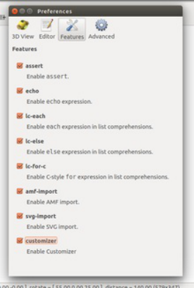

OpenSCAD 2017-01-06 experimental-
build,
all experimental features enabled

OpenSCAD comes with over 740 regression tests. To build and run them, it is recommended to first build the GUI version of OpenSCAD by

following the steps above, including the downloading of MCAD. Then, from the same login, run these commands:

```
 cd tests
 mkdir build && cd build
 cmake ..
 make
 ctest -C All

```

The file 'openscad/doc/testing.txt' has more information. Full test logs are under tests/build/Testing/Temporary . A pretty-printed index.html

web view of the tests can be found under a machine-specific subdirectory thereof and opened with a browser.

### Troubleshooting

If you encounter any errors when building, please file an issue report at [https://github.com/openscad/openscad/issues/ .](https://github.com/openscad/openscad/issues/)

#### **Errors about incompatible library versions**

This may be caused by old libraries living in /usr/local/lib like boost, CGAL, OpenCSG, etc, (often left over from previous experiments with

OpenSCAD). You are advised to remove them. To remove, for example, CGAL, run rm -rf /usr/local/include/CGAL && rm -rf

/usr/local/lib/*CGAL*. Then erase $HOME/openscad_deps, remove your openscad source tree, and restart fresh. As of 2013 OpenSCAD's

build process does not advise nor require anything to be installed in /usr/local/lib nor /usr/local/include.

Note that CGAL depends on Boost and OpenCSG depends on GLEW - interdependencies like this can really cause issues if there are stray

libraries in unusual places.

Another source of confusion can come from running from within an 'unclean shell'. Make sure that you don't have LD_LIBRARY_PATH set to

point to any old libraries in any strange places. Also don't mix a Mingw windows cross build with your linux build process - they use different

environment variables and may conflict.

#### **OpenCSG didn't automatically build**

If for some reason the recommended build process above fails to work with OpenCSG, please file an issue on the OpenSCAD github. In the

meantime, you can try building it yourself.

<!-- PDF page 51 -->

```
  wget http://www.opencsg.org/OpenCSG-1.3.2.tar.gz
  sudo apt-get purge libopencsg-dev libopencsg1 # or your system's equivalent
  tar -xvf OpenCSG-1.3.2.tar.gz
  cd OpenCSG-1.3.2
  # edit the Makefile and remove 'example'
  make
  sudo cp -d lib/lib* $HOME/openscad_deps/lib/
  sudo cp include/opencsg.h $HOME/openscad_deps/include/

```

**Note:** on Debian-based systems (such as Ubuntu), you can add the 'install' target to the OpenCSG Makefile, and then

use checkinstall to create a clean .deb package for install/removal/upgrade. Add this target to Makefile:

```
 install:
     # !! THESE LINES PREFIXED WITH ONE TAB, NOT SPACES !!
     cp -d lib/lib* /usr/local/lib/
     cp include/opencsg.h /usr/local/include/
     ldconfig

```

Then:

```
 sudo checkinstall -D make install

```

.. to create and install a clean package.

#### **CGAL didn't automatically build**

If this happens, you can try to [compile CGAL yourself. It is recommended to install to $HOME/openscad_deps and otherwise follow the build](https://en.wikibooks.org/wiki/OpenSCAD_User_Manual/CGAL_From_Source)

process as outlined above.

#### **Compiling fails with an Internal compiler error from GCC or GAS**

This can happen if you run out of virtual memory, which means all of physical RAM as well as virtual swap space from the disk. See below

under "horribly slow" for reasons. If you are non-root, there are a few things you can try. The first is to use the 'clang' compiler, as it uses much

less RAM than gcc. The second thing is to edit the Makefile and remove the '-g' and '-pipe' flags from the compiler flags section.

If, on the other hand, you are root, then you can expand your swap space. On Linux this is pretty standard procedure and easily found in a

web search. Basically you do these steps (after verifying you have no file named /swapfile already):

```
   sudo dd if=/dev/zero of=/swapfile bs=1M count=2000  # create a roughly 2 gig swapfile
   sudo chmod 0600 /swapfile # set proper permissions for security
   sudo mkswap /swapfile  # format as a swapfile
   sudo swapon /swapfile  # turn on swap

```

For permanent swap setup in /etc/fstab, instructions are easily found through web search. If you are building on an SSD (solid state drive)

machine the speed of a swapfile allows a reasonable build time.

#### **Compiling is horribly slow and/or grinds the disk**

It is recommended to have at least 1.5 Gbyte of RAM to compile OpenSCAD. There are a few workarounds in case you don't. The first is to

use the experimental support for the Clang Compiler (described below) as Clang uses much less RAM than GCC. Another workaround is to

edit the Makefile generated by qmake and search/replace the optimization flags (-O2) with -O1 or blank, and to remove any '-g' debug flags

from the compiler line, as well as '-pipe'.

If you have plenty of RAM and just want to speed up the build, you can try a paralell multicore build with

```
  make -jx

```

Where 'x' is the number of cores you want to use. Remember you need x times the amount of RAM to avoid possible disk thrashing.

The reason the build is slow is because OpenSCAD uses template libraries like CGAL, Boost, and Eigen, which use large amounts of RAM to

compile - especially CGAL. GCC may take up 1.5 Gigabytes of RAM on some systems during the build of certain CGAL modules. There is

[more information at StackOverflow.com.](http://stackoverflow.com/questions/3634203/why-are-templates-so-slow-to-compile)

<!-- PDF page 52 -->

#### **BSD issues**

The build instructions above are designed to work unchanged on FreeBSD and NetBSD. However the BSDs typically require special

environment variables set up to build any QT project - you can set them up automatically by running

```
   source ./scripts/setenv-unibuild.sh

```

NetBSD 5.x, requires a [patched version of CGAL. It is recommended to upgrade to NetBSD 6 instead as it has all dependencies available](https://en.wikibooks.org/wiki/User:Dbright/patch_cgal_for_netbsd)

[from pkgin. NetBSD also requires the X Sets to be installed when the system was created (or added later).](http://ghantoos.org/2009/05/12/my-first-shot-of-netbsd/)

On OpenBSD it may fail to build after running out of RAM. OpenSCAD requires at least 1 Gigabyte to build with GCC. You may have need to

be a user with 'staff' level access or otherwise alter required system parameters. The 'dependency build' sequence has also not been ported

to OpenBSD so you must rely on the standard OpenBSD system package tools (in other words you have to have root).

#### **Sun / Solaris / IllumOS / AIX / IRIX / Minix / etc**

The OpenSCAD dependency builds have been mainly focused on Linux and BSD systems like Debian or FreeBSD. The 'helper scripts' are

likely to fail on other types of Un*x. Furthermore the OpenSCAD build system files (qmake .pro files for the GUI, cmake CMakeFiles.txt for the

test suite) have not been tested thoroughly on non-Linux non-BSD systems. Extensive work may be required to get a working build on such

systems.

#### **Test suite problems**

**Headless server**

The test suite tries to automatically detect if you have an X11 DISPLAY environment variable set. If not, it tries to automatically start Xvfb or

Xvnc (virtual X framebuffers) if they are available.

If you want to run these servers manually, you can attempt the following:

```
$ Xvfb :5 -screen 0 800x600x24 &
$ DISPLAY=:5 ctest

```

Alternatively:

```
$ xvfb-run --server-args='-screen 0 800x600x24' ctest

```

There are some cases where Xvfb/Xvnc won't work. Some older versions of Xvfb may fail and crash without warning. Sometimes Xvfb/Xvnc

have been built without GLX (OpenGL) support and OpenSCAD won't be able to generate any images.

**Image-based tests takes a long time, they fail, and the log says 'return -11'**

Imagemagick may have crashed while comparing the expected images to the test-run generated (actual) images. You can try using the

alternate ImageMagick comparison method by by erasing CMakeCache, and re-running cmake with -DCOMPARATOR=ncc . This enables

the Normalized Cross Comparison method which is more stable, but possibly less accurate and may give false positives or negatives.

**Testing images fails with 'morphology not found" for ImageMagick in the log**

Your version of imagemagick is old. Upgrade imagemagick, or pass -DCOMPARATOR=old to cmake, otherwise the comparison reliability is

reduced.

#### **I moved the dependencies I built and now openscad won't run**

It isn't advised to move them because the build is using RPATH hard coded into the openscad binary. You may try to workaround by setting

the LD_LIBRARY_PATH environment variable to place yourpath/lib first in the list of paths it searches. If all else fails, you can re-run the entire

dependency build process but export the BASEDIR environment variable to your desired location, before you run the script to set environment

variables.

### Tricks and tips

#### **Reduce space of dependency build**

After you have built the dependencies you can free up space by removing the $BASEDIR/src directory - where $BASEDIR defaults to

$HOME/openscad_deps.

<!-- PDF page 53 -->

#### **Preferences**

OpenSCAD's config file is kept in ~/.config/OpenSCAD/OpenSCAD.conf.

#### **Setup environment to start developing OpenSCAD in Ubuntu 11.04**

The following paragraph describes an easy way to setup a development environment for OpenSCAD in Ubuntu 11.04. After executing the

following steps QT Creator can be used to graphically start developing/debugging OpenSCAD.

Add required PPA repositories:

```
# sudo add-apt-repository ppa:chrysn/openscad

```

Update and install required packages:

```
# sudo apt-get update
# sudo apt-get install git build-essential qtcreator libglew1.5-dev libopencsg-dev libcgal-dev
libeigen2-dev bison flex

```

Get the OpenSCAD sources:

```
# mkdir ~/src
# cd ~/src
# git clone https://github.com/openscad/openscad.git

```

Build OpenSCAD using the command line:

```
# cd ~/src/openscad
# qmake
# make

```

Build OpenSCAD using QT Creator:

Just open the project file openscad.pro (CTRL+O) in QT Creator and hit the build all (CTRL+SHIFT+B) and run button (CTRL+R).

#### **The Clang Compiler**

There is experimental support for building with the Clang compiler under linux. Clang is faster, uses less RAM, and has different error

messages than GCC. To use it, first of all you need CGAL of at least version 4.0.2, as prior versions have a bug that makes clang unusable.

Then, run this script before you build OpenSCAD.

```
 source scripts/setenv-unibuild.sh clang

```

Clang support depends on your system's QT installation having a clang enabled qmake.conf file. For example, on Ubuntu, this is under

/usr/share/qt4/mkspecs/unsupported/linux-clang/qmake.conf. BSD clang-building may require a good deal of fiddling and is untested, although

eventually it is planned to move in this direction as the BSDs (not to mention OSX) are moving towards favoring clang as their main compiler.

[OpenSCAD includes convenience scripts to cross-build Windows installer binaries using the MXE system (http://mxe.cc). If you wish to use](http://mxe.cc)

them, you can first install the MXE Requirements such as cmake, perl, scons, using your system's package manager (click to view a complete

list of requirements). Then you can perform the following commands to download OpenSCAD source and build a windows installer:

```
 git clone https://github.com/openscad/openscad.git
 cd openscad
 source ./scripts/setenv-mingw-xbuild.sh
 ./scripts/mingw-x-build-dependencies.sh
 ./scripts/release-common.sh mingw32

```

The x-build-dependencies process takes several hours, mostly to cross-build QT. It also requires several gigabytes of disk space. If you have

multiple CPUs you can speed up things by running **export NUMCPU=x** before running the dependency build script. By default it builds the

dependencies in $HOME/openscad_deps/mxe. You can override the mxe installation path by setting the BASEDIR environment variable

before running the scripts. The OpenSCAD binaries are built into a separate build path, openscad/mingw32.

Note that if you want to then build linux binaries, you should log out of your shell, and log back in. The 'setenv' scripts, as of early 2013,

<!-- PDF page 54 -->

required a 'clean' shell environment to work.

If you wish to cross-build manually, please follow the steps below and/or consult the release-common.sh source code.

### Setup

The easiest way to cross-compile OpenSCAD for Windows on Linux or Mac is to use mxe (M cross environment). You must install git to get it.

Once you have git, navigate to where you want to keep the mxe files in a terminal window and run:

```
git clone git://github.com/mxe/mxe.git

```

Add the following line to your ~/.bashrc file:

```
export PATH=/<where mxe is installed>/usr/bin:$PATH

```

replacing <where mxe is installed> with the appropriate path.

### Requirements

The requirements to cross-compile for Windows are just the requirements of mxe. They are listed, along with a command for installing them

[here. You don't need to type 'make'; this makes everything and take up >10 GB of diskspace. You can instead follow the next step to compile](http://mxe.cc/#requirements)

only what's needed for openscad.

Now that you have the requirements for mxe installed, you can build OpenSCAD's dependencies (CGAL, Opencsg, MPFR, and Eigen2). Just

open a terminal window, navigate to your mxe installation and run:

```
make mpfr eigen opencsg cgal qt

```

This can take a few hours, because it has to build things like gcc, qt, and boost. Just go calibrate your printer or something while you wait. To

[speed things up, you might want do something like "make -j 4 JOBS=2" for parallel building. See the mxe tutorial for more details.](http://mxe.cc/#tutorial)

Optional: If you want to build an installer, you need to install the nullsoft installer system. It should be in your package manager, called "nsis".

### Build OpenSCAD

Now that all the requirements have been met, all that remains is to build OpenSCAD itself. Open a terminal window and enter:

```
git clone git://github.com/openscad/openscad.git
cd openscad

```

Then get MCAD:

```
git submodule init
git submodule update

```

You need to create a symbolic link here for the build system to find the libraries:

```
ln -s /<where mxe is installed>/usr/i686-pc-mingw32/ mingw-cross-env

```

again replacing <where mxe is installed> with the appropriate path

Now to build OpenSCAD run:

```
i686-pc-mingw32-qmake CONFIG+=mingw-cross-env openscad.pro
make

```

This creates openscad.exe in ./release and you can build an installer with it as described in the instructions for building with Microsoft Visual

<!-- PDF page 55 -->

[C++, described here.](https://en.wikibooks.org/wiki/OpenSCAD_User_Manual/Building_on_Windows#Building_an_installer)

The difference is that instead of right-clicking on the *.nsi file you run:

```
makensis installer.nsis

```

Note that as of early 2013, OpenSCAD's 'scripts/release-common.sh' automatically uses the version of nsis that comes with the MXE cross

build system, so you may wish to investigate the release-common.sh source code to see how it works, if you have troubles. This is a set of

instructions for building OpenSCAD with the Microsoft Visual C++ compilers. It has not been used since circa 2012 and is unlikely to work

properly. It is maintained here for historical reference purposes.

A newer build is being attempted with the Msys2 system, please see

[http://en.wikibooks.org/wiki/OpenSCAD_User_Manual/Building_on_Microsoft_Windows](https://en.wikibooks.org/wiki/OpenSCAD_User_Manual/Building_on_Microsoft_Windows)

---

This MSVC build is as static as reasonable, with no external DLL dependencies that are not shipped with Windows

Note: It was last tested on the Dec 2011 build. Newer checkouts of OpenSCAD may not build correctly or require extensive modification to

compile under MSVC. OpenSCAD releases of 2012 were typically cross-compiled from linux using the Mingw & MXE system. See Cross-

compiling for Windows on Linux or Mac OS X.

### Downloads

start by downloading:

Visual Studio Express http://download.microsoft.com/download/E/8/E/E8EEB394-7F42-4963-A2D8-

29559B738298/VS2008ExpressWithSP1ENUX1504728.iso

[QT (for vs2008) http://get.qt.nokia.com/qt/source/qt-win-opensource-4.7.2-vs2008.exe](http://get.qt.nokia.com/qt/source/qt-win-opensource-4.7.2-vs2008.exe)

[git http://msysgit.googlecode.com/files/Git-1.7.4-preview20110204.exe](http://msysgit.googlecode.com/files/Git-1.7.4-preview20110204.exe)

[glew https://sourceforge.net/projects/glew/files/glew/1.5.8/glew-1.5.8-win32.zip/download](https://sourceforge.net/projects/glew/files/glew/1.5.8/glew-1.5.8-win32.zip/download)

[cmake http://www.cmake.org/files/v2.8/cmake-2.8.4-win32-x86.exe](http://www.cmake.org/files/v2.8/cmake-2.8.4-win32-x86.exe)

[boost http://www.boostpro.com/download/boost_1_46_1_setup.exe](http://www.boostpro.com/download/boost_1_46_1_setup.exe)

[cgal https://gforge.inria.fr/frs/download.php/27647/CGAL-3.7-Setup.exe](https://gforge.inria.fr/frs/download.php/27647/CGAL-3.7-Setup.exe)

[OpenCSG http://www.opencsg.org/OpenCSG-1.3.2.tar.gz](http://www.opencsg.org/OpenCSG-1.3.2.tar.gz)

[eigen2 http://bitbucket.org/eigen/eigen/get/2.0.15.zip](https://bitbucket.org/eigen/eigen/get/2.0.15.zip)

[gmp/mpfr http://holoborodko.com/pavel/downloads/win32_gmp_mpfr.zip](http://holoborodko.com/pavel/downloads/win32_gmp_mpfr.zip)

MinGW http://netcologne.dl.sourceforge.net/project/mingw/Automated%20MinGW%20Installer/mingw-get-inst/mingw-get-inst-

20110316/mingw-get-inst-20110316.exe

### Installing

Install Visual Studio

No need for siverlight or mssql express

You can use a virtual-CD program like MagicDisc to mount the ISO file and install without using a CD

Install QT

Install to default location C:\Qt\4.7.2\

Install Git

Click Run Git and included Unix tools from the Windows Command Prompt despite the big red letters warning you not to.

Install Cmake

Check the 'Add cmake to the system path for the current user' checkbox

Install to default location C:\Program Files\CMake 2.8

Install Boost

Select the VC++ 9.0 vs2008 radio

Check the 'multithreaded static runtime' checkbox only

Install into C:\boost_1_46_1\

Install CGAL

Note - CGAL 3.9 fixes several bugs in earlier versions of CGAL, but CGAL 3.9 does not compile under MSVC without extensive

patching. Please keep that in mind when compiling OpenSCAD with MSVC - there may be bugs due to the outdated version of CGAL

required to use MSVC.

<!-- PDF page 56 -->

Note its not a binary distribution, just an installer that installs the source.

No need for CGAL Examples and Demos

Make sure mpfr and gmp precompiled libs is checked

The installer wants you to put this in C:\Program Files\CGAL-3.7\ I used C:\CGAL-3.7\

Make sure CGAL_DIR environment checked.

Install MinGW

Make sure you select the MSYS Basic System under components

Extract downloaded win32_gmp_mpfr.zip file to C:\win32_gmp_mpfr\

Replace the mpfr and gmp .h files in CGAL with the ones from win32_gmp_mpfr

Delete, or move to a temp folder, all files in CGAL-3.7\auxiliary\gmp\include folder

Copy all the .h files in C:\win32_gmp_mpfr\gmp\Win32\Release to CGAL-3.7\auxiliary\gmp\include

Copy all the .h files in C:\win32_gmp_mpfr\mpfr\Win32\Release to CGAL-3.7\auxiliary\gmp\include

Replace the mpfr and gmp libs in CGAL with the ones from win32_gmp_mpfr

Delete, or move to a temp folder, all (06/20/2011 libmpfr-4.lib is needed 7/19/11 - i didnt need it) files in CGAL-3.7\auxiliary\gmp\lib

folder.

Copy C:\win32_gmp_mpfr\gmp\Win32\Release\gmp.lib to CGAL-3.7\auxiliary\gmp\lib

Copy C:\win32_gmp_mpfr\mpfr\Win32\Release\mpfr.lib to CGAL-3.7\auxiliary\gmp\lib

Go into CGAL-3.7\auxiliary\gmp\lib and copy gmp.lib to gmp-vc90-mt-s.lib, and mpfr.lib to mpfr-vc90-mt-s.lib (so the linker can

find them in the final link of openscad.exe)

To get OpenSCAD source code:

Open "Git Bash" (or MingW Shell) (the installer may have put a shortcut on your desktop). This launches a command line window.

Type **cd c:** to change the current directory.

Type **[git clone git://github.com/openscad/openscad.git](git://github.com/openscad/openscad.git)** This puts OpenSCAD source into C:\openscad\

Where to put other files:

I put all the dependencies in C:\ so for example,

C:\eigen2\

C:\glew-1.5.8\

C:\OpenCSG-1.3.2\

.tgz can be extracted with tar -zxvf from the MingW shell, or Windows tools like 7-zip. Rename and move sub-directories if needed. I.e eigen-

eigen-0938af7840b0 should become c:\eigen2, with the files like COPYING and CMakeLists.txt directly under it. c:\glew-1.5.8 should have

'include' and 'lib' directly under it.

### Compiling Dependencies

For compilation I use the QT Development Command Prompt

Start->Program Files->Qt by Nokia v4.7.2 (VS2008 OpenSource)->QT 4.7.2 Command Prompt

#### **Qt**

Qt needs to be recompiled to get a static C runtime build. To do so, open the command prompt and do:

```
configure -static -platform win32-msvc2008 -no-webkit

```

Configure takes several minutes to finish processing. After it is done, open up the file Qt\4.7.2\mkspecs\win32-msvc2008\qmake.conf and

replace every instance of -MD with -MT. Then:

```
nmake

```

This takes a very, very long time. Have a nap. Get something to eat. On a Pentium 4, 2.8GHZ CPU with 1 Gigabyte RAM, Windows XP, it took

more than 7 hours, (that was with -O2 turned off)

#### **CGAL**

<!-- PDF page 57 -->

```
cd C:\CGAL-3.7\
set BOOST_ROOT=C:\boost_1_46_1\
cmake .

```

Now edit the CMakeCache.txt file. Replace every instance of /MD with /MT . Now, look for a line like this:

CMAKE_BUILD_TYPE:STRING=Debug

Change Debug to Release . Now _re-run_ cmake

```
cmake .

```

It should scroll by, watch for lines saying "--Building static libraries" and "--Build type: Release" to confirm the proper settings. Also look for

/MT in the CXXFLAGS line. When it's done, you can do the build:

```
nmake

```

You should now have a CGAL-vc90-mt-s.lib file under C:\CGAL-3.7\lib . If not, see Troubleshooting, below.

#### **OpenCSG**

Launch Visual Express.

```
cd C:\OpenCSG-1.3.2
vcexpress OpenCSG.sln
Substitute devenv for vcexpress if you are not using the express version

```

Manually step through project upgrade wizard

Make sure the runtime library settings for all projects is for Release (not Debug)

Click Build/Configuration Manager

Select "Release" from "Configuration:" drop down menu

Hit Close

Make sure the runtime library setting for OpenCSG project is set to multi-threaded static

Open the OpenCSG project properties by clicking menu item "Project->OpenCSG Properties" (might be just "Properties")

Make sure it says "Active(Release)" in the "Configuration:" drop down menu

Click 'Configuration Properties -> C/C++ -> Code Generation'

Make sure "Runtime Library" is set to "Multi-threaded (/MT)"

Click hit OK

Make sure the runtime library setting for glew_static project is set to multi-threaded static

In "Solution Explorer - OpenCSG" pane click "glew_static" project

Open the OpenCSG project properties by clicking menu item "Project->OpenCSG Properties" (might be just "Properties")

Make sure it says "Active(Release)" in the "Configuration:" drop down menu

Click C/C++ -> Code Generation

Make sure "Runtime Library" is set to "Multi-threaded (/MT)"

Click hit OK

Close Visual Express saving changes

Build OpenCSG library. You can use the GUI Build/Build menu (the Examples project might fail, but glew and OpenCSG should succeed).

Alternatively you can use the command line:

```
cmd /c vcexpress OpenCSG.sln /build
Again, substitute devenv if you have the full visual studio

```

The cmd /c bit is needed otherwise you return to the shell immediately and must wait for the build process to complete (there is no indication

that this is happening apart from viewing in task manager).

#### **OpenSCAD**

Bison/Flex: Open the mingw shell and type mingw-get install msys-bison . Then do the same for flex: mingw-get install msys-flex

Open the QT Shell, and copy/paste the following commands

<!-- PDF page 58 -->

```
cd C:\openscad
set INCLUDE=%INCLUDE%C:\CGAL-3.7\include;C:\CGAL-3.7\auxiliary\gmp\include;
set INCLUDE=%INCLUDE%C:\boost_1_46_1;C:\glew-1.5.8\include;C:\OpenCSG-1.3.2\include;C:\eigen2
set LIB=%LIB%C:\CGAL-3.7\lib;C:\CGAL-3.7\auxiliary\gmp\lib;
set LIB=%LIB%C:\boost_1_46_1\lib;C:\glew-1.5.8\lib;C:\OpenCSG-1.3.2\lib
qmake
nmake -f Makefile.Release

```

Wait for the nmake to end. There are usually a lot of non-fatal warnings about the linker. On success, an openscad.exe file appears in the

release folder. Enjoy.

### Building an installer

[Download and install NSIS from http://nsis.sourceforge.net/Download](http://nsis.sourceforge.net/Download)

[Put the FileAssociation.nsh macro from http://nsis.sourceforge.net/File_Association in the NSIS Include directory, C:\Program](http://nsis.sourceforge.net/File_Association)

Files\NSIS\Include

[Run 'git submodule init' and 'git submodule update' to download the MCAD system (https://github.com/elmom/MCAD) into the](https://github.com/elmom/MCAD)

openscad/libraries folder.

Copy the OpenSCAD "libraries" and "examples" directory into the "release" directory

Copy OpenSCAD's "scripts/installer.nsi" to the "release" directory.

Right-click on the file and compile it with NSIS. It produces a nice, easy installer. Enjoy.

### Compiling the regression tests

Follow all the above steps, build openscad, run it, and test that it basically works.

Install Python 2.x (not 3.x) from [http://www.python.org](https://www.python.org)

[Install Imagemagick from http://www.imagemagick.org](http://www.imagemagick.org)

read openscad\docs\testing.txt

Go into your QT shell

```
set PATH=%PATH%;C:\Python27 (or your version of python)
cd c:\openscad\tests\
cmake . -DCMAKE_BUILD_TYPE=Release
Edit the CMakeCache.txt file, search/replace /MD to /MT
cmake .
nmake -f Makefile

```

This should produce a number of test .exe files in your directory. Now run

```
ctest

```

If you have link problems, see Troubleshooting, below.

### Troubleshooting

**Linker errors**

If you have errors during linking, the first step is to improve debug logging, and redirect to a file. Open Openscad.pro and uncomment this line:

```
 QMAKE_LFLAGS   += -VERBOSE

```

Now rerun

```
 nmake -f Makefile.Release > log.txt

```

You can use a program like 'less' (search with '/') or wordpad to review the log.

To debug these errors, you must understand basics about Windows linking. Windows links to its standard C library with basic C functions like

<!-- PDF page 59 -->

malloc(). But there are four different ways to do this, as follows:

```
compiler switch - type - linked runtime C library
/MT - Multithreaded static Release - link to LIBCMT.lib
/MTd - Multithreaded static Debug - link to LIBCMTD.lib
/MD - Multithreaded DLL Release - link to MSVCRT.lib (which itself helps link to the DLL)
/MDd - Multithreaded DLL Debug - link to MSVCRTD.lib (which itself helps link to the DLL)

```

All of the libraries that are link together in a final executable must be compiled with the same type of linking to the standard C library.

Otherwise, you get link errors like, "LNK2005 - XXX is already defined in YYY". But how can you track down which library wasn't linked

properly? 1. Look at the log, and 2. dumpbin.exe

**dumpbin.exe**

dumpbin.exe can help you determine what type of linking your .lib or .obj files were created with. For example, dumpbin.exe /all CGAL.lib |

find /i "DEFAULTLIB" gives you a list of DEFAULTLIB symbols inside of CGAL.lib. Look for LIBCMT, LIBCMTD, MSVCRT, or MSVCRTD.

That tells you, according to the above table, whether it was built Static Release, Static Debug, DLL Release, or DLL Debug. (DLL, of course

means Dynamic Link Library in this conversation.) This can help you track down, for example, linker errors about conflicting symbols in

LIBCMT and LIBCMTD.

dumpbin.exe can also help you understand errors involving unresolved external symbols. For example, if you get an error about unresolved

external symbol ___GLEW_NV_occlusion_query, but your VERBOSE error log says the program linked in glew32.lib, then you can

dumpbin.exe /all glew32.lib | find /i "occlusion" to see if the symbol is actually there. You may see a mangled symbol, with __impl, which

gives you another clue with which you can google. In this particular example, glew32s.lib (s=static) should have been linked instead of

glew32.lib.

#### **CGAL**

**CGAL-vc90-mt-s.lib**

After compilation, it is possible that you might get a file named CGAL-vc90-mt.lib or CGAL-vc90-mt-gd.lib instead of CGAL-vc90-mt-s.lib .

There are many possibilities: you accidentally built the wrong version, or you may have built the right version and VCExpress named it wrong.

To double check, and fix the problem, you can do the following:

```
cd C:\CGAL-3.7\lib
dumpbin /all CGAL-vc90-mt.lib | find /i "DEFAULTLIB"
(if you have mt-gd, use that name instead)

```

If this shows lines referencing LIBCMTD, MSVCRT, or MSVCRTD then you accidentally built the debug and/or dynamic version, and you

need to clean the build, and try to build again with proper settings to get the _multi-threaded static release_ version. However, if it just says

LIBCMT, then you are probably OK. Look for another line saying DEFAULTLIB:CGAL-vc90-mt-s . If it is there, then you can probably just

rename the file and have it work.

```
move CGAL-vc90-mt.lib CGAL-vc90-mt-s.lib

```

**Visual Studio build**

You can build CGAL using the GUI of visual studio, as an alternative to nmake. You have to use an alternate cmake syntax. Type 'cmake' by

itself and it gives you a list of 'generators' that are valid for your machine; for example Visual Studio Express is cmake -G"Visual Studio 9

2008" . . That should get you a working .sln (solution) file.

Then run this:

```
vcexpress CGAL.sln

```

Modify the build configure target to Release (not Debug) and change the properties of the projects to be '/MT' multithreaded static builds. This

is the similar procedure used to build OpenCSG, so refer to those instructions above for more detail.

**Note for Unix users**

The 'MingW Shell' (Start/Programs) provide tools like bash, sed, grep, vi, tar, &c. The C:\ drive is under '/c/'. MingW has packages, for

example: mingw-get install msys-unzip downloads and installs the 'unzip' program. Git contains some programs by default, like perl. The

windows command shell has cut/paste - hit alt-space . You can also change the scrollback buffer settings.

#### **References**

<!-- PDF page 60 -->

[Windows Building, OpenSCAD mailing list, 2011 May.](http://rocklinux.net/pipermail/openscad/2011-May/thread.html)

[C Run-Time Libraries linking, Microsoft.com for Visual Studio 8 (The older manual is good too, here)](http://msdn.microsoft.com/en-us/library/abx4dbyh%0x28v=vs.80%0x29.aspx)

[old nabble on _isatty, flex](http://old.nabble.com/flex-2.5.35-1:-isatty%0x28%0x29-problem-%0x28and-solution%0x29-td17659695.html)

[Windows vs. Unix: Linking dynamic load modules by Chris Phoenix](http://xenophilia.org/winvunix.html)

[Static linking in CMAKE under MS Visual C](http://www.cmake.org/Wiki/CMake_FAQ#How_can_I_build_my_MSVC_application_with_a_static_runtime.3F) (cmake.org)

[__imp, declspec(dllimport), and unresolved references (stackoverflow.com)](http://stackoverflow.com/questions/3704374/linking-error-lnk2019-in-msvc-unresolved-symbols-with-imp-prefix-but-should)

[For building OpenSCAD, see https://github.com/openscad/openscad/blob/master/README.md](https://github.com/openscad/openscad/blob/master/README.md)

<!-- PDF page 61 -->

## Chapter 9 -- Frequently Asked Questions

#### OpenSCAD User Manual

## General

### How is OpenSCAD pronounced?

The intended pronunciation is: **Open** - **ESS** - **CAD**

### Using OpenSCAD for Windows in VM's or via Remote desktop (Windows RDP or Linux XfreeRDP etc)

It is likely that your VM or session does not support the required version of OpenCSG/OpenGL for correct OpenSCAD previews.

This can be resolved by use of software rendering via the Mesa driver from the MSYS2 package.

Download the Repo (the link at File: in the URLs below) for the 64-bit, or 32-bit version as appropriate for your Windows installation:

```
64bit - mingw64 Repo at https://packages.msys2.org/package/mingw-w64-x86_64-mesa?repo=mingw64
32bit - mingw32 Repo at https://packages.msys2.org/package/mingw-w64-i686-mesa?repo=mingw32

```

That file is a ...pkg.tar.xz compressed file, a format unsupported in Windows. Use 7-zip or WinRAR to extract the file contents.

Extract the file mingw[64 or 32]\bin\opengl32.dll, (the file is still named opengl32.dll for the 64bit version).

Copy opengl32.dll to the OpenSCAD installation directory, i.e. with the openscad.exe file, likely a sub-directory of c:\program files [for 64bits]

or c:\program files(x86) [for 32bits].

Restart OpenSCAD and preview should function normally.

## Display

### Preview doesn't appear to work at all

Some systems, in particular Intel GPUs on Windows, tend to have old or broken OpenGL drivers. This

affects preview rendering when using difference or intersection operators.

The following tends to improve the situation: Edit->Preferences->Advanced->Force Goldfeather (see

screenshot).

### What are those strange flickering artifacts in the preview?

This is typically caused by differencing objects that share one or more faces, e.g.:

```
cube_size = 20;
difference() {
  cube(cube_size, center = true);
  cylinder(r = 10, h = cube_size, center = true);
}

```

In some cases the final render works fine, but designs with coincident resulting faces should be

considered a design with undefined behavior, as a proper render result is not guaranteed. The

fundamental source of the issue is not a bug, but an intrinsic property of the inability to rigorously

compare floating point values which might have undergone trigonometric operations (like rotations)

resulting in irrational values that simply cannot be represented exactly in any manner. Because of this

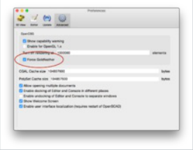

Force Goldfeather

OpenSCAD display issue with
coincident faces

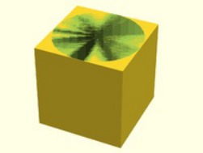

you can get near-coincident surfaces where part of the surface is inside and part of the surface is outside, or zero-volume regions, resulting in

a render error that the output is not manifold. In simple tests like this example, the render will typically be okay giving false confidence in this

approach, but if both pieces were subject to an equal rotation it can fail to render in a manner which is slightly dependent on the platform the

<!-- PDF page 62 -->

program is running on. This will typically result in a warning at render, and a rendered piece being removed from the final output.

The solution to this is to always provide a clear overlap for surfaces which are to be removed, such as by adding a small value called an

epsilon:

```
cube_size = 20;
difference() {
  cube(cube_size, center = true);
  cylinder(r = 10, h = cube_size+0.01, center = true);
}

```

Note that a similar issue occurs with unions, where coincident faces to be merged must also be given an epsilon value to guarantee they are

always inside.

There is a second preview-only flickering result which can also occur with faces that are not even supposed to be visible in the final result, for

example because they're were negative faces used for removal by a difference() operation. This second case impact of fully properly

removed faces (or negative faces) is an artifact of the library used for drawing the preview, and will not affect the render. If a clean preview

[result is desired such as for imaging output, these can be adjusted by an epsilon value in the same manner. See this discussion for other](https://github.com/openscad/openscad/issues/1793)

details.

### Why are some parts (e.g. holes) of the model not rendered correctly?

This can happen when using features like linear_extrude() or when importing objects. The convexity

of the objects is not known. For more complex objects, the convexity parameter can be used to

specify the value. Note that higher values cause a slowdown in preview.

```
difference() {
    linear_extrude(height = 15 /*, convexity = 2 */) {
        difference() {
            square([50, 50]);
            translate([10, 10]) circle(5);
        }
    }
    translate([25, 25]) cube([5, 5, 40], center = true);
}

```

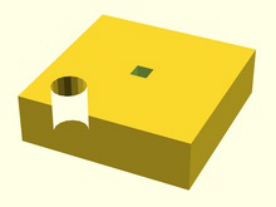

OpenSCAD display issue with convexity
setting too low

[The user manual (section Extrude parameters for all extrusion modes) describes how to calculate the number that should be given to the](https://en.wikibooks.org/wiki/OpenSCAD_User_Manual/2D_to_3D_Extrusion#Extrude_parameters_for_all_extrusion_modes)

convexity parameter.

### Why is my model appearing with F5 but not F6?

[This can be caused by polyhedrons with flipped faces.](https://en.wikibooks.org/wiki/OpenSCAD_User_Manual/Primitive_Solids#polyhedron)

This can be visualized in "Thrown Together" display mode. See [misordered faces for details.](https://en.wikibooks.org/wiki/OpenSCAD_User_Manual/Primitive_Solids#Mis-ordered_faces)

```
points = [[5,5,0],[5,-5,0],[-5,-5,0],[-5,5,0],[0,0,3]];
faces = [[0,1,4],[1,2,4],[2,3,4],[3,4,0],[1,0,3],[2,1,3]];
polyhedron(points, faces);

```

If the model imports external STL files, see also import related question.

### Why is the preview so slow?

[http://forum.openscad.org/Why-is-for-so-slow-tp11511p11531.html](http://forum.openscad.org/Why-is-for-so-slow-tp11511p11531.html)

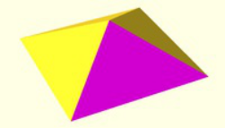

OpenSCAD polyhedron with flipped
face

This is hard to explain, but in essence, having intersections as the negative objects in difference is expensive. The preview rendering

algorithm allows having only primitive objects as negatives, and everything else has to be unpacked.

For example (using A+B = union() / A-B = difference() / A*B = intersection() ):

A - B*C - D*E

becomes: A-B-D + A-B-E + A-C-D + A-C-E

<!-- PDF page 63 -->

..and if A is more complex:

A+B - C*D - E*F

becomes: A-C-E + A-C-F + A-D-E + A-D-F + B-C-E + B-C-F + B-D-E + B-D-F

All combinations have to be rendered, which can take some time, especially on older GPUs, and especially on low-end Intel GPUs.

## Import

### Why is my imported STL file appearing with F5 but not F6?

This is mostly caused by bad STL files, the best bet is to verify the STL file in a tool like Blender, MeshLab or NetFabb and fix the issues. In

essence the model needs to be manifold to be processed in OpenSCAD.

The reason for the model still appearing in preview mode is that there is no real geometry calculation going on yet. The preview simply draws

the triangles from the STL.

There is one specific issue that causes problems called "Zero faces" (meaning the STL contains triangles with zero area because all 3 points

are on one line), which is currently not handled well in OpenSCAD.

**Using MeshLab**

MeshLab has a filter to remove zero faces by flipping edges of polygons

Filters -> Cleaning and Repairing -> Remove T-Vertices by Edge-Flip .

Set the Ratio to a high value (e.g. 1000000), otherwise it's possible the model gets distorted.

**Using Blender**

Blender has a 3D-Printing-Toolbox Plug-in (needs to be enabled in the UserSettings) that can show issues with the STL file. See

[http://wiki.blender.org/index.php/Extensions:2.6/Py/Scripts/Modeling/PrintToolbox](http://wiki.blender.org/index.php/Extensions:2.6/Py/Scripts/Modeling/PrintToolbox)

**Using NetFabb/Microsoft cloud service**

The Microsoft 3D Model Repair service can help with fixing STL files. Make sure to read the service conditions before posting files. See

[https://modelrepair.azurewebsites.net/](https://modelrepair.azurewebsites.net/)

### I'm getting "Unsupported DXF Entity" warnings when importing DXF files. What does that mean?

DXF import sometimes produces warning messages like Unsupported DXF Entity 'SPLINE' (1c1) in "file.dxf" . This means the DXF file is

using features that the OpenSCAD importer does not know how to handle. The importer simply ignores those unknown entities that could

result in an incomplete model.

When using Inkscape, the easiest way to produces DXF files without unsupported entities is to convert all Bezier curves to short line

segments using

Extensions -> Modify Path -> Flatten Beziers

The value given in the dialog determines the length of the line segments. Lower values produce smoother results, but also more line

segments. As export file format, use "Desktop Cutting Plotter (AutoCAD DXF R14)".

[A more detailed tutorial is available at http://repraprip.blogspot.de/2011/05/inkscape-to-openscad-dxf-tutorial.html](http://repraprip.blogspot.de/2011/05/inkscape-to-openscad-dxf-tutorial.html)

## Export

### How can I export multiple parts from one script?

Answer based on comments in related issue on github [https://github.com/openscad/openscad/pull/1534#issuecomment-227024209](https://github.com/openscad/openscad/pull/1534#issuecomment-227024209)

There is a way to generate a bunch of geometric primitives and export them as STL files from a single script, without

commenting/uncommenting code.

The variable PARTNO indicates which part is being exported in the current run. If PARTNO is 'undef', then nothing is exported.

<!-- PDF page 64 -->

```
 PARTNO = undef; // default part number

 module tree() {
   color("green") cylinder(r1 = 12, r2 = 1, h = 30);
   // ...
 }

 module trunk() {
   color("brown") cylinder(r = 3, h = 10);
   // ...
 }

 module base() {
   color("white") translate([-10, -10, 0]) cube([20, 20, 5]);
   // ...
 }

 if (PARTNO == 1) tree();
 if (PARTNO == 2) trunk();
 if (PARTNO == 3) base();

 // optionally use 0 for whole object
 if (PARTNO == 0) {
   base();
   translate([0, 0, 5]) trunk();
   translate([0, 0, 15]) tree();
 }

```


Image exported with PARTNO=0

When working interactively, the PARTNO variable at the top of the file can be set to the number of the part to be shown/exported from the

GUI.

It's possible to automate the process of exporting all of the parts by writing a shell script on MacOS or Linux, or a batch file on Windows. The

shell script would look something like this:

```
 # export parts as STL
 openscad -DPARTNO=1 -o tree.stl model.scad
 openscad -DPARTNO=2 -o trunk.stl model.scad
 openscad -DPARTNO=3 -o base.stl model.scad

 # export image of all the parts combined
 openscad -DPARTNO=0 -o model.png model.scad

```

Running this script once from the command line exports all of the parts to separate files.

### How can I export screenshots with higher resolution than the current window

Right now that is not possible from the GUI, as the images are restricted to the actual display context. Using the _File->Export->Export As_

_Image_ menu always exports at viewport resolution.

It is however possible to generate higher resolution images via command line using the --imgsize parameter. This uses a separate drawing

context, size-limited by memory and the graphics driver, to generate the image. For example, on Linux, the Mesa driver for Intel UHD Graphics

620 (Kabylake GT2) seems to max out at an image resolution of about 16000×16000.

```
 $ openscad --imgsize 16000,16000 -o CSG.png CSG.scad
 ECHO: version = [2019, 1, 0]
 Compiling design (CSG Products normalization)...
 Normalized CSG tree has 6 elements
 $ file CSG.png
 CSG.png: PNG image data, 16000 x 16000, 8-bit/color RGB, non-interlaced

```
## Language

### Why am I getting an error when writing a = a + 1?

<!-- PDF page 65 -->

[http://forum.openscad.org/A-A-1-tp11385p11411.html](http://forum.openscad.org/A-A-1-tp11385p11411.html)

First of all, the question **why** we have these "limitations" become more clear once we start better exploiting the opportunities.

We need a "reduce" function to help collecting information depending on a list of input. Recursion is fine, but people tend to struggle with it

and we could offer some help.

We should probable disallow any attempt of reassignment, to make it more clear what's going on. The only real reason we partially allow it

is to allow cmd-line variable overrides.

To help think about things:

Imagine every expression in OpenCAD being executed in parallel. Any dependency of existing expressions must be made explicit by

hierarchical grouping. This should quell the idea of iterating for the purpose of accumulating information.

In terms of functions: Imagine a function expression being something you'd type into a spreadsheet cell. Not totally mappable, but it might

help framing it.

The spreadsheet analogy applies also to iterations. A cell in a spreadsheet cannot increment itself; attempting to do so results in a circular

reference error in the spreadsheet.

Now, we _could_ add all kinds of sugar to help people apply their existing programming problem solving skills. The questions are more if it really

helps us, and who would spearhead the design of such language extensions, as we currently don't really have attachment for these ideas on

the dev-team.

If you think about the OpenSCAD language as something similar to HTML, but for 3D modeling, you'd still have a need for various programs

generating code in this language (similar to the plethora of HTML generators out there). There exist a number of tools for helping with

OpenSCAD code generation from existing programming languages (python, ruby, C++, haskell, clojure off the top of my head) and there are

tools offering Javascript interfaces for similar purposes (OpenJSCAD, CoffeeSCAD). Until we have a really good reason to do so in

OpenSCAD proper, and a really good candidate for which language to support, it's better to keep these things separate.

[See also for help: List Comprehension, Tips & Tricks, Recursive Functions](https://en.wikibooks.org/wiki/OpenSCAD_User_Manual/List_Comprehensions)

## User Interface

### OpenSCAD isn't adhering to my GTK desktop theme

You may need to install package "qt5-style-plugins" on debian based systems, then set environment variable when calling openscad

QT_QPA_PLATFORMTHEME=gtk2 openscad

To make the setting permanent, add export QT_QPA_PLATFORMTHEME=gtk2 to your user's ~/.profile

### I'm not getting any menubar when running OpenSCAD in Ubuntu, how can I get it back?

This seems to be caused by Ubuntu messing with Qt to move the menubar somewhere else (e.g. top of the screen).

That problem hits other applications too, see [https://bugs.launchpad.net/ubuntu/+source/appmenu-qt5/+bug/1307619](https://bugs.launchpad.net/ubuntu/+source/appmenu-qt5/+bug/1307619)

There are two things that could help:

Set the QT_QPA_PLATFORMTHEME environment variable to an empty string (the default value is probably "appmenu-qt5") or simply

run OpenSCAD with QT_QPA_PLATFORMTHEME= openscad

Remove the appmenu-qt5 package to globally disable menubar changes for all applications

### Why are the error line numbers wrong?

That is a limitation/bug in the current parser that handles include<> basically as copy&paste of content. In some cases it's possible to work

around the issue by placing the include<> statements at the end of the file.

When depending on libraries, it's recommended to use use<> instead which does not have that problem and also automatically inhibits any

top-level geometry of that file (which might be there as demo for the library).

### I don't like the editor, can I use my favourite editor instead?

Yes, OpenSCAD supports a special mode that reloads the files if they are modified externally. To enable this mode, check the Design ->

Automatic Reload and Preview option and just close the editor window (or use View -> Hide Editor).

As an example, here's a script that runs vim as editor and also starts OpenSCAD, which takes the model viewer role.

<!-- PDF page 66 -->

It supports 3 modes

Run with no parameters, it opens a temp file for quick testing, which it deletes.

Run with the name of a non-existent file, it starts the file with a default license header.

Run with the name of an existing file, it simply opens it.

```
#!/bin/bash

FILE="$1"
AUTHOR="Your Name Here"
YEAR="$(date "+%Y")"
LICENSE="// Created in $YEAR by $AUTHOR.\n// This work is released with CC0 into the public
domain.\n// https://creativecommons.org/publicdomain/zero/1.0/"

# increase stack size to allow deeper recursion
ulimit -s 65536

if [ "$FILE" == "" ]
then
  TEMPF=`tempfile -s .scad`
  openscad "$TEMPF" >/dev/null 2>/dev/null &
  vim "$TEMPF"
  rm -f "$TEMPF"
  exit
fi

if [ ! -e "$FILE" ]
then
  echo -e "$LICENSE" >> "$FILE"
fi

openscad "$FILE" >/dev/null 2>/dev/null &
vim "$FILE"

```
## Errors / Problems

### Why am I getting "no top level geometry to render"?

This can have different reasons, some common ones include

**Missing / Commented out module call**

```
module model() {
  cube(20);
}
%model();

```

Using the % modifier does not only make the part transparent, it also causes the part to be excluded in the final render!

**Difference / Intersection with wrong translated objects**

The easiest way to solve this type of issues is to highlight the objects using the # modifier and see if the objects are placed at the position

where they should be.

**Importing broken STL files**

See Why is my imported STL file appearing with F5 but not F6?

### OpenSCAD crashed/was killed, are my unsaved changes lost?

Before starting a preview or render process, the OpenSCAD editor writes a backup file in case there are unsaved changes.

This file is stored in the users documents folder in a separate directory (e.g. on Linux this is normally

$HOME/.local/share/OpenSCAD/backups ). The actual path can be checked in the Help -> Library Info dialog where it is listed as "Backup

Path".

<!-- PDF page 67 -->

### OpenSCAD crashes when clicking "New" or loading a file on Windows

OpenSCAD crashes on some machines with Intel graphics drivers, for more details, see [https://github.com/openscad/openscad/issues/2442](https://github.com/openscad/openscad/issues/2442)

### OpenSCAD fails to run refering to EVR.dll, MF.dll or MFPlat.dll on Windows

This is an issue with the special Windows N (Europe) and KN (Korea) versions which have the Windows Media Framework ripped out as a

result of a ruling for anti-competitive practices by the European Commission in 2004.

OpenSCAD, starting with release 2019.05, depends on some of the features so it fails to run on those systems.

The missing Windows Media Framework can be added by installing the correct "Media Feature Pack for N versions" from the list Microsoft

[provides in KB3145500. For Windows 10 version N, there's a dedicated download page with Windows version selector at:](https://support.microsoft.com/en-us/help/3145500/media-feature-pack-list-for-windows-n-editions)

[https://www.microsoft.com/en-us/software-download/mediafeaturepack.](https://www.microsoft.com/en-us/software-download/mediafeaturepack)

Starting with Windows 10 1909 you can't download the Media Features from the Microsoft Website directly - instead you have to use Windows

Settings -> Apps -> Apps and Features. Select Add a Feature and add the Windows Media Framework. Afterwards reboot and it should work.

## Reporting bugs, Requesting features

### How do I report bugs?

[Bugs in OpenSCAD are best reported in the github issue tracking system at https://github.com/openscad/openscad/issues. If you are not sure](https://github.com/)

[it's a bug, asking on the mailing list/forum can help clarifying things.](http://www.openscad.org/community.html)

Please try searching through the existing issues if the bug was already reported. If you find something similar or if you are unsure, create a

new issue, but mention the (possibly) related one.

The bug report should give as much information as possible to help with reproducing it, including but not limited to

The OpenSCAD version

The Operating System name and version

A description of the scenario that produces the issue

In case of graphics issues, the OpenGL driver information

If possible, a trimmed down script reproducing the issue

Most of the technical version information can be found in menu Help -> Library Info, or via the command line openscad --info .

### How do I request new features?

New features or changes/extensions to existing features can be requested in the [github issue tracking system at](https://github.com/)

[https://github.com/openscad/openscad/issues too.](https://github.com/openscad/openscad/issues)

Please make an effort to clearly explain the new feature / change as detailed as possible. Including some background about why you think this

feature would be useful to you and other people helps a lot and increases the chances of it being implemented.

### How do I report bugs that are related to the Operating System I use?

#### **Windows**

[The Windows version is currently maintained by the OpenSCAD team, so please use the github issue tracker for reporting bugs.](https://github.com/openscad/openscad/issues)

#### **Mac OSX**

[The Mac OSX version is currently maintained by the OpenSCAD team, so please use the github issue tracker for reporting bugs.](https://github.com/openscad/openscad/issues)

#### **Linux**

The OpenSCAD versions included in / distributed by the various Linux distributions are usually maintained by people/teams working with the

distributions.

Specific bugs can be reported in the respective bug tracking systems, e.g.

**Debian**    - See "please report it" directions at [https://bugs.debian.org/cgi-bin/pkgreport.cgi?package=openscad](https://bugs.debian.org/cgi-bin/pkgreport.cgi?package=openscad)

<!-- PDF page 68 -->

**Ubuntu**    - See "Report a bug" directions at [https://launchpad.net/ubuntu/+source/openscad](https://launchpad.net/ubuntu/+source/openscad)

**Fedora / Red Hat** [- See https://apps.fedoraproject.org/packages/openscad/bugs and https://bugzilla.redhat.com/buglist.cgi?](https://apps.fedoraproject.org/packages/openscad/bugs)

component=openscad

**Arch Linux**    - See "reporting bug guidelines" directions at [https://bugs.archlinux.org/index.php?string=openscad&status%5B%5D=](https://bugs.archlinux.org/index.php?string=openscad&status%255B%255D=)

[The nightly builds hosted on the openSUSE build service are maintained by the OpenSCAD team, so please use the github issue tracker for](https://build.opensuse.org/package/show/home:t-paul/OpenSCAD)

reporting issues with those packages.

<!-- PDF page 69 -->

## Chapter 10 -- Libraries

#### OpenSCAD User Manual

## Library Locations

OpenSCAD uses three library _locations_, the installation library, built-in library, and user-defined libraries.

1. The _Installation_ library location is the libraries directory under the directory where OpenSCAD is installed.

2. The _Built-In_ library location is O/S dependent. Since version 2014.03, it can be opened in the system specific file manager using the

"File->Show Library Folder..." menu entry.

Windows: My Documents\OpenSCAD\libraries

Linux: $HOME/.local/share/OpenSCAD/libraries

Mac OS X: $HOME/Documents/OpenSCAD/libraries

3. The _User-Defined_ library path can be created using the OPENSCADPATH Environment Variable to point to the library(s).

OPENSCADPATH can contain multiple directories in case you have library collections in more than one place, separate directories with

a semi-colon for Windows, and a colon for Linux/Mac OS. For example:

Windows: C:\Users\A_user\Documents\OpenSCAD\MyLib;C:\Thingiverse Stuff\OpenSCAD Things;D:\test_stuff

_(Note: For Windows, in versions prior to 2014.02.22 there is a bug preventing multiple directories in OPENSCADPATH as described above, it uses a colon (:)_

_to separate directories. A workaround, if your libraries are on C: is to leave off the drive letter & colon, e.g._ _\Thingiverse Stuff\OpenSCAD Things:\stuff_ _._ For

[more about setting Windows environment variables, see User Environment Variables.](https://msdn.microsoft.com/en-us/library/windows/desktop/bb776899%0x28v=vs.85%0x29.aspx)

Linux/Mac OS: /usr/lib:/home/mylib:.

OpenSCAD must be restarted to recognize any change to the OPENSCADPATH Environment Variable.

When you specify a _non-fully qualified_ path and filename in the **use <...>** or **include <...>** statement OpenSCAD looks for the file in the

following directories in the following order:

the directory of the calling .scad file

the _User-Defined_ library paths (OPENSCADPATH)

the _Built-In_ library (i.e. the O/S dependent locations above)

the _Installation_ library

In the case of a library file itself having **use <...>** or **include <...>** the directory of the library .scad file is the 'calling' file, i.e. when looking for

libraries within a library, it does not check the directory of the top level .scad file.

For example, with the following locations and files defined: (with OPENSCADPATH= /usr/lib:/home/lib_os:. )

```
1. <installation library>/lib1.scad
2. <built-in library>/lib2.scad
3. <built-in library>/sublib/lib2.scad
4. <built-in library>/sublib/lib3.scad
5. /usr/lib/lib2.scad
6. /home/lib_os/sublib/lib3.scad

```

The following **include <...>** statements match to the nominated library files

```
include <lib1.scad>  // #1.
include <lib2.scad>  // #5.
include <sublib/lib2.scad>  // #3.
include <sublib/lib3.scad>  // #6.

```

Since 2014.03, the currently active list of locations can be verified in the "Help->Library Info" dialog.

The details info shows both the content of the OPENSCADPATH variable and the list of all library locations. The locations are searched in the

order they appear in this list. For example;

```
OPENSCADPATH: /data/lib1:/data/lib2
OpenSCAD library path:
  /data/lib1
  /data/lib2
  /home/user/.local/share/OpenSCAD/libraries
  /opt/OpenSCAD/libraries

```

<!-- PDF page 70 -->

#### **Setting OPENSCADPATH**

In Windows, Environment Variables are set via the Control panel, select System, then Advanced System Settings, click Environment

Variables . Create a new User Variable, or edit OPENSCADPATH if it exists.

On Linux, to simply add the environment variable to all users, you can type in terminal:

sudo sh -c 'echo "OPENSCADPATH=$HOME/openscad/libraries" >>/etc/profile'

to set the OPENSCADPATH to openscad/libraries under each user's home directory. For more control on environment variables, you'll need

[to edit the configuration files; see for example this page.](http://unix.stackexchange.com/questions/117467/how-to-permanently-set-environmental-variables)

On Mac, you need to modify the /etc/launchd.conf:

sudo sh -c 'echo "setenv OPENSCADPATH /Users/myuser/my/own/path" >>/etc/launchd.conf'

The variable will be available at next reboot.

To avoid to reboot and use it immediately, issue the following commands:

egrep "^setenv\ " /etc/launchd.conf | xargs -t -L 1 launchctl

<u><mark>killall Dock</mark></u>

killall Spotlight

## MCAD

[OpenSCAD bundles the MCAD library.](https://github.com/openscad/MCAD)

There are many different forks floating around (e.g. [[1], [2], [3]) many of them unmaintained.](https://github.com/SolidCode/MCAD)

MCAD bundles a lot of stuff, of varying quality, including:

Many common shapes like rounded boxes, regular polygons and polyhedra in 2D and 3D

Gear generator for involute gears and bevel gears.

Stepper motor mount helpers, stepper and servo outlines

Nuts, bolts and bearings

Screws and augers

Material definitions for common materials

Mathematical constants, curves

Teardrop holes and polyholes

The git repo also contains python code to scrape OpenSCAD code, a testing framework and SolidPython, an external python library for solid

cad.

[More details on using MCAD are in a later chapter, OpenSCAD User Manual/MCAD.](https://en.wikibooks.org/wiki/OpenSCAD_User_Manual/MCAD)

## Other Libraries

BOLTS tries to build a standard part and vitamin library that can be used with OpenSCAD and other CAD tools: [[4]](https://github.com/jreinhardt/BOLTS)

Obiscad contains various useful tools, notably a framework for attaching modules on other modules in a simple and modular way: [[5]](https://github.com/Obijuan/obiscad)

This library provides tools to create proper 2D technical drawings of your 3D objects: [[6]](http://www.cannymachines.com/entries/9/openscad_dimensioned_drawings)

[Stephanie Shaltes wrote a fairly comprehensive fillet library (](https://plus.google.com/u/0/101448691399929440302) [https://github.com/StephS/i2_xends/blob/master/inc/fillets.scad)](https://github.com/StephS/i2_xends/blob/master/inc/fillets.scad)

[The shapes library contains many shapes like rounded boxes, regular polygons. It is also included in MCAD.](http://svn.clifford.at/openscad/trunk/libraries/shapes.scad)

[Also Giles Bathgates shapes library provides regular polygons and polyeders and is included in MCAD.](https://github.com/elmom/MCAD/blob/master/regular_shapes.scad)

[The OpenSCAD threads library provides ISO conform metric and imperial threads and support internal and external threads and multiple](http://dkprojects.net/openscad-threads/)

starts.

[Sprockets for ANSI chains and motorcycle chains can be created with the Roller Chain Sprockets OpenSCAD Module. Contains hard](http://www.thingiverse.com/thing:197896)

coded fudge factors, may require tweaking.

[The Pinball Library provides many components for pinball design work, including models for 3d printing of the parts, 3d descriptions of](https://code.google.com/p/how-to-build-a-pinball/source/browse/trunk/scad/pinball)

mount holes for CNC drilling and 2d descriptions of parts footprint

[For the generation of celtic knots there is the Celtic knot library](https://github.com/beanz/celtic-knot-scad)

[The 2D connection library helps with connections between 2D sheets, which is useful for laser cut designs.](https://www.youmagine.com/designs/openscad-2d-connection-library)

[local.scad provides a flexible method for positioning parts of a design. Is also used in BOLTS.](https://github.com/jreinhardt/local-scad)

[SCADBoard is a library for designing 3D printed PCBs in OpenSCAD.](http://scadboard.wordpress.com/)

[A Ruler for determining the size of things in OpenSCAD.](http://www.thingiverse.com/thing:30769)

[A colorspace converter for working with colors in HSV and RGB: http://www.thingiverse.com/thing:279951/](http://www.thingiverse.com/thing:279951/)

[A number of utility functions is collected in https://github.com/oampo/missile](https://github.com/oampo/missile)

[Unit test framework https://github.com/oampo/testcard](https://github.com/oampo/testcard)

[Knurled surface library by aubenc http://www.thingiverse.com/thing:9095](http://www.thingiverse.com/thing:9095)

<!-- PDF page 71 -->

[Text module based on technical lettering style https://github.com/thestumbler/alpha](https://github.com/thestumbler/alpha)

[Round corners for Openscad https://www.thingiverse.com/thing:8812](https://www.thingiverse.com/thing:8812) https://www.makerbot.com/media-center/2011/05/26/script-for-

rounded-corners-for-openscad-by-warrantyvoider

[Bevel library for OpenScad https://www.thingiverse.com/thing:30336](https://www.thingiverse.com/thing:30336)

[SCAD libraries used by Michigan Tech's Open Sustainability Technology Lab (MOST) https://github.com/mtu-most/most-scad-libraries](https://github.com/mtu-most/most-scad-libraries)

A full Workflow library by Ulrich Bär can be found at "sites.google.com/site/ulrichbaer/tdi/UB.scad"

The Belfry OpenScad Library has many shapes, masks, manipulators, and support for threading, gears, polylines and beziers. It can be

[found at GitHub with extensive documentation here](https://github.com/revarbat/BOSL)

There is also a list with more libraries here: [[7]](https://github.com/openscad/openscad/wiki/Libraries)

### Other OpenSCAD tutorials and documentation

["OpenSCAD User Manual" http://www.openscad.org/documentation.html](http://www.openscad.org/documentation.html)

"Know only 10 things to be dangerous in OpenSCAD" https://cubehero.com/2013/11/19/know-only-10-things-to-be-dangerous-in-

openscad/

["OpenScad beginners tutorial" http://edutechwiki.unige.ch/en/OpenScad_beginners_tutorial](http://edutechwiki.unige.ch/en/OpenScad_beginners_tutorial)

"How to use Openscad, tricks and tips to design a parametric 3D object" http://www.tridimake.com/2014/09/how-to-use-openscad-tricks-

and-tips-to.html

[OpenSCAD discussion forum http://forum.openscad.org](http://forum.openscad.org)

<!-- PDF page 72 -->

## Chapter 11 -- Command Glossary

#### OpenSCAD User Manual

This is a Quick Reference; a short summary of all the commands without examples, just the basic syntax. The headings are links to the full

chapters.

#### **Please be warned: The Command Glossary is presently outdated (03 2015).**

Please have a look at the Cheatsheet, instead:

[http://www.openscad.org/cheatsheet/](http://www.openscad.org/cheatsheet/)

### Mathematical Operators

```
+
-   // also as unary negative
*
/
%  // this is mod

<
<=
==
!=
>=
>

&&   // logical and
||   // logical or
!    // logical not

<boolean> ? <valIfTrue> : <valIfFalse>

```
### Mathematical Functions

```
abs ( <value> )

cos ( <degrees> )
sin ( <degrees> )
tan ( <degrees> )
asin ( <value> )
acos ( <value> )
atan ( <value> )
atan2 ( <y_value>, <x_value> )

pow( <base>, <exponent> )

len ( <string> )   len ( <vector> )   len ( <vector_of_vectors> )
min ( <value1>, <value2> )
max ( <value1>, <value2> )
sqrt ( <value> )
round ( <value> )
ceil ( <value> )
floor ( <value> )
lookup( <in_value>, <vector_of_vectors> )

```

<!-- PDF page 73 -->

### String Functions

```
str(string, value, ...)

```
### Primitive Solids

```
cube(size = <value or vector>, center = <boolean>);

sphere(r = <radius>);

cylinder(h = <height>, r1 = <bottomRadius>, r2 = <topRadius>, center = <boolean>);
cylinder(h = <height>, r = <radius>);

polyhedron(points = [[x, y, z], ... ], triangles = [[p1, p2, p3..], ... ], convexity = N);

```
### Transformations

```
scale(v = [x, y, z]) { ... }

(In versions > 2013.03)
resize(newsize=[x,y,z], auto=(true|false) { ... }
resize(newsize=[x,y,z], auto=[xaxis,yaxis,zaxis]) { ... }  // #axis is true|false
resize([x,y,z],[xaxis,yaxis,zaxis]) { ... }
resize([x,y,z]) { ... }

rotate(a = deg, v = [x, y, z]) { ... }
rotate(a=[x_deg,y_deg,z_deg]) { ... }

translate(v = [x, y, z]) { ... }

mirror([ 0, 1, 0 ]) { ... }

multmatrix(m = [tranformationMatrix]) { ... }

color([r, g, b, a]) { ... }
color([ R/255, G/255, B/255, a]) { ... }
color("blue",a) { ... }

```
### Conditional and Iterator Functions

```
for (<loop_variable_name> = <vector> ) {...}

intersection_for (<loop_variable_name> = <vector_of_vectors>) {...}

```

<!-- PDF page 74 -->

```
if (<boolean condition>) {...} else {...}

assign (<var1>= <val1>, <var2>= <val2>, ...) {...}

```
### CSG Modelling

```
union() {...}

difference() {...}

intersection() {...}

render(convexity = <value>) { ... }

```
### Modifier Characters

```
! { ... } // Ignore the rest of the design and use this subtree as design root
* { ... } // Ignore this subtree
% { ... } // Ignore CSG of this subtree and draw it in transparent gray
# { ... } // Use this subtree as usual but draw it in transparent pink

```
### Modules

```
module name(<var1>, <var2>, ...) { ...<module code>...}

```

Variables can be default initialized <var1>=<defaultvalue>

In module you can use children() to refer to all child nodes, or children(i) where i is between 0 and $children.

### Include Statement

After 2010.02

```
include <filename.scad> (appends whole file)

use <filename.scad>  (appends ONLY modules and functions)

```

_filename_ could use directory (with / char separator).

Prior to 2010.02

```
<filename.scad>

```
### Other Language Features

```
$fa is the minimum angle for a fragment. The default value is 12 (degrees)

```

<!-- PDF page 75 -->

```
$fs is the minimum size of a fragment. The default value is 1.

$fn is the number of fragments. The default value is 0.

```

When $fa and $fs are used to determine the number of fragments for a circle, then OpenSCAD never uses less than 5 fragments.

```
$t

```

The $t variable is used for animation. If you enable the animation frame with view->animate and give a value for "FPS" and "Steps", the "Time"

field shows the current value of $t.

```
function name(<var>) = f(<var>);

echo(<string>, <var>, ...);

render(convexity = <val>) {...}

surface(file = "filename.dat", center = <boolean>, convexity = <val>);

```
### 2D Primitives

```
square(size = <val>, center=<boolean>);
square(size = [x,y], center=<boolean>);

circle(r = <val>);

polygon(points = [[x, y], ... ], paths = [[p1, p2, p3..], ... ], convexity = N);

```
### 3D to 2D Projection

```
projection(cut = <boolean>)

```
### 2D to 3D Extrusion

```
linear_extrude(height = <val>, center = <boolean>, convexity = <val>, twist = <degrees>[, slices =
<val>, $fn=...,$fs=...,$fa=...]){...}

rotate_extrude(convexity = <val>[, $fn = ...]){...}

```
### DXF Extrusion

```
linear_extrude(height = <val>, center = <boolean>, convexity = <val>, twist = <degrees>[...])
import (file = "filename.dxf", layer = "layername")

```

<!-- PDF page 76 -->

```
rotate_extrude(origin = [x,y], convexity = <val>[, $fn = ...])
import (file = "filename.dxf", layer = "layername")

```
### STL Import

```
import("filename.stl", convexity = <val>);

```

[From the WikiBooks article OpenSCAD User Manual (provided under CC-BY-SA-3.0)](https://en.wikibooks.org/wiki/OpenSCAD_User_Manual/Print_version)
