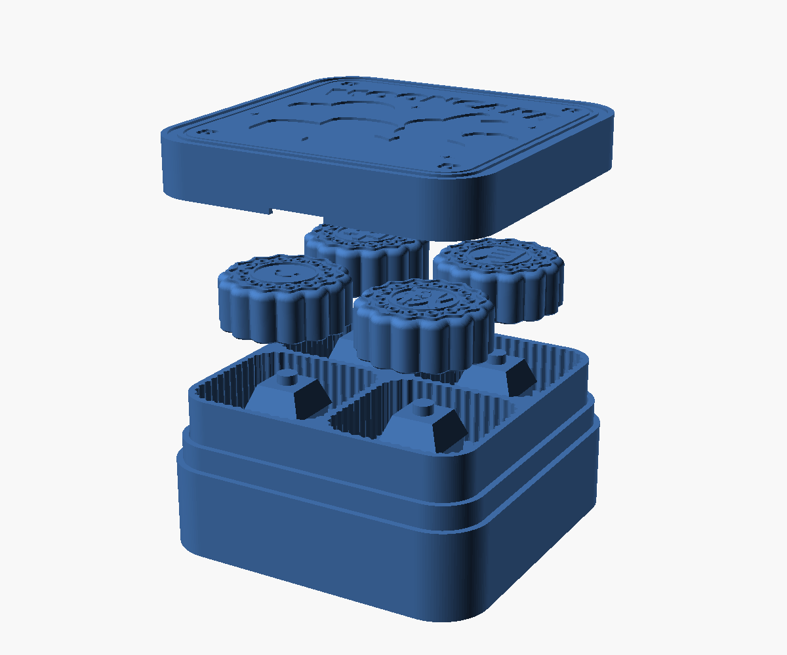
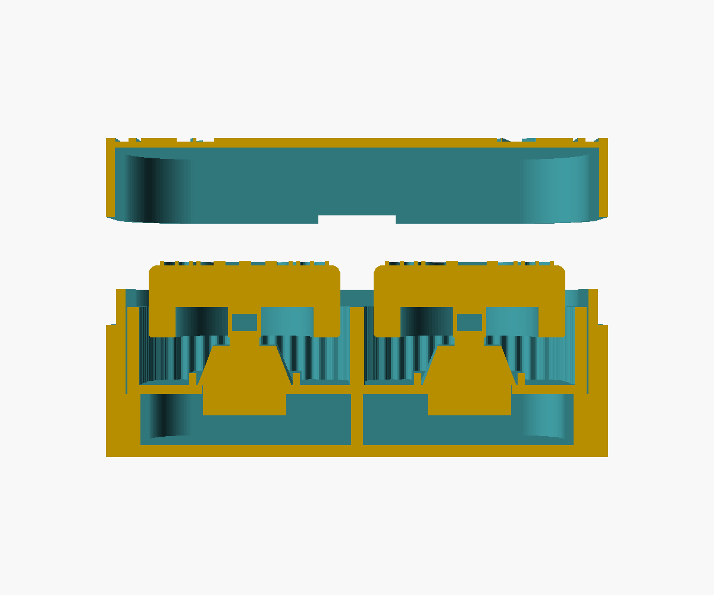

# Mooncake switch box (fidget clicker)

A 2×2 box of "mooncake" keycaps on MX-style mechanical switches, styled like a
mooncake gift box: a **base**, a fluted **tray insert** that holds the switches,
**keycaps** with mooncake patterns, and a friction-fit **lid** with "MOONCAKE" artwork.



Assembly video: [`mooncake_switch_box_assembly.mp4`](mooncake_switch_box_assembly.mp4) (12 s, 1280×720).

### Lid artwork (4 colours, A1 + AMS lite)


Recreates the reference gift-box lid: bunny hugging a stack of smiling mooncakes,
full moon, swirl clouds, arched MOONCAKE lettering (Segoe UI Black), sparkles and
corner flowers inside a red frame with a gold pin-stripe. The art is a 0.6 mm (3-layer)
flush inlay on the bed side of the lid, so it comes out glossy-flat from the plate.

**Slicing:** drag `lid.stl` + the three `lid_inlay_*.stl` into Bambu Studio together and
answer **Yes** to "load as a single object with multiple parts". Assign filaments
(lid = tan, red, yellow, white). The parts share coordinates and fit exactly; the
colour regions never overlap. Only the first 3 layers have colour changes, so the
purge waste is small. Single-colour printing: just print `lid.stl` — the art is then
an engraved recess.

## Files to print (everything in its print orientation, no supports)

| STL | Qty | Notes |
| --- | --- | --- |
| `base.stl` | 1 | 83.6 × 83.6 × 28 mm. Open side up. |
| `insert.stl` | 1 | 2×2 tray, 76.6 × 76.6 × 14.5 mm. Switch plate (floor) on the bed. |
| `insert_single.stl` | 4 | *Optional, instead of `insert.stl`.* 38.1 mm single-cell cups; four fill one base. These are the small cups at the top right of your 2nd reference photo. |
| `lid.stl` | 1 | Printed **upside down** (artwork face on the bed); lid colour = beige/tan. |
| `lid_inlay_red.stl` | 1 | Artwork, red: thick border, arched "MOONCAKE", corner flowers, all outlines and faces. |
| `lid_inlay_yellow.stl` | 1 | Artwork, yellow/gold: moon, mooncakes, inner pin-stripe, sparkles. |
| `lid_inlay_white.stl` | 1 | Artwork, white: bunny and clouds. |
| `keycaps/keycap_*.stl` | 4 | Mooncake keycaps, top up. Pick any four designs. |
| `fit_coupon.stl` | 1 | *Recommended first.* Small test piece: 3 switch holes and 3 stem sockets. |

Keycap designs (`keycaps/all_keycap_designs.png`):

| file | face |
| --- | --- |
| `keycap_smiley` | smiley face (debossed eyes/mouth) |
| `keycap_zhong` | 中 middle |
| `keycap_qiu` | 秋 autumn |
| `keycap_yue` | 月 moon |
| `keycap_man` | 满 full |
| `keycap_jia` | 家 home |
| `keycap_le` | 乐 joy |
| `keycap_yuan` | 圆 round / reunion |
| `keycap_fu` | 福 good fortune |
| `keycap_blank` | lace pattern only |

All have the same scalloped 14-lobe outline (32 mm), lace border, petal ring and
centre medallion; characters/patterns are raised 0.6 mm (3 layers).
The reference photos' characters look like seal-script calligraphy; these use
Microsoft YaHei Bold, which is installed in Windows.

## Hardware

- 4 × MX-compatible switches. Designed for the purchased **EBILNVKE blue clicky,
  3-pin** switches (MX clone): 15.5 × 15.5 mm housing, "+" stem, plate clips.
  How they fit:
  - 14.0 mm plate hole, 1.5 mm thick floor → the clips snap underneath (standard MX plate).
  - Locating frame 16.0 mm inside → 0.25 mm per side around the 15.5 mm housing.
  - Keycap socket = standard MX "+" (4.15 × 1.35 mm slots) on a Ø5.6 post.
  - 8.5 mm free space under the floor for the bottom housing, centre post and the two pins
    (~6.8 mm needed), so longer clone pins also clear.
  - Keycap cavity Ø23 mm clears the housing diagonal (≈ 21.9 mm) through the full 4 mm travel.
  5-pin switches fit too (the two extra plastic pegs sit in the same space).
- Nothing else. No glue or screws.

## Print settings (Bambu Lab A1, 0.4 mm nozzle)

- PLA, 0.20 mm layers, 3 walls, 15 % infill. For the keycaps, 0.12–0.16 mm layers
  give crisper lace detail. Optional "ironing: top surfaces" on the keycaps is
  **off** (it would smear the relief).
- **No supports anywhere.** Expected bridges: the keycap underside ceiling
  (ring between stem post and skirt, ≈ 8.7 mm span) and the 0.6 mm lid art recess
  (strokes ≤ 2 mm). Both bridge cleanly with default PLA bridge settings.
- Brim not needed; keycaps have a 0.4 mm bottom chamfer against elephant foot.

## Fit tuning — print `fit_coupon.stl` first

The coupon has three columns marked by 1, 2, 3 dots:

| column | switch hole | stem socket slop |
| --- | --- | --- |
| 1 dot | 13.9 mm | +0.0 mm |
| 2 dots | 14.0 mm (default) | +0.1 mm |
| 3 dots | 14.1 mm | +0.2 mm |

Switch should snap in and stay put; keycap socket should push on firmly and not
wobble. Put the best values in `plate_hole` and `stem_slop` in the SCAD and run `build.ps1`.
Other clearances (per side): insert→base 0.3, lid skirt→base lip 0.2, switch
housing→locating frame 0.2 (0.25 with the 15.5 mm clone housing), mooncake→cell ≥ 1.75.

## Key dimensions

| item | value |
| --- | --- |
| closed box | 83.6 × 83.6 × ≈ 35 mm (lid 13.2 mm deep) |
| keycap | Ø32 × 12.6 mm, stem post Ø5.6, socket 3.8 deep, cavity Ø23 × 5 |
| cell | 35.5 mm rounded square with vertical flutes |
| switch plate | 1.5 mm, 14.0 mm square hole, 2 mm locating frame |
| keycap rest height | bottom 8 mm above the plate; 4 mm travel; 2 mm clearance to the frame at bottom-out |

## Assembly

1. Press the 4 switches into the insert from the top (clips snap under the 1.5 mm floor;
   the raised square frame locates the housing).
2. Drop the insert into the base; it rests on the inner ledge and centre cross ribs.
3. Push a mooncake keycap onto each switch stem.
4. Lid slides over the base lip. Fingernail notches on two sides help open it.
   To remove switches later, lift the insert out and squeeze the clips from below.



## Editing / rebuilding

`mooncake_switch_box.scad` is the master model. Parameters are at the top
(`part`, `design`, dimensions, clearances). Parts: `keycap`, `insert`,
`insert_single`, `base`, `lid`, `lid_inlay` (with `inlay_color` = red/yellow/white), `fit_coupon`, plus display-only
`assembly` and `exploded` (contain dummy switches; `mooncake_switch_box.stl` and
`mooncake_switch_box_exploded.stl` are those views, **not** for printing).

Add a new character: add a `["name", "字"]` entry to `designs`, then:

```powershell
python ..\..\tools\openscad_tools.py export mooncake_switch_box.scad -D 'part="keycap"' -D 'design="name"' -o keycaps\keycap_name.stl
```

Re-make the assembly video (after re-exporting STLs; needs ffmpeg on PATH, ~1 min):

```powershell
python renders\make_assembly_video.py
```

`renders/assembly_animation.scad` is the animated scene (driven by `$t`); it imports the
exported STLs, so the video always shows the real printable parts. Video frames use
OpenSCAD colour preview of those already-evaluated meshes.

Rebuild every printable STL with validation reports:

```powershell
powershell -ExecutionPolicy Bypass -File build.ps1
```

Requires OpenSCAD 2021.01+ and the workspace's pinned BOSL2 (`docs/BOSL2-2.0.766`),
set up automatically by the tools. A keycap takes ~1.5 min to export.

## Validation status

All STLs pass the workspace mesh check (closed, manifold, single shell — except
the `lid_inlay_*` files, which are many separate artwork islands by design). Images were inspected.
**Not yet done:** slicing in Bambu Studio and a physical fit test; dimensions of the
switch interface follow the MX standard but printer tolerance varies — use the coupon.
